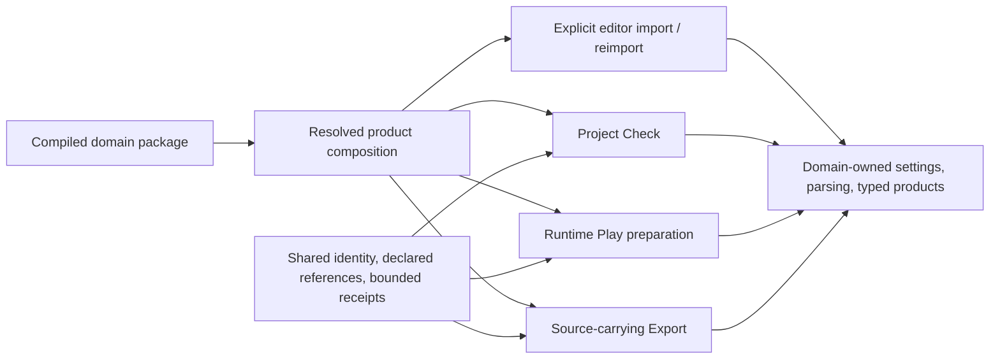

# Asset Extension Host Interface Design

- **Status:** Design draft with a qualified source-backed slice; see ADR 0103.
- **Date:** 2026-10-21.
- **Authority:** Accepted ADRs remain authoritative. Example interface names and sequences are
  illustrative unless adopted by the ADR 0103 source-domain refinement.

## Purpose

Define how a compiled Rust domain package adds a resource type that can participate in the Nara
product workflow. The immediate target is project `Check`, runtime `Play`, and the current
source-carrying `Export`. Editor import/reimport is a distinct optional contribution. This design
does not select a file format, plugin marketplace, script language, dynamic Rust ABI, cooked
runtime catalog, or replacement ECS.

At the start of this design, Nara identified source kinds with `AssetSourceKind` and could extract
declared references from component schemas. However, `ProjectContentLoader` lowered the closure to Images,
TileSets and Scene/Prefab values, and `ProjectContentSnapshot` exposes typed Image and TileSet
collections. An unfamiliar `Other(String)` is identity data; it does not supply an executable
owner. [Source-kind identity](../../crates/nara_asset/src/database.rs),
[reference dispatch](../../src/project_content.rs), and
[typed content snapshot](../../src/project_content.rs).

## Implemented Slice

The first implementation adds `ProductRecipe::add_asset_domain::<D>()` for a compiled, stateless
`ProjectAssetDomain`. It prepares typed CPU products from scoped primary and auxiliary source
reads. Check records their exact source closure without running runtime plugin hooks; Play
publishes an immutable `ProjectDomainAssets` owner with the admitted content generation. Export
reopens the existing receipt and rejects missing or changed members before publication.

This slice adopts neither a universal importer nor the separate operation-facet catalog proposed
below. Image and TileSet retain their concrete adapters. Editor Import/Reimport, prepared-product
dependencies, cooking and dynamic loading remain outside the implemented contract. The
[ADR 0103 refinement](adr/0103-concrete-domain-owned-asset-import-execution.md),
[public guide](../guides/project-asset-domains.md) and
[qualification plan](../plans/2026-10-21-external-asset-domain-qualification-plan.md) define the
accepted boundary and its evidence. The remaining sections are background design, not an
implementation ledger.

## Existing Contracts And Scope

ADR 0103 assigns the import transaction to its concrete domain and rejects an unconsumed generic
importer registry. ADR 0115 gives Image a user-invoked Import/Reimport transaction. Both decisions
remain sound: a project-content extension must be an actually used workflow contribution, not a
placeholder decoder catalog or a second import task framework.

ADR 0110's current export carries executables and exact declared source members after Check. ADR
0088's cooked runtime content catalog remains Proposed. This design therefore lets domains declare
the source and runtime facts current Hosts need; it does not introduce cook artifacts or claim that
source export is a complete project archive.

Rust packages remain compiled through Cargo and selected through Nara product composition. A
package may provide separate typed operation implementations. Installing one never silently
grants another role: an import editor, project validator, runtime provider, and export provider
remain distinct capabilities, even when one crate implements several.

## What Mature Engines Contribute

| Engine | Relevant contract | Lesson for Nara |
|---|---|---|
| Bevy | Typed `AssetLoader` is registered with `AssetServer`; it reads through a loader context that tracks dependencies. Optional offline `Process` converts source bytes to processed bytes through a separate contract. | Separate source IO, typed runtime loading and optional processing. A prebuilt import artifact must not be mandatory for a valid runtime path. |
| Godot | `EditorImportPlugin` handles editor import; `ResourceFormatLoader` resolves and loads runtime resources; `EditorExportPlugin` contributes export behavior. These are separate registration points. | An importer alone does not make an asset loadable by Play or includable by Export. Keep operation contracts distinct. |
| Unity | `ScriptedImporter` registers main and secondary products through a scoped import context and declares source/artifact/custom invalidation dependencies. Build callbacks are a separate pipeline. | Let domains declare products and real dependency edges; let a Host schedule and retain results. Import success does not imply project Check or runtime readiness. |

These examples support specialized contributions coordinated by product Hosts. They do not imply
that Nara should copy another engine's package manager, script runtime, object model, universal
artifact graph, or callback surface. See the [pinned source comparison](../research/2026-10-21-asset-extension-engine-precedents.md)
for versions and source evidence.

## Proposed Design

### One selected package, separate operation facets

Product composition selects ordinary trusted Rust packages before a Host operation starts. Each
package may declare a resource domain: a stable domain identity, the source kinds it owns, optional
format/extension hints, and the operation facets it implements. These declarations describe
dispatch and product planning. They are not a complete package installer or permission sandbox.

The product Host resolves one immutable composition and passes only the chosen operation to the
domain's typed implementation. A domain may provide:

- source import/reimport in an editor or explicit authoring tool;
- project reference inspection and Check validation;
- typed CPU/runtime content preparation and publication participation for Play; and/or
- source-member and dependency contributions for current Export.

The same package can implement several facets. A package that implements only import remains
unavailable for Play until a runtime facet exists. No Host infers support from a crate dependency,
file extension, import artifact, or successful type registration.

### Keep four operations distinct

Import/reimport may create a reusable domain product under ADR 0103/0115. Project Check validates
the declared source closure; it does not implicitly reimport every source. Play prepares the
runtime values it actually needs and establishes residency only when its runtime candidate is
admitted. Export consumes the source-delivery receipt, reopens and revalidates its exact members,
and stages the declared source files. It does not imply offline processing or cooked artifacts.

These paths may reuse verified work when the source, settings, dependency observations, and domain
revision still match. The Host records the basis needed for freshness and the declared closure.
Each domain decides what additional state is required to validate or reuse its products.

### Shared Host responsibilities

The project/content Host owns facts shared across domains and products:

- selected project/Scene roots, admitted schema and manifest agreement, and authorized project
  filesystem capabilities;
- extraction and deduplication of schema-declared references, canonical source identity/path
  agreement, and routing to the selected owning domain;
- aggregate project limits for members, dependency edges, paths, work, and retained data, charged
  once as work is admitted; these limits supplement rather than replace a domain's format-specific
  input/output budgets;
- source-member and dependency receipts bound to the project and selected roots;
- operation admission, current input/revision checks, cancellation/retirement custody, and
  aggregation of domain diagnostics;
- owner-mediated candidate publication so Scene/content replacement does not publish a partially
  prepared runtime generation; and
- exact Check-to-Export receipt handoff followed by source revalidation before output publication.

These shared responsibilities must build on current capability, budget, receipt, and generation
owners. They do not authorize a new generic task kernel, an erased public `Any` asset store, a
Host-wide mutable `World`, arbitrary filesystem access, or a second package resolver.

### Domain responsibilities

The concrete resource domain owns:

- file/format interpretation, settings schema and canonicalization, typed schemas, and
  domain-specific semantic checks;
- import or direct source-loading behavior, product identities, labels/sub-assets where useful,
  and dependencies that cannot be extracted from persistent `AssetRef` fields;
- typed results and private caches, backend-neutral data where appropriate, and the runtime
  integration that consumes those results; and
- domain error context and actionable diagnostics.

The domain receives an operation-scoped, authorized input and returns typed results through the
public domain contract. The Host retains its own source/member receipts and limits, verifies shared
identity/freshness/publication conditions, and keeps domain leases or receipts only for the
operation that owns them. It does not decode domain resource bytes, reinterpret domain schemas, or
publish GPU resources on a domain's behalf. The concrete Host still parses project documents and
validates project-owned metadata as required by its accepted contracts.

### Identity, source selection, and conflicts

`AssetSourceKind` identifies the authored resource domain; file extensions are recognition hints,
not durable identity or proof that a provider is installed. New domain identities should be stable
and namespaced, and distinct from package release identity, Rust `TypeId`, runtime handle, display
name, and path. Persistent metadata continues to carry the canonical source path and source kind
under the existing asset identity contract.

Composition reports a conflict when two selected contributions claim exclusive ownership of the
same stable domain identity or when their declared selectors make an operation ambiguous. It does
not globally reject overlapping extensions that can be resolved by an explicit persisted domain
identity. The Host never chooses an arbitrary winner by registration order. No speculative
priority/ranking mechanism is introduced; a real format-disambiguation workflow must provide its
own visible selection or a separately admitted rule.

Missing domain code does not erase or rewrite source files and bounded asset records. Discovery and
unrelated authoring remain possible when their schemas permit it. Check, Play or Export reports a
missing handler only when that selected operation requires the missing domain capability.

### Validation without repeated whole-project work

Run validation where its governing information enters or changes:

| Boundary | Validation owner | Example |
|---|---|---|
| Host source admission | Core filesystem/product Host | Selected root, authorized path, byte/member/work limit |
| Format and domain values | Domain parser | Supported header/version/settings and domain invariants |
| Shared reference/receipt handoff | Project/content Host | Stable identity/path agreement, deduplicated members, dependency limits, source freshness |
| Operation readiness | Selected Host plus domain facet | Required Check rule, Play product, or Export source member |
| Publication | Owning runtime/content transaction | Generation match, no stale replacement, complete candidate before commit |

An accepted fact is reused while the receipt's source/settings/dependency basis remains unchanged.
Check may inspect all declared Scene roots once and issue a source-delivery receipt; Export reopens
those receipt members and verifies their digests rather than rediscovering the dependency graph.
Play loads only its admitted content and establishes a separate residency lease. Format parsing is
owned by the domain, not redundantly repeated by a generic Host validator.

This deliberately does not promise one project-wide filesystem snapshot, automatic healing of
stale references, or validation of unknown schemas. Existing bounded limits and fail-closed
requirements remain where the owning contracts require them.

Retain `bevy_ecs` for now. Resource extension registration and ECS choice are separate decisions.
Keep durable asset identity, receipts, and project Check/Export usable without ECS world handles or
`ComponentId`, while allowing current Rust runtime integrations to use Bevy ECS directly. This
leaves room for a future substrate choice without adding a universal ECS facade today. Revisit ECS
only if a concrete extension workflow demonstrates that its requirements or costs cannot be handled
cleanly on the current substrate.

## Alternatives Considered

### One generic core importer registry and executor

It offers one scheduling/diagnostic path, but would absorb domain settings, validation, products,
and publication before multiple domains prove those semantics are shared. It risks recreating the
unconsumed executor rejected by ADR 0103. Reconsider only after two end-to-end domain paths show
measured duplicated policy that cannot remain private.

### Each plugin integrates independently into every Host

It preserves maximum domain control, but makes each package duplicate project reference routing,
Check/Export closure receipts, authority, global budgets, and receipt-bound source revalidation.
That would let `Check` and `Export` disagree about which source files a domain requires.

### Shared Host coordination with domain-owned execution (recommended)

It gives Check, Play, and Export one source/member and operation contract while retaining typed,
domain-specific import and runtime behavior. The cost is explicit operation facets and admission;
it avoids forcing a single import pipeline on domains that can correctly load sources directly.

## Initial Qualification

Before accepting a new asset extension contract, use one clean-room Rust package to contribute a
third-party domain. The fixture should exercise the actual common surface without private Host APIs:

1. declare a stable source kind and settings/schema contribution;
2. reference its source from persisted project data and have the Host resolve its bounded
   dependency closure;
3. produce a useful Check diagnostic when a required setting or dependency is invalid;
4. load a typed product in Play with explicit residency/failure behavior;
5. export from the exact Check receipt, including a missing/changed source failure;
6. show that an import-only package is not accidentally treated as runtime-ready; and
7. demonstrate that unrelated content works when the extension is absent where lossless authoring
   is already supported.

Image and TileSet then qualify as existing domain adapters to the same product-host contract.
An additional independent asset domain should challenge the proposed common interface; it must not
be implemented solely to validate a design abstraction.

Success means the external package has one documented registration path, each claimed operation
works through that path, identity/dependency/output receipts agree across Check and Export, and the
Host performs no repeated full closure walk beyond its explicit validation/reopen points. No
latency or universal package-ecosystem target is selected by this draft.

## Success Criteria

- A separately locked consumer outside workspace inheritance installs one compiled resource-domain
  package through the ordinary public composition path, with no Nara-private imports.
- Check emits a bounded, deduplicated closure receipt that binds every declared source member to its
  selected roots and project/schema authority.
- Changing or removing a member after Check causes Export to reject before publishing output; it does
  not silently rediscover a different dependency closure.
- An import-only contribution cannot be admitted as Play-ready, and a missing handler fails only the
  selected operation that needs it.
- The first-party Image and TileSet workflows preserve their current typed content, ownership and
  failure-atomic replacement behavior when they consume the new public Host contract.

## Risks And Open Questions

| Risk or question | Design response |
|---|---|
| A `ProjectContentSnapshot` that is typed per domain may not aggregate heterogeneous leases cleanly | Keep public domain products typed; have operation Hosts own typed contribution bindings/receipts. Choose concrete composition shape from the fixture rather than exposing `Box<dyn Any>`. |
| Domain-generated dependencies exceed declared persistent `AssetRef` values | Give domains a scoped way to report dependency facts; charge aggregate budgets in the Host and preserve provenance. Do not infer arbitrary file reads. |
| Check repeatedly parses data or keeps too many decoded values | Produce bounded source receipts, reuse unchanged domain products, and release per-root decoded values after aggregating Check/Export facts as ADR 0110 does. |
| Check succeeds but runtime handler is absent | Operation facets are explicit; Play admission rejects missing runtime capability before publishing a candidate. |
| Extension adds a processor/export path that is not in normal product composition | Require compiled contribution selection in the same product plan consumed by Editor, Check, Play, and Export; do not make package presence alone activate code. |
| Requirements imply cooking or multi-product atomic artifacts | Keep ADR 0088/0087 Proposed boundaries explicit; capture concrete consumer evidence before revising them. |

Open implementation choices include the exact typed aggregation mechanism across domain packages,
the representation of domain-reported dependency facts, and whether import presets belong to a
domain schema or an Editor adapter. Resolve those in a production-shaped fixture; do not settle
them through speculative helper types.

## Sources And Related Contracts

- [ADR 0103: concrete domain-owned import](adr/0103-concrete-domain-owned-asset-import-execution.md)
- [ADR 0110: first-party project workflow and source-carrying Export](adr/0110-first-party-project-workflow-and-source-carrying-export.md)
- [ADR 0115: Editor Image import and reimport](adr/0115-editor-image-import-metadata-and-authoring-publication.md)
- [ADR 0095: plugin-owned specialized domains](adr/0095-plugin-owned-specialized-domains-and-project-configuration.md)
- [ADR 0087: proposed multi-product artifact graph](adr/0087-asset-dependency-import-product-and-artifact-publication-graph.md)
- [Engine precedent research](../research/2026-10-21-asset-extension-engine-precedents.md)
- [Source extension package design harness](source-extension-package-interface-design.md), non-normative
- [Project content loader](../../src/project_content.rs)
