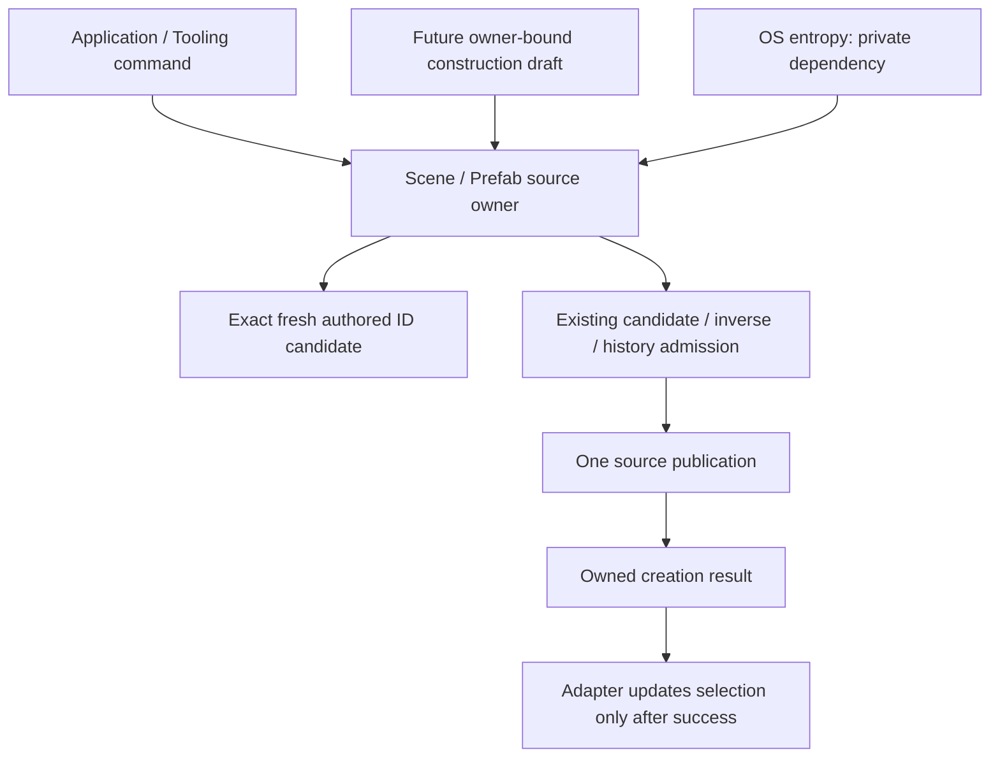

# Source-Owned Creation And Transaction-Local Construction

## Problem And Evidence

The existing prepared-edit owner already retains the candidate, inverse and history admission.
The missing depth is construction: independent tools still assign new IDs, copy template owner/
version and assemble reference patches. Workspace also owns separate Scene/Prefab ordinal allocators.

A concrete public-workflow regression creates an empty entity, Undoes to the saved empty document,
Reopens that source, then creates another entity. The old allocator restarts at `editor_entity_1`.
Run `216c780a-ceef-44b0-905b-fc54c20199d9` fails because the new creation systematically asserts
the previous object's authored identity. This is not evidence that runtime incarnations alias.

The [foundation plan](../plans/2026-10-23-foundation-architecture-rebaseline-plan.md#r2-owner-owned-prepared-editing-and-selection-independent-queries)
still includes full construction, field queries, panel preparation and cost comparison. Correcting
allocation is an owning prerequisite, not completion of R2 or its delivery wave.

## Ownership And Selected Creation Contract

Scene/Prefab sessions own generated source identities and the complete creation operation.
Tooling does not request a free ID, reserve an ordinal, construct a patch around that reservation,
then separately advance allocator state. A successful creation returns its exact authored ID and
ordinary patch report. Failure returns the report without document, history or selection changes.

Two real admission contracts remain distinct:

- Published authoring creates an empty source entity through the existing prepared edit kernel.
  Later generic components still require the exact admitted complete template.
- Registry-backed native authoring accepts its existing finite component records and uses its
  existing registry/codec validation and history. It must not be relabeled Published, nor removed
  merely to make one new construction path easier to qualify.
  `create_entity_with_asset_database` retains the existing project-database-aware codec and
  reference validation path for both retained and newly created records; the registry-only
  entry does not manufacture that context.

Both call the same private source-ID generator. Native domain recipes may select components and
provide their already-supported native records; they do not allocate IDs or publish source data.
The ordinary Workspace paths now call these owners and select only the returned successful ID.
Both ordinal fields, candidate-ID helpers, success increments and Reopen resets are removed.
The same generator will serve transaction-local construction, without a second ID authority.

## Identity Policy And Alternatives

Generated IDs contain 128 bits from fallible OS entropy, encoded as 22 URL-safe unpadded Base64
characters. They remain ordinary exact `SceneEntityId` strings, not hashes, runtime counters or
an alternate document format. Existing named IDs are neither rewritten nor reinterpreted.

Ordinary creation checks the current source. The construction experiment must additionally check
its already allocated candidate IDs through the same private generator. Allocation tries at most
eight candidates; entropy failure or collision exhaustion explicitly refuses.
There is no published allocator cursor. Disposing or refusing a candidate needs no reservation
rollback; entropy already consumed is not document state. Commit, Undo, Redo and Reopen retain
the exact stored ID rather than generate another one.

| Alternative | Benefit | Decision |
| --- | --- | --- |
| Workspace-local ordinal | Readable and cheap | Rejected: resets at Reopen and splits source allocation from publication |
| Persisted namespace/counter/lineage | Can define stronger non-reuse within an explicit lineage | Not selected: requires copy/fork/history/source-format authority that this workflow does not demand |
| Canonical UUID text | Familiar, strong random identity | Not selected as encoding: 36 bytes per source entity unnecessarily consume complete UI-address budgets |
| Full random bytes encoded as URL-safe text | No source-format extension, exact string identity, 22-byte generated IDs | Selected for owning creation |

This does not prove absolute non-reuse across arbitrary deletion history, discarded branches or
restored old files. Existing semantics remain: the same authored ID asserts identity continuity.
An explicit caller-authored ID is still data, not proof of fresh allocation. Source incarnation,
runtime incarnation and construction-local handles never become persisted ID material.

Compact encoding matters beyond aesthetics. A three-step Prefab UI address carries an anchor,
three source-entity coordinates and a leaf. UUID text uses 70 more bytes than 22-character IDs
across those five fields, before unchanged source/occurrence framing. Do not increase the 256-byte
UI ceiling or normalize arbitrary user-authored ID strings as UUIDs to hide that cost.
This observation does not promise admission of every three-step address or every source path.
The existing `Name` component is a separate presentation fact; authored identity is not a renameable
label. Frontend display of generated IDs remains a named usability consideration, not permission
to couple human naming back into identity.

## Pinned Engine Comparison

The comparison uses Bevy `85503941e488152711a4695bbe248e9ed9f453fc` and Godot
`81ab961f91066a63bcbf3ec340962bb1a1ada558`, not assumptions about earlier releases.

- Godot's `core/io/resource_uid.cpp::ResourceUID::create_id` obtains random bytes, checks its
  current UID registry and returns an explicit invalid result on entropy failure. Its
  `scene/resources/packed_scene.cpp` packing path retains assigned node IDs and resolves absent
  or conflicting local IDs before storing them. This supports separating stored identity from
  an Editor-local ordinal. Nara does not copy Godot's global UID registry, 31-bit node packing
  representation or unbounded collision retry: its source owner checks exact local conflicts,
  retains all 128 generated bits and explicitly refuses after eight attempts.
- Bevy's `crates/bevy_ecs/src/template.rs::SceneEntityReferences` and
  `crates/bevy_scene/src/resolved_scene.rs` keep reference-to-runtime-entity resolution in a
  template application context. They support owner-local reference resolution, not persistence
  of runtime entity bits or a Workspace counter. This is relevant to the next construction-draft
  experiment; it does not by itself supply Nara's source history, atomic commit or saved identity
  contract. Nara must continue to lower through its existing prepared source owner.

## Construction Interface Comparison

Three read-only designs examined the same two-entity/two-component/mutual-reference, scalar,
nested keyed-reference and local-parent workflow:

| Interface | Depth and trade-off | Disposition |
| --- | --- | --- |
| Generative scoped closure | Static local affinity, synchronous construction; lifetime/exports become caller concepts and locals cannot be retained across calls | Not selected as primary interface |
| Finite declarative intent | Easy transport and one prepare call; local numbers are names, so accidental cross-intent reuse is not detectable | Retain as comparison, not another production language |
| Owner-bound retained draft | Supports incremental tool construction; private Arc scope distinguishes locals even on equal source/revision bases | Selected for a bounded consumer experiment |

The proposed draft stores bounded intent and exact revision/Schema admission, not a document or
Undo copy. Its local handles are opaque, non-serialized and independent of source IDs. A transient
construction placement may name existing or local entities; persistent `ScenePlacement` does not
need public generics solely for that purpose. Parents/sibling anchors must already be declared;
property references can be mutual or self references after declaration. No topology solver is needed.

Property lowering must share the existing R5a selector implementation while reading both original
Available records and this candidate's admitted templates. It must not prepare intermediate public
documents or mirror `ComponentValue` recursively. Existing explicit `SceneLocal` data is relative
to the target source; do not claim to discover arbitrary forgotten provenance in copied plain data.
Foreign opaque draft handles, in contrast, must be rejected by exact affinity.

The final retained interface, mapping/result lifetime and error-recovery policy need an actual
independent consumer before adoption. No public draft or new commit protocol is qualified by this
design document. Do not delete working native creation or introduce a second registry to complete it.

### Next Experiment Boundary

The retained draft should record intent, not eagerly copy a document or its record classification.
Beginning it captures exact source revision and Schema basis. Append operations carry component
IDs and property selectors; the originating session supplies its current admitted templates only
when preparing that exact draft. This avoids cloning `AuthoringDocumentState` merely to retain
template access and does not require tools to copy owner/version metadata.

Experiment with separate scalar-property and entity-reference append operations. The latter can
accept an existing source ID or an opaque local handle without introducing a recursive replacement
for `ComponentValue`. Resolve all local entity IDs once, lower through the shared R5a property
resolver over existing Available records plus admitted new templates, and run the existing final
candidate/inverse/history admission. Preparation must not publish intermediate source revisions.

The prepared construction needs its local-to-source mapping for preview. A successful consuming
commit must return that same mapping with the ordinary report, so a tool can select the actual
created object without parsing patches. A rejected or dropped candidate must not be mistaken for
successful creation. Compare a nominal prepared-construction wrapper around the existing edit
with extending the existing prepared-edit result; compile the independent consumer before choosing
the public signature. Keep owner affinity and failed-append recovery policy explicit in that trial.

## Acceptance And Measurement

- Ordinary empty Scene/Prefab and native component-bearing creation use one source-owned generator.
  Remove both Workspace ordinals, candidate-ID helpers, success increments and Reopen resets.
- Exact basis rejection precedes allocation. Final validation/history refusal publishes nothing;
  selection and outcomes use the returned successful ID, never a predicted name or parsed patch.
- Exercise entropy error, current-source/candidate collision and eight-attempt exhaustion through
  a private test seam, not a public RNG/provider trait. Verify complete IDs and ordinary serialization.
- Creation/Undo/Redo/Save/Reopen retain identity. Undo followed by Reopen and a new creation must
  not deterministically restart the old generated ID. This is not a mathematical history guarantee.
- Retained construction acceptance includes two components per entity, mutual/self and keyed nested
  references, local-parent placement, stale/foreign bases/handles and last-operation failure.
  Preserve unavailable records, exact inverse/history limits and non-active document independence.
- Keep `MAX_AUTHORING_EDIT_OPERATIONS = 256` and raw `MAX_AUTHORING_FIELD_WRITES = 8`; charge selector/
  value work before coalescing and complete forward/inverse replay separately.

The initial debug-only owner observation uses one existing entity, two created entities, one
component each and three field writes. Run `424741c4-aafc-475d-9152-6556bcf1510c` records upper-median/
P95 prepare of 349,700/367,500 ns and commit of 4,100/5,100 ns (8 warmups, 64 samples).
It excludes caller patch construction, source admission, report disposal, projection, Save and
rendering. The final comparison must retain these exclusions and name ID-length differences.
At experiment entry, use twice the observed P95 as an investigation threshold, not a performance
promise or permission to weaken correctness: 735,000 ns prepare and 10,200 ns commit. Repeat noisy
observations before attribution. No release-frame, memory or native-performance claim follows.

## Risks And Limits

| Risk | Mitigation |
| --- | --- |
| New constructor silently widens Published authoring | Retain nominal admission checks and exact template policy; native records stay on their existing native path |
| OS failure leaves an allocation reservation | Generate privately and publish once; there is no cursor/reservation to compensate |
| Local/durable/runtime identity conflation | Separate opaque draft affinity, stored ID and freshness; no ordinal serialization |
| Root coalescing hides work | Retain raw write/value limits and final replay/history admission |
| Another transaction executor accumulates | Lower through the current candidate, inverse and commit kernel; delete caller-owned allocation choreography |
| Random identity is overstated | Check current conflicts exactly and explicitly retain the absence of arbitrary-history non-reuse guarantees |

Broader field queries, panel prepared hooks, declarative Prefab overlays, dynamic Behavior and the
remaining foundation waves remain open. No migration guide or compatibility alias is required.
