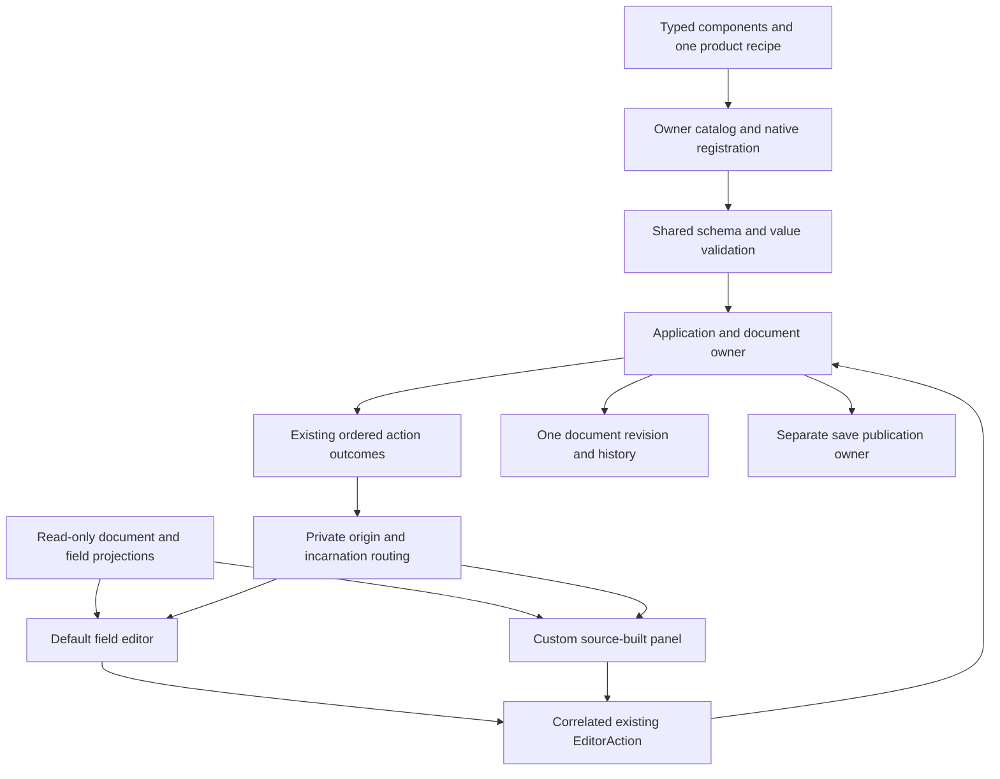
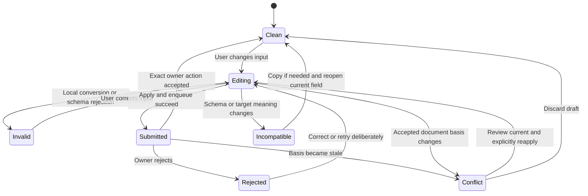
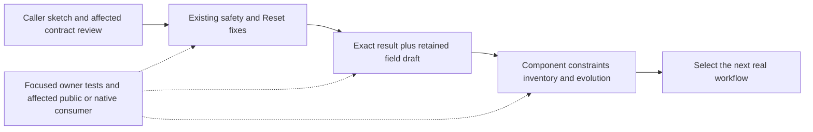

# Authoring Interface Ergonomics

**Status:** S1-S3 and the separate N05 App plugin-error follow-up are implemented and qualified within their linked verification scopes. D6 remains triggered future work.
**Date:** 2026-10-19.
**Updated:** 2026-10-20.
**Source baseline:** `f988852`.
**Inputs:** [post-correction audit](../audits/2026-10-19-foundation-next-stage-review.md),
[strategy](../../STRATEGY.md), Accepted ADRs 0010, 0045, 0047, 0068, 0081, 0116, 0117 and 0118.

This design addresses N01-N09 without reopening the completed correction plan. It records the
selected interfaces, implementation sequence and caller-level acceptance. Rust sketches omit
imports and surrounding package setup; the guides and independently compiled fixtures demonstrate
the implemented APIs. Pele is excluded.

S1 / E1-E2 is implemented through `bfbd2b8`, with the
[verification record](../knowledge/engineering/verification/2026-10/2026-10-19T143606Z-authoring-s1-safety-and-field-override-recovery-0aca8f3bff914ffeaf0254f40a5cb118.md)
covering the existing Prefab/render failure and field-override corrections. S2 / E3-E4 implements
D1's default field helper and D2's exact dispatch path under the refinements in Accepted ADRs
0047/0118; see the [S2 verification record](../knowledge/engineering/verification/2026-10/2026-10-19T153834Z-authoring-s2-exact-results-and-retained-field-editing-2b09e865afc64b7990e2adc737fa2aa7.md).
S3 / E6-E5 implements D3's explicit inventory and D4's finite intervals and safe component-domain
errors under the refinements in Accepted ADRs 0045/0081. Its owner, independent-consumer and
selected native workflows pass within the [S3 verification record](../knowledge/engineering/verification/2026-10/2026-10-19T162634Z-authoring-s3-component-constraints-diagnostics-and-inventory-64aacf18a3af432584d306af27d32eb3.md)'s scope.
D5 was delivered in S1; D6 and the App plugin-error portion of N05 remain outside S3.
The separately authorized N05 follow-up implements owner-local plugin facts and product lowering;
its focused qualification passes and does not extend S3's historical evidence.
This status does not reopen U1-U15 or start another Goal.

## Start With The Developer's Work

A game developer wants to declare gameplay data, install its behavior once, edit it, understand a
failure and run the result. A tool author wants to display a field or submit a deliberate change,
with a reliable answer about that change. Neither should need to reconstruct publication,
revision, routing or retirement policy from several internal modules.

Correctness also contains information the developer must supply: persistent identity, schema
version, migration meaning and game-specific restore behavior cannot be guessed from a Rust type.
The goal is to remove mechanical bookkeeping while keeping these decisions explicit.

### Keep Four Responsibilities Legible

- A transient ECS `Component` is typed gameplay data. It need not become persistent or implement
  another Nara lifecycle trait just to participate in systems.
- A persistent component adds the schema/codec contract: stable IDs, versions, authoring metadata
  and explicit evolution. Derive handles mechanical conversion; it does not install behavior.
- A Plugin/package installs behavior, scheduling dependencies and owned services through the
  existing contribution and recipe. Components do not become plugins, and setup does not become
  asynchronous simply because a later runtime operation may wait for I/O.
- An Editor panel displays projections and submits semantic intent. It does not acquire native
  component registration, history or mutable World authority to edit saved data.

The ordinary guide should follow one real component from declaration through package installation,
creation/editing, validation failure, Save/Play and one version migration. Separate API reference
pages cannot substitute for that complete developer workflow.

| Caller | Common task | Information they should supply | Machinery the engine should own |
| --- | --- | --- | --- |
| Gameplay author | Use transient ECS data and systems | Typed data, systems and scheduling dependencies | Managed execution, faults and close |
| Persistent component author | Create/edit/version a component | Stable component/field IDs, declared values and explicit evolution | Schema/codec generation, shared validation and catalog admission |
| Component package author | Install data and behavior together | One component inventory, owner/binding identity and configuration | Matching schema/native paths and atomic contribution admission |
| Ordinary panel author | Edit one persistent field | Resolved panel target, entity and stable component/field identity | Draft, validation feedback, submission correlation and conflict recovery |
| Advanced tool author | Submit existing semantic actions | Owned action and tool-local response policy | Origin routing, owner result and instance retirement |
| Backend/Host author | Prepare and publish native resources | Concrete native operations | Device/source authority, candidate failure and actual retirement |

## First Principles And Design Rules

1. **A common task should have one complete entry.** A convenience method earns its place when it
   hides a real lifecycle, not when it only renames another method.
2. **Display identity and mutation basis are different facts.** A field remains the same field
   when another accepted edit advances the document revision. A submission still needs an exact basis.
3. **A request has a visible failure path.** Parsing, queue admission, document acceptance and
   persistence publication are different outcomes. None implicitly means the next one succeeded.
4. **The owner decides; the adapter explains.** Early validation is useful feedback. It does not
   grant a panel mutable document/World access or replace final validation.
5. **Failure preserves recoverable work.** Rejected input remains available for correction. Conflict
   resolution is deliberate; silently rebasing, discarding or replaying a draft is not a default.
6. **Safe behavior should require less code.** The default field editor manages submission and
   retirement. Advanced callers can submit actions without obtaining a second history authority.
7. **Expose domain decisions, hide process details.** Stable IDs and migrations stay explicit;
   batch indexes, GPU epochs and internal callback routing do not become normal authoring inputs.
8. **Use existing modules before adding frameworks.** Keep `ProductRecipe`, schema owners,
   revisioned patches, batch reports, native panel instances and resource reservations.

## Recommended Shape

Use a complete default field editor over a small correlated action interface. Keep both in the
existing Editor/frontend module; retain UI-neutral semantic models and outcomes in `nara_tooling`.
The default helper first serves the built-in Inspector, then a separately compiled panel.
Do not publish a generic form engine or a public controller state-machine framework.



### Alternatives Considered

Three independent design lanes explored different seams before this recommendation.

| Alternative | Strength | Material cost | Decision |
| --- | --- | --- | --- |
| A: one pending action per panel plus one callback, no public correlation ID | Very small interface; clear lifecycle | A normal multi-field/tool panel encounters Busy for independent same-frame actions | Keep the callback, remove the arbitrary one-action restriction |
| B: owned tickets and a pollable UI-neutral tool inbox | Flexible multi-action composition; no callback reentrancy | Every ordinary field must retain/poll a ticket; introduces inbox, consumption and long-running-operation policy | Defer until a real non-painting consumer needs pull semantics |
| C: a complete field-edit entry with Host-managed drafts | Smallest common caller; one implementation owns recovery | Limited default interaction/customization | Select as the ordinary path; prove privately before exposing it |
| Selected combination: C over a small submit/result callback with an opaque local ID | One easy path and one coherent advanced seam | Requires exact private routing and clear dispatch-only finality | Recommended |

Keeping today's raw `emit` alone leaves every editing tool to reconstruct acknowledgement. A new
universal event bus, package kernel or transaction DSL would add learning and ownership without
closing a workflow that the existing models cannot express.

### Lessons From The Pinned Reference Engines

This comparison uses the local Bevy snapshot `85503941e488152711a4695bbe248e9ed9f453fc`
and Godot snapshot `81ab961f91066a63bcbf3ec340962bb1a1ada558`, rechecked on 2026-10-19.
It does not claim to describe their latest releases. The broader
[architecture comparison](../audits/2026-10-19-nara-bevy-godot-architecture-review.md) and
[current audit](../audits/2026-10-19-foundation-next-stage-review.md) retain their original scope.

The following are source facts; the Nara choices are design judgments drawn from them.

| Developer task | Reference-engine design | Nara at the design baseline and selected response | Deliberate difference / cost |
| --- | --- | --- | --- |
| Install behavior | Bevy `App.add_plugins` invokes the Plugin composition path; Plugin separates `build`, `ready`, `finish` and `cleanup` [B1] | Keep the existing fallible Plugin lifecycle and one `ProductRecipe` contribution across Hosts/tools. D3 shortens package authoring without a second installation service. | Do not merge persistent component identity into Plugin or infer dependencies from callbacks. Nara's admission and close guarantees still need their own proof. |
| Make a Rust type editable/persistent | Bevy derive metadata plus `register_type` installs reflection type data; `ReflectComponent` supplies reflected ECS operations [B2]. Godot `PropertyInfo` carries type, name, hint and usage [G1]. | Current `PersistentComponent` derives schema/codec, but the package author still lists types in catalog and native registration. D3 generates both from one inventory and reuses the current schema list for successors. | Runtime type registration is not a substitute for Nara's explicit owner IDs, predecessor catalogs and migrations. Keep those semantic decisions visible. |
| Edit a normal property | Godot `EditorProperty.emit_changed` reaches the Inspector change path; `_edit_set` integrates with the Editor Undo/Redo manager [G2]. | Nara currently exposes actions but lacks a complete per-attempt result-aware field entry. D1 owns drafts, conversion, exact submission and feedback behind `edit_field`; D2 supplies the underlying dispatch result. | Godot's inspected path edits live Object properties. Nara edits a revisioned saved-document model, so `emit_changed` is not evidence for opaque candidates or revision conflict handling. Those are Nara-specific requirements. |
| Extend the Inspector or add a tool | Godot `EditorInspectorPlugin` offers `can_handle`, `parse_property` and `add_property_editor`; `EditorPlugin` has targeted edit/visibility/state/clear hooks [G3]. | Current Nara source-built panels already have per-instance state and action submission. Prove D1 in a public external panel; add a narrower inline field/menu hook only when a real tool needs it. | A full panel is more work than Godot's inline property hook for a small customization. Record that capability gap; do not claim panel support makes the extension experience equally mature. No dynamic ABI is proposed. |
| Reset a property | Godot exposes `property_can_revert` and `property_get_revert`; Inspector revert emits the chosen revert value [G4]. | Fix N02 and keep authored override presence distinct from effective/defaulted value. D1 Reset removes an override through the existing document owner and Undo/Redo. | Borrow the explicit revert affordance, not Godot's storage operation: writing a value and removing a Nara override have different future-default semantics. |
| Declare a numeric range | Godot range hints configure Inspector spin bounds, step and greater/lesser allowances [G1]. | D4 adds typed finite validation intervals shared by catalog admission, authoring and native preflight; presentation hints remain distinct. | A Godot control hint does not by itself establish a persisted validator for every ingestion path. Nara's rule changes affect saved-schema lineage and require component succession. |
| Apply several related edits | Godot exposes do/undo property operations, commit and history selection; its Inspector has a multi-property action path [G5]. | Retain one owner/history. D2 can correlate several ordered actions; a true Apply All uses one existing atomic patch. | Two Nara writes from the same revision can still accept the first and reject the second. Correlation alone does not match the convenience of a cohesive multi-property control; its consumer must build one patch. |
| Wait for I/O or initialization | Bevy `AssetLoader.load` returns a Future; Plugin `ready` synchronously reports asynchronous setup readiness [B3]. Godot ResourceLoader exposes threaded request/status/get [G6]. | Keep Plugin composition, codecs and paint synchronous. Design an owned preparation attempt, pending result, cancellation/staleness and owner-thread publication for a concrete slow workflow. | Do not infer that all loads should use a Future or that a request/status interface guarantees nonblocking final retrieval. Physical retirement remains an additional explicit Nara obligation. |
| Recover from resource preparation failure | Bevy retains `CachedPipelineState::Err` and retries dependency-not-ready failures separately from permanent shader failures [B4]. The current audit traces Godot allocation checks. | E1 closes expected allocation errors and remembers terminal static shader rejection inside existing owners. Ordinary callers receive a result instead of reconstructing GPU recovery. | Copy the failure classification, not a full render graph or another public pipeline cache interface. |

#### Primary Source Map

Line locations refer to the pinned local snapshots. `repo-ref/` stays read-only and untracked.

- **B1:** [Bevy Plugin](../../repo-ref/bevy/crates/bevy_app/src/plugin.rs):57-78;
  [App composition](../../repo-ref/bevy/crates/bevy_app/src/app.rs):642.
- **B2:** [App reflection registration](../../repo-ref/bevy/crates/bevy_app/src/app.rs):654-669;
  [ReflectComponent](../../repo-ref/bevy/crates/bevy_ecs/src/reflect/component.rs):76-125.
- **B3:** [AssetLoader](../../repo-ref/bevy/crates/bevy_asset/src/loader.rs):32-46;
  [Plugin readiness](../../repo-ref/bevy/crates/bevy_app/src/plugin.rs):61-71.
- **B4:** [Pipeline failure states and retry classification](../../repo-ref/bevy/crates/bevy_render/src/render_resource/pipeline_cache.rs):48-56,
  901-936.
- **G1:** [PropertyInfo](../../repo-ref/godot/core/object/property_info.h):128-159;
  [numeric property controls](../../repo-ref/godot/editor/inspector/editor_properties.cpp):1619-1635.
- **G2:** [Editor property change and Inspector mutation](../../repo-ref/godot/editor/inspector/editor_inspector.cpp):322-327,
  5730-5885.
- **G3:** [Inspector extension hooks](../../repo-ref/godot/editor/inspector/editor_inspector.h):350-387;
  [Editor plugin lifecycle](../../repo-ref/godot/editor/plugins/editor_plugin.h):205-220.
- **G4:** [Object revert contract](../../repo-ref/godot/core/object/object.cpp):652-686;
  [Inspector revert](../../repo-ref/godot/editor/inspector/editor_inspector.cpp):1299, 1656.
- **G5:** [Editor Undo/Redo manager](../../repo-ref/godot/editor/editor_undo_redo_manager.h):84-127;
  [Inspector multi-property action](../../repo-ref/godot/editor/inspector/editor_inspector.cpp):5888-5915.
- **G6:** [Threaded ResourceLoader](../../repo-ref/godot/core/io/resource_loader.h):249-251.

Current Nara caller contracts are in the [component guide](../guides/persistent-components.md),
[recipe guide](../guides/rust-product-recipes.md) and [panel guide](../guides/editor-panels.md).
The current [panel context](../../editor/src/frontend/imgui/workspace.rs) exposes `submit`, exact
`action_finished` results and the D1 `edit_field` helper. The [panel guide](../guides/editor-panels.md)
describes that implemented surface. D3/D4 are implemented and qualified within S3's linked scope;
D6 remains a set of consumer-triggered designs.

#### What This Comparison Changes

The strongest lesson is to reduce what each caller must reconstruct, rather than match method
names. Bevy motivates derived type registration with an explicit advanced escape hatch; Godot
shows how a narrow property control can participate in a complete editing/history workflow.
For Nara this supports the selected C-over-D2 interface instead of a public ticket/controller
framework, while retaining its separate saved-data authority.

Three usability costs remain visible: package/provider declaration is more verbose than one
runtime `register_type`; inline property extension is less direct than Godot's inspected hook;
strict revision admission makes independent same-document writes conflict. D3 addresses the
first mechanically, a real inline-tool consumer should drive the second, and one atomic patch
addresses a concrete multi-field operation without automatic rebasing.

This evidence does not establish that Nara's interfaces are as mature as either reference engine.
S2's linked evidence covers field conflict recovery, native IME and the external panel surface.
S3's linked evidence covers external component evolution and the affected native controls.
It does not establish complete game production or untested-platform readiness.

## D1. Ordinary Field Editing

The implemented common usage is intentionally short:

```rust,ignore
impl ImguiEditorPanel for HealthPanel {
    fn show(&mut self, ui: &Ui, cx: &mut ImguiEditorPanelContext<'_, '_>) {
        let Some(entity) = cx.model().selection()
            .filter(|selection| selection.len() == 1)
            .and_then(|selection| selection.top_entity())
            .cloned()
        else {
            ui.text_disabled("Select one entity");
            return;
        };

        cx.edit_field(ui, &entity, &HEALTH_COMPONENT, &CURRENT_FIELD);
    }
}
```

`HEALTH_COMPONENT` and `CURRENT_FIELD` are the component library's stable identities. The helper
binds only to this panel's resolved authoring document. A missing/inactive target is shown as
unavailable; it must not silently fall back to a different active document. The caller does not
construct revisions, patches, tickets, raw paths or defaults. Explicit selection/layout is still
the panel author's decision. One editable control per field per panel paint is the initial contract;
a second presentation can be read-only rather than creating ambiguous duplicate editors.

The helper belongs to the Dear ImGui adapter and is not a universal widget abstraction. Its private
controller is stored in the existing per-instance widget state, beside the panel object. It can
use disjoint borrows for panel state and field controllers while `show` runs. Its shared validator
and document operations remain in their existing toolkit-neutral owners.

### Stable Identity And Exact Basis

Private control/draft identity contains the panel incarnation, document session, authored entity,
stable component and root-field IDs. It does not contain the current document revision. Nested
draft rows use local editor identity; list indexes and temporary map keys are not durable fields.

An edit basis separately captures document revision, admitted schema/catalog basis, component
version and source-binding incarnation. Ordinary Save does not replace that document/source
incarnation. The exact submission still targets the owning document and revision. Existing
`EditorFieldTarget` can remain the revision-bound command target; it should not also be used as
the stable key for all UI state. The document owner must expose the admitted catalog and
source-binding incarnation through a narrow read-only projection; the adapter cannot invent them
by hashing a locator or assuming that equal paths mean equal source authority.

Remove document revision from the adapter's outer widget scope and from unconditional draft
retirement. This requires native focus/IME evidence: stable IDs alone do not prove that toolkit
composition survives. Panel target/resolved-document and project changes still retire local state
under ADR 0118. A selection change inside the same document is not itself a panel retirement.

### Draft State And Conflict Recovery



Local invalid text, unfinished container children and empty-but-unconfirmed entries remain drafts.
For an `u8` field, `256` is retained with an immediate range explanation; the owner still validates
the eventual action. Submitted controls keep their candidate and disable another submit for that
field. This first slice does not queue several versions of the same field draft.

A dirty draft survives unrelated document changes. It retains its basis and enters Conflict,
rather than being cleared or silently acquiring the latest revision. The control shows the
accepted current value and proposed value. Explicit reapply captures a fresh basis and reruns
validation; it is a new action, not automatic retry. No per-field read-set rebase protocol is added.
Schema/source meaning changes make the binding incompatible; old input may be copied, but must
not be interpreted under the new schema automatically. Actual instance retirement still discards
its transient draft, as today's contract states.

Not painting a field is not proof that its binding died. Collapsing a component or temporarily
selecting another entity retains a dirty draft within the live panel/document scope. A missing
entity/component/field instead marks the retained draft Incompatible only when precise owner
facts establish that absence. Today's selected-entity Inspector projection does not describe all
unselected fields: lack of projection coverage means temporarily unresolved, not missing. Defer
that classification until the field is resolvable; if timely background classification is needed,
add a narrow read-only owner query keyed by retained binding. Never mutate global selection to
obtain those facts. Clean entries may be reclaimed; dirty, invalid and incompatible entries share
a finite private draft budget and are
never silently evicted. When that budget is full, a new editor explains the capacity limit before
accepting input and offers explicit discard of retained drafts. Do not infer retirement from the
set of controls painted in the latest frame.

Owner acceptance must be correlated to the exact submitted draft before it can retire. If a later
accepted edit already changed the same field, the next clean paint shows the latest projection;
an earlier success is never proof that the old candidate is still current. The helper does not
promise document save, native preview readiness or later-operation completion.

### Defaults, Null And Creation

| User intent | Stored operation | Eligibility |
| --- | --- | --- |
| Set a value | Store an explicit root value | Field is admitted and editable |
| Reset to default | Remove the authored override | Authored state is Present and a default exists |
| Remove optional field | Remove the authored key | Authored state is Present and the key is optional |
| Set explicit Null | Store Null | Nullable shape permits Null |
| Add Component | Copy one complete creation template through the owner | Template exists and creation is admitted |

The remove rule remains `Present && (!required || default_value.is_some())`. Reset is not writing
the default back into the file. A field already Defaulted has no override to remove. Component
creation templates, missing-field defaults and validation constraints retain separate meanings.
Override removal applies to a map-member path endpoint. Removing a whole root value or terminal
list index is not admitted by this finite Set/Remove inverse contract; the control stays disabled.
All accepted operations use ordinary document Undo/Redo; the control adds no private persistent
undo stack. Native text editing can retain its toolkit-local undo during input.

## D2. Advanced Action Submission And Results

The advanced public sketch remains small:

```rust,ignore
// Implemented on ImguiEditorPanelContext and ImguiEditorPanel respectively.
fn submit(&mut self, action: EditorAction)
    -> Result<PanelSubmissionId, PanelSubmitError>;

// On the existing per-instance ImguiEditorPanel trait:
fn action_finished(&mut self, id: PanelSubmissionId, result: PanelActionDispatch) {}
```

`submit` is the single result-aware replacement for `emit`; no second mutation route is added.
An opaque process-local ID allows a complex panel to distinguish several actions without creating
its own request identities. It is not serialized, not reusable between incarnations, not authority
to mutate or cancel an action, and not a `Future`. A panel that needs no result can ignore the ID
after handling immediate enqueue failure. Its default callback is empty.

The host accepts several independent actions per panel in existing batch order. Each helper field
can still allow only one pending candidate. A finite private admission budget rejects before
enqueue with a typed capacity error; it never silently drops a result or evicts an unread one.
There is no accumulated result history: dispatch results are delivered once while the original
instance remains live, after all painting borrows release and before its next painting opportunity.
Callback execution receives no UI, frame, Context, World or submit handle, preventing reentrant
dispatch through this seam. Trusted callback panics remain subject to the existing native-code
failure boundary, not a new sandbox promise.

| Stage | Meaning | What the caller may infer |
| --- | --- | --- |
| Immediate `Err` | Action was not enqueued | Keep input; no later callback for this attempt |
| `Ok(id)` | Owned action was queued | No document mutation or save success yet |
| `Dispatched(EditorActionOutcome)` | Existing owner processed that exact action | Interpret its existing typed result; Workspace applied may finish a field draft |
| `NotDispatched(reason)` | Batch/frame/closing/target gate prevented dispatch | No accepted edit for this action; preserve live draft |
| Persistence Accepted within a dispatched outcome | Save/Reopen request was admitted | Still not Saved/Opened or crash-durable publication |

A two-action batch is still ordered, not automatically atomic. A tool needing one history entry
uses an existing single atomic patch/field-edit/gesture action. The action interface must not
silently rebase the second action when the first changes the revision.
In particular, two same-document field writes prepared from the same revision may accept the
first and conflict on the second. Several submissions remove an arbitrary panel-wide Busy limit;
they do not promise automatic multi-field merging. If a real tool needs Apply All, it prepares one
complete atomic patch through the existing owner. Prove the two-field same-basis case explicitly.

### Private Routing And Retirement

The frontend boundary must preserve the exact batch as well as action positions. Its public
`show` path should return an opaque, move-only `ImguiEditorSubmission` containing the prepared
actions and private origin ledger, consumed by the matching frontend's `submit_and_drive`.
It has no public constructor, Clone or conversion that transfers its observation authority to an
arbitrary `EditorActionBatch`. Frontend identity, candidate serial and project epoch are checked
before dispatch; a candidate from a different or superseded frontend cycle is rejected before any
mutation. Frame revision alone is not a correlation identity.

Only one prepared candidate is current per frontend. Preparing another settles any unconsumed
candidate as NotDispatched before the next eligible paint and invalidates late consumption. Dropping
the owned candidate performs no engine work; its pending observation is settled on the next frontend
cycle or released at actual frontend retirement. This bounds retained host bookkeeping without
making Drop run user callbacks. The native presentation path seals its candidate only after its
canvas actions/provenance are final. Direct non-frontend application consumers may still submit an
ordinary `EditorActionBatch`; their reports cannot settle frontend-origin observations.

The adapter records the originating project/workspace epoch, panel incarnation and original action
position in this candidate. Application filtering retains a position mapping and explicit rejected
slots. A compacted closing batch cannot be zipped against original positions. Whole-batch rejection
terminates each queued action. System actions have no panel recipient but retain normal batch ordering.

Each accepted enqueue has one accounted dispatch outcome. Delivery is at most once to the original
live object. If the instance is retired before dispatch, the host makes the not-dispatched decision
where applicable; if mutation already committed, retiring the observer cannot undo it. The host
settles and releases the observation record without delivering to a replacement instance.
No hidden object retention is needed to wait for future persistence or process completion.

Moving/docking and GPU reconstruction preserve panel/controller state. Close, hide, changed resolved
target, layout replacement and project replacement retire its scope under the existing lifecycle.
Collect dispatch results, finish driving the application, and reconcile actual project/target/panel
lifetimes before invoking callbacks. Finding an old object in a widget map is not proof that it is
still live after that drive. Outcome routing runs independently of whether the object paints that
cycle. Every origin has exactly one private recipient: either its field controller or the custom
panel callback. Helper-generated IDs are not broadcast to custom callbacks which never received
them. A controller enters Submitted only after enqueue succeeds; an immediate error retains its
editable candidate and explanation. Neither recipient reconstructs success from global revision,
value equality or the latest single-slot field feedback.

Persistence's final result remains an explicitly separate owner projection in this slice. Do not
present request acceptance as publication. A future tool that genuinely chains a save with another
operation needs owner-correlated persistence completion, not polling the latest global result or
quietly expanding this dispatch callback into a general asynchronous operation system.

## D3. One Component Inventory, One Product Contribution

Keep ordinary consumption unchanged:

```rust,ignore
ProductRecipe::new()
    .add_contribution(agent::package(settings)?)?
```

A component package should expose that single helper; callers do not maintain a parallel provider
list. Direct App, Headless/Desktop, Check, Editor Play and Export continue to use the same recipe.
Do not add another global component installation mechanism.

The package author's mechanical duplication is reduced with one explicit declaration:

```rust,ignore
nara::persistent_components! {
    pub mod agent_types = [Health, Cooldown];
}

const AGENT_SCHEMA: ComponentSchemaProviderDefinition =
    ComponentSchemaProviderDefinition::new(
        ComponentSchemaOwnerId::new("example.agent.components"),
        PluginSchemaProviderId::new("example.agent.components"),
        ComponentSchemaProviderBindingId::new("example.agent.components.native", 1),
        agent_types::initial_catalog,
        agent_types::register,
    );
```

The one type inventory emits two ordinary existing callbacks: a pure generation-one catalog
source and native registration. It also exposes the fallible pure schema-list helper used by that
initial source, so an explicit successor catalog can reuse today's type membership. It performs
no discovery, World mutation, freeze or installation.
The existing provider admission still compares the declared catalog and native candidate, then
publishes atomically. Plugin declarations can use `AGENT_SCHEMA.id()` instead of duplicating a
provider ID constant; this part is already possible today.

The name `initial_catalog` makes the first-generation limit visible. Evolution switches to the
existing explicit current/predecessor source and registration callback, while reusing the generated
schema list and native register function. A version-two package that later adds a new current
component still updates only this inventory; its predecessor snapshots remain unchanged.
Historical catalogs, tombstones and migrations are not inferred from today's type list. Entries
are type identifiers imported or aliased in the invocation module; qualified paths must first be
imported. The generated module resolves those explicit parent-module identifiers. The macro does
not become a package, migration or registration DSL.

Keep owner ID, provider ID, binding versions, component version and catalog generation explicit.
Do not derive stable identities from crate paths, automatically increment every version, or use
native Default as an ordinary Editor callback. A manual codec or advanced migration stays available
through the existing explicit provider path, with no compatibility shim that bypasses admission.

## D4. Finite Shared Constraints And Safe Diagnostics

The implemented consumers are `UiText.logical_size` and an external `Cooldown.seconds` range.
The descriptor extension is an optional finite numeric interval on Scalar shape,
alongside its existing numeric domain. It does not create a new field wrapper or arbitrary rule DSL.
Optional/container traversal remains the existing shape traversal; no new container attribute
grammar is required by this first consumer.

The derive supports this component declaration:

```rust,ignore
#[derive(Component, PersistentComponent)]
#[nara(id = "example.Cooldown", version = 1, alias = "Cooldown",
       component_capabilities(scene, inspect, edit),
       field_capabilities(scene, inspect, edit), authoring_initial)]
struct Cooldown {
    #[nara(id = "seconds", alias = "Seconds", initial = 0.5_f32,
           range(min_inclusive = 0.0_f32, max_inclusive = 30.0_f32))]
    seconds: f32,
}
```

Only the range syntax is new here. There is one descriptor source, interpreted by bundle admission,
generic patch validation, native preflight and strict Check. UI slider/step/format hints are
presentation metadata if later needed; a slider hint must not silently become a persisted validator.
UI input can be temporarily invalid without becoming accepted document data.

The shared interval contract is:

- Bounds have the scalar's admitted signed, unsigned or finite floating domain; no integer-to-float
  coercion. Missing bounds are unbounded; contradictory or empty intervals reject at schema admission.
- F32 intervals compare the deterministic F32-materialized value widened exactly for comparison.
  A tiny positive F64 which rounds to F32 zero must fail a positive F32 rule, matching native decode.
  Defaults, templates and generic/native validation share this rule without rewriting stored bytes.
  `UiText.logical_size` now has an F32 numeric domain and the complete native interval `(0, 256]`.
  UiText advances from component v2 to v3 and the UI catalog from generation 2 to generation 3,
  retaining the exact generation-2 predecessor. Other UI components retain their versions.
  Its explicit migration preserves valid stored values and rejects invalid history for deliberate
  repair; it does not clamp or rewrite the floating payload.
- Nonfinite bounds reject, canonical signed zero is deterministic, and inclusive/exclusive endpoints
  have explicit tags. Constraint traversal consumes existing caller value-work budgets.
- Absent metadata preserves the old fingerprint encoding. New metadata participates in catalog
  identity. Readers which do not support it reject; they cannot silently discard it and claim the
  stronger contract. Adding, tightening, relaxing or removing bounds changes field-shape semantics
  and requires a component successor with explicit predecessor and migration policy, even when
  wire bytes do not change. An identity migration may suffice for a relaxation. Do not build an
  interval-subsumption compatibility prover to bypass existing same-version schema equality.
- Cross-field conditions and arbitrary native invariants remain owner-specific. Generic data
  validity still does not imply complete Runtime readiness. This slice exposes that limit rather
  than claiming every codec can be reproduced from metadata.

Errors need stable identity without revealing private values. `ComponentDomainError` contains
a checked static namespaced code, a checked safe summary and an optional stable root field ID.
`ComponentCodecError::Domain` carries those facts through native validation. The diagnostic bridge
receives an optional admitted component schema and publishes the field only after checking its
membership; without that schema it retains the safe code/summary and omits field identity.
Dynamic paths, map keys, asset locators and raw codec details do not become public diagnostic
payloads. Safe summaries are static and checked.
The diagnostic adapter adds owner/component identity and preserves the domain code, instead of
parsing Display text. Existing free-form native errors remain private fallback detail.
Data-only range rejection uses an engine-defined code and known root field. It does not generate
arbitrary project-native codes, execute a codec or require a metadata code registry. Preserve
custom codes only where a real native/domain failure is already ingested. Scene validation,
generic authoring decode and the existing Play apply-changes bridge preserve these facts;
strict Check and compiled Editor ingestion use the same component diagnostic path.

Dependency direction matters: `nara_diagnostic` already depends on `nara_app`. Therefore app errors
cannot import the diagnostics runtime/report crate. Extending App plugin failures with static
namespaced codes requires a separate owner-local change; the qualified N05 follow-up below
does not change this component dependency direction.
For component-domain errors, the implemented `nara_reflect -> nara_diagnostic -> nara_app` edge
is acyclic and reuses existing checked code/summary primitives. Reflect-specific field identity
stays in reflect and is validated at the bridge. Diagnostic does not depend on reflect; there is
no second diagnostic bus or all-engine error enum.

## D5. Resource Failures Stay Inside Their Existing Owners

N01 needs a structural preflight of resolved Prefab source before graph indexing. The public raw
data constructors can remain useful; calling a fallible expansion should return diagnostics rather
than require the caller to memorize a validator order. A new public ValidatedPrefab type family
is unnecessary for this fix. Preserve existing bounded materialization and override semantics.

N08 needs local expected-allocation error capture in Editor target reservation. A failed successor
keeps the old target and registration. The ordinary panel author should never need to preflight
VRAM, inspect device limits or add catch-unwind around a resize. Aggregate target-budget policy
remains separate from correctly reporting allocation failure.

N09 needs a private cache state for deterministic pipeline rejection under the existing key/device
namespace. It must not cache retryable device/allocation failure as a permanent invalid shader.
No public render graph, pipeline-cache controller or polling loop is added to gameplay APIs.

## D6. Predesign The Next Workflow Without Claiming It Exists

| Workflow | Recommended contract to preserve now | Enter implementation when |
| --- | --- | --- |
| Open/Save preparation | Owned attempt and result, cooperative cancel, stale-result rejection, owner-thread commit; no borrowed World/frame across await | A measured phase exceeds the chosen interaction budget |
| Task cancellation | Logical terminality and physical capture/worker retirement are separate; make standalone Drop semantics explicit | G1/G9 characterization, before new external task promises |
| Automatic Rust rebuild | Distinct authored content, observed code inputs, build attempt and immutable executable generation | The product promises code-currentness; choose finite cooperative observation or immutable-source build |
| Restart/restore | Restart same executable is distinct from reset/checkpoint restoration | A concrete game chooses the restoration experience under G6 |
| Multiple same-kind documents | Document-keyed Host persistence/projections, existing per-document history; no active-document mutation fallback | Two-source comparison, cross-document tool or pinned different-document Inspectors |
| Inline domain tools | Narrow source-built field/menu/source-handler contribution using existing actions | One real domain tool cannot use the existing panel seam |

Do not add `async fn` to Plugin build/finish, component codecs, panel painting or World commit to
make the surface appear modern. An asynchronous preparation operation needs explicit pending,
cancel and physical-retirement semantics; it may use existing blocking workers or a Future executor
only after its consumer requires that choice. No generic operation service is needed now.

### Selected G1/G2/G9 Investigation

The [Editor responsiveness and task-retirement investigation](../benchmarks/2026-10-20-editor-responsiveness.md)
now selects a bounded part of these triggers. It records ordinary data-only Open's synchronous
phases, Save checkpoint capture and persistence drive, and Reopen preparation/publication through
existing public interfaces. Three optimized measurement processes pass, each retaining sixteen
samples per population/phase and 480 numeric rows. The protocol separates request admission from
frame drive, excludes fixture setup/output, and physically closes each session before the next
sample. At 4,096 empty entities and 483,534 baseline source bytes, the three Save-drive P50 values
are 14.973 / 14.926 / 15.117 ms; per-process P95 values are 16.357 / 15.559 / 15.792 ms.
Reopen-drive P95 spans 10.104-10.394 ms and startup-closure preparation 10.312-12.028 ms, while
Save-request P95 spans 0.262-0.293 ms and idle drive 0.307-0.330 ms. These are separate process
results, not pooled samples or a subtraction of independent percentiles.

This evidence prioritizes a targeted Save preparation design, followed by Reopen and startup-
closure preparation. An 8 ms single-call owner-work threshold selects private investigation; it
is not a product guarantee or native SLA. No asynchronous implementation lands in this follow-up.
With sixteen samples, nearest-rank P95 equals max and does not estimate a stable tail. These
shallow empty-entity probes do not qualify Browser Open, saved-source receipts, no-op Cargo,
native redraw interruption, representative game components, cold storage or a supported scene
ceiling. Their raw samples and run identities remain in the linked investigation.

A task-owner regression fails on the starting source: a blocked first pending capture's destructor
delays another pending handle's logical cancellation during standalone pool abandonment. The
owner-local correction at `3b70e48` publishes cancellation for the bounded pending set before
transferring captures to their existing physical-retirement owner. The final Tasks/Image library
cohort passes all 120 tests, and independent review has no remaining findings. This does not
change handle Drop into cancellation, add a disposal queue, or promise constant-time Drop.
Rejected/coalesced capture disposal during submission and the last owner's disposal of an untaken
completed result can still execute user destructors on the caller thread; their potential owner
latency remains an open G9 concern.

The suspected unbounded supervised-process output drain was disproved: both platform adapters
already limit each poll to 64 records and retain reader/queue completion separately. No output
queue or polling refactor follows from that suspicion. Plugin hooks, component codecs, World
commit and panel painting retain synchronous contracts. An asynchronous preparation implementation
still needs a measured consumer, stale-result rejection, owner-thread publication and explicit
physical retirement; D6 as a whole remains open.

## Implementation Sequence And Ownership

S1 / E1-E2, S2 / E3-E4 and S3 / E6-E5 are complete within their linked verification scope.
D6 remains consumer-triggered work, with only the bounded G1/G2/G9 investigation above selected.
It is not an active Goal or a blanket asynchronous interface migration. Preserve the existing
history and complete real consumers.

### Architecture Adjustment After The Reference Comparison

Retain the existing ECS, managed Runtime, product composition and document-owner structure.
The evidence calls for deeper interfaces at those owners, not a replacement architecture.
Keep the completed [U1-U15 plan](../plans/2026-10-19-1335-refactor-foundation-correction-plan.md)
closed; its G1-G9 entry conditions remain separate from the work below.

| Boundary | Recommended adjustment | Adoption point |
| --- | --- | --- |
| Field identity and mutation authority | Stable UI/draft binding is independent of document revision; exact revision/catalog/source basis still governs commit. Retained controller state remains private to its frontend instance. | Adopted in ADRs 0047/0118 for S2. |
| Intent and acknowledgement | Keep existing semantic actions and owner reports. Carry their exact origin through dispatch/filtering, then settle one original live recipient after application drive. | Adopted in ADR 0118 for S2. |
| Data rules and error facts | One schema-driven validator owns supported numeric rules; native preflight and Editor feedback consume it. Presentation hints and arbitrary native invariants remain distinct. Safe error facts cross adapters without parsing strings. | Adopted in ADRs 0045/0081 for S3, with explicit UiText/catalog succession. |
| Component installation | Keep explicit package/recipe and atomic provider admission. One inventory generates mechanical callbacks and current schemas, while history stays explicit. | Implemented as an ergonomic helper over existing ProductRecipe/SchemaContribution authority; no additional registration owner. |
| Waiting and retirement | Preserve a seam for owned preparation, attempt/result identity and owner-thread publication; decide cancel and physical-retirement behavior for the actual operation. | D6 and G1/G9 remain triggered work, not blanket async trait changes or prerequisites for current repairs. |

ADRs 0047/0118 adopt the S2 identity/result refinements; ADRs 0045/0081 adopt S3's interval and
component-authoring refinements. No shared controller framework, universal operation service or
crate layer is required. Stable identity, strict authority and failure retention remain the
governing invariants.

### Deliver Workflows, Qualify Each Changed Boundary

The E labels below identify implementation responsibilities, not seven consecutive release stages.
In particular, E7 qualification is part of each affected delivery; it must not be deferred until
all implementation units have landed.

| Stage | Included work | Exit evidence |
| --- | --- | --- |
| S0: establish the consumer and affected contracts | Use the existing independently compiled component/panel fixture to specify the D1-D4 calls and adoption points. Reuse a concrete field such as Cooldown; no new example game is required. | One type inventory, one product contribution and one ordinary field-edit entry; no manually routed reports or private engine hooks. This is a caller design check, not a requirement to implement E5/E6 before safety repairs. |
| S1: repair existing failure and authored-state semantics | E1 and E2 as independent owner-local changes, with their focused portion of E7 | Raw invalid Prefab rejects without panic; failed target reservation preserves the old publication; terminal bad shader is not recreated per frame; Reset/Remove preserves raw authored semantics through affected history/persistence paths. |
| S2: complete one reliable editing loop (implemented) | E3 followed by E4, with external/native evidence from E7 | Exact action result reaches the original live controller or panel; invalid/conflicting input survives; unrelated edits and native IME retain stable widget identity. Two fields from one basis have explicit conflict behavior; a cohesive multi-field operation uses one existing atomic patch. See S2 verification above for executed consumers and platform limits. |
| S3: complete component declaration through evolution (implemented) | E6 validation/error semantics and E5's inventory convenience, with E7 owner, independent-consumer and affected native evidence | The independent component is installed, created, edited, rejected with an actionable error, saved/reopened and explicitly migrated. Adding a component after a successor catalog changes only the current inventory, leaving historical membership intact. See S3 verification for executed paths and platform limits. |
| Follow-up selection | D6 and existing G1-G9 only when their named consumer or measurement enters | Pick a concrete pending operation, frame workload, inline field tool or multi-document workflow, then design and verify that owner's next complete contract. These are not hidden exit conditions for S1-S3. |



This stage order is a risk/learning preference, not a fabricated source dependency. E3 may land
in reviewable internal steps, but the public editing experience is not complete until E3/E4 work
together. E5 and E6 are independently implementable once their respective contracts are clear;
the preferred order settles supported value/error semantics before polishing declaration syntax.
E3/E4 can use today's shared validator and need not wait for new interval metadata.

During S2, keep native painting and private draft/result state in frontend modules, semantic
actions/projections in tooling, and dispatch/publication in the application/document owners.
During S3, keep descriptor validation in reflection and diagnostic lowering in its adapters.
Extract these responsibilities privately as their large files change; line count alone does not
justify a new crate or public trait, and the field helper must not grow into another owner.

Keep verification proportional: use focused `cargo nextest run` and affected external fixtures,
and apply the existing native procedure to controls/lifetimes actually changed. Integrate one
complete affected author workflow at stage closure rather than repeating every platform/export
qualification after each internal commit. Report untested platforms explicitly.

### Responsibility Map

| Unit | Delivers | Existing owning files and consumers | Dependencies |
| --- | --- | --- | --- |
| E1 | N01 source graph rejection, N08 allocation-error result, N09 terminal failure cache as separate reviewable changes | `crates/nara_scene/src/prefab.rs`, `validation.rs`, Scene tests; `crates/nara_render_wgpu/src/editor_execution.rs`, `texture.rs`, `backend.rs`, `quad.rs`, native allocation/pipeline tests | None |
| E2 | N02 correct Reset/Remove using authored state | `editor/src/frontend/imgui/authoring.rs`, tooling Inspector projections, native interaction and persistence consumers | None |
| E3 | D2 opaque frontend candidate, correlated dispatch, post-drive lifetime checks and closing-filter settlement | `editor/src/frontend/imgui/mod.rs`, `workspace.rs`, `editor/src/app.rs`, native dispatch path; existing tooling batch reports; independent panel fixture | None; use existing actions |
| E4 | D1 stable draft/widget identity, exact-basis conflict and default field helper | `editor/src/frontend/imgui/mod.rs`, `authoring.rs`, `authoring/recursive_controls.rs`, native IME/interactions and external panel fixture | E2, E3 |
| E5 | D3 one component inventory over current contribution | `crates/nara_reflect`, root macro facade, independent module-consumer and public guides | Explicit first-generation and migration example |
| E6 | D4 interval constraints and safe error identity for the two real consumers | `crates/nara_reflect/src/schema.rs`, validation/codec/provider owners, `nara_reflect_derive`, `nara_scene` diagnostic adapters, `nara_ui` codec and external component fixture | Saved-data lineage and dependency review before writing |
| E7 | Qualification and concise guides inside every affected stage | Existing native Editor procedure, external component/panel fixtures, Reference Game and affected guides | Accompanies each changed owner; integrated workflow at stage closure |

E1's three independent owners should land separately; the row groups their user-visible failure
boundary, not a requirement for one large commit. Extract private responsibilities in touched
large files when useful, retaining exports and order. Do not make a whole-tree module shuffle a
prerequisite for a local correctness repair. Build/test commands remain serialized in the shared target.

### S3 Implementation And Qualification

Finite interval semantics are private to the focused reflection module; derive supplies typed
literal bounds and rejects unsupported field types or invalid declaration syntax at compile time.
The existing shared validator owns admission and value checks. Component-domain facts reuse the
existing diagnostic primitives, while Scene/tooling adapters validate field identity and redact
dynamic codec details. The inventory remains a small mechanical helper over current provider
admission rather than a new owner. A consumer may import only a renamed root `nara` dependency;
derive ranges and the inventory resolve through that facade without a direct reflection dependency.

Implementation landed in `64e8484` (shared bounds, diagnostics and inventory) and `2ca6771`
(UiText succession, shipped fixtures and affected native controls). Owner tests, independent
component workflows, strict Check/compiled Editor domain diagnostics, the renamed root-only
facade and locked bundle checks pass. The independent consumer covers failure atomicity,
creation/editing/rejection, Undo/Redo, actual Save/Check/Reopen and explicit migration.
The affected native Windows/DX12 field/focus/IME and Canvas real-source Save/Reopen paths pass
with an actual adapter required. These runs do not establish OS IME candidate-window delivery,
accessibility, monitor scanout, native Linux/macOS support or full release qualification.
The [S3 verification record](../knowledge/engineering/verification/2026-10/2026-10-19T162634Z-authoring-s3-component-constraints-diagnostics-and-inventory-64aacf18a3af432584d306af27d32eb3.md)
owns numerical cohorts, commands, run identities, review results and execution limits.

### N05 App Plugin-Error Follow-Up

Implementation landed in `40bcdc6`.

This follow-up is separate from S3's component-domain work. `PluginDomainError` admits only a
checked static code and safe static summary. App shares its source-fact validation with
`RuntimeFaultDetail` without depending on the diagnostic runtime. Factories return this same type
in place of `PluginPrepareFailure`; hooks return it through `PluginError::Domain`.

The framework retains the actual invoked plugin and hook, including a first retryable preflight
failure. An error cannot replace those facts with a claimed owner. The existing borrowed failure
report preserves primary and shutdown facts through source wrappers and retained-owner cleanup;
this does not introduce a second report collection or copies in runtime-close evidence.
Direct App callers receive the same invocation facts through `PluginCommitError` in
`AddPluginsError::Plugin` and the direct `App::seal` result, with access to the original error
and recorded plugin failure.

Product adapters preserve the checked code/summary, add `project-context-code`, and retain bounded
plugin/hook or preparation-phase context. They do not render raw error `Display` text. Existing
Check, Export and data-only Open retain their behavior and execute no additional lifecycle hooks.
Editor publishes terminal shutdown facts once per runtime generation even when physical close
participants still keep the owner in `CloseIncomplete`. Polling and retrying that close neither
hides the failure until completion nor duplicates it in the report.
Qualification passes: all 121 App tests and the selected 133-test product cohort cover invocation,
retry, ordinary recipe Headless Run and Editor Play failure/retirement paths. The locked workspace
check passes with all features and targets. Independent review has no remaining findings.
These cohorts are recorded separately and are not a unique combined test count. The follow-up
changes no native controls and establishes no new platform or release qualification.
D6 and G1-G9 remain consumer-triggered work.
The [N05 verification record](../knowledge/engineering/verification/2026-10/2026-10-19T170951Z-n05-safe-plugin-failure-facts-and-invocation-context-d01f7391b84348a8827a0daa760dd1a4.md)
owns this follow-up's actual results and limits separately from S3.

## Acceptance And Ergonomics Criteria

| Criterion | Required proof |
| --- | --- |
| Ordinary editing does not expose machinery | A separately compiled field panel uses one field-edit entry after selection, with no manual revision, ticket, report matching or native registry |
| Package membership has one source | One type inventory produces both existing catalog/native paths, including a version-two successor followed by a new current component; historical membership remains unchanged |
| Failure preserves user work | u8 overflow, owner rejection, stale revision and batch rejection retain editable input; accepted document/history remain unchanged on rejection |
| Correlation is exact | Two panels and several actions per panel, closing-filtered slots, two same-revision candidates, foreign/stale candidate consumption and custom/helper recipients are distinguished; same-basis field writes do not silently merge; replacement or post-drive retired instances receive none from predecessors |
| Widget identity is stable | A dirty field survives another field's accepted edit with focus/IME composition intact; collapsed or temporarily unselected fields retain input; full draft capacity rejects new input without eviction; revision admission remains strict |
| Stored/default distinction is preserved | Required/default, optional/default, optional/no-default and explicit Null pass Reset/Undo/Redo/Save/Reopen with raw presence asserted |
| Schema/native bounded constraints agree | Positive F32 underflow, endpoints and external cooldown range agree; u64 above 2^53 remains exact; invalid defaults/templates reject admission; absent bounds preserve old fingerprints; every bound change rejects same-version lineage; old catalogs/migrations and unsupported readers behave explicitly |
| Diagnostics remain actionable and private | Data-only range failures preserve engine code/root field; actual native/domain ingestion preserves two custom codes through Check/Editor bridges with schema-checked fields; missing schema omits the field; dynamic keys, paths and value sentinels remain redacted |
| Native failure is recoverable | Invalid Prefab returns diagnostics without mutation; controlled target allocation failure retains old target; repeated invalid shader attempts once per key/namespace |
| No hidden authority or wider readiness claim | Ordinary Open loads no project code; callbacks expose no mutable owner; Save Accepted is never labeled Saved; data-only validation does not assert all native invariants |

Use the existing native qualification procedure for claimed controls, IME, reconstruction and
retirement. Source review or compile-only fixtures do not establish these behaviors. No timings or
performance budgets are claimed from this design. Decision-local measurements for task submission,
Open/Save and edit-to-result precede executor or scaling changes.

## Risks And Alternatives To Avoid

| Risk | Chosen mitigation |
| --- | --- |
| The convenience helper becomes another widget framework | One concrete field entry, private controller, existing native adapter and external consumer |
| Callback results are confused with eventual operation completion | Dispatch-only naming/contract; existing persistence owner remains separate |
| Stable widget identity permits stale writes | Keep revision/schema/source basis separate and strict; conflict requires deliberate reapply |
| Numeric rules silently tighten saved contracts | Explicit metadata identity, rejecting old readers and component successor/migration policy |
| Shorter registration hides durable ownership | Generate only paired first-generation callbacks; explicit IDs/history/provider admission remain |
| Safer diagnostics introduce a crate cycle | Native typed facts stay below diagnostic adapters; app never depends on its diagnostic consumer |
| Advanced APIs dominate the default guide | Lead with Component, derive, contribution and edit_field; put raw callbacks/codecs/Host authority in advanced sections |

The default conflict policy here preserves drafts and requires explicit review/reapply. Product
choices for checkpoint restoration, automatic source freshness and cross-document atomicity remain
deferred to their actual workflows. They do not block the concrete corrections and ordinary field
editing interface implemented in S2.
