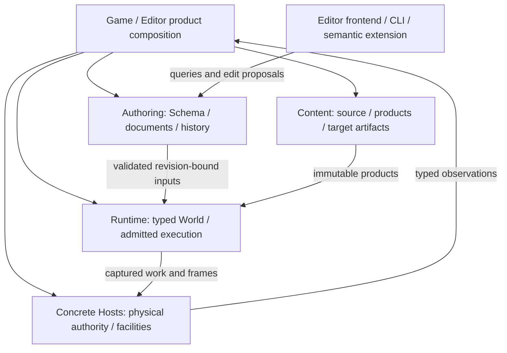

# Foundation Architecture Reassessment

Date: 2026-10-23. Source baseline: `9fafdac`.
Status: Design recommendations with explicit unresolved experiments; not implementation qualification.

## Purpose And Authority

This reassessment covers the entire supplied engine-design conversation, not only defects found
in the preceding owner audits. The [coverage inventory](../audits/2026-10-23-foundation-architecture-coverage.md)
maps its 36 topics and all 103 baseline ADRs to the decisions below. The
[rebaseline plan](../plans/2026-10-23-foundation-architecture-rebaseline-plan.md) orders implementation
and comparison experiments. Earlier probes remain evidence at their recorded revisions; they are
not fresh qualification of these designs.

Six independent read-only reviews challenged execution, data, assets, rendering, extensions and
Editor/UI against actual callers and pinned Bevy/Godot sources. Recommendations are integrated
here rather than treated as six independent architectures. Current implementation, accepted
scope corrections, proposed direction and undecided representation are different states.

The user's requirements include a modular Rust framework, a complete integrated Editor,
Unity-like installable extension experience, optional gameplay languages, Agent-friendly
authoring, and future domain/platform growth. They justify bounded design and executable tracers
now. They do not select C#, Lua, Wasm, an object kernel, a universal ScriptHost, or every proposal
made by the assistant in that conversation.

## Verdict

The native Bevy ECS substrate, independently usable modules, document-owned authoring, explicit
Host authority and immutable captured inputs remain appropriate for a Rust engine. Repeated bugs
alone do not prove that ECS or modularity is wrong. Several recurring classes do identify missing
contracts: losing operation identity at adapters, conflating logical and physical lifetime,
using revision-local locators as durable addresses, and treating one native implementation slice
as the universe of possible extensions.

The current architecture is **not yet a demonstrated architecture for the whole requested
product**. In particular, source-built Rust extensibility is not equivalent to installable
extensions, an immutable native registry is not a complete managed Schema model, and immutable
render inputs do not require a permanently closed rendering topology. These are design changes,
not nine more local bug fixes.

The response is neither a clean-room rewrite nor compatibility wrappers around known mistakes.
Retain proven ownership invariants; replace constraints that encode accidental prototype shape.
Nara is unreleased, so affected callers and formats can change together. No new migration guide
is required for this work.

## Target Architecture And Refactor Decision Rule

The integrated recommendation is one architecture with five cooperating responsibility groups.
These are semantic owners, not five mandatory new crates, services, inheritance roots or threads.
Existing modules can be merged, moved or deleted when a complete replacement makes that simpler.

| Owner group | Authoritative facts | Ordinary consumer interface | Must not also own |
| --- | --- | --- | --- |
| Authoring | Semantic Schema, document/source identity, accepted revisions, transactional history | Query, prepare edit, inspect diff, commit, exact operation observation | Executable World or GPU/native-resource lifetime |
| Runtime | One simulation World/generation, complete execution plan, simulation inputs and domain state | Typed Rust systems and concrete domain queries/commands; admitted dynamic representation when qualified | Saved document truth, workspace tabs or process-global devices |
| Content | Source/product continuity, tracked import recipes, immutable products and target delivery closure | Typed source/import/decode/cook facets, exact product captures | Project-code authorization, gameplay World or target presentation |
| Hosts | Filesystem/process/native-window/GPU authority and physical execution facilities | Concrete scoped admission, drive, results and physical retirement | A universal service locator or implicit persistent-data semantics |
| Product composition | Selected modules, targets, package contributions and compatible routing | Ordinary game recipe, Editor/tool workflow and explicit contribution activation | Another ECS, source dependency resolver or global rollback engine |



Arrows describe data/authority interaction, not literal Rust dependencies. Shared traits do not
belong in a new central kernel simply because several groups interact. Domain modules own their
meaning; adapters consume the narrow facts necessary for their operation. The Editor is a client
of authoring and a Host for executable previews/Players. An Editor widget does not need to be an
ECS component, while a gameplay system need not cross a document transaction for every mutation.

The selected direction is document-first authoring plus native ECS execution, Schema-first
metadata plus complete representation families, scoped logical activity plus Host-owned physical
resources, immutable content products, and typed contributions with explicit placement. Start
dynamic Behavior language work with a data-only entity envelope as the provisional candidate,
following the [private representation comparison](../research/2026-10-27-behavior-representation-comparison.md).
Rows retain a selective-query advantage and an additional retirement obligation; actual VM
custody and dispatch evidence can reverse that choice. Keep only the winning production path.
Start ordinary installable tools with bounded semantic contributions; do not make all gameplay/native calls IPC.
Start rendering composition with typed Features and a finite resource plan, preserving one
physical execution Host. None of those intended interfaces is qualified merely by this paragraph.

"Most correct" is evaluated against falsifiable product obligations: a game can be authored,
edited, run, extended, saved and delivered through public contracts; failed work cannot publish
as current; old observations never gain new authority; physical owners retire truthfully; and
ordinary authors do not manually reproduce internal registration/result/lifecycle choreography.
A design with more abstractions or more ADRs is not better by that measure.

Each refactor selects an owning contract and one complete public workflow, develops the necessary
alternative only far enough to answer the disputed question, replaces implementation and callers
together, proves failure/lifetime behavior, then deletes the displaced path. Keep one coherent
architecture at integration points. Reversible development steps are not an obligation to keep
obsolete interfaces in the final product, and breaking changes are not a reason to rewrite
unrelated proven modules.

## D01: Product Composition And Author Roles

Topics: T01, T02, T10, T33. ADRs: 0001, 0002, 0016, 0044, 0055, 0093, 0095.

**Pressure and evidence.** Root composition has real product responsibilities; `nara_app` does
not depend on every domain drawn in the old foundation diagram. Public Bevy types create real
source/version coupling. The explicit `nara_ecs::bevy_ecs` entry already replaced `upstream` in
the qualified U8 work; this reassessment does not propose that rename a second time.

**Alternatives.** A fully wrapped, storage-independent ECS hides useful Rust capabilities while
requiring a second API and derive ecosystem. A monolithic product exposes everything but makes
standalone reuse expensive. A thin native ECS boundary plus deep domain/product owners preserves
ordinary Rust and allows independent modules without pretending their contracts are interchangeable.

**Direction.** Keep the third design. `nara_ecs` is a version-coupled substrate and derive-path
boundary, not a competing ECS or stable binary SDK. Public roles are ordinary Rust gameplay,
native domain author, Editor contribution author, optional language author, and Host integrator.
They need different interfaces and authority, not five spellings of one universal plugin trait.

```rust
// Design intent; use the existing native path where available.
app.add_systems(Update, player_movement)?;
// Installing a tool package is a product operation, not this Plugin call.
```

**Impact and acceptance.** Correct dependency diagrams rather than moving code to fit them.
Keep root orchestration where it closes a product workflow; move reusable domain contracts down
only when they currently import root/2D/Editor unnecessarily. Standalone direct/renamed consumers
must retain native query/derive access without importing the full Editor. Root Markdown files
are evaluated by authority, not deleted to reduce their count: retain Strategy and AGENTS; do not
create a root GLOSSARY duplicating the architecture concept guide. Audit a specific obsolete
document before removing it; historical evidence is not a second canonical specification.

## D02: Schema Authority And Executable Representations

Topics: T04, T05, T12, T35. ADRs: 0004, 0006, 0011, 0045, 0051, 0081, 0090, 0098.

**Pressure and evidence.** Native persistence is genuinely constrained: `registry.rs` indexes
one stable component ID per Rust `TypeId`, freeze requires a native binding, and
`persistent_apply.rs` maintains a native stable-ID/World-`ComponentId` bijection and exact-`T`
prepared candidates. Two Behavior types cannot honestly become two native bindings to one
`ScriptRecord`. Removing only the duplicate check would leave encoding, absence and insertion
semantics wrong. Conversely, `PersistentComponentProvider` and the independent nested-schema
consumer already work without `Reflect`; Bevy `TypeRegistry` is not the semantic authority.

**Alternatives.**

| Representation | Meaning | Main cost |
| --- | --- | --- |
| One attachments envelope | A native component contains typed Behavior attachments | Nested Schema dispatch, migration, reference traversal and attachment addressing remain real work |
| Owner-managed rows | Distinct authored Schema records materialize into owner-controlled per-entity storage | Grouped preparation/encoding, exact membership and retirement require a second complete binding family |
| Dynamic Bevy components | Each Schema has a World-local descriptor with engine-owned safe storage | By-ID access, layout/drop safety, generation accumulation and dynamic query plans are substantially harder |

**Direction.** Make Nara Schema the semantic metadata authority; Bevy reflection is an optional
native inspection adapter. Preserve the native one-to-one binding proof. Admit a *design* for
other complete representations instead of weakening the native bijection into a multimap.
The [private comparison](../research/2026-10-27-behavior-representation-comparison.md) revises
the earlier Rows preference: independently addressable Behavior records work with either store.
Use the entity envelope for the next bounded language workflow because its data inherits entity
lifetime without another cleanup path. This does not settle VM custody, scheduler access or
dispatch performance. Dynamic descriptors remain a bounded query/storage counterfactual,
not the first mandatory implementation.

Each executable Schema needs a complete admitted representation: enumerate/read, explicit
Absent versus Unavailable, Schema/reference validation, grouped prepare/commit, encode and exact
retire. Prepared values bind World incarnation, Schema snapshot and owner execution generation.
VM reconciliation occurs after data admission and is not automatically a reversible document edit.
This is not permission to pass arbitrary `FnOnce(&mut World)` as a persistence proof.

```text
Attach PlayerController and EnemySensor to the same entity
 -> edit their distinct stable fields -> Undo -> Save/Reopen -> Play
 -> remove the language/module -> preserve both records -> restore it
```

**Impact and acceptance.** Remove the global assumption that every future executable Schema
requires a distinct compiled Rust component, not the native path's safety. Two Behavior Schemas
must complete that workflow with no per-Behavior Rust type. Migrate one without changing the
other; traverse nested entity/asset references; reject stale owner completion; distinguish
absence, unavailable binding and encode failure. Same-type multiplicity is an explicit tracer
choice: if enabled, use stable attachment identity, never array position or VM handle.

The [first language slice](../research/2026-10-27-behavior-language-workflow-comparison.md)
executes a fixed admitted Scene/Prefab task through actual in-process C# and Lua calls.
It removes a hosting feasibility uncertainty. The
[Schema-driven successor](../research/2026-10-27-schema-driven-behavior-comparison.md) then
loads an external catalog, admits explicit callback bindings and generically resolves fields and
references for three authored Schemas. Complete selected source/history/Prefab workflows have
private evidence; measured domain access, author code iteration and VM ownership remain open.
The private DTO harness is not a selected SDK.

## D03: Immutable Publications And Reload

Topics: T09, T11, T13, T35. ADRs: 0046, 0079, 0081, 0082, 0084, 0090, 0093, 0098.

**Alternatives.** Reconstructing the whole Runtime for every change is simplest and remains a
valid fallback, but makes ordinary managed module edits unnecessarily disruptive. Mutating a
global live registry in place undermines all admitted snapshots. Immutable owner/domain
publications allow narrower replacement while retaining snapshot and physical-custody guarantees.

**Direction.** Prefer the third design, progressively. Native executable/layout changes continue
to require a fresh native Runtime generation. A managed body-only edit changes module execution
generation; a managed field/constraint edit changes its owner catalog plus explicit state
migration. Neither silently mutates an already admitted native registry. A Host composite view
records the exact selected owner snapshots; equal bytes alone do not confer execution authority.

```text
prepare module/catalog candidate against expected owner heads
 -> stop affected admissions at a declared safe point
 -> validate/migrate isolated state -> publish required cohort routing
 -> retire old invocations, callbacks, tasks and drop functions
```

**Failure and impact.** Rejection during reversible preparation preserves the previous route;
Stop-first and coexist-and-switch have the distinct guarantees below. Required
cohorts publish together or not at all; unrelated optional contributions need not share a global
transaction. A generation fence rejects stale publication but does not prove code has stopped.
Keep the old executable and compatible state until physical retirement. If quiescence cannot be
proven, replace a process or require restart; arbitrary native hot-unload is not a target guarantee.
Keep native snapshot identity checks until a replacement has its own equally strong owner proof.
The document may already contain a newer authored revision while execution remains last-good;
report both revisions and the failed activation. Old executable/data retention must not label
that Runtime current or roll back the user's independent source edits.

**Cohort closure.** A concrete adapter supplies a bounded Schema/interface/binding read-set,
including unchanged consumers and cached field/query/codec plans. A depends on B is not handled
by changing only B's route: reject an incompatible change or jointly reprepare/migrate A, while
independent C stays usable. This is not another universal resolver. Retained executable snapshots,
prepared closures, instances, vtables and drop functions hold code leases even with no active
calls. Pure data Schema need not pin code; a callback-bearing container is not data-only. Old
executable objects cannot submit through new routing.

**Replacement modes.** Coexist-and-switch can leave an old active route on candidate failure,
then retire it after successful publication. Exclusive-authority Stop-first instead exposes an
interruption and preserves restartable last-good executable/data/recipe; it cannot promise a
still-active predecessor. Reversible admission quiesce and destructive retirement differ.
Failure after new routing publishes retains old cleanup custody, not automatic route rollback.

**Acceptance.** Two projects use different owner generations; old commands, drafts and prepared
values cannot cross them. Managed replacement with unchanged native layout must not require
mutating native registrations. Migration/activation failure preserves last-good; old callbacks
keep code alive. Whole-Runtime restore remains a tested recovery route, not a prohibition on
future controlled network resimulation.
Also test A->B with independent C, incompatible B, zero active calls with retained old executable
objects, final required-member failure, Pending old retirement and post-switch cleanup failure.
Report active routing, restartability and physical custody separately in each replacement mode.

## D04: Document Truth, Projection And Identity Knowledge

Topics: T03, T06, T08. ADRs: 0006, 0026, 0027, 0038, 0047, 0058, 0083, 0089, 0090, 0100, 0101.

**Alternatives.** An authoritative EditorWorld needs a parallel preservation store for unknown
or unbound records. An authoritative document with derived Worlds naturally retains those facts
but can be implemented inefficiently. Choose the document model, not full replacement as an
eternal implementation rule. A preview is an execution/materialization of a known revision;
Play has a separate World and activation lifetime.

**Direction.** Use revision-bound projection preparation. Compare owner-specific incremental
changes with full candidate reconstruction and explicit preview-epoch rotation. Ordinary
edits must not consume an entire runtime's finite historical identity budget indefinitely.
Keep durable source identity, structured projection address, activation incarnation and
observer/World epoch distinct. Hierarchy does not define Scene membership or lifetime.

```text
prepare document revision -> publish projection -> retain old captured frame if needed
capture game-selected checkpoint DTOs -> explicit restore admission (a separate operation)
```

**History choice.** Prefer exact stale-alias prevention with bounded diagnostic history and
explicit Expired/HistoryUnavailable observations; full checkpoint/replay history has a separate
owner. Do not claim a watermark can encode arbitrary claims, restores and tombstones in constant
space. Do not clear a ledger and return the old contract's Missing classification. This requires
an ADR 0058 amendment and caller changes before implementation, not a hidden cache eviction.
Bounded knowledge also must not silently re-admit an identity whose terminal deletion can no
longer be disproved. Refuse history-dependent admission, rotate to a distinct explicit domain
epoch, or consult an admitted durable timeline. The tracer must choose and prove that rule;
generation fencing alone does not preserve the old Deleted-is-terminal meaning forever.

**Impact and acceptance.** Preserve immutable data/budget leases in World-free candidates;
prohibit active native service authority there, not every lease. Long edit churn, epoch-stale
references, failed projection, unchanged-object activation, unknown round-trip, independent
additive unload and fresh-process checkpoint restore are separate tests. The current two-content-
generation limit is Host policy, not a universal architecture constant. Measure incremental
benefit; a simpler epoch rebuild may win for structural changes.

## D05: Durable Properties And Prefab Overlays

The first public non-active editing consumer exposed a concrete Host constraint: Workspace
supported multiple slots, while the integrated project owned only one Scene and one Prefab file
lane. Opening another source of the same kind retired/replaced its predecessor. The subsequent
R5c custody replacements separate per-document persistence, retained preview and executable
startup, with additive Open and exact Play-source retention through physical retirement.
The [implementation ledger](adr/implementation-status.md) links their distinct public/native
qualifications. A retained tab without its file Host remains invalid; the earlier bounded
Scene-plus-Prefab consumer alone did not qualify those changes. Durable property selectors and
disposable projection epochs have separately scoped qualification; they do not implement
declarative overlays or finish the broader source/history work below.

Topics: T05, T07. ADRs: 0006, 0011, 0038, 0043, 0083, 0090, 0101.

**Pressure at the reassessment baseline.** `PrefabInstance.overrides` stored `ScenePatchDocument`; `MoveEntity`
contains revision-specific from/to state. R5a now provides stable nested member/key selectors,
but lowering an edit to a whole-root patch loses which leaf was intentionally overridden.
Current private `prefab_N` locators are not source
entity identity; do not report an obsolete string-concatenation description as the current bug.

**Alternatives.** Persisting editor operation patches requires explicit rebase/migration against
every changed base. A declarative override set states desired field/component/placement changes
against source identity and preserves unresolved targets. Prefer the latter; keep exact revision-
bound editor patches and inverse history as a different data model.

```text
source document/product + source entity + nested instance chain
 + component/Behavior Schema + durable property address
 -> override desired value or structure, with base evidence
```

**Direction and cost.** Stable IDs are justified for independently overridden named members;
keyed collection items need owner-declared stable keys. Unkeyed indices remain revision-local,
and a root-only Schema may explicitly require whole-root migration. Do not mint UUIDs for every
scalar. The expanded candidate compiler owns base-plus-overlay validation and conflict reporting;
the overlay is not a second competing document truth.

**Impact and acceptance.** Separate override format from undo operations; preserve orphaned or
unmigratable overrides as repairable conflicts. Verify repeated source instances, nested instances,
base rename/reorder, removed targets, Behavior upgrades, external bindings and convert-to-local.
No guessed remap, silent dropping or regenerated product IDs may make a failed rebase look valid.

The [Scene-owned overlay design](prefab-overlay-design.md) records private scalar and
structural/reference comparisons before the production replacement. It separates base evidence
from target identity, preserves explicit equal-value pins, selects version-bound reference-slot
binding and normalized placement cohorts, and records full-value/provenance/publication gaps
that block a production format freeze. The subsequent scoped production correction carries typed
source/addition ancestry through existing Scene/Runtime/UI keys without switching durable storage;
new overlay compiler and source repair/history qualification remain separate. The editor workflow follows the
[Unity/Godot ownership study](../research/2026-10-26-unity-godot-prefab-editor-ownership.md):
selection, instance override, source editing, explicit Apply destination and restoring inheritance
must remain distinct author concepts; custom Inspector controls must not own another Undo system.

## D06: Packages, Contributions And Execution Placement

Topics: T10, T11, T12, T13, T23, T34. ADRs: 0016, 0021, 0046, 0079, 0093, 0095; OQ-007/031.

Compare one Quest package with behavior, command, Inspector, importer and optional native systems:

| Product architecture | Strength | Limitation | Recommended role |
| --- | --- | --- | --- |
| Source-built Runtime and Editor companion | Full typed native integration and debugging | Toolchain/rebuild/restart; shares Editor fault domain | Retain as complete trusted path |
| Long-lived Shell, replaceable semantic tool Host, separate Player | Install/update ordinary tools without rebuilding Shell; bounded protocol and recovery | Protocol, custom-surface and debugging costs | Leading ordinary-tool tracer |
| Trusted in-process versioned C ABI/object SDK | Low-overhead rich native/managed integration | ABI maintenance, crash domain, callback/drop retirement and dual identities | Serious bounded comparison, not assumed impossible |

**Direction.** One product Package coordinates role artifacts and lifecycle facts; it is not
one process, callback interface or global rollback transaction. A gameplay VM normally executes
inside its Player at explicit phases; do not route every physics/query call through Editor IPC.
Neither isolation nor C ABI is mandatory for source-built Rust contributions. Wasm is a possible
execution adapter, not a definition of the product.

The Shell keeps documents, Undo, selection, event loop, windows and package transaction authority.
Source Rust exposes native ECS; a semantic tool Host requests admitted document operations; a
gameplay adapter owns instances and domain bindings; an exact native renderer/SDK adapter has
explicit privileged authority. First-party and third-party use the same admitted seam within
each tier, not identical raw permissions across all tiers.

```text
PreviewInstall(package release)
 -> inspect roles, target artifacts, trust and activation effects -> confirm
 -> prepare required cohort -> publish routing -> retire old owners
```

**Lifetime and security.** Installation, enablement, compiled readiness and active generation
are distinct. Package dependencies, Cargo/NuGet graphs, source references, import recipes and
delivery closure remain separate. Source graphs stay with their toolchains. Process isolation
is lifecycle/fault isolation, not an OS sandbox. Revoking Host protocol authorization does not
revoke ambient I/O from arbitrary running native code. Privileged placement is justified by
named authority *or* measured latency, not only after building an unsuitable complete IPC path.

**Product choices.** Block removal that breaks required dependency closure by default; allow an
explicit previewed cascade, never silently keep an invalid enabled graph. Preserve modified,
adopted or ownership-unknown files. Editable local development is an explicit trusted session
with artifact tracking and reapproval on authority expansion, not a mutable immutable release.

**Acceptance.** Use existing frontend command/property adapters now; a full Nara UI toolkit is
not a prerequisite for a narrow semantic Inspector. Compare the three placements on the same
tool, recording author concepts, edit latency, Shell continuity, crash/disable/update recovery
and native call needs. Freeze numerical performance goals before measurement; do not invent them
from the review. Compare C# and Lua candidates on the same bounded gameplay task without selecting
two production SDKs. An initial unique-per-type Behavior rule is a trial limit, not a permanent
product decision. Research, first owner API, shared protocol freeze and supported product are
four different qualifications.

## D07: Extensible Automatic Execution

Topics: T09, T16, T25, T29. ADRs: 0003, 0010, 0023, 0036, 0039, 0080, 0084.

**Pressure.** `CoreStage::ALL` owns the automatic sequence and pause policy. Custom schedules
are externally driven, not automatic fixed-tick phases. Adding systems within FixedUpdate is
possible; it does not establish a domain's right to contribute its complete execution protocol.

**Alternatives.** Public sets inside the fixed sequence are simple. A configuration-time sealed
phase plan gives domains explicit segments. `bevy_app::App::empty()` plus Nara lifecycle wrappers
is a genuine third option; rejecting it solely to avoid becoming a Bevy distribution is circular.

**Direction.** Compare all three using two independently authored motion domains. Prefer a
sealed frame/fixed plan if public sets cannot express the workflow without private hooks.
Continue Bevy system access analysis and execution; do not write another ECS scheduler or a
general looping workflow DSL. Ordinary game authors keep `add_systems`.

```rust
// Candidate only: a domain, not every gameplay author, declares an automatic segment.
plan.fixed_phase(PhysicsStep).after(MotionIntent).before(SpatialPublication)?;
```

**Invariants and impact.** Seal topology before startup; reject cycles, missing anchors and
duplicate drive. Declare clock, pause, exact-step, deferred visibility and fault policy. Keep
one execution owner and a whole successful fixed-tick finalization before command Ack. Domain
render stages need not remain hardcoded App knowledge. Default TaskUpdate is an observation cut,
not the one permissible future authoritative integration point.

**Acceptance.** Physics-like and Animation-like independent plugins combine without editing App
or using private anchors. Cover deferred writes, paused background service, exact step, empty
ticks and failure without Ack. Record author complexity and glue as well as execution cost.

## D08: Execution Facilities, Activity Scopes And Close Dependencies

Topics: T09, T16, T17, T32. ADRs: 0008, 0010, 0042, 0052, 0068, 0082, 0084.

**Pressure.** TaskPools currently combines three physical pools and whole-pool closing. Its
FnOnce work is not a Future/reactor. Runtime close iterates obligations in reverse, but begins
earlier providers even while consumers remain Pending; initiation order is not completion order.
Owner-thread-bound close participants still require Send.

**Alternatives.** Independent lazy pools minimize shared failure complexity. Host-selected
facilities plus isolated activity scopes avoid physical threads per logical session. A single
global executor for frame work, blocking I/O, asynchronous waits and real-time audio conflates
different execution contracts and is not recommended.

**Direction.** Prefer scoped owned work with Host-chosen facilities, retaining standalone owned
facilities as an ergonomic configuration. Scope admission/terminal/disposal/physical-return
evidence is independent of facility join. Compare typed composite owners with a small sealed
close-completion dependency plan; prefer the latter only where composition needs it. Do not
build a universal ServiceHub/startup/update/restore graph.

**Measured refinement (2026-10-26).** The
[matched lazy/shared Image comparison](../benchmarks/2026-10-26-task-facility-locality.md) confirms
that logical activity isolation is not execution-progress isolation: arbitrary blocking work
can consume both shared workers while an independent lazy facility preserves sibling progress at
the same aggregate capacity. Prefer isolation domains selected by required progress, not fewer
facility objects. Keep shared scopes explicit, and qualify lazy private facilities as a stronger
interactive Editor candidate before changing product defaults. This does not admit a universal
fairness scheduler or complete R4b's product lifecycle qualification.

```text
close scope: stop admission -> cancel/suppress publication -> await owned work/disposal
close provider: only after its physical dependents complete -> release native state
close facility: after all its scopes -> join workers
```

**Invariants.** Quiesce and destructive release differ. A failed-but-physically-complete consumer
may unblock release while preserving error; timeout/incomplete failure cannot. Local participants
remain on the owner thread without synthetic Send. Cancellation is cooperative; priority is not
preemption. Closure captures cannot be introspected into a hard memory guarantee. Reserve owned
slots/buffers and model declared weights honestly. Bevy handles frame borrowing; blocking work,
Future I/O/reactors and audio callback constraints keep separate seams.

**Impact and acceptance.** Remove mandatory per-Runtime ownership of all physical pools; preserve
first-terminal and disposal custody. Two scopes share a facility; closing one cannot stop the
other. Cover late/sub-work, retained output, uncooperative work, partial startup, Pending consumer,
failed-complete versus incomplete, cycles and a local SDK controller. Measure queue delay,
interactive work under blocking saturation, workers and close latency before choosing fairness
or priority algorithms. Existing idle worker counts are not new performance evidence.

## D09: Simulation Time, Cross-Domain Authority And Repeatability

Topics: T08, T25, T28, T29, T30. ADRs: 0018, 0019, 0024, 0027, 0028, 0029, 0030, 0036,
0039, 0041, 0056, 0057, 0076, 0080, 0095, 0097.

**Alternatives.** All domains writing Transform with conventional ordering is initially easy but
hides authority. A universal enforced writer ACL intrudes on native ECS without sandboxing trusted
Rust. Prefer domain-owned intent/result types and explicit authoritative commit cuts.

Authored local pose, authoritative simulation pose and interpolated presentation pose differ.
Dynamic bodies publish solver poses; gameplay/animation submit forces, teleports or targets.
Root motion is intent, not an implicit right to overwrite physics. Kinematic parent-space,
teleport interpolation reset and network correction cuts belong to concrete domain contracts.
Audio consumes semantic effects/spatial snapshots with separate game-time and sample-time
policies; callbacks do not borrow World or block on ordinary tasks. Do not resurrect generic
PhysicsBackend/AudioBackend or a universal motion service.

**Repeatability alternatives.** A closed-input same-build simulation profile is the first target.
Recording external outcomes with their actual application tick is a later broader profile.
Recording only commands and assuming asynchronous results deterministic is insufficient.

```text
fixed build + selected content + explicit RNG streams + admitted command inputs
 + recorded authoritative external outcomes OR RejectUnrecorded policy
 -> complete ticks -> authoritative state checksums
```

**Direction and errors.** Keep real/virtual/fixed clocks, explicit debt and completed observations.
RNG stream identity/algorithm/state and outcome application tick are inputs. Unclassified
authoritative I/O invalidates repeatability qualification. Same-build repeatability is not
cross-platform bit-exact determinism. Debugger fresh restore does not prohibit controlled
same-Runtime prediction rollback; that is a separate state/effect model. Server profile does
not itself implement networking. Tick event freshness is not app-frame tracker freshness.

**Acceptance.** Motion tracer combines root motion, kinematic/dynamic bodies, parent edits,
teleport and interpolation; add a minimal audio effect consumer. Repeat under pause/exact-step,
different frame groupings and worker completion order. A bounded client/server prediction tracer
tests correction and irreversible effect suppression without claiming a full networking stack.

### Action Maps, Seats, Rebinding And Input Replay

**Pressure.** Current `InputBinding` supports Key/Mouse; the semantic aggregation key is
action/context, with physical endpoint contributions. This is a valid single-player desktop
slice, not proof of gamepad/analog, per-seat maps or portable semantic replay. Focus arbitration
alone does not answer those questions.

| Alternative | Strength | Cost |
| --- | --- | --- |
| Global keyboard/mouse map, gameplay builds device/seat policy | Small current core, native control | Each game repeats pairing/rebinding; action aggregation can conflate players |
| Typed action/context maps scoped to local seat, normalized device events | Semantic gameplay and explicit device pairing/rebind | Seat/device generations and map-change cancellation need owner rules |
| Per-device action services or callbacks into game objects | Specialized SDK freedom | Duplicated focus/held/replay semantics and implicit cross-device ordering |

**Direction.** Prefer seat-scoped semantic maps while retaining direct normalized raw input for
specialized native consumers. The Host assigns normalized endpoints/device connection generations
to local seats; gameplay selects explicit contexts and map revisions. Aggregate held state by
seat + action + context, not device-global action name alone. Persistent user bindings name stable
action/context and device/control classes; transient OS handles/connection IDs are not portable
saved identity. A game's durable player identity is not the local seat allocation.

Use a closed captured map/context revision for each input admission cut. Rebind, context removal,
device disconnect or focus loss cancels affected held contributions under an explicit policy;
do not manufacture a second Started from an old held key or let one seat release another's action.
Re-arming currently held inputs is an explicit option to validate, not an implicit side effect
of editing bindings. Analog thresholds/deadzones, chords and conflict priority belong to the
action-map declaration; a bounded button/axis tracer selects the first necessary types instead
of prebuilding every device API. Editor capture/UI contexts arbitrate before gameplay admission
without forcing toolkit controls through ECS actions.

**Replay choice.** Raw-event replay with pinned normalization/bindings tests the input pipeline
but depends on device/platform profiles. For repeatable gameplay prefer recording already-admitted
seat/action/context/value/phase at the authoritative application tick, with stable action
vocabulary/profile identity. A later rebind must not reinterpret that semantic trace: it stays
compatible or fails explicit admission. Raw testing and semantic replay are different artifacts;
neither uses OS IDs or process-local mapping tokens as durable identity, and neither alone proves
deterministic simulation.

```text
seat A keyboard + seat B gamepad -> explicit contexts -> admitted semantic actions
 -> authoritative tick inputs -> game-owned command/simulation adapter
rebind A while held -> cancel affected A action -> B unaffected -> replay prior semantic trace
```

**Acceptance and impact.** A dual-seat keyboard/gamepad tracer covers axes, simultaneous same-name
actions, press/hold/release, disconnect/reconnect generation, focus transfer and UI capture.
Rebind while held; replay the same semantic trace under changed bindings and reject incompatible
action vocabularies. Update 0041 before widening native input; replace implicit global aggregation,
not Host focus or exact provenance. Gamepad/multiseat/replay are not implemented by this review.

## D10: Resource Extension Facets

Topics: T18, T19, T32, T34. ADRs: 0007, 0033, 0035, 0037, 0049, 0068, 0103, 0115.

**Pressure.** ProjectAssetDomain is a useful compiled source-backed Check/Play/source-carrying
Export slice. Its root/project/2D dependencies and operation coverage do not constitute the
whole importer, processed-product and Runtime decode contract.

**Alternatives.** Separate independent registration per operation is simple but duplicates
identity and compatibility facts. One erased universal executor loses operation semantics.
Prefer a compiled resource package with operation-specific typed source/import, Runtime-decode,
optional cook and Editor facets, connected by one release/composition identity.

```text
TextPackage: SourceImporter + RuntimeCodec [+ TargetCook] [+ EditorSettings]
 -> Host selects a supported operation -> typed prepared candidate
 -> concrete domain owner validates and publishes
```

**Direction and impact.** Reusable asset contracts belong below root project orchestration and
must not require Editor/Scene/2D. Root retains source receipts, aggregate budget and Scene commit.
Host-internal erasure is acceptable; public Any stores and arbitrary World mutation are not the
extension contract. Image/TileSet retain specific publication semantics. Missing facets produce
operation-unavailable, not guessed runtime support. Settings are versioned domain data, not all
forced into nara.toml. Trusted typed configuration and authorable configuration coexist.

**Acceptance.** An independent compound atlas/text-bundle package supplies Editor settings,
Check, source Play, processed decode and Export. Test absent Runtime/cook facets separately,
tracked cross-product inputs, retained old generations and importer failure. A dependency probe
must prove a pure importer does not pull in 2D or Editor. Do not create multiple crates just to
make the diagram symmetrical.

## D11: Product Continuity, Recipes And Content Addressing

Topics: T03, T18, T19. ADRs: 0007, 0020, 0037, 0083, 0087.

**Alternatives.** Source/recipe-named output directories are easy to debug but do not identify
content or guarantee sub-product continuity. Prefer three separate facts: authored continuity,
recipe index and immutable content-addressed bytes. No remote cache is required initially.

```text
authored source/product IDs and continuity mapping   (not generated cache)
source + settings + implementation + tracked inputs + target -> recipe digest
recipe digest -> verified group manifest -> member byte digests -> immutable blobs
```

**Direction.** Intrinsic source IDs may support a validated mapping. Otherwise persist an
authored sidecar continuity table; clear-cache rebuild must not mint new product references.
Labels, indices, names, byte hashes and fuzzy matching are not durable identity. Ambiguous
reconciliation reports a conflict requiring an explicit remap. Implementation identity must
state its authority, not silently rely only on a manually bumped importer version.

**Lifetime and impact.** Publish a complete validated product group old-or-new. Recipe digest,
output integrity and descriptor association use different semantic types. CAS collection follows
retained manifests/candidates/generations; Handle Copy is not residency. Removing generated cache
does not remove authored continuity. Preserve exact Image association rather than generalizing
it back into an unproved generic prepared store.

**Acceptance.** Cache deletion, rename/reorder, ambiguous match, source/dependency/settings/target
drift, member corruption and publication fault points. Two clean content builds produce the same
canonical manifests/member digests; that is not a claim of bit-identical Rust executables.
Break the 0083/0087 admission cycle by deciding identity semantics first, then qualifying artifact
publication; neither must await the entire Editor recovery system.

## D12: Host Tools, Target Builds And Source-Free Delivery

Topics: T20, T23, T31. ADRs: 0035, 0055, 0056, 0079, 0086, 0087, 0088, 0091, 0110.

**Alternatives.** Continue source-carrying Export as an honest supported mode. Do not call it
source-free after changing directory names. A separate Host tool plus target executable and
verified base Runtime catalog provides the requested delivery foundation; prefer that design.

```text
immutable Host-owned source capture -> import products -> target cook -> base catalog
Cargo-authoritative code selection -> target executable artifact
catalog + executable -> release candidate -> target runner qualification -> activation evidence
```

**Direction.** Host tool target and Player target differ. Selection explicitly includes Cargo
package/bin/profile/features/target/toolchain; trusted Host policy maps project settings to it.
Do not infer flags from a desktop string or execute a foreign binary to prove build success.
Build completion, byte integrity, target qualification and active Runtime readiness are distinct.
Cargo/MSBuild remain authoritative; do not build a partial compiler/name resolver in xtask.

The first source-free format can be an immutable directory catalog. Required/soft/addressable
roots, target stripping and verified Runtime bytes are required; patch/DLC, remote authenticity,
overlay rollback, compression and a marketplace are not. Pass-through data must be declared
Runtime content, not a hidden fallback to mutable source/importers. Source capture has a stated
consistency envelope, not an unearned filesystem-wide instant snapshot or hermetic build claim.

**Impact and acceptance.** Move fixed starter bins/features/five-file observations back into the
starter adapter. Preserve source-carrying evidence. Boot with source/cache inaccessible and no
Cargo on the run machine; reject wrong target/schema/member digest. Qualify a host/target-different
build plan separately from actual native execution. Do not gate a base catalog on complete
patch/DLC or cross-file Editor journaling.

## D13: Filesystem, Operations, Diagnostics And Budget Truth

Topics: T17, T31, T32. ADRs: 0048, 0049, 0050, 0052, 0068, 0070, 0091, 0103, 0115, 0118.

**Alternatives.** Making importers combine filesystem primitives is flexible but exports
identity/lock/temp/replace protocols to every author. A universal VFS/operation bus conflates
different guarantees. Prefer deep Host workflows over exact scoped capabilities, while keeping
advanced receipts inspectable and domain semantics local.

```text
request with exact basis -> acquiring -> preparing -> validating
 -> published OR rejected -> retiring physical work
```

**Direction.** An owner-retained typed operation result is the success authority. Diagnostics
are bounded supplemental facts, not the result database or control flow. CLI, UI and Agent
adapters retain operation ID, stage, safe stable codes, classified context and truncation facts;
they do not serialize raw Display strings as the whole result. Cancellation/supersession removes
publication eligibility, not physical custody. A poller must not infer success from revision drift.

Preparation plans may use bounded independent work and existing task scopes, with source I/O
separate from CPU decoding and owner commit. Do not require every synchronous decoder to become
async. Distinguish output limit, preallocation reservation/model, throughput and resident/in-flight
retention. Trusted callbacks are not allocator/CPU sandboxes. Aggregate overlap includes old,
candidate and externally retained generations; exact policy remains owner-specific.

**Persistence and security.** Data-only Open executes no project Rust. Project data, selected
native package code and supplied package bytes have separate trust decisions. Logical paths
are not authority; exact-handle proof and explicit weak tiers remain. Document Save, multi-file
transaction and build source capture are different operations. Do not verify all unrelated
workspace files for each single-document save without a stated consistency requirement.

**Acceptance.** Same request through CLI/UI/automation covers queueing, cache hit, capacity reject,
cancel, late result, close and diagnostic eviction. Include link/root replacement, unsupported
proof tier, concurrent external write, exact Save receipt and multi-observer persistence result.
Measure owner occupancy and reservations separately from total duration and RSS.

## D14: Composable Render Programs And Host Execution

Topics: T21, T22, T23, T34. ADRs: 0012, 0017, 0032, 0040, 0077, 0078, 0094, 0096, 0105, 0106.

**Pressure.** WgpuFramePayload names Sprite/UI, its frame sequence is private/closed and core
encoding chooses their order. An independent two-pass effect cannot contribute complete work
without editing that owner. Immutable packet safety does not logically imply closed topology.
The existing Editor execution already demonstrates a Host outside the gameplay World.

**Alternatives.** Named effect slots are ergonomic but insufficient for arbitrary intermediate
dependencies. An open render ECS/schedule gives broad control but leaves resource obligations
to authors. Prefer typed Features plus a bounded versioned logical color/depth dependency plan;
simple slots may lower into it. Do not add aliasing, pass fusion or multi-queue scheduling now.

```text
Stock2d RenderProgram + independent Outline Feature
 -> captured owned inputs -> validate initialized logical resource versions
 -> realize required pipelines for host/device epoch -> encode -> Host finalizes target
```

An exact-WGPU adapter may encode a Feature against the supported WGPU version; do not clone all
WGPU descriptors into another RHI. The Host alone acquires, submits and presents. Renderer policy
replacement can reuse that Host; replacing the entire Host is a separate privileged integration.
First-party Sprite/UI encoding must enter through the same Feature seam, not central new fields
per package. Exact native code remains fully trusted, not type-system sandboxed.

**Execution direction.** Runner/Editor-local GPU Host consumes captured producer streams. Prefer
that over per-World GPU ownership or a mandatory dedicated thread. Local/browser affinity is
explicit, not blanket Send+Sync. Device requirements close before initialization; supported,
requested and enabled differ. Offscreen GPU is distinct from content-only Headless. Closing one
Play stream must not destroy a shared Editor device.

**Recovery.** Host identity plus epoch binds every physical resource/result. Uploaded content may
be rebuilt from immutable captures; generated/history resources reset; external resources require
reacquisition. Old-epoch GPU objects are never new-device last-good. Queue submission, image
publication, presentation and physical completion are different observations. Independent
windows are not a globally atomic present transaction.

**Acceptance and deletion.** External two-pass outline/blur runs in Runtime, Scene View and
offscreen, then an independent renderer replaces Stock2d without core package-specific branches.
Two producer streams, two windows and one image target survive one stream's close and device
loss. Replace tests forbidding all public topology with tests forbidding unauthorized target
authority. Preserve 0077 as historical; do not resurrect its entire family/recipe taxonomy.

## D15: Shader, Material And Pipeline Resources

Topics: T18, T21, T36. ADRs: 0033, 0087, 0092, 0094, 0105, 0106.

**Pressure.** The external palette material is real, but the present contract has one vec4,
one extra texture, static shader text and transient instances. It proves a fixed Sprite extension,
not durable general materials or incremental shader dependency compilation.

**Alternatives.** Enlarge the fixed fragment contract; expose dynamic string/Variant parameters;
or use typed Rust declarations that also produce one inspectable binding Schema. Prefer the
third, with dynamic authoring as a projection of the same declaration, not parallel truth.

```text
tracked WGSL/WESL dependency closure -> immutable shader artifact/interface
material declaration + stable parameters/references -> durable material data
render policy + specialization + target state -> pipeline key -> device-epoch realization
```

**Direction and impact.** WESL is a frontend, not the resource model. Separate shader compiler,
material data, renderer policy and physical pipeline owners. Pipeline keys include actual shader
interface, specialization, vertex/target/depth/sample requirements; bind physical cache to epoch.
Distinguish invalid content from transient allocation failure. Do not use static string address
as content identity or untracked ambient includes. Durable materials and transient per-instance
overrides differ. No visual shader graph prerequisite is needed.

**Acceptance.** Convert the current palette consumer to Save/Check/Export; add a second layout.
A shared WESL dependency change invalidates only its dependent pipelines. Rejected shader/layout
candidates preserve last-good within a valid epoch; device loss cannot retain old GPU objects.
Measure cold compile, edit-to-ready and variant count; no unmeasured speed claim.

## D16: Views, Coordinates, Color And Render Projection

Topics: T21, T24, T25. ADRs: 0005, 0018, 0022, 0053, 0054, 0092, 0096, 0097, 0100, 0105.

**Alternatives.** Universal Mat4 is not a full shared-view contract; every renderer inventing its
own targets fragments picking and composition. Prefer a shared target/viewport/color/captured-time
envelope with typed 2D and later 3D projection payloads. A stable producer-scoped View identity,
not frame index alone, keys history. Do not rename Mat3 ViewMapping2d as dimension-neutral.

**Direction.** Retain 2D Y-up/radians and distinct UI physical/logical coordinates; make conversion
owners explicit. Record matrix/vector/upload layout, clip/depth/winding and import/unit rules
before a 3D tracer becomes supported. Meter/Reverse-Z were conversation candidates, not already
selected product facts. Render time is captured from explicit real/virtual/fixed-derived clocks,
not an arbitrary GPU Host wall clock. Prefer distinct LinearRgba/Srgba types in the breaking
design; target transfer and alpha representation are explicit. Premultiplied composition is a
measured correctness/API choice, not excluded by unreleased backward compatibility or adopted
as universal HDR policy.

**Projection alternatives.** Bounds-only culling is the cheap control; domain-owned immutable
geometry blocks avoid repeated static lowering; a global retained render scene adds another
resync/identity protocol. Prefer domain-local retained projections when the tracer wins, not a
universal retained scene. Dirty hints are not authority: current visibility tests permit users
to clear dirty chunks before a later edit. Complete content/settings/resource/spatial revisions
and a rebuild-on-gap rule must underpin any cache. Sealed old packets retain old geometry.

**Acceptance.** Drawing/picking inverses at multiple DPI, mirrored transforms, a bounded 3D depth
sample, transparent offscreen re-composition readback and paused-game/active-Editor shader time.
Compare bounds-only versus retained blocks on small/large/static/edited maps and multiple views.
Keep invalid-invisible-content diagnostics, removal, asset replacement and device loss correct.

## D17: Editor Transactions, Queries And UI Ownership

Topics: T06, T14, T15, T26, T27, T28, T31, T33, T34.

ADRs: 0009, 0013, 0014, 0015, 0025, 0026, 0031, 0034, 0041, 0047, 0099, 0102,
0104, 0107, 0108, 0109, 0111, 0112, 0113, 0114, 0116, 0117, 0118.

### Prepared Single-Document Editing

**Pressure.** Editor actions execute in order, not as an atomic batch. Public generic structural
editing currently permits one operation and empty entity creation, with a separate finite field
transaction. Private prepared candidates exist, but a caller cannot hold the owner's exact
validated candidate for inspection and later commit. This is a capability gap, not a breach of
the current narrower API.

**Alternatives.** Editing World as the source repeats the unavailable-data problem in D04.
Separate dry-run validators and tool-built inverses drift from the owner. Prefer owner-owned
prepare/diff/commit on the authoritative document.

```rust
// Candidate interface, not an existing public API.
let prepared = session.prepare_edit(document, basis, bounded_intent)?;
inspect(prepared.diff());
let result = session.commit_edit(prepared)?;
```

The candidate binds session/source incarnation, document revision, Schema admission and history
budget. Commit revalidates volatile facts, then publishes document, revision, inverse/history and
content state once. A transaction may construct an entity with several components and fields,
using transaction-local references before persistent identity allocation. Dry-run changes no
document, selection, history or native effect and does not prove Runtime readiness. Gesture
Preview remains transient; Commit is one semantic transaction and one Undo.

**Limits and acceptance.** Do not claim cross-document atomicity; initially reject it or report
explicit per-document results. Compensating Undo is not rollback and in-memory commit is not a
multi-file atomic Save. Test final-step rejection with zero publication, stale candidate, unknown
record preservation, history budget rejection, gesture cancel and Save/Reopen identity. Delete
duplicate dry-run logic, tool-owned inverses and action-list-as-transaction usage, not domain history.

### Selection-Independent Queries And Semantic Contributions

**Pressure.** Workspace/Inspector models are active-document/selection-shaped. An external panel
can submit actions, but that does not automatically provide inline Inspector, menu, view-tool or
query capabilities. Trusted `Any + TypeId` commands are not a cross-language wire protocol.

**Alternatives.** A universal AutomationService concentrates excessive authority; tools opening
files or manipulating World bypass authoring invariants. Prefer domain-owned queries and semantic
proposals, with optional frontend facets. Queries do not change selection or active tabs.

```text
query document entities/components with field projection and work budget
 -> bounded page + cursor bound to query/source/revision/Schema
 -> semantic tool plans edit -> owning document prepares -> frontend shows diff -> commit
```

An initial stale next-page request returns StaleCursor; it need not retain a whole project snapshot
or implement a global index. Result-count limits do not bound scan work. Wire codecs are opt-in
for the specific admitted tool, not Serialize requirements on all Rust commands. Registration,
project session, panel instance and prepared proposal have separate lifetimes. A closed panel
does not cancel an already committed edit; unloaded tools cannot publish late proposals.

**Earliest tracer.** Use the existing Dear ImGui panel and window-free session to plan one legal
patch, preview it, submit it and observe its exact action result plus Undo/Save/Reopen. This does
not wait for new query or mixed-structure APIs. A subsequent bounded Rust child tool may return
a proposal to the same owner without rebuilding Editor. It proves neither a sandbox nor a complete
dynamic package product. Inline property customization falls back to the default field renderer;
view overlays/hit/gestures have their own finite contribution, not raw GPU authority.

**Acceptance.** Built-in and external semantic tools share validation, no selection side effects,
stale cursor/proposal rejection, safe bounded errors, crash/unload fencing and no raw Any crossing
the process boundary. Qualify each facet independently; a panel example is not ecosystem parity.

### UI, Text And Input Product Boundaries

**Alternatives.** One common desktop/game toolkit maximizes widget reuse but couples large product
requirements. Permanently separate toolkits are legitimate. Prefer independent products with
selective shared semantics/text/rendering where a concrete consumer proves value; do not mandate
eventual convergence or reject permanent toolkit separation in advance.

Keep domain draft/basis/validation/result logic UI-neutral; the selected frontend owns invalid
text, selection, caret, composition and scrolling. Host/platform owns window/seat/focus/capture,
clipboard and native IME arbitration. Runtime UI owns its presented geometry/semantics. Unifying
arbitration does not require routing Editor controls through game ECS actions or a universal
Widget trait. Mature shaping/edit-buffer implementations may be reused; display text is not
automatically editable text. IME preedit does not mutate documents; a committed composition can
be one semantic edit. Loss of focus, panel close and source replacement have explicit policies.

**Acceptance and limits.** Unicode/composition, keyboard focus, DPI mapping, draft reopening and
native detach tests match the changed capability. Backend hidden-window IME tests do not prove
OS candidate-window placement. Runtime accessibility support is not Editor accessibility proof;
critical actions still require real keyboard and assistive-technology qualification. Do not block
a pure semantic tool experiment on unrelated complete-toolkit parity. Theme revision/content
association and preallocation glyph limits from the earlier audit remain root fixes, not solved
by changing frontend strategy.

### Different Facts Need Different Authority

| Operation | Required basis |
| --- | --- |
| Query/property/structural authoring | Source/document incarnation, revision and Schema admission |
| Pick/drag/Canvas geometry | Actual presented geometry, view/window mapping and document basis |
| Gameplay input/fixed-tick test | Runtime generation, input/tick admission and selected simulation profile |
| Save/Open/Play and long work | Original request identity and retained terminal observation |

Do not require headless semantic tools to forge a presentation receipt. Do not give geometric
tools authority merely from numeric view IDs. Dispatch success and final operation completion
are different. Ordinary external Play uses admitted saved source; trusted in-process preview
may use a document snapshot. Both keep Play isolated and default to no apply-back.

Authoring replay re-resolves persistent addresses against current admitted source/Schema rather
than replaying process-local tokens. Simulation replay follows D09. Pixel qualification executes
the actual renderer. Desktop supervised v1's first-present READY remains correct within that
protocol; bounded headless tick results use another completion fact, not counterfeit presentation.

## D18: Decision Scope, Evidence And Deletion Discipline

Topics: T01, T33 and all cross-domain admission rules. ADRs: 0014, 0016, 0055, 0099, 0102,
0107, 0117, 0118; proposed omnibus 0083/0085/0087/0088/0089/0091.

**Alternatives.** Continuing to append amendments, old plan IDs and admission ladders makes
Accepted documents difficult to interpret. Deleting history for a universal architecture loses
tradeoffs. Prefer concise current contracts, linked historical rationale and separately scoped
implementation evidence.

**Direction.** Current owner APIs may be revised with a named workflow and falsifiable experiment;
a second real implementation is evidence for portable/shared abstraction, not a prerequisite to
write a first concrete owner contract. Research feasibility, first public owner API, reusable
protocol freeze and production/platform support are separate gates. A reference game prevents
paper architecture from replacing delivery; it does not veto independent extension experiments.
Avoid requiring a historical plan ID, missing registration or unrelated toolkit/marketplace to
authorize the present user-requested study.

**ADR organization.** Replace 0004's outdated reflection authority with a Schema-first successor;
replace 0008's long-term pool-as-lifetime model and 0017/0094/0105's permanently closed topology
only after their successors are adopted. Narrow 0085 to historical overlap plus remaining concrete
questions instead of accepting its obsolete Bevy relationship substrate wholesale. Split broad
identity/Scene/persistence/package qualification into ordered slices; break acceptance cycles.
Move stable 0117 amendments into their owners over affected work, leaving a linked summary.

**Impact and acceptance.** No blanket promotion of Proposed ADRs or already Superseded designs.
The inventory's Replace means a recommended successor, not that the current decision status has
silently changed. A scoped Accepted correction may change research/product policy now while
explicitly preserving current implementation limits. Check links, status/ledger consistency,
scope contradictions and user requirements; do not rerun native product acceptance for a
documentation-only closure. Preserve private source text, other authors' changes and evidence;
remove obsolete production APIs and duplicate protocols when their replacement is qualified.

## Reference Mechanisms And Limits

Reference checkouts are fixed at Bevy `85503941e488152711a4695bbe248e9ed9f453fc` and Godot
`81ab961f91066a63bcbf3ec340962bb1a1ada558`. Nara's released dependency is separately pinned to
`bevy_ecs = "=0.20.0"`; the development reference is not its binary/API compatibility promise.

| Concern | Pinned mechanism | Lesson and non-equivalence |
| --- | --- | --- |
| Automatic execution | Bevy `crates/bevy_app/src/main_schedule.rs`, `app.rs` | Mutable main/fixed order and App::empty are genuine alternatives; they do not supply Nara publication/close proof |
| Dynamic storage | Bevy `examples/ecs/dynamic.rs`; Godot `core/object/script_language.h` | Dynamic descriptors and separate ScriptInstance properties show representation alternatives, not complete Nara persistence |
| Work resources | Bevy `task_pool_plugin.rs`; Godot `core/object/worker_thread_pool.cpp` | Budget/configuration and low-priority concurrency exist; they do not prove scope physical-return semantics |
| Asset pipeline | Bevy `bevy_asset/src/loader.rs`, `processor/process.rs`; Godot `core/io/resource_importer.h` | Tracked inputs, subproducts and processing/runtime separation; labels do not prove opaque identity continuity |
| Rendering | Bevy `bevy_render/src/renderer/mod.rs`, `examples/shader_advanced/custom_post_processing.rs`; Godot `scene/resources/compositor.h`, `servers/rendering/rendering_device_graph.h` | The pinned Bevy RenderGraph is a Schedule, not the old Node API; Godot separates effect slots from low-level usage tracking |
| Materials | Bevy `bevy_sprite_render/src/mesh2d/material.rs`, `bevy_shader/src/shader_cache.rs`; Godot `scene/resources/material.cpp` | Typed materials and tracked WESL dependencies versus dynamic parameters are real designs, not a speed comparison |
| Extensions | Godot `editor/plugins/editor_plugin.cpp`, `core/extension/gdextension_manager.cpp`, `modules/mono/glue/GodotSharp/GodotPlugins/Main.cs` | Rich native/managed integration and restart fallback; unloading old before loading new is not candidate-preserving activation |

Official language/runtime references were also checked on 2026-10-23: Rust's
[type-layout guarantees](https://doc.rust-lang.org/reference/type-layout.html) do not make ordinary
Rust values a stable binary SDK, and .NET's
[unloadability documentation](https://learn.microsoft.com/en-us/dotnet/standard/assembly/unloadability)
states that collectible-context unloading is cooperative and depends on stacks/references.
These are narrow constraints, not arguments that all extension calls must use IPC.

## Completion Boundary

A complete design review records a considered disposition for every topic/ADR, including explicit
unknowns and their bounded experiments. It does not mean all replacements are implemented or all
proposed designs should be marked Accepted. New protocols are frozen only after their specific
consumer proof. Supported workflows and platform/performance claims require fresh matching
evidence. The rebaseline plan must preserve this distinction at every unit.
