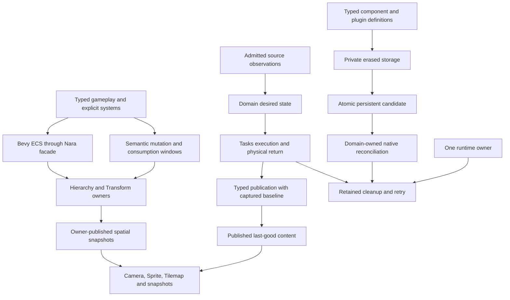
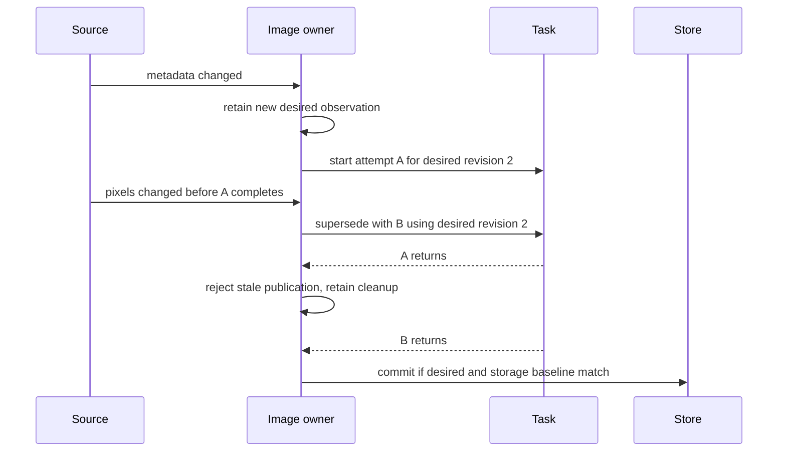

# Low-Level Contract Redesign

**Status:** Proposed; design research, not an Accepted ADR or implementation qualification.
**Date:** 2026-10-23, Asia/Shanghai.
**Source baseline:** `74cbe3ba5586944bf24c60c11c06f441ae001e6b`.
**Inputs:** [Strategy](../../STRATEGY.md),
[original low-level findings](../audits/2026-10-22-low-level-module-and-interface-review.md),
[architecture reassessment](../audits/2026-10-23-low-level-architecture-reassessment.md),
[pinned reference mechanisms](../research/2026-10-23-low-level-contract-mechanisms.md).

The user authorizes research, recording findings and pre-1.0 redesign. This document selects
recommended directions and names the experiments needed to settle implementation details. It
does not change product code, persistent formats, Accepted ADRs or implementation status. Proposed
names below are sketches, not newly available APIs or a source-compatibility promise.

## Outcome And Scope

Make the module that knows a fact responsible for retaining it and exposing the complete operation.
Keep ordinary gameplay as typed ECS data and scheduled systems. Give asynchronous work, persistent
publication and native cleanup stronger contracts where their real effects require them.

Retain Bevy ECS and one runtime owner. Refactor the existing modules rather than adding a universal
transaction, task, resource, plugin or authority framework. A successful refactor deletes caller
coordination and old paths. Fewer lines or fewer crates alone do not establish a better interface.



## First-Principles Rules

1. A transfer either succeeds or leaves an identifiable owner responsible for recovery. Returning
   an error must not erase a resource whose shutdown protocol has not run.
2. A completion fact states a baseline and a time interval. Immutable bytes, a retained token and
   the continuing validity of their association are different facts.
3. Type relationships stay typed until heterogeneous storage requires erasure. Stable schema IDs
   remain explicit because Rust type identity does not define persistent identity.
4. Desired configuration, published usable value and an in-flight attempt have independent
   lifetimes. Rejecting a result does not recover intent that was never retained.
5. Independent source identity, store identity, slot revision, state revision and physical return
   remain separate when they can change independently. Join them privately at the owning operation.
6. Execution order does not imply success, atomicity, cancellation or native rollback. State those
   guarantees at the domain that can actually provide them.
7. Treat ordinary tracked safe ECS operations according to their documented contract. Trusted
   native code is not sandboxed; explicit change-detection bypasses and unsafe mutation do not
   justify weakening already supported replacement/removal behavior.

## D1: Preserve Custody And Expose Task Retirement

### Runtime registration

Keep `RuntimeObligationLedger::register` ownership-returning. For the App integration entry, prefer
**unconditional custody acceptance with fallible activation**: once the participant is passed to
App, every return path retains it in the App's retirement ledger, including wrong phase, undeclared
obligation, duplicate obligation and duplicate participant ID. Illegal installation reports its
normal structured error; Build failures poison construction as before. Rejected installation does
not activate the participant as a normal plugin contribution.

This preserves the current ergonomic `Plugin::build -> Result<(), PluginError>` path. The caller
can use `?` without receiving and accidentally dropping a generic cleanup-bearing error. Retention
must occur before any admission branch, and must not require a unique active participant ID.
Retirement callbacks run through the existing owner-thread close drive, not synchronously during
registration. A participant must already be self-sufficient for cleanup when submitted; it cannot
depend on a later successful resource insertion.

The lower-level standalone ledger still returns `P` on rejection because it has not accepted
responsibility for the caller's complete runtime. Document these two distinct transfer contracts.

Custody acceptance is limited to the callable configuration App lifecycle. `RuntimeInstance::start`
consumes App, and failure/retirement wrappers do not return a registrable App after physical close.
Preserve that consuming boundary; do not reopen a completed owner or rerun plugin shutdown to
accept an impossible late registration. Add a privacy/ownership consumer that prevents regaining
App after close. If a future API returns App, its late-transfer policy must be designed explicitly.

Alternative: return `RegistrationFailure<P>` from App. It is locally explicit, but moves cleanup
retention into every plugin error conversion and weakens the ordinary construction workflow.
Select it only if current consumers demonstrate a need to continue using the rejected participant.
An ignored owned error is not automatic cleanup.

### Single-task retirement

Expose one read-only retirement observation from `TaskHandle<T>`; use an independently retained
observer only where a real caller drops the terminal handle first. It is executor-authored and
does not grant cancellation, result consumption or shutdown authority.

Conceptual states are `Pending`, `Returned`, and `CleanupFailed`. Keep this state distinct from
the first terminal result. A successful return observation means:

- The task closure is no longer executing and its executor-owned captures have been disposed.
- If cancellation won, any result rejected by terminal publication has also been disposed.
- The executor no longer owns task-specific cleanup that could access those captures.
- A Release/Acquire observation publishes this ordering to the observing thread.

A result already delivered into `TaskHandle<T>` remains owned by that terminal or its consumer;
external clones, nested work and domain native effects are outside this observation. It is not
equivalent to joining the worker thread. Rust's
[JoinHandle contract](https://doc.rust-lang.org/std/thread/struct.JoinHandle.html#method.join)
illustrates why completion must name its exact scope, not why Nara should join a worker per task.

The executor marks return only after disposal paths, not after `finished = true` or removal from
its running map. Include queued cancellation, coalescing, rejection disposal, shutdown disposal,
normal completion, panic and late-result destruction. If destruction panics, report a classified
cleanup failure rather than claiming successful cleanup. Do not publish success from an early
guard Drop that precedes capture fields; Rust specifies struct field destruction order in its
[Drop documentation](https://doc.rust-lang.org/std/ops/trait.Drop.html#drop-order).

Keep the return observer's shared state independent from `TaskState<T>` so an observer clone cannot
prolong the completed output's lifetime. Current disposal helpers catch destructor panics internally;
propagate their classified outcome to the return state rather than assuming an outer catch sees it.
Align physical running count/age with final worker-owned disposal as well: `finish_running` currently
precedes pending/control release, so a dropped handle's blocking output destructor can run after
the public running count becomes zero (A04). A delivered result remains its recipient's responsibility.

Migrate Scene preparation, Browser scanning and document Open. Delete their `PhysicalReturn`
wrappers. Keep their request slots, published results, source authority and external Arc ownership
domain-local. Do not replace their different workflows with one generic preparation operation.

**Acceptance:** all registration rejections retain cleanup through incomplete close/retry; terminal
cancellation is observable while a gated capture or late-result destructor still holds return
pending; successful return follows actual destruction. At least Scene and Browser use the common
observation with no local return flag. O2 caller-thread destructor latency remains separately measured.

## D2: Give Spatial Completion One Owner And A Complete Time Contract

### Retained responsibilities

Hierarchy owns ordered structural placement and its validity. Transform owns authored local-to-global
projection and optional presentation interpolation. Neither owns entity lifetime. Render owns
extraction, not repair of a broken hierarchy or reconstruction of Transform authority.

### Recommended external contract

Use private immutable phase snapshots behind semantic system-registration windows. Remove the
`Component` implementation from `GlobalTransform2d`; retain it as an ordinary affine read value.
The snapshot payload is private, with one Transform-owned slot and a read-only SystemParam.
Ordinary consumers ask for fixed simulation or presentation snapshots; they do not compare
hierarchy/Transform/order generation resources or import private sets.

Illustrative vocabulary:

```rust,ignore
// Proposed names; exact generics and SystemParam layout need the consumer proof below.
fn resolve_contacts(spatial: FixedSpatialSnapshot2d, /* gameplay queries */) -> Result { /* ... */ }
fn extract_visuals(spatial: PresentedSpatialSnapshot2d, /* render queries */) -> Result { /* ... */ }

let transform = spatial.global(entity)?;
let publication = spatial.stamp();

add_fixed_transform_projection_systems(app, resolve_contacts)?;
add_extract_transform_projection_systems(app, extract_visuals)?;
```

The fixed interval is authored simulation mutation, materialized deferred baseline, hierarchy
completion, Transform completion, projection consumption, then fixed finalization/capture. The
consumer helper supplies both interval ends. Changes made by consumers belong to the next
publication. Current-frame changes required by a later consumer must have a deliberate later
completion; a consumer cannot call the earlier snapshot a current view of its new writes. The
Extract interval similarly completes simulation and presentation before camera/Sprite/Tilemap
extraction. Startup, zero-fixed-step, paused and multiple fixed-step paths state which snapshot
they consume. Materialize system-local Commands through an actual ApplyDeferred edge;
`World::flush()` alone does not drain every system's command buffer.

Each snapshot fixes World identity, runtime generation where managed, publication sequence, phase
and tick/frame, plus local samples, global matrices and the structural order it consumed. Store
full Entity generations. Access validates the expected slot/stamp, not a caller-supplied equality
predicate. Reusing an old slot in a later phase cannot mark that phase successful. A missing or
invalid publication returns an explicit failure, never last-good-as-current output.

The distinction between **a snapshot completed at a named phase** and **a view current with the
borrowed World** is part of the public contract. A snapshot remains historically valid after a
source edit, while the current source-completion fact is revoked. The initial interface promises
the snapshot only. An exact immediate spatial read, if demanded by a real caller, must compute
against its current validated World/revision; do not silently add that stronger promise to this
snapshot SystemParam.

Keep the most recently completed simulation publication available through an explicit historical
read role during the next mutation phase. Startup supplies its initial cut; subsequent reads retain
their real publication stamp rather than relabelling it as this tick. This is required by
[pursue_scene_players](../../reference-game/src/systems.rs#L798), which reads previous globals while
writing new locals before propagation. Resolve/Capture use this tick's completed simulation cut;
presentation has its own snapshot. Do not move pursue into the post-propagation window and silently
delay its local writes until the next tick.

The current Reference Game also processes newly spawned projectiles through explicit domain-local
positions in the same tick. Preserve or deliberately replace that game rule; it is not a fallback
for missing globals of arbitrary parented entities. If generalized to inherited space, add a
deliberate later completion before the dependent collision/capture operation. Test the actual
spawn-to-hit-to-capture trajectory rather than promising all live inputs came from the earlier cut.

### Representation decision and cost proof

The Reference Game already reads completed globals and then
[spawns projectiles](../../reference-game/src/systems.rs#L1028) and
[retires entities](../../reference-game/src/systems.rs#L1308) in its spatial consumer chain.
A historical tick snapshot describes this workflow honestly: those operations can keep reading
the selected cut while creating state for the next cut. Requiring every following read to prove
the entire live World unchanged would reject this legitimate workflow or require repeated completion.
This real consumer selects the private snapshot over a current-view facade around mutable ECS slots.

The slot may be a private Resource; that is World storage, not security isolation. Trusted native
World access can remove resources. Missing, foreign-World or wrong-phase state fails explicitly;
there is no reason to build an out-of-World service or tamper-proof native boundary. Do not retain a
second authoritative Global Component mirror for source compatibility.

At each publication point, perform one allocation-free source-value/membership comparison with
retained samples, alongside hierarchy validity. This avoids relying on two direct mutations having
different change ticks. With unchanged finite local values and the same topology, reuse the private
matrix payload; changed sources use a complete O(T + E) candidate and atomic slot publication.
Keep this comparison at publication, never per entity or renderer. Value comparison semantics
must cover finite floats deliberately; source invalidity must not be hidden by a no-change shortcut.
The existing scale report is the old baseline, not evidence that the new cost is acceptable.

A snapshot SystemParam reads its slot and therefore need not conflict with mutable local components.
That is intentional: it protects immutable snapshot access during a call, not a frozen World for
an entire stage. Source observations at the next publication determine the next snapshot. Explicit
change-detection bypasses remain trusted escapes; value comparison is not a general anti-tamper promise.

Keep a bounded set of owner slots: latest simulation publication, active presentation and reusable
candidate/history buffers. Readers borrow a publication for their system call; a copied affine
value is just a value, not a clonable completion authority. Do not retain a full snapshot per tick
or introduce public arbitrary history. Any future owned snapshot retention needs an explicit
consumer and memory budget. Compute presentation from one captured local/topology cut rather than
combining a simulation matrix with freshly queried interpolation inputs.

Spatial consistency also does not establish a coherent snapshot of every live Camera/Sprite/Tile
configuration. Render owns those input queries and its extraction interval. A live renderable
missing from the selected spatial snapshot rejects extraction or waits for an explicit later cut;
it cannot fall back to its local transform. If cross-system live input changes need same-cut
semantics, capture those rendering inputs inside the existing Render extraction owner.

Alternative: retain Component caches with hook/epoch revocation and a validated current view. It
preserves current Query syntax, but must cover slot movement, local in-place edits, sequential
writers and safe validation reuse. It also conflicts with the existing consume-then-spawn workflow
unless every read names a snapshot anyway. Reject as the default, while retaining a small local
benchmark variant to quantify the cost of the selected breaking interface.

Alternative: phase-only convention with no invalidation. It is simpler but weakens current raw
structural mutation guarantees and allows stale authority. Reject for the present product contract.
Alternative: recompute through ancestors on every read. It is useful as a small correctness oracle,
not a default extraction path with repeated hierarchy work.

**Acceptance:** old Global Component movement no longer compiles; remove Parent after publication;
replace roots/order; modify locals before/after consumers, including same-tick edits; historical-read pursuit writes new locals before publication; defer mutation
across the actual apply boundary; consume across Worlds and entity reuse; fail propagation without
partial publication. Prove consumer spawn/retirement preserves the named old cut and the next cut
adopts the new state. No generation comparison or live-global fallback remains in Sprite/camera/game
callers. Measure unchanged-frame and sparse/root-dirty costs against the existing scale workload;
source-only design supplies no speedup.

### Spatial domain boundary

Reconcile a newly confirmed source/contract mismatch: ADR 0097 treats a structural parent outside
the same Transform domain as an inheritance boundary, while current propagation rejects it with
`MissingParentTransform`. Select the domain-boundary interpretation: a real non-spatial grouping
parent makes its spatial child a domain root using that child's local transform. Do not search
past the grouping parent for an earlier spatial ancestor. An absent entity or invalid structural
relation remains a Hierarchy error. Test parent Transform removal/re-addition and nested grouping;
replace the existing test that currently requires whole-projection failure for this case.

Expose the effective spatial parent/frame from the same snapshot cut. Migrate the
[pursue velocity conversion](../../reference-game/src/systems.rs#L869), which currently looks up
a global for every structural parent. A direct parent outside the domain returns no inherited
frame, so the child uses its domain-root frame; a participating parent supplies its captured
matrix. Callers must not reconstruct this rule by walking the live hierarchy. Include the real
pursue consumer under a non-spatial grouping parent in acceptance.

## D3: Make Native Lock Ownership Explicit

Prefer an owned `LockedFileCapability` over repeated borrowed `FileLock` guards. Acquiring consumes
the file capability; rejection returns that same capability. The locked owner exposes the required
read/digest/identity operations without exposing another lock-acquisition path. Explicit release
returns an unlocked capability on success or a failure retaining the locked owner for retry.
Drop best-effort unlocks and closes the handle; it does not report a successful explicit release.

```rust,ignore
let locked = file.try_lock(LockMode::Exclusive)
    .map_err(|failure| { /* retain or close failure.into_file() */ })?;
let identity = locked.identity();
// Read or verify while this owner retains the lock.
let file = locked.release().map_err(|failure| { /* retain lock owner */ })?;
```

The exact error adapters are domain-owned; this sketch does not authorize dropping a retryable
lock merely to obtain an `FsError`. Ordinary scoped callers can drop the owned locked file when
they no longer need the original handle. Long-lived owner markers store it directly, removing
the intentional `mem::forget(lock)` pattern.

Alternative: one synchronized active guard per capability. This can preserve shared-reference
callers but adds runtime lock state, poisoned/unlock-failed transitions and mode-upgrade policy.
Alternative: `try_lock(&mut self)` with an exclusive borrowing guard. Simpler for scoped use,
but not sufficient for a long-lived aggregate that owns both capability and lock without self-reference.
Choose one owner model; do not offer both reentrant-looking guards and owned locks for the same handle.

Audit reader/duplicate handle paths and the platform lock unit. A duplicated Unix fd is not proof
of an independent lock owner. Distinguish cooperative locking, platform enforcement and publication
conflict protection; an owned wrapper cannot upgrade any OS guarantee.

**Acceptance:** same-capability repeated acquisition is unrepresentable or rejected; an independent
open remains contended while the owned lock lives; release/Drop/retry and source publication behave
correctly on Windows and Linux separately. Migrate file publication, repair, checkpoint I/O and
generation-store markers. Retain unsupported/unproven outcomes and existing source-race checks.

## D4: Retain Intent And Centralize Managed Asset Mutation

### Image state

Keep three independent records inside the concrete Image owner:

| Record | Owned facts | Lifetime |
| --- | --- | --- |
| Desired recipe | Current admitted source identity/configuration, observation revision, or unresolved/invalid metadata requiring admission | Survives attempts and failed imports; replaced by a later observation or source retirement |
| In-flight attempt | Exact desired revision, task, source/hash facts and publication baseline | One bounded attempt; supersession revokes publication interest without pretending work returned |
| Published value | Last usable pixels, recipe actually used, slot/state publication identity and retained allocation | Survives failed successors; removal/revocation/replacement changes eligibility |

A source event advances source observation; a metadata event records unresolved desired metadata
before work can be superseded. Admission publishes a desired recipe only from validated matching
metadata. Invalid/missing newer metadata remains a desired failure, not permission to reuse settings
from published pixels. A later source event retries the current desired recipe or its unresolved
metadata requirement. Successful import publishes only if both the desired revision and captured
storage baseline still match. Failed import reports attempt failure without changing last-good pixels.
Removal revokes publication; recreation re-admits identity and metadata.

Retain unresolved observation at the first owner that can lose it: a full reload-request queue
may reject work before Image receives it. Generic source resolution retains metadata-dirty/rescan
interest through that rejection; Image interprets the actual settings. Clear the observation only
after matching domain admission or an explicit rescan/retirement transition. Keep runtime last-good
visibility separate from Editor authoring-choice revocation policy.



Do not generalize this into an importer executor. TileSet already has domain-specific desired versus
published dependency semantics; reuse a private helper only when both actual implementations share
the same invariant. Keep layout migration, dependency admission and immutable pixel retention separate.

### Shared mutation admission

Replace loosely paired managed storage operations with a typed mutation admission that captures
handle/type, value-store identity/slot revision, state-store identity/revision and relevant current
publication. Success, failure and removal validate the same captured baseline. Source identity,
desired revision and dependency policy remain in the concrete domain and are revalidated at commit.

The baseline is opaque and consumable. A short-lived writer joins the resources for an atomic owner
operation; retaining a baseline across frames does not retain a mutable World borrow. State and events
publish only after all recoverable preconditions pass. Pressure/lost event observation follows existing
bounded gap semantics. Raw code-first insertion remains explicitly raw and invalidates managed
publication; it does not gain source-backed authority by sharing a handle.

Admission validates the association at capture, not only equality at commit. Capturing empty
value store B together with state store A and later finding both unchanged proves no valid pairing.
For an existing publication, check its recorded published slot against the supplied value store;
for initial loading/re-admission, the same managed owner establishes the pair before issuing a
baseline. Resource replacement cannot silently establish a successor pair. Reuse existing slot/state
identities; do not create a global association registry. Migrate Image snapshots and TileSet slot
guards to this mechanism rather than retaining two equivalent proof layers.

Managed derivation authority is distinct from supported raw code-first rendering. A direct Image
replacement may still be eligible for its ordinary Prepare path under existing code-first tests;
it does not authorize reuse of a retained managed content snapshot. Preserve that distinction.

Alternative: merge every value, state, source and event resource into one universal AssetServer.
Reject: their lifetimes and domain policies differ, and it would centralize concrete imports.
Alternative: leave every domain's current guards. It protects existing callers but preserves the
same store-pairing and late-failure mistakes for the next domain. Select shared admission instead.

### Watcher scope

Use exact-file, subtree and unknown-scope observations at the adapter boundary, or request the
existing sticky rescan immediately when exact translation is unjustified. Preserve both sides of
a rename. Removed paths cannot be reclassified by stat after the fact. Resolve known descendants
by path-component prefix, not string prefix. Expanding a subtree is budgeted and cannot lose the
remaining scope when capacity is reached. Unknown/overflow becomes a rescan obligation, never a
successfully consumed exact-path miss. The Host owns completing the rescan and clearing its
obligation after reconciliation; `RescanRequired` alone does not prove descendant revocation or
completed discovery. No directory scan runs in the notify callback.

**Acceptance:** cross-frame metadata/source supersession; failed metadata then source change;
cross-store mutation, state-store replacement, empty-slot ABA, stale success/failure/removal;
directory remove/rename, root event, unknown kind and bounded expansion overflow. Keep task-poll
cutoff semantics and TileSet last-good/revocation behavior. Native event frequency remains unmeasured.

## D5: Preserve Codec Type Relationships Until Private Erasure

Make `PreparedComponentCandidate<T>` typed. Its `insert`, deferred preparation and asset-aware
preparation constructors must produce exactly `T`. Register a codec whose preflight returns that
candidate, and whose encoder receives the already selected `&T` plus read-only context needed for
entity/asset references. If World/entity are still necessary, pass them as context alongside `&T`;
do not ask the encoder to select its own component or encode absence.

```rust,ignore
fn register_persistent_component_codec_with_context<T>(
    schema: ComponentSchema,
    decode: impl Fn(&ComponentValue, &mut ComponentDecodeContext)
        -> Result<PreparedComponentCandidate<T>, ComponentCodecError>,
    encode: impl Fn(&T, &ComponentEncodeContext)
        -> Result<ComponentValue, ComponentCodecError>,
);
```

This is a shape, not the full bounds or lifetime signature. Registry internals erase after `T`, its
schema registration and candidate preparation have been linked. Heterogeneous apply batches remain
erased internally. Preserve runtime stable-ID binding, frozen registry authority, target lifecycle
admission, asset-aware staged context and failure-atomic publication. Type correctness does not
prove those mutable or persistent facts.

One typed candidate represents exactly one registered component, not a Bundle or hidden additional
inserts. Deferred closures own their inputs and remain `Send + 'static`; they cannot borrow the
temporary decode context, input value or World across preparation. Preserve the declaration that
an asset-aware candidate may touch the AssetServer, before fresh target allocation. The existing
batch shares one scratch AssetServer and publishes neither earlier components nor scratch assets
if a later candidate fails. Keep that batch owner and its precommit revalidation.

Alternative: only return `T` directly. Simpler, but insufficient for existing deferred asset-aware
preparation; it would push handle reservation or native effects into the wrong phase. Alternative:
keep the erased callback and validate arbitrary closure output at freeze. Reject: closure behavior
is not statically inspectable. Keep the final runtime guard as defense, not the public type contract.

**Acceptance:** registering T with a U candidate fails compilation; ordinary and renamed dependency
consumers pass; Sprite/Tilemap encoders no longer repeat `world.get::<T>`; missing components are
selected by the registry; deferred failure preserves target World and asset staging.

## D6: Complete The Existing ECS And Identity Interfaces

Complete the Nara facade paths for the ordinary derives actually exported and used, including
Bundle and SystemParam. Current macro-logic does not expose their path injection, so first qualify
an upstream helper contribution or a precise pinned dependency patch; a thin wrapper is not yet
a demonstrated solution. Include generated `ptr`, `__macro_exports` and SystemParam support paths.
Do not rewrite arbitrary expanded token strings, copy unsafe derive semantics casually or build
a second derive compiler. Explicit advanced Bevy access remains honest. Remove normal
consumer `use nara::ecs as bevy_ecs` workarounds only after root-only, direct-crate and renamed
dependency fixtures pass with generics/lifetimes/where clauses.

Provide small World-oriented identity operations, optionally grouped by a narrow writer. Prefer
shared World/domain preflight that produces an owned candidate, then admitted marker mutation and
a short mutable domain borrow for infallible index publication. Preparation that only reads the
domain must not extract it. This removes unnecessary resource lifecycle effects rather than just
hiding `resource_scope` in another wrapper. Where a multi-domain transaction genuinely needs
extraction, admit its actual remove/reinsert effects before extraction and restore on every Result
path. Detached-domain use can remain advanced with the same invariant implementation. The writer
does not wrap all World access or hide a long-lived mutable World inside a Resource.

**Acceptance:** first adoption rejects target Add/Insert observers before effects; repeated legal
adoption works; public single-entity retirement rejects resource observers with zero effects before
preparation; domain stays installed after rejection; independent save/restore and stale locator
consumer needs no manual resource extraction. Preserve tombstones, World binding and incarnation.

## D7: Keep Numeric And Input-Budget Repairs Bounded

Move map-key length/aggregate accounting into the visitor before Nara copies a borrowed string.
For an already owned parser string, validate before retaining or copying it further. Preserve the
encoded input cap and document that a generic Serde visitor cannot prevent all parser-owned scratch
allocation. Do not build a JSON parser merely to assert an allocation-free rejection.

Compute angular differences in a domain wide enough for admitted f32 endpoints, wrap the angle,
then lower deliberately. Preserve alpha endpoints and shortest-arc behavior. Check the resulting
matrix under existing finite projection validation. These are bounded repairs in Core/Transform,
not reasons for a universal numeric or parser framework.

## D8: Make Success-Dependent Finalization Explicit

Document that a managed system error is observed at the Schedule boundary, not an intra-schedule
abort. Deferred effects already queued may run; arbitrary native changes are not rolled back.
This contract is independent from persistent-document atomicity.

For Gameplay, first add the missing observable failure trajectory: Consume errors before Capture
and Acknowledge, including queued commands. Recommended policy is that a faulted batch does not
publish a successful capture or acknowledge consumption. Gate those effects on a domain-owned
accepted-operation state or combine the steps that truly require shared success into one fallible
operation. Successful tick membership alone is insufficient. Scope the state to that exact batch
and runtime generation; do not treat absence of a global sticky fault as proof that every relevant
operation succeeded. Specify retry/restart behavior before implementing a change.

Alternative: a general fail-fast scheduler. Reject here: concurrently started systems and deferred
commands still prevent an honest whole-schedule transaction. Alternative: leave ordering and add
comments. Insufficient for consumers whose acknowledgement has actual success meaning.

**Acceptance:** final runtime fault plus the absence/presence of the specifically agreed capture,
acknowledgement and deferred effects. Retain normal zero/multiple fixed ticks, replay and Stop.

## Contract Adoption And Upper-Level Impact

| Design | Owning module | Callers that must migrate | ADR treatment before implementation |
| --- | --- | --- | --- |
| D1 custody | App/Tasks | TaskPlugin, checkpoint plugin, Scene/Browser/document Open and close owners | Repair 0084/0117 custody; refine 0008/0052 task observation if adding a public semantic contract |
| D2 spatial | Hierarchy/Transform | Reference Game, camera, Sprite/Tilemap extraction, interpolation, Scene construction, UI readers | Repair 0100 revocation; clarify 0097/0100/0101/0117 time contract; replacing the Component requires an explicit refinement |
| D3 locks | FS | file publication, project repair, checkpoint and generation store | Reconcile 0070 release-ownership vocabulary and guide; preserve guarantee axes |
| D4 assets | Asset/Image/Watch | source resolution, Image import, TileSet publication, hosted replacement and diagnostics | Clarify/refine 0037/0080/0103/0115/0117 where intent or publication contract changes |
| D5 codecs | Reflect | derives/providers, Scene apply, Sprite, Tilemap and independent native codecs | Repair type relationship under 0081; reconcile public codec contract in owning guides/ADR |
| D6 facade/identity | ECS/Identity | independently compiled modules, persistent identity consumers, root preludes | Repair 0002/0044 facade support and 0058 identity admission; document the supported writer |
| D7 bounded corrections | Core/Transform | shape preflight and interpolation fixtures | Existing guarantees; no new architecture decision unless admitted semantics change |
| D8 success | App/Gameplay | command Consume/Capture/Acknowledge, reference snapshots | Clarify 0084 detection scope; reconcile 0023/0024/0057 and Gameplay policy if changing acknowledgement |

Do not rewrite historical test results or mark an ADR implemented because this proposal exists.
The implementation ledger now records confirmed counterexamples and limits earlier implementation
claims; this documentation correction does not execute or qualify a repair. Status advances only
with new source and executed evidence. New durable choices can use a focused
ADR or a precise revision with reciprocal refinement links. Avoid one omnibus ADR that silently
supersedes unrelated native, persistence or platform contracts.

## Ordered Execution And Research Gates

1. **Ownership first:** regression-first L01/L07, select lock owner with real publication/marker
   callers, and qualify D1 physical-return semantics. Native lock checks are serial and platform-specific.
2. **Spatial replacement:** qualify the selected private snapshot with historical-read pursuit,
   consume-then-spawn/retire, grouping and extraction consumers. Compare a bounded component-backed
   control for cost, without retaining parallel public APIs. Reconcile the snapshot ADR clauses,
   migrate all consumers and delete old token predicates. This is the main architecture proof gate.
3. **Asset state:** retain desired Image state, scope invalidation, then centralize managed mutation
   baselines using Image and TileSet. Do not make desired intent depend on a successful new import.
4. **Typed extension interfaces:** typed candidates, facade derives and identity writer; compile
   independent root/direct/renamed consumers before deleting old paths.
5. **Success semantics and bounded fixes:** run the failing Gameplay trajectory before choosing
   batch policy; apply visitor/numeric corrections in their owners. No scheduler replacement.
6. **Integration:** reconcile ADRs/guides, review actual caller diff, execute the affected headless,
   independent consumer, Editor and native cohorts. Commit coherent owner slices, not a compatibility
   shell followed by indefinite migration. Keep one Cargo process and `CARGO_BUILD_JOBS=1`.

The first four slices may have independent read-only research in parallel. Cargo verification and
shared contract changes stay coordinated. Storage/serialization changes need explicit fixture and
supported source conversion; this proposal itself selects no new persistent format.

## Measurable Completion Criteria

| Criterion | Required observation |
| --- | --- |
| Custody | Every rejected participant has one reachable cleanup owner until close completes |
| Spatial validity | Every stated mutation trajectory returns correct current values, rejects, or explicitly returns a named historical snapshot; no silent stale authority |
| Consumer simplicity | Zero consumer generation-equality predicates and zero local `PhysicalReturn` guards in the migrated workflows |
| Typed registration | T/U candidate mismatch fails compilation; normal root/direct/renamed derives and codecs compile without hidden aliases |
| Asset intent | Cross-frame supersession preserves latest accepted recipe or latest unresolved metadata requirement while last-good values remain coherent |
| Mutation association | Cross-store/state/ABA and stale failure/removal cases reject before state/event/value changes |
| Lock owner | One release owner; independent opens show actual contention/release on each qualified platform |
| Success policy | Error trajectory asserts capture/acknowledgement and deferred effects, not only final runtime error |
| Cost | Re-measure the existing 4,096-member static/sparse/root-dirty spatial workload and actual changed preparation/asset flows; investigate regressions rather than inventing an FPS target |
| Product workflow | Actual external source/module and affected Editor/Play/Save/Stop consumers pass within explicitly named platform/feature scope |

## Risks And Deliberately Deferred Work

| Risk | Mitigation |
| --- | --- |
| A reader facade hides an unchanged freshness hole | Qualify same-tick, post-propagation, sequential writer and deferred cases before selecting representation |
| Hook-based revocation causes self-invalidating publication or observer effects | Keep owner writes distinguishable privately; validate exact lifecycle surface and test first insertion/replacement |
| Task return overclaims external cleanup | State exact capture/rejected-result scope; domain retains delivered values, clones and native effects |
| Owned lock wrapper still shares a native lock unit through duplication | Audit every duplicate/read path and test actual OS mechanism; preserve unsupported/unproven states |
| Shared asset baseline becomes a generic importer | Limit it to existing store association/revision checks; keep recipes, decoding and dependencies domain-owned |
| Typed candidates discard existing deferred preparation | Preserve typed deferred/asset-aware constructors and heterogeneous internal batches |
| Refactor fixes owners but leaves old consumer bypasses | Inventory real callers and remove obsolete paths in the same slice; use external compile/privacy consumers |
| Documentation grows without a product improvement | Each slice must delete concrete caller coordination and satisfy a named consumer trajectory |

The six O1-O6 opportunities from the prior review remain tracked in the reassessment. Caller-thread
destructor time, catalogue copies, picker scale, synchronous extension codecs and thread-affine
pollable close require their existing measurements or concrete consumer triggers. Do not promote
them into speculative framework work. No new 3D, physics/audio backend, scripting language, dynamic
ABI, save format, resource-acquisition service or universal rollback contract is selected here.

## Research And Verification Status

This proposal is based on source inspection and pinned reference mechanisms. No Cargo, runtime,
native/GPU, allocator or performance experiment was executed during its authoring. Prior audit
probes used cached artifacts and keep that limitation. Required implementation proofs above are
future gates, not results. Independent architecture review challenged the selected seams. An adversarial review found two
P2 migration gaps: historical pre-propagation pursuit reads and same-cut effective spatial-parent
conversion. Both were corrected; narrow re-review found them closed with no new finding. This is
document qualification only; platform/consumer/cost proofs remain required before implementation
claims. Source-lane counterexamples and corrections are recorded in the reassessment, including A04
physical running statistics. Five Codex lanes completed (four research lanes and one adversarial
reviewer); all were closed after collection. Initial research lanes briefly paused on coordinated
document writes, then resumed after parent ownership was clarified. No external model was used.
