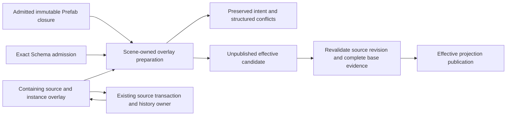

# Scene-Owned Declarative Prefab Overlays

Status: Proposed R5b design and bounded comparison. This does not replace an Accepted ADR or
change the current `PrefabInstance.overrides: ScenePatchDocument` production contract.

The [private comparison evidence](../knowledge/engineering/verification/2026-10/2026-10-26T025005Z-private-prefab-property-intent-comparison-and-next-owner-replacement-70ca642be09045ab909751b87ed5164d.md)
records six executed scalar cases and independent review corrections. That evidence does not
qualify the structural/reference compiler, conflict persistence or a production format switch.
The [structural/reference successor](../knowledge/engineering/verification/2026-10/2026-10-26T034052Z-private-prefab-structure-and-reference-comparison-with-owner-boundary-counterexamples-c823420a09444940993ed9d948a28273.md)
adds a private executable comparison and owner-boundary counterexamples. It still does not
replace production storage or qualify Host publication. The
[Unity/Godot editor study](../research/2026-10-26-unity-godot-prefab-editor-ownership.md) supplies
editing-context, Apply/Revert and Inspector evidence, separately from runtime qualification.
The [typed-origin production checkpoint](../knowledge/engineering/verification/2026-10/2026-10-26T041116Z-typed-prefab-instance-addition-provenance-and-complete-consumer-propagation-331ec66de92c4315971800928d8f2dc7.md)
replaces flattened addition provenance in the current patch-based expansion under ADRs
0038/0058/0102. It does not adopt this Proposed durable overlay format.
The [mixed-origin and property successor](../knowledge/engineering/verification/2026-10/2026-10-26T074532Z-complete-mixed-origin-overlay-targets-and-payload-relative-property-claims-0949791c549242739236d36eb00d4fa2.md)
combines nested source/addition targets and Schema-relative property claims in that private
compiler. Its resolved-base trace is test-only; production storage and Host admission remain unchanged.

## Problem And Scope

An editor transaction and a durable override answer different questions:

- A transaction says what changes on one exact revision and how to undo that accepted change.
- An override says which authored intent should survive later changes to an inherited source.

`authoring/property.rs` correctly coalesces nested property writes into root `SetField` operations
for exact history. Persisting that result as an overlay discards the original leaf intent. An
override of `position.x` can then pin the previous `position.y`. `MoveEntity.from` likewise proves
an exact edit basis; it is not the desired placement after the base has reordered itself.

R5a selectors, canonical source admission, structured provenance, retained source construction,
and prepared source editing already exist. Reuse them. Full recursive discovery, a new global ID
service, Behavior representation and a universal document framework are not prerequisites.

## Alternatives

| Design | Benefit | Cost and disposition |
| --- | --- | --- |
| Persist exact operation patches and rebase each operation | Existing implementation and exact inverse machinery | Root lowering has already lost leaf intent; exact placement preconditions encode old state. Keep for revision-bound editing, not the replacement durable contract. |
| Persist a complete modified Prefab snapshot and three-way diff | Simple snapshot activation and a concrete comparison oracle | Must retain old base and infer intent from values; equal values cannot distinguish inheritance from a deliberate pin. Compare where useful, do not make it default truth. |
| Persist declarative property/component/structure intent | Preserves intentional inheritance and explicit target semantics | Needs conflict retention, structure compilation and base evidence. Recommended owner direction; wire format is not frozen by the first property experiment. |

## Ownership And Data Flow



The containing source owns the overlay as durable authoring data. Effective entities are a
projection, never a second source or Undo owner. Preparing or rejecting a projection does not
change the source, revision, history or dirty state. Editing/remapping the overlay is an ordinary
source transaction with owner-created inverse history. Saving unresolved intent and activating a
valid projection are separate admissions; a conflict must not make the source unsavable.

## Target Context

- The containing source and its local instance anchor come from the overlay's actual owner. Do
  not redundantly persist a Workspace document ID, runtime occurrence, expanded locator or epoch.
- Bind the overlay's root source to admitted canonical `SourceDocumentKey` identity, separately
  from the lookup `AssetRef`. An explicit source replacement cannot silently retarget old intent.
- A direct inherited target names a source entity. A nested target adds ordered steps of source-
  local instance anchor plus the next canonical source identity, ending with a source entity.
  The same source at two anchors is two placements, not one target.
- That source-only shorthand is insufficient for inherited additions or an added instance
  anchor. The replacement address must tag source versus addition origin at every anchor and
  terminal entity; the later grammar sketch below records this unresolved production shape.
- Lookup spelling is useful evidence and write-back input, not canonical equality. Do not use
  whole `PrefabProjectionStep` equality: it deliberately includes the authored lookup request.
- Properties retain `ComponentTypeId` and the original `ComponentPropertyPath` before root
  coalescing. Keyed selectors retain both `by` identity member and key value.
- Overlay-local additions use an explicit local namespace, distinct from inherited targets.
  Remapping an added entity or converting an instance to local data must rewrite declared
  references through the existing Scene/Schema owner, not string substitution.

Target addressing alone does not bind references inside a replacement value.
`EntityReference::SceneLocal` contains only a local entity ID; Schema traversal can find its slot
but cannot infer whether `socket` denotes inherited data, a local addition or one of two nested
placements. The structural comparison selects ordinary `ComponentValue` plus explicit bindings
for each declared local-reference slot, rather than duplicating the recursive value model.
Each binding carries the exact payload coordinate, expected local spelling, and complete
inherited target or explicit added-entity target. The slot is version-bound payload evidence,
not a durable property selector; payload/schema migration invalidates it. Defaults are
materialized before binding because they can introduce local references too. Every local slot
consumes exactly one binding; duplicate, missing, stray and mismatched bindings reject. Persistent
references and typed asset references keep their existing meaning and accept no local binding.
Do not silently reinterpret the ordinary `SceneLocal` wire type or add a global reference resolver.
Ambiguous/unbound references remain conflicts. Production replacement is blocked until existing
valid inherited-to-added and added-to-inherited references work, including equal local spellings
and repeated nested sources. The first scalar comparison intentionally exercises none of these.

`SourceDocumentKey` is not currently a wire type. Freeze its bounded persistent encoding through
the source owner before production format replacement; do not serialize Debug text, invent a new
asset resolver, or derive canonical identity from a lookup path after resolution. Named,
project-location and admitted stable-asset origins retain their existing continuity semantics.

### Complete Nested Target Grammar

The private comparison now replaces its former `Inherited(Vec<SourceEntity>)/Added(id)`
split, which dropped a target whenever any production provenance step was an addition.
Real expansion already admits `Source(P,n) -> Added(x)`, `Added(a) -> Source(Q,y)` and
`Added(a) -> Added(x)`. Each is a distinct authored placement, including repeated outer instances.
Treating `Added(id)` as root-only or tagging only the terminal entity cannot express them.

The executable private shape models the following semantics; this is not an adopted public API
or production wire schema:

```text
EntityOrigin = SourceEntity(local_id) | InstanceAddition(local_id)
InstanceHop = { anchor: EntityOrigin, expected_base: SourceDocumentKey }
EntityTarget = { through: [InstanceHop], entity: EntityOrigin }
Overlay = { base: SourceDocumentKey, additions, components, placements, suppressions }
```

Interpret a target relative to the containing overlay's instance. Each hop identifies the next
anchor in that layer's source/addition namespace, then enters its Prefab only if its admitted
base matches `expected_base`. The terminal origin uses the reached layer. The root overlay's
`base` also binds intent when only additions survive. These are rebase predicates, not addition
owners or extra Runtime/UI identity axes. Alias requests may preserve a canonical key; actual
root or nested base replacement conflicts until explicit rebind/remap. Do not put Workspace IDs,
Runtime occurrences, preview epochs or lookup requests into canonical target equality.

Retain `PrefabInstance.source` as lookup, and reuse `ComponentPropertyPath`, `ComponentValue`,
`SceneComponentRecord` and payload-coordinate `ComponentFieldPath` rather than creating parallel
value/selector trees. Complete records and property values carry exact local-reference bindings
relative to that payload; a scalar-reference payload can have an empty slot. Default-before-bind,
exact single consumption and final survivor-namespace validation remain mandatory. Version-bound
payload coordinates are not durable selectors and neither follows a full-record migration
implicitly.

The private compiler also replaces its component upsert with explicit normalization:

- One `(target, component)` has Add, Replace, Suppress or a property-claim set, not overlapping
  modes. Add requires absence and Replace presence. New-entity component changes fold into its
  complete added record; placement alone owns sibling/child order.
- Duplicate and ancestor/descendant property claims conflict against one base. Preserve explicit
  equal-value pins. Key-member writes, including replacement of an enclosing item with another
  key, require complete keyed-container replacement and exclude descendant claims.
- Initially Absent covers only a declared root that existing RemoveField can remove: optional
  or default-bearing, ending in a map member. It removes authored storage; a Schema default can
  still apply. It is neither Set(Null) nor Revert (removing the claim). Do not generalize nested
  Optional to absent record members when the existing shape validator requires them.

Property claims resolve against the same immutable effective base before replacement. Raw claims
are bounded before payload cloning or binding. A small Reflect helper reuses the existing declared
reference traversal with the selected value shape and payload-relative paths, including an empty
scalar slot. The owning root field still supplies capabilities. Existing inherited references are
retained; a replacement payload or an Absent-exposed default must bind its local references
explicitly. Bound defaults appear only in the derived effective candidate; the retained declaration
remains Absent. Duplicate claims, ancestor/descendant overlap and keyed-item identity changes
reject; whole keyed-container replacement is explicit. These are executable comparison rules,
not production source editing or persistence qualification.

Scene's format owner should use private wire structs for the existing source-key kind and
Named/ProjectLocation/StableAsset origins, rebuilding semantic keys through their constructors.
The UI's existing canonical key encoder is useful precedent, not the persistence owner; never
persist its occurrence-bearing context. A decoded expected key does not itself admit a real file:
the actual Host still validates metadata/location and captures the immutable resolved closure.

The private comparison covers the three mixed-origin paths through repeated outer instances;
alias versus root/nested base replacement including additions-only; leaf/whole-container and
Absent/Null/Revert distinctions; mixed-origin references, defaults and empty payload slots;
and final invalid intent with unchanged source/history. Before a production switch, qualify these
through bounded production decoding and actual source editing,
Undo/Redo, conflict Save/Reopen and conversion through the real decoder/Host. Reconcile ADRs
0006/0038/0026/0090/0043 and remove embedded operation-path/patch-version dependence together.
No new legacy reader is justified for the unreleased canonical-v1 replacement.

## Intent, Versions And Rebase

An overlay value retains its authored component version and Schema interpretation evidence.
Selector identity does not prove that an old replacement value has current meaning. Initially,
version or identity-policy changes preserve the intent as a conflict requiring explicit
re-authoring/remap; a component's full-value migration does not implicitly migrate leaf overrides.

For a fresh admitted base, Scene resolves the original intent and builds one effective candidate.
Uncovered siblings inherit the new base. Removed targets, changed keyed identity policy, missing
Schemas, invalid values, dangling references and incompatible structure produce structured
conflicts with the original payload intact. Do not guess a replacement by wire name or index.

Keep these evidence lifetimes separate:

1. Durable authoring evidence explains the original target/value and permits a repair decision.
2. A prepared activation retains the exact immutable participating base closure and Schema used
   to build its candidate, including nested dependencies and alias admission evidence.
3. Publication checks the source revision and current closure evidence. A changed base rejects
   that candidate, not the overlay forever. Reprepare against the new base; harmless unrelated
   changes must not become permanent digest-mismatch conflicts.

The private comparison may use full document equality as its exact base-change oracle. That is
not a selected production hashing, retention or filesystem-consistency mechanism. Production
must reuse the actual Host's captured-source evidence and bound retained work before copying.

## Structural Completeness Before Replacement

The production switch must replace all existing durable capabilities together. A property-only
experiment is not permission to ship two competing overlay authorities.

| Current operation capability | Required durable intent |
| --- | --- |
| `SetField`, `SetAssetRefField` | Explicit property replacement, including typed references |
| `RemoveField` | Explicit absence where the current Schema permits it; inheritance is a separate reset action |
| `AddComponent`, `ReplaceComponent`, `RemoveComponent` | Declared added/replaced/suppressed component state with version basis |
| `AddEntity`, `RestoreEntity` | Overlay-local entity/subtree data, references and desired placement |
| `RemoveEntity` | Explicit inherited-target suppression with survivor/reference validation |
| `MoveEntity` | Desired parent/order relation, without an old `from` prerequisite |

Placement remains source-local and stable-ID based. Missing parents/anchors, cycles and colliding
claims must be conflicts, not a fallback to the old ordinal. The structural comparison must settle
ordering of multiple added/moved siblings and inherited descendants before freezing serialization.
An overlay is normalized desired state, not a chronological replay log; duplicate or overlapping
property claims initially refuse rather than depend on input order. Do not infer inheritance
from value equality: an explicit pin can equal today's base.

Ordered source edits cannot simply be persisted as a set of their original selectors. A concrete
counterexample is changing a keyed item's identity `a -> b`, then writing another member through
key `b`: that second target does not exist in the untouched base. Initially reject a leaf override
that changes its enclosing collection's `by` member. Require explicit whole-keyed-container
replacement for that intent, deliberately owning the container rather than guessing a key remap.
Ordinary revision-bound source transactions retain their existing sequential key-edit support.
Any later finer-grained normalization must prove logical identity/reference preservation without
turning the durable overlay back into an ordered operation log.

## Structural Comparison And Selected Limits

The private compiler in `crates/nara_scene/src/prefab/overlay_structure_comparison.rs` uses real
Prefab expansion and canonical provenance. Its initial checkpoint used the existing construction
owner and one final source-owner preparation. The subsequent full-value comparison instead
reuses the underlying ID allocator and complete-record validation core without source edit or
construction preparation. Intermediate structure uses existing exact Scene placement operations
on an unpublished copy; there is no new ID allocator or Undo authority.
It compares a real old-basis `MoveEntity` override against desired placement on a reordered base.
Repeated source occurrences, nested targets and lookup aliases are separate executable cases.
The mixed-origin successor indexes all nine targets in a real repeated/nested fixture where the
old source-only index retained four. Each instance hop reads its canonical base from actual
production resolution in a test-only trace, including instances with no surviving source entities.
It does not infer dependencies from surviving entity provenance or add a production inventory.

The chosen placement rules for this experiment are:

- Each target has at most one placement claim. Multiple claims on the same target reject.
- `First`, `Last`, `Before` and `After` describe slots in the instance's projected sibling
  subsequence. A slot cohort follows placement-declaration order, not entity allocation order or
  a replay of old placements. Unclaimed inherited siblings retain source order.
- Relative anchors must exist in the final same parent. Attachment cycles and parent cycles
  reject. Ancestors are placed before their final descendants, allowing a valid parent rotation
  without constructing a transient cycle in exact Scene operations.
- Containing-owner children are not inherited targets. Only projected entities are moved;
  foreign records and their relative order are retained. Existing foreign interleaving does not
  cause a no-op edit. No cross-owner placement is inferred from a sibling's expanded locator.
- Suppression follows desired layout, so an explicitly moved descendant can survive its old
  parent's suppression. Overlapping ancestor/descendant suppressions reject independent of
  input order. Any declaration or declared placement relation erased by suppression conflicts.
  The returned target map excludes removed entities.

The comparison preserves intent and a private conflict through JSON encode/decode for controlled
fixtures. This proves neither hostile persistent admission nor production conflict Save/Reopen.
The private source-identity wire shape is not the selected persistent source-owner codec. The
64-declaration/reference limits and existing Schema traversal budgets bound this experiment;
they are not a measured product workload budget or a complete pre-copy overlay admission policy.

Two owner-boundary counterexamples matter to production design:

1. A default local reference can resolve to an unrelated same-named containing-Scene entity if
   binding precedes default materialization. Default-before-bind now rejects that ambiguity.
2. Creation-template plus root-field edits are not a complete component-value codec. Removing
   optional `group.note` from a template leaves `{ group: {} }`, even if the valid intended
   full value is `{}`. The initial private comparison rejected that mismatch. Its full-value
   successor reproduces the lawful input's rejection first, then accepts both distinct values by
   directly constructing complete records and sharing source classification's value validator.
   It does not reconstruct ancestor containers or broaden generic source-edit permissions.

Consequently, production effective-projection compilation must reuse full candidate
classification/admission, not widen generic source-authoring edits merely to compile derived
data. Source overlay mutation and its exact inverse/history remain at the existing source owner;
projection preparation publishes no source history. Complete full-value support is a production
switch prerequisite, not a reason to keep the lossy template lowering as a fallback.

### Full-Value Admission Boundary

The shared complete-value validator is production code used by `classify_complete_record` in
`authoring_decode.rs`. Source classification retains its existing readiness, manifest,
source-location and local-reference duties. The strict whole-document entry remains test-only,
used by the private compiler until a real production compiler establishes its public needs and
evidence holder. It admits current known Schema independently of editing Adapter availability,
and requires neither a creation template nor Undo budget. No unused public candidate family is
introduced to make this comparison appear production-complete.

The compiler supplies unpublished full values after default materialization and explicit
reference binding/remapping. Reflect continues to own value shape, defaults and declared-reference
traversal. Scene validates final structure, effective local references and the complete typed
provenance before constructing its existing expanded candidate. Keep `{}` distinct from
`{ "group": {} }` when both satisfy the Schema; neither a template nor root-field reconstruction
may select one on the author's behalf. The final invalid record must leave no admitted candidate.

This data admission is not native execution admission. Missing/future/unmigratable source records
may remain losslessly savable under ADR 0090 without becoming executable. Known current values
must reject undeclared fields. Native codec, registry, asset and Runtime admission remain on the
existing materialization path; the compiler does not issue a substitute execution credential.
Full-record migration likewise does not migrate durable selectors or version-bound reference
slot coordinates implicitly.

Borrowed source/value accounting must precede copying input, defaults, bindings and provenance
in the production replacement.
Neither `effective_component_value`'s borrowed fast path nor a final publication-shape check
proves that condition: the latter currently constructs a canonical envelope by cloning. Reuse
the existing file/value counters rather than create another recursive format validator. The
comparison now reuses these counters for the borrowed base and final aggregate effective values,
including defaults. This is still not complete pre-copy aggregate default/binding/provenance
admission: individual default materialization may allocate before the final aggregate rejects.
Keep that limitation explicit until the actual production compiler owns its complete budget.

The exact Schema basis and actual base/source revision evidence must flow from the first real
compiler and existing Host holder. Do not introduce a public publication-token family solely for
this extraction. Tests should prove both lawful container shapes, template independence,
unknown-field/version refusal, defaults-before-reference binding and last-record failure.
The private compiler now consumes this core and returns an expanded document with complete
typed provenance, rather than a source edit/inverse. Its tests preserve the real source document,
revision and history, including under a one-byte history budget. This does not qualify durable
overlay storage, a captured base closure, native materialization or Host publication.

### Remaining Production Identity And Publication Obligations

- An addition belongs to its containing source's instance overlay, not the base Prefab. The
  typed-origin checkpoint carries explicit `InstanceAddition` steps through current production
  expansion, Runtime and UI keys. The private comparison's `TargetMap` is not that owner. The
  eventual durable overlay codec and compiler must reuse the same ownership meaning; no
  `overlay:` ID prefix or fabricated base-source entity may stand in for it.
- An overlay declared inside a Prefab source can itself appear through repeated/nested outer
  instances. Production ancestry now distinguishes source-entry and addition-entry steps,
  including an added instance anchor. This does not yet qualify the new durable overlay's
  source edit/history/repair or full reference grammar. Existing occurrence/epoch custody stays.
- Activation must retain and revalidate the actual admitted immutable nested base closure and
  Schema. Full document equality in a private fixture is not a filesystem publication protocol.
- The private compiler now combines explicit absence, whole keyed-container replacement, overlap
  rules, component-mode admission and mixed-origin reference binding with complete-value
  validation. The production replacement still needs bounded canonical source/conflict encoding,
  aggregate admission before copying, complete source edit/history/repair and conversion paths.
  Combining the private comparisons does not qualify those production obligations.
- The private overlay's new additions are still IDs plus separate component declarations. It
  can address an existing added instance anchor from real production expansion, but cannot yet
  declare a complete new record carrying its own `PrefabInstance`. Production additions must
  preserve complete records and recursively capture their sources; mixed-origin target coverage
  does not establish that declaration capability.

The production provenance change is a typed origin axis within the existing placement model,
not a replacement identity service. Conceptually, an entity address combines its owning-source
placement with either a source-local entity or an overlay-local addition at an explicit instance
address. For Scene `S`, anchor `a` instantiating `P`, addition `x` belongs to `S/a`'s overlay,
not to `(P, x)`. For Prefab `P`, anchor `n` instantiating `Q`, addition `x` belongs to `P/n`'s
overlay; each outer placement of `P` supplies its own existing occurrence and source chain.

An added entity can itself carry a `PrefabInstance`, so the origin distinction must also occur
in instance-anchor ancestry, not just as a terminal `is_added` flag. `PrefabProjectionPath::steps`
now carries either `SourceEntity` (canonical source plus entity and lookup evidence) or
`InstanceAddition` (addition-local entity, owned by the preceding anchor). Earlier expansion
flattened patched-in additions into the base's source/entity namespace. The current patch-based
effective copy still refuses duplicate IDs; the correction does not enable same-spelled inherited
and added records to coexist or claim a previously observed Runtime ID collision.

The corrected typed provenance travels through existing expansion, candidate validation,
retained-byte admission, `SceneEntitySource` publication and UI placement encoding. Runtime
retains one encapsulated provenance value, not separately mutable ID/path fields. Canonical source,
logical occurrence, Runtime activation/incarnation and preview epochs remain unchanged. The
ECS-independent UI kernel still receives opaque context/placement keys, not Scene origin types.
Provenance is not a base-dependency inventory: actual resolved sources remain captured/revalidated
by their Host even when only additions survive and their addresses omit the overridden base.
Durable overlay edits remain on `SceneAuthoringSession` or `PrefabAuthoringSession` according to
the declaration's real source. Reopening a disposable authoring session merely to classify the
derived projection would introduce the wrong source/history lineage.

## Editor Workflow Consequences

Unity and Godot are the primary editor-workflow references; Bevy is principally an ECS/Rust
composition reference. The [versioned official Unity and pinned Godot study](../research/2026-10-26-unity-godot-prefab-editor-ownership.md)
separates observed behavior from these proposed Nara consequences:

- Inspector and scene breadcrumbs identify the edited source/layer separately from selection and
  visible preview context. A Prefab source session and an instance overlay are different owners.
- Revert removes the selected authored intent to restore inheritance; writing the current base
  value instead would create another explicit pin. Source edit, instance override and Apply to a
  chosen ancestor source must not share one ambiguous write command.
- Apply identifies its destination source and scope, previews widened effects, and fences all
  participating evidence. Updating a source and removing an instance override is cross-document
  work, not an excuse for a universal transaction manager or a silent partial success.
- Ordinary and custom Inspector controls use the same semantic prepare/commit/history path.
  Multi-object mixed values and per-target compatibility are explicit; observing the first value
  does not prove all selected targets agree or make a loop of writes one atomic owner edit.
- Unresolved overrides stay visible and savable with explicit repair/removal. Unity's documented
  unused-override behavior is useful product precedent, not proof of our proposed implementation.

These are design requirements for the later public/native workflow, not implemented UI features.
Current Accepted ADR 0038 and the current narrow Apply Changes scope remain authoritative until
the owning contracts and complete replacement are reconciled.

## Ordered Implementation

1. **Private semantic comparison:** compare the real existing root-patch path with original leaf
   intent against the same admitted base change. Exercise inherited siblings, explicit equal-value
   pins, schema-version conflict, last-operation rejection and stale-base activation. Keep types
   private to the test; do not change production format or Accepted decisions for an experiment.
2. **Structural and nested comparison:** extend the selected candidate to repeated/nested source
   targets, local additions, suppression and placement. Decide overlap/order policy from executable
   cases, key-changing edits and explicit whole-container replacement, plus inherited/local and
   repeated-nested reference binding. Retain conflict payload through a bounded round trip. Stop
   before a public API if any existing structural/reference capability has no replacement.
3. **Reconcile owning ADRs:** amend 0006/0038 for durable versus exact operations, 0026/0090 for
   source transaction/repair authority, and 0043 for value/address evolution and canonical v1 reset.
   Reconcile 0038/0058/0102 for explicit overlay-local origin throughout nested ancestry and its
   existing Runtime/UI lowering. Amend 0101 only if its stable placement rules actually change.
   Record narrower implementation status separately; do not promote Proposed ADR 0083 as an
   incidental dependency.
4. **Replace production owner and consumers:** switch `PrefabInstance.overrides`, bounded wire
   admission, expansion, source-edit/history and persistence together. Remove operation-patch-as-
   overlay and obsolete in-repository fixtures; no legacy reader, compatibility alias or new
   migration guide. Exact editor patches/inverses remain because their responsibility remains.
5. **Qualify public workflow:** non-active prepare/retain/commit, exact outcomes, one Undo/Redo,
   conflict Save/Reopen, explicit remap, convert-to-local and last-failure atomicity. Include
   independent consumption and the affected native Editor path before claiming its support.

### Concrete Production Replacement Boundaries

The next production unit is one containing-source instance workflow across the following existing
owners. A compiler-only or wire-only switch cannot establish that workflow:

- `nara_scene::prefab` and `format` own instance storage, private wire, bounded decoding and
  recursive declaration/value counting. `migration` and `authoring_decode` must replace embedded
  patch-version/operation-path locations with actual overlay declaration locations. Preserve
  unavailable payloads, owner/version, selectors and bindings without guessing a migration.
- Exact Scene patches remain source transactions. Their current operation enum cannot mutate an
  existing `entity.prefab`; add a dedicated owner-created instance/overlay operation and inverse
  through existing prepare/commit, revision, readmission and history budgets. Unresolved intent
  remains savable even when activation rejects. Source repair must not require an active projection.
- The Scene-owned compiler takes actual resolved bases and produces the existing admitted expanded
  document without source history. Production additions carry complete records, including nested
  instances. Bound aggregate values, defaults, targets, bindings and provenance before copying;
  the private equality oracle, limits and test-only resolved-base trace cannot supply this policy.
- Both `project_host/authoring/project.rs` and `project_content.rs` capture dependencies from the
  new declarations, including nested additions and Schema-declared asset references. Update
  `scene_retention` and the Editor UI-domain scanner with them. Retain actual immutable closure
  receipts, exact Schema and containing-source revision through prepared activation; metadata
  revalidation alone does not prove unchanged Prefab content.
- Persistence and Workspace route edits through the same source sessions and actual decoder.
  Whole-instance conversion needs dedicated source-owned preparation with durable local IDs,
  complete hierarchy/reference remap and one inverse; generated expanded locators cannot simply
  be saved as source IDs. Existing generic authoring intentionally disallows arbitrary whole-record
  replacement and Prefab-anchor deletion, so conversion must not bypass those boundaries.

Current `project_authoring_preview` still reports nested Prefabs as unsupported. A format switch
does not qualify the ordinary Inspector/preview path until its real captured closure and compiler
are connected. Existing Play Apply Changes remains limited to ordinary Scene entities; extending
cross-document Apply is a separate workflow and is not required to preserve that supported scope.

## Experiment Gates And Risks

| Gate | Required result |
| --- | --- |
| Leaf inheritance | Exactly the authored leaf is pinned after an uncovered sibling changes |
| Equal-value pin | Remains pinned after the base changes; not normalized away |
| Version/target conflict | Original intent remains available; no active candidate is published |
| Preparation atomicity | Final invalid intent leaves base/source/history unchanged |
| Base change | Old candidate cannot activate; fresh preparation can accept a compatible new base |
| Structural replacement | Every row above has an executable complete path before the format switch |

The first comparison makes no speed or allocation-improvement claim. It records concrete author
concepts and semantic outcomes. Before choosing a production compiler, measure prepare/retention/
commit work against the same expanded fixtures and choose numerical limits at that experiment's
entry; no assumed tail-latency win justifies bypassing bounded admission.

Main risks are premature format freeze, an implicit second source/Undo owner, guessed value
migrations and silent structural capability loss. The ordered gates prevent those shortcuts.
Conflict repair and activation use different admissions but the same durable source owner; this
is not a general collaboration, multi-file atomicity or universal rebase framework.

## Pinned Upstream Comparison

This is source evidence, not runtime qualification or a promise that upstream provides Nara's
proposed guarantees.

- Godot `81ab961f91066a63bcbf3ec340962bb1a1ada558` stores node structure and property differences
  separately from Undo (`scene/resources/packed_scene.h:59`, `packed_scene.cpp:914`, `:1061`).
  Base instantiation precedes applying local values (`packed_scene.cpp:300`, `:567`). Its pinned
  property exception shows why an explicit equal-value pin must differ from inheritance.
- That Godot snapshot has scene-local node IDs and nested owner-chain ID paths, not only paths
  (`packed_scene.cpp:1180`, `:1466`, `:2024`). Existing-name matching can accept the current node
  before ID recovery (`:353`); Nara must not adopt that as semantic identity continuity.
- Godot reimport restores available properties to surviving nodes and clears its temporary
  modification map (`editor/editor_node.cpp:5191`, `:1550`). Combined with rebuilding SceneState
  from the live tree (`packed_scene.cpp:1418`), this suggests unmatched intent can disappear on a
  later save; it does not mean loading immediately rewrites disk. MissingNode/resource-specific
  preservation is not a general unresolved-overlay guarantee. Missing-parent recovery may attach
  added content to the root (`editor_node.cpp:7664`); Nara instead retains a placement conflict.
- Bevy `85503941e488152711a4695bbe248e9ed9f453fc` offers consuming `TemplatePatch` closures and
  clone-on-write cached templates (`crates/bevy_scene/src/scene.rs:285`, `:343`). Resolution stores
  the modified template (`resolved_scene.rs:479`), not durable leaf intent awaiting another base.
  Nested scene composition and spawn-local reference maps do not establish persistent rebase.
- In that Bevy snapshot the `.bsn` file format is not provided (`bevy_scene/src/lib.rs:852`), and
  resolution handles loading/removal rather than a general modified-base instance-rebase protocol
  (`spawn.rs:597`). Its scene patches are not owner-created inverse history (`scene_patch.rs:20`).
  Do not cite it as an already qualified Prefab conflict/rebase implementation.

All upstream paths above are relative to `repo-ref/godot/` or `repo-ref/bevy/`. The useful shared
lesson is separation of base composition from editing history, not copying either engine's full
object model, fallback policy or currently missing feature set.

## Sources

- [Foundation D05](foundation-architecture-reassessment.md#d05-durable-properties-and-prefab-overlays)
- [R5 execution context](../plans/2026-10-23-foundation-architecture-rebaseline-plan.md)
- [ADR 0038](adr/0038-scene-prefab-authoring-identity-and-provenance.md)
- [ADR 0043](adr/0043-scene-prefab-and-patch-document-migration-policy.md)
- `crates/nara_scene/src/prefab.rs`, `authoring/property.rs`, `authoring/prepared.rs`, `patch.rs`
- `crates/nara_scene/src/source.rs`, `provenance.rs`
