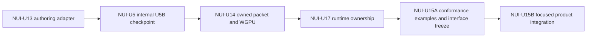

# Reference-Game UI Product Slice

**Status**: Runtime UI product contract; implementation paused pending UIF conformance baseline
**Date**: 2026-08-05
**Amended**: 2026-08-06 for the NUI-U17 ownership checkpoint; 2026-08-07 for the example-first NUI-U15A/NUI-U15B split; 2026-08-08 for the UIF/RUP rebaseline
**Authority**: ADR 0102 and ADR 0107-0109; execution belongs to the inactive [Runtime UI Product Slice plan](../plans/2026-08-08-002-feat-runtime-ui-product-slice-plan.md) after UIF publishes a pinned conformance baseline
**Scope**: The first complete data-driven runtime UI proof for the reference game

This document is a product input for the renderer-neutral UI work. It is intentionally narrower
than an editor design system: it describes one shippable game surface, its states, and its ownership
boundaries. It does not introduce a general widget registry, docking model, or Editor object tree.
It becomes an integration contract only after UIF-U5 publishes a Foundation Conformance Baseline
through neutral layered examples; this product slice cannot independently admit an engine abstraction.

## Product Surface

The reference game uses one 16:9 game surface with a fixed logical design space of 960 x 540. The
adapter maps the logical space to the actual surface and preserves the authored safe-area insets.
The acceptance captures use these three physical targets:

| Target | Physical surface | Render scale | Proof purpose |
|---|---:|---:|---|
| Compact desktop | 1280 x 720 | 1.333... | Minimum readable HUD and pointer hit targets |
| Standard desktop | 1920 x 1080 | 2.0 | Primary visual and interaction baseline |
| High-density desktop | 2560 x 1440 | 2.666... | Text raster, snapping, and packet residency proof |

The logical layout must remain unchanged across the three targets. Only the Host-owned
`SurfaceContentTransform`, pixel snapping and bounded text raster revision may differ. That transform
uniformly fits the design extent into the safe physical area, owns content origin plus forward/inverse
mapping, and maps paint, input and semantic bounds through one revision. Product code never rescales
or clamps pointer coordinates itself.

## Authoring Structure

The runtime UI is one ordered Scene/Prefab projection with these roots:

```text
reference-hud (layer: gameplay)
  health-track
    health-fill
    health-label
  wave-status
  score-status
  movement-status
  autofire-status

terminal-overlay (layer: modal)
  modal-dim
  terminal-panel
    outcome-label
    run-summary
    retry-button
    input-hint
```

`reference-hud` remains visible while the wave is running. `terminal-overlay` is inert and absent
from hit/focus/semantics while hidden. When shown, it owns the modal scope and the gameplay HUD is
visually retained but input-inert. The structure, ordering, style roles, labels, and button names
are Scene/Prefab data; the Rust adapter supplies only typed facts and consumes typed intents.
`retry-button` carries `UiVisual` for its normal shape/background and `UiButtonVisuals` for its
normal text plus hover, pressed, focus, and disabled theme roles. Disabled suppresses activation
styling, pressed overrides the hover background, and the non-color-only focus outline composes with
hover or pressed.

## Visual Direction

The first visual pass is restrained and high-contrast so the game state is scannable during a wave:

- Health uses a dark neutral track, green fill, and a compact text value at the track edge.
- Wave and score use short text rows with a shared theme role, not hand-positioned draw calls.
- The terminal panel uses a solid dark surface with a thin warm border. It is a framed modal tool,
  not a page-level card and not a translucent full-screen decoration.
- Retry is the only terminal action in this slice.
- Focus is visible without relying on color alone: a two-pixel outline and a changed text role.
  The outline composes with hover or pressed backgrounds instead of replacing those states.

The initial palette is deliberately mixed: charcoal surfaces, cool cyan structural accents, green
health, amber progress, and warm red terminal failure. Exact color values belong to the immutable
`UiTheme` asset and may change without Rust recompilation.

## State Matrix

| Product state | HUD | Overlay | Primary intent | Input/semantics |
|---|---|---|---|---|
| Running | Visible and interactive only for admitted gameplay controls | Hidden, absent from hit/focus | None | Gameplay actions route normally; health, wave/enemy progress, score, movement, and auto-fire facts remain in the frame |
| Paused | Visible but inert | Optional pause treatment is out of this slice | None | Observation and UI cancellation remain pause-safe |
| Completed | Visible but inert | Visible with completion facts and Retry | `Activate(retry)` | Modal entry focuses Retry and traps focus |
| Defeated | Visible but inert | Visible with defeat facts and Retry | `Activate(retry)` | Same modal and initial-focus contract, different theme/status role |
| Retry pending | Last submitted terminal frame remains authoritative | Retry disabled with pending status | None | Focus identity remains on Retry, activation is disabled, and duplicate submission cannot occur |
| Retry rejected | Last-good terminal frame remains visible | Error text is data-driven; Retry re-enabled | `Activate(retry)` | The same control regains enabled focus and one semantic status node changes; no separate live-announcement event or partial replacement is introduced |
| Retry applied | New-generation HUD is authoritative | Removed immediately from paint, hit, focus, and semantics | None | No transient success frame is published; the prior valid focus target is restored or focus is cleared, and exactly one new run generation is visible |

The six capture states are Running, Completed, Defeated, Retry pending, Retry rejected, and Retry
applied. Paused is a transport/lifecycle safety condition, not a seventh visual capture state. At the
canonical target, enabled Retry covers default, hover, pressed, and keyboard-focus variants once;
pending supplies the disabled variant and applied supplies direct removal. Other physical targets
prove layout, readability, and snapping without repeating the state-by-input matrix. The variants
change theme roles and semantic state, not structural order or logical keys.

## Ownership Boundary

| Concern | Owner | Rust responsibility |
|---|---|---|
| Root/node order, layout, `UiButtonVisuals` theme roles, labels, accessibility names | Scene/Prefab data and UI kernel | Validate and project typed authoring data |
| Health, wave, score, terminal outcome, retry status | Reference-game domain | Publish immutable facts for the current frame |
| Hover, focus, capture, modal scope, last-good frame | UI kernel/session | Reduce input against the exact retained frame/behavior/receipt session |
| Retry behavior | Reference-game command adapter | Map typed `UiIntent` to the existing Retry domain command |
| Image/glyph residency and backend submission | UI/render presentation owners | Build an owned packet and return a submission receipt |

Changing HUD geometry, text, theme roles, modal structure, or labels must be possible by editing
Scene/Prefab data and assets. Rust changes are required only when a new typed fact, intent, or domain
rule is introduced.

## Required Product Trajectory

One ordinary Runtime adapter trace must start from the authored Scene/Prefab, update HUD facts from
gameplay, present the read-only terminal/Retry overlay, activate Retry through each admitted input,
emit exactly one typed game command, and publish the new run generation only with the next matching
receipt. Desktop and headless use that same adapter. A separate authoring roundtrip changes geometry,
copy/theme role or modal structure in source data and proves desktop, headless and packaged
arbitrary-CWD consumption without a Rust edit or test-private hook.

## Acceptance Captures

The canonical 1,920 x 1,080 target captures all six product states and the complete Retry interaction
path. Each capture records structured frame and environment revisions, structural key sequence, and
semantic state. The 1,280 x 720 and 2,560 x 1,440 targets record layout/readability assertions for
the longest HUD and terminal content. One canonical-target case uses a representative fractional
platform scale to prove the exact `SurfaceContentTransform` inverse mapping. The product
slice does not require a target-by-state packet, pixel, hash, or digest matrix.

The first implementation may use a bounded test presenter for headless frame and semantic captures.
Desktop GPU/readback evidence must use the ordinary presentation recipe and the same authoring
data. Source and packaged desktop readiness requires an actual resident glyph texture/binding, not
only a submitted sprite frame. UIF-U3 owns one representative nonblank GPU readback and exact packet
outcome; RUP consumes that boundary without duplicating it for each product state. A
receipt records backend acceptance and submission of the exact packet and never claims that a human
saw the frame. Any difference between the three targets is limited to physical mapping, snapping,
and admitted raster generations.

## Historical NUI Unit Boundary (Superseded)

This section preserves why the earlier NUI units were split. It is audit evidence, not current
execution authority; UIF owns shared correction and RUP owns the product proof.



The product proof is dependency-ordered rather than one atomic implementation unit:

| Unit | Required proof | Explicitly deferred |
|---|---|---|
| NUI-U13 | Scene/ECS authoring adapter, stable keys and structural order, headless frame/action projection, and reference-game migration away from the Rust-built tree | Paint-packet outcomes, GPU pixels, and the complete state/resolution matrix |
| NUI-U5 after internal U5B checkpoint | `runtime-ui` is content/authoring-only and `presentation-ui` is selected explicitly by presentation Hosts | Backend packet correctness and product captures |
| NUI-U14 | Exact immutable image/glyph packet ownership, closed presentation outcomes, backend readiness containment, and representative nonblank GPU readback | Reference-game state and interaction coverage |
| NUI-U17 | Presented frame/behavior/receipt sessions, transactional routing, pause-safe intent journal, route lifecycle, and narrow schedule interfaces; includes only the smallest Reference Game consumer migration | Product layout, package, and full input acceptance |
| NUI-U15A | Neutral kernel layout gallery, runtime interaction lab, and presentation gallery consume only public interfaces; prove distinct owner-specific behavior including the platform-neutral semantic tree, typed accessibility action, and one matching-receipt vertical round trip; and freeze the public inventory, named shared invariants, exact assertions, and proving commit | Reference-game facts, package proof, AccessKit adapter acceptance, a reusable example framework, a general component catalogue, and adaptive-layout policy |
| NUI-U15B | Six canonical-target capture states, three-target layout/readability coverage, one representative fractional input scale, all admitted Retry inputs once, package parity, and presentation-free headless Retry through the frozen interfaces | Editor UI and deferred general-purpose UI features |

### Alternatives Considered

- **Chosen: staged closure.** Each unit closes only evidence owned by its dependency layer. This keeps
  the authoring adapter testable headlessly and prevents packet or product acceptance from becoming
  a prerequisite of its own dependency.
- **Rejected: keep the full product matrix in NUI-U13.** This creates a U13 -> U14/U17/U15B -> U13
  dependency cycle because packet results, exact presented behavior, and product states belong to
  later owners.
- **Rejected: merge NUI-U13 through NUI-U17, NUI-U15A, and NUI-U15B.** A single large atomic unit would hide
  whether a failure belongs to authoring, product composition, packet ownership, transactional input,
  backend submission, public-interface conformance, or the reference product.
- **Rejected: let the Reference Game design the shared interfaces directly.** Product-specific state,
  layout, copy, and packaging pressure would become the cheapest path to widen expensive engine seams.
  NUI-U15A instead proves those seams with neutral consumers before product integration begins.

## Risks And Mitigations

| Risk | Consequence | Mitigation |
|---|---|---|
| Unit evidence drifts from implementation order | An active registration can claim U13 while code silently depends on unfinished U14 behavior | Update the ledger and engineering-memory registration at every unit boundary; never use later-unit evidence to close an earlier unit |
| Physical-target wording is confused with logical layout | A 4:3 surface is treated as an ordinary 16:9 baseline and produces contradictory acceptance results | Keep one 960 x 540 logical design space and the three declared 16:9 physical targets; admit any future 4:3 constrained fallback as a separate product decision |
| Retry success is represented only by command acceptance | Old modal roots or stale frames can remain interactive after replacement | Capture the new run generation and prove the prior overlay is absent from paint, hit, focus, and semantics |
| Product captures become architecture authority | Reference-game state or test convenience leaks into public engine interfaces or shared semantics | Close NUI-U15A first, freeze its public inventory, named invariants, assertions, and commit, and require non-circular independent evidence plus a focused amendment before NUI-U15B changes that baseline |

## Historical Exit Criteria

The criteria below describe the superseded NUI execution lineage and cannot activate work.

NUI-U9/U10 may start after this document, ADR 0102's checkpoint amendment, and the identity rule
are referenced by their evidence records. NUI-U13 closes when the current Rust-built HUD is replaced
by this Scene/Prefab data boundary and the new adapter proves stable identity/order plus headless
frame/action projection. NUI-U14 adds exact packet outcomes and representative GPU readback. NUI-U15A
does not start until NUI-U17 closes the presented-session, routing, journal, route, and schedule
contracts. NUI-U15A closes when the three neutral layered examples prove their distinct public seams
and one matching-receipt vertical round trip, any required module refactor is complete, and the public
inventory, named shared invariants, exact assertions, and proving commit are frozen without an example
framework. NUI-U15B then closes after all six canonical-target capture states, the separate paused
safety condition, three-target layout/readability coverage, one representative fractional input scale,
the complete Retry input path, package parity, and headless parity pass without a Cartesian proof matrix
or an unreviewed engine-interface change.
