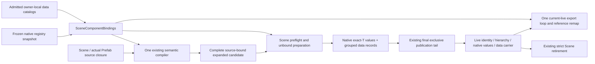

# Scene-Owned Native And Data Representations

**Status:** The closed native/data storage and publication subset is adopted in ADR 0006;
broader executable publication, migration and language-owner work remains Proposed under ADR 0120.
**Design baseline:** `65402b9`. The foundation Goal remains active.

## Pressure And Selected Seam

The private [representation](../research/2026-10-27-behavior-representation-comparison.md),
[Schema-driven consumer](../research/2026-10-27-schema-driven-behavior-comparison.md) and
[code-lifetime comparison](../research/2026-10-27-behavior-code-iteration-and-lifetime.md) establish
that independently authored records do not need independent compiled Rust types. They do not
qualify a production materializer. The current private consumer takes an Authoring preview,
commits native values, then installs its data carrier with further fallible entity lookups.
It exports through a cached initial entity roster. Those are experiment limitations, not code
to make public or reuse as a second production interpreter.

Select a closed Scene-owned representation seam. Native prepared values keep their exact Rust
type, codec and World ComponentId proof. Explicitly admitted data-only Schemas use one concrete
engine-owned per-entity carrier. An unknown/missing native codec never implicitly selects data
storage. No language VM, callback or generic user World mutation participates in Scene commit.

The source and public consumers own actual signatures. Do not export further abstractions merely
to make the module catalogue look complete.

Backend-free owner admission and the closed `SceneComponentBindings` selection now have
production source/compiler consumers. Native and data records use the existing semantic
compiler; data records require explicit owner/current-version admission. Runtime preparation now
captures exact managed definitions, stages complete groups with native values, and exposes guarded
membership/read/write and current-live export through the existing owners. Headless evidence is
separate from product recipe/content-replacement integration, language execution readiness and
native Editor qualification. The [implementation ledger](adr/implementation-status.md) links the
actual verification separately from this design's remaining contract.

## Responsibility And Identity

| Owner | Responsibility | Must not acquire |
| --- | --- | --- |
| Reflect Schema admission | Canonical catalog validation, owner identity, version/lineage and immutable data declarations | Scene entities, VM execution or mutable World authority |
| SceneComponentBindings | Disjoint native/data family selection and exact selected definitions for compile/prepare/export | Package installation authority or a universal language dispatcher |
| Scene data carrier | Complete current data records plus exact owner-local data Schema observations | Native codec snapshots, VM objects, delegates, tasks or executable leases |
| Scene publication | Group preparation, World/hierarchy/identity admission and one closed commit | Arbitrary user callbacks inside the final tail |
| Concrete optional language owner | VM instances, actual domain binding, code routing, safe points and physical cleanup | Source history or bypass of Scene/native admission |

Bindings retain the frozen native snapshot and immutable data-owner snapshots. Reject overlapping
native/data IDs, duplicate owners, cross-owner type/tombstone claims and unavailable family
selection. Require an explicit matching durable owner claim for data records; do not infer it
from a type spelling or reuse the native ownerless convenience path.

Materializing data does not prove a gameplay callback exists. Plain data consumers may use this
family without a VM. A product that declares executable Behaviors must independently admit its
required language/module contributions before runtime publication, as the private comparison
already does. Do not silently treat an unavailable Behavior module as a successful playable
data-only fallback.

Use exact **owner-local** data snapshots in stored records, not a strong reference to the entire
mixed composition. Unchanged owners can retain their identity when another owner changes.
An owner fingerprint proves canonical equivalence, not current authority. Independently admitted
same-byte snapshots do not silently become the same authority. Data-only captures must not
accidentally pin native codec code or a VM. Native prepared definitions still capture the exact
native/managed Host basis and target World as today.

## Metadata Admission Without An Authoring-Only Dependency

`AuthoringSchemaBundle` is currently behind Reflect's `serde` feature, whereas an ordinary
code-authored data Schema must not require JSON support or a fake native codec. Factor the
existing catalog/lineage/ownership validation into a backend-free internal admission path used
by Authoring composition and the concrete Scene family. Do not copy validators, intern dynamic
owner strings into static executable IDs or build an adapter-specific metadata language.

Determine the smallest public construction interface only while wiring the real materializer.
An admitted data catalog is metadata and storage eligibility, not proof that a gameplay language
module is installed. File headers and existing serialization remain source-format concerns;
this implementation does not need a new on-disk wrapper or migration guide.

## One Compiler, Strict Runtime Admission

The existing private `SchemaAuthority` already separates native and Authoring interpretation.
Add explicit mixed representation resolution inside that owner rather than compiling through
the degraded Authoring report and filtering `NativeBindingUnavailable` omissions afterward.
Runtime compilation must fail if a surviving record has no complete selected representation.
Authoring retains its degraded preservation behavior; the two outcomes are not interchangeable.

Reuse canonical source identities, actual-demand lazy loading, working-set admission, defaults,
property resolution, complete references and typed provenance. Native records retain existing
migrations/codecs; current data records require their admitted version. Future data migration
must be explicit and owner-owned, not guessed by a generic interpreter. Reusing this compiler
does not make a classified source's IO receipts or a VM's execution authority transferable.

## Complete Preparation And Publication

1. Preflight all native values and complete data groups under one aggregate value/work allowance.
   Admit owning copies before allocating them; share immutable catalogs rather than cloning a
   catalog per entity. Failure of the last data record leaves no candidate publication.
2. Retain data groups with `UnboundScenePublication`, alongside the exact native prepared values.
   Register only the concrete carrier's actual World metadata. Do not register each inner Schema
   as a native codec or synthesize dynamic descriptors.
3. Revalidate exact native and data definitions before allocating/binding targets. In a managed
   Runtime the selected data composition must be admitted through its owner/startup composition,
   not replaceable by an unrelated caller passing another same-byte catalog.
4. After `spawned_by_id` exists, stage one carrier per data-bearing entity in the existing
   `LifecycleFreeInsertionPlan`. Respect the empty-target requirement of persistent receipt
   declaration: carrier preparation is not early insertion.
5. Include the carrier in final topology/lifecycle revalidation and the existing exclusive tail.
   Rename an internal product-only insertion label if necessary; do not create another public
   transaction or generic `FnOnce(&mut World)` hook. Reserve the carrier type against product
   overlay writes so that two owners cannot install or overwrite it.

Preparation, replacement and export must select the same definitions. Existing native-only
convenience operations remain native-only operations using this owning implementation, not a
legacy reader or an implicit data fallback. Public mixed operations must not expose retention,
target lookup or codec choreography to ordinary consumers. Exact signatures remain a consumer
ergonomics decision, not a reason to preserve a duplicate mechanism.

Native-only export must reject encountered data-family records as unavailable, not silently omit
them because the caller selected only native bindings. Full export requires the matching complete
binding selection; ordinary unregistered runtime-only components keep their existing semantics.

## Read, Mutation And Retirement

Expose current per-Schema membership/read with explicit Absent versus unavailable binding or
invalid encoding. Keep carrier construction and mutable storage fields controlled by the Scene
owner. The concrete consumer requires full-value replacement/removal of one member while its
sibling survives; reuse complete Schema and declared-reference validation before any write.
Bound retained values and target authority. A direct trusted World escape is not an advertised
guarded mutation interface.

Pure data and Schema Arcs need no Scene lifecycle hook. Ordinary strict entity/instance retirement
must release the carrier naturally. VM detach, language finalizers and external resources remain
with their concrete execution owner and safe point, never hidden in carrier ECS hooks.
Existing native claims and additional-retirement guards remain unchanged; final commit still
requires owners to remove claimed native components before strict retirement succeeds.
No rollback of arbitrary destructors, panic/OOM or already-performed native effects is promised.

## Live Export, Not A Second Roster

Extend the current `export_scene_with_options` loop over live registered Scene identities.
Do not export all unregistered ECS entities or assume persistent-only entities enter this Scene
export. For each eligible live entity, combine native encoding with all current carrier members.
Check each member's exact selected owner Schema; reject duplicate native/data keys, stale basis,
invalid payload or unresolved reference rather than overwriting/skipping it.

Use the same aggregate output budget, effective-value validation and
`rewrite_export_reference` with the actual `SceneInstanceId` and full locator remap for both
families. This includes existing persistent-reference semantics, not just SceneLocal string
substitution. A legally retired entity or a later admitted Scene instance changes the live export
set without consulting the original source receipt's cached population. Any error yields no output.

Asset policy needs its own data-family lowering: native codecs receive
`ComponentEncodeContext`, but data records contain durable `AssetRef` values rather than native
handles. Traverse only Schema-declared asset references with the existing bounded reference
walker. Under `Path`, preserve a path and resolve a stable ID to its path through the selected
immutable project asset metadata; missing required metadata rejects the whole export. Under
`StableIdWhenKnown`, preserve a stable ID and prefer the admitted stable ID for a known path,
otherwise retain the path. Reuse the selected source-kind/reference validation and aggregate
output allowance. This operation does not load assets, allocate native handles or invoke a codec.
The entity-reference rewrite alone cannot implement asset policy. The mixed native/data oracle
must compare both policies for the same asset and reject an unavailable required conversion
without output.

## Alternatives

| Alternative | Benefit | Rejection / selection reason |
| --- | --- | --- |
| Promote the private native-preview plus post-commit carrier helper | Small diff, existing tests | Reject: omits strict representation proof, leaves fallible work after native publication and uses a stale entity roster |
| Register several Schemas against one native carrier type | Reuses native entry points superficially | Reject: violates exact native binding cardinality, grouped membership and encode/absence semantics |
| Scene-owned closed native/data families | Shares real compiler, identity, publication and export; no VM dependency | Selected for implementation; must earn public workflow evidence before adoption |
| Public arbitrary representation callback SPI | Future storage flexibility | Reject now: admits uncontrolled World work and lifecycle obligations without a second production family/consumer requiring that interface |

Owner Rows and dynamic descriptors remain counterfactuals from the executed representation
comparison, not extra production implementations to preserve for optionality.

## Acceptance And Risks

| Required observation | Measurement / failure oracle |
| --- | --- |
| Two data Schemas plus native Name, no per-Schema Rust type | Independent module-consumer uses only public APIs; enumerate/read/replace/remove preserves siblings |
| Last data value or binding invalid | No new identities/carrier/native publication; an existing activation stays usable |
| Exact World/native/data authority | Wrong World, stale/same-byte foreign owner basis and altered managed composition reject |
| One shared Prefab compiler | Two nested occurrences plus additions/overrides produce independent target identities and close declared references |
| Aggregate cost | Native+data together cross exact node/byte limits; owning copies are refused before allocation |
| Late topology interference | Carrier insert/remove hooks, observers and required-components changes reject before publication/retirement |
| Complete live export | Retire an unreferenced entity, admit a later Scene instance, export remaining native/data values through one actual remap |
| Persistent references and encoding failure | Declared targets match native behavior; nested native/data asset fields honor both export policies without loading; missing required conversion metadata yields no output |
| No VM lifetime coupling | Carrier retains only data; explicit language leases continue to own execution code |
| Backend-free use | Code-authored consumer runs without `serde`; file-backed Scene/Prefab consumer runs with it |
| Actual product integration | A managed App consumer and the selected optional owner use this family rather than the private preview helper |

Key risks are misusing metadata as executable authority, weakening the managed native basis,
duplicating the compiler, double-counting or omitting retained cost, and accidentally storing code
inside a data carrier. The mitigations are the closed family, exact owner snapshots, shared
preflight/publication/export loops and independent negative consumers in the table. Native Editor
or release support claims require their own affected qualification; data-family tests do not
replace it. Catalog migration, dependency cohorts, Stop-first and VM replacement remain separate
ADR 0120 work, not silently completed by this first production family.
