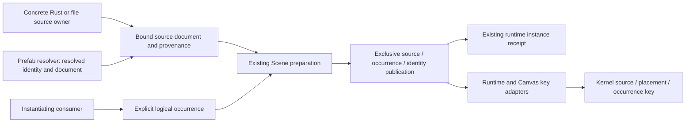

# Scene Source Context And Logical Occurrence

## Original Problem And Evidence

The original [public Scene/UI consumer](../../crates/nara_ui/tests/source_identity.rs) materialized
two different documents with separate `SceneInstanceId` values into one World. Distinct local UI
root IDs produced two compiled roots. Making both local IDs `root` produced `root-key-duplicate`
and no candidate frame. This was a qualified counterexample to complete source identity, not evidence of
incorrect runtime instance allocation or action misrouting.

The duplicate-key failure remains correct under [ADR 0109](adr/0109-root-local-ui-compilation-and-presentation-closure.md).
The original missing boundary was upstream: `SceneEntitySource` had no containing source-document
context. Before the replacement, [UI projection](../../crates/nara_ui/src/runtime/projection.rs)
lowered only the local source entity plus an optional Prefab chain. Equal anchors and chains in
different containing Scenes had the same structural omission. Document identity alone would
still not distinguish two simultaneous occurrences of the same complete source. The current
[selected seam](#selected-kernel-and-adapter-seam) includes both axes; the consumer now asserts
successful independent roots rather than preserving the original rejection expectation.

The [R5a property selector](durable-property-addressing-design.md) remains Schema-relative. It
does not own this outer source/occurrence contract. The
[foundation rebaseline plan](../plans/2026-10-23-foundation-architecture-rebaseline-plan.md) remains
broader than either unit.

## Production Source Admission Checkpoint

The project content owner now admits the source-document portion of this contract for selected
file-backed Scenes and the complete loaded Prefab closure. `ProjectContentSnapshot` retains a
`SourceDocumentKey` for the selected Scene and every Prefab; the Prefab resolver lends the bound
key and immutable document together, and expanded projection steps retain the canonical key.
Project-location projects bind the authored universe plus the complete project-relative path.
Stable-metadata projects require the sidecar, retain its exact closure member, and validate its
declared relative path and Scene/Prefab kind before publication. Missing or mismatched metadata
rejects; loading never mints metadata or silently falls back to location identity. The resolver's
cycle stack compares canonical keys, so aliases for one admitted source do not
become separate active sources.

Metadata lookup evidence and semantic identity remain separate. Under `project_location`, a
Prefab discovered through the stable-reference catalogue must still revalidate that catalogue's
sidecar and include it in the exact closure; its source key remains location-based. Unreferenced
adjacent metadata does not change the declared policy. Under `stable_metadata`, admitted Prefab
identities enter the existing catalogue, so two distinct paths cannot silently claim one stable
asset identity. A partial identity catalogue is not a complete asset-reference validation basis.
Reconciliation runs after complete Prefab discovery, so a later stable reference also retains the
sidecar for a path that was loaded earlier. Delivery checks the union of selected Scene and loaded
asset identities against full project-relative paths, without retaining decoded snapshots or a
permanent source registry. Native source admission verifies exact stored component spelling through
the filesystem owner instead of creating different location identities for case aliases. Windows
and WSL Linux filesystem tests execute; casefold-volume behavior and native Linux product loading
are not qualified by that filesystem cohort. Other exact-spelling adapters remain unsupported.

That earlier checkpoint qualified source admission and Prefab provenance at the content owner.
Canonical Prefab sources are now required even for in-memory and document-only resolvers. The
subsequent owning replacement below has scoped qualification; its source changes are not retroactive
evidence for the earlier checkpoint or completed shared UI adoption.

### Required Scene Binding And Active Occurrence Implementation

Pure expansion owns an `ExpandedSceneDocument`; its source owner consumes `bind_source` to form
the required `ExpandedSceneCandidate`. Plain construction likewise requires a source. The sole
ordinary spawn function accepts the bound candidate and explicit occurrence namespace/slot;
identity-free spawn convenience variants and public `SceneSpawner` are removed. Bare documents
remain useful for editing and validation without acquiring a runtime occurrence.

Scene's private World-bound association uses namespace/slot as its only uniqueness key and source
plus exact domain/activation as values. Empty and individually emptied instances retain occupancy.
Exact replacement obtains the predecessor's declared slot from that association; end and projection
clear release only the exact activation inside their existing exclusive publication cut. Active
item/byte limits reject without eviction. Runtime entity sources share one containing context per
activation rather than deeply copying a root key into every entity.

Project startup and Editor preview declare their fixed product slots. Each opened Editor Scene or
Prefab retains its own policy-admitted key; preview and trusted Play receive that key rather than
borrowing startup identity. Native source admission and prepared Open/Reopen preserve exact
metadata observations. The [scoped qualification](../knowledge/engineering/verification/2026-10/2026-10-24T114901Z-required-scene-sources-and-active-occurrence-ownership-qualification-e249da9a1f404677a72e52457ac990c4.md)
records actual checks, counterexamples and limits. Ordinary no-entity preparation has subsequent
[separate qualification](../knowledge/engineering/verification/2026-10/2026-10-24T164025Z-owned-ordinary-scene-preparation-and-complete-support-admission-qualification-e94d2a95cbf94dd7a0cbbd371aedf55c.md);
Runtime/Canvas complete-key lowering and compound imported products remain separate work. The bounded source-
carrying delivery tests pass; the full independent desktop Export trajectory is not rerun here.

## Distinct Coordinates

Names here describe semantic roles, not frozen Rust type names or new global services.

| Coordinate | Meaning | Authority |
| --- | --- | --- |
| Source document reference | One authored entity-bearing document, including its source/product or explicitly scoped named origin | Concrete Rust author or file/asset admission owner |
| Source object address | Source document reference plus source-local entity ID | Source document owner |
| Authored placement | Containing root document plus local entity or structured Prefab anchor/source chain | Scene expansion owner |
| Logical occurrence | One caller-owned placement of source content, such as player-one HUD or a level slot | Instantiating consumer |
| Runtime activation | One World-bound Scene instance and entity incarnation | Existing Identity/Scene publication owners |
| Property selector | Component identity plus stable root/member/key selector | Schema owner and current-value resolver |

Source equality must not come from content bytes, a Rust type path, a compiler/macro callsite, a pointer,
active tab, workspace incarnation, physical file identity or runtime instance counter. File identity
and content digests remain custody/change-detection evidence. They do not prove semantic continuity.

Reusing a logical occurrence key explicitly asserts continuity of that logical slot. It is not a
promise that the engine retains arbitrary deleted-object history. Rebuilding that slot creates a
new runtime activation while preserving the declared source/placement address. Old runtime tokens
and presentation receipts remain fenced by the existing incarnation/session rules.

## Alternatives

### A. Required Source-Bound Envelope And Separate Occurrence (Recommended)

Keep `SceneDocument` as a pure document-local graph. A source admission owner binds its immutable
document and complete provenance in a private-field source candidate. The materializing consumer
supplies the logical occurrence separately. Source candidates can therefore be shared or retained
without confusing source content with a particular placement.

This aligns authority with actual consumers: a code-authored Scene need not impersonate a disk
asset; an imported document keeps source/product identity; a source loader cannot choose how many
logical placements its caller wants. It also avoids making payload identity and asset/product
identity competing authorities. These are the reasons to prefer A, not merely fewer file edits.

Cost: all persistent materialization paths must migrate, including direct Rust, startup/current
Scene, file-backed project content, Editor preview and Canvas. An optional source field followed
by the old local-ID fallback is not an implementation of this design.

### B. Mandatory Identity Inside Native Scene/Prefab Payloads

Native documents could own an embedded document identity, and Rust constructors could require it.
This makes native Save/Reopen self-describing. It is viable if native document storage is selected
as the durable identity owner.

It still requires a separate occurrence. It must also define clone versus Duplicate versus Save As,
and the exact relation between an embedded document ID and source/product identity. Compound
importers still need authored continuity outside a disposable cache. Do not retain two independent
equality authorities for the same document. B requires a deliberate owning format change.

### Rejected Shortcuts

- Requiring every document-local entity ID to be globally unique contradicts ADR 0038.
- `(SceneInstanceId, entity)` fixes present coexistence by destroying declared logical continuity
  on every reconstruction and contradicts ADR 0102.
- UI-generated namespaces or `AssetRef::to_string()` cannot establish canonical source equality.
- A short hash is not exact identity and must not hide structural-key budget exhaustion.
- A universal object UUID registry, a second Entity resolver, a Package service or a new Undo owner
  is unnecessary for the demonstrated workflow.

## Recommended Ownership Flow



The source owner supplies data and proves its association. The existing Scene owner retains the
prepare/revalidate/commit/retire boundary. The kernel consumes opaque structured identity and
does not depend on ECS, Scene, Asset or Editor. Generic `nara_app` acquires no Scene dependency.

The active occurrence claim must include empty Scenes and bind to the exact instance receipt.
Its key is the caller-declared occurrence namespace and slot within the receiving World; source
identity and instance receipt are binding values, not additional uniqueness axes. Changing source
cannot admit a second occupant of the same slot. The namespace is an explicit logical owner key,
not a process-local counter or an automatically derived source namespace.

Claims cannot be inferred by scanning entity components. Duplicate active claims reject before
allocation/publication; replacement consumes the exact predecessor claim under one exclusive
commit. A public Scene-owner end operation accepts the exact instance receipt, including an empty
Scene, and releases only that activation's claim without discarding Identity's independent runtime
history. Deleting the final entity does not end the occurrence. A stale end retry or projection
clear must never release a successor's claim. No permanent occurrence-history service is proposed.

### Public Instance-End Prerequisite

The [public exact-instance operation](../../crates/nara_scene/src/spawn.rs),
`retire_and_despawn_scene_instance`, now exposes the existing Scene-owned retirement transaction.
The [public tests](../../crates/nara_scene/tests/instance_retirement.rs) cover empty and individually
emptied instances, independent instances, stale/foreign receipts and lifecycle refusal. The
[separately compiled consumer](../../tests/fixtures/module-consumer/tests/scene_spawn.rs) completes
parse/publish/spawn/end without private hooks. Authoring clear uses the same operation; disposable
projection clear keeps its additional complete-epoch ownership proof.

The subsequent occurrence implementation extends that same exact retirement/publication cut to
release the matching active slot. It retains Identity history and adds no caller cleanup step.
Its [scoped qualification](../knowledge/engineering/verification/2026-10/2026-10-24T114901Z-required-scene-sources-and-active-occurrence-ownership-qualification-e249da9a1f404677a72e52457ac990c4.md)
records the owning lifecycle, migrated public/independent consumers and selected Windows/DX12
trajectories. The earlier prerequisite evidence does not by itself qualify this extension.

## Admission Boundary And Remaining Adoption

The production admission checkpoint covers the native source owner, not every downstream owner:

- [Project content loading](../../src/project_content.rs) now binds its selected Scene key to the
  expanded candidate. Separate Editor sources supply their own admission keys.
- [Retained asset catalogues](../../src/project_content/catalogue.rs) retain domain-relative
  Prefab/Image/TileSet records. The selected Scene key is retained separately, without appending an
  unscoped Scene record to that database. Location-authored documents need not have a stable ID.
- [PrefabSourceResolver](../../crates/nara_scene/src/prefab.rs) requires canonical bindings from
  every adapter; document-only expansion remains separate from containing-source materialization.
- [Editor source admission](../../src/project_host/runtime/editor/source_admission.rs) retains
  duplicate file custody checks and now also associates each opened source with its native
  identity policy. Their qualification remains separate from UI semantic key lowering.

The implemented source slice selects a concrete, bounded representation for both code-authored
and file-authored origins. Its required semantics are:

1. Code authors explicitly declare stable named origin keys; no macro-location inference.
2. Stable asset origins retain the product/document dimension. A primary native document can be a
   bounded first case, but two entity-bearing products from one source must not alias.
3. Any retained path-authored route is explicitly scoped by its admitted source universe. It is
   location-addressed and does not claim automatic rename continuity. Path and stable-ID aliases
   are reconciled only by the source owner, not UI or string normalization at use sites.
4. Missing continuity metadata never causes runtime load to mint IDs or write source files. Stable
   identity loss is an explicit conflict/repair operation; a deliberately path-authored origin is
   not silently promoted to a different identity policy.

The durable source-universe carrier is now the required authored `[project].source_universe`.
A project name, current directory or process-local session ID is not an acceptable default. A
complete direct/file-backed materialization path uses this carrier without hiding its absence
behind a fallback. Full importer publication, package governance and multi-file migration
are not prerequisites to that bounded identity trial.

### Executable Owner Experiment

The separately compiled [source-context experiment](../../tests/fixtures/module-consumer/tests/source_context_trial.rs)
and its [private prototype owner](../../tests/fixtures/module-consumer/tests/support/source_context_trial.rs)
exercise an explicit carrier and one flat native-document workflow. They use ordinary Scene
candidate, replacement and exact-end APIs; they do not change production materialization, project
configuration or shared UI behavior. The prototype owns its World and active occurrence table
together. It is not a product-side registry to retain after the Scene owner adopts this contract.

The carrier under experiment is a dedicated, authored, non-nil `project.source_universe` UUID and
a required `content.native_document_identity` choice: `project_location` or `stable_metadata`.
The fixture's `TrialManifest` is intentionally not the current `ProjectManifest`. No default,
metadata-first fallback or load-time ID creation is used. Source equality is structured:

| Origin | Equality coordinates |
| --- | --- |
| Explicit Rust declaration | Universe, named source, product |
| Stable asset | Stable asset ID, product; not the receiving project's universe |
| Deliberate native location | Universe, complete project-relative path, product |

The flat file case loads and publishes actual canonical Scene files and metadata. The location
policy refuses competing adjacent metadata. Stable path requests and stable-ID requests resolve
to the same admitted asset identity; metadata is required for both. An explicitly opened path
outside the prototype's initial scan root is admitted directly before its stable-ID alias is used.
Moving the project root and clearing disposable cache content do not change location identity;
renaming the location does. Stable source relocation retains identity after its authored metadata
path is updated. Loading does not write source files.

The occurrence experiment covers same-source simultaneous slots, changing a slot's source,
empty-instance replacement/end, stale replacement-intent/end rejection, and failed Scene admission that
retains its predecessor. Source is the claim's value, not part of its uniqueness key. It borrows an
immutable source candidate without exposing independently replaceable document/provenance inputs.
An intent is bound to its receiving World, but an initially vacant-slot intent describes current
vacancy, not a historical vacancy generation. It is not an already decoded Scene candidate.

This is evidence for a carrier/owner direction, not the complete trial's exit gate. In particular:

- This prototype did not qualify production admission. The subsequent production checkpoint now
  supplies selected-Scene/Prefab keys, exact metadata closure observations and retained accounting;
  required materialization, Browser Open and Editor preview now have separate scoped qualification.
  Neither proves complete filesystem
  alias/capture consistency.
- All Prefab resolvers and projection steps now require canonical keys. The containing Scene
  now requires source binding at materialization. A bare `AssetRef` request must not
  become canonical provenance by stringification.
- The product coordinate is distinguished as data, but no named imported Scene product is decoded
  or published by this experiment. Native files use `Primary` only.
- The typed trial payload has an exact tagged byte encoding for cost inspection. It is not a
  current `UiPersistentIdentity`, a durable file format or an ADR 0102 refreeze. Comparing its size
  with the public kernel limit does not prove Runtime/Canvas key admission or UI state isolation.
- The pre-commit stage only admits and captures a placement intent. Scene decode/preparation still
  runs inside commit through the existing public operation. Timing that first stage is not a
  measurement of engine preparation, and this does not qualify prepared Scene publication,
  cancellation or preview reuse. Native completion, public panel preparation and product
  performance remain separate obligations.

The advanced retained replacement entry requires explicit asset bindings, native
retirement claims, overlay limits, additional retirements and a product callback; it may own scratch
World entities that require explicit discard. That is a provisional native-product integration
interface, not proof of an ergonomic ordinary source-placement prepare/preview/commit workflow.
Ordinary preparation below exposes the unbound alternative with separate failure and cancellation
custody. It does not relocate target cleanup into a caller's second candidate or cleanup system.

The production preparation kernel now separates native values from runtime target binding. Reflect
retains all unbound values with the same scratch asset catalogue; Scene runs this phase after
topology/identity-capacity admission and before allocating Scene entities. Deferred native failure
therefore does not need target-entity rollback. That prerequisite split by itself did not supply an
ordinary public Scene prepare/cancel API: the advanced retained publication still owns scratch entities,
and later admission failures retain their existing cleanup/custody semantics.

### Canonical Prefab Resolution Entry

The resolver now lends one private-field binding of canonical document key and
immutable Prefab, not an independently assemblable key/document pair. Path/StableId requests are
lookup coordinates; only the admitted source owner proves that two aliases resolve to that binding.
An in-memory Rust author can explicitly bind aliases to one named source without inventing a new
durable request syntax. Missing, unsupported product, wrong kind and conflicting admission must
not collapse into an unqualified bare-document result or fallback to another product.

Expansion must resolve first and check its active ancestry using the canonical document key,
including product, rather than the requested `AssetRef`. The original request is diagnostic/write-
back context only. Structured projection steps carry the resolved key and pre-remap source-local
entity; the containing Scene key remains a separate outer coordinate. Repeated siblings and
diamond dependencies are legal: source discovery deduplication is not an active-recursion stack.
Count materialization and patch work per instance even when a source read is shared.

Each recursive exit must pop its ancestry frame on patch, reference, structure and budget failure.
Association is checked against the effective patched source, including valid override-added
entities, not by requiring every materialized entity to exist in the unpatched Prefab. Existing
source-local reference remaps and opaque generated runtime locators remain; no parser of expanded
IDs or second source registry is needed. The retained project resolver must lend its bound source
without leaking independently cloneable allocations beyond the source lease. Project content now
uses that borrow, and [canonical source tests](../../crates/nara_scene/tests/prefab_sources.rs)
exercise alias cycles, sibling placements and wrong-kind rejection. The resolver has one required
`resolve_prefab` operation; neither its result nor a projection step has an optional-key fallback.
The in-memory adapter requires the author's key and owns one document per key, with a separate
request index. `insert(request, key, document)` replaces the canonical document for every alias
and returns the previous document for that key. Rebinding a request releases its old source only
when no other request addresses it. This is explicit canonical-key last-write-wins, not a
content-preserving alias operation or an inference about which revision is newer. File-backed
duplicate identity refusal remains at Project Content rather than inheriting this author-owned
container's publication policy.

This adapter-local index is not a permanent source registry. It borrows the key and document from
one canonical entry and retains no historical source records. The separate
[public consumer](../../tests/fixtures/module-consumer/tests/prefab_sources.rs) exercises canonical
alias replacement, cycle refusal without mutation and successful re-expansion. Containing-Scene
source binding and logical occurrence have scoped qualification; the shared UI contract remains separate.
The pre-adoption Runtime UI lowering encoded lookup requests. Provenance's derived `Eq` includes
diagnostic request context and is not canonical placement equality; the selected lowering uses
each step's canonical source instead.

### Native Policy Decision Before Production Adoption

The production manifest carrier now places both required fields in `[project]`:
`source_universe` and `native_document_identity`. Unlike the optional content-root declaration,
neither can disappear through defaulting/empty serialization or vary by profile. The non-nil
`SourceUniverseId` value is ECS-independent in `nara_core`; policy and lowering belong to
`nara_project`. Explicit creation prepares the universe and startup Scene metadata once and
retains their exact member bytes/digests. The unreleased manifest remains schema 1 and replaces
the old shape without a compatibility reader. The subsequent production admission checkpoint
enforces native loader policy and canonical Prefab provenance. Scene occurrence claims and
per-opened-document source admission have subsequent scoped qualification. Complete shared UI
keys are implemented under the selected seam; their successor conformance remains a separate gate.

A required project-level enum is smaller than a second per-document location list, but it applies
to all native document admission, not merely configured Scene/Prefab directories. The existing
[mixed-source rename consumer](../../src/project_host/authoring/mod.rs) has a metadata-free Scene
and a stable-metadata Prefab. It proves a real mixed-loading workflow, not that the Scene must
permanently retain location identity. Before freezing the enum, either migrate this workflow to
fully stable native identity with explicit authored Scene metadata, or establish a named need for
deliberately mixed identity policies. Do not add an exception inventory merely to retain an
unreleased incidental input shape, or silently remove the stable Prefab rename workflow.

The ordinary integrated-project recommendation is fully stable native identity; a deliberately
location-authored project remains an explicit alternative, not fallback on missing metadata.
Creating metadata is an explicit authoring/creation operation, never a side effect of loading.
Changing policy is an identity change and requires explicit source readmission, not a profile
override. Imported products retain their own admitted stable source/product identity rather than
inherit the receiving native-document policy.

Neither an enum nor an exception list can infer that arbitrary bytes copied into a location-authored
project used to have metadata somewhere else. The guarantee is refusal under the declared current
policy, not a permanent provenance history service. Whole-project Duplicate also needs explicit
stable-asset ID remapping: changing the universe alone separates named/location origins only.
Current catalogue paths are domain-relative; the fixture uses full project-relative native paths.
Production admission must reconcile those coordinate systems and canonical spelling at the source
owner. Appending unscoped Scene records to the existing asset database, or lowercasing names in UI,
would not prove alias equality. The fixture does not qualify filesystem case/symlink/hardlink aliases
or cross-file capture consistency.

## Continuity And Failure Rules

| Operation | Source / placement | Logical occurrence | Runtime activation |
| --- | --- | --- | --- |
| Same source instantiated twice | Same | Different | Different |
| Compatible rebuild of one logical slot | Same | Explicitly retained | New |
| Slot switches to another source | Different | May retain the slot key | New; composite UI key changes |
| Repeated Prefab in one Scene | Different authored anchor/chain | Outer occurrence may be shared | Separately bound |
| Independent source Duplicate | New source; local IDs may remain | Caller-selected | New |
| Reuse an ended slot | Owner-declared continuity | Explicit reuse | Old tokens remain invalid |

Missing context, active occurrence collision, wrong provenance association, foreign World, stale
preparation and exceeded Scene/source/claim admission budgets reject the Scene operation before
retiring a predecessor. This guarantee ends at the Scene publication boundary.
Source/occurrence stability does not imply unconditional focus/reducer resurrection or cache reuse:
existing presence, modal, session and environment rules still apply.

The structured-key size is charged exactly. The current kernel has a 256-byte key ceiling and
bounded projection depth. The trial must report the new encoded costs and prove supported
combinations against the selected budget rather than conceal overflows or silently drop axes.
UI admission remains a separate owner boundary: an unrepresentable projected key rejects the UI
candidate under ADR 0109, preserving the applicable presentation history, not rolling back a Scene
already published. A stronger pre-Scene key-admission guarantee would require an explicit consumer
preflight contract and evidence; this proposal does not silently claim one.

## Deliberate API Replacement

The independent owner review selects the following dependency-ordered replacement, rather than
extending the prototype's product-side claim table:

1. Make the containing source mandatory in `ExpandedSceneCandidate`, require canonical Prefab
   bindings, and replace source-less persistent spawn/replacement inputs. Scene owns a private,
   World-bound active occurrence association keyed by explicit namespace/slot. It records source
   and exact activation as values, covers empty instances, and participates in publication,
   replacement, exact end and disposable projection clear. Reuse the existing instance receipt;
   do not add another Entity resolver, source registry or permanent slot-history service.
2. Expose ordinary preparation at the existing unbound-native-value stage, before Scene target
   entity allocation. Dropping this token needs no World; commit revalidates the exact World,
   Schema, asset and occurrence baselines. World-bound asset context is not cross-World purity.
   Advanced native retirement custody remains a later stage of this same kernel, not a second
   preparation policy. Compare prepare/commit/cancel separately through a public consumer.
3. Adopt one complete source/placement/occurrence lowering in Runtime and Canvas, then refreeze
   ADR 0102's public inventory and neutral conformance assertions. A canonical native key currently
   names only a primary Scene or Prefab document; `SourceDocumentKind` is not an imported product
   identifier. Admit a real product coordinate before supporting multiple entity-bearing products
   from one source.

ADRs 0038/0058 now adopt required source binding and active occurrence ownership for step 1.
Neither step changes ordinary Identity history or admits
occurrence eviction. Authoring queries/edits remain document-relative; they do not need a runtime
occurrence merely to edit a document.

### Ordinary Preparation: Owned Unbound Native Values

The selected public implementation splits Scene publication at the existing native-value stage.
Its independent/public and native qualification must be read from the implementation ledger;
the design alone does not qualify it. Reflect is used by Scene before target allocation.
Its `UnboundComponentApplyBatch` owns the actual values with their original scratch asset
catalogue. It is not a new decoder, a reservation of live entities, or a complete admission proof.
The revalidation seam returns that stage before allocating targets. Bindings have been consumed,
so the original validator over `PreparedComponent` inputs is no longer callable. The owning
unbound batch's fresh-target check reuses its exact bindings, receipt/support validators and
original asset read basis. It does not reconstruct values,
allocate dummy targets or add a second validation registry.

The ordinary interface is selected as two operation-specific entry points:

```rust,ignore
prepare_scene(world, registry, candidate, occurrence, database) -> Result<PreparedScene, SceneSpawnReport>
prepare_scene_replacement(world, registry, candidate, current, database) -> Result<PreparedScene, SceneSpawnReport>
prepared.commit(world) -> SceneSpawnReport
```

First placement remains explicit. Replacement obtains its occurrence from the exact predecessor
association. A move-only ordinary token owns unbound native values, layout/provenance, source and
occurrence admission, the frozen definition basis and any private scratch catalogue. It exposes
preparation diagnostics, but no independently replaceable document/map or target list. Commit is
one-shot; failure safely consumes private preparation and publishes no candidate. Dropping it,
including after dropping its World, requires no World cleanup. This does not promise arbitrary
codec/destructor rollback, no metadata registration, no ordinary deferred work, or no consumption
of checked process-local IDs.

Both entry points use one split Scene kernel. The first stage ends before target allocation. The
second stage re-admits current World facts, allocates/binds targets and enters the existing fully
validated publication tail. `spawn_scene` remains the immediate prepare/commit convenience;
advanced native-retirement custody continues at the later target-bound stage of the same kernel,
with its existing explicit discard responsibility. Do not retain an independent old decoder or
make an ordinary token own unpublished target entities.

The revalidation read-set is deliberately narrower than a global World revision:

- World identity is exact; a foreign World rejects before flushing that foreign World's work.
- The owning Scene token retains the exact frozen definition used to prepare values. Standalone
  Worlds do not have to install a managed registry or keep the caller's registry variable alive.
  If a managed registry exists, its current authority must agree with that frozen definition;
  removing required managed authority or replacing it with another definition rejects. Reflect's
  primitive does not itself own this Scene/managed-Host policy.
- The original AssetServer value basis must still match when preparation read or allocated asset
  identities. A batch that never touched assets does not become stale merely because unrelated
  asset work completed. Equal catalogue values are compatible, not a new anti-ABA epoch. Decoded
  reference values do not promise to pin payload residency or every ProjectAssetDatabase update.
- Unbound preparation reserves neither a logical slot nor a runtime instance number. New spawn
  rechecks current vacancy and Identity capacity; unrelated compatible Scene publications do not
  invalidate it solely by advancing the allocator. Replacement retains the exact predecessor
  activation, not an equality requirement on its original entity roster. A formerly occupied
  slot that is now vacant does not need a new permanent vacancy-history service.
- Fresh lifecycle/support topology, including Hierarchy construction, is checked after the final allowed flush and before target
  allocation. Bound targets, exact identity registration/replacement and the complete publication
  tail still require their later checks. A target-bound proof is not an unbound reservation and
  cannot reuse a stale domain/allocator proof after arbitrary World advancement.

The target-bound finalization retains the same frozen definition. It rejects a foreign World
before flushing, materializes ordinary deferred work once, and then validates the full read-set
through registered-support, nonflushing owner operations. Identity proof creation and receipt
validation must not hide a later flush behind an earlier Schema, asset or occurrence check.
Standalone means neither managed registry nor authority is installed; an authority whose registry
has disappeared is broken managed state, not permission to fall back to standalone execution.

The shared kernel retains two distinct facts: its selected immutable native execution definition,
and the receiving World's original standalone/managed composition basis. Ordinary entry requires
those definitions to be identical in a managed World before native preparation. Explicit product
projection selects its execution definition independently, as the generic Editor's finite typed
preview capability requires, but still preserves the original Host authority and complete binding
admission. This is not a second source Schema, an authority-check escape or project execution
readiness. ADRs 0081/0098 and 0114 govern that separation. Capture the basis once and pass it into
the common kernel; do not resample between ordinary eligibility and deferred commit.

The public consumer must prepare actual values, cancel without consuming Scene target allocator
slots, commit two independent prepared Scenes, replace/end through exact receipts and reject
occupied/stale/foreign, changed read assets, incompatible definition and late lifecycle cases.
Report the ordinary prepare/commit/cancel scope independently from the advanced retained token,
the existing historical trial's intent table and the later Runtime/Canvas key migration.

The scoped lifecycle review supplied the following integration obligations. The ordinary
replacement now has separately scoped qualification; these remain its owning invariants:

- Ordinary preparation must stop after unbound native values and before target entity allocation.
  The existing advanced retained publication requires `discard(world)` and is not that token.
- Revalidate registration at final commit, including the exact installed domain and allocator
  baseline. A target-bound `Register` proof assumes uninterrupted exclusive ownership; a
  deferred ordinary token cannot reuse a peeked registration proof after another allocation or install
  a detached domain over a successor authority. Refusal must precede component publication.
- Compare exact domain/activation association, not an instance number alone or full equality of
  an original receipt and a newly captured, reduced entity roster. Individual entity retirement
  can shrink the active roster without ending the activation or its occupied slot.
- Claim installation, exact replacement and release join the same prevalidated publication/end
  tail. A private resource still needs lifecycle-topology admission. Native preparation baseline
  validation and the final commit both include the claim; caller cleanup after success is too late.
- Projection epoch checks must include the new Scene association as well as Identity's existing
  full-domain proof. Successor domains can reuse the numeric instance value. Empty instances,
  deleted-last-entity instances and stale clear/end retries must not release a successor slot.

For interface depth, exact replacement may obtain the predecessor's already-declared occurrence
from the Scene association instead of asking the caller to repeat it. A `SceneProjection` can retain
an explicitly supplied occurrence across publish/clear. Neither is an inferred default; first
placement remains explicit and deleting the final entity still does not end it. Reconcile the
owning ADRs when selecting those signatures, rather than introducing both alternatives publicly.

The implemented owning changes include required `ExpandedSceneCandidate::plain`, the sole direct
`spawn_scene`, candidate-based replacement, required Prefab resolution, `SceneSource::direct`,
startup/current-Scene replacement, `SceneProjection::new`/`publish`, and exact-receipt
Scene-instance end. The duplicate `direct_expanded` constructor is removed. Bare documents remain useful
for editing, validation and serialization; they must not remain an identity-free persistent-spawn
shortcut. Do not add a transient fallback without a concrete consumer and explicit semantics.

### Historical Runtime/Canvas Lowering Findings

These findings describe the pre-adoption baseline, not the selected implementation below.
Read-only inspection of `nara_ui/src/runtime/projection.rs` identified missing containing-source
and occurrence axes plus request-string encoding instead of canonical Prefab source. Canvas
compiled a raw Prefab with local entity identity only; source/occurrence had to enter both the
compile input and cache basis. Document/revision/gesture/image generation fence presentation and picking, not
persistent logical equality. Full provenance-derived equality includes diagnostic alias requests
and must not become the semantic placement comparison.

The baseline `nara_ui_kernel/src/identity.rs` admitted a scoped key with `2 + root + local` bytes but
reported `encoded_len()` as `1 + root + local`. The replacement establishes one consistent cost
model. The hard ceiling is 256 bytes: naively repeating complete context in both root and
local identities can exhaust it after only a few Prefab steps. Exact bounded opaque carriers,
shared immutable context and explicit scope-relative representations required comparison before
selection. Do not silently truncate, use hash-only equality, or preserve a malformed key by raising
a limit without a supported-workflow and memory-cost argument. Kernel remains ECS/Scene-independent.

Acceptance must distinguish logical continuity from exact runtime incarnation and retained
presented-session authority. A source switch changes logical identity; a compatible rebuild may
retain it while old entity/activation tokens remain fenced. Existing retained UI requests must
follow their actual presented-history contract, not an invented rule that every compatible
rebuild immediately invalidates all input. Raw Prefab Canvas and a Scene-instanced Prefab are
different placements; parity means equal complete coordinates produce equal keys in both adapters.

Runtime projection and [Editor Canvas](../../crates/nara_ui/src/canvas.rs) migrate together so they
do not establish different meanings for persistent UI equality. Retained-source leases and move-only
candidate custody remain intact. Do not install source fields in a second post-publication pass.

### Key-Representation Comparison

A UI root is not a source-context boundary. `HierarchyWriter::move_entity` can move a node from
another Scene occurrence under that root without changing its `SceneEntitySource`. Runtime UI
traversal also accepts explicitly keyed runtime children and stops at nested UI roots, not at
source changes. A representation must preserve these legal mixed-context trees rather than add
a same-source restriction to make the key cheaper. `UiLocalKey` equality is independently
observable through its public accessor and widget reconstruction; silently interpreting the old
local constructor as an address relative to an implicit root would change that contract.

The bounded comparison considered these alternatives. This section preserves the trial questions;
the selected representation and actual measured limits follow under the selected seam.

| Representation | Benefit | Cost or failure mode |
| --- | --- | --- |
| Complete root and local addresses, separately charged | Simple independent lowering and equality | Duplicated context exhausts the 256-byte scoped-key ceiling early; `Arc` sharing alone does not change the encoded cost |
| Root context plus genuinely relative local address | Compact same-context children | Cross-source and runtime children need explicit absolute cases; construction, equality and round-trip extraction acquire a root basis |
| Complete semantic addresses with exact context/prefix sharing | Independent lowering and mixed-context correctness, with no repeated shared prefix in the scoped representation | Requires content-defined cost and equality independent of storage shape; real storage savings must be demonstrated |

The third was a candidate for a disposable experiment, not an accepted storage format. A simpler
typed shared-context representation must be compared against arbitrary byte-prefix compression:
the latter is not justified merely because it can charge fewer bytes. Follow the addresses through
retained authoring snapshots, widget descriptions and compiled frame keys; sharing one compiled
pair is not a memory saving if it only adds a new allocation while both original payloads remain
retained. No global interner, recursive address graph or per-field allocation framework is needed.

The storage follow-up finds that existing snapshots and compiled keys clone the same local `Arc`,
not its payload. Adding a suffix allocation only at compilation can increase live payload while
the snapshot remains alive, and authoring validation also calls `UiKey::scoped`. Runtime later
drops its temporary snapshot, so this is not proof that compression can never help. Prefer
complete typed addresses with an explicitly shared opaque context and allocation-free scoping
as the initial replacement candidate. Treat prefix compression as an independently specified
encoding cost, not a reason to replace the in-memory key with segmented storage. The experiment
must displace that simpler candidate only with a benefit across the real retention phases.

The adapter must encode complete canonical coordinates with discriminants, unambiguous lengths
and raw UUID bytes. Preserve original UTF-8 text. Binary source/occurrence context cannot be placed
in `UiKeyAtom`, which rejects controls more broadly than the source and occurrence owners. Kernel
may consume bounded opaque bytes but must not import or reinterpret Scene/ECS authority. This
carrier is a logical key representation, not a persistent document format or executable capability.

For an illustrative flat prefix encoding with a tag and three two-byte lengths, scoped cost is
`7 + R + L - P`, where `P` is the exact common prefix of complete root/local addresses. Root-only
cost is `3 + R`. The selected seam adopts this exact cost, not a persistent/wire format. Identical values
constructed independently must have the same admission and cost as pointer-shared values. An
unrelated source with no common prefix still pays both addresses and may legitimately exceed the
unchanged ceiling. Encoded cost, live payload bytes, allocation count and allocator/RSS costs are
different measurements; report them separately.

The minimum experiment compares the unshared baseline and candidate on the same canonical input:

- Independent construction, alternate storage sharing, Eq/Ord/Hash consistency and local extraction
  plus re-composition; retain root-scoped `(root, child)` equality.
- Same source with distinct occurrences, canonical aliases, repeated/diamond Prefab placements,
  cross-Scene reparenting, persistent/runtime mixtures and nested-root traversal cutoffs.
- Short stable, named and project-location sources; shallow and deep paths; exact 255/256/257-byte
  admissions and reduced `UiLimits`. A 32-step structural ceiling is not a promise that every such
  path fits the byte ceiling.
- Equivalent Runtime/Canvas coordinates, source-switch last-good isolation, independent focus,
  reducer, semantics and actions; preserve presented-history and incarnation rules separately.
- A representative small tree and 4096 nodes, including retained authoring plus compiled output:
  compare construction/lookup/compile time, allocation count and actual retained payload bytes.

Begin with the small key-lifecycle probe, including Button reconstruction and validation/compile
clones before and after snapshot disposal, without first integrating layout or rendering. If
segmented storage cannot beat typed context on its most favorable long-prefix case, or needs
extra round-trip allocations without a corresponding benefit, delete that storage candidate.

Only the selected representation enters production. Keep decision-local comparison controls as
research evidence, not alternate supported implementations. Amend the owning ADR and neutral
public conformance inventory with the selected representation and measured limits before claiming
shared UI adoption.

### Selected Kernel And Adapter Seam

The [three-process allocation comparison](../benchmarks/2026-10-25-ui-key-storage.md) selects complete
typed addresses with explicit context sharing and allocation-free scoping. It does not establish
an engine frame-time or RSS improvement. Segmented storage can win a long-placement-tail steady
case, but raises peak and validation allocation work in that experiment; it remains outside the
production replacement pending an actual workload that needs it.

Kernel no longer needs a Scene-flavored public projection-path model. Its persistent Interface is
`UiPersistentIdentity::new(context, placement)`, with both coordinates required `UiOpaqueId` binary
values. The adapter owns canonical tags and lengths. Context contains the complete containing
document and explicit namespace/slot; placement contains the local entity and optional ordered
anchor/canonical-source/source-entity chain. Kernel's typed pair preserves exact independent
root/local equality, while canonical prefix encoding supplies the shared byte cost. Action,
image, consumer and runtime-domain textual IDs retain their distinct validated text carrier.

One construction-local Runtime map shares context for equal source/occurrence pairs; it borrows
current source facts and is dropped with projection construction. It neither resolves sources nor
retains occurrence history. Canonical lowering uses raw UUID bytes and original UTF-8, never
diagnostic AssetRef spelling. Canvas calls that same lowering with its admitted Prefab source and
explicit `nara.editor`/`ui-canvas` occurrence. The source comes from the existing concrete Prefab
persistence lane, not a locator reconstruction or a new Tooling/source registry. Complete source
and occurrence enter the Canvas compile/cache basis before cache lookup; document/revision/
gesture/image/profile facts and exact composite picking authority remain independent fences.

Whole-key budgets include ready and rejected root envelopes. Root-count admission precedes excess
identity/context construction, and node-count admission still precedes body projection. A shared
opaque context is not permission to omit foreign child identity, evade a reduced limit or revive
an old activation. Required complete-key Runtime/Canvas, neutral/public, interaction and native
qualification must close before ADR 0102's successor conformance checkpoint is recorded as frozen.

## Pinned Reference Findings

Bevy `85503941e488152711a4695bbe248e9ed9f453fc` uses
[spawn.rs](../../repo-ref/bevy/crates/bevy_scene/src/spawn.rs) and
[spawn_system.rs](../../repo-ref/bevy/crates/bevy_scene/src/spawn_system.rs), not the historical
`scene_spawner.rs` layout. A patch can serve multiple target entities. Each root apply creates a
new `SceneEntityReferences` context in
[resolved_scene.rs](../../repo-ref/bevy/crates/bevy_scene/src/resolved_scene.rs). This supports
instance-scoped lowering; it does not make runtime scope counters or macro positions durable
source identity.

Godot `81ab961f91066a63bcbf3ec340962bb1a1ada558` separates resource UID/path mapping from
Scene-local node IDs and instantiated node trees. Its
[PackedScene implementation](../../repo-ref/godot/scene/resources/packed_scene.cpp) allocates
per-instantiation node state, carries owner-chain ID paths and handles repeated-instance local-ID
collisions during packing. The useful precedent is scoped identity and placement, not copying
the singleton UID service or heuristic repair policy into Nara.

## Qualification And ADR Scope

1. Reconcile ADR 0038's containing-source/provenance contract and ADR 0058's logical-occurrence versus
   runtime-activation distinction. Keep runtime tombstone and disposable-epoch semantics intact.
2. Prove one complete direct Rust plus file-backed origin trial. Choose the source-universe carrier,
   typed identity representation and constructor ergonomics. Do not ship all competing designs.
3. Replace materialization APIs and publication/retirement claims together. Test two sources with
   equal local IDs, one source with two occurrences, duplicate occurrence refusal, empty Scenes,
   source switches in an occupied slot, independent public retirement and compatible reconstruction
   with stale-token rejection. Deleting a final entity retains the claim; stale end retries cannot
   clear a successor, and empty instances can end through the same public owner operation.
4. Qualify repeated/nested Prefabs in two containing Scenes, including canonical resolved sources,
   source-local reference rewriting and wrong-association failure atomicity.
5. Carry the same contract through project loading, direct App, preview and Canvas. Prove declared
   move/reopen/cache-clear continuity separately from path-authored rename limits and metadata loss.
6. Amend/refreeze ADR 0102 with exact public inventory and neutral conformance assertions. Qualify
   independent focus, reducer, semantics, actions, fallback/cache identity and old-receipt fencing.
   ADR 0109 retains duplicate-key whole-candidate failure. Native/product evidence remains separate.
7. Record precisely which ADR 0083 semantic slice is adopted. Its importer/package/copy-closure and
   migration proposals do not become Accepted or implemented merely because this source slice passes.

The public counterexample is an incumbent characterization, not desired final conformance. Replace
its rejection expectation with the accepted complete-key behavior when the owning API is implemented.

## Success Metrics And Risks

| Criterion | Required evidence |
| --- | --- |
| Two independent sources with equal local IDs | Two distinct compiled UI roots through public APIs |
| Same source, two logical occurrences | Independent frames/state/actions with no engine-private assembly |
| Compatible rebuild | Same declared logical keys, new activation, all old runtime tokens fenced |
| Failure atomicity | No predecessor retirement or source/claim publication on each named rejection |
| Consumer ergonomics | Recorded concepts/choreography and no caller-built provenance maps or Undo |
| Bounded work | Exact key/claim budget tests and measured prepare/replace costs on the public trial |

The main risks are duplicate source authorities, hidden path fallback, active claims that omit empty
Scenes, and accidental cross-source last-good UI reuse. The owning source binding, exact receipt
association and shared UI qualification address these directly. A second global identity framework
would add risk without solving an additional current consumer requirement and is not proposed.
