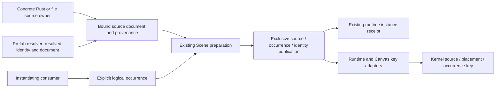

# Scene Source Context And Logical Occurrence

## Problem And Evidence

The [public Scene/UI consumer](../../crates/nara_ui/tests/source_identity.rs) materializes two
different documents with separate `SceneInstanceId` values into one World. Distinct local UI root
IDs produce two compiled roots. Making both local IDs `root` produces `root-key-duplicate` and no
candidate frame. This is a qualified counterexample to complete source identity, not evidence of
incorrect runtime instance allocation or action misrouting.

The duplicate-key failure remains correct under [ADR 0109](adr/0109-root-local-ui-compilation-and-presentation-closure.md).
The wrong boundary is upstream: [SceneEntitySource](../../crates/nara_scene/src/spawn.rs) has no
containing source-document context, and [UI projection](../../crates/nara_ui/src/runtime/projection.rs)
uses only the local source entity plus an optional Prefab chain. Two equal anchors and chains in
different containing Scenes have the same structural omission. Adding document identity alone
would still not distinguish two simultaneous occurrences of the same complete source.

The [R5a property selector](durable-property-addressing-design.md) remains Schema-relative. It
does not own this outer source/occurrence contract. The
[foundation rebaseline plan](../plans/2026-10-23-foundation-architecture-rebaseline-plan.md) remains
broader than either unit.

## Distinct Coordinates

Names here describe semantic roles, not frozen Rust type names or new global services.

| Coordinate | Meaning | Authority |
| --- | --- | --- |
| Source document reference | One authored entity-bearing document, including its source/product or explicitly scoped named origin | Concrete Rust author or file/asset admission owner |
| Source object address | Source document reference plus source-local entity ID | Source document owner |
| Authored placement | Containing root document plus local entity or structured Prefab anchor/source chain | Scene expansion owner |
| Logical occurrence | One caller-owned placement of source content, such as player-one HUD or a level slot | Instantiating consumer |
| Runtime activation | One World-bound Scene instance and entity incarnation | Existing Identity/Scene publication owners |
| Property selector | Component identity plus stable root/member/key selector | Schema owner and current-value resolver |

Source equality must not come from content bytes, a Rust type path, source location, a pointer,
active tab, workspace incarnation, physical file identity or runtime instance counter. File identity
and content digests remain custody/change-detection evidence. They do not prove semantic continuity.

Reusing a logical occurrence key explicitly asserts continuity of that logical slot. It is not a
promise that the engine retains arbitrary deleted-object history. Rebuilding that slot creates a
new runtime activation while preserving the declared source/placement address. Old runtime tokens
and presentation receipts remain fenced by the existing incarnation/session rules.

## Alternatives

### A. Required Source-Bound Envelope And Separate Occurrence (Recommended)

Keep `SceneDocument` as a pure document-local graph. A source admission owner binds its immutable
document and complete provenance in a private-field source candidate. The materializing consumer
supplies the logical occurrence separately. Source candidates can therefore be shared or retained
without confusing source content with a particular placement.

This aligns authority with actual consumers: a code-authored Scene need not impersonate a disk
asset; an imported document keeps source/product identity; a source loader cannot choose how many
logical placements its caller wants. It also avoids making payload identity and asset/product
identity competing authorities. These are the reasons to prefer A, not merely fewer file edits.

Cost: all persistent materialization paths must migrate, including direct Rust, startup/current
Scene, file-backed project content, Editor preview and Canvas. An optional source field followed
by the old local-ID fallback is not an implementation of this design.

### B. Mandatory Identity Inside Native Scene/Prefab Payloads

Native documents could own an embedded document identity, and Rust constructors could require it.
This makes native Save/Reopen self-describing. It is viable if native document storage is selected
as the durable identity owner.

It still requires a separate occurrence. It must also define clone versus Duplicate versus Save As,
and the exact relation between an embedded document ID and source/product identity. Compound
importers still need authored continuity outside a disposable cache. Do not retain two independent
equality authorities for the same document. B requires a deliberate owning format change.

### Rejected Shortcuts

- Requiring every document-local entity ID to be globally unique contradicts ADR 0038.
- `(SceneInstanceId, entity)` fixes present coexistence by destroying declared logical continuity
  on every reconstruction and contradicts ADR 0102.
- UI-generated namespaces or `AssetRef::to_string()` cannot establish canonical source equality.
- A short hash is not exact identity and must not hide structural-key budget exhaustion.
- A universal object UUID registry, a second Entity resolver, a Package service or a new Undo owner
  is unnecessary for the demonstrated workflow.

## Recommended Ownership Flow

The source owner supplies data and proves its association. The existing Scene owner retains the
prepare/revalidate/commit/retire boundary. The kernel consumes opaque structured identity and
does not depend on ECS, Scene, Asset or Editor. Generic `nara_app` acquires no Scene dependency.

The active occurrence claim must include empty Scenes and bind to the exact instance receipt.
Its key is the caller-declared occurrence namespace and slot within the receiving World; source
identity and instance receipt are binding values, not additional uniqueness axes. Changing source
cannot admit a second occupant of the same slot. The namespace is an explicit logical owner key,
not a process-local counter or an automatically derived source namespace.

Claims cannot be inferred by scanning entity components. Duplicate active claims reject before
allocation/publication; replacement consumes the exact predecessor claim under one exclusive
commit. A public Scene-owner end operation accepts the exact instance receipt, including an empty
Scene, and releases only that activation's claim without discarding Identity's independent runtime
history. Deleting the final entity does not end the occurrence. A stale end retry or projection
clear must never release a successor's claim. No permanent occurrence-history service is proposed.

### Public Instance-End Prerequisite

The [public exact-instance operation](../../crates/nara_scene/src/spawn.rs),
`retire_and_despawn_scene_instance`, now exposes the existing Scene-owned retirement transaction.
The [public tests](../../crates/nara_scene/tests/instance_retirement.rs) cover empty and individually
emptied instances, independent instances, stale/foreign receipts and lifecycle refusal. The
[separately compiled consumer](../../tests/fixtures/module-consumer/tests/scene_spawn.rs) completes
parse/publish/spawn/end without private hooks. Authoring clear uses the same operation; disposable
projection clear keeps its additional complete-epoch ownership proof.

This prerequisite ends current runtime activations and retains Identity history. It does not yet
create or release the source/occurrence claims proposed here. Their future integration must occur
inside the same exclusive retirement/publication cut, not in caller cleanup after a successful end.

## Source Admission Work That Cannot Be Skipped

Current project loading does not already supply this contract:

- [Project content loading](../../src/project_content.rs) reads and expands the selected Scene but
  does not bind a containing source-document identity to its expanded candidate.
- [Retained asset catalogues](../../src/project_content/catalogue.rs) retain Prefab/Image/TileSet/
  domain records, not necessarily the selected Scene. Prefab metadata admission can legally have
  no metadata. The implementation must not assume every Scene/Prefab already has a stable asset ID.
- [PrefabSourceResolver](../../crates/nara_scene/src/prefab.rs) returns a document while expansion
  retains the requested `AssetRef`; it does not return a proven canonical source binding.
- [Editor source admission](../../src/project_host/runtime/editor/source_admission.rs) rejects
  duplicate file custody. That is not durable source-document identity.

The implementation trial must select a concrete, bounded representation for both code-authored
and file-authored origins before changing public APIs. Required semantics are:

1. Code authors explicitly declare stable named origin keys; no macro-location inference.
2. Stable asset origins retain the product/document dimension. A primary native document can be a
   bounded first case, but two entity-bearing products from one source must not alias.
3. Any retained path-authored route is explicitly scoped by its admitted source universe. It is
   location-addressed and does not claim automatic rename continuity. Path and stable-ID aliases
   are reconciled only by the source owner, not UI or string normalization at use sites.
4. Missing continuity metadata never causes runtime load to mint IDs or write source files. Stable
   identity loss is an explicit conflict/repair operation; a deliberately path-authored origin is
   not silently promoted to a different identity policy.

The durable source-universe carrier for path-authored project content remains an implementation-entry
decision. A project name, current directory or process-local session ID is not an acceptable default.
This question must be settled in a complete direct/file-backed public trial, not hidden by a
fallback. Full importer publication, package governance and multi-file migration are not prerequisites
to that bounded identity trial.

### Executable Owner Experiment

The separately compiled [source-context experiment](../../tests/fixtures/module-consumer/tests/source_context_trial.rs)
and its [private prototype owner](../../tests/fixtures/module-consumer/tests/support/source_context_trial.rs)
exercise an explicit carrier and one flat native-document workflow. They use ordinary Scene
candidate, replacement and exact-end APIs; they do not change production materialization, project
configuration or shared UI behavior. The prototype owns its World and active occurrence table
together. It is not a product-side registry to retain after the Scene owner adopts this contract.

The carrier under experiment is a dedicated, authored, non-nil `project.source_universe` UUID and
a required `content.native_document_identity` choice: `project_location` or `stable_metadata`.
The fixture's `TrialManifest` is intentionally not the current `ProjectManifest`. No default,
metadata-first fallback or load-time ID creation is used. Source equality is structured:

| Origin | Equality coordinates |
| --- | --- |
| Explicit Rust declaration | Universe, named source, product |
| Stable asset | Stable asset ID, product; not the receiving project's universe |
| Deliberate native location | Universe, complete project-relative path, product |

The flat file case loads and publishes actual canonical Scene files and metadata. The location
policy refuses competing adjacent metadata. Stable path requests and stable-ID requests resolve
to the same admitted asset identity; metadata is required for both. An explicitly opened path
outside the prototype's initial scan root is admitted directly before its stable-ID alias is used.
Moving the project root and clearing disposable cache content do not change location identity;
renaming the location does. Stable source relocation retains identity after its authored metadata
path is updated. Loading does not write source files.

The occurrence experiment covers same-source simultaneous slots, changing a slot's source,
empty-instance replacement/end, stale replacement-intent/end rejection, and failed Scene admission that
retains its predecessor. Source is the claim's value, not part of its uniqueness key. It borrows an
immutable source candidate without exposing independently replaceable document/provenance inputs.
An intent is bound to its receiving World, but an initially vacant-slot intent describes current
vacancy, not a historical vacancy generation. It is not an already decoded Scene candidate.

This is evidence for a carrier/owner direction, not the complete trial's exit gate. In particular:

- The real selected-Scene Loader, Browser Open, closure observations, retention leases and Editor
  preview have not adopted these fields or types. The prototype's scan is deliberately narrow;
  it does not establish complete discovery or filesystem alias/capture consistency.
- Prefab canonical resolver results, nested projection chains and their source association remain
  unimplemented. A bare `AssetRef` request must not become canonical provenance by stringification.
- The product coordinate is distinguished as data, but no named imported Scene product is decoded
  or published by this experiment. Native files use `Primary` only.
- The typed trial payload has an exact tagged byte encoding for cost inspection. It is not a
  current `UiPersistentIdentity`, a durable file format or an ADR 0102 refreeze. Comparing its size
  with the public kernel limit does not prove Runtime/Canvas key admission or UI state isolation.
- The pre-commit stage only admits and captures a placement intent. Scene decode/preparation still
  runs inside commit through the existing public operation. Timing that first stage is not a
  measurement of engine preparation, and this does not qualify prepared Scene publication,
  cancellation or preview reuse. Native completion, public panel preparation and product
  performance remain separate obligations.

The public prepared replacement entry currently requires explicit asset bindings, native
retirement claims, overlay limits, additional retirements and a product callback; it may own scratch
World entities that require explicit discard. That is a provisional native-product integration
interface, not proof of an ergonomic ordinary source-placement prepare/preview/commit workflow.
The production trial must compare a source-owned preparation that delays World allocation with
an explicitly retained World-bound preparation, including failure and cancellation custody. Do not
relocate this work into a caller's second candidate or cleanup system merely to keep the old API.

### Native Policy Decision Before Production Adoption

A required project-level enum is smaller than a second per-document location list, but it applies
to all native document admission, not merely configured Scene/Prefab directories. The existing
[mixed-source rename consumer](../../src/project_host/authoring/mod.rs) has a metadata-free Scene
and a stable-metadata Prefab. It proves a real mixed-loading workflow, not that the Scene must
permanently retain location identity. Before freezing the enum, either migrate this workflow to
fully stable native identity with explicit authored Scene metadata, or establish a named need for
deliberately mixed identity policies. Do not add an exception inventory merely to retain an
unreleased incidental input shape, or silently remove the stable Prefab rename workflow.

The ordinary integrated-project recommendation is fully stable native identity; a deliberately
location-authored project remains an explicit alternative, not fallback on missing metadata.
Creating metadata is an explicit authoring/creation operation, never a side effect of loading.
Changing policy is an identity change and requires explicit source readmission, not a profile
override. Imported products retain their own admitted stable source/product identity rather than
inherit the receiving native-document policy.

Neither an enum nor an exception list can infer that arbitrary bytes copied into a location-authored
project used to have metadata somewhere else. The guarantee is refusal under the declared current
policy, not a permanent provenance history service. Whole-project Duplicate also needs explicit
stable-asset ID remapping: changing the universe alone separates named/location origins only.
Current catalogue paths are domain-relative; the fixture uses full project-relative native paths.
Production admission must reconcile those coordinate systems and canonical spelling at the source
owner. Appending unscoped Scene records to the existing asset database, or lowercasing names in UI,
would not prove alias equality. The fixture does not qualify filesystem case/symlink/hardlink aliases
or cross-file capture consistency.

## Continuity And Failure Rules

| Operation | Source / placement | Logical occurrence | Runtime activation |
| --- | --- | --- | --- |
| Same source instantiated twice | Same | Different | Different |
| Compatible rebuild of one logical slot | Same | Explicitly retained | New |
| Slot switches to another source | Different | May retain the slot key | New; composite UI key changes |
| Repeated Prefab in one Scene | Different authored anchor/chain | Outer occurrence may be shared | Separately bound |
| Independent source Duplicate | New source; local IDs may remain | Caller-selected | New |
| Reuse an ended slot | Owner-declared continuity | Explicit reuse | Old tokens remain invalid |

Missing context, active occurrence collision, wrong provenance association, foreign World, stale
preparation and exceeded Scene/source/claim admission budgets reject the Scene operation before
retiring a predecessor. This guarantee ends at the Scene publication boundary.
Source/occurrence stability does not imply unconditional focus/reducer resurrection or cache reuse:
existing presence, modal, session and environment rules still apply.

The structured-key size is charged exactly. The current kernel has a 256-byte key ceiling and
bounded projection depth. The trial must report the new encoded costs and prove supported
combinations against the selected budget rather than conceal overflows or silently drop axes.
UI admission remains a separate owner boundary: an unrepresentable projected key rejects the UI
candidate under ADR 0109, preserving the applicable presentation history, not rolling back a Scene
already published. A stronger pre-Scene key-admission guarantee would require an explicit consumer
preflight contract and evidence; this proposal does not silently claim one.

## Deliberate API Replacement

The likely owning changes are `ExpandedSceneCandidate::plain`, SceneSpawner/direct spawn and
replacement entry points, the Prefab resolver result, `SceneSource::direct`/`direct_expanded`,
startup/current-Scene replacement, `SceneProjection::publish*`, and a public exact-receipt
Scene-instance end operation. Bare documents remain useful
for editing, validation and serialization; they must not remain an identity-free persistent-spawn
shortcut. Do not add a transient fallback without a concrete consumer and explicit semantics.

Runtime projection and [Editor Canvas](../../crates/nara_ui/src/canvas.rs) migrate together so they
do not establish different meanings for persistent UI equality. Retained-source leases and move-only
candidate custody remain intact. Do not install source fields in a second post-publication pass.

## Pinned Reference Findings

Bevy `85503941e488152711a4695bbe248e9ed9f453fc` uses
[spawn.rs](../../repo-ref/bevy/crates/bevy_scene/src/spawn.rs) and
[spawn_system.rs](../../repo-ref/bevy/crates/bevy_scene/src/spawn_system.rs), not the historical
`scene_spawner.rs` layout. A patch can serve multiple target entities. Each root apply creates a
new `SceneEntityReferences` context in
[resolved_scene.rs](../../repo-ref/bevy/crates/bevy_scene/src/resolved_scene.rs). This supports
instance-scoped lowering; it does not make runtime scope counters or macro positions durable
source identity.

Godot `81ab961f91066a63bcbf3ec340962bb1a1ada558` separates resource UID/path mapping from
Scene-local node IDs and instantiated node trees. Its
[PackedScene implementation](../../repo-ref/godot/scene/resources/packed_scene.cpp) allocates
per-instantiation node state, carries owner-chain ID paths and handles repeated-instance local-ID
collisions during packing. The useful precedent is scoped identity and placement, not copying
the singleton UID service or heuristic repair policy into Nara.

## Qualification And ADR Scope

1. Reconcile ADR 0038's containing-source/provenance contract and ADR 0058's logical-occurrence versus
   runtime-activation distinction. Keep runtime tombstone and disposable-epoch semantics intact.
2. Prove one complete direct Rust plus file-backed origin trial. Choose the source-universe carrier,
   typed identity representation and constructor ergonomics. Do not ship all competing designs.
3. Replace materialization APIs and publication/retirement claims together. Test two sources with
   equal local IDs, one source with two occurrences, duplicate occurrence refusal, empty Scenes,
   source switches in an occupied slot, independent public retirement and compatible reconstruction
   with stale-token rejection. Deleting a final entity retains the claim; stale end retries cannot
   clear a successor, and empty instances can end through the same public owner operation.
4. Qualify repeated/nested Prefabs in two containing Scenes, including canonical resolved sources,
   source-local reference rewriting and wrong-association failure atomicity.
5. Carry the same contract through project loading, direct App, preview and Canvas. Prove declared
   move/reopen/cache-clear continuity separately from path-authored rename limits and metadata loss.
6. Amend/refreeze ADR 0102 with exact public inventory and neutral conformance assertions. Qualify
   independent focus, reducer, semantics, actions, fallback/cache identity and old-receipt fencing.
   ADR 0109 retains duplicate-key whole-candidate failure. Native/product evidence remains separate.
7. Record precisely which ADR 0083 semantic slice is adopted. Its importer/package/copy-closure and
   migration proposals do not become Accepted or implemented merely because this source slice passes.

The public counterexample is an incumbent characterization, not desired final conformance. Replace
its rejection expectation with the accepted complete-key behavior when the owning API is implemented.

## Success Metrics And Risks

| Criterion | Required evidence |
| --- | --- |
| Two independent sources with equal local IDs | Two distinct compiled UI roots through public APIs |
| Same source, two logical occurrences | Independent frames/state/actions with no engine-private assembly |
| Compatible rebuild | Same declared logical keys, new activation, all old runtime tokens fenced |
| Failure atomicity | No predecessor retirement or source/claim publication on each named rejection |
| Consumer ergonomics | Recorded concepts/choreography and no caller-built provenance maps or Undo |
| Bounded work | Exact key/claim budget tests and measured prepare/replace costs on the public trial |

The main risks are duplicate source authorities, hidden path fallback, active claims that omit empty
Scenes, and accidental cross-source last-good UI reuse. The owning source binding, exact receipt
association and shared UI qualification address these directly. A second global identity framework
would add risk without solving an additional current consumer requirement and is not proposed.
