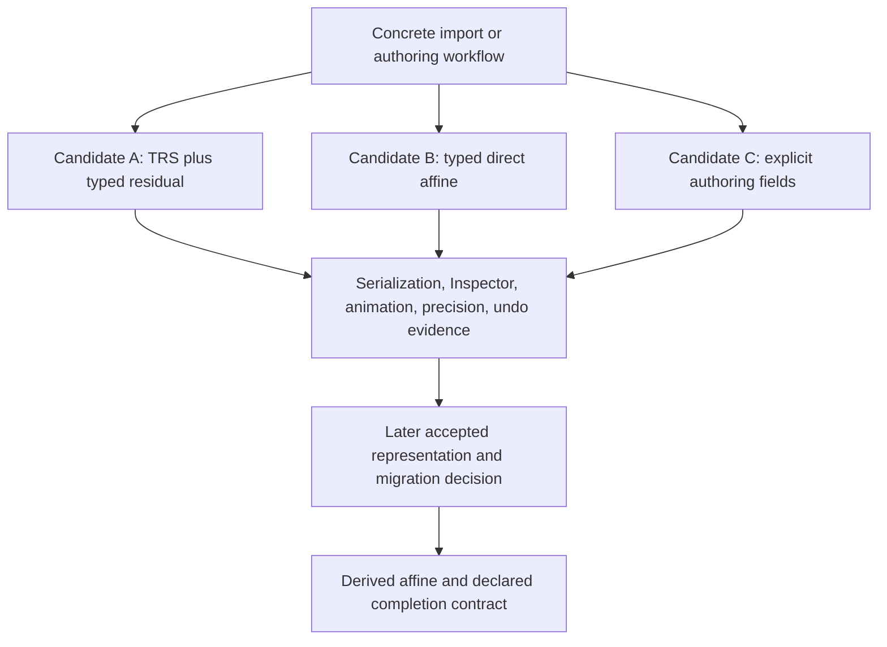

# Spatial Affine Representation Design

**Status**: Proposed candidate design; no future schema or algorithm is accepted here
**Date**: 2026-10-23
**Decision boundary**: [ADR 0097](adr/0097-future-capable-2d-3d-spatial-transform-model.md)

## Purpose and Current Evidence

Preserve the affine-authoring candidate and reasoning previously included in ADR 0097, while
comparing it with alternatives before choosing a persistent representation. This document is not
an implementation plan or a compatibility promise.

Accepted scope remains separate 2D/3D domains, current local authored 2D TRS, derived global
affine values, explicit conversion and no silent loss. ADR 0100 owns supported phase snapshots;
ADR 0101 owns ordered placement and exact inverse operations. Current structural authoring uses
`KeepLocal`, preserving component values.

`Transform2d::matrix` and propagation in `crates/nara_transform/src/propagation.rs` already compose
local TRS as affine matrices. Rotated non-uniform ancestor scales can therefore produce global
shear without a persistent local residual. This proves the need for affine global results, not a
particular local-affine schema. The structural moves and exact undo in
`crates/nara_scene/tests/structural_authoring.rs` likewise do not prove KeepWorld semantics.

Future pressure could come from a non-TRS DCC node import, skew/pivot editing or world-preserving
reparenting. One complete workflow must compare persistence, Inspector interaction, animation,
numerical behavior and undo together. A focused 3D workflow must additionally validate the 3D
representation before any of its fields become an accepted schema. Explicit source/schema
migration is allowed; no candidate guarantees that future work will avoid a format change.



## Candidate A: TRS Base Plus Typed Post-Affine Residual

The original candidate keeps ordinary authoring simple while extending the local expression:

```text
effective_local = base_trs_affine * post_affine
```

This is a proposed column-vector multiplication convention, not a current persistent contract.
Base and residual together would be one local authority, rather than competing transforms.

- Current `Transform2d` fields remain translation `Vec2`, rotation in radians and scale `Vec2`.
- A proposed `Transform3d` uses translation `Vec3`, a Nara-owned normalized `UnitQuat`, and scale
  `Vec3`. Its proposed encoding is finite, normalized and sign-canonical. Euler values would be
  Inspector/gizmo presentation or command input. These fields and encoding remain unselected.
- Optional `PostTransform2d` and `PostTransform3d` would contain finite, bounded affine data in
  Nara-owned fields. Absence means identity. They would be persistent components owned by
  `nara_transform`, rather than opaque backend or `glam` values.
- The residual could express local skew/shear, pivot-relative translation, reflection, imported
  matrices or a singular visual transform while retaining ordinary base fields.
- A 2D Skew control or 3D Basis/Affine mode could present that same expression. Neither would
  create another document authority.
- Future global wrappers would remain derived read-only affine values. This candidate selects no
  3D snapshot storage mechanism, generic transform-domain trait or provider registry.

The attraction is preserving recognizable TRS fields and allowing exact affine values where a
workflow needs them. The cost is a larger schema and more complicated normalization, animation,
Inspector state and migration rules. A mathematically complete expression alone does not prove
that its editing behavior is suitable.

### Original Lowering Options and Unresolved Priority

The earlier ADR contained these proposed rules:

1. If a source value is exactly representable as TRS, omit the residual.
2. Preserve imported source TRS when exact. Otherwise use identity base plus a validated residual.
3. For an exact world-preserving edit, retain the existing invertible base and compute a residual
   for the new local affine. If the old base is singular, use identity base plus the candidate.
4. An explicit `BakePostAffineToTrs` removes the residual only after decomposition and
   recomposition satisfy an engine-defined precision contract.
5. Singular visual locals may be representable, while an operation requiring a parent inverse
   rejects before mutation if that inverse cannot be admitted.

These are alternatives to reconcile, not a consistent accepted normalization algorithm. For
example, an old identity base and a new local pure translation make rule 1 prefer translation in
base with no residual, while rule 3 prefers identity base with translation in residual.

The unresolved choice is whether canonical minimal representation or preservation of authored
base fields takes priority, and whether import and editing should have different explicit rules.
Evidence must include source diffs, Inspector behavior, animation targets, repeated edits and
undo. An automatic bake could change authored meaning even when it preserves the matrix.

## Alternatives and Trade-offs

| Candidate | Benefit | Cost and question to validate |
|---|---|---|
| A: TRS plus typed residual | Simple common fields and a complete affine expression | Equivalent representations, hidden residual state and base-preservation conflicts |
| B: Typed direct affine local value | Direct import and world-preserving results without decomposition | Authoring and animation need a deliberate presentation that does not expose raw matrix arithmetic to ordinary users |
| C: Explicit authoring representation, such as skew/pivot fields | Controls may align better with the target workflow | Must prove representational coverage, composition, canonical encoding and animation semantics |
| D: Retain current local TRS and reject unsupported local results | Small supported surface with explicit failure | Some import/reparent workflows remain unavailable until a later representation and migration decision |

Candidate A remains a leading option, not the selected future schema. A universal 3D authoring
transform remains excluded by ADRs 0005/0097. Persisting raw matrices for all ordinary entities
would obscure author intent; Candidate B must demonstrate typed authoring and tool behavior rather
than assume a matrix field is an adequate public interface.

## World-Preserving Edit Candidates

The structural operation remains KeepLocal. For a future world-preserving workflow, the familiar
mathematical target is:

```text
new_local = inverse(new_effective_parent_global) * old_global
```

That equation is a candidate calculation, not a complete algorithm. It still needs a defined
domain boundary, one validated revision, inverse admission, numerical error model, local
representation and atomic document publication.

The original operation names were:

- `KeepWorldExact`: admit an affine result, potentially materializing a residual under Candidate A.
- `KeepWorldTrs`: reject a result that cannot satisfy the selected TRS precision contract.
- `BakePostAffineToTrs`: explicitly normalize a residual-bearing expression when admissible.

Names, representation and algorithms remain Proposed. Under any eventual design, retention must
be explicit; failure must leave the document unchanged; and patches must persist final placement
and local values rather than replay a transient KeepWorld request. Those semantic requirements
come from ADR 0097 and do not select Candidate A.

Unresolved numerical and editing choices include:

- Near-singular inverse acceptance, error units and absolute/relative tolerances.
- Whether repeated reparenting accumulates drift and what each operation promises to preserve.
- Preservation of existing base values versus removal of redundant residuals.
- Exact undo/replay after later ancestor changes, without recomputing historical intent.
- Whether singular visual values are supported by each consumer, independently of inverse use.
- Whether Editor drag-reparent should request world preservation by default in a proven workflow.

## Domain Consequences to Validate

The original candidate sought to cover imported DCC matrices, pivot operations, skew, reflection,
world-space UI, cameras, picking, animation and physics. A single representation may not provide
the same accepted operations in each domain:

- Import must convert coordinate conventions under ADR 0022 and preserve declared information or
  reject explicitly. The identity-base residual fallback needs actual imported-node evidence.
- Animation must define which fields or expression it targets and how interpolation behaves.
  Residual animation cannot be inferred from generic reflected field animation.
- Physics must declare accepted scale/shear/parenting subsets and fixed-tick writeback authority.
  A renderable affine value does not imply a valid dynamic-body pose.
- UI layout retains its own semantics. A world-space bridge must name its spatial domain and
  conversion; a complete affine representation does not replace layout inputs.
- Render extraction and other fresh consumers retain the owning domain's completed projection.
  No candidate permits live-local fallback or changes the supported 2D snapshot roles.

## Evidence Required Before Acceptance

These are investigation criteria for a triggered workflow, not new requirements on the current
2D implementation:

| Question | Required observation |
|---|---|
| Non-TRS import | At least one real affine node import, including shear or pivot translation, round-trips under a stated error metric without silent loss |
| World preservation | Rotated non-uniform ancestors, domain boundaries and singular/near-singular parents produce an admissible result or explicit no-change failure |
| Representation priority | The identity-base/pure-translation example and an animated base have documented, deterministic source and Inspector outcomes |
| History | Undo/redo and replay restore exact final source facts even after ancestor edits; historical intent is never reevaluated |
| Numerical stability | Repeated reparenting reports accumulated error against a declared precision budget; the workflow determines the budget before acceptance |
| 3D schema | A focused 3D consumer validates field/rotation encoding, coordinate conversion and editing rather than inheriting the 2D schema by analogy |
| Migration | Any changed source shape has explicit version/admission rules and migration fixtures; runtime loading does not silently rewrite files |

## Risks and Mitigations

| Risk | Mitigation |
|---|---|
| Candidate names become de facto public commitments | Keep this document Proposed and accept schema/algorithms only through a later decision with consumer evidence |
| Equivalent local expressions cause diff churn or alter animation | Compare canonicalization and base-preservation using complete editing/history workflows |
| Affine support is mistaken for physics or UI support | Keep domain admission and conversion explicit |
| Future-proofing expands the current 2D task | Preserve supported TRS and phase snapshots; start representation work only for a concrete missing workflow |

## Preserved Reference Rationale

The previous ADR used these comparisons to motivate investigating affine authoring. They are
historical research pointers, not fresh qualification or proof of Candidate A:

- Bevy's local TRS, derived affine global and explicit propagation illustrate the authored/derived
  distinction; reparent decomposition has shear and degeneracy limits.
- Godot's separate `Node2D`, `Node3D` and `Control` illustrate domain-specific authoring.
  The original rationale noted 2D skew, a full 3D basis and different UI reparent behavior.
- Unity classic Transform's non-uniform-parent shear limits motivated checking complete
  workflows. Unity Entities' local transform plus optional post-transform matrix motivated the
  base-plus-residual candidate.

Original reference locations, retained without reopening them for this documentation amendment:

- `repo-ref/bevy/crates/bevy_transform/src/components/transform.rs`,
  `repo-ref/bevy/crates/bevy_transform/src/components/global_transform.rs`, and
  `repo-ref/bevy/crates/bevy_transform/src/plugins.rs`
- `repo-ref/godot/scene/2d/node_2d.cpp`, `repo-ref/godot/scene/3d/node_3d.cpp`, and
  `repo-ref/godot/scene/gui/control.cpp`
- Unity classic [Transform manual](https://docs.unity3d.com/6000.0/Documentation/Manual/class-Transform.html)
- Unity Entities [Transform concepts](https://docs.unity3d.com/Packages/com.unity.entities@1.3/manual/transforms-concepts.html)
