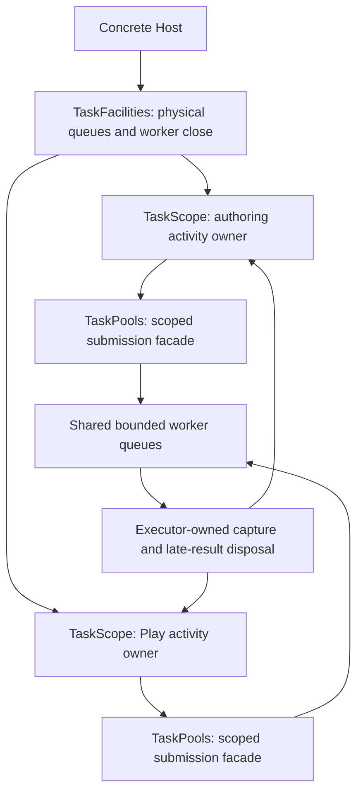
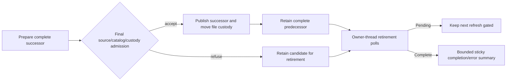

# Task Facilities And Activity Custody

Status: the [first R4b custody unit is qualified](../knowledge/engineering/verification/2026-10/2026-10-25T155728Z-independent-task-activity-custody-and-shared-image-runtime-qualification-13caef5f8c39471aa58529789ae9c530.md).
Optional demand activation and a [bounded lazy/shared comparison](../benchmarks/2026-10-26-task-facility-locality.md)
now have separate evidence; actual Editor lifecycle/deployment qualification remains open. The [rebaseline plan](../plans/2026-10-23-foundation-architecture-rebaseline-plan.md)
owns the complete scope. This document does not qualify R4c, Future I/O or real-time callbacks.

## Pressure And Ownership

`TaskPools` currently combines the submission facade with optional ownership of three physical
worker queues. `TaskPlugin` transfers the physical close owner into a Runtime ledger. That remains
a valid standalone composition, but cloning an execution facade cannot create independent worker
ownership. Pre-inserting a facade also cannot prove a Runtime's outstanding work returned.

The concrete product candidate is trusted compiled Editor authoring/preview plus its same-process
Play Runtime. The ordinary Editor's supervised Play child is a separate process and cannot prove
shared in-process facilities. Source indexing, persistence, Image and Scene preparation retain
their own result/publication rules; cancelling their task is not proof that a file operation or
native resource retired.

## Candidate Interface

- `TaskFacilities` owns physical workers and exposes configuration, aggregate statistics, scope
  creation and explicit physical shutdown. A Host may share its ownership through `Arc`; it is not
  a process-global singleton.
- Shared plugin instances retain the explicitly supplied `Arc<TaskFacilities>`. The final strong
  owner can therefore be a plugin/Runtime if the outer Host released its own reference early.
  This runs the existing physical Drop fallback, not an implicit blocking shutdown. A Host with
  manually retained activities must keep its facilities owner; arbitrary completed-output
  destructor latency remains subject to the existing physical-owner Drop contract.
- `TaskScope` is move-only. `spawner()` produces activity-bound `TaskPools` facades. These facades
  submit to the same activity, cannot create another scope, and have no physical shutdown owner.
- `TaskScope::begin_close` stops that activity's admission and cancels its pending/running work.
  `poll_close` observes physical return without joining shared workers. Drop requests the same
  cancellation and transfers pending disposal to retained custody without waiting.
- `TaskPlugin::shared` creates a scope before installing its facade and registers the scope owner
  with the managed Runtime. An occupied facade is an explicit setup refusal. Default plugin
  construction continues to own its physical pools; explicitly external standalone pools retain
  their existing caller-owned close contract.
- `TaskScopeCloseReport` describes activity pending count and sticky cleanup failure.
  `TaskShutdownReport` continues to describe physical worker/disposal retirement. Their completion
  statements are deliberately different.

Statistics on any facade describe the physical facility. Completion cutoffs have a separate
activity token; `TaskId` allocation remains shared and non-reused within the facility. The
existing `TaskPools` name preserves one submission interface, not a promise of physical ownership.
There is no `Clone` implementation that silently changes ownership authority.

## Admission And Return

Scope admission acquires the activity gate before the executor queue. A successful admission
registers its physical-return obligation before publishing the pending entry. Close takes the same
gate, then visits each queue. A competing spawn is either admitted and counted or refused; there
is no successful-but-unregistered interval.

Pending and running entries carry activity identity. Coalescing matches activity, domain and key;
equal asset IDs in different Worlds cannot replace each other's pending jobs. Cancellation borrows
queue-owned controls in place. The scope never retains strong task-state snapshots that could
become the final owner of an untaken output on the closing thread.

`TaskReturnObservation` accounts one accepted obligation in the activity. Only its successful
physical-return transition decrements that obligation, after executor-owned capture and rejected
late-result disposal. Failure is sticky before the decrement. Rejected work never enters the
accepted close set. Constant-space aggregate accounting does not retain task output or scan an
ever-growing history on submission.

Close removes its queued entries under queue custody and transfers them to the existing retained
disposal lanes. It does not wait for an unrelated uncooperative worker to reach those entries.
Blocked disposal keeps return Pending. Reclamation/coalescing disposal already executing on a
submitter remains counted even after its queue entry disappears. User destructors execute outside
both queue and activity locks.

Nested work submitted through the same facade belongs to the same activity. Work admitted before
close is counted; a later child submission is refused. Published/transferred outputs, escaped
resource clones and work explicitly sent to another independently owned facility remain separate
responsibilities. A return report cannot establish native cleanup or arbitrary code-unload safety.

## Alternatives And Deployment

| Alternative | Benefit | Cost and limitation | Disposition |
|---|---|---|---|
| Lazy per-Runtime facilities | No shared queue contention; inactive Runtime need not create workers | Active Runtime multiplicity still creates independent facilities; first use must report spawn failure and retain partial startup | Required comparison; still a valid deployment |
| Host facilities with activity scopes | Shared physical capacity with independently observed activity return | Admission capacity and blocking contention are shared; the Host must choose policy and retire facilities separately | Implement the custody candidate; product selection requires measurements |
| Shared facade without activity custody | Small surface change | Runtime Stop either shuts siblings down or loses its work/disposal proof | Reject |
| Universal frame/Future/blocking/audio executor | One advertised execution abstraction | Conflates borrowing, wake, blocking and real-time contracts | Reject |

The pinned Bevy source separates lexical Future scopes from physical TaskPool Drop; its default
pools use process-global initialization. Godot separates finite group completion from worker-pool
`finish()`. Neither mechanism directly supplies Nara's cross-frame retryable activity close.
References are `repo-ref/bevy` at `85503941e488152711a4695bbe248e9ed9f453fc` and `repo-ref/godot`
at `81ab961f91066a63bcbf3ec340962bb1a1ada558`.

No fairness or priority algorithm is selected. Shared capacity does not reserve progress for each
scope. Facilities can be closed by their owner while scopes remain; this cancels admitted work but
does not manufacture scope completion. Normal Host shutdown retires scopes before worker join.

## Verification And Remaining Decisions

### Concrete Product Admission And Retirement Work

Read-only tracing at `c62ff32` identifies the trusted Editor authoring/preview plus same-process
Play consumer in `src/project_host/runtime/tests/editor_scene_travel.rs`. It also exposes required
work beyond replacing a Tasks plugin:

- `PluginDefinition::exact_eq` compares canonical definition identity and factory type, not
  captured runtime objects. A repeatable definition must not capture an otherwise unrepresented
  facilities Arc; pointer bytes must not become a canonical configuration fingerprint.
- Prefer one move-only typed candidate input installed after pure definition preparation and
  before the existing commit/seal/admit path. A two-phase construction owner is a valid alternative
  but adds another abandonment contract without a second real input consumer. Do not add an
  arbitrary App callback, service locator or Tasks dependency to App.
- The ordinary configured Tasks plugin consumes the input, checks full `TaskPoolConfig` equality,
  registers an activity owner that also retains the physical facilities Arc, then exposes its
  facade. Conflicting explicit shared-plugin input, existing facade or config mismatch refuses
  construction. The plan and its canonical Tasks definition remain unchanged.
- A concrete Session owns facilities outside the Play running slot. Stop/Restart and failed
  startup retire only their activity; content-refresh replacements use the same facilities with
  fresh activity identity. A later start cannot merge or silently reconfigure physical policy.
  Shared deployment explicitly replaces authoring's fixed 2/1/1 policy with the Host-selected
  policy; those former numbers are not per-scope reservations.
- `EditorAuthoringRuntime::shutdown_tasks` currently expects only `TaskShutdownReport`. Separate
  activity return from final Session physical shutdown before enabling shared facilities, or a
  stopped authoring Runtime would remain falsely incomplete. Final public physical close receipts
  must still describe actual joined facilities.
- `advance_close` must account for Preparing, Starting, AwaitingGameTarget, Active and failed Play
  owners using the existing trusted-workspace retirement choreography, not merely an empty
  `ProjectHost` slot. Preserve Scene-request Tasks custody after its local cancellation completes.
- Content refresh currently can replace the old authoring Runtime or drop a failed replacement.
  Retain those complete owners through retirement and gate another refresh until they finish;
  preserve exact `HostCustody::transfer_to` for file owners. Drop/quarantine is not evidence of
  normal predecessor completion.
- Authoring startup failure currently projects to `DiagnosticReport`. Retain its retryable failure
  owner through Open/refresh failure instead of treating diagnostic projection as cleanup proof.
- Expose nonblocking physical close progress for the concrete Session. Do not call the standalone
  `shutdown_blocking` driver from a per-frame Editor close poll and imply responsiveness.

These are source-derived redesign obligations, not completed implementation or new public Host
abstractions. Qualify the actual A-to-B-to-A Scene consumer with held Play work, authoring
Save/Image progress, Stop/Restart/failed start, config refusal, refresh predecessor retirement and
final Session physical completion before selecting a shared product deployment.

### Retained Authoring Replacement Unit

The first product-owner correction keeps at most one unpublished or predecessor authoring
Runtime in Session-owned retirement. Successful refresh publishes its prepared content/preview
successor and transfers file-Host registrations exactly once; the complete previous Runtime then
retires separately. Any rejection after a replacement Runtime exists transfers that Runtime to
the same slot without changing the live owner. Another refresh cannot construct a Runtime while
the slot is occupied. Logical task cancellation is not release evidence.

Choose this bounded retained owner over either a growing list of old Runtimes or best-effort
Drop/quarantine. A Stop-first alternative would require suppressing the still-useful authoring
owner and restoring last-good on rejected successor; there is no such product requirement here.
Do not mutate the existing asset World in place merely to avoid retirement: old task captures,
content snapshots and preview bindings have exact generation/authority contracts.

Acceptance requires a held predecessor surviving actual Prefab Save/refresh, successor Save/Reopen
remaining usable, a second refresh remaining gated, rejected post-start candidate retention,
off-thread physical disposal and Session close waiting for every retained authoring owner.
Physical reports aggregate disjoint completed owners once, without retaining an unbounded history;
cleanup failure remains sticky independently of completion. A public frame pending fact drives
non-redraw native maintenance after content publication. This unit does not by itself qualify
failed App/initial-Open construction or select lazy product placement.

### Initial Construction And Open Failure Follow-up

The replacement slot exists only after an Editor Session has been published. It cannot own an
App that failed configuration, a failed Startup, or a successful authoring Runtime whose enclosing
Session publication subsequently rejects. Those stages need their own concrete Host custody;
do not expand the refresh slot into a universal failure registry.

The source investigation at baseline `a1ff454` identified three boundaries to replace:

- `build_authoring_app` created a local App and installed Tasks before other fallible configuration.
  A later error returned only diagnostics. The Tasks plugin already registers successful and
  partial worker construction in the App ledger; this is loss of the enclosing retry owner, not
  proof that Tasks forgot its threads.
- `EditorAuthoringRuntime::new` and `new_authoring` projected `RuntimeStartFailure` to diagnostics.
  That failure already carries retained retirement. Earlier preview/asset preparation errors also
  exit after resource acquisition.
- Ordinary and trusted `EditorProjectSession` Open created their authoring Runtime before later
  image/UI, source-file and Workspace publication checks. `EditorProjectOpenError`, the public
  Open failure and Shell Recovery carried diagnostics without that candidate owner.
  Retry, return to the manager and failed project replacement therefore could not poll its exact
  ordinary cleanup responsibility.

`RuntimeOwner::drop` attempts finite close and retains incomplete custody through quarantine.
That safety fallback is not evidence of immediate unsafe World destruction, a reproduced leak,
or responsive successful Open cleanup. The intended replacement is explicit owner-thread polling
from first resource acquisition through publication or physical retirement. Candidate refusal and
cleanup completion remain separate facts.

Use an actual public rejection as the next consumer: advance `EditorProjectOpenHost` to pending
`SessionPublication`, change the prepared startup Scene bytes or native-source metadata, then
advance again. Binding/revalidation rejects after authoring construction while preserving the
incumbent project. Pair this real failure with private held-work instrumentation to prove retained
Pending, disposal return and final close; source reachability alone does not prove a long-lived
unfinished owner or quarantine abort in the ordinary built-in path.

The comparison considered a narrow retained raw-App admission/abort boundary and converting the
concrete authoring builder to the existing `PluginPlan` candidate path. Reuse `RuntimePreparationRetirement`,
`RuntimeCandidate`, `RuntimeStartFailure` and the existing ledger rather than adding a second close
machine. Configuration must borrow an already accountable owner; do not start an invalid App merely
to obtain a retirement handle. Keep any post-start unpublished Runtime in the same failed-attempt
custody. Public Open failure should retain its owner and expose bounded cleanup observation, while
Application holds one failed-Open slot independently of replaceable Recovery presentation state.
Gate another construction while it is Pending, keep an incumbent project usable, and make Exit
wait. Preserve the independent startup-preparation attempt's transportability rather than moving
thread-bound Runtime ownership into it. Select the actual interface with the consumer, not by
introducing another general service registry or arbitrary App callback.

Lazy private facilities reduce unused worker acquisition and shift OS-spawn refusal to typed first
use; they do not make preview, source validation or Session publication infallible. Directly
preinserting `TaskPools` skips the plugin's physical-owner registration, and `TaskPlugin::shared`
registers activity close rather than the authoring owner's physical report. Neither is a valid
shortcut to lazy product deployment. Qualify initial construction/Open custody first, then choose
the concrete private-lazy placement and its first-use failure behavior separately.

Pinned comparison limits: Bevy `85503941e488152711a4695bbe248e9ed9f453fc` separates `App::empty`
from default task-plugin installation; its task plugin initializes global facilities during build,
not at each first job, and explicit task-pool Drop joins synchronously. Godot
`81ab961f91066a63bcbf3ec340962bb1a1ada558` explicitly owns singleton initialization, lazily creates
named pools and finishes them on destruction. These inform placement and physical ownership;
neither supplies Nara's cross-frame retained Open-failure protocol. Relevant read-only source is
`repo-ref/bevy/crates/bevy_app/src/{app,task_pool_plugin}.rs`,
`repo-ref/bevy/crates/bevy_tasks/src/task_pool.rs`, `repo-ref/godot/main/main.cpp` and
`repo-ref/godot/core/object/worker_thread_pool.cpp`.

Acceptance for this separate unit covers configuration failure after acquisition, Startup failure
with held disposal, actual public source-drift rejection, Retry/manager/Exit and project replacement
while cleanup is Pending, then successful Open/edit/Save/Reopen/Close after physical completion.
No new release migration guide, global executor, generic erasure or lazy-default claim follows.

The selected concrete implementation keeps raw-App configuration. Preview installation requires
pre-seal resource/system mutation and returns a separate preview session; moving that workflow into
repeatable plugin factories would require another input/output transfer mechanism. The narrow
`App::begin_retirement` and `RuntimeInstance::prepare` bridges instead reuse the existing owner and
ledger. Ordinary start reuses the same admission prefix. Authoring configuration borrows an App
whose failure boundary already exists, and its error retains configuration/admission/Startup
custody. A successfully started but unpublished authoring Runtime remains in that boundary until
complete Session publication or transfer into the Open failure.

The public Open error/failure owns cleanup separately from its diagnostic observation. Application
holds at most one such failed owner independently of Recovery/manager/retained-project state, polls
it through maintenance, refuses Retry or new construction while Pending, and withholds Exit until
physical completion. It retains the first terminal failed-close evidence across later clean
retirements. The transportable startup-preparation attempt remains separate from thread-bound
authoring custody. This selection and source wiring do not establish qualification before the
configuration, real source-drift, lifecycle and native gates execute.

### Demand-Activation Comparison Candidate

The demand-activation candidate creates bounded queues and a physical close owner without workers. The
first submission to a worker kind activates only that kind. First use may perform OS thread
creation on the submitter and concurrent first submissions may wait for the same activation;
measure that wall time separately from accepted-admission-to-start. There is no caller-thread
execution fallback. An already closed scope must not activate facilities.

Activation serializes on one private worker-ownership lock and uses the existing queue lock for
live-worker reservations. Physical close atomically prevents further activation and closes the
queue without waiting for OS thread creation; join polls the worker lock without blocking. All
successfully created handles, including partial activation, stay in the physical owner's shared
private custody. Abnormal Drop transfers that same custody object to the reaper, not a possibly
incomplete handle snapshot. A failed activation closes that kind and returns a typed spawn
rejection before admitting its closure; it does not retry implicitly or manufacture completion.
Other worker kinds remain independent. The existing physical close protocol joins any partial
workers. Scope return still describes accepted work only, not physical worker joining.

Activation precedes the scope admission gate. A competing scope close can therefore complete
while a first-use submission is still creating facilities, provided no work was yet accepted.
That submission is refused when it later reaches the gate; its input disposal remains the
submitter's unadmitted responsibility. A scope already known closed never starts activation.

This is an optional measured candidate, not a new default. Comparing explicit Host preactivation
with lazy first-use activation can distinguish latency policy from scope ownership without a
universal executor trait, per-task native-thread creation or a process-global pool. Shared and
per-Runtime facilities must use the same activation mechanism and job consumer so that the
comparison does not silently reward one candidate with an eager warmup or extra worker budget.

The [bounded release comparison](../benchmarks/2026-10-26-task-facility-locality.md) now records the
same two-active-Image consumer with matched aggregate worker/queue capacity. Both start with no
workers; private facilities preserve sibling progress under owner-0 occupancy while the shared
queue waits for held work. This challenges unconditional sharing as the preferred interactive
deployment. Activity custody remains useful independently; select physical isolation domains
from required progress guarantees, then qualify actual Editor deployment. No product default
has yet changed.

| Criterion | Required evidence |
|---|---|
| Independent close | Two managed Runtimes share one physical facility; one Stop remains Pending on its own work while the other admits and completes work |
| Admission and key isolation | Concurrent spawn/close, same-key cross-scope submission, same-scope replacement and cutoff mismatch |
| Physical custody | Pending disposal under sibling saturation; cancelled-running late result; coalesced disposal; nested work; sticky unwind failure; output ownership |
| Failure ownership | Failed registration/startup and facade replacement/removal retain the original activity through return |
| Measured comparison | Same consumer for lazy per-Runtime and shared candidates; accepted-admission-to-start, interactive completion and actual worker/facility multiplicity |
| Product deployment | Trusted Editor authoring/Play preserves Scene requests, Save/Reopen, retry, source association and last-good restart |

`TaskHandle::admission_to_start` samples accepted queue publication through execution authorization;
cancelled-before-start tasks have no sample. It excludes submission setup, acquiring the queue lock
and capture disposal after replacement. First-use/interactive wall time must be measured separately.
Small synthetic samples cannot qualify a product latency distribution or a native frame P99.

Risks are shared-queue starvation, retained disposal-lane saturation, incomplete cleanup after
unwind and accidental product policy changes. Keep each visible in measurement or return evidence,
retain the existing quarantine, refuse unsupported cleanup claims and leave deployment explicit.
The first custody unit does not replace ADR 0008's long-term execution model or complete R4b.
