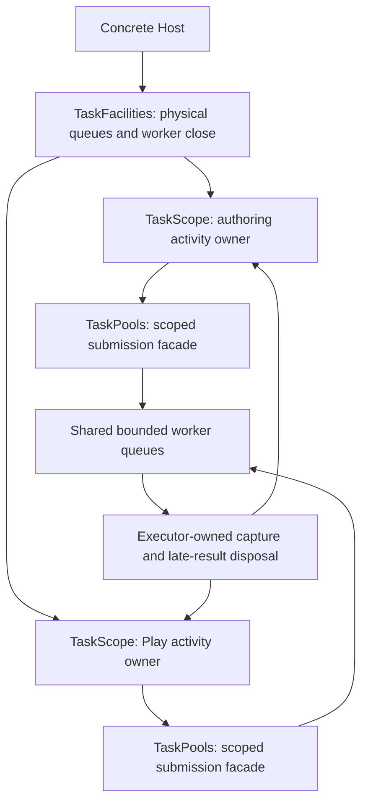

# Task Facilities And Activity Custody

Status: the [first R4b custody unit is qualified](../knowledge/engineering/verification/2026-10/2026-10-25T155728Z-independent-task-activity-custody-and-shared-image-runtime-qualification-13caef5f8c39471aa58529789ae9c530.md); product deployment and the comparison
with lazy per-Runtime facilities remain open. The [rebaseline plan](../plans/2026-10-23-foundation-architecture-rebaseline-plan.md)
owns the complete scope. This document does not qualify R4c, Future I/O or real-time callbacks.

## Pressure And Ownership

`TaskPools` currently combines the submission facade with optional ownership of three physical
worker queues. `TaskPlugin` transfers the physical close owner into a Runtime ledger. That remains
a valid standalone composition, but cloning an execution facade cannot create independent worker
ownership. Pre-inserting a facade also cannot prove a Runtime's outstanding work returned.

The concrete product candidate is trusted compiled Editor authoring/preview plus its same-process
Play Runtime. The ordinary Editor's supervised Play child is a separate process and cannot prove
shared in-process facilities. Source indexing, persistence, Image and Scene preparation retain
their own result/publication rules; cancelling their task is not proof that a file operation or
native resource retired.

## Candidate Interface

- `TaskFacilities` owns physical workers and exposes configuration, aggregate statistics, scope
  creation and explicit physical shutdown. A Host may share its ownership through `Arc`; it is not
  a process-global singleton.
- Shared plugin instances retain the explicitly supplied `Arc<TaskFacilities>`. The final strong
  owner can therefore be a plugin/Runtime if the outer Host released its own reference early.
  This runs the existing physical Drop fallback, not an implicit blocking shutdown. A Host with
  manually retained activities must keep its facilities owner; arbitrary completed-output
  destructor latency remains subject to the existing physical-owner Drop contract.
- `TaskScope` is move-only. `spawner()` produces activity-bound `TaskPools` facades. These facades
  submit to the same activity, cannot create another scope, and have no physical shutdown owner.
- `TaskScope::begin_close` stops that activity's admission and cancels its pending/running work.
  `poll_close` observes physical return without joining shared workers. Drop requests the same
  cancellation and transfers pending disposal to retained custody without waiting.
- `TaskPlugin::shared` creates a scope before installing its facade and registers the scope owner
  with the managed Runtime. An occupied facade is an explicit setup refusal. Default plugin
  construction continues to own its physical pools; explicitly external standalone pools retain
  their existing caller-owned close contract.
- `TaskScopeCloseReport` describes activity pending count and sticky cleanup failure.
  `TaskShutdownReport` continues to describe physical worker/disposal retirement. Their completion
  statements are deliberately different.

Statistics on any facade describe the physical facility. Completion cutoffs have a separate
activity token; `TaskId` allocation remains shared and non-reused within the facility. The
existing `TaskPools` name preserves one submission interface, not a promise of physical ownership.
There is no `Clone` implementation that silently changes ownership authority.

## Admission And Return

Scope admission acquires the activity gate before the executor queue. A successful admission
registers its physical-return obligation before publishing the pending entry. Close takes the same
gate, then visits each queue. A competing spawn is either admitted and counted or refused; there
is no successful-but-unregistered interval.

Pending and running entries carry activity identity. Coalescing matches activity, domain and key;
equal asset IDs in different Worlds cannot replace each other's pending jobs. Cancellation borrows
queue-owned controls in place. The scope never retains strong task-state snapshots that could
become the final owner of an untaken output on the closing thread.

`TaskReturnObservation` accounts one accepted obligation in the activity. Only its successful
physical-return transition decrements that obligation, after executor-owned capture and rejected
late-result disposal. Failure is sticky before the decrement. Rejected work never enters the
accepted close set. Constant-space aggregate accounting does not retain task output or scan an
ever-growing history on submission.

Close removes its queued entries under queue custody and transfers them to the existing retained
disposal lanes. It does not wait for an unrelated uncooperative worker to reach those entries.
Blocked disposal keeps return Pending. Reclamation/coalescing disposal already executing on a
submitter remains counted even after its queue entry disappears. User destructors execute outside
both queue and activity locks.

Nested work submitted through the same facade belongs to the same activity. Work admitted before
close is counted; a later child submission is refused. Published/transferred outputs, escaped
resource clones and work explicitly sent to another independently owned facility remain separate
responsibilities. A return report cannot establish native cleanup or arbitrary code-unload safety.

## Alternatives And Deployment

| Alternative | Benefit | Cost and limitation | Disposition |
|---|---|---|---|
| Lazy per-Runtime facilities | No shared queue contention; inactive Runtime need not create workers | Active Runtime multiplicity still creates independent facilities; first use must report spawn failure and retain partial startup | Required comparison; still a valid deployment |
| Host facilities with activity scopes | Shared physical capacity with independently observed activity return | Admission capacity and blocking contention are shared; the Host must choose policy and retire facilities separately | Implement the custody candidate; product selection requires measurements |
| Shared facade without activity custody | Small surface change | Runtime Stop either shuts siblings down or loses its work/disposal proof | Reject |
| Universal frame/Future/blocking/audio executor | One advertised execution abstraction | Conflates borrowing, wake, blocking and real-time contracts | Reject |

The pinned Bevy source separates lexical Future scopes from physical TaskPool Drop; its default
pools use process-global initialization. Godot separates finite group completion from worker-pool
`finish()`. Neither mechanism directly supplies Nara's cross-frame retryable activity close.
References are `repo-ref/bevy` at `85503941e488152711a4695bbe248e9ed9f453fc` and `repo-ref/godot`
at `81ab961f91066a63bcbf3ec340962bb1a1ada558`.

No fairness or priority algorithm is selected. Shared capacity does not reserve progress for each
scope. Facilities can be closed by their owner while scopes remain; this cancels admitted work but
does not manufacture scope completion. Normal Host shutdown retires scopes before worker join.

## Verification And Remaining Decisions

| Criterion | Required evidence |
|---|---|
| Independent close | Two managed Runtimes share one physical facility; one Stop remains Pending on its own work while the other admits and completes work |
| Admission and key isolation | Concurrent spawn/close, same-key cross-scope submission, same-scope replacement and cutoff mismatch |
| Physical custody | Pending disposal under sibling saturation; cancelled-running late result; coalesced disposal; nested work; sticky unwind failure; output ownership |
| Failure ownership | Failed registration/startup and facade replacement/removal retain the original activity through return |
| Measured comparison | Same consumer for lazy per-Runtime and shared candidates; accepted-admission-to-start, interactive completion and actual worker/facility multiplicity |
| Product deployment | Trusted Editor authoring/Play preserves Scene requests, Save/Reopen, retry, source association and last-good restart |

`TaskHandle::admission_to_start` samples accepted queue publication through execution authorization;
cancelled-before-start tasks have no sample. It excludes submission setup, acquiring the queue lock
and capture disposal after replacement. First-use/interactive wall time must be measured separately.
Small synthetic samples cannot qualify a product latency distribution or a native frame P99.

Risks are shared-queue starvation, retained disposal-lane saturation, incomplete cleanup after
unwind and accidental product policy changes. Keep each visible in measurement or return evidence,
retain the existing quarantine, refuse unsupported cleanup claims and leave deployment explicit.
The first custody unit does not replace ADR 0008's long-term execution model or complete R4b.
