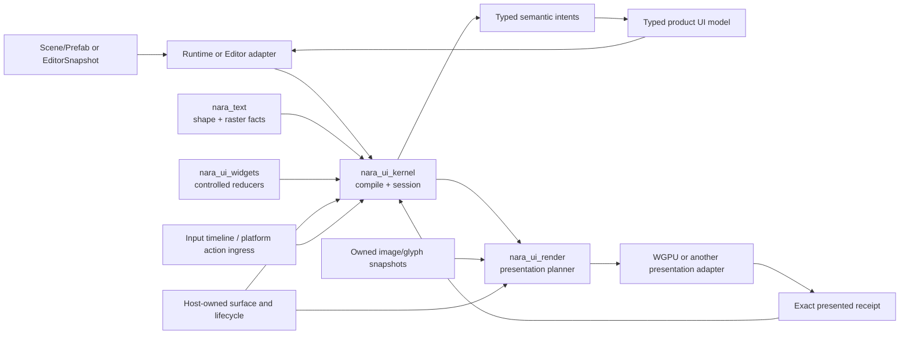

# UI Foundation Design

**Status**: Design blueprint
**Date**: 2026-08-08
**Owners**: UI Foundation, Runtime UI, Editor Host
**Authority**: This document is non-normative. Durable ownership and failure decisions live in ADR 0102 and ADR 0107-0109; execution order lives in the active UI Foundation Correction plan.

## Purpose

Nara needs a UI foundation that can support both a data-authored game UI and a
tool-oriented Editor without making either product own the other's state. The
foundation must be deep: callers provide a small set of typed facts and receive
an immutable result whose ordering, interaction, semantics, resource ownership,
and failure outcome are already resolved.

The Reference Game is a late acceptance carrier. It is not the authority for
shared interfaces. Neutral examples and module-owned tests establish the
foundation first; product work may expose a missing capability, but a shared
change requires a named invariant and independent pressure.

## Target topology



## Shared Foundation Interface

The public seam is intentionally expressed as three operations. Names are
design vocabulary; the implementation plan may select different Rust names if
the invariants remain identical.

```text
compile(authoring_snapshot, environment, limits)
    -> Compiled(UiFrameCandidate) | CompileRejected(diagnostics)

present(PresentationRequest {
    candidate, target, surface_slot_generation,
    environment_revision, capability_generation, gpu_generation,
})
    -> Presented(OneShotPresentationCommit)
     | ContentRejected | Deferred(retry_identity) | BackendFault

OneShotPresentationCommit::commit() -> UiPresentationReceipt

dispatch(presented_receipt, input_event)
    -> Consumed | PassThrough | RejectedClosed + typed intents
```

`UiFrameCandidate` owns logical geometry, paint order, hit facts, focus and
navigation facts, semantic nodes, root-local outcomes, and the environment
revision used to compile it. Global identity/profile/capacity failure returns no
candidate. A candidate is not presented until the packet and its resources are
accepted by the backend and the Host consumes the matching one-shot commit.
Only that non-constructible receipt can route input or platform accessibility
actions.

### Internal modules

`nara_ui_kernel` remains one deep public module with private implementation
seams. The first internal split is:

- `authoring`: bounded root envelopes and validated input;
- `compile`: layout, text placement, paint, hit and semantic projection;
- `surface`: surface environment and revision identity;
- `session`: presented history, focus, capture and route lifecycle;
- `interaction`: atomic disposition and typed intent delivery;
- `budget`: candidate-wide compile limits and diagnostics;
- `semantics`: backend-neutral semantic tree and action resolution.

The split is for locality and testing, not a promise of one public crate per
module. A crate is admitted only when it has an independent dependency closure
or a second heterogeneous adapter.

`nara_ui_render` separately owns target-plan-wide primitive/resource/atlas/
retention limits. The concrete backend owns actual device upload, instance and
residency work. These owners exchange typed outcomes; they do not share one
cross-crate mutable budget object.

## Ownership matrix

| Fact | Owner | Must not be owned by |
|---|---|---|
| Scene/Prefab structure and authored style | Scene/document domain | UI session, WGPU, toolkit IDs |
| Runtime product values and commands | Game domain | Widget reducer, ECS UI adapter |
| Focus, capture, hover, modal scope, scroll | Per-surface UI session | Scene/Prefab, global singleton |
| Layout, hit, paint, semantics for a revision | Immutable frame candidate | Live World during submit or input |
| Image/glyph bytes and revisions | Presentation planner/packet | Backend live asset lookup |
| Native window, surface, seat, IME, clipboard | Host | Editor panel or widget |
| Selection, undo, save, play state | Editor workspace/domain | ECS Resource, toolkit memory |
| Panel placement | Editor shell | egui/GPUI generated IDs |

## Surface content transform

The first Foundation baseline uses one Host-owned transform instead of unrelated render and input
scale setters. Its facts are:

- platform-logical coordinates reported by the native event source;
- physical surface extent and safe-area insets;
- a physical content rect with a non-zero origin inside the safe area;
- the authored logical extent;
- the platform-logical-to-physical scale and authored-logical-to-content scale;
- one transform revision shared by paint, hit testing and semantic bounds.

Safe-area insets are applied to the physical surface first. The supported authored aspect ratio is
uniformly fit inside that available rect, producing a centered letterbox/pillarbox content rect.
Paint and semantics use the forward mapping; input first maps platform-logical to physical, rejects
the black bars, subtracts the content origin and applies the exact inverse content scale. Coordinates
are never clamped to the nearest widget.

Outside-content input is `PassThrough` when no modal barrier is active and `RejectedClosed` when a
modal barrier is active. Existing capture/hover is first cancelled by an atomic consumed
reconciliation. A transform revision change invalidates pointer positions, capture, geometry routes
and old receipts before the new mapping can dispatch.

UIF admits one active Surface Slot per presentation target, the existing all-roots scope and the
current global theme/font environment. Generic root selectors, per-surface theme choice, target
aggregation and multi-viewport remain successor decisions.

## Root safety

Current root-envelope facts include identity, layer/order and modal barrier policy. Cached root body
facts never own the barrier. A failed modal may reuse a compatible inert last-good visual while its
current barrier continues to block underlay UI and gameplay. Without a valid current barrier and
fallback, compilation rejects the candidate and preserves the prior presented session.

## Product layers

### Runtime UI

Runtime UI is one-way:

```text
game state -> typed UI model -> candidate/frame -> typed intent -> game command
```

Scene/Prefab stores static structure, stable keys, style and text. Dynamic
values are supplied by a game-owned typed model. The foundation does not add a
generic expression or binding language until a second complete game exposes a
repeated contract.

### Editor UI

Editor UI is a separate product layer:

```text
Editor document -> EditorSnapshot -> EditorActionEnvelope -> applied/rejected/conflict
```

The first shell is single-window, fixed-layout and egui-first. It owns Scene
Tree, Inspector, Undo/Save/Reopen, Play/Stop and Diagnostics. A future Nara UI
Inspector is an evidence trial, not a prior architectural commitment. Docking,
detached native windows and multi-viewport are later plans owned by the Host.

## Reference pressure matrix

The local reference revisions make this evidence reproducible. Line numbers may drift inside a
reference checkout; the pinned commit and path are the stable anchor.

| Source and revision | Concrete evidence | Current Nara invariant / neutral assertion | Deferred pressure | Explicit rejection |
|---|---|---|---|---|
| Open-GPUI `67f0048d` | `crates/gpui/src/tab_stop.rs`; `crates/ui_core/src/virtualizer.rs`; `crates/gpui_docking/README.md` | UIF-U1 retains a disabled current key as navigation origin while excluding it as a destination; middle-item sequential/directional tests | stable-key virtualization, logical docking and atomic tear-off after real workloads | GPUI App/Window/Entity lifecycle, broad neutral-core API, docking transplant |
| Dear ImGui Rust `b5244c46` | `dear-imgui/tests/frame_lifecycle.rs`; `dear-imgui/tests/dock_api_boundaries.rs`; `dear-app/README.md` | UIF-U3 uses a move-only presentation commit and UIF-U4 keeps native endpoint lifecycle in the Host | docking and native multi-viewport only after Host owns every secondary window | toolkit context or generated dock IDs as durable authority |
| egui `46ba6405` | `ARCHITECTURE.md`; `crates/egui/src/viewport.rs` | EFI keeps egui as a pure shell Adapter over immutable Editor state and ordered actions | additional native viewports after an Editor Host lifecycle proof | egui memory/IDs as document, undo or shell-layout authority |
| Godot `4173760f` | `scene/gui/control.h`; `scene/gui/base_button.cpp`; `editor/editor_undo_redo_manager.cpp`; `editor/docks/editor_dock_manager.cpp` | UIF-U1 controlled focus/disabled assertions and EFI document/undo workflow | theme breadth, richer controls and docking after the first complete panel | Node/Object/Variant identity and global services |
| Bevy `e8b3598f` | `crates/bevy_ui/src/interaction_states.rs`; `crates/bevy_ui_widgets/src/button.rs`; `crates/bevy_ui/src/ui_node.rs` | UIF-U1 controlled reducer and disabled activation assertions; UIF-U2 borrows algorithms, not topology | layout/text/widget algorithms admitted by measured workloads | SubApp/RenderWorld public topology, entity persistence, wide default plugins |

Unity UI Toolkit remains a secondary product-organization analogy, not admission evidence, until a
primary source/version and neutral Nara assertion are pinned. A reference implementation is evidence,
not authority or a license to copy code.

## Component admission map

The vocabulary is staged rather than speculative:

1. **Foundation primitives**: container/panel, text, image, spacer, absolute and
   flex/stack layout, theme, semantics.
2. **Controlled interactions**: button, toggle, checkbox, radio and slider.
3. **Text and overlays**: text input, textarea, IME/clipboard, dialog, menu and
   select.
4. **Collections**: scroll area, list, stable-key virtualized list, tree and
   table.
5. **Tooling/product layers**: inspector fields, hierarchy panels, docking and
   multi-viewport.

Each stage is admitted by a real workload and a named owner. A product-local
composite is allowed without turning it into a shared widget.

## Scale and layout contract

The first product slice uses a `960 x 540` logical design space and the standard
physical targets `1280 x 720`, `1920 x 1080`, and `2560 x 1440`. Transient
non-16:9 desktop resize is handled by the closed `SurfaceContentTransform`
letterbox/pillarbox mapping above. This admits neither a 4:3 product target nor
adaptive/responsive layout. Arbitrary render/input scale setters are removed in
favor of the transform's validated forward and inverse mappings.

## Success measures

| Measure | Foundation signal |
|---|---|
| Interface locality | Three neutral consumers compile without ECS, Host or WGPU leakage |
| Failure atomicity | Every UIF-U1 through UIF-U4 rejection test leaves no uncommitted owner state |
| Revision coherence | A stale receipt cannot activate or hit geometry from another revision |
| Resource closure | A presented packet owns all image/glyph bytes and each owner enforces its candidate/target/device budget once |
| Product portability | The same runtime adapter can feed headless and desktop presentation adapters |
| Editor readiness | An Editor action identifies a document and base revision without toolkit state |

## Risks and mitigations

| Risk | Mitigation |
|---|---|
| Foundation work becomes another broad infrastructure phase | Each F unit has one owner, one seam, one neutral proof, and a stop condition |
| Reference projects pull Nara toward their lifecycle | Keep the pressure matrix and reject external identity/Host models explicitly |
| Runtime and Editor abstractions converge too early | Share only immutable facts, semantics and reducers; keep adapters and commands separate |
| Public vocabulary outruns backend support | Capability closure occurs before packet acceptance; unsupported authoring fails early |
| Future widgets force a breaking change | Admit by workload and version typed state/semantic contracts before broadening |
