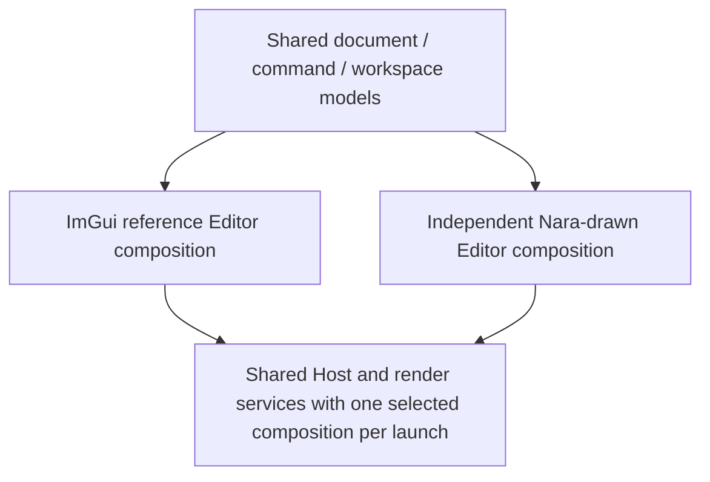
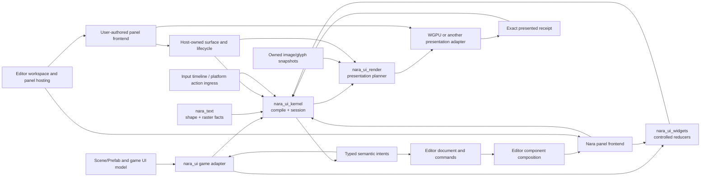

# UI Foundation Design

**Status**: Design blueprint; qualified mechanisms and unimplemented targets are distinguished below
**Date**: 2026-08-08
**Last Revised**: 2026-11-05
**Owners**: UI Foundation, Runtime UI, Editor frontend, Editor Host
**Authority**: This document is non-normative. Durable contracts live in ADR 0102, ADR 0107-0109 and ADR 0118. Current execution order belongs to R11/R12 in the [foundation rebaseline plan](../plans/2026-10-23-foundation-architecture-rebaseline-plan.md); the UI Foundation Correction plan is completed lineage.

## Purpose

Nara needs a UI foundation that can support both a data-authored game UI and a
tool-oriented Editor without making either product own the other's state. The
foundation must be deep: callers provide a small set of typed facts and receive
an immutable result whose ordering, interaction, semantics, resource ownership,
and failure outcome are already resolved.

The default Editor is Nara-drawn. Users must be able to attach another UI implementation through
public Host/panel interfaces without changing engine-private code. Nara need not distribute an
official ImGui extension. Complex graph/timeline tools and future automation constrain those
interfaces before broad component-library work; complete products and transports can follow later.

### Development route

Maintain a complete ImGui reference Editor to validate semantic/module interfaces and UI models,
and build an independently runnable Nara-drawn Editor over the same domain/workspace owners.
Add workflows incrementally inside the successor's own shell, layout, input and presentation
composition. Complete replacement acceptance, followed by a default switch and reference removal,
is the migration unit. Neither reciprocal toolkit embedding nor a mixed first-party shell is
required during development. Optional product embedding remains allowed under public Host ports.



The diagram describes separate implementations, not two toolkits that must run together. The
successor must have a build/run closure that needs no Dear context, renderer, input or docking
service. Package/executable/feature structure remains an implementation decision. Keep the
reference as a workflow oracle until complete acceptance, then remove its first-party code and
migration-only bridges. Product Host conformance may separately exercise optional mixed content.

The current checkout already contains selected Nara controls hosted by Dear and has removed
some original Dear painters. Preserve their actual evidence and reusable mechanisms. Establish
the exact reference revision and any missing reference workflows explicitly; this document
claims neither an intact pure-ImGui reference nor an independent self-drawn implementation today.

The Reference Game is one acceptance carrier, not the sole authority for shared interfaces.
Named game, Editor and independent-author consumers establish the required contracts. Preserve
existing domain, Input and render owners; do not add a universal widget tree or another GPU graph.

## Target topology



The arrows describe data/ownership handoffs, not Rust dependency edges or required new crates. Shared text,
kernel, controlled widgets and presentation remain free of Editor, project execution and
game-specific ECS facts. `nara_ui` owns the game's Scene/ECS projection; an Editor component must
not import that adapter merely to draw or edit text. Editor components compose shared mechanisms
and domain-neutral interaction; document-specific graphs and inspectors consume them above that
layer. External frontends may bypass Nara layout/widgets while using the same Host admission.
Actual backend work follows the existing render-program/Feature and retained-output contracts.

The package `nara-editor` selects its Dear frontend through the default-enabled `imgui-reference`
feature. Disabling defaults retains Application, workspace and the typed semantic
`EditorPanelHost<P>` without Dear. The Host shares the reference frontend's candidate/result
implementation and preserves the original Session query, preparation, history and persistence
owners. Its caller owns drawing and native presentation. Winit/WGPU and broader product
dependencies remain in the Editor package; this is not a minimal headless dependency closure.
The [panel custody prerequisite](../plans/2026-10-23-foundation-architecture-rebaseline-plan.md#toolkit-independent-panel-custody-prerequisite)
keeps its finite independent consumer distinct from native capability arbitration and the
complete self-drawn Editor. Module/crate extraction follows actual consumer pressure.

The concrete `native::EditorPanelImageHost<S>` adds a single-window image attachment over that
same original semantic Host and renderer. Exact instance tokens observe frontend-state lifetime;
opaque snapshots need no Nara control tree. One complete native outcome adopts the ordered
images/mappings atomically. The Host arbitrates provider keyboard/capture/modal input and scoped
IME, clipboard, cursor and explicit refresh, while providers keep their original controls and
text coordinate owners. Unsupported direct rendering, out-of-panel overlay, native detach and
accessibility requests refuse explicitly. Independent Nara and software-painted consumers use
these same ports; the [attachment unit](../plans/2026-10-23-foundation-architecture-rebaseline-plan.md#image-backed-native-panel-attachment)
records the actual scope rather than treating it as a complete Editor or toolkit compatibility.

The [R11b dependency prerequisite](../plans/2026-10-23-foundation-architecture-rebaseline-plan.md#neutral-presentation-consumption-prerequisite)
separates the neutral packet/planner/presenter from App/ECS installation inside the current
owners. Asset, Identity, Diagnostic, Image, Render, Window and UI Render use explicit `runtime`
features for their integration; ordinary value consumption and serialization need not install
those services. The same target/resource identities, pixel retention and backend permit storage
serve both paths. The independently locked UI consumer's optional presentation library supplies
the complete capture/plan/present/input/retire pressure; its dependency and native evidence is
recorded separately from this selected contract. No additional package or universal resource
namespace is required by the separation.

The dependency contract is `text <- kernel <- controlled widgets`, with product adapters above
those modules. The neutral presentation planner consumes kernel/text and render resource facts;
App/ECS/window installation and concrete device execution are adapters above it. Editor component
composition depends on the shared modules it uses; game projection and Editor domain modules do
not depend on one another. These directions are compile/consumer assertions in R11a/b.

## Shared Foundation Interface

The public seam is intentionally expressed as three operations. Names are
design vocabulary; the implementation plan may select different Rust names if
the invariants remain identical.

These are Nara Foundation operations, not a universal protocol imposed on every foreign frontend.
Host attachment admits a foreign implementation's own output and interaction capabilities without
requiring it to translate its complete control tree into `UiNode`.

```text
compile(authoring_snapshot, environment, limits)
    -> Compiled(UiFrameCandidate) | CompileRejected(diagnostics)

present(PresentationRequest {
    candidate, target, surface_slot_generation,
    environment_revision, capability_generation, gpu_generation,
})
    -> Presented(OneShotPresentationCommit)
     | ContentRejected | Deferred(retry_identity) | BackendFault

OneShotPresentationCommit::commit() -> UiPresentationReceipt

dispatch(presented_receipt, input_event)
    -> Consumed | PassThrough | RejectedClosed + typed intents
```

`UiFrameCandidate` owns logical geometry, paint order, hit facts, focus and
navigation facts, semantic nodes, root-local outcomes, and the environment
revision used to compile it. Global identity/profile/capacity failure returns no
candidate. A candidate is not presented until the packet and its resources are
accepted by the backend and the Host consumes the matching one-shot commit.
Only that non-constructible receipt can route input or platform accessibility
actions.

### Conformance visibility

The qualified public inventory and the first-party conformance implementation are not identical.
`layout_gallery` and [`ui-module-consumer`](../../tests/fixtures/ui-module-consumer/) use only ordinary public Interfaces. Headless runtime and
presentation conformance must also prove the Host-only acceptance path, so their local presenter
glue may use doc-hidden first-party seams that can stage and consume non-forgeable authority. Those
seams are not product Interface: they are never re-exported, never imported by Reference Game code,
and never promoted into a test-only public receipt issuer merely to make an example look external.

### Internal modules

`nara_ui_kernel` remains one deep public module with private implementation
seams. The first internal split is:

- `authoring`: bounded root envelopes and validated input;
- `compile`: layout, text placement, paint, hit and semantic projection;
- `surface`: surface environment and revision identity;
- `session`: presented history, focus, capture and route lifecycle;
- `interaction`: atomic disposition and typed intent delivery;
- `budget`: candidate-wide compile limits and diagnostics;
- `semantics`: backend-neutral semantic tree and action resolution.

The split is for locality and testing, not a promise of one public crate per
module. A crate is admitted only when it has an independent dependency closure
or a second heterogeneous adapter.

`nara_ui_render` separately owns target-plan-wide primitive/resource/atlas/
retention limits. The concrete backend owns actual device upload, instance and
residency work. These owners exchange typed outcomes; they do not share one
cross-crate mutable budget object.

## Ownership matrix

| Fact | Owner | Must not be owned by |
|---|---|---|
| Scene/Prefab structure and authored style | Scene/document domain | UI session, WGPU, toolkit IDs |
| Runtime product values and commands | Game domain | Widget reducer, ECS UI adapter |
| Focus, capture, hover, modal scope, scroll | Per-surface UI session | Scene/Prefab, global singleton |
| Layout, hit, paint, semantics for a revision | Immutable frame candidate | Live World during submit or input |
| Image/glyph bytes and revisions | Presentation planner/packet | Backend live asset lookup |
| Native window, surface, seat, IME, clipboard | Host | Editor panel or widget |
| Selection, undo, save, play state | Editor workspace/domain | ECS Resource, toolkit memory |
| Panel placement | Editor shell | egui/GPUI generated IDs |

## Surface content transform

The first Foundation baseline uses one Host-owned transform instead of unrelated render and input
scale setters. Its facts are:

- platform-logical coordinates reported by the native event source;
- physical surface extent and safe-area insets;
- a physical content rect with a non-zero origin inside the safe area;
- the authored logical extent;
- the platform-logical-to-physical scale and authored-logical-to-content scale;
- one transform revision shared by paint, hit testing and semantic bounds.

Safe-area insets are applied to the physical surface first. The supported authored aspect ratio is
uniformly fit inside that available rect, producing a centered letterbox/pillarbox content rect.
Paint and semantics use the forward mapping; input first maps platform-logical to physical, rejects
the black bars, subtracts the content origin and applies the exact inverse content scale. Coordinates
are never clamped to the nearest widget.

Outside-content input is `PassThrough` when no modal barrier is active and `RejectedClosed` when a
modal barrier is active. Existing capture/hover is first cancelled by an atomic consumed
reconciliation. A transform revision change invalidates pointer positions, capture, geometry routes
and old receipts before the new mapping can dispatch.

UIF admits one active Surface Slot per presentation target, the existing all-roots scope and the
current global theme/font environment. Generic root selectors, per-surface theme choice, target
aggregation and multi-viewport remain successor decisions.

## Root safety

Current root-envelope facts include identity, layer/order and modal barrier policy. Cached root body
facts never own the barrier. A failed modal may reuse a compatible inert last-good visual while its
current barrier continues to block underlay UI and gameplay. Without a valid current barrier and
fallback, compilation rejects the candidate and preserves the prior presented session.

## Product layers

### Runtime UI

Runtime UI is one-way:

```text
game state -> typed UI model -> candidate/frame -> typed intent -> game command
```

Scene/Prefab stores static structure, stable keys, style and text. Dynamic
values are supplied by a game-owned typed model. The foundation does not add a
generic expression or binding language until a second complete game exposes a
repeated contract.

### Editor UI

Editor UI is a separate product layer:

```text
Editor document -> EditorSnapshot -> EditorActionEnvelope -> applied/rejected/conflict
```

The Nara-drawn Editor is the selected default destination. Ordinary Inspector, source Hierarchy, specialized
UI Hierarchy and Scene controls have scoped qualification; remaining specialized panels and
workspace still need independent successor implementation and qualification. Dear supplies the
current surrounding Shell and registered source-built panel interface; that existing mixed
composition is recorded evidence rather than the prescribed migration route. Historical
egui-first, fixed-layout records do not describe the destination or establish today's capability.

Workspace owns stable panel/document placement and preference restoration. Frontends own their
content and compatible instance state. Host owns windows and cross-frontend platform arbitration.
Docking within a window, several logical render Views and native detached windows are different
capabilities. Reuse existing View/output ownership for the first two; native detachment additionally
requires actual window, DPI, IME, focus, GPU-loss and close evidence.

## State, composition and invalidation

Select persistent interaction state and reusable execution artifacts with declarative composition
and local invalidation for Nara-owned Editor UI. Retain field incarnation, composition, selection
and scroll under their existing owners. Rebuilding a short-lived description must not recreate
those owners. The public component interface should hide routine key scoping, event/reducer
plumbing and compatible-state retention from ordinary authors; custom layout/drawing remains a
lower-level capability. No public retained-node arena, reconciliation algorithm or reactive
language is selected by this design.

| Changed dependency | Required invalidation scope |
| --- | --- |
| Child membership/order, key or incarnation | Affected structural reconciliation, routing and dependent layout/semantics |
| Available constraints or intrinsic metrics | Affected layout/measurement and downstream geometry |
| Text, font/fallback, shaping features or wrap constraints | Affected shaping/measurement; raster realization follows its own scale/placement keys |
| Color/brush or compatible visual state | Affected paint; preserve compatible layout/text |
| Focus, enabled state, value or action availability | Affected interaction/semantics and required paint |
| New live View image | Image/output use and composition; unchanged panel structure/text need not rebuild |
| Component implementation or state-schema generation | Invalidate code-derived descriptions, layout/paint/semantic work and callback registrations unless explicit compatibility proves reuse; do not retain stale function pointers as cached data |

Each cache has an owner, complete dependency identity, byte accounting, eviction and retirement
policy. Revision numbers do not replace content association. Keep layout reuse, text-layout
reuse, placed raster keys, atlas residency and native pipeline reuse separate. Cache loss may
cost work but cannot change document results or revive retired input. A retained last-good visual
is inert recovery, not an active incremental-layout result.

Current Inspector code can reconstruct descriptions and compare them before returning an unchanged
frame. The source Hierarchy's private reuse uses exact immutable Editor-frame identity plus local
paint invalidation, read-only, environment and theme facts before constructing a description. Its
matching-index cache separates full committed-filter work from visible source/choice construction.
New models conservatively refresh, so this does not solve cross-frame static-panel reuse beside an
advancing Game. The [matched unit](../plans/2026-10-23-foundation-architecture-rebaseline-plan.md#source-hierarchy-matched-reuse-unit)
owns its before/after measurements and acceptance. Current kernel compilation flattens roots and
creates a Taffy tree; its root cache provides compatible fallback. Prepared text avoids reshaping
its editing source, but window preparation still scans the admitted layout and rasterizes distinct
placed keys. These mechanisms do not establish general zero idle work or persistent incremental
layout.

The [editable-text interface](../guides/editable-text.md#local-editing) adds explicit local font
reconfiguration while retaining a field's edit/focus state. It revalidates current, preedit-origin
and bounded history layouts under the new ordered fonts; previous paint keeps its own font
provenance. Raster and presentation admission remain separate. The current Editor Host still
constructs native font/planner policy once and replaces controllers if that font list changes;
atomic all-panel adoption and old/new geometry input handoff remain R11b work.

### GPUI mechanisms to compare

The [November 4 local source study](../research/2026-10-27-custom-drawn-editor-ui-boundaries.md#november-4-state-reuse-and-component-mechanisms)
prioritizes Zed GPUI for retained state, notification and artifact reuse, and Open-GPUI for
component composition and list geometry. Zed retains typed entities/element state while rebuilding
ordinary descriptions. Its opt-in cached views require explicit dependency notification and
compatible bounds, clip, inherited text style and opacity. Replaying their input/paint records
still costs work. The inspected Zed pin clears its Taffy tree after drawing; it does not establish
a persistent whole-tree layout arena as the preferred Nara optimization.

Compare reuse at the measured owner first: unchanged description, layout/measurement, shaped
text, placed raster, packet/atlas and native composition are separate artifacts. A listener,
external model result or local edit must invalidate the consuming artifact, not merely mutate
some retained state. Until those dependencies are represented completely, conservatively rebuild
the affected root. Do not replace the existing owners with GPUI's App/Window/Entity model or
assume automatic field-level dependency discovery.

The [November 5 follow-up](../research/2026-10-27-custom-drawn-editor-ui-boundaries.md#november-5-phase-validity-and-measurement-retention)
also distinguishes early cache selection from final artifact validity. A property determined
in a later phase can invalidate an earlier hit. Revalidate and regenerate or refuse the affected
output before publication; replay followed by a next-frame correction does not establish exact
paint/input agreement for the accepted frame.

The bounded `UiStateStore` prerequisite retains arbitrary typed local state through exact
root/parent/leaf keys. Its membership pass reads compatible existing state and lazily initializes
new slots. Only `finish` adopts membership; failure or abandonment keeps the previous owners.
Type, schema or opaque binding mismatches refuse ordinary reuse and require explicit replacement.
Handles retain store and incarnation identity, so an aborted, evicted or replaced slot cannot
inherit old input. This is local state custody, not a persistent layout tree or presentation commit.
Its direct-field helpers reduce admitted focus and apply edits through captured scoped tokens;
custom composites may retain their fields separately without a central widget registration.

Each consumer declares its retention scope. The independent row composite deliberately evicts
omitted fields and discards their draft/preedit. Existing Editor form drafts that must survive
hidden controls retain their longer-lived owner; they must not be mechanically migrated to that
row policy. Dropping state makes local handles unusable, but native IME/focus release, capture,
pending domain results and external-work cancellation remain with their original owners. A
failed later compile/presentation does not restore dropped owners; previous visuals may remain
only as inert recovery. Membership acceptance grants no routing receipt.

The selected interface has no implicit notify or dependency discovery. Explicit updates precede
composition; owners conservatively rebuild affected roots after text/focus changes, and callers
of arbitrary typed mutation invalidate all consuming artifacts. Initializers are lazy local state
construction, not task/subscription installation. Stable-slot count and exact path bytes are
bounded, but arbitrary user payload bytes remain the component author's responsibility. Retained
lookup and direct-field focus scans have documented work; no timing, allocation reduction or
O(visible rows) claim follows from keyed retention alone.

Skipping an existing child's composition for reuse is not omission from the declared state
scope. Reuse must preserve its state membership and consuming dependency associations before
adopting the parent pass, so a cached child's draft/preedit survives and later external changes
still invalidate its artifacts. Actual removal applies the declared eviction/cancellation policy.
Zed's cached-view replay carries accessed element-state and entity records forward; Nara keeps
the equivalent retention mechanism private and must qualify it together with cache reuse.

Virtualization has separate collection and active-row work. Uniform extents can derive a range
arithmetically; measured extents need estimates, changed-size invalidation and retained geometry.
The Open-GPUI pin implements `virtualizer` inside `open-gpui-ui-core` 0.2.0. Its outer list wrapper
owns placement/interaction while a content renderer composes reusable controls. A measured
geometry-cache hit avoids size callbacks, but dense metadata rebuild still visits and stores
O(logical rows) entries. The wrapper also rebuilds ordered key sets/maps, which can require
O(n log n) key comparisons plus copied key bytes. This is a reusable packaging example,
not evidence of O(visible rows) total work or a selected dependency.

Nara's list consumers must distinguish visible, overscan and pinned editing rows from logical
metadata, filtering and height-index storage. Retained order/measurement depends on actual item
keys, content, width and typography. Reorder/filter/remeasurement needs an explicit domain-key
plus intra-item-offset anchor policy; deletion requires a defined fallback. Focus, caret,
selection, drafts and preedit need an explicit pin/preserve/cancel policy on eviction, and a
recycled index cannot inherit the previous item's input route. The independent keyed composite
and custom-layout consumers in R11b determine the public shape; R11e compares its private
implementations against the baseline rather than freezing a generic virtual-list framework.

Measured-height records and the derived height index have separate validity. Records depend on
item incarnation, content, measurement width and typography; stale offscreen measurements must
be invalidated or replaced by estimates before rebuilding the index. Qualify same-key offscreen
changes followed by reorder and scrolling back, checking actual height, keyed anchoring and input
association. Keep a bounded collection mounted while repeatedly replacing keys: measurement
storage needs a declared bound/eviction policy and must plateau independently of attach/close.
Pinned edit state retains its separate owner and policy. Label a cold geometry index with warm
measurements separately from empty measurement/snapshot state when reporting cold/warm work.

## Interface readiness and component authoring

The existing foundation proves useful ownership and presentation contracts, not a general-purpose
component library interface. November 4 source inspection identifies these concrete limits:

| Current surface | Evidence | Missing pressure before a broad extension claim |
| --- | --- | --- |
| Source-built panel registration | `ImguiEditorPanel::show` in [workspace.rs](../../editor/src/frontend/imgui/workspace.rs) and `register_panel` in [composition.rs](../../editor/src/platform/composition.rs) | Toolkit-independent attachment, lifecycle and capability admission |
| Authored layout | [UiNode](../../crates/nara_ui_kernel/src/authoring.rs) and scoped [custom layout](../../crates/nara_ui_kernel/src/layout.rs) | Broader custom drawing/input and complete complex-editor consumer; layout alone does not establish them |
| Drawing | `UiPaintPrimitive::Rect`/`Text`/`Mesh` in [frame.rs](../../crates/nara_ui_kernel/src/frame.rs), captured geometry and the independent curve consumer | Final-size drawing, broader effects/resources and complete custom-canvas interaction |
| Interaction | Event-time pointer samples, declared motion/scroll and opt-in viewport capture in [interaction](../../crates/nara_ui_kernel/src/interaction/mod.rs) | General logical-key delivery, dynamic propagation and broader gesture/services beyond the finite canvas consumer |
| Controlled widgets | [widgets](../../crates/nara_ui_widgets/src/lib.rs) expose Button, TextField and scoped local state | Complete scoped effects/services and component-library ergonomics beyond the keyed composition prerequisite |
| Semantics | Finite roles/actions in [authoring.rs](../../crates/nara_ui_kernel/src/authoring.rs), including the external curve's ordinary node/port buttons | Complete graph/document interaction and native accessibility; node/port controls alone do not supply them |

These are interface gaps and unqualified capabilities, not claims that the existing bounded
consumers are incorrect. Extending the appropriate owner may change the current vocabulary;
keeping today's small enums is not a compatibility requirement.

Expose three authoring levels: compose existing controls; create components using layout,
interaction, text, semantics and drawing services; attach a complete foreign frontend. A new
component library need not inherit first-party high-level controls. A foreign frontend need not
adopt Nara's component interface. Keep contribution/document access separate from all three.

The following phases constrain the Nara component interface without prescribing a public trait,
macro language or number of methods:

| Phase | Allowed responsibility | Publication rule |
| --- | --- | --- |
| Update | Reduce an admitted event/result into component state and explicit requests | Domain changes use original prepared commands/results; effects have their own scope and identity |
| Compose | Describe children, local properties and stable identities from state | May run zero or several times; no document edit, task spawn or subscription may depend on its invocation count |
| Measure/layout | Resolve finite constraints, intrinsic size/baseline and child placement | May repeat during sizing; mutate only private compatible work/candidate state |
| Paint/hit/semantics | Produce ordered visual, interaction and semantic facts at the resolved geometry | No business mutation or unscoped callback registration; failed/unpresented work grants no new input authority |

Cached artifacts can be updated behind these phases. Physical events are delivered once through
their admitted route; repeated composition cannot repeat their business effect. Foreign
immediate frontends may use their own response/event model, but their adapter must preserve that
delivery/result rule across sizing passes and discarded output. First draw is not a mount event.

Component identity is scoped by panel instance, parent component and explicit sibling key;
repeated labels, list position and source line are insufficient for reorderable content. Compatible
state stays with that identity across short-lived descriptions. Duplicate keys are diagnosed.
A state-type/version or document-binding change requires explicit compatible migration or a fresh
incarnation; Rust `TypeId`, pointers and generated hashes are not cross-build persistence formats.
Virtualization keeps active editing/focus and logical collection navigation explicit rather than
retargeting a recycled row. Ordinary authors should not manually reproduce token/journal maps.

Event listeners, subscriptions, timers and async work have an owning component/panel scope and
explicit release policy. Work consumes owned immutable observations, not frame borrows; results
retain their original document/request/incarnation and cannot update a replacement. Logical
cancellation and physical return remain distinct. This reuses existing task custody rather than
adding a UI executor. Pure local callbacks are allowed; they do not acquire document authority.

Custom layout can measure children and return finite placements without accessing a public
retained arena. Custom drawing carries bounds, clips, transforms, order, color/alpha meaning,
resource dependencies and budget charges through existing render owners. Hit and semantic facts
use that same mapping. Path tessellation/mesh work and renderer-specific programs have explicit
capabilities; an arbitrary callback inside paint is not a portable or lifetime-complete contract.
Native code and callback/drop glue remain loaded until every retained use and its resource
reclamation physically completes.

Scoped theme/style inputs allow library defaults and local overrides without mutating a global
theme. Typography, fallback, locale/direction, density and accessibility preferences participate
in the dependencies they actually change; color-only changes preserve compatible measurement.
Custom visuals still need keyboard/text behavior, semantic actions and an explicit unsupported
capability outcome. Painting pixels alone does not provide those services. The first composite
and custom-drawn consumers determine the minimum required tokens, roles and gestures; no CSS
engine, complete theme language or catalogue of every platform gesture is selected in advance.

### Interface alternatives

| Alternative | Benefit | Cost and disposition |
| --- | --- | --- |
| One immediate `show(context)` entry for all concerns | Very easy ordinary calls and custom painter access | State identity, repeated-pass effects and cache dependencies remain caller burdens; insufficient as the whole Nara contract |
| Public retained objects with mutable layout/render internals | Direct control over a rich desktop tree | Exposes storage, ownership and reconciliation to extensions; makes later implementation changes expensive; rejected as the public foundation |
| Scoped persistent state, declarative composition and explicit custom-layout/draw access | Ordinary controls hide lifecycle plumbing; specialized components retain control; internals can change | Requires the independent composite and canvas consumers in R11b/c before exact Rust types freeze; selected target |

This selection does not restrict an optional frontend's own immediate/retained implementation.

### Scoped custom child layout

`UiCustomLayout::new(impl UiLayout)` retains one immutable layout description. Attach it with
`UiNode::with_custom_layout` or the root equivalent. Keep that description across compatible
compositions; clones compare by exact instance. Updated captured parameters need a new
description. The scoped `UiLayoutChildren` exposes direct child count and `measure`, `place`,
`hide`; local child order addresses the current immutable topology, while keyed state retains
its separate domain identity. No layout-node handle survives the callback.

The callback receives available content space on each axis (`Definite`, `MinContent`,
`MaxContent`). Measure child subtrees under explicit constraints, optionally use their first
horizontal baseline, then place each at an exact outer rectangle relative to the parent content
origin. Available space supplies wrapping and percentage bases; authored size may differ. Final
placement fixes the child's outer allocation and recomputes its descendants. Parent/child
padding remains accounted once. Measure before placement; each child must be placed or hidden
once. A custom container owns no intrinsic text on the same node: compose a text child instead.
Wrapping text's `MinContent` query uses actual shaper content widths rather than treating it as
`MaxContent`. Prepared text retains its own full layout and real first line. Ordinary containers
propagate the first genuine visible in-flow baseline in authored order; text-free boxes return
none even when the private Flex algorithm synthesizes a box baseline internally.

The [independent measured column](../../tests/fixtures/ui-module-consumer/src/measured_column.rs)
demonstrates this interface with a real keyed-field composite. Its title determines current
intrinsic height and subsequent field positions; it does not guess row coordinates from font
size. A private compile-local Taffy adapter supplies default and custom algorithms under one text
session and projection owner. Full-layout cache replay is disabled for subtrees containing custom
layout so exploratory measurements cannot leave stale descendant placement. This conservative
choice is not an incremental-cache optimization.

`UiLimits::with_max_layout_work` reduces the default hard ceiling of 1,048,576 reached layout
dispatches, custom callbacks and child requests per candidate. Requests, including cache hits and
failed roots, remain observable through `UiCompileWorkStats`; overflowing that shared budget
rejects the whole candidate. Callback error/unwind and invalid or swallowed child-operation
errors use root-local bounded diagnostics and inert last-good recovery. The count does not
bound a native callback's arbitrary computation or allocation. Source snapshots own callback
code/inputs until released; final frames, retained visuals and paint packets contain resolved
facts only. This supplies child layout, not custom geometry/drawing, gestures, code reload or the
complete component/foreign-frontend contract.

### Captured custom geometry

The next drawing prerequisite selects immutable, renderer-neutral triangle meshes inside the
original UI paint stream. A user component may tessellate a path with its chosen library and
attach `UiMesh` to a node; Nara does not acquire that library's path model or callbacks. The
independent curve consumer uses Lyon, following the pinned GPUI mechanism of tessellating before
painting. Lyon remains a fixture dependency, not a Foundation requirement.

Vertices carry local content-space positions and straight-alpha colors. The compiler resolves
the content origin, padding and inherited clip; a mesh is always clipped to its own content
box. Geometry supplies no intrinsic size. The owning component captures size, pan, zoom and
other geometry inputs explicitly when composing its description. There is no encode-time
lookup of mutable component state. Background, mesh and text use that order within a node;
the ordinary layer, z and structural ordering still orders different nodes. A foreground
ordinary control can therefore cover a curved connection in the same stream.

The snapshot and compiler bound aggregate vertex/index occurrences, including shared meshes,
hidden source geometry and retained fallback output. The presentation planner independently
admits geometry counts and retained payload bytes before staging resources. The hard aggregate
ceilings are 65,536 vertices and 196,608 triangle indices per candidate; owner-local profiles may
reduce them. Coordinates and colors are validated at mesh construction. Physical projection
uses the original content transform at fractional scale, rather than scaling a rounded layout
rectangle. Packets retain only immutable geometry and their original frame/resource closure.

The original WGPU `UiFeature` must preserve quad/mesh/quad barriers in one ordered attachment
transaction. Quad resources are prepared once per operation, while mesh buffers and pipelines
use the same device epoch, preparation reservation and physical submission custody. Draw and
upload observations must count this work without calling triangles quads or sprites. Preparation
and encoding still confer no input authority: only the presenter's matching original native
composite/outcome adopts a journal candidate.

Native preflight also bounds the aggregate across matching packets in one UI operation before
copying their geometry. Its metadata model charges the capture allocation, each aligned Arc
slice, quad instance capacity, retained material-key values, mesh pipeline wrapper and buffer
reservation/custody records. Original packet/frame and image/glyph source storage remain with
their source owners. Native buffer payloads use the original render byte reservations; driver
allocations, allocator rounding and BTree node overhead are not measured by this model.

This finite seam permits a component to supply its own shape algorithm without adding a
graph-specific widget kind. It does not supply final-size drawing callbacks, curve hit testing,
drag/wheel routing, a vector-effect language, an incremental geometry cache or a performance
result. Those capabilities need their actual consumers and matching qualification.

### Pointer samples and local canvas views

The canvas-input prerequisite extends the existing presented interaction owner with immutable
event-time pointer samples. Position, seat/pointer, button edge, modifiers and scroll units
travel together. Routed press/release, motion and scroll retain the exact resolved sample;
reconciliation cleanup does not manufacture a device sample. Non-finite input is refused before
state changes. Text/IME remains with the text owner, and the gameplay physical-key vocabulary
does not become a desktop logical-key interface.

A component declares supported buttons and interest in motion or scroll through its immutable
interaction description. A press captures the actual selected target; only the matching button
release ends that capture. Captured motion reaches that owner outside its hit rectangle without
clamping. Uncaptured motion and scroll choose the nearest interested keyed ancestor of the
event's exact hit. That one target participates in ordinary Capture/Target/Bubble observation;
ancestor observations do not install a second listener. This finite rule supports a scrollable
canvas containing ordinary buttons without a mutable-tree event callback or a second router.
It is not arbitrary dynamic stop-propagation or gesture arbitration.

Default capture continuity keeps the existing strict surface-routing equivalence. A custom
viewport can explicitly select `UiCaptureContinuity::TargetGeometry`: actual presentation may
advance its capture across changed descendants/siblings only while its owner and keyed
ancestors keep the same geometry, clips, declarations, path and published modal scope under
the same Surface mapping and generations. Explicit behavior invalidation, replacement,
reparenting, owner movement, fallback, disabling or native/Surface loss still cancels the
gesture. Old event epochs cannot cancel or move a renewed newer capture. A component incarnation
change must invalidate its old behavior even when its logical key and rectangle remain equal.

`UiScrollDelta::Lines` retains device line units. `Pixels` carries authored logical point
displacement after the adapter's inverse content-scale conversion; the name preserves its
pixel-event origin and does not mean physical target pixels. Sensitivity and line conversion
belong to the component. The external curve library retains desired pan/zoom and its drag
anchor; cursor-anchored zoom updates both scale and pan. It consumes already admitted batches,
owns no journal or receipt, and asks its caller to compose/present the changed view. Continuous
desired-state updates do not authorize unpresented hit geometry.

This prerequisite supplies pointer behavior, not a general logical-key stream, native OS
capture across windows, Runtime wheel projection from an untyped source, a gesture arena or
the full graph editor. The reference Runtime wheel event currently lacks unit/modifier facts;
its adapter must continue to report unsupported input instead of inventing them.

## Panel hosting and optional frontend implementations

The extension interface has three cooperating parts: contribution/document access, panel-instance
attachment and UI-implementation services. The first reuses Application/Session queries,
preparation, exact commands and outcomes. The second binds stable contribution/instance/document
identity to placement and lifecycle. The third provides the finite Host capabilities below.
Exact Rust types and crate placement remain implementation decisions tested by public consumers.

| Host contract | Frontend responsibility and observable result |
| --- | --- |
| Attachment and lifecycle | Create one instance, observe visibility/target/relocation/retirement, preserve only explicitly compatible state |
| Geometry and composition | Consume bounds, clip, scale and mapping generation; return owned output with exact resource/use lifetime and presentation feedback |
| Input and platform services | Consume routed pointer/key/text with endpoint/incarnation identity; request focus/capture, cursor, clipboard and IME through Host arbitration |
| Overlay placement | Request a popup/menu scope beyond panel bounds; Host admits clipping, stacking, modal behavior and dismissal |
| Refresh and scheduling | Request an immediate update, deadline or active animation; Host coalesces work without polling every static panel |
| Semantics and diagnostics | Expose supported roles, identities, values, actions and mapped bounds; identify unsupported operations and report attributable work |

Local focus/capture belongs to the frontend; Host arbitrates between frontends and windows. A
frontend cannot capture input merely because it drew an image. Attachments and pending outputs
retain actual instance, endpoint, target and GPU lineage. Closing a panel with a held pointer,
composition, queued result or in-flight output retires its route before a replacement can receive
input. Relocation and native reconstruction follow an explicit preserve/cancel policy.

An immediate implementation can own its context and internal IDs; a retained implementation can
own its tree. Neither becomes document identity. An admitted image path may add an offscreen
target; a direct-render path must close the same clip/color/alpha/resource contracts through the
existing renderer. Count copies and submissions rather than promising zero overhead. Optional
frontends do not own the application's event loop, an independent default Device/Queue or the
global Dock manager. Required capabilities fail explicitly before publication.

First qualification uses independently compiled real Nara and non-Nara content through the same
public attachment, including drawing, text input, a popup and retirement. A small conformance
frontend proves that finite Host contract, not compatibility with every toolkit. A named toolkit
support claim additionally requires its actual user-authored adapter and matching native tests.
No official ImGui package, universal Widget IR, binary ABI or executable unload service is implied.
When claiming optional mixed-content support, exercise it in a dedicated extension fixture.
That fixture is not a prerequisite for the independent default's development/replacement. The
self-drawn composition does not require hosting the ImGui reference or embedding either toolkit
inside the other.

The finite Nara surface-presenter prerequisite closes the packet-to-presented-journal bridge.
`UiSurfacePresenter` stages one immutable frame and original backend outcome permit, then adopts
the staged journal only after the matching one-shot backend presentation commit. The caller
retains interaction/reducer state and exact native placement; the existing render Host retains
GPU resources and native-use retirement. The public journal cannot mint receipts. Deferred
attempts retain their original retry, and closing immediately revokes routes while original
backend results still return to the retiring presenter. This single-surface adapter is not the
whole frontend/panel attachment or a neutral presentation dependency split. The existing Dear
bridge and Runtime integration keep their recorded scope until separately migrated/qualified.

## Complex editors, custom drawing and render composition

Use a bounded document-backed node/link editor as architectural pressure for future Shader Graph,
animation and timeline products. Its domain owns typed nodes/ports/links, validation, history and
persistence. Panel state owns pan/zoom, selection, pending connection and property drafts. Content
or shader owners own compilation requests, diagnostics and preview artifacts against the exact
source revision. A completed old compilation cannot replace the current graph's preview.

The consumer needs composable controls plus custom geometry, clipping, transforms, pointer
capture, keyboard actions and semantic representation of nodes/ports/connections. The existing
kernel paint vocabulary is finite; provide custom drawing through an owning capability rather
than expanding a central enum for each tool. Reuse existing render Feature/program and retained
image-output seams for previews/effects. A graph document, its UI topology and the renderer's
resource-dependency graph retain different owners; add no universal graph or second scheduler.

Exercise two logical Views in one window: graph preview beside Scene or another preview, with
independent camera/selection/output generations. Moving a panel cannot change producer View
identity; sharing a rendered capture cannot grant the second display the first display's input
authority. Later Docking and multi-window transfer build on that distinction. Existing multiple
Render Views do not qualify several UI Surface Slots on one target: ADR 0108's current slot rule
and the game's window-to-Surface index keep their scope. Reconcile the owning contract before
changing that aggregation; separate panel outputs may use distinct admitted targets meanwhile.
Full shader-node catalogues, shader-language generation, rich timelines and visual authoring
products are deferred.

## Editor extension iteration and reconstruction

Declarative composition makes UI reconstruction easier to express; it does not load new native
code or make an old Rust state layout compatible. Source-built Editor panels currently compile
into the executable and have no automatic code-reload workflow. ADR0093's game/Play restoration
does not qualify Editor extension iteration. Treat it as the separate R11f consumer under
[ADR0093](adr/0093-rust-authoring-hot-iteration-and-optional-scripting-adapters.md) and
[ADR0118](adr/0118-editor-workspaces-frontends-and-creation-templates.md).

| Change | Candidate path | State contract |
| --- | --- | --- |
| Theme, layout or other admitted data | Owner-validated data update | Retain compatible state and invalidate actual dependencies; no arbitrary expression interpreter implied |
| UI composition or compatible code body | Rebuild/reconstruct baseline; optional proven faster path | Only explicitly compatible component state may be retained/restored |
| State layout, signature, dependency or registration change; unknown case | Fresh executable/process generation | Restore versioned owner data or refuse; never reinterpret old allocations |

The reliable source-built baseline is automated build followed by supervised Editor restart and
validated restoration, separate from supervised Play. A developer explicitly starts this workflow;
ordinary project Open remains data-only. A later data-description or native-patch adapter may
improve supported change classes without becoming required for Editor development.

```mermaid
sequenceDiagram
    participant Dev as Extension author
    participant Build as Build supervisor
    participant Old as Current Editor generation
    participant New as Candidate Editor generation
    Dev->>Build: Change source in explicit development mode
    Build->>Build: Build and identify candidate artifact
    alt Build rejected
        Build-->>Dev: Diagnostics; current Editor continues
    else Candidate built
        Build->>Old: Request consistent, bounded recovery capture
        Old-->>Build: Capture or explicit refusal
        Note over Old,New: Drain/cancel effects; obey native teardown and restore compatibility
        Build->>New: Start candidate with supported owner recovery data
        New-->>Build: Restore result and matching presented UI, or failure
        Build-->>Dev: Outcome, retained/reset state and recovery route
    end
```

The sequence describes the successful capture path. Capture refusal leaves the current Editor
running. Build success is not activation success. Keep the last-good artifact and usable recovery
capture until the candidate's actual restore/presentation outcome. After old-process teardown,
failure may require relaunching that artifact; uninterrupted old windows and transactional rollback
are not implied. No two processes gain concurrent source-publication authority during handover.

Capture separates owner data, workspace preferences, opt-in component state and disposable work.
Document owners define restoration of unsaved content, saved checkpoints and supported history;
unsupported dirty owners or in-flight publication cause a safe deferral/refusal rather than an
implicit Save, Discard or history reset. Reload cannot bypass existing persistence/Close decisions.
UI state codecs are bounded and explicitly versioned, not mandatory serialization of every object.
An incompatible dirty draft needs a recoverable representation or refusal before its old owner is
lost. Focus routes, OS IME sessions, pressed pointers, tasks, GPU handles and code pointers are not
restored as live objects; establish fresh incarnations and cancel/reconcile transient interaction.

Scope the first experiment to a UI-only change with unchanged document owners. Replacing code
that implements document/history/codec behavior is a different compatibility case: keeping its
memory alive is insufficient. Old callbacks, tasks, vtables, destructors and retained native work
must physically finish before their code may be reclaimed. A generation check only rejects late
results. Process isolation/restart remains the fallback; stable native ABI and hot unload are not
prerequisites for this workflow.

R11f measures change-to-correct-presented-result P50/P95, with compile/link, capture, retirement,
startup and restore costs separated. It tests compatible UI changes, invalid source, incompatible
state and failed restoration. A watcher, successful build or GPU reconstruction alone is not
acceptance. Implementation is still open.

## Automation, tests and future agent/debug clients

Keep two operation paths and compare their final domain outcomes:

- Domain automation reads explicit document bases and submits existing semantic queries/edits.
  It observes original results, history, Save/Reopen and close through their current owners.
- Visible-UI operation observes the currently presented semantic tree, targets an exact control
  incarnation/route, and invokes its normal UI action or Host input route. It exercises focus,
  drafts and controller lowering; a direct document action cannot stand in for a button test.

The observation includes document/panel scope, presented revision, live identity, role, name,
value, enabled/focused/selected state, actions and clip-correct bounds. Repeated labels and recycled
rows remain distinguishable. Supported providers expose the same observation/operation contract;
missing semantic or text capability is explicit. Semantic actions reuse existing UI dispatch,
and pointer/key/text injection reuses Host arbitration. No tool mints presentation authority.

Operations return their own admission/completion identities. Tests wait for the requested domain
outcome and a matching later observation, with bounded timeout/cancellation; a perpetually
animating preview is not a reason to wait for global idle. Async compilation, persistence and
physical close keep their different terminal conditions. Diagnostics correlate the operation,
panel, presented frame and render transaction without becoming another source of truth.

An independent public test driver is the first consumer. A future agent may wrap those same
operations; no MCP server, remote-control transport, global string command bus or second mutation
path is required now. UI semantic snapshots are not proof of native accessibility, and injected
IME events are not proof of actual OS composition/candidate-window behavior.

## Cost and refactor acceptance

Before changing a measured mechanism, record hardware, source/toolchain, build mode, font/DPI,
logical/physical size, cold/warm state, workload, sample count and numeric CPU/GPU/latency/memory
ceilings. Fix the endpoint and budgets before comparing alternatives. R11 must establish these
numbers; this source/design update has measured none. A private investigation trigger or short
test duration is not a public frame-time SLA.

| Workload | Required observation |
| --- | --- |
| Static panels beside an active preview | Description construction/comparison, layout, shaping, raster, upload and composition counted separately; unchanged subtrees do no repeated construction/layout/shaping/upload after warm-up |
| 10,000 versus 100,000 logical rows at fixed viewport | Live controls/layout scale with visible plus declared overscan/pinned edit rows; filtering/reindexing cost is attributed separately |
| One hover, field edit or color change | Recompute only actual dependencies; unrelated panels preserve compatible text/layout |
| Resize, font/fallback or DPI change | Correct invalidation, mapped hit/semantics and honest rebuild cost; no stale-cache success |
| Two Views and two UI implementations | Per-provider/phase CPU, GPU work, output targets/copies/submissions and event-to-present distributions |
| Repeated attach/close/rehost and device recovery | CPU/GPU retained bytes plateau within owner budgets; old routes/results cannot affect replacements |
| Repeated sizing/composition and local async work | One admitted input has one business effect; no duplicate subscriptions/tasks, work on retired scope or borrowed frame state in tasks |
| Editor extension source change | Build/capture/retire/start/restore and first correct presentation measured separately; refused or failed attempts preserve recoverable owner state |

Report P50/P95/P99 only with adequate distributions and run-to-run variation; retain cold spikes
and refusal/eviction counts. Identify cache hits/misses, invalidation reasons and allocation bytes.
Measure enabled/disabled diagnostics overhead and dropped observations. Resource ceilings are
not speed evidence. In-process extension CPU scheduling is cooperative; measurement does not
preempt arbitrary native code. Any future isolation promise needs its own execution boundary.

Refactor acceptance is preservation of public consumer behavior, owner results, dependency closure
and these budgets while replacing private layout/cache/render algorithms. It does not freeze
today's internal trees, packets or crate count. New component/effect/docking breadth must use
the qualified ports rather than reopen private Host access in each consumer.

## Reference pressure matrix

The local reference revisions make this evidence reproducible. Line numbers may drift inside a
reference checkout; the pinned commit and path are the stable anchor.

| Source and revision | Concrete evidence | Current Nara invariant / neutral assertion | Deferred pressure | Explicit rejection |
|---|---|---|---|---|
| Open-GPUI `67f0048d` | `crates/gpui/src/tab_stop.rs`; `crates/ui_core/src/virtualizer.rs`; `crates/gpui_docking/README.md` | UIF-U1 retains a disabled current key as navigation origin while excluding it as a destination; middle-item sequential/directional tests | stable-key virtualization, logical docking and atomic tear-off after real workloads | GPUI App/Window/Entity lifecycle, broad neutral-core API, docking transplant |
| Dear ImGui Rust `b5244c46` | `dear-imgui/tests/frame_lifecycle.rs`; `dear-imgui/tests/dock_api_boundaries.rs`; `dear-app/README.md` | UIF-U3 uses a move-only presentation commit and UIF-U4 keeps native endpoint lifecycle in the Host | docking and native multi-viewport only after Host owns every secondary window | toolkit context or generated dock IDs as durable authority |
| egui `46ba6405` | `ARCHITECTURE.md`; `crates/egui/src/viewport.rs` | EFI keeps egui as a pure shell Adapter over immutable Editor state and ordered actions | additional native viewports after an Editor Host lifecycle proof | egui memory/IDs as document, undo or shell-layout authority |
| Godot `4173760f` | `scene/gui/control.h`; `scene/gui/base_button.cpp`; `editor/editor_undo_redo_manager.cpp`; `editor/docks/editor_dock_manager.cpp` | UIF-U1 controlled focus/disabled assertions and EFI document/undo workflow | theme breadth, richer controls and docking after the first complete panel | Node/Object/Variant identity and global services |
| Bevy `e8b3598f` | `crates/bevy_ui/src/interaction_states.rs`; `crates/bevy_ui_widgets/src/button.rs`; `crates/bevy_ui/src/ui_node.rs` | UIF-U1 controlled reducer and disabled activation assertions; UIF-U2 borrows algorithms, not topology | layout/text/widget algorithms admitted by measured workloads | SubApp/RenderWorld public topology, entity persistence, wide default plugins |

The entries above preserve their original source baselines. November 4 pressure adds upstream Zed
GPUI `dd3437011469d5c2ec8c821a84cc999979625697`: `crates/gpui/src/element.rs` separates
composition from custom layout/prepaint/paint, and `crates/gpui/src/view.rs` makes cached-view
invalidation explicit. This is distinct from the Open-GPUI fork. egui
`fc9d66dda742d722eedaa8684d23f86369cf8e5f` separates `Widget`/`Response`, superficial `Memory`
and visible-row construction; neither pattern grants document authority.

Official Unity 6.0 [custom EditorWindow](https://docs.unity.com/en-us/engine/6000.0/manual/uitoolkits/uielements/uie-support-for-editor-ui/uie-how-to-create-editor-window)
and [IMGUI migration](https://docs.unity.com/en-us/engine/6000.0/manual/uitoolkits/uielements/uie-migration-guides/uie-imgui-migration)
documents distinguish contributed content, framework lifecycle, explicit state restoration and
directional `IMGUIContainer` embedding. This is Unity's IMGUI, not Dear ImGui interoperability.
Epic's [Slate editor-window guide](https://dev.epicgames.com/documentation/en-us/unreal-engine/slate-editor-window-quickstart-guide-for-unreal-engine),
[invalidation](https://dev.epicgames.com/documentation/en-us/unreal-engine/invalidation-in-slate-and-umg-for-unreal-engine)
and [Slate Insights](https://dev.epicgames.com/documentation/en-us/unreal-engine/slate-insights-in-unreal-engine)
documents, checked November 4, separate tab contribution, widget composition, cache invalidation
and observable update causes. These sources pressure the Nara contracts above; they qualify no
Nara plugin, native platform, automation port or performance result.

Godot `fefec82d74b46f5e6cc31f373071058f80a5cbee` adds concrete graph pressure through
`doc/classes/GraphEdit.xml`, `doc/classes/GraphNode.xml` and
`modules/visual_shader/editor/visual_shader_editor_plugin.cpp`: composable node content,
connection requests and domain-validated Undo remain distinct. At the egui pin above,
`crates/egui_kittest/src/node.rs` distinguishes physical pointer clicks from semantic AccessKit
actions, while `src/lib.rs` waits for repaint convergence. GPUI's `Element` semantic children
and `app/visual_test_context.rs` expose custom-drawn semantics and controlled test progression.
Nara adopts the distinction between semantic and physical paths and request-specific completion;
it does not treat convergence as completion of Save or compilation.

The component/reload follow-up inspects those exact egui/Zed pins and Dear ImGui
`9d0b72573a27d860280811d58ef9ed62f4d46c05` (`1.93.1 WIP`, source evidence rather than a selected
Nara dependency). Its transferable mechanisms and limits are:

| Primary-source mechanism | Nara consequence and limit |
| --- | --- |
| egui [Widget/Response](https://github.com/emilk/egui/blob/fc9d66dda742d722eedaa8684d23f86369cf8e5f/crates/egui/src/widgets/mod.rs#L58-L119) and [allocated painter](https://github.com/emilk/egui/blob/fc9d66dda742d722eedaa8684d23f86369cf8e5f/crates/egui/src/ui.rs#L1496-L1500) | Pair ordinary composition with explicit layout/interaction/drawing access; a fluent builder alone supplies no lifecycle or effect policy |
| egui [persistent versus automatic IDs](https://github.com/emilk/egui/blob/fc9d66dda742d722eedaa8684d23f86369cf8e5f/crates/egui/src/ui.rs#L909-L924) and Dear ImGui [ID collision/scoping FAQ](https://github.com/ocornut/imgui/blob/9d0b72573a27d860280811d58ef9ed62f4d46c05/docs/FAQ.md#L449-L529) | Stable scoped object identity for reorderable state; no persistence promise from labels, indices, pointers or source locations |
| egui [two-pass test](https://github.com/emilk/egui/blob/fc9d66dda742d722eedaa8684d23f86369cf8e5f/crates/egui/src/context.rs#L5334-L5349) increments an external counter twice after one discard | Repeated build is observable and visual discard does not roll back external effects; this does not establish duplicate delivery of a click |
| Dear ImGui [public InvisibleButton](https://github.com/ocornut/imgui/blob/9d0b72573a27d860280811d58ef9ed62f4d46c05/imgui.h#L643-L648) and [canvas demo](https://github.com/ocornut/imgui/blob/9d0b72573a27d860280811d58ef9ed62f4d46c05/imgui_demo.cpp#L10682-L10721) | Geometry allocation, coordinates, hover/active state and capture are useful public extension services; no requirement to depend on private widget helpers |
| GPUI [typed Element phases](https://github.com/zed-industries/zed/blob/dd3437011469d5c2ec8c821a84cc999979625697/crates/gpui/src/element.rs#L52-L105) and [canvas adapter](https://github.com/zed-industries/zed/blob/dd3437011469d5c2ec8c821a84cc999979625697/crates/gpui/src/elements/canvas.rs#L8-L87) | Separate retained state, frame-local layout data and drawing; borrow the mechanism without adopting GPUI App/Entity ownership |
| GPUI [state keys and typed retention](https://github.com/zed-industries/zed/blob/dd3437011469d5c2ec8c821a84cc999979625697/crates/gpui/src/window.rs#L4586-L4696) and [explicit notify](https://github.com/zed-industries/zed/blob/dd3437011469d5c2ec8c821a84cc999979625697/crates/gpui/src/app/context.rs#L215-L218) | Define retention and invalidation together; mutation and redraw are separate obligations, and runtime type identity is not a reload codec |

This GPUI revision also contains a real optional native-patch integration: the
[hot-reload feature](https://github.com/zed-industries/zed/blob/dd3437011469d5c2ec8c821a84cc999979625697/crates/gpui/Cargo.toml#L51-L57)
uses Subsecond `=0.7.10`; [render dispatch](https://github.com/zed-industries/zed/blob/dd3437011469d5c2ec8c821a84cc999979625697/crates/gpui/src/view.rs#L339-L354)
resolves `HotFn`, while [patch transport/application](https://github.com/zed-industries/zed/blob/dd3437011469d5c2ec8c821a84cc999979625697/crates/gpui/src/hot_reload.rs#L15-L107)
checks build/process identity, applies between foreground updates and refreshes windows. A full
reload message requests a restart; the inspected integration does not establish arbitrary entity
layout migration. The matching [Subsecond 0.7.10 documentation](https://docs.rs/subsecond/0.7.10/subsecond/)
separately limits workspace patch scope, struct-layout changes, static initialization and
thread-local behavior. [Dioxus 0.7](https://dioxuslabs.com/learn/0.7/essentials/ui/hotreload/)
also distinguishes RSX description changes from experimental Rust patching. This is evidence for
an explicit optional integration, not reload provided by declarative syntax.

These are static source/document observations checked November 4. No reference-framework build,
live patch, component port or Nara performance/compatibility test was run for this design update.
The source investigation uses the local read-only checkouts. Remote permalinks point to those
same commits for readers without `repo-ref`; no moving upstream branch is the evidence baseline.

## Component admission map

The vocabulary is staged rather than speculative:

1. **Foundation primitives**: container/panel, text, image, spacer, absolute and
   flex/stack layout, theme, semantics.
2. **Controlled interactions**: button, toggle, checkbox, radio and slider.
3. **Text and overlays**: text input, textarea, IME/clipboard, dialog, menu and
   select.
4. **Collections**: scroll area, list, stable-key virtualized list, tree and
   table.
5. **Tooling/product layers**: inspector fields, hierarchy panels, docking and
   multi-viewport.

Each stage is admitted by a real workload and a named owner. A product-local
composite is allowed without turning it into a shared widget.

## Scale and layout contract

The first Runtime product slice uses a `960 x 540` logical design space and the standard
physical targets `1280 x 720`, `1920 x 1080`, and `2560 x 1440`. Transient
non-16:9 desktop resize is handled by the closed `SurfaceContentTransform`
letterbox/pillarbox mapping above. This admits neither a 4:3 product target nor
adaptive/responsive layout. Arbitrary render/input scale setters are removed in
favor of the transform's validated forward and inverse mappings.

That authored Runtime policy is not a fixed-resolution Editor layout contract. Editor panels
consume current admitted bounds and scale. Responsive layout, cross-window transfer and native
platform support are qualified independently rather than inferred from this Runtime baseline.

## Success measures

| Measure | Foundation signal |
|---|---|
| Interface locality | Public kernel/consumer code has no ECS, Host or WGPU leakage; named first-party presenter glue contains all doc-hidden Host authority |
| Failure atomicity | Every UIF-U1 through UIF-U4 rejection test leaves no uncommitted owner state |
| Revision coherence | A stale receipt cannot activate or hit geometry from another revision |
| Resource closure | A presented packet owns all image/glyph bytes and each owner enforces its candidate/target/device budget once |
| Product portability | The same runtime adapter can feed headless and desktop presentation adapters |
| Editor readiness | An Editor action identifies a document and base revision without toolkit state |

## Risks and mitigations

| Risk | Mitigation |
|---|---|
| Foundation work becomes another broad infrastructure phase | Each F unit has one owner, one seam, one neutral proof, and a stop condition |
| Reference projects pull Nara toward their lifecycle | Keep the pressure matrix and reject external identity/Host models explicitly |
| Runtime and Editor abstractions converge too early | Share only immutable facts, semantics and reducers; keep adapters and commands separate |
| Public vocabulary outruns backend support | Capability closure occurs before packet acceptance; unsupported authoring fails early |
| Future widgets force a breaking change | Admit by workload and version typed state/semantic contracts before broadening |
| Declarative syntax is mistaken for safe native reload | Separate data, reconstruction and code replacement; prove state compatibility and physical code retirement |
| A custom-draw escape bypasses input, semantics or resource ownership | Qualify one independent composite/canvas through public geometry, interaction, semantics and render capabilities |
| A small-looking interface exports hidden caller obligations | Verify repeated-pass behavior, scoped identity/effects and dependency closure through independent authorship |
