# nara 游戏引擎编辑器设计规范

视觉系统 · 常用组件 · 多工具面板 · 停靠与多视图 · 文档和运行会话

**版本 v0.4 · 2026 年 11 月 5 日 · 目标设计规范**

nara 采用石墨灰工作区、青绿色强调与紧凑的桌面工具控件。本版保留 v0.3 的窗口、文档、视图和运行会话规则，将同一套组件扩展到场景、资源、动画、性能诊断、项目设置、粒子、音频和构建工作流。本文规定目标设计，不表示相关功能已经实现。

品牌资产：[nara 主图标](assets/nara-icon.svg) · [深底横向组合](assets/nara-lockup-dark.svg) · [应用图标](assets/nara-app-icon.svg)

## v0.4 修订与依据

本轮新增十张 UI PNG：两张组件图板与八张工具工作区。场景、表格、时间轴、性能轨道、设置表单、模块栈与混音通道采用各自适合的布局，同时共享属性行、选择器、列表、命令、反馈与停靠语法。图像负责呈现工作密度、信息层级和状态表达，精确行为由本文与同版 JSON 定义。

第 01–27 章的基础规范继续有效；其中第 02 章默认工作区改用新版 Scene / Inspector 图片，第 05、16、17 章补充新图与交付说明。第 28 章扩充可复用组件，第 29–36 章分别定义八类工具，第 37 章给出复用矩阵与实现验收，第 38 章汇总图片。

| 对象 | 本版依据 | 使用方式 |
| --- | --- | --- |
| 品牌与配色 | 已认可 SVG、基础 token | 保留图标、颜色、密度和排版基线 |
| 外层窗口与停靠 | 第 02、21 章及 v0.4 工具图 | 每个 DockGroup 的标签从本组起始端排列；应用栏不承载全局资源标签 |
| 常用组件 | 第 05–11、28 章及 C01 / C02 | 从默认可编辑状态扩展到混合值、来源、校验、加载和故障 |
| 专业工具 | 第 18–20、29–36 章 | 复用基础控件，并保留各工具的专用工作区 |
| 精确尺寸、单位和行为 | Markdown 与同版 JSON | 不从生成图的像素、细字或示例读数反推实现 |
| 实现完成程度 | 后续真实程序与验收 | 图片中的运行、性能、导入和构建信息均为设计示例 |

v0.3 已定义的 Document / View 分离、内容 Undo、无标签脏资源、输入捕获、Fit / 1:1、布局恢复与异步结果校验继续适用于所有新增工具。新面板数量不扩大首版实现承诺，实施阶段仍见第 15、27 章。

## 阅读与交付方式

本轮图片优先。先看第 28–36 章的十张新图及其可见状态，再用第 37 章检查组件复用。需要实现基础规则时，回到第 02、06–13、21–27 章。第 38 章提供全部图片索引与版本说明。

完整包包含完整 Markdown、同版 JSON token、十张新增 UI PNG、六张继承参考 PNG、品牌资产、生图提示词与说明。本轮不重新生成 PDF / DOCX；先前 v0.3 文档保留其版本，不混入 v0.4 交付包。Markdown 采用相对图片链接，解压后保持 images 和 assets 的目录位置即可阅读。

SVG 仅用于品牌符号、应用图标与字标组合。生成图中的细小文字、示意曲线、采样读数、轨道和连线可能简化；它们不是精确技术图、基准测试或运行结果。具体状态、数据单位与操作契约以对应章节为准。图中没有画出的边界状态仍需要按规范实现。

## 01 品牌含义与标志

nara 的品牌叙事围绕“从小而清晰的核心，长出复杂世界”展开。这是为项目赋予的含义，不作为名称的词源解释，也不规定项目许可证或商业模式。品牌书写统一使用小写 nara，产品名称使用 nara engine 与 nara editor。

### 符号构成

主标把开放的 n 形拱门与两侧鹿角分枝连接。拱形对应核心与入口，分枝对应组件、插件和内容的生长；中央负空间保留开放感。图形允许同时被读作字母、枝杈或抽象鹿角，品牌识别依靠符号与 nara 字标共同建立。

| 元素 | 定义 | 使用意图 |
| --- | --- | --- |
| n 形拱门 | 中央开放轮廓与两根竖笔 | 形成稳定主结构，保留可辨认的负空间 |
| 双侧分枝 | 每侧一条竖枝与一条外展枝 | 表达扩展与生长，保持左右平衡 |
| 圆端与圆连接 | 主标 64 单位画布，描边 6 | 避免尖锐碎片，适配工具软件的小尺寸 |
| 小写字标 | 由独立 SVG 路径组成 | 字形随资产交付，不依赖用户安装字体 |

### 尺寸与安全空间

16 与 20 个逻辑像素采用小尺寸光学版；24 及以上采用主标。版本选择依据布局中的逻辑尺寸，之后再按系统缩放与用户缩放进行栅格化。16 逻辑像素在 2 倍系统缩放下仍选小版。

主标 viewBox 为 64 × 64，图形可见外接范围约 x 5 至 59、y 8.5 至 55.5。小版 viewBox 为 16 × 16，描边为 1.75，鹿角端点作独立调整。宣传和文档中，标志周围安全空间至少为符号画布宽度的 1/8；工具栏内遵循控件内边距。

| 环境 | 符号颜色 | 资产选择 |
| --- | --- | --- |
| 深色表面 | #5EC8BF | nara-icon.svg |
| 浅色表面 | #21675F | nara-icon-light.svg |
| 单色与自定义主题 | currentColor | nara-icon-mono.svg |
| 应用图标 | 石墨底与青绿符号 | nara-app-icon.svg |

保持比例、分枝方向和中央负空间；不要增加眼睛、鼻子、阴影或描边装饰。字标与符号分别允许独立使用，跨版式组合优先采用随附横向 lockup。

## 02 默认工作区与停靠总则

默认布局采用左侧 Hierarchy、中间主要编辑视图、右侧 Inspector、底部资源与诊断的组织方式。它是初始预设，各组的最终位置与比例由用户的 DockTree 决定。参考画布为 1600 × 1000 逻辑像素；宽屏、分屏和多窗口允许使用不同分配。

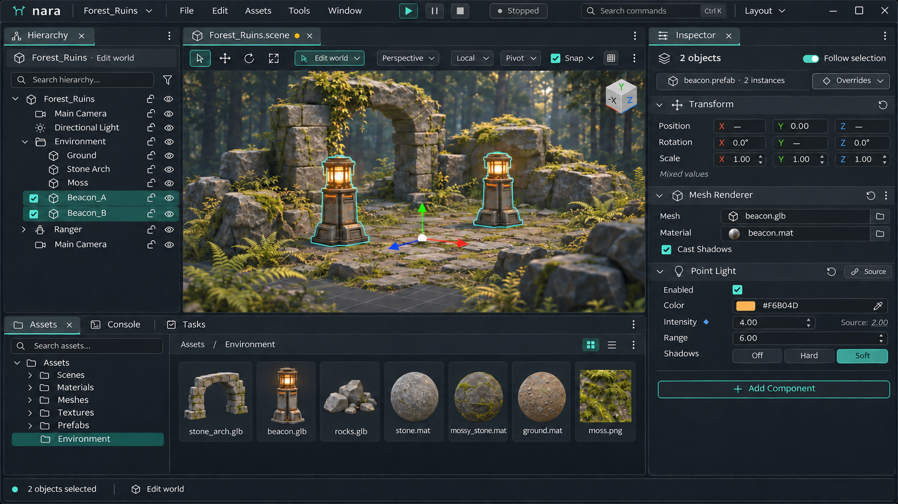

本版以场景编辑、Hierarchy 与 Inspector 作为默认工作区视觉入口。停靠标签从各自组的左边缘开始；工具栏、对象选择、属性来源与辅助面板分别表达自身上下文。此图的具体工作任务与状态见第 29 章。Scene 与 Shader 并排、Scene 与 Game 并排的 v0.3 图片继续作为多视图和多窗口参考，见第 21 章及第 38 章图片索引。

| 区域 | 默认预设值 | 约束 |
| --- | --- | --- |
| Hierarchy | 宽 240，建议最小 200 | 可移动、分组、折叠；显示绑定的场景上下文 |
| Inspector | 宽 352，建议最小 320 | 可固定目标并支持多个实例；窄时字段换行 |
| 底部工具区 | 高 256 | 可调大小、切换标签、暂时隐藏并恢复 |
| 应用栏与状态栏 | 高 36 与 24 | 应用栏不承载全局资源标签 |
| DockGroup 标签栏 | 高 34 | 只有本组的标签；单标签组也保留可拖动栏 |
| 视口工具栏 | 高 32 | 显示本视图的投影、工具、世界或输出上下文 |
| 场景视口 | 目标至少 640 × 360 | 是单视图舒适面积目标，不是每次分屏的绝对限制 |

所有停靠标签从所属组的起始端排列。中文与英文默认左对齐；位于中央的组在屏幕中部开始，并不意味着标签采用全窗口居中。多个组可以同时拥有各自的活动标签，键盘焦点独立指示。

普通工具视图和文档视图共享外层停靠容器。不同视图类型可以进入同一组，具体限制来自明确的实例能力、最小可用尺寸或平台能力，不能由硬编码的屏幕位置决定。

### 空间不足时的处理

保留用户停靠树，先让内容重排、滚动或使用工具内部可折叠区域。提供临时最大化当前视图、隐藏或恢复面板、应用紧凑预设等明确入口。临时聚焦结束后恢复原分割、尺寸和活动标签。

不再按 1280／1024 宽度自动把面板变成抽屉或覆盖层。窗口尺寸不足时应有可恢复的降级布局，但不得静默重排并覆盖用户保存的预设；也不能用僵硬的最小尺寸把窗口卡在屏幕之外。

Docking 的移动、复制、关闭、多窗口和恢复契约见第 21 章；默认尺寸不代替这些行为规则。

## 03 颜色与语义 token

颜色通过语义 token 引用。装饰分隔与控件边界使用不同 token；可交互边界不能只依赖低对比度的面板分隔线。表中列出主色，完整颜色与状态值见 JSON 文件。 控件边界按用途使用：只有边界本身承担识别操作区域时才需要相应的清晰描边；普通行分隔、面板分区和组内细线继续保持克制，不把所有轮廓都统一成同样明亮的外框。

| Token | 数值 | 用途 |
| --- | --- | --- |
| surface.canvas | #171A1F | 工作区基底 |
| surface.panel | #1D2128 | 停靠面板 |
| surface.raised | #252B34 | 工具栏与弹出表面 |
| surface.input | #14171B | 字段内部 |
| surface.hover | #2A323C | 悬停底色 |
| surface.pressed | #34404B | 按下底色 |
| border.subtle | #303741 | 装饰性分隔 |
| border.control | #6B7584 | 需要可辨认边界的控件 |
| text.primary | #E6EAF0 | 正文与有效值 |
| text.secondary | #A4ADB9 | 次级标签与帮助 |
| text.disabled | #697381 | 禁用内容，不能用于普通提示 |
| text.on_accent | #102522 | 青绿实底按钮文字 |
| accent.primary | #5EC8BF | 主要操作与活动标记 |
| accent.selection | #264442 | 选中背景 |
| accent.focus | #78E0D5 | 键盘焦点描边 |
| status.error | #F08F95 | 错误文字 图标 边框 |
| status.warning | #E4BF7B | 警告 |
| status.success | #91C99A | 成功与完成 |
| status.info | #87B5EC | 信息与来源标记 |

坐标轴同时使用 X／Y／Z 字母与颜色：X 为 #E89797，Y 为 #A2D09C，Z 为 #96BAED。错误同时提供图标或文字，选中树行同时提供侧边标记，信息不只依赖颜色。

深色主题是首版工作基线。浅色 logo 资产仅规定品牌在浅底上的呈现，不代表本文已经定义完整浅色编辑器主题。

## 04 尺寸字体与动效

所有 UI 尺寸使用逻辑像素。默认密度服务于鼠标和键盘操作；紧凑密度作为用户选择，不能通过统一缩小文字应对窄窗口。

| 项目 | 基准 | 说明 |
| --- | --- | --- |
| 间距 | 4 / 8 / 12 / 16 / 24 / 32 | 4 为基础步长 |
| 普通控件 | 高 28 | 紧凑变体高 24 |
| 属性行 | 高 28 | 校验信息另占一行 |
| 面板标签栏 | 高 34 | 图标与标题保持同一基线 |
| 普通圆角 | 4 | 弹出层为 6 |
| 普通描边 | 1 | 焦点环 2，外偏移 1 |
| 工具图标 | 16，必要时 20 | 16 尺寸建议 1.5 描边 |
| 点击目标 | 至少 24 × 24 | 图形可较小，命中区不重叠 |
| 分隔条 | 可见 1，命中带 6 | 可拖动区域给出尺寸调整光标 |
| 滚动条 | 滑块宽 6，命中宽 12 | 悬停可扩大视觉宽度 |
| 树缩进 | 每层 16 | 展开箭头与名称对齐 |

### 文字层级

| 角色 | 字号与行高 | 要求 |
| --- | --- | --- |
| 正文和字段标签 | 13 / 20 | 常规字重 |
| 面板与组件标题 | 13 / 20 | 中等或半粗字重 |
| 次级说明 | 12 / 18 | 保留足够对比度 |
| 数值与快捷键 | 12 / 18 | 等宽数字；需要时用等宽字体 |

字体选择遵循平台 UI 字体并提供中文回退；字形整形、行高和字重需要在实际字体上验证。单行过长内容可省略，提供完整提示与复制入口；错误信息和关键数值不能被永久截断。

### 动效与反馈时间

悬停过渡建议 80 ms，弹出层 100 ms，Tooltip 延迟 500 ms，成功提示约 4 秒。焦点、按压和输入回显即时出现。减少动态效果模式取消非必要过渡。长任务显示真实进度或明确的未知进度状态，不用动画暗示不存在的进展。

## 05 控件状态与视觉优先级

选中表示持续的数据状态，焦点表示当前键盘目标，校验表示输入有效性。三者可以同时存在，状态不能合并成一个“active”标志。

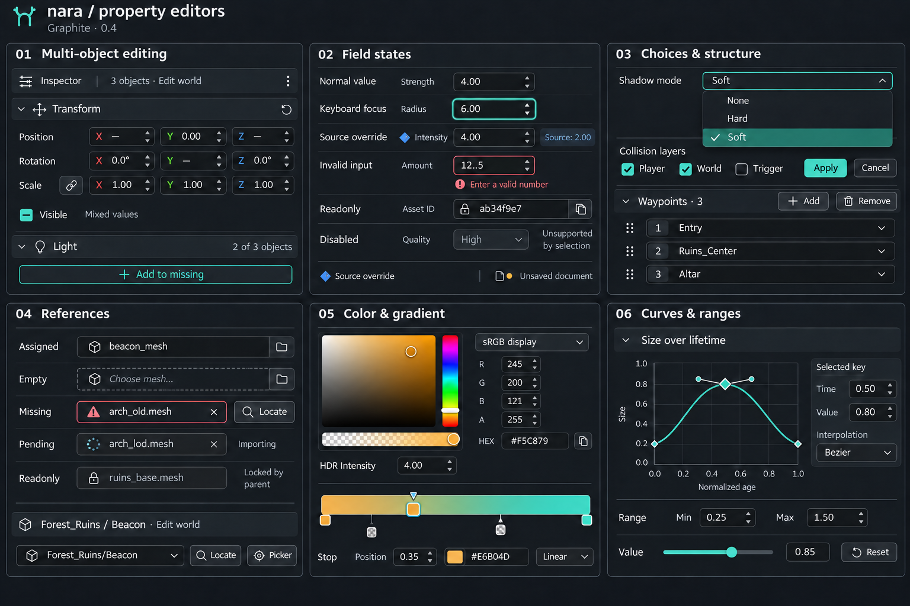

本版组件图板展示属性字段、数值与向量、来源和校验、资源引用以及复合编辑器。集合、导航、任务反馈和对话框见第 28 章的第二张图板。基础行为继续采用本章与第 06–11 章，新增复用与边界契约见第 28 章；v0.2 组件图作为补充参考保留在第 38 章索引。

| 状态 | 表现与行为 |
| --- | --- |
| 默认 | 稳定表面、清晰标签与可辨认边界 |
| 悬停与按下 | 按下反馈覆盖悬停；不抹掉选中状态 |
| 选中 | 底色加标记；树行使用 2 px 侧边线 |
| 键盘焦点 | 独立外层描边；不被父面板裁掉 |
| 校验错误 | 错误边框和说明；外层焦点仍可见 |
| 只读 | 可以聚焦与复制，显示只读原因 |
| 禁用 | 禁止提交并抑制按压，普通 Tab 顺序跳过 |

绘制顺序建议为基础表面、选中背景、悬停或按下、校验标记、焦点环。禁用状态可以降低视觉权重，但不能隐藏原因。窗口失焦时清理悬停、指针捕获与未结束按压，避免控件停留在错误状态。

## 06 基础组件行为

| 组件 | 必要行为 | 需要验证的边界 |
| --- | --- | --- |
| Button | 按下捕获指针，在有效范围内释放后提交 | 拖出后释放不触发；避免重复提交 |
| IconButton | 可读名称、Tooltip、绑定命令 | 提示快捷键与实际绑定一致 |
| TextField | 独立编辑缓冲、选择、复制、校验 | 非法输入保留；模型保留上一有效值 |
| SearchField | 清除、结果数量、空结果反馈 | 搜索不自动改变已选对象身份 |
| Checkbox | 选中、未选、中间态 | 多选混合值首次激活统一开启 |
| Select | 方向键导航、确认、取消 | 长列表可搜索，关闭后归还焦点 |
| DockTab | 组内活动、文档未保存、关闭、拖动 | 相对本组起始端排列；移动、复制与文档关闭按第 21 章协调 |
| ContextMenu | 分组、快捷键、禁用原因 | 边缘避让，弹层不被父面板裁掉 |
| Tooltip | 解释图标或截断内容 | 不承载唯一可用的操作入口 |
| Toast 与任务 | 短时确认、进度、结果 | 失败与冲突同时留在可查记录中 |

### 标签与局部切换

DockTab 表示可停靠的 ViewInstance；工具内部的 Shaded/Wireframe、Layers/Parameters、Dope Sheet/Curves 使用局部分段控件或导航。局部切换不默认带关闭按钮或停靠拖柄。拖动标签只移动视图；复制同一文档的视图由显式 Split/Duplicate View 发起，详见第 21 章。

### 文本编辑提交规则

输入期间保留缓冲文本和已提交值。Enter 在校验通过后提交，Esc 恢复本次编辑开始值；失焦时也执行校验。失败时不丢弃缓冲，不写入零、不静默替换内容，重新聚焦后可以继续修正。

字段接收外部更新时，如果用户没有正在编辑则刷新显示；如果存在本地编辑缓冲，显示冲突并提供接受外部值、取消本地编辑或明确覆盖的选择。编辑控件的身份不依赖当前行号。

### 停靠与弹出层

面板标题栏负责停靠拖动，内容区域保留业务拖放。停靠时先显示落点预览，释放才提交布局，Esc 恢复原位置。弹出层在窗口范围内避让；模态对话框限制自身焦点，普通停靠面板保持可自由离开。

## 07 数值向量与颜色编辑

### 数值字段

NumericField 同时支持直接输入与水平拖动调值。属性描述提供类型、合法范围、显示精度、步长、单位与只读原因；显示舍入不能写回未编辑的底层值。单位固定占位，明确哪些单位可输入。首版限定合法十进制格式，表达式求值可在后续单独定义。

| 操作 | 规范 |
| --- | --- |
| 直接输入 | 显示错误并保留输入；越界不静默截断 |
| 拖动调值 | 按属性步长预览；受限拖动在边界停止 |
| 精细与快速调节 | Shift 精细、Ctrl 快速作为建议默认，允许重绑定 |
| 结束拖动 | 一次手势提交一条撤销记录 |
| 取消 | Esc 恢复手势开始前的每个对象原值 |
| 外部更新 | 冲突显式呈现，不用旧缓冲覆盖新数据 |

### 向量与混合值

Vector2／3／4 为一组按轴可编辑字段。XYZ 同时保留字母和颜色；缩放联动使用单独开关，初始关闭。混合值显示“—”，它是显示状态，不是可写入数值。多选后输入 X 只替换每个实体的 X，保持各自 Y、Z 不变。

绝对输入与相对拖动的语义必须明确：输入为统一目标值；对多选执行拖动时，建议把相同增量作用于每个对象的原值。联动缩放和非线性属性需单独声明规则，不从 UI 外观推断。

### 颜色与 HDR

ColorField 包含色块、数值和颜色弹窗。色块显示透明棋盘格；颜色的线性或 sRGB 语义由属性元信息明确，HEX 与 RGBA 读数标示所处编码。HDR 颜色将基色与强度分开，透明度与光强使用独立字段。

颜色弹窗可以连续预览，关闭或确认形成单次事务，Esc 恢复打开前的值。拾色器取样后必须通过同一颜色转换路径；界面色与场景线性色不能按相同字节直接互换。

## 08 层级树与资源浏览

### 树的选择与结构操作

展开状态、选中集合和活动项独立维护。单击替换选择，Ctrl 点击切换集合成员，Shift 点击选择可见连续区间；活动项决定 Inspector 的主要上下文。离开树后保留选择，键盘焦点可以移动到其他控件。

拖拽预览区分两种落点：插入线表示成为同级项，整行高亮表示成为子项。提交前检查自包含、父子循环和目标有效性。变更父级属于可撤销事务，是否保持世界变换应作为可见的操作选项。

### 稳定身份与异步状态

树和资源列表可以虚拟化，但对象身份不依赖可见行号、显示名称或数组位置。滚动、过滤、排序和异步加载不能把选择转移到另一个对象。重命名后仍定位同一实体或资源。

| 状态 | 呈现与动作 |
| --- | --- |
| 加载中 | 显示正在读取，保留已有内容和选择 |
| 空目录 | 说明目录为空，提供导入或新建入口 |
| 无搜索结果 | 保留搜索词，提供清除条件 |
| 读取失败 | 保留错误原因、重试与可查看日志 |
| 缩略图未就绪 | 显示资源类型占位，名称仍可操作 |

### 资源引用控件

| 状态 | 呈现 | 数据约束 |
| --- | --- | --- |
| 已赋值 | 类型图标、名称、预览和定位入口 | 保存稳定资源身份，路径仅供阅读 |
| 空值 | 明确的拖放区域和选择按钮 | 空值不是资源丢失 |
| 丢失 | 警告图标、原名称或身份、修复入口 | 保留原引用，不能自动清空 |
| 可接受拖放 | 目标高亮与类型提示 | 释放后再提交 |
| 拒绝拖放 | 拒绝光标与具体原因 | 错误类型不得悄悄转换 |

资源浏览器的网格与列表共享选择模型；网格用于辨识外观，列表用于路径、类型、大小等精确字段。右键操作与菜单操作进入同一命令入口。

## 09 Inspector 与多对象编辑

Inspector 由实体标题、组件区块、属性行和添加组件入口构成。实体身份等调试信息弱化显示，组件名称与当前可编辑值优先。自定义组件也遵循相同的输入、校验和事务契约。

| 属性类型 | 默认编辑器 | 必需元信息 |
| --- | --- | --- |
| bool | Checkbox | 混合值、只读原因 |
| integer / float | NumericField | 范围、步长、单位、精度 |
| enum | Select | 稳定枚举值与显示标签 |
| string | TextField | 长度、校验、单行或多行 |
| vector | VectorField | 维度、轴名、联动规则 |
| color | ColorField | 编码、HDR、透明度语义 |
| asset reference | AssetField | 资源类型约束与可空性 |
| entity reference | EntityField | 目标作用域与有效性 |
| struct / list | 折叠属性组与列表编辑 | 元素身份、增删与重排能力 |

### 多对象作用范围

多选时显示对象数量。共同属性仅在类型与编辑语义一致时合并；同名但单位、范围或类型不同的字段不能自动合并。相同值正常显示，不同值显示混合状态；每次编辑都明确实际作用数量。

部分对象缺少组件时显示“部分对象拥有”，并提供独立的添加操作。编辑属性不会顺便创建缺失组件。只读对象或不兼容对象被排除时，必须显示排除原因；单次事务要恢复每个对象各自的原值。

### 组件区块

组件标题提供展开、启用、重置和更多操作。启用与折叠分别处理：折叠不影响运行状态。删除组件前展示组件依赖造成的影响；复制、粘贴和批量添加仍经过类型检查与统一命令。

PropertyRow 固定承担标签、帮助、编辑器和状态标记的排版；ComponentSection 管理标题、折叠与作用范围。对特殊类型注册编辑器时继续复用这两个容器，维持插件与内建组件的一致性。

### 多 Inspector 与上下文

Inspector 可创建多个实例。默认跟随本窗口当前有效编辑上下文，也可固定到某文档、世界和对象；固定状态及来源必须可见。切换到 Shader 不会把固定的场景 Inspector 改绑到节点。目标删除、文档关闭或插件缺失后显示失效原因与重绑入口，不能凭同名对象恢复。

Inspector 切换对象不等于关闭文档。已提交的未保存修改留在 DocumentStore；正在输入的缓冲按字段校验规则处理。仅通过 Inspector 编辑、没有文档标签的资源同样进入未保存文档清单。具体生命周期与命令路由见第 21、22 章。

## 10 来源状态与撤销事务

### 三种修改状态

| 状态 | 建议呈现 | 恢复操作 |
| --- | --- | --- |
| 偏离类型默认值 | 在字段菜单提供恢复默认及默认值提示 | 恢复类型默认值 |
| 覆盖 prefab 来源 | 属性旁来源标记，提示来源与覆盖值 | 恢复来源值或应用到来源 |
| 文档尚未保存 | 文档标签上的未保存标记 | 保存文档 |

保存只清除文档未保存状态，不清除 prefab 覆盖。恢复类型默认、恢复来源和将覆盖应用到来源是不同操作；应用到来源时必须指出目标资源与影响范围。一个模糊的“已修改”圆点不足以承担全部语义。

### 一次意图对应一次撤销

拖动数值、滑条、颜色调整和 gizmo 操作允许连续预览，结束后生成一个撤销步骤；Esc 恢复操作开始前的值。多个对象共同编辑形成一个逻辑事务，撤销时恢复各自原值。

| 阶段 | 要求 |
| --- | --- |
| 开始 | 记录稳定对象身份、属性路径、原值与基线版本 |
| 预览 | 校验并显示变化，不产生逐帧历史记录 |
| 提交 | 检查目标与版本，形成一次一致的逻辑变更 |
| 取消 | 恢复原值与 UI 状态，不留下未完成记录 |
| 撤销与重做 | 使用稳定身份恢复，不依赖当前数组下标 |

### 文档归属与跨文档边界

内容历史属于 DocumentSession，同一文档的多个视图共享 Dirty、版本与 Undo/Redo。相机导航、画布缩放与停靠布局不进入普通内容撤销；它们有独立的视图返回或布局恢复入口。

跨场景与资源的复合修改必须由项目级协调器验证全部目标并记录同一事务身份。首版没有该能力时，应明确限制复合写入，不能提供只撤销当前文档的“整体撤销”。内存编辑、文件落盘和导入构建任务的原子性分别定义，详见第 22、24、25 章。

### 运行模式与外部更新

编辑场景和运行时世界需要可见区分。Play 中的调试修改默认作用于运行时实例；结束运行后的保留操作单独展示对象与属性差异。运行时新建对象、瞬态组件和只读字段必须排除或提供明确映射，不能直接复制整份运行世界。

视图通过场景或文档命令提交修改。对象删除、属性变化和外部更新都可能使编辑基线失效；冲突出现时保留本地缓冲并显示解决入口，不能以旧数据静默覆盖新数据。

## 11 键盘输入法与可访问性

窗口、面板、复合控件和文本编辑分别管理输入上下文。键盘焦点始终可见，并与持续选择区别；这与 W3C APG 对键盘界面的指导相符 [3]，在 nara 中需要由自绘 UI 和平台适配共同实现。

| 操作 | 建议默认键位 | 作用范围 |
| --- | --- | --- |
| 命令搜索 | Ctrl K | 当前窗口 |
| 面板内移动焦点 | Tab / Shift Tab | 可交互组件之间 |
| 复合控件内部导航 | 方向键 | 树、列表、标签组、菜单 |
| 确认当前操作 | Enter | 优先当前输入上下文 |
| 取消当前操作 | Esc | 只取消最上层正在处理的操作 |
| 选择 移动 旋转 缩放 | Q / W / E / R | 场景视口上下文 |
| 重命名 | F2 | 当前有效选择 |
| 撤销与重做 | Ctrl Z / Ctrl Shift Z | 优先文本，再文档命令 |
| 复制 粘贴 删除 | 平台通用快捷键 | 由当前焦点决定目标 |

### 多视图命令目标

FocusedControl、ActiveView、每窗口 ActiveDocument、SelectionContext 和 World/RuntimeContext 分开维护。菜单与命令搜索保留唤起时的上下文；固定 Inspector 的命令使用其绑定文档。字段已消费的快捷键不能继续穿透，即使该字段暂时没有可执行的 Undo。

Delete 等目标性命令不回退到另一个面板的上次选择。Game 输入捕获采用明确所有者和持续提示，默认 Shift+Esc 释放，失焦与停止时自动清理。完整路由见第 22、23 章。

### 中文与复合字符

输入法组合文本与已提交文本分开保存。组合期间不触发场景快捷键；确认候选的 Enter 只完成输入法确认，不同时提交字段。输入名称中的 W 不切换移动工具。光标移动、选择和删除按可见字符簇处理，不按 UTF-8 字节截断。

IME 候选窗跟随真实插入点，转换包含滚动、窗口位置、系统缩放和用户缩放。Esc 首先交给输入法，再处理最上层弹出层或当前编辑预览；已消费的事件不继续传播。

### 语义与焦点恢复

控件对外暴露稳定身份、名称、角色、值、可编辑性和可用动作。平台可访问性桥接读取语义树，而非从绘制像素反推。隐藏与禁用状态仍可解释。关闭菜单归还触发者焦点；删除控件或移除插件面板时，把焦点转移到合理父级。

以上定义是实现目标。文字对比、键盘行为与语义桥接需要分别验收，完成其中一项不等于整体可访问性已经合格。

## 12 高 DPI 与自绘渲染

### 统一坐标转换

布局、滚动与命中使用同一逻辑坐标系；绘制阶段转换到物理像素。系统缩放与用户 UI 缩放只在明确的边界组合一次，避免输入坐标重复乘除。跨显示器移动时保持控件的逻辑尺寸，更新字体、图标缓存与裁剪。

| 阶段 | 坐标或数据 | 要求 |
| --- | --- | --- |
| 布局 | 逻辑坐标 | 浮点布局，保持相邻控件约束 |
| 命中 | 平台坐标转换后的逻辑坐标 | 逆变换一次，与视觉边界一致 |
| 文字排版 | 字形位置与逻辑行高 | 考虑回退、整形、字符簇与选择 |
| 细线绘制 | 物理像素 | 在最终边界对齐，避免逐节点累积舍入 |
| IME 候选窗 | 平台要求的坐标 | 由真实插入点做最终转换 |
| 弹出层 | 窗口级覆盖顺序 | 可见顺序与命中顺序一致 |

### 颜色与合成

JSON 中的 HEX 定义 sRGB 显示颜色。实现必须明确 UI 输入颜色、纹理、混合阶段与输出目标的编码，避免重复转换或未转换。透明纹理与绘制颜色统一采用约定的 alpha 表达，混合状态与素材格式保持一致。本文不绑定某个渲染后端的具体 API。

### 裁剪与性能边界

嵌套滚动使用明确的裁剪栈；菜单、Tooltip 与拖动预览进入合适的浮层，不能被父面板误裁。视觉覆盖顺序、命中顺序和焦点顺序保持可解释的对应关系。

列表虚拟化、字形缓存、图标缓存和绘制批处理可优化吞吐，但不能改变对象身份与输入状态。性能目标依据真实场景单独测量，不把概念图中的帧率或帧耗当作指标。

### 多窗口归属

每个原生窗口具有独立窗口身份、DPI、输入焦点、弹层宿主与渲染目标状态。公共字体和纹理缓存可以复用，但窗口尺寸、裁剪和命中变换不能依赖全局单窗口变量。失去显示器、窗口最小化、设备或目标失效都需要可恢复行为，见第 21、26 章。

### 显示缩放验收

至少验证 100%、125%、150%、200% 系统缩放，以及独立用户缩放。检查中文基线、细线、输入光标、选区、命中、拖动和 IME 候选窗；跨不同缩放的显示器后重新检查。小尺寸 logo 依据缩放前的布局尺寸选择。

## 13 自绘 UI 与插件接口

规范不强制立即模式或保留模式，但要求语义、交互、布局和绘制之间有清晰边界。实现可以组合不同组织方式，控件的身份、输入缓冲与编辑事务必须稳定。

| 职责 | 应持有的信息 | 不应承担的工作 |
| --- | --- | --- |
| 语义 | 身份、角色、名称、值、动作、属性绑定 | 根据图像识别业务对象 |
| 交互 | 焦点、选择、编辑缓冲、捕获、事务 | 把每一帧预览都写成历史 |
| 布局 | 尺寸、边界、约束、滚动与裁剪 | 把颜色值硬编码到几何逻辑 |
| 绘制 | 主题、几何、文字、顺序与合成 | 绕过命令直接修改场景 |

### 插件属性编辑契约

插件优先提供类型与属性描述，再为特殊类型注册自定义编辑器。属性描述至少包含稳定路径、显示标签、类型、默认值、范围、单位、只读原因、帮助和校验器。字段元信息与保存值分开，显示标签可以本地化。

自定义编辑器复用 PropertyRow、ComponentSection、AssetField 与事务入口。插件可以扩展内容、交互和绘制，但仍遵守多选作用范围、焦点、校验、撤销与授权规则。缺少专用编辑器时，可用通用只读查看器解释数据。

### 命令与持久 UI 状态

动作具有稳定命令身份、显示名称、适用上下文、可用条件和执行入口。菜单、快捷键、命令搜索、自动化与 Agent 复用同一能力入口；绑定变化后，菜单与提示中的快捷键同步更新。这里规定的是契约，不指定现有 Rust API 名称。

面板布局、展开、搜索与滚动状态独立于场景数据持久化。插件卸载时保留可解释的面板占位，并允许关闭；热重载只恢复仍然有效的状态。失效编辑缓冲需要明确提示并退出，不能绑定到另一个同名字段。

### 视图、任务与数据生命周期

插件视图通过宿主注册类型、实例策略、上下文绑定、状态版本和关闭职责。后台任务属于项目服务，面板只是订阅者；迟到结果核验 owner 和输入版本。原生插件不因一份权限清单就自动具备安全隔离，动态重载也不等于任意原生代码均可无条件卸载。具体边界见第 25 章。

### 实现顺序建议

先建立稳定控件身份、输入与文本编辑，再完成焦点、主题和基础控件；随后实现属性行、组件区块、资源引用及统一事务。复杂面板从这些复合控件组装，避免每个插件重新定义数值输入与撤销。

## 14 Agent 与变更预览

Changes 面板把自动化建议表示为结构化差异，聚焦具体对象、组件与属性。入口放在底部停靠区，也可以从属性修改标记定位；主工作区保持场景编辑所需空间。

| 变更记录 | 用途 |
| --- | --- |
| 目标身份 | 稳定实体或资源身份，避免只用显示名定位 |
| 组件与属性路径 | 精确定位修改点与编辑语义 |
| 旧值与新值 | 展示实际差异，可跳转到 Inspector |
| 基线版本 | 应用前发现人工修改或资源更新 |
| 作用范围与依赖 | 解释相关对象、资源与提交顺序 |
| 来源与结果 | 记录提案来源、执行结果和撤销入口 |

### 应用与冲突

默认提供预览、应用和丢弃操作。已有明确授权的自动应用可依项目或会话策略执行，不必为每个普通修改重复确认；授权范围、目标类型、基线版本和事务条件仍要重新验证。

如果提案生成后人工修改同一属性，将提案标为过期并解释冲突；不能把“已授权”解释为允许覆盖任意新值。用户可重新生成、取消，或在明确显示新旧差异后解决冲突。

### 批次与撤销

相关场景修改合并为一次逻辑事务，成功后可整体撤销。部分应用必须重新检查依赖关系，不能仅按界面勾选裁剪操作列表。无法保证原子性的导入与构建步骤单独列为任务，保留已完成、失败和待执行状态。

Agent 与人工操作经过相同的命令和校验入口。删除、覆盖、发布等动作遵守各自授权范围；界面只显示产品层面的目标与影响，不向普通用户暴露无关的实现细节。

### 多视图中的自动化目标

Agent 命令显式携带工程、文档、世界、稳定对象、基线版本与授权上下文，不继承碰巧获得键盘焦点的界面对象。布局或语言变化不能改变命令身份。语义入口与可访问性树可协作，但资产导入、构建、发布等副作用仍采用各自任务与授权协议。

### 示例行为

提案把 Beacon 的 Point Light Intensity 从 2.00 改成 4.00。应用前该属性若仍与基线一致，则提交并形成一次历史记录；若用户已改成 3.00，则显示当前值 3.00、提案基线 2.00 与目标值 4.00，等待重算或解决冲突。

## 15 首版范围与验收矩阵

先冻结身份、上下文、内容事务与保存边界，再交付最小闭环。下面的阶段是实施顺序，不表示原型图中的所有专业工具都属于首版承诺。多窗口、远程运行和跨文档能力可以后置，但接口从第一天保留其身份与生命周期，详见第 27 章。

| 阶段 | 交付范围 |
| --- | --- |
| 架构约定 | Project／Document／View／World／Runtime 身份，上下文、命令、事务、保存与资源模式边界 |
| P0 | 单窗口分组与分割、同场景多视图、基础 Inspector、Undo、可靠保存、布局恢复、单本地运行会话、任务与诊断最小模型 |
| P1 | 浮动多窗口、多屏恢复、更多 Inspector 和资源编辑器、导入队列、插件视图与工具、语义桥接 |
| P2 | 跨文档协调、复杂 prefab、远程或多客户端运行、构建发布工具、高级自动化与可共享布局 |

| 检查项 | 操作 | 通过条件 |
| --- | --- | --- |
| 布局 | 1600×1000、1280×800、1024×640 | 面板可达；无重叠；不足空间可折叠 |
| 焦点与错误 | 聚焦并输入非法数值 | 错误与焦点同时可见；不写入零 |
| 多选按轴 | 两个对象仅修改 Position X | 各自 Y、Z 保持原值 |
| 连续事务 | 拖动数值后撤销；再拖动并 Esc | 一次撤销；取消完整恢复 |
| 来源状态 | 改 prefab 实例后保存 | 未保存消失；覆盖标记保留 |
| 输入法 | 中文改名并确认候选 | 候选位置正确；不提前提交 |
| 键盘上下文 | 名称字段输入 W | 不切换场景工具 |
| 资源引用 | 拖错类型并模拟丢失 | 拒绝原因明确；原身份保留 |
| 虚拟列表 | 滚动、过滤与异步加载 | 选择不漂移到另一对象 |
| 缩放 | 四档 DPI 与跨显示器 | 文字、光标、裁剪与命中一致 |
| 变更冲突 | 提案后人工改同一属性 | 发现过期基线，不静默覆盖 |
| 运行转存 | Play 中修改后请求保留 | 先展示可映射差异与排除项 |
| 品牌图标 | 16、20、24、32、64 像素 | 分枝可分辨；n 负空间保留 |

验收必须运行真实交互。概念图、SVG 预览与 token 数值只能检验视觉资产，不能代替输入法、事务、可访问性和跨显示器行为测试。

## 16 配色检查与交付文件

文字与关键状态以 W3C 的对比度指导为参考：普通文字至少 4.5∶1，识别控件或状态所需的非文本视觉信息至少 3∶1 [1][2]。以下为本方案实色配对的计算结果；实际应用仍需检查背景、透明混合与控件状态。

| 前景与背景 | 计算比值 | 使用结论 |
| --- | --- | --- |
| 正文 #E6EAF0 / 面板 #1D2128 | 13.37∶1 | 用于主要文字 |
| 次文字 #A4ADB9 / 面板 | 7.12∶1 | 用于正常可读的次级文字 |
| 控件边框 #6B7584 / 面板 | 3.46∶1 | 可作为需要辨认的边界 |
| 分隔线 #303741 / 面板 | 1.34∶1 | 仅用于装饰分区 |
| 焦点 #78E0D5 / 面板 | 10.32∶1 | 用于外层焦点环 |
| 按钮字 #102522 / 青绿实底 | 8.01∶1 | 实底按钮使用深色文字 |
| 浅底符号 #21675F / 白色 | 6.63∶1 | 浅底采用深青绿版本 |

### 交付文件

| 文件组 | 内容 |
| --- | --- |
| nara-editor-design-spec-v0.4.md | 完整 38 章 Markdown 规范，含基础规则、组件扩充、八类新增工具与相对图片引用 |
| nara-icon 系列 | 已认可的主标、浅底、白色、单色、小尺寸及小尺寸单色 SVG |
| nara-app-icon | 带石墨底的 SVG 与 512 px PNG |
| nara-lockup 系列 | 深底与浅底横向组合，字标为路径 |
| nara-design-tokens.json | 颜色、尺寸、字体层级、动效和关键行为 |
| images | 十张 v0.4 组件／工具 PNG，以及六张明确标注版本的继承参考 PNG |
| design-process | 本轮生图提示词、参考说明与最终图片索引 |
| README | 资产选择、目录结构、currentColor 与颜色编码说明 |

SVG 主资产没有嵌入位图、脚本、滤镜或外部字体。单色 SVG 使用 currentColor 并提供石墨色回退；内联使用时设置根元素 color，作为外部图片加载时应修改源 color 或选择固定颜色版本，不能假定宿主样式自动穿透。

### 参考依据

[1] W3C WAI — [Understanding SC 1.4.3 Contrast Minimum](https://www.w3.org/WAI/WCAG22/Understanding/contrast-minimum.html)

[2] W3C WAI — [Understanding SC 1.4.11 Non-text Contrast](https://www.w3.org/WAI/WCAG22/Understanding/non-text-contrast.html)

[3] W3C WAI — [Developing a Keyboard Interface](https://www.w3.org/WAI/ARIA/apg/practices/keyboard-interface/)

## 17 视觉语法

### 共同的桌面工具框架

nara 的工业化工具质感来自连续的工作面板、稳定的对齐关系、紧凑而充分的工作信息，以及能说明实际用途的控件细节。各工具共享应用栏、组内停靠标签、属性编辑与状态反馈的基本结构；中心内容依据任务采用场景视口、资源网格、节点或状态机画布、时间轴、曲线、性能轨道、设置表单、模块栈或混音通道。

| 层级 | 共用规则 | 各工具允许变化的部分 |
| --- | --- | --- |
| 应用栏 | 品牌、项目、菜单、命令搜索位置稳定 | 与当前编辑上下文相关的命令集合 |
| 停靠标签 | 所属 DockGroup 内从起始端排列，活动与焦点分开 | 文档视图、运行视图与工具视图的标题、目标和实例策略 |
| 工具栏 | 小型图标、紧凑分段按钮、清楚的分组间隔 | 图缩放、编译、预览、播放、录制、吸附与时间单位 |
| 辅助面板 | 搜索、树或列表、属性行与组件区块复用 | 参数黑板、状态参数、动画轨道、资源引用 |
| 中心工作区 | 主要任务获得最大可操作面积 | 视口、资源、节点、状态、时间编辑、性能轨道、表单、模块栈与混音通道的专用表达 |
| 状态区 | 可追溯的错误与任务结果、克制的短时反馈 | 编译诊断、当前运行状态、片段时长与预览模式 |

常用操作直接呈现在工作上下文附近。节点端口、转换箭头、切线手柄、录制按钮、材质预览和关键帧标记都保留自身的工具语义；同一套基础控件不意味着把所有编辑工具画成相同的表单。

### 密度与对齐

延续 4／8 像素的间距节奏、28 像素标准属性行、24 像素紧凑控件与 16 像素工具图标。面板内部优先采用连续行、列对齐和窄分隔；组件标题与内容之间留出足以辨认分组的间距。附加图标的出现不能推动数值列来回移动，单位、重置按钮与状态标记应预留稳定位置。

资源引用显示对应类型图标及有用缩略图；材质使用材质预览，网格使用形状预览，动画使用片段或骨架提示。预览是工作信息，应与当前资源、选中对象或参数保持关联。允许按需折叠预览，为编辑内容腾出空间。

### 表面与边界

普通细分隔与有效交互边界不能全部使用同一种高对比描边。大面积面板主要依靠层次、位置和细分隔组织；需要识别操作范围的字段、空资源槽与可拖动目标保留足够清楚的边界。

| 用途 | 表现 | 约束 |
| --- | --- | --- |
| 面板分区与行间分隔 | `border.subtle` 或克制的表面层差 | 仅承担组织结构，不承担唯一的操作提示 |
| 需要可辨认边界的字段与空槽 | `border.control` 配合标签或图标 | 避免把每个属性行再包一层外框 |
| 紧凑组合字段 | 清楚的整体边界与细内部划分 | XYZ、数值与单位维持一个可读组合 |
| 悬停 | 局部表面或图标反馈 | 不改变长期选择、不挤动内容 |
| 选中 | 克制填色、侧标或对象轮廓 | 节点、树项、状态、关键帧采用适合自身的形态 |
| 键盘焦点 | 独立焦点环或焦点指示 | 能与选中、错误同时存在 |
| 弹出层 | 有限层次差、清楚边缘与轻量阴影 | 阴影仅帮助辨认覆盖关系 |

属性行、节点、状态和轨道都应保持平直、紧凑的主体形态。较大的圆角与间隔集中在必要的浮层和独立对话框，避免降低工作区域的有效密度。

### 颜色与动态状态

青绿色承担品牌、选择和焦点语义。节点端口的颜色表示数据类型，坐标轴颜色表示 X／Y／Z，时间曲线可沿用属性通道颜色；这些颜色不能因鼠标悬停而被全部改成青绿。类型名、轴名或形状提示与颜色共同出现。

选中、键盘焦点和运行时活动分别维护。一个未执行的转换可以被选中；一条未选中的轨道可以正在播放；正在运行的状态可以保持运行标记而不抢走属性面板焦点。运行态增加明确的播放标记、进度或活动指示，不能只依靠与选中相同的底色。

### 视觉验收

- 各张参考图能通过共同的标题栏、标签、输入框、字体层级和强调色识别为同一产品。
- 每张工具图都包含与任务相关的真实工作信息，关键控件在合理缩放下可读。
- 选中对象与右侧属性一致；预览与当前资源或角色一致。
- 基础组件板呈现默认、悬停、按下、焦点、禁用、混合值、资源丢失等实际状态。
- 细分隔不会形成满屏同等强度的框线；关键交互也不会隐没在背景中。

## 18 Shader Graph

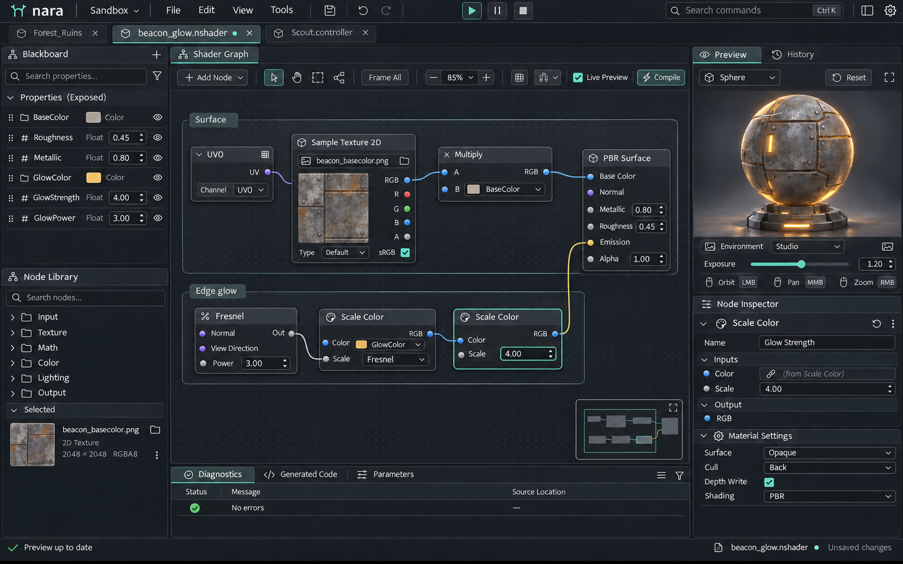

此图沿用 v0.2 的专业控件、内容与密度参考；外层全局标签和局部页签外观不再作为停靠依据，视图归属统一采用第 21 章。

### 用途与示例

Shader Graph 是绑定材质图 DocumentSession 的可停靠视图，内部黑板、节点画布、材质球和诊断采用局部分区；也可明确拆出绑定同一文档的辅助视图。它用于编辑材质数据流，图稿采用 `beacon_glow.nshader`。示例将基础纹理与颜色相乘后输出 Base Color，同时用 Fresnel、发光颜色和强度组成 Emission。材质预览显示与该图关联的发光材质，提供外观反馈。

示例参数包括 `BaseColor`、`Roughness`、`Metallic`、`GlowColor`、`GlowStrength`、`GlowPower`。用于跨图核对的表面值为 `Roughness = 0.45`、`Metallic = 0.80`；其余参数保留明确类型与可编辑值，具体默认值由资源定义。

### 面板与组件

| 区域 | 内容 | 关键控件 |
| --- | --- | --- |
| 文档与工具栏 | 资源名称、未保存、编译、预览与缩放 | 编译状态、自动预览开关、Frame All、缩放读数 |
| 参数黑板 | 暴露参数、类型、默认值与分组 | 搜索、增加参数、拖入画布、重命名、资源引用 |
| 节点画布 | 节点、输入输出端口、连接、分组和重路由点 | 点阵或细网格、框选、平移、缩放、节点搜索 |
| Inspector | 选中节点或图资源的属性 | 节点参数、类型、预览开关、材质设置 |
| 材质预览 | 当前有效图的预览对象与环境 | 球体或目标网格、环境选择、预览暂停与旋转 |
| 诊断区 | 编译中、警告、错误与定位信息 | 可跳转诊断行、节点错误标记、可收起日志 |

节点使用紧凑标题、对齐的端口行与有限预览。输入位于左侧，输出位于右侧；端口标签和类型能够被直接阅读。连接线在节点后方绘制，进入准确端口；重路由用于整理连线，分组用于组织意图，不改变求值语义。

### 示例数据流

| 数据流 | 目标 |
| --- | --- |
| `UV0 → Sample Texture 2D → Tint Multiply` | 纹理 RGB 与 `BaseColor` 相乘后接入 PBR 的 Base Color |
| `Roughness` | 接入 PBR Roughness，示例为 0.45 |
| `Metallic` | 接入 PBR Metallic，示例为 0.80 |
| `GlowPower → Fresnel` | 控制 Fresnel 响应形状 |
| `Fresnel × GlowStrength × GlowColor.rgb` | 接入 PBR Emission，可折叠成有明确输入的组合节点 |

端口类型与运算规则必须匹配。允许在明确支持广播的 Multiply 中采用 `Float × RGB → RGB`；其他类型转换需要有声明或显式转换节点。连接拒绝应说明具体类型差异。图稿中节点可以为可读性简化，不能以示意连线替代实现中的类型检查。

### 交互语义

从端口拖出连线时，兼容目标获得反馈，不兼容目标给出原因。接线、断线、重接、节点删除和参数修改都经过统一事务；删除节点时明确其连接影响。缩放与平移只改变画布视图，键盘删除与输入不能穿透节点内正在编辑的字段。

选中节点时，Inspector 显示同一节点；选中图背景时，Inspector 显示图级配置。节点选中轮廓、端口类型色与字段焦点分别表达。悬停连接线时可以增粗，并显示源端口与目标端口，确保复杂交叉仍可追踪。

编译与预览异步更新。失败时保留最近一次有效预览，并明确标注其已过期状态；不能把旧结果显示成当前编译成功。错误列表可以定位节点和字段，后台编译不能阻塞普通画布编辑。

### 验收点

- 图资源名称、黑板参数、选中节点与材质预览属于同一编辑上下文。
- 所有连接的方向、端口和类型可辨认；数据类型与选中颜色的含义独立。
- 无效连接给出原因；有效编辑可作为一次操作撤销。
- 编译失败时，旧预览与当前图状态区别清楚，诊断可以定位。
- 不同缩放下端口命中、节点文字、连线与 Inspector 仍可使用。

## 19 动画控制器

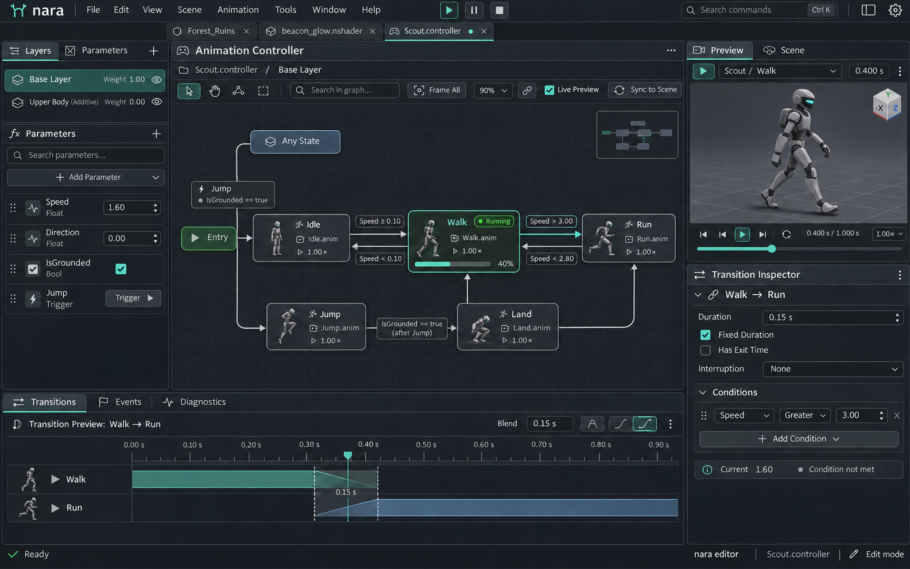

此图沿用 v0.2 的专业控件、内容与密度参考；外层全局标签和局部页签外观不再作为停靠依据，视图归属统一采用第 21 章。

### 用途与示例

动画控制器是绑定控制器 DocumentSession 的可停靠视图，状态机预览使用工具预览上下文，与完整 Game 的 RuntimeSession 分开。它编辑状态、转换条件、层与运行预览。图稿采用 `Scout.controller` 的 `Base Layer`，角色 Scout 为中性灰色轻型机器人，示例状态包含 `Idle`、`Walk`、`Run`、`Jump`、`Land`。

图稿当前运行状态为 `Walk`。参数区显示 `Speed = 1.60`、`IsGrounded = true`，并提供 `Jump` 触发器。被选中的是 `Walk → Run` 转换，条件为 `Speed > 3.0`，固定时长为 `0.15 s`，`Has Exit Time` 关闭。因此该转换可以显示为被选中，但不能显示为此刻正在执行。

### 面板与组件

| 区域 | 内容 | 关键控件 |
| --- | --- | --- |
| 控制器工具栏 | 资源、预览模式、播放与层路径 | 模式指示、播放控制、缩放、层级面包屑 |
| Layers 与 Parameters | 层、权重、参数类型与预览值 | 标签切换、参数搜索、数值、复选框、触发器按钮 |
| 状态机画布 | 状态、Entry、转换与子状态机 | 状态节点、方向箭头、转换选择、运行标记与进度 |
| Inspector | 当前状态或转换属性 | Motion 引用、播放倍率、条件行、时长、退出时间与中断设置 |
| 角色预览 | 同一 Scout 角色的当前姿态 | 预览环境、播放进度、复位与单步 |

状态节点显示名称、关联 Motion 和必要的运行信息。转换连接带方向箭头；双向转换分别绘制并可以单独选中。Entry 与普通状态使用不同形态；子状态机通过面包屑表达当前位置，返回上层不丢失选择与视图位置。

### 选择与运行状态

画布的选中对象决定 Inspector，预览状态机的当前活动状态决定运行标记，两者不互相替代。用户在 Walk 播放期间选择 Run 或 `Walk → Run`，应能检查目标属性而不强制切换当前播放状态。只有明确的预览跳转命令才改变测试状态。

`Speed` 是本示例的运动参数，与 Motion 播放倍率分别编辑和显示。`Jump` 触发器提供一次测试触发请求，不能画成长期保持的普通布尔开关。运行预览值与资源默认值分开，改变测试参数不会无提示地改写保存的默认值。

### 转换条件

转换 Inspector 明确显示源状态、目标状态与条件组合。条件行使用参数类型对应的比较操作；多个条件的 AND／OR 关系必须可见。固定秒数与归一化时长分开标注，`Has Exit Time` 的开关与数值不能含混合并。

| 选中转换属性 | 示例值 | 含义 |
| --- | --- | --- |
| Source / Target | Walk / Run | 当前正在检查的有向转换 |
| Condition | Speed > 3.0 | 当前 1.60 尚未满足 |
| Duration Mode | Fixed | 时长采用秒 |
| Duration | 0.15 s | 转换混合时长，不是片段长度 |
| Has Exit Time | Off | 本示例不额外等待退出时间条件 |

状态删除、Motion 替换、转换条件编辑及节点位置变更分别进入可撤销命令。删除被引用状态前解释转换影响；无效 Motion、孤立入口、缺失参数等问题显示定位信息，不用视觉连线掩盖配置错误。

### 验收点

- `Walk` 的运行标记与 `Walk → Run` 的选中标记可同时辨认。
- Speed 为 1.60 时，图稿不把 `Speed > 3.0` 表现为已满足。
- Inspector 的源、目标、条件与被选中箭头一致，0.15 s 的单位清楚。
- 参数测试、触发器测试与保存默认值有明确边界；运行预览不造成意外脏状态。
- 相同角色、Motion 引用、播放进度和预览姿态保持一致；编辑可撤销。

## 20 动画时间轴与曲线编辑器

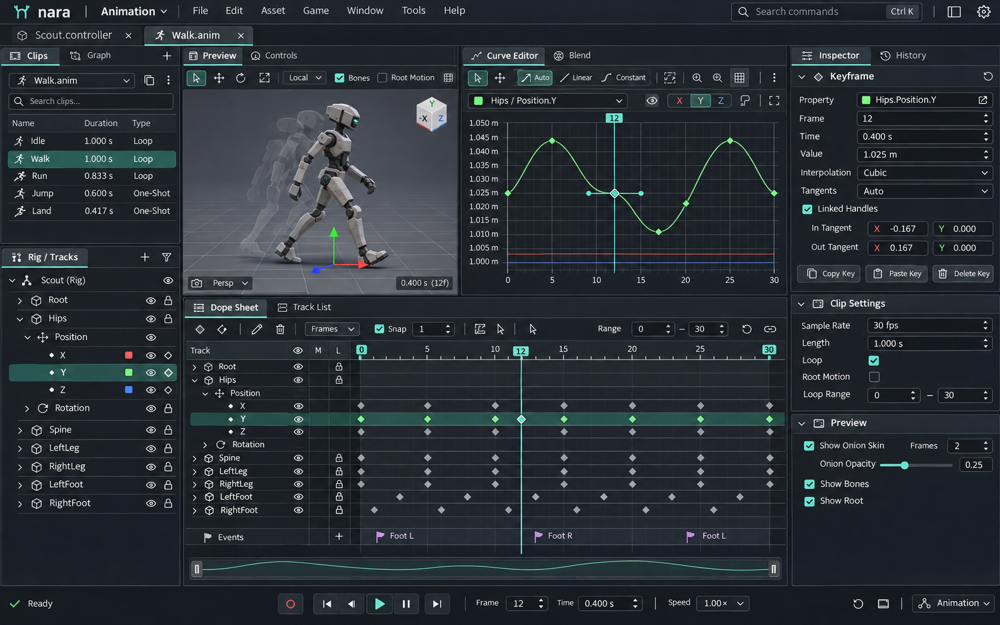

此图沿用 v0.2 的专业控件、内容与密度参考；外层全局标签和局部页签外观不再作为停靠依据，视图归属统一采用第 21 章。

### 用途与示例

时间轴与曲线编辑器绑定动画片段 DocumentSession，同一工具视图内共享播放头；第二个视图的导航和预览时间可独立，内容及 Undo 仍共享。时间轴用于组织片段、轨道、关键帧与事件，曲线编辑器用于精确调整连续属性。图稿使用同一 Scout 角色的 `Walk.anim` 循环，采样显示为 `30 fps`，范围为 `0–30 f`，对应一秒。播放头为第 `12 f`，即 `0.400 s`；选中 `Hips.Position.Y` 的第 12 帧关键帧，值为 `1.025 m`，插值为 `Cubic`，切线模式为 `Auto`。

### 面板与组件

| 区域 | 内容 | 关键控件 |
| --- | --- | --- |
| 片段工具栏 | 资源、时长、帧率、循环、播放与录制 | 播放／暂停、单步、循环区、录制状态、吸附、帧／秒显示 |
| 轨道树 | 对象、组件、属性与通道 | 展开、搜索、静音、锁定、可见性、关键帧指示 |
| 时间轴 | 时间刻度、播放头、关键帧与事件 | 框选、移动、缩放、循环范围与轨道对齐 |
| 曲线区 | 当前选择的数值通道 | 曲线、关键帧、切线、横纵轴、框选与 Frame Selection |
| Key Inspector | 选中关键帧的精确值 | Frame、Time、Value、Interpolation、Tangent Mode |
| 角色预览 | 当前时间的 Scout 姿态 | 相机控制、预览复位、根运动或辅助骨架显示 |

轨道树与时间轴行同步垂直滚动，轨道名始终能与关键帧对应。播放头跨越可见轨道；在曲线视图中使用相同时间基准。颜色保留通道语义，例如 Position Y 的曲线沿用 Y 轴颜色；选中曲线增加线宽或关键帧轮廓，不抹掉原来的通道身份。

### 时间单位与关键帧

帧数、秒数和片段采样率分别存储与显示。当前显示使用 `Time = Frame / FPS`：12 ÷ 30 = 0.400。切换刻度单位只改变读数与网格，不移动关键帧。0 f 与 30 f 是一秒循环范围的两端，片段实际如何处理循环端点由资源格式明确，不把两个端点无条件当成互不相关的姿态。

| 选中关键帧属性 | 示例值 | 含义 |
| --- | --- | --- |
| Track | Hips.Position.Y | 正在编辑的局部属性通道，坐标空间需在资源上下文可见 |
| Frame | 12 f | 按 30 fps 显示的帧位置 |
| Time | 0.400 s | 与帧位置联动 |
| Value | 1.025 m | 位置值，纵轴使用米 |
| Interpolation | Cubic | 相邻关键帧之间的插值方式 |
| Tangent Mode | Auto | 切线如何计算；独立于插值类型 |

`Cubic`、`Linear` 属于插值类型；`Auto`、自由或断开等属于切线模式，应使用不同控件。数值通道显示对应单位，旋转、位置与权重不能共用一个没有单位的纵轴解释。多个不同单位的通道同时查看时，使用分组轴、归一化显示或单独视图，并明确当前模式。

### 编辑与预览语义

拖动播放头仅改变预览时间。移动关键帧、调整数值或切线形成编辑事务，一次连续拖动只生成一次撤销；Esc 恢复开始位置和值。时间吸附和数值吸附分别设置，吸附发生时显示反馈。锁定轨道仍可查看，但不能被批量移动误改。

录制是明确、持续可见的模式。记录哪些属性、写入哪些轨道、创建还是替换关键帧，需要在操作前可判断；普通预览和参数查看不自动创建关键帧。对多个关键帧执行移动时，保持相对时间间隔；发生重叠、越界或覆盖已有键时采用明确的策略与反馈。

选中关键帧、当前播放时间和字段键盘焦点独立。Space、Delete、方向键等由当前输入上下文处理，不能穿透正在编辑的 Frame、Time 或 Value 字段。修改精确时间与拖动时间轴走同一数据和撤销入口。

### 验收点

- 12 f、0.400 s、30 fps 三个读数一致，播放头与 Key Inspector 指向同一时刻。
- 被选中轨道为 Hips.Position.Y，选中键值为 1.025 m，曲线纵轴说明单位。
- Cubic 插值与 Auto 切线分别显示，切换其中一项不含混改变另一项。
- 轨道树、时间轴、曲线和 Scout 预览保持同一片段与时间上下文。
- 普通播放不创建关键帧；录制状态清楚；锁定、吸附、撤销和取消符合统一契约。

## 基础视觉核对清单

| 核对对象 | 通过条件 |
| --- | --- |
| 产品一致性 | 各张参考图共享 nara 品牌、石墨层次、青绿强调、紧凑字体与控件语言 |
| 工具差异 | Shader Graph 展示数据流，控制器展示状态与转换，时间轴展示时间与数值，不混用连接语义 |
| 选择与焦点 | 鼠标悬停、持续选中、键盘焦点和运行活动可以分别辨认 |
| 示例一致性 | beacon_glow.nshader 的材质链路、Scout.controller 的运行条件、Walk.anim 的时间与键值符合各章描述 |
| 操作完整性 | 关键工具具备搜索、导航、预览、精确输入、错误定位、撤销与取消的入口 |
| 参数来源 | 图片负责呈现视觉与工作情境，MD 与 JSON 定义精确尺寸、颜色、单位和行为 |
| 交付格式 | 品牌以 SVG 母版交付，布局、组件和工具以 PNG 交付，规范包含完整 Markdown |

这些核对项是后续实现与评审的目标。图稿用于验证设计系统能否承载不同任务，不替代 Shader 编译、动画运行、输入与事务的实际功能验收。

## 21 窗口、停靠组与视图模型

### 方案选择与外部参照

Unity 官方文档将工作区组织为可移动标签集合，支持多标签浮动窗口与布局保存；Unreal 5.8 支持在 Level Editor 顶部停靠其他编辑器标签，并在 Viewport 内组织多个视口；Godot 支持 Dock 和部分编辑器浮动，并将关闭某些浮动窗口定义为回停。[4][5][6][7]

因此 docking 的通用需求是重排、并排、独立宿主与恢复，具体层级和关闭语义需要产品自行决定。本规范为 nara 选择统一外层停靠视图。它便于 Scene、Game 与资源工具并排，并让插件复用同一套宿主；代价是必须认真定义文档、选择和辅助面板的绑定关系。首版不采用每种资源各自拥有完整嵌套工作台的结构。

### 对象及职责

| 对象 | 含义 | 持有状态 | 生命周期约束 |
| --- | --- | --- | --- |
| ProjectSession | 当前工程的编辑会话 | 打开的文档、任务、命令服务、运行会话 | 关闭一个视图或浮动窗不会结束工程会话。首版一套工程会话只编辑一个工程。 |
| NativeWindow | 平台原生窗口 | 位置、尺寸、DPI、窗口焦点、窗口级浮层与一个 DockSurface | 多个窗口共享工程会话；平台窗口不是文档的数据所有者。 |
| DockSurface / DockTree | 窗口内容区的停靠布局 | 分割方向、比例、组、标签次序 | 只组织视图位置，不拥有资源内容、内容 Undo 或运行世界。 |
| DockGroup | 一个标签堆栈 | ViewInstanceId 列表、当前可见视图、溢出导航 | 每组同时显示一个普通视图；其他组可以同时显示各自的活动视图。 |
| ViewInstance | 一个可停靠的界面实例 | 镜头、缩放、滚动、局部导航、选中工具、绑定上下文 | 每个实例同时只属于一个 DockGroup；移动保留实例身份，复制才创建新身份。 |
| DocumentSession | 一份可编辑资源的打开状态 | 稳定资源身份、内容、当前版本、已保存版本、校验状态、内容 Undo/Redo | 由 DocumentStore 持有；多个视图共同编辑同一会话，不能各自持有一份可独立保存的内容副本。 |
| RuntimeSession | 一次正在运行或调试的游戏实例 | 启动配置、运行世界、连接状态、播放状态 | 由明确的启动/停止流程管理；不依附 Game 标签是否可见。 |
| WorkspacePreset | 命名的工作区布局预设 | 视图类型、停靠结构及可移植的布局偏好 | 切换预设不保存或丢弃资源，不启动或停止游戏，也不偷偷换掉当前工程。 |

DockTree 的内部节点表示水平或垂直分割，叶子为 DockGroup。数据结构可以采用不同实现，但必须能表达组内标签、组间分割和窗口之间的迁移。DockGroup 不应被写死为“左 Inspector”“中央 Scene”等坐标角色；这些是默认布局建议。插件可以声明不支持的能力或最小尺寸，宿主需要解释拒绝原因。

“文档”和“视图”必须分开。例如同一个场景可以有透视与顶视两个视图，同一个 Shader 可以在两个组里以不同缩放查看。它们共享内容和撤销历史，但保持各自镜头与画布导航。Scene 编辑视图、Game 运行视图和 Shader 材质预览分别绑定编辑世界、运行会话或工具预览会话，不能只靠一个模糊的 current_world 变量区分。

### 三种外观相近的导航必须分开

| 导航类型 | 示例 | 放置与外观 | 行为 |
| --- | --- | --- | --- |
| 工作区选择 | Level、Shading、Animation | 应用栏中的布局选择器 | 应用命名布局，保留文档与运行状态；切换资源不自动触发。 |
| 停靠标签 | Scene · Forest_Ruins、Game · Local、beacon_glow.nshader、Inspector | 所属 DockGroup 顶部，高 34 逻辑像素，从本组起始端排列 | 可以重排、移动、关闭、分组、浮动；每个标签对应一个 ViewInstance。 |
| 工具内表示切换 | Shaded/Wireframe、Local/World、Dope Sheet/Curves、Parameters/Layers | 所属工具内容区的分段控件或局部导航 | 改变同一视图的表示或编辑工具；默认无关闭按钮，也不显示停靠拖柄。 |

应用栏保持品牌、工程、全局菜单、运行目标与命令入口的稳定位置。内容组位于左栏之后时，其标签从该组左边缘开始；组被移到别处时，标签跟随组，不跟随某个绝对屏幕坐标。语言方向变化时使用本组起始端这一语义。

标签栏使用已有 34 像素高度、16 像素图标和至少 24 像素命中区。活动项样式表示组内当前内容；键盘焦点以独立标记表达。标题过长允许省略并提供完整名称、路径或身份提示；标签多时提供溢出列表和滚动，不能换成多行标签而挤压内容，也不能把关闭与拖动命中区重叠。

文档标签显示文档类型、名称和未保存状态；多个视图观察同一文档时反映相同的未保存状态。工具视图显示工具名称和必要的目标说明。Game 的目标、运行状态和输入捕获状态应在其工具栏持续可见。

### 移动、分屏、浮动与关闭

| 操作 | 规定结果 |
| --- | --- |
| 拖动到组内标签栏 | 移动已有视图并改变次序，保留 ViewInstanceId 与编辑状态。 |
| 拖动到组边缘 | 按落点预览分割组，并移动已有视图；不得暗中复制资源或运行会话。 |
| Split / Duplicate View | 明确创建第二个视图；文档视图共享 DocumentSession，Game 共享 RuntimeSession 并指明输出，工具视图按 ContextPolicy 复制绑定；仅对支持多实例的视图开放。 |
| 拖出成为浮动窗 | 新窗口就绪后才提交迁移；创建窗口失败时原组和原视图保留。 |
| Dock Back / Move to Main Window | 把现有视图移回主窗口，保持会话、滚动、镜头、图缩放和选择上下文。 |
| Esc 或无效落点 | 取消整个停靠操作，回到开始位置；不产生空白窗口或丢失标签。 |
| 关闭一个视图 | 关闭该表现实例；若同一文档还有其他编辑视图，继续保留共享文档。 |
| 关闭文档最后一个主编辑视图 | 默认进入该文档的 Close Document 流程，按脏状态提供保存/丢弃/取消。取消后原视图保持可见；保存失败保留内容与错误。 |
| 关闭组或浮动窗口 | 宿主统一协调其中的关闭请求，同一个脏文档只处理一次；取消时不留下部分关闭的混乱布局。 |
| 关闭 Game 视图 | 只关闭观察/输入界面；不隐式停止 RuntimeSession。运行状态和重新打开入口继续可达。 |
| 退出工程或应用 | 统一处理未保存文档、未提交字段缓冲、运行会话与不可直接取消的任务，清楚列出尚未完成的项目。 |

本规范确定：关闭浮动窗口是协调关闭其中视图；Dock Back / Move to Main Window 是单独的回停命令。所有同类窗口采用相同语义，插件不得私自把关闭解释为停止运行、丢弃文档或打开新工程。

关闭不能依靠对象引用计数直接决定是否丢弃数据。文档会话由工程级注册表协调；后台编译、缓存和固定的 Inspector 引用不能悄悄使未保存数据失去可达入口。所有脏文档都应出现在 Open Documents / Unsaved Changes 清单中，包括通过 Inspector 修改、尚未打开专门资源编辑器的资源；待提交输入也必须有可达入口，并进入保存候选检查。

| 生命周期动作 | 规范 |
| --- | --- |
| Change Binding：切换 Inspector 或预览目标 | 只改变视图绑定。先按字段编辑契约处理进行中的输入或拖动；已经提交到文档的修改继续由 DocumentStore 保留。不能每点击一个资源就弹出保存询问，也不能丢弃上一目标的脏会话。 |
| Close View：关闭界面实例 | 工具面板关闭只移除表现。关闭主文档视图时，若仍有该文档的其他主视图，保留会话；若是最后一个主视图，按统一默认策略进入 Close Document。是否为主文档视图由宿主契约声明，不能从它有没有资源字段猜测。 |
| Close Document：明确关闭文档 | 使用显式 DocumentId 协调保存/丢弃/取消、进行中的编辑和相关主视图；成功后让跟随或固定的辅助面板解绑或显示已关闭状态。干净缓存可以按需要保留，但缓存引用不决定用户看到的文档关闭行为。 |
| Exit Project：退出工程 | 处理 DocumentStore 中全部脏会话，包括没有文档标签的 Inspector 修改；统一检查运行会话和后台任务，不能只遍历屏幕上可见标签。 |

保存全部使用 DocumentStore 的脏会话集合。仅由 Inspector 打开的隐式会话可以保持打开直至保存或明确关闭；当前 Inspector 不再显示它，不代表它已经被丢弃。未提交的字段缓冲仍按控件契约独立处理，不能误报为已经写入文档的修改。

通用 Inspector 等观察面板不应阻止文档关闭。其固定目标被关闭后显示可解释的“文档已关闭/目标不可用”状态，并提供重新打开；不能自动跳到同名对象。若某插件 Inspector 本身是资源的主编辑视图，应通过 ViewType 契约声明其文档生命周期责任。

移动布局不进入内容 Undo。布局恢复通过命名布局、恢复上一个布局和重置入口处理。跨文档数据修改由统一事务协调；首版没有相应协调器时，不开放可能留下半笔结果的跨文档复合动作。

### 工具内部布局政策

首版不为每种资源编辑器建立完整的嵌套 DockHost。Shader Graph 的 Blackboard、Node Library、Material Preview、Node Inspector 与 Diagnostics 采用该 ViewInstance 内的可折叠分区、分割条或局部导航。动画工具的 Layers、Parameters、Preview、Timeline、Curves 和 Key Inspector 采用同样原则。局部操作不会重新排列主窗口的 Hierarchy、Assets 或通用 Inspector。

确有跨工具并排需求时，可通过“Open as Panel”将某个工具视图以普通外层 ViewInstance 打开，并携带 owner DocumentId、必要的 owner ViewId/PreviewSessionId 和绑定模式。固定到文档或预览会话的视图不会随任意全局选择漂移。所有者失效后显示失效状态及重绑/关闭入口。

例如右侧同时保留 Scene 的固定 Inspector 和 Shader 的材质预览，两者能独立放置，但目标都可见。其实现应复用已有外层 DockTree、焦点和生命周期协议，而不是每个工具重新实现一套窗口系统。

### 布局与状态恢复

| 数据类别 | 默认归属 | 内容 |
| --- | --- | --- |
| 项目内容 | 工程资源与版本管理 | 场景、材质图、控制器、动画片段等可编辑文档 |
| 可共享布局预设 | 用户明确导出的配置 | 视图类型、分割结构、组次序、可移植尺寸偏好 |
| 用户工程会话 | 本机每用户、每工程 | 打开的资源身份、镜头/滚动、固定面板目标、当前布局与浮动窗位置 |
| 瞬态输入状态 | 只存在于当前进程，不跨启动恢复 | 悬停、按键按下、指针捕获、菜单、进行中的拖动、游戏输入捕获 |
| 内容恢复快照 | 独立的恢复存储 | 未保存文档与可解释的编辑缓冲；不包含捕获或正在执行的交互 |

布局文件携带 schema 版本，使用稳定 ViewTypeId 与实例身份，保留未知插件视图的占位和可关闭入口。恢复时验证分割树、重复实例、尺寸和资源身份；加载失败可退回最近可用布局或默认布局。重置布局不删除文档内容、不清空 Undo，也不停止运行任务。应用或重置预设使用重排、挂起或重建表现流程，不调用用户关闭最后主视图所触发的 Close Document；打开的文档被重新放入可达的文档组或文档清单，未提交缓冲先协调再迁移。跨进程恢复从无捕获、无按键按下、无未完成拖动开始。

保存布局在用户完成操作后进行，不因每一帧拖动同步写入。提供原子写入与最近可用版本。缺失插件、升级后的视图状态不兼容或已删除资源都需要可解释的恢复结果；不能把整个编辑器卡在恢复失败中。

浮动窗位置基于显示器工作区和逻辑尺寸恢复。显示器被拔掉、编号变化或工作区缩小时，必须保证窗口标题栏和关键操作可达，并提供“Bring All Windows to Main Window”。调整当前会话的可见位置不自动覆盖命名布局；用户重新连接显示器后可以再次应用原预设。

窗口变窄时优先保留 DockTree，采用内容重排、滚动、明确的折叠入口和临时最大化。不能只因为越过某个宽度阈值，就把用户手动并排的面板自动变成全局抽屉或覆盖层并写回配置。最小尺寸是可用性约束；空间不足必须有可恢复路径，不能让窗口无法缩小或无法拖回屏幕。

### 停靠手势与实例能力

拖动标签、拖动资产、移动场景对象使用不同类型的拖放载荷。停靠拖动只从标签的可拖区域开始，关闭按钮和其他操作区不得触发迁移。拖入另一窗口时核验其工程归属与目标能力；首版不允许把同一视图直接迁移到另一个 ProjectSession。

拖动过程显示明确的插入或分割预览，原布局保留到提交成功。左右分栏与上下分栏、组内插入和创建浮动窗必须有不同落点。无效尺寸、视图不支持复制或平台不支持多窗时解释原因，不产生空窗口。拖动取消不写回命名预设。

DockGroup 即使只有一个标签也保留标签栏，便于发现关闭、移动与组菜单。临时最大化可以收起其他组，但保留可达的恢复入口。标签溢出使用滚动或列表，不换成多行标签。

移动同一个视图保留 ViewInstanceId；Split View 创建新 ViewInstanceId，并按视图类型共享文档会话、运行会话或工具上下文。复制视图与复制资源、复制运行会话是三个不同命令。

### 本版多视图与独立窗口参考

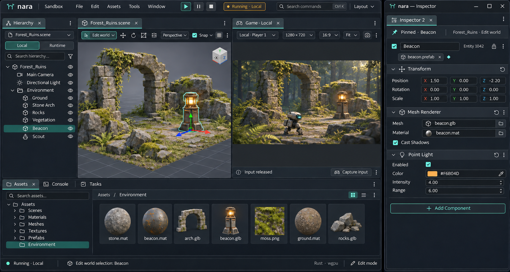

主窗口同时显示编辑世界和指定运行会话的输出，浮动 Inspector 固定到编辑世界的 Beacon。两边的停靠标签仍从各自组的起始端排列。浮动宿主使用原生标题栏与自己的 DockSurface；主窗口的完整应用工具栏不必在窄辅助窗口中重复，但窗口菜单、关闭和回停入口必须可达。

“多视图”包含三种不同能力：一个 Scene View 内的多相机分区、同一文档的多个 ViewInstance，以及多个 NativeWindow。前者只改变该视图的局部布局，后两者由统一外层停靠与窗口模型承载；它们不会自动创建多份文档或模拟世界。

## 22 文档会话、选择与命令上下文

### 状态归属

| 状态 | 所属对象 | 是否影响内容 Dirty / Undo |
| --- | --- | --- |
| 场景实体、材质节点、动画键、资源参数 | DocumentSession | 是，经过内容事务 |
| 文档版本、保存基线、校验状态与内容历史 | DocumentSession / DocumentStore | 与同一文档的所有视图共享 |
| 镜头、图缩放、滚动、搜索、展开、当前工具 | ViewInstance | 默认不进入内容历史 |
| 组次序、分割比例、浮动位置、布局预设 | Workspace / NativeWindow | 不使资源 Dirty |
| 当前实体、节点或键的选择 | 明确的 SelectionContext | 选择本身不等于内容修改 |
| 游戏世界、运行输入、调试状态 | RuntimeSession | 与编辑文档分开，回写需要明确事务 |
| 材质球、片段播放等局部预览 | PreviewSession / ViewInstance | 不隐式改写资源默认值 |

同一持久资源在同一 ProjectSession 内由一份标准 DocumentSession 管理。资源 ID、文档 ID、视图 ID、世界 ID、运行会话 ID 与控件 ID 不能互相替代。显示名、路径字符串、临时实体下标或内存地址都不单独承担跨文件身份。

DocumentStore 独立持有打开或未保存的会话。资产 Inspector 可以创建尚无文档标签的编辑会话；选择切换不触发逐次保存询问，已提交修改仍进入 Save All 和 Unsaved Documents 清单；有未提交输入的 Clean 文档也属于保存候选。关闭与退出遍历登记的会话，不只遍历屏幕上的标签。

### 活动视图、焦点、选择和命令目标

需要分开维护以下四项：

| 状态 | 回答的问题 | 例子 |
| --- | --- | --- |
| FocusedControl | 键盘正在输入到哪里 | Inspector 的 X 字段，或 Shader 节点内的数值字段 |
| ActiveView | 当前输入发生在哪个视图实例 | 左侧 Scene 或右侧 Shader Graph |
| EditContext / DocumentContext | 命令针对哪份文档、世界或编辑阶段 | Forest_Ruins 编辑世界、某个 prefab 隔离阶段、某个 RuntimeSession |
| SelectionContext | 此次操作使用哪组选择 | 场景实体、Shader 节点、动画关键帧、项目资源 |

选择不等于焦点。进入 Inspector 编辑字段时，选择对象应保持稳定；选择一个 Shader 节点不能覆盖另一个文档的场景选择。每个上下文记录稳定对象身份与域，禁止把相同的实体序号跨编辑世界、运行世界或预览世界混用。

同一编辑上下文的 Scene 与 Hierarchy 默认共享实体选择；它们的镜头与滚动独立。两个视图是否共享选择必须由其上下文绑定决定，而不是由它们是否位于同一窗口决定。不同编辑视图的导航状态默认独立；同一动画工具内的曲线、时间轴和角色预览共享该工具的播放头。将来需要独立播放头时，通过第二个视图或明确的联动设置实现。

通用 Inspector 默认跟随当前编辑上下文，并提供固定目标功能。固定状态必须显示文档/世界/对象来源；“Fixed”不能只藏在菜单里。进入固定 Inspector 后，保存、撤销和属性命令使用其实际绑定文档。视图被移动或浮动时不改变绑定。

键盘路由优先处理 IME、模态/弹出交互、当前字段、当前视图，然后才考虑窗口或工程命令。某控件已经拥有某快捷键时，即使其动作暂时不可用，也不能把同一个键继续穿透为另一种业务操作。例如文本 Undo 已为空时，不应意外撤销场景删除；节点数值输入中的 Delete 不应删除节点。

保存、撤销等文档命令明确显示目标，采用当前控件/视图绑定的文档。仅在没有明确目标且命令允许时，才使用该窗口最近活动的文档；删除、拖放等具备具体业务目标的命令不使用这种模糊回退。打开菜单和命令搜索时，需要保留唤起它们的上下文，避免菜单夺走焦点后改变执行目标。

每个 NativeWindow 保留自己的 ActiveDocument/最近文档上下文；工程级操作额外携带明确 ActionContext。浮动窗口中的 Ctrl+S 不应受另一窗口最后点过哪张标签影响。来自菜单、任务、Agent 或脚本的动作记录显式文档、世界、选择域及版本，便于诊断操作目标。

Agent 和脚本操作使用显式文档、世界和对象身份，不继承碰巧获得焦点的界面对象。其命令入口可以与人工操作共用，目标解析却不能依赖屏幕上哪一张标签当前可见。

### 命令解析契约

命令请求形成明确的 ActionContext：ProjectId、WindowId、来源 ViewId、DocumentId、World/RuntimeId、SelectionContext、目标身份、输入版本与授权信息。字段按命令类型可缺省，但不能由实现临时猜测含义。显示标签用于解释目标，稳定身份用于执行。

| 命令情境 | 合法目标与优先级 | 禁止的回退 |
| --- | --- | --- |
| 文本框内 Undo / Delete | 当前文本编辑缓冲；即使无历史也保持消费策略 | 穿透到场景或节点删除 |
| Scene / Graph 的 Delete | 当前视图绑定域内的实体或节点选择 | Console 获得焦点后删除上次选中过的对象 |
| Inspector 属性编辑 | Inspector 实际绑定的文档、世界、对象和字段 | 从当前其他资源标签推断目标 |
| Save / Undo 文档命令 | 明确绑定文档；命令允许时使用本窗口 ActiveDocument | 使用其他窗口的最近非空选择 |
| Play / Pause / Stop | 运行工具栏明确指定的 RuntimeSession 或启动配置 | 把当前 Shader / 动画预览当作全局运行目标 |
| Agent / 批处理 | 请求显式给出的对象、文档、世界、版本和授权 | 继承偶然的键盘焦点或鼠标位置 |

同一编辑世界中的 Scene 与 Hierarchy 默认共享选择通道。不同文档或运行世界不共享裸选择数组。多个视图之间需要独立选择时，显式使用不同通道；相机、缩放等导航状态始终独立。固定 Inspector 持有稳定目标，不持有会因 ECS 更新、重载或删除失效的长期借用。

### Dirty 与内容历史

Dirty 表示当前内容相对已保存基线存在差异，不是“曾经点击过按钮”的布尔记录。撤销回保存点可以重新变干净；外部文件发生变化仍独立标记冲突。异步保存只把实际写出的版本标为已保存，保存过程中新增的修改继续 Dirty。

普通内容 Undo/Redo 属于文档会话。相机导航与布局调整各有独立恢复入口。跨文档动作携带同一 TransactionId，先验证全部目标，再提交并登记所有历史参与者；撤销也要检查其他文档的后续变化。没有协调器时禁止伪装成一次可整体撤销的跨资源操作。

“整体编辑成功”不等于“多个文件落盘原子成功”。文件保存、导入、构建和外部工具副作用各自采用明确的提交或恢复协议。关闭批次可先完成所有询问与校验，再提交视图销毁；用户取消后布局保持完整，已经成功保存的文件不必回退成未保存。

## 23 运行会话、预览与空间编辑

### Game 与预览

Game 标签是运行结果的视图，不是运行模式本身。进入 Play 可以按用户选择让某个 Game 视图获得焦点或临时最大化；退出这种临时显示后恢复原布局。普通切换资源或工具不改变 RuntimeSession 的执行状态。

Game 工具栏显示会话名称、Local/Remote 等连接来源、当前输出或摄像机、运行/暂停状态与输入捕获状态。同一运行会话可以被多个 Game 视图观察，但同时的输入控制权要明确，不能把一次按键广播给所有目标。首版可以只允许一个本地 RuntimeSession，但接口仍保留目标身份。

游戏输入捕获有持续提示和明确的释放快捷键，建议默认 Shift+Esc，并允许在设置中重绑定为无冲突组合。该释放路径由宿主保留；窗口失焦、视图关闭或目标失联时释放捕获，清理按键与按钮状态。停止运行的入口不能被游戏的输入处理吞掉。编辑场景的快捷键、数值输入与游戏操作不能同时响应同一事件。

Shader 的材质球、动画工具的角色播放和 Game 运行实例分别拥有预览/运行上下文。材质预览更新或动画片段播放不应被顶层 Play 按钮误解释为启动整个游戏；本地播放控件需要靠近对应预览并明确作用对象。

### 输出尺寸、显示尺寸和输入映射

Game 输出分辨率、Game View 的可用显示区域、编辑器 UI 缩放是三组独立参数。默认 Fit 保持输出宽高比，必要时留边；1:1 明确定义为一个输出像素对应一个物理屏幕像素，与编辑器逻辑 UI 缩放分开；Fill / Stretch 必须单独命名，不能静默拉伸或裁切。

图稿示例输出为 1280 × 720、16:9。Game 面板更窄或更高时，画面仍保持 16:9。1:1 时若输出大于可见区域，使用明确的平移或滚动查看裁剪内容，不自动缩小。输入坐标先减去实际图像矩形偏移，再按图像缩放及平移偏移映射到输出坐标；留边区域不向游戏发送错误的点击。高 DPI、动态分辨率、多个输出和远程串流变化也必须重新计算映射。

输入捕获有唯一目标，界面持续显示 Captured / Released 与释放入口。默认 Shift+Esc 释放，可以在快捷键设置中调整但必须保留无歧义的逃生路径。失焦、目标断开、视图关闭、停止运行或迁移到尚未就绪的窗口时释放捕获并清理按键状态。暂停不必等于 UI 停止刷新，单步的模拟与渲染语义需要分别定义。

### 运行状态与进程策略

RuntimeSession 至少解释 Starting、Running、Paused、Stopping、Stopped、Failed、Disconnected 等状态；哪些命令可用由实际状态决定。启动配置指定源场景、构建配置、目标平台、玩家/输出和所用资源版本。运行状态持续存在于项目级入口，不能只藏在一个可以关闭的 Game 标签中。

运行会话与视图解耦，不自动决定它们位于同一进程。Godot 的官方说明即明确：游戏即使嵌入编辑器，也运行在独立进程中。[8] nara 应先固定运行桥接契约，再验证进程和画面嵌入方案。需要用户代码崩溃隔离的完整 Play 优先评估独立进程；轻量材质或动画预览可以在编辑器内采用受控预览世界。

首版可以先支持一个本地运行目标。多客户端、远程设备与完整调试协议后置，但目标身份、断连和版本归属不能依赖单例 current_world。独立进程能提供进程级故障边界，不能承诺隔离全部 GPU 或驱动故障；同进程原生扩展也不能仅凭错误捕获就保证编辑器继续运行。

### 多场景与 prefab 编辑域

一个编辑世界可以组合多个场景文档。每个对象记录其所属文档，活动场景决定新建对象的默认归属；在其他场景对象下创建、移动到另一场景或应用 prefab 来源时，明确提示实际写入目标。

Prefab 隔离编辑属于明确的编辑上下文，可复用同一停靠框架并显示来源面包屑。对象显示名相同不表示来源相同。嵌套来源、实例覆盖与跨场景迁移需要稳定身份与显式依赖；完整嵌套功能可以后置，文件模式和对象归属不能后置。

运行对象与创作对象通过可解释的映射关联。运行时新建对象、瞬态组件或已失效来源不能无条件写回场景；遵循第 10 章的差异预览与校验。

### 场景工具与 Gizmo

编辑相机、投影、网格、可视辅助和工具模式属于视图上下文。对象变换和层级属于创作数据。局部/世界坐标、Pivot/Center、多选枢轴、吸附、父级变换和约束应有可见设置。

自定义工具通过统一命中、预览、提交与取消契约工作。一次手势形成一次事务；目标在拖动中被删除、重载或迁移时重新检查基线并取消或提示重试。场景层级、Gizmo 和 Inspector 修改同一属性时使用同一编辑入口。2D 工具沿用上下文与事务框架，但有自己的平面、单位和导航规则。

## 24 保存、资源生命周期与数据演化

### 保存状态与失败处理

| 状态 / 事件 | 必须保持的行为 |
| --- | --- |
| Clean / Dirty | 基于内容与保存基线；所有视图显示同一状态 |
| Saving | 固定本次待写版本；允许继续编辑时保留新增版本 |
| Save Failed | 不清 Dirty，不销毁文档；说明路径、原因与重试入口 |
| Read Only | 可以查看和复制；解释权限、来源或锁定原因 |
| External Changed | 校验磁盘基线；不把旧内存自动覆盖新文件 |
| Conflict | 保留本地编辑和外部状态，提供比较、重载或明确覆盖 |
| Recovery Available | 恢复快照与正式文件分开，展示来源版本和时间 |

每个文件采用可验证的暂存与替换策略，写入失败保留旧文件和可恢复内容。多个文件不能仅凭 UI 上一次点击就声称原子保存；依赖组需要提交协议或清楚的部分成功报告。Save All 的候选集合为 Dirty 会话与拥有待提交输入或进行中编辑的文档的并集，包括没有可见标签的资源；先协调缓冲，再保存需要写出的内容。

Save 先协调目标文档各视图中的未提交编辑缓冲：有效输入经过版本检查与事务提交后进入待写内容；非法输入、过期基线或尚在进行的 IME 组合不被悄悄忽略。默认阻止该文档的保存并定位问题，不显示“已全部保存”。同一属性存在多份缓冲时先解决冲突，不能按视图遍历顺序覆盖。Save All 可以保存其他有效文档，但明确报告未完成项目。

关闭视图、文档和项目也检查未提交缓冲，即使已提交模型仍为 Clean。继续编辑、放弃该输入和丢弃整份文档修改是不同选择。切换 Inspector 目标时不强制确认 IME 候选，不把非法缓冲自动写成零；缓冲保留或取消遵循字段契约并提供可见解释。

外部程序或版本管理切换文件后，无本地编辑的会话可以按策略重新加载；有本地编辑时保留冲突信息。自动恢复快照不是正式保存，崩溃恢复不静默覆盖较新的磁盘版本。恢复存储与损坏的布局文件分离，重置布局不删除内容恢复数据。

### 源资源、派生产物与缓存

| 层 | 例子 | 修改与保存原则 |
| --- | --- | --- |
| 源资源 | 场景、源图像、模型源文件、Shader 源图 | 有稳定身份、依赖、格式版本与来源 |
| 文档草稿 | 正在编辑但尚未保存的参数或节点 | 由 DocumentSession 和恢复系统管理 |
| 导入设置 | 纹理颜色空间、压缩、模型轴向、平台覆盖 | 是可追踪的创作配置，有明确的作用目标 |
| 派生产物 | 平台纹理、编译 Shader、运行资源包 | 记录输入、依赖、工具链与目标配置，不能误当源文件 |
| 可再生缓存 | 缩略图、临时预览、索引 | 可以重建，损坏不应导致创作数据丢失 |

资源移动和重命名保持稳定引用；删除仍被引用资源时展示影响位置与修复入口。缺失资源保留原身份，不能自动指向另一个同名文件。路径用于定位和显示，不独自承担全部资源身份。

导入和编译先在暂存结果上工作，确认输入版本、依赖摘要和目标配置仍匹配后再发布。A 请求晚于 B 返回时，A 不能覆盖 B。若用户主动查看旧版本，明确标记其来源；当前预览不能把旧产物伪装成最新成功。

### 反射与模式演化

持久类型、组件、字段与资源格式使用稳定身份和模式版本，显示名称允许本地化或重命名。进程内的类型标识、实体槽位、地址或当前字段排列不能作为跨文件模式的唯一依据。

插件缺失、类型未知或字段迁移失败时，保留原始未知数据并提供只读占位和来源解释。打开再保存不能悄悄删除 Inspector 无法绘制的组件。自动迁移需说明版本、影响、失败项与恢复路径；失败不留下半迁移的正式文件。

### 版本管理与项目设置

稳定序列化、可追踪的资源身份和外部变化检测应先于完整 Git 面板。个人布局、镜头、搜索和浮动窗位置默认不进入工程内容变更；团队共享布局仅在用户明确导出时产生可共享配置。

项目设置影响构建或运行的值应区分平台覆盖与本机偏好。敏感配置与日志输出采用明确的访问和过滤策略；错误报告应提供排查所需上下文，同时避免无关敏感内容进入分享包。实时多人编辑可以后置，保存冲突和模式兼容不能假设只有一个写入者。

## 25 插件、后台任务、诊断与构建工作流

### 插件视图契约

| 声明 | 含义 |
| --- | --- |
| ViewTypeId / StateSchemaVersion | 跨版本识别视图与迁移可保存状态，禁止用显示标题作为唯一身份。 |
| InstancePolicy | SingletonPerProject、SingletonPerDocument 或 MultiInstance；打开已有单例时定位原实例而非悄悄复制。 |
| ContextPolicy | 跟随当前上下文、固定文档、固定世界/运行会话，或由用户明确绑定。 |
| DocumentBehavior | 是否为主编辑视图、是否拥有未提交缓冲、是否参与关闭文档协调。 |
| Capabilities | 能否复制、浮动、分屏、恢复状态及支持的最小尺寸。 |
| Lifecycle | 创建、状态恢复、可见性变化、序列化、解绑与销毁；异步结果须核验 owner 和版本。 |

单例或多实例是视图类型的能力，不代表“所有面板全局单例”或“每次打开都复制数据”。Inspector 和资源浏览器适合允许多个实例；编辑某类资源时默认定位已有实例，并通过显式 Split/Duplicate 创建第二视图。插件停止或重载时，宿主先释放输入捕获与焦点，再转换为占位；不得继续调用失效 owner 的回调。

隐藏视图可以暂停不必要的材质球、缩略图和动画渲染，但编译/导入任务的状态与错误仍应更新到任务模型。是否继续运行游戏由 RuntimeSession 的配置决定，不能简单等同于 Game 标签是否隐藏。

### 打开策略与单例职责

实例策略与默认打开策略分别定义。一个 MultiInstance 资源编辑器仍可在普通 Open 时定位已有视图，只有显式 Split/Duplicate 才创建第二视图。SingletonPerDocument 的类型不提供复制视图。项目级服务单例不表示其观察面板必须全局单例：不同 Console 或 Tasks 视图可以使用各自过滤器观察同一服务。

插件声明主编辑视图、辅助观察视图和内部控件的区别。自定义编辑器不能另外建立不兼容的 Dirty、Undo 或全局选择模型。扩展点包括视图、属性、命令、菜单、SceneTool/Gizmo、导入、验证与构建；实际语言与 ABI 方案另行选型，宿主契约保持一致。

### 任务与诊断的统一模型

任务至少记录 TaskId、种类、输入资源/版本、目标平台或运行会话、依赖关系、状态、进度、取消状态与结果引用。明确区分未知进度、已请求取消、正在收尾和已取消。面板关闭不会取消或抹掉任务；真正取消由任务能力和显式命令决定。

诊断包含严重级别、来源、资源身份、版本、对象/节点/字段位置、可解释消息与可能的修复动作。位置跳转核验目标仍然存在且版本可用；过期日志保留原来源，不跳到同名但不同身份的对象。Tasks、Console、Problems 与各工具局部诊断可共同订阅模型。

在不修改编辑数据的前提下，导入、编译、验证、缩略图和构建尽量在后台进行。提交到资源或文档时仍经过版本和权限校验；完成回调不能持有已经销毁的 UI 实例。

### 构建、调试与分析目标

| 工作流 | 必须明确的上下文 |
| --- | --- |
| Build / Cook | 目标平台、构建配置、入口场景、资源与工具链版本、输出目录 |
| Run / Attach | 启动或连接目标、会话身份、玩家/输出、编辑资源基线 |
| Profiler | 被采样的编辑器/预览/运行会话、采样范围、时钟与开销说明 |
| Debug / Console | 日志来源进程/会话、当前连接、命令是否会修改运行状态 |
| Validate | 被验证资源与模式版本、规则集合、结果是否仍对应当前内容 |

工程已有未保存内容时，构建必须说明使用保存版本还是显式创建的编辑快照。不能在后台随意混用几份不同版本。构建成功、运行成功、验证成功和资源保存成功分别呈现；一个绿色标记不代表所有环节都已完成。

完整构建面板、外部设备和分析工具可以后置，任务与诊断上下文从首版存在。需要可重复的自动化时，命令和验证服务允许在无可见面板的环境中调用；GUI 不应是获取资源身份或执行校验的唯一入口。

### 插件重载与故障边界

停用或重载插件前协调未提交字段、编辑手势、注册入口、任务回调和文档关闭。可安全恢复的状态按版本迁移；无法迁移时解释降级。保留未知组件原始数据，不能把重载变成资源数据清除操作。

原生扩展按受信任代码管理；权限清单只描述能力时，不能宣称它提供进程或内存安全隔离。需要强隔离的扩展采用实际受限执行环境与消息边界。首版不承诺任意原生插件可无条件热卸载；错误返回、panic、进程崩溃和 GPU 故障分别设计恢复范围。

编辑器扩展与游戏运行时扩展有明确依赖边界。发布产物不意外携带个人编辑器状态、工具面板或仅供编辑器使用的代码和资产。

## 26 多窗口、自绘 UI 与性能边界

### 窗口级平台状态

每个 NativeWindow 独立管理焦点、指针坐标、IME 插入点、弹层顺序、可访问性根、尺寸、系统缩放和可见性。控件身份保持稳定，移动视图到另一窗口后重新解析平台宿主；旧窗口的捕获、弹层和输入路由不能继续生效。

跨屏拖动包含窗口坐标、桌面工作区和物理/逻辑像素转换。每个边界只转换一次；系统缩放与用户缩放分开。不同窗口可以使用不同系统 DPI，不能通过修改全局 scale 影响所有窗口。弹出菜单、Tooltip 与拖放预览选择正确宿主，并避免被原父控件裁剪。

窗口最小化、尺寸为零、输出目标失效或设备重建时可以暂停相关绘制并保留模型。共享 GPU 资源故障可能影响多个窗口，应有统一恢复或安全退出路径；窗口重建不改变 DocumentSession 内容和 Dirty 状态。

### UI 与游戏刷新的关系

编辑器输入和布局刷新不能无条件绑在游戏模拟帧率上。暂停游戏仍能操作属性、拖动面板和处理任务结果。隐藏或静止的材质球、缩略图、动画预览可按需降频，运行会话是否继续执行则由其明确策略决定。

分别测量输入反馈、布局、文本排版、CPU 绘制数据构建、GPU UI、场景预览和后台任务占用。以明确硬件、窗口数、DPI、场景规模、节点数和列表规模建立预算，记录分位数与最坏交互，不从概念图中的帧率推导性能结论。

列表和图画布按可见区域工作，缓存有明确的输入版本和失效规则。虚拟化不改变稳定身份、焦点、选择或编辑缓冲。多个视图可共享同一文档索引和派生数据，但独立保持镜头与导航状态。

### 颜色、HDR 与输出

UI 的可读性与材质预览的颜色准确性分开验证。保持第 12 章的 sRGB/线性边界约定；HDR 或色调映射预览不应让普通 UI 文字一起采用不明的曝光。Game 的源输出、显示转换、缩放和截图用途需要明确，比较材质时说明当前预览环境与显示状态。

### 键盘、语义与本地化

停靠提供键盘可达的 Move to Group、Split、Float、Dock Back 与恢复入口，不要求所有操作只能通过鼠标拖动。视图位置变化后语义身份和名称保持可追踪；对复杂节点图与时间轴提供可导航的结构或属性入口。

显示名称、翻译和快捷键提示与稳定命令身份分离。长名称、中文输入、字体回退、不同平台字号和用户缩放在真实布局中验证；不得依赖英语短词宽度来决定唯一可用操作。减少动态效果、高对比与非颜色状态提示沿用基础规则。

这些是目标能力；完整平台可访问性支持可以分阶段交付，但语义数据、键盘路径和平台桥接责任从基础组件阶段存在。

## 27 盲区审计、实施顺序与验收

### 对 v0.2 的准确评价

原规范对单控件行为已有较完整约定。需要补上的核心是多文档、多视图、多窗口和运行任务同时存在时的数据归属与失败路径。下面区分“已覆盖”“待补强”和“缺失”，避免把原有规则重复当成新发现。

状态定义：**已有明确约定**表示保留并加入回归验证；**需要补强**表示已有局部规则但缺少全局归属或失败路径；**缺失**表示原稿未给出能指导实现的契约。优先级 A 是实现前必须确定的数据或状态边界，B 是首版可用性闭环，C 是可后置的完整能力。

| 主题 | v0.2 状态与依据 | 具体失效情境 | 建议补充 | 优先级 |
| --- | --- | --- | --- | --- |
| 输入、IME、字符簇、焦点 | 已有明确约定：第 06、11、12 章 | 双窗口下输入事件或候选窗被送到旧窗口 | 将既有契约扩展到 WindowId 和迁移后的视图；无须重新设计文本编辑 | A／B |
| 稳定对象与控件身份 | 已有明确约定：第 06、08、10、13 章 | 两个场景里的同名对象，或重载后的 ECS 句柄，被错误视为同一目标 | 补充 Project／Document／World 作用域和持久身份到运行句柄的映射 | A |
| Document 与 View 的区别 | 缺失：第 02、06、17 章只有标签与外观规则 | 为同一材质打开第二视图，得到第二份未保存内容和撤销栈 | 文档会话共享内容、Dirty、版本和内容 Undo；视图保存相机、滚动、缩放等表现状态 | A |
| Docking、分组与多窗口生命周期 | 需要补强：第 02、06、13 章有拖放预览和状态持久化 | 关闭浮动窗口被误解释为丢弃文档；拔掉显示器后面板永久在屏幕外 | 明确 DockGroup、ViewInstance、浮动宿主、关闭、回停、布局版本与恢复规则 | A／B |
| 活动文档、选择与命令路由 | 需要补强：第 08、09、11、13、17 章 | 点击 Console 后 Ctrl+S 保存错误文档；锁定 Inspector 因切图而改写另一对象 | FocusedControl、ActiveView、EffectiveDocument、World 与 SelectionContext 分开 | A |
| 内容撤销与跨资源事务 | 需要补强：第 10、14 章已有单手势事务和批次原则 | 两个视图各有 Undo；跨材质和场景的操作只撤销一半 | 文档域共享历史；跨文档事务由协调器整体管理；布局不进入内容 Undo | A |
| 保存、外部修改与恢复 | 需要补强：第 06、10、14 章已有基线冲突；缺少文件生命周期 | 磁盘写失败仍清 Dirty；外部工具修改文件后被旧内存覆盖；崩溃丢未保存内容 | 保存状态机、外部版本检查、可靠写入、恢复快照和关闭项目汇总 | A／B |
| Game 视图与运行会话 | 需要补强：第 10、19 章已有运行／编辑分离 | 切 Shader 停掉游戏；两个 Game 标签意外启动两份世界；关闭预览杀掉运行 | Game 绑定 RunSession／输出目标；运行控制与可视容器生命周期分离 | A／B |
| 输入捕获与预览导航 | 需要补强：第 05、11 章已有失焦清理与输入上下文 | WASD 同时移动编辑相机和游戏角色；隐藏 Game 后鼠标仍被捕获 | 明确输入所有者、捕获提示、释放方式、失焦／停止释放及快捷键优先级 | A／B |
| 资源导入、依赖与热重载 | 需要补强：第 08 章有身份与加载状态，第 18 章有过期预览 | 导入旧结果覆盖新版本；重命名资源造成大量引用断裂；删除仍被引用资源 | 源资产／导入产物／缓存／文档草稿分离，结果携带输入版本和目标平台 | A；完整导入体验 C |
| ECS、反射与资源模式迁移 | 需要补强：第 09、13 章有属性元信息；缺少持久类型与字段演化规则 | 组件改名或插件缺失后，打开再保存场景悄悄丢字段 | 稳定类型／字段身份、模式版本、迁移报告、未知数据保留和只读降级 | A |
| 多场景、Prefab 与编辑作用域 | 需要补强：第 10 章清楚区分三种修改状态 | 选中 B 场景对象却把新实体建到 A；Prefab 编辑误写实例或源资源 | 活动场景、对象所属文档、实例／来源编辑上下文必须可见；操作明确目标 | A；完整嵌套功能 C |
| 插件生命周期与工具扩展 | 需要补强：第 13 章已有属性编辑、命令和卸载占位 | 重载期间拖动仍持有旧属性；工具注销后回调继续写数据 | 统一注册与撤销注册、版本化状态、未完成事务清理、工具与数据格式解耦 | A；任意动态原生卸载 C |
| 长任务、诊断、Profiler、构建目标 | 部分缺失：第 04、08、14、18 章有任务／错误片段，无统一上下文 | 旧编译结果显示成功；构建目标与预览设备不同；日志跳到同名错误对象 | 统一任务与诊断模型，带项目、资源、版本、平台、RunSession 等上下文 | A；完整工具 C |
| 场景工具与 Gizmo | 需要补强：第 07、08、10、11 章有数值、父级、事务和快捷键 | 两个视口切换后工具串用；局部／世界坐标或 Pivot 不明确 | View 级相机与工具上下文，操作级坐标／枢轴／吸附规则，统一可撤销入口 | A／B |
| 可访问性、本地化、自动化 | 已有基础：第 11、13、14 章；跨视图约束需要补强 | 文案本地化导致命令 ID 变化；停靠后自动化只能按坐标猜目标 | 稳定命令与语义身份不依赖文案、窗口位置或像素；平台桥接分阶段落地 | A；完整覆盖 C |

### 推荐实施顺序

| 阶段 | 应完成的结果 | 暂不扩大的范围 |
| --- | --- | --- |
| 架构约定 | 固定身份、上下文、文档历史、保存协议、资源模式、视图与运行边界 | 不先追求所有工具图都成为完整功能 |
| P0 最小闭环 | 一个场景两个 View、单窗口停靠分割、Inspector、修改/Undo/保存/重开、单本地 Runtime、最小任务诊断 | 完整 Shader Graph、复杂动画系统、远程多客户端可继续作为后续工具 |
| P1 扩展工作区 | 多原生窗口、多屏恢复、更多资源视图、插件面板与工具、导入队列 | 任意原生插件热卸载与实时多人协作不默认纳入 |
| P2 复杂工作流 | 跨文档协调、复杂 prefab、构建发布、远程调试、完整自动化 | 根据真实项目需要推进，不以面板数量衡量完成度 |

先完成一次贯通原型：同一场景两个视图 → 固定 Inspector → 修改 → 两边刷新 → Undo → 保存 → 关闭一个视图 → 重启并恢复。它比继续增加静态面板更能验证核心设计。多窗口可先做小范围技术原型以验证 DPI/输入/渲染边界，正式功能在 P1 完整交付。

### 验收情境

以下均为后续实现验收目标，不表示生图已实现相关功能。

| 编号 | 操作情境 | 通过条件 |
| --- | --- | --- |
| T01 同文档多视图 | 将同一场景分成透视和正交两个视图，在 A 中拖动对象后在 B 查看，再撤销并关闭 A | 内容、Dirty 与 Undo 共享；两台编辑相机独立；一次拖动仅一条内容历史；关闭 A 不丢内容；改变分割不使场景 Dirty |
| T02 上下文与固定 Inspector | 同时打开场景 A 和材质 B，将 Inspector 固定到 A 中对象，再在 B 节点输入框编辑、按 Undo／Delete | 文本优先处理编辑；文档命令目标明确；B 的节点操作不删除 A 实体；固定 Inspector 不被全局选择覆盖；目标删除后显示失效绑定 |
| T03 运行输出与输入捕获 | 启动一次 Play，打开两个 Game 输出视图，切到 Shader，关闭一个 Game，再切换操作系统窗口 | 仍是预期 RunSession；切资产与关闭视图不自动停止；运行控制目标可见；输入只由指定目标消费；失焦后指针和按键状态释放 |
| T04 保存、冲突与恢复 | 修改文档后模拟保存失败；随后外部程序改同一文件；最后模拟崩溃并重新打开 | 失败不清 Dirty；外部冲突不静默覆盖；本地缓冲保留；恢复内容与磁盘版本可比较；取消关闭保留会话 |
| T05 引用的持久性 | 重命名并移动一个被场景与材质共同引用的资源，再从外部删除它 | 重命名／移动后引用仍解析为同一资产；删除后显示缺失身份与依赖位置；不能自动变成空引用或另一个同名资源 |
| T06 未知类型与模式升级 | 停用一个提供自定义组件的插件，打开并保存含该组件的场景，再恢复插件；同时测试一次失败迁移 | 未知组件及字段数据不丢失；占位能解释来源；恢复后可重识别；迁移失败保留原文件与报告，不留下半迁移文档 |
| T07 异步旧结果 | 先请求版本 A 的编译／导入，再修改为 B；让 B 先完成，A 后完成；期间关闭相关视图或取消任务 | A 不覆盖 B；诊断关联实际输入版本；关闭面板不会产生悬空回调；取消状态与结果可解释；保留旧预览时明确过期 |
| T08 布局恢复与多屏 | 拆出面板并移动到另一 DPI 显示器，保存布局后移除该显示器；另测试缺少插件和损坏布局 | 重要窗口可达；按当前显示器重新约束位置；文字、命中与 IME 一致；缺插件有占位；损坏布局可回退且不影响内容文件 |
| T09 跨文档一致性 | 一个动作同时修改场景和材质，模拟第二个目标校验失败；再测试成功后另一文档已有后续修改时撤销 | 具备协调器时先验证并保持整体一致；撤销检查所有目标与后续冲突；未支持跨文档事务时操作明确不可用，不提供半成功的假象 |
| T10 插件重载边界 | 在插件属性编辑器拖动过程中请求停用／重载；其后台任务随后返回 | 编辑手势被提交或取消的策略明确；旧注册与回调不能继续写旧对象；失效缓冲有解释；恢复不凭同名字段误绑定 |
| T11 任务与诊断上下文 | 在编辑器继续操作时运行一个可失败的构建／资源验证任务，切换目标平台或运行会话，再打开诊断 | 不阻塞普通编辑；进度可信；结果明确对应原输入与目标；失败有可查询位置和原因；不会把旧平台或旧运行会话结果当作当前成功 |
| T12 语义与自动化 | 调整 docking、改变 UI 语言，并用键盘／语义命令重复“选择对象—修改属性—撤销” | 命令和对象身份稳定，不依赖文案或像素坐标；自动化与人工经过相同校验和事务；焦点可见；辅助技术状态与实际控件一致 |

### 补充停靠与输出验收

| 编号 | 操作 | 通过条件 |
| --- | --- | --- |
| T13 标签归属 | 将 Scene/Shader 放在左、中、右不同组，增加标签使其溢出 | 标签始终相对本组起始端排列；同组只有一个活动视图，组间可并行可见 |
| T14 迁移取消 | 拖动标签，测试 Esc、无效落点和新窗口创建失败 | ViewId、原布局与内容完整恢复，无重复文档或空白残留窗 |
| T15 关闭与无标签脏资源 | 仅从 Inspector 修改资源后切换选择，再关闭浮动窗和项目 | 切换目标不逐次问保存；Save All / 退出会找到全部 Dirty 会话；取消关闭不丢视图 |
| T16 输出比例与输入 | 1280×720 输出放入不同宽高的 Game View，Fit 与1:1切换，并跨DPI屏幕 | 比例与留边符合模式；点击只映射实际画面，不受容器留边和UI缩放重复影响 |
| T17 预设恢复 | 运行中切换布局，最大化再恢复，随后重置损坏布局 | 不丢文档、Undo或任务，不隐式停止运行；临时状态不污染命名预设 |

### 实现责任边界

以下划分的是逻辑职责，不要求立即拆成独立 Rust crate，也不强制立即模式或保留模式。

| 边界 | 主要职责 | 必须避免的耦合 |
| --- | --- | --- |
| 编辑器外壳与 UI | Window、DockTree、View、焦点、命令呈现、语义树、个人工作区状态 | 由某个 Tab 独占项目数据；面板直接决定对象生命周期 |
| 文档与创作数据 | 加载、编辑模型、版本、Dirty、保存基线、引用、模式迁移、内容 Undo | 把展开、滚动、相机导航写入普通场景修改历史 |
| 命令与事务 | 目标解析、可用性、校验、预览、提交、撤销与跨资源协调 | Agent、插件、菜单各自绕过统一入口直接写数据 |
| 运行桥接 | World 与 RunSession、可安全读取的视图数据、运行调试命令、编辑／运行映射 | UI 长期持有会在重载或帧更新后失效的 ECS 访问；Game 标签即世界 |
| 资产与任务服务 | 资源身份、依赖、导入产物、缓存、任务取消、结果版本与诊断 | 面板关闭导致任务状态丢失；旧产物无版本检查地覆盖新数据 |
| 平台与绘制 | 原生窗口、输入／IME／可访问性桥接、DPI、绘制与资源恢复 | 只为单窗口编写隐藏的全局坐标或输入所有者；把游戏帧率当作 UI 刷新契约 |

最值得先做的纵向原型是：同一场景两个 View → 固定 Inspector → 一次修改 → 两边刷新 → Undo → 保存 → 关闭一个 View → 重开项目恢复布局。这条链能同时暴露身份、上下文、事务、保存和布局归属问题，比继续增加更多静态面板更能验证架构。

### 新增官方参考

[4] Unity — [Customize your workspace layout](https://docs.unity.com/en-us/engine/6000.6/manual/extending-the-editor/customizing-your-workspace)。用于核对标签集合、浮动窗口与布局保存，不作为 nara 的实现约束。

[5] Unreal Engine — [Level Editor](https://dev.epicgames.com/documentation/en-us/unreal-engine/level-editor-in-unreal-engine)。用于核对顶部编辑器标签和视口内部多视口的不同层次。

[6] Unreal Engine — [EAssetEditorOpenLocation](https://dev.epicgames.com/documentation/en-us/unreal-engine/API/Editor/UnrealEd/EAssetEditorOpenLocation)。用于核对资产编辑器可以采用不同打开位置策略。

[7] Godot — [Customizing the interface](https://docs.godotengine.org/en/stable/tutorials/editor/customizing_editor.html)。用于核对浮动、回停和布局恢复的产品选择。

[8] Godot — [Game embedding](https://docs.godotengine.org/en/stable/tutorials/editor/game_embedding.html)。用于说明画面嵌入与运行进程边界是不同问题。

资料核对日期：2026 年 11 月 5 日。其他产品用于说明可行的模式与取舍；本文中的 nara 状态机、身份、关闭与停靠规则均为本项目的目标设计。

## 28 常用组件扩充

本章把同一套组件放到场景、资源、动画、性能、输入配置、构建、粒子和音频工作中验证。组件继续采用 v0.3 的石墨表面、青绿强调、28 逻辑像素普通行高、24 紧凑行高和 4 像素普通圆角。视觉参考展示目标外观；交互和状态以本章及第 06–13、21–26 章为准。

图中的六个区域是独立组件样本，便于比较多选、来源、引用和复杂值编辑。多个弹窗同时可见只用于样本展示，不代表普通工具一次打开多个抢占焦点的弹层。

### 28.1 属性行与状态组合

PropertyRow 仍统一承载标签、帮助、编辑器与状态；ComponentSection 负责组件标题、折叠、启用和作用对象。标签与输入对齐，单位固定占位，错误说明占独立行；窄 Inspector 可把编辑器移到标签下方。优先保留完整数值和错误原因，不通过缩小字号维持单行。

一个字段可以同时处于“多选混合、覆盖来源、输入无效、获得焦点”等状态。实现应分别记录值的一致性、来源、可编辑性、校验、引用解析和交互状态，避免用单一状态枚举互相覆盖。

| 状态 | 可见表现 | 操作与约束 |
| --- | --- | --- |
| 相同值 | 正常读数或选项 | 显示格式不改变未编辑的精度。 |
| 多选混合 | 数值显示 —；bool/flags 使用中间态；显示作用数量 | — 不是数值。直接输入统一目标值；向量只修改被编辑的轴。 |
| 来源覆盖 | 属性旁独立来源标记，能查看来源资源及原值 | 恢复类型默认、恢复来源、应用到来源分别命名；保存文档不清除来源覆盖。 |
| 未保存 | 文档或未保存清单显示 Dirty | 不把每个字段的来源标记替换成统一未保存圆点。 |
| 输入无效 | 保留原输入，错误描边、图标与具体原因 | 已提交模型保留上一有效值；外层焦点环仍可见；不能静默截断或改成零。 |
| 只读 | 值仍可读、可聚焦和复制，显示锁与原因 | 禁止修改和拖动调值；复制、定位引用等非修改操作仍可用。 |
| 禁用动作 | 降低操作权重并解释不可用原因 | 不提交、不产生按压结果，普通 Tab 导航跳过；原因不能只藏在瞬时 Tooltip 中。 |
| 待加载或导入 | 保留名称、身份和已有预览，显示当前阶段 | 不把暂未就绪显示为空引用；取消任务不等于清空引用。 |
| 引用缺失 | 警告、原名称或身份、定位或修复入口 | 保留原引用，重新指定是明确的数据修改。 |
| 本地与外部冲突 | 指明本地输入和较新版本，提供查看与处理入口 | 不以旧缓冲覆盖新值；取消也只能移除本次预览，不能回写一个已过期的快照。 |

状态颜色复用已有语义 token。来源信息可以使用 info 的弱强调，错误使用 error；同时保留图标与文字。焦点、选中、来源和错误分别表达，不依赖颜色让用户猜测含义。

### 28.2 属性编辑器及复用范围

| 组件 | 必须呈现 | 提交、撤销与错误处理 | 主要复用位置 |
| --- | --- | --- | --- |
| TextField / NumericField | 标签、类型需要的单位、格式与帮助；数值可直接输入或拖动 | Enter 校验提交，Esc 取消本次输入；IME 确认候选不顺便提交字段。连续拖动形成一次事务。 | 名称、Transform、粒子参数、音频增益、构建配置 |
| VectorField | 每轴名称与数值，联动开关有明确状态 | 多选直接输入只替换对应轴；相对拖动按各对象原值应用同一增量。联动缩放规则独立声明。 | Transform、速度、力场、输入二维向量 |
| Checkbox | 选中、未选、中间态，完整标签 | 焦点内 Space 激活；混合态首次激活统一开启；每次明确切换是一笔事务。 | 组件启用、循环播放、阴影、导入选项 |
| EnumSelect | 当前标签、可选项、必要的解释 | 方向键选择，Enter 或点击确认，Esc 取消；保存稳定枚举身份。未知旧值保留并解释，不能自动变为第一项。 | 阴影、混合模式、插值、目标平台 |
| FlagsField | 每一位的名称、勾选或混合状态，必要时有搜索 | 弹窗暂存多项选择，Apply 一次提交，Cancel 放弃本次缓冲；未知位保留。混合位的开启/清除对实际对象逐一计算。 | 碰撞层、渲染掩码、导入标志 |
| Slider + NumericField | 相同值的滑条与精确读数，合法范围和单位 | 滑条在范围内预览，松开提交一次；直接输入越界保留错误，不静默夹紧。 | 音量、曝光、混合权重、粒子速率 |
| RangeField | 明确的 Min/Max 或 Start/End，单位和联动关系 | 两值共同校验；Min 大于 Max 时保留错误，不偷偷交换。预览和撤销恢复两端原值。 | 随机寿命、速度范围、裁切区间、距离衰减 |
| ColorField | 色块、透明棋盘格、编码标签；HDR 强度与 Alpha 分开 | 弹窗连续预览，确认或按既定关闭规则形成一笔事务，Esc 恢复；必须经过属性指定的颜色转换。 | 灯光、环境、粒子颜色、材质普通属性 |
| GradientField | 色带、颜色点与 Alpha 点的不同手柄、选中点位置与值 | 选中点具有稳定身份；拖动、增删、插值调整可撤销。位置与最少点数由类型约束校验，不按屏幕像素写值。 | 粒子颜色随寿命、环境过渡、动画色彩 |
| CurveField | 小型预览、横纵轴意义与单位、选中键数值、插值类型 | 时间/位置与值都可精确输入；拖键或切线一次一笔。越界、重复时间或固定端点限制给出原因。 | 动画曲线、粒子随寿命参数、音频距离衰减 |
| AssetField / EntityField | 类型图标、名称、身份上下文、定位与选择入口 | 候选预览不立即改引用；确认后校验类型、目标存在性与作用域，再提交。空值、缺失、待加载分别显示。 | Mesh、贴图、音频片段、动画绑定、对象引用 |
| Struct / List / Map | 层次、元素数量、展开、添加与删除；可重排列表有独立拖柄 | 元素有稳定身份，重排或虚拟化不换绑输入。Map 重复键保留错误；删除依赖和最少元素数先校验。 | 组件数组、动画事件、音频效果链、构建场景列表 |
| BindingCapture | 监听状态、设备或控件路径、已解析输入、冲突位置 | 开始监听与确认分开；Esc 结束监听。要把 Esc 本身作为绑定时使用显式选择入口；检测冲突不自动删除旧绑定。 | Input Actions、编辑器快捷键设置 |

复杂控件仍复用 PropertyRow 和文档事务，不绕过统一提交入口。字段内文本 Undo 优先于文档 Undo；即使文本没有可撤销内容，也不能让同一个按键穿透到其他对象。

小型 Gradient/Curve 编辑弹窗可采用“暂存预览—Apply/Cancel”的整体编辑模式，确认形成一笔事务。进入完整曲线编辑器后，各次拖动、增删和插值修改各自成笔；工具必须清楚声明采用哪种模式，不能同时出现含义相同的两层 Apply。

### 28.3 多对象、来源与引用的边界

多选 Inspector 顶部显示对象数量与编辑世界。只有类型、单位、范围和编辑语义一致的属性才合并。组件只有部分对象拥有时显示“2 / 3 个对象拥有”，编辑现有组件不会顺带给第三个对象添加；补齐组件使用独立动作，并展示实际作用集合。

存在只读、不兼容或目标已失效的对象时，先解释可写数量及排除项，再允许用户明确选择受支持的目标集合。不得表面显示修改全部对象，实际只改了其中一部分。一次多对象事务记录各对象原值，撤销逐一恢复。跨文档批量写入继续受项目级事务能力约束；不能把各文档分别提交伪装成整体原子成功。

来源菜单分别列出“恢复类型默认”“恢复 prefab 来源”“应用到来源”。后两项显示来源资源与影响范围；来源只读时，应用动作显示原因。恢复默认可能仍然构成来源覆盖，应用来源可能影响多个实例，不能合并成同一枚重置按钮的隐含行为。

AssetField 的 Empty 表示没有引用，Missing 表示原身份无法解析，Pending 表示目标已知但内容尚未准备好。三种状态允许的动作不同。资源选择器确认时重新验证候选；拖入错误类型时在释放前解释拒绝原因，不把音频或纹理等不同类型静默转换。

EntityField 显示场景、编辑阶段或运行世界。引用保存规则由属性类型定义；不能把另一个 World 中恰好同号的 ECS 实体视为同一对象。定位不会改写引用，固定 Inspector 的引用操作始终使用它显示的目标上下文。

### 28.4 集合、导航与筛选

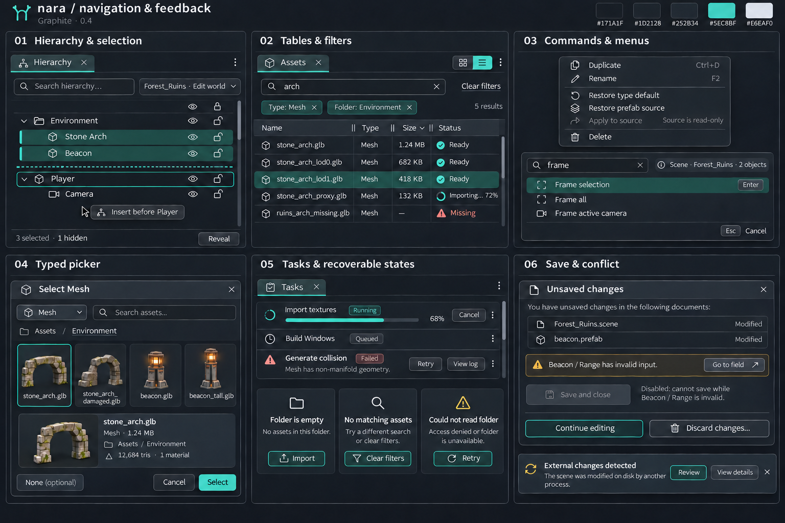

本图把层级树、数据表、命令入口、选择器和失败状态放在同一套视觉语法下比较。样本中的局部标签从所属组左侧开始；工具内部网格/列表切换使用分段控件，不伪装成可停靠标签。

| 组件 | 可见行为 | 键盘、选择与错误处理 | 复用位置 |
| --- | --- | --- | --- |
| TreeView | 展开箭头、层级缩进、选中、焦点、可见与锁定列分别表达 | 左右键展开/收起，上下键移动活动项；F2 重命名。拖入成为子项与同级插入采用不同落点。检查循环、作用域及目标存活。 | Hierarchy、骨架、目录、设置类别 |
| DataTable | 清楚表头、排序箭头、单位、列宽拖柄；数字按位对齐 | 排序、过滤和虚拟化保留对象身份；编辑缓冲绑定实体而非行号。行选择与单元格编辑采用明确的激活操作。 | 资源、Console、Profiler、任务、导入报告 |
| OrderedList | 序号、元素身份、独立拖柄、增删入口与作用范围 | 重排一次事务，Esc 取消；拖柄不能与输入框或删除按钮重叠。输入焦点内 Delete 先编辑文字。 | 构建场景、动画事件、粒子模块、音频效果链 |
| Search + FilterBar | 搜索词、作用范围、可移除条件、结果数量与清除入口 | 查询不修改内容；清除后恢复已有选择。语法无效时保留查询和错误，不伪装成零结果。 | Assets、命令搜索、Console、设置、选取器 |
| Breadcrumb | 可辨认层级、当前位置与返回入口 | 导航改变视图位置；不把浏览路径当作资源身份。路径过长可折叠中段并保留完整提示。 | 资源目录、Prefab 阶段、动画绑定 |
| SegmentedControl | 当前表示模式与其他可选模式 | 使用复合控件内方向键导航；切换表示不清掉同域选择或修改文档。不是 DockTab，没有关闭与停靠拖柄。 | 网格/列表、Dope Sheet/Curves、Local/World |

筛选隐藏已选项时，保留稳定选择，并显示“3 selected · 1 hidden”及定位/清除隐藏选择入口。可见列表不能显示两个选中行，却在没有解释的情况下宣称只选中一项。对整个选择集执行动作时清楚列出实际数量；如果动作仅作用可见项，必须明确命名和范围。

表格列宽、排序、筛选、展开和滚动属于视图状态；不进入资源内容 Dirty 或 Undo。Tree 的可见性列需要声明它修改的是编辑器临时可见性、对象启用还是渲染属性，不把三者绑定到同一模糊眼睛图标。

### 28.5 菜单、命令搜索与类型选择器

| 组件 | 打开与执行 | 取消与焦点 | 必须显示的上下文 |
| --- | --- | --- | --- |
| ContextMenu | 右键与键盘菜单入口调用同一命令集合；重命名、复制、来源恢复按语义分组 | 方向键导航、Enter 执行、Esc 关闭并归还触发者；失效目标使动作不可用 | 作用对象或数量、快捷键、禁用原因；破坏性操作与普通动作分组 |
| CommandPalette | 保留唤起时的 ActionContext；查询命令名称及可用动作 | 输入框优先接收文字；上下键选项、Enter 执行、Esc 返回；不能因菜单获得焦点就换目标 | 场景/文档、选择数量或运行目标；结果的可用条件 |
| TypedPicker | 由目标字段限定类型和作用域；搜索、浏览、预览候选后显式 Select | 单纯浏览不写回属性；Cancel/Esc 保持原引用，关闭后焦点回到字段 | 允许类型、项目或场景范围、候选身份；只有可空字段提供 None |
| Tooltip / Help | 解释图标、单位、完整路径或命令快捷键 | 不截断正常键盘流；可关闭，不能成为唯一操作入口 | 与实际绑定一致的提示；关键错误和禁用原因仍有持久可见表达 |

选择器和弹出菜单进入所属 NativeWindow 的浮层，靠近边缘时翻转或调整，不被 Inspector 的滚动区域裁切。异步查询结果带请求与作用域身份；较早查询结果不能覆盖较新查询，也不能把当前候选换成同名的另一个资源。

选择器的网格/列表只是表示切换。预览候选与已确认引用使用不同标记，避免用户误以为方向键浏览就完成赋值。确认前再次核验资源仍存在、类型兼容且绑定字段版本有效。

### 28.6 任务、空状态和失败反馈

任务行复用紧凑列表与语义状态，不要求用户始终打开任务面板。任务至少显示名称、真实阶段、目标、可取消性与结果入口；耗时无法估计时使用明确的未知进度。只有进度可测量时显示百分比。

| 状态 | 显示 | 可用动作与保留信息 |
| --- | --- | --- |
| Queued | 等待与已知的依赖或队列信息 | 可移出队列时提供取消；不能显示正在处理的虚假百分比。 |
| Running | 当前阶段、进度或未知进度、目标版本/平台 | 提供受支持的取消或查看详情；面板关闭不取消任务。 |
| Cancel requested | 已请求取消，正在等待安全停止 | 不提前显示已取消；取消请求晚于任务提交时报告真实完成结果，已确认取消或过期 generation 的结果不得写回。 |
| Completed | 完成结果及明确目标 | 可定位产物或查看记录；完成提示可短暂，记录保持可查。 |
| Failed | 失败阶段、可理解的原因、诊断入口 | Retry 或修正入口只在适用时提供；重试明确是否采用新输入版本。 |
| Empty | 当前目录或集合为空 | 提供适用的新建/导入动作；不使用巨幅插画挤占工具空间。 |
| No results | 当前条件没有匹配项 | 保留搜索词，提供清除条件；不把它当读取失败。 |
| Unavailable / Error | 连接、权限、文件或插件错误 | 说明上下文并提供重试、定位或日志；可保留已有内容，但明确其过期状态。 |

错误不能只靠 Toast 存在几秒后消失。失败、冲突、导入与构建诊断保留可再次打开的记录，并能定位到实际资源和版本。重试、复制诊断与定位资源分别使用可发现的动作。

### 28.7 对话框与未保存修改

普通编辑优先在原字段附近说明错误。模态对话框用于确实需要暂停当前流程并做出决定的情境，例如关闭带未保存内容的文档；标题说明操作，正文列出对象和影响，按钮使用“保存并关闭”“继续编辑”等具体动词。

未保存对话框由统一文档服务提供内容，包括没有可见主标签的资源和待提交输入。无效输入显示所属文档、对象与字段，并提供定位入口；不能在字段无效时显示“全部保存成功”。单文档无法保存时，可以完成其他有效文档的保存，但结果必须说明哪些未完成。

“放弃本次未提交输入”与“丢弃文档全部修改”分别命名。对话框中不能用一个 Discard 按钮让用户猜测范围。放弃整份修改需要清楚列出涉及文档；默认焦点不放在不可恢复的破坏性动作上。取消关闭保留相关视图；先前已经成功保存的文档可以保持已保存。

对话框限制自身焦点，Esc 按该流程定义返回或取消；IME 和最上层局部交互仍先处理。错误文本允许复制，长文件名可展开查看，主要动作在系统缩放和窄窗口下保持可达。

### 28.8 同一组件在不同工具中的复用

| 工具 | 可直接复用的组件 | 必须额外显示的业务上下文 |
| --- | --- | --- |
| Scene / Inspector | Tree、Vector、Checkbox、Asset/EntityField、来源标记 | 文档、编辑世界、Prefab 阶段、多选对象数量 |
| Assets / Import | Search/Filter、Table/Grid、TypedPicker、任务与诊断 | 源资源、导入产物、输入版本、平台覆盖与待重导入状态 |
| Animation | Tree、Timeline/Curve、Range、Enum、事件列表 | 片段、目标骨架、时间单位、播放头、预览/录制/内容修改的区别 |
| Profiler / Console | DataTable、筛选、范围选择、诊断详情 | 捕获会话、帧范围、线程/设备、时间单位；列表刷新不夺走当前选择 |
| Project Settings / Input | 分类树、枚举、flags、列表、BindingCapture | 设置作用层、平台或项目范围、配置冲突、需要重启或重载的原因 |
| Build / Tasks | 有序场景列表、目标选择、路径字段、任务与错误汇总 | 构建配置、目标平台、输入快照、输出产物与取消阶段 |
| Particle editor | 数值范围、Curve、Gradient、模块列表、预览工具栏 | 预览会话、随机种子、单位、模拟空间、Normalized age 的含义 |
| Audio tools | Numeric/Slider、Curve、AssetField、效果链列表、表格 | 总线或事件、dB/Hz/距离单位、监听目标、静音/独奏/旁通作用范围 |

### 28.9 组件验收情境

| 编号 | 情境 | 通过条件 |
| --- | --- | --- |
| C01 | 多选三个对象，只编辑混合的 X，再撤销 | 各对象 Y/Z 不变，X 修改范围明确，撤销恢复各自原值。 |
| C02 | 来源覆盖字段输入无效内容并获得焦点 | 来源、错误和焦点同时可辨；无效缓冲保留，模型与来源信息不被覆盖。 |
| C03 | 资源经历 Empty、Assigned、Pending、Missing | 四种显示和允许动作可区别，暂未就绪与丢失都不自动清空引用。 |
| C04 | 编辑列表元素时排序、过滤或后台插入其他行 | 控件仍绑定同一对象/元素，选择和缓冲不跳到新的行号。 |
| C05 | 选择器浏览候选后 Esc；再次打开确认候选 | 首次不产生内容修改，第二次确认只产生一次引用事务并重新验证候选。 |
| C06 | 曲线拖动、渐变预览期间取消或遇到外部版本变化 | 普通取消恢复自身预览；版本冲突不把过期原值写回，处理入口可见。 |
| C07 | 筛选隐藏部分选择后执行批量操作 | 显示可见/隐藏数量，操作对象可解释；不悄悄改变范围。 |
| C08 | 运行中关闭任务面板，任务随后失败 | 任务继续由服务管理，失败记录与目标仍可达，重新打开能查看和定位。 |
| C09 | Inspector 隐式修改资源，另一个字段还存在无效输入，然后退出 | 未保存清单包含全部相关文档与输入，不能漏掉没有标签的资源或报告全部已保存。 |
| C10 | 工具切换、移动到另一 DockGroup 或另一 DPI 窗口后调用菜单 | 组件语义、焦点和绑定保持正确，菜单出现在所属窗口，局部导航不变成全局标签。 |

## 29 场景编辑、Hierarchy 与多对象 Inspector

### 工作任务与布局

本工具用于搭建场景、组织实体和批量调整组件。示例在 `Forest_Ruins.scene` 中同时选择来自 `beacon.prefab` 的 `Beacon_A` 与 `Beacon_B`；树、场景选中轮廓与 Inspector 的对象数量应对应。图中的 Intensity 为示例相对强度 `4.00`、来源值为 `2.00`，Range 为 `6.00` 个场景长度单位。这些是示例值，不是引擎默认值；两个实例共享来源不代表它们的全部属性相同。

| 区域 | 主要内容 | 复用组件 |
| --- | --- | --- |
| Hierarchy | 场景根、实体层级、搜索、可见性、选择集合与活动项 | Tree、SearchField、ContextMenu、SelectionSummary |
| Scene | 视角、编辑世界、坐标空间、枢轴、吸附、Gizmo | ViewToolbar、Select、Toggle、NumericField、ViewportOverlay |
| Inspector | 多选范围、来源、共同组件和混合值 | PropertyRow、ComponentSection、VectorField、ColorField、AssetField |
| Assets | 场景常用资源与放置入口 | Breadcrumb、AssetGrid、Filter、DragPreview |

每个外层组的标签从本组左边缘开始。`Local/World`、`Pivot/Center`、投影和吸附属于 Scene 工具栏；它们不再绘制成全局文档标签。对象选择与键盘焦点分别呈现。

### 可见行为与状态

多选标题持续显示对象数量。共同属性相同则显示数值，不同则显示 `—`；混合值不能按零处理。输入某个轴只替换该轴；相对拖动遵循第 07 章，取消时恢复各对象原值。存在只读、不兼容或缺少组件的对象时，显示实际作用数量与排除原因，不悄悄为对象添加组件。

来源覆盖使用独立的标记与 `Overrides` 入口。该入口先展示属性、实例值和来源值；“恢复来源”与“恢复类型默认”分开。应用到来源必须指出将写入的 prefab；多个实例值不同时不能猜测应采用哪一个。涉及多个文档时遵循第 22 章的协调能力，未支持时明确限制操作。

Hierarchy 拖放显示“同级插入”或“成为子项”的不同预览；不合法的父子循环给出原因。资源拖入 Scene 时，预览显示将创建的内容和归属场景，释放后才提交。Gizmo、属性字段与层级操作使用相同的撤销规则，一次手势产生一次修改记录。

相机、网格、显示辅助和折叠状态属于视图状态。对象变换、组件和实例覆盖属于创作内容。锁定状态使用能区分开锁与闭锁的反馈；闭锁对象不得一面显示为禁止修改，一面提供无说明的可编辑字段。Inspector 固定后持续显示文档、世界与对象来源；选择别的资源不会改绑固定目标。

| 需要实现的其他状态 | 呈现与动作 |
| --- | --- |
| 无选择 | 保留场景上下文，显示选择对象的提示；不沿用上一个对象的可编辑字段 |
| 来源资源缺失 | 保留实例和来源身份，显示缺失及定位/修复入口 |
| 部分对象只读 | 显示可编辑数量与原因，提交前明确本次实际范围 |
| 固定目标已删除 | 显示失效绑定，允许解除固定或重新选择；不按同名重绑 |

这些状态用于实现覆盖，不要求在同一张图中同时出现。验收重点是：两只对象的选择一致、混合轴编辑不影响其他轴、覆盖来源与未保存状态可区分、取消操作能恢复每个原值。

## 30 资源浏览、Importer 与依赖检查

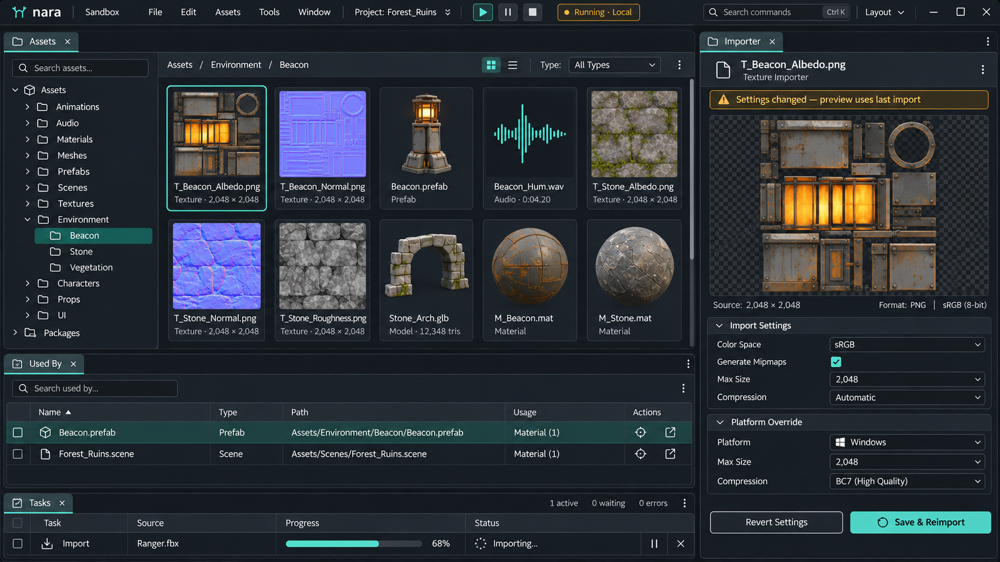

### 工作任务与布局

本工具用于找到资源、检查源数据、编辑导入设置并追踪使用位置。示例选择 `T_Beacon_Albedo.png`，旁边的 Importer 显示同一资源；资源网格、源文件、导入设置和生成预览有各自明确的角色。

| 区域 | 主要内容 | 复用组件 |
| --- | --- | --- |
| Assets | 文件夹树、面包屑、类型/标签过滤、网格与列表 | Tree、Breadcrumb、SearchField、FilterChip、AssetGrid、DataTable |
| Importer | 源信息、导入参数、平台继承与覆盖 | PropertyRow、Select、Checkbox、NumericField、OverrideIndicator |
| Preview | 最近有效产物、缩放、通道/透明背景查看 | PreviewToolbar、ZoomControl、ChannelToggle、StateBanner |
| Used By / Dependencies | 引用方向、资源名称、类型与定位 | DependencyList、DataTable、AssetField、LocateAction |
| Tasks | 当前导入与结果 | TaskRow、Progress、DiagnosticRow |

网格与列表切换保留同一个选择集合；筛选和排序不按行号重新绑定选择。过滤导致选中资源暂时不可见时，可以显示“已选资源不在当前结果中”，并提供定位或清除条件，不能自动选择另一项。

### 设置、预览与导入的关系

源尺寸与格式为只读信息。颜色空间、Mipmaps、最大尺寸和平台覆盖为可编辑配置；平台值要能区分继承值与覆盖值。多选导入仅合并语义兼容的参数，其余显示数量和不可用原因。

设置尚未导入时，显示 `Settings changed — preview uses last import` 或等价提示。预览应能查看其来源版本和目标平台；它仍可用于观察最近有效结果，但不能暗示已应用新设置。

`Save & Reimport` 先校验并保存目标配置，再以明确版本提交导入任务。非法输入阻止该目标继续执行；后台任务失败不撤销已明确完成的配置保存，也不伪装为导入成功。`Revert Settings` 恢复最后保存的配置，和“恢复默认参数”“查看上次导入配置”分别命名。

源文件或设置在任务期间变化时，旧结果不能覆盖当前版本。导入失败保留最近有效产物，并显示过期状态、失败原因与重试入口。任务由项目服务追踪，关闭 Importer 不会丢失结果。图稿中本地运行可同时继续；Save & Reimport 不隐式重启运行，活动运行会话采用哪个产物版本由明确的热重载策略决定。

| 状态 | 必须可见的差异 |
| --- | --- |
| 缩略图未就绪 | 类型占位仍可选择，名称与操作保持可用 |
| 源文件丢失 | 保留身份与引用位置，显示修复入口；与空目录不同 |
| 配置已改、未导入 | 配置的 Dirty 与预览的旧版本同时可辨认 |
| 导入失败 | 持久诊断及重试；最近有效预览明确标为旧结果 |
| 批量导入部分失败 | 按资源报告结果，不以整体绿色状态掩盖失败项 |

`Used By` 回答谁引用当前资源，`Dependencies` 回答当前资源依赖谁；切换方向必须有明确标题。定位跳转按稳定身份执行，资源移动后仍能打开正确对象。验收重点是源信息、可编辑配置和派生产物不会相互混淆。

## 31 动画片段、关键帧、事件与姿态预览

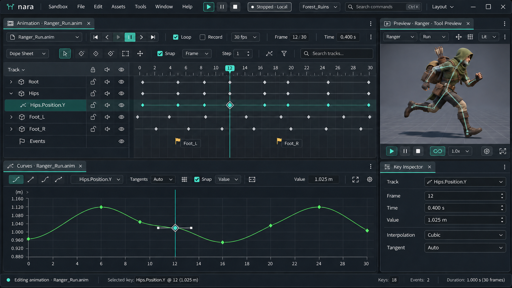

### 工作任务与布局

本例扩展第 20 章的动画规则，用 `Ranger_Run.anim` 展示片段关键帧、脚步事件和角色姿态。Animation 是主要文档视图，Curves、Preview 和 Key Inspector 可以作为显式绑定的辅助停靠视图。当前图采用独立 Curves 组，沿用同一外层停靠框架，标题或上下文栏明确其文档与通道。Dope Sheet 仍是 Animation 内部的表示选择；同一工具也可以提供不拆出的局部曲线模式。

| 区域 | 主要内容 | 复用组件 |
| --- | --- | --- |
| Clip Toolbar | 片段、播放范围、预览播放、循环、录制、吸附 | Transport、Toggle、TimeField、NumericField、Select |
| Track Tree / Dope Sheet | 骨骼或对象路径、属性通道、关键帧、事件 | Tree、TimelineRuler、KeyMarker、EventMarker、RangeSelection |
| Curves | 当前数值通道、关键帧与切线 | CurveEditor、AxisLabel、ZoomControl、FrameSelection |
| Key Inspector | 时间、值、插值与切线模式 | PropertyRow、TimeField、NumericField、Select |
| Pose Preview | 当前时间的目标角色与预览环境 | ViewToolbar、AssetField、Transport、ViewportOverlay |

### 示例数值与行为

示例按 `30 fps` 显示，范围 `0–30 f`；播放头为 `12 f`，读数为 `0.400 s`。选中 `Hips.Position.Y` 的关键帧，值 `1.025 m`；插值为 `Cubic`，切线为 `Auto`。本示例选中键与预览时间恰好都在第 12 帧；一般情况下两者独立，Inspector 的时间来自选中键，播放头来自预览时间。它们必须采用同一时间基准，不能要求选键就强制移动预览。曲线画布本例只显示该位置通道，纵轴明确使用米。

独立 Curves 视图与 Animation 共享 `Ranger_Run.anim` 的内容和 Undo，导航与缩放独立；本布局显式连接到同一工具预览上下文。复制视图时是否连接该预览由明确选项决定，不能仅因共享文档就隐式共享所有播放状态。

选择关键帧不会自动把任意属性编辑变成录制。Record 为持续可见的显式模式，并显示录制目标范围；普通预览、相机操作和查看属性不会创建关键帧。拖动播放头默认只求取姿态；有副作用的事件需要独立、受控的事件预览开关。

时间吸附与数值吸附分别设置。框选后移动多个关键帧保留相对间隔；覆盖、重叠、越界与锁定轨道有明确处理。一条拖动事务可整体撤销，Esc 恢复原时间和值。切换帧/秒显示不重采样动画；若确需改变采样数据，应使用单独命令。

脚步事件与连续数值关键帧采用不同形状或图标。事件编辑显示事件身份、时间、参数与目标；缺失处理器或无效参数会定位到事件，不能被普通曲线键覆盖。重命名轨道不改变其绑定身份。

| 状态 | 呈现与动作 |
| --- | --- |
| 导入片段不可直接编辑 | 显示只读来源与创建可编辑副本入口 |
| 骨骼或属性绑定失效 | 轨道保留路径与身份，显示修复/重绑；不默默删除键 |
| 轨道锁定 | 可选择与检查，但批量移动排除并提示 |
| 录制启用 | 持续显示录制指示、范围和待写属性；与预览播放区分 |

Ranger 姿态预览属于工具预览上下文，和完整游戏运行独立。播放速度、预览时间、相机与视图缩放不让片段 Dirty；关键帧、事件和资源内曲线修改会产生内容历史。验收首先核对时间单位、目标通道、录制范围以及事件预览的副作用边界。

## 32 Profiler 捕获、Console 与诊断详情

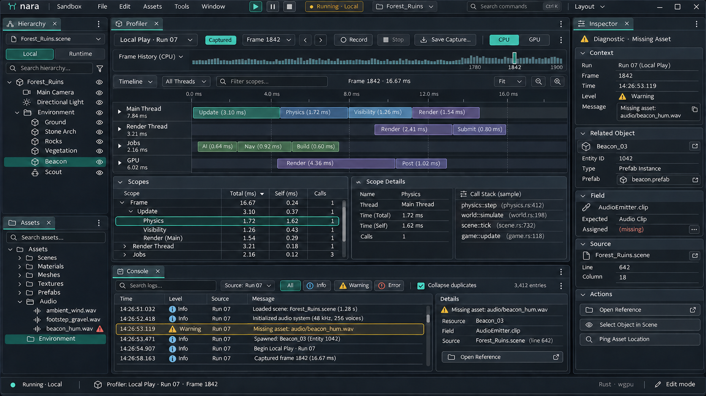

### 工作任务与布局

本工具用于定位一次运行中的性能区段与错误。设计示例绑定 `Local Play · Run 07`，Profiler 查看一次已完成捕获，Console 显示同一会话的日志。图中的轨迹、波形、耗时和计数为界面示例，不是 nara 的性能测量结果。

| 区域 | 主要内容 | 复用组件 |
| --- | --- | --- |
| Capture Toolbar | 目标、连接、采集/捕获状态、范围、保存与载入 | TargetSelect、RecordControl、StatusBadge、RangeControl |
| Frame / Thread View | 帧选择、线程区段、任务层级 | RangeSelection、TimelineRuler、SpanRow、Tooltip |
| Scope Table | 名称、总耗时、自身耗时、调用数 | TreeTable、SortHeader、NumericCell、SearchField |
| Console | 时间、严重级别、来源、重复数与消息 | Filter、DataTable、DiagnosticRow、VirtualList |
| Details | 原始消息、资源/字段位置、调用栈与定位动作 | ReadOnlyText、LocationLink、CopyAction、ContextMenu |

### 采集与选择

`Live`、`Recording`、`Captured` 和 `Disconnected` 必须区分。查看历史捕获时持续显示其目标、时间范围和版本；切换当前运行会话不把旧捕获的标签改成新会话。选择某一帧只改变查看位置，不重新运行或回放游戏。

CPU 线程区间、GPU 时间和任务关联采用采集器提供的语义。缺乏可靠时钟对齐时分区展示并说明，不能仅凭图形把独立时钟当成同一时间轴。`Total`、`Self` 和 `Calls` 在表头帮助中解释口径；异步区段缺失或采样未完成时显示未知状态，不能补成零。

捕获可以由服务在后台完成；关闭 Profiler 不删除正在采集或已保存的记录。修改过滤、排序、缩放和所选帧不修改场景。当前工具是否能开始或停止采集，应由目标连接与采集能力决定。

### 日志、定位与错误恢复

示例选中 `Missing asset: audio/beacon_hum.wav`，详情指出 `Forest_Ruins.scene` 中 `Beacon_03` 的 `AudioEmitter.clip`。定位操作先校验记录对应的目标仍有效；过期位置可显示原版本或说明无法直接跳转，不打开另一个同名对象。

Console 的来源过滤持续可见，严重级别过滤与文本搜索分别处理。重复折叠至少考虑来源、位置和消息身份，保留次数及首次/末次时间；不同运行会话不能只因文字相同就合并。`Clear View` 清理当前显示范围，不删除任务失败或构建结果的事实记录。

| 状态 | 呈现与动作 |
| --- | --- |
| 无捕获 | 说明可选择目标并开始采集，显示受支持能力 |
| 目标断开 | 保留已收到数据与明确断开时间；禁用依赖连接的动作 |
| 捕获不完整 | 标识缺失范围和原因，未知数据不显示为零耗时 |
| 诊断位置过期 | 保留原消息与身份，提供原版本查看或重新定位说明 |

如提供运行控制台输入，它必须显示将接收命令的实时会话；历史捕获页不能凭最后一次选择暗中获得修改运行世界的能力。验收重点是“记录属于谁、是否实时、能跳到哪里”始终可判断。

## 33 项目设置与 Input Action 编辑

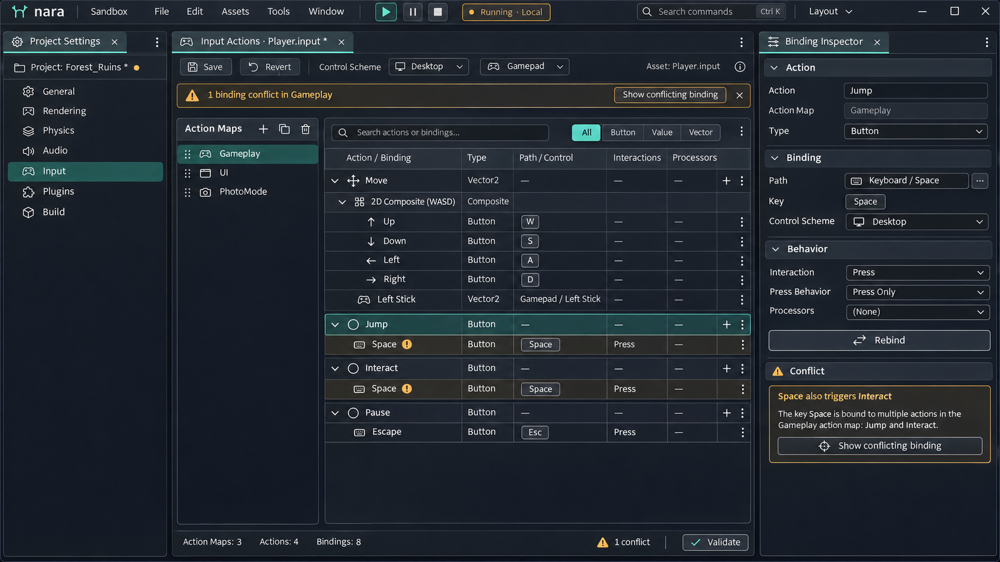

### 工作任务与布局

本工具用于管理项目级输入动作、控制方案与绑定。Project Settings 提供分类导航，`Input Actions · Player.input` 明确指出正在编辑的资源，Binding Inspector 绑定所选动作或绑定项。项目配置、本机偏好和运行时重绑定记录采用不同作用域。

| 区域 | 主要内容 | 复用组件 |
| --- | --- | --- |
| Settings Navigation | 分类、搜索、项目/本机作用域 | Tree、SearchField、ScopeBadge |
| Action Maps | Gameplay、UI、PhotoMode 等动作集合 | List、AddMenu、RenameField、ContextMenu |
| Actions / Bindings | 动作类型、绑定、复合输入与设备方案 | TreeTable、TypeBadge、Keycap、Select、ReorderHandle |
| Binding Inspector | 设备、控制路径、交互、处理器和参数 | PropertyRow、EnumSelect、AssetField、NumericField |
| Validation | 冲突范围、类型问题、定位动作 | StateBanner、DiagnosticRow、LocationLink |

### 动作、绑定与冲突

动作类型与物理控制分开表达。`Move` 为 Vector2，可由 WASD 复合输入或手柄摇杆产生；`Jump` 为 Button，其交互和处理器必须适用于按钮。复合绑定的 Up/Down/Left/Right 子项有明确语义与稳定身份，表格排序不能改变它们的方向。

示例中 Gameplay 内的 Jump 与 Interact 都使用 Space。冲突提示指出两个动作及相同控制，并提供跳转；判断还需要考虑控制方案、设备、绑定上下文和是否同时启用。重复键可以是明确的共享设计，不能把所有跨 Map 重复都判成错误，也不能自动删除其中一个绑定。

`Rebind` 进入有明确目标的暂态捕获模式，显示“正在为哪个动作监听”、候选输入与取消入口。开始监听时排除仍被按住的启动输入；模拟轴使用阈值与释放条件。Esc、失焦、目标失效或关闭监听入口会结束捕获，不吞掉宿主保留的释放路径。确认后才产生一次可撤销的绑定修改。

键盘绑定应能说明使用物理位置还是逻辑按键语义，显示名称随布局变化不改变稳定控制标识。长控制路径可省略显示，但完整路径可查看和复制。

### 保存与其他状态

动作、绑定、参数和控制方案属于 `Player.input`；树展开、搜索、选择和正在监听的候选属于视图状态。切换设置分类不丢失未保存的输入资源，也不把动作值写入本机偏好。选择当前绑定后，Inspector 与 Undo/Save 必须指向同一资源。

图稿同时显示本地运行中与输入配置草稿，这是一种允许的并行工作状态。保存更新创作资源，不会无提示地替换活动 RunSession 使用的输入快照。若支持 `Apply to Running`，它是带目标会话与版本的显式动作：结束监听、释放旧按键/动作状态后，由运行桥接确认应用或解释失败；不支持时明确提示下次启动采用新配置。

| 状态 | 呈现与动作 |
| --- | --- |
| 正在监听 | 目标、已捕获候选、确认/取消与监听状态持续可见 |
| 设备未连接 | 保留绑定路径与类型，可编辑；测试能力给出不可用原因 |
| 类型不兼容 | 定位动作/处理器，保留输入；不自动转换或替换 |
| 共享绑定 | 显示冲突范围与用户的明确处理结果，不伪装为已自动解决 |

验收重点是动作与物理键的区分、复合输入的层级、冲突的实际范围，以及监听不会把输入泄漏到 Scene 或 Game。

## 34 粒子模块、曲线与效果预览

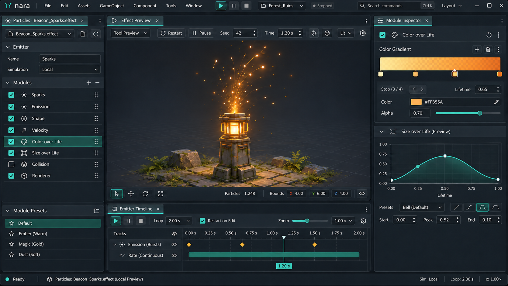

### 工作任务与布局

本工具使用模块栈编辑 `Beacon_Sparks.effect`，展示与节点图不同的创作方式。艺术家通过发射、形状、速度、生命周期颜色、尺寸、碰撞与渲染模块调节火花；画面中心是独立效果预览。Effect Preview、Emitter Timeline 与 Module Inspector 是绑定该效果或其预览上下文的辅助视图；外层组始终有矩形边界，不跨入另一停靠组形成重叠区域。

| 区域 | 主要内容 | 复用组件 |
| --- | --- | --- |
| Emitter / Modules | 发射器、模块顺序、启用、选择和增加入口 | Tree、ReorderableList、Checkbox、AddMenu |
| Effect Preview | 独立预览世界、相机、边界与效果显示 | ViewToolbar、Transport、ViewportOverlay、StatusBadge |
| Module Inspector | 数值、随机范围、资源、颜色与曲线 | PropertyRow、RangeField、AssetField、GradientEditor、CurveEditor |
| Preview Timeline | 当前时间、预览区间、重播和种子 | TimeField、RangeControl、SeedField、Toggle |

### 编辑与预览范围

模块折叠、模块启用、模块删除是三个不同动作。关闭启用保留参数；重排要校验阶段与依赖，只允许有明确执行语义的位置。被拒绝的落点说明原因。模块参数、顺序和启用状态进入效果资源的内容历史。

示例选择 `Color over Life`。Inspector 显示归一化生命周期 `0–1` 的颜色与透明度变化；所选 stop 的位置 `0.65` 表示单个粒子寿命的 65%，不等于预览世界的 `1.20 s`。颜色、Alpha 和 HDR 强度分别有可理解的字段，沿用第 07 章的颜色空间契约。

示例 stop 的颜色为 `#FFB55A`，Alpha 为 `0.70`。移动、增加、删除 stop 或曲线键形成统一事务；键具有稳定身份，重排不使 Inspector 绑定到另一键。必需端点和允许的键顺序由属性类型定义，越界输入保留校验信息，不能静默改为另一个值。

预览工具栏明确标识 `Tool Preview`，拥有自己的 Restart、Pause、时间和测试种子。测试种子与资源中需要保存的随机策略分别命名；调整预览相机或测试时间不改变资源。`Restart on Edit` 明确决定修改后是否重置预览，不把重置隐藏在任意字段操作中。

粒子资源是否循环发射与编辑器是否循环查看某个时间范围分别控制。示例的 `0–2.0 s` 是可见预览范围；没有明示的操作不能据此改变发射器的正式时长。拖动播放头只改变预览时间，拖动 Burst 标记则编辑资源中的发射时序；两种目标有独立命中与选中反馈。

| 状态 | 呈现与动作 |
| --- | --- |
| 模块禁用 | 参数保留并显示禁用原因/状态，允许重新启用 |
| 材质或网格缺失 | 资源引用保留身份，预览显示可定位的诊断 |
| 预览重建中/失败 | 区分正在更新、旧有效预览与失败，不把旧画面标成最新 |
| 达到粒子容量 | 显示当前容量和实际限制，诊断可查看，不伪造完整模拟 |

验收重点是模块选择与 Inspector 一致、寿命比例与预览秒数不混淆、预览操作与资源修改分开，以及一次曲线或渐变拖动可整体撤销。

## 35 音频混音、总线与事件试听

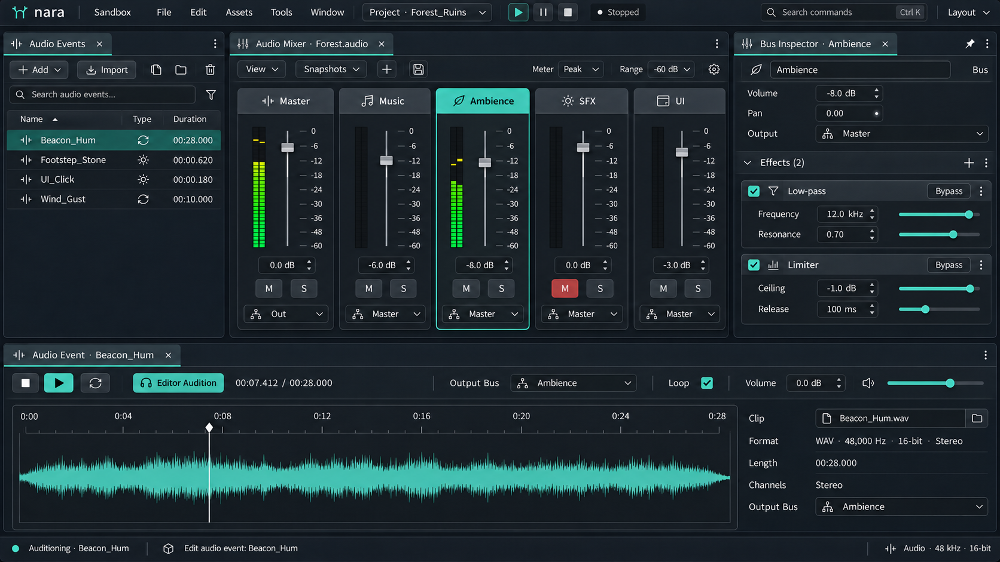

### 工作任务与布局

本工具用于调整混音总线、效果链和声音事件。示例在 `Forest.audio` 中选择 Ambience 总线，并通过 `Beacon_Hum` 事件试听其结果。总线资源与声音事件分别拥有明确的编辑目标；试听状态由工具预览管理。

| 区域 | 主要内容 | 复用组件 |
| --- | --- | --- |
| Audio Events | 事件搜索、类型、资源与缺失状态 | SearchField、List、AssetField、StatusBadge |
| Audio Mixer | 总线名称、推子、增益、峰值、路由、试听 M/S | ChannelStrip、Fader、LevelMeter、NumericField、Toggle |
| Bus Inspector | 当前总线、效果链与参数 | ComponentSection、PropertyRow、ReorderableList、NumericField |
| Event Preview | 波形、片段引用、输出总线、循环与试听位置 | WaveformView、AssetField、Transport、TimeField、Select |

### 增益、静音与路由

推子与数值字段共同编辑增益，并显示 dB 单位；零 dB 不能画成“静音”。峰值、电平和削波是测量/预览反馈，和保存的增益分别呈现。持续削波标记有清除峰值的动作；清除显示历史不改变声音数据。

示例 Ambience 增益为 `-8.0 dB`，输出到 Master，右侧固定的 Bus Inspector 也显示 Ambience。Master、Music、Ambience、SFX、UI 的通道布局相同；总线增删不需要重新发明另一套属性编辑器。

在 `Editor Audition` 模式下，通道 M/S 分别表示试听静音与试听独奏，属于试听过滤，不改写正式路由或增益。需要保存的总线启用或效果 bypass 通过明确的资源字段编辑。模式、提示和可访问名称要能区分这些动作，不能只依靠按钮颜色。

改变路由时显示目标总线并校验循环与能力约束。效果顺序、参数和持久启用状态属于混音资源；未知效果保留数据与来源说明，不能因插件缺失被保存操作删除。示例效果链为 Low-pass 与 Limiter，其数值仅用于界面设计。

### 事件与试听

`Beacon_Hum` 的片段引用为 `Beacon_Hum.wav`，输出总线为 Ambience；事件视图提供独立的试听、停止、循环与位置控制。当前试听输出设备和 `Editor Audition` 标识可见，游戏的 Play 保持独立。波形和电平图仅示意控件形态，不代表实测声音。

| 状态 | 呈现与动作 |
| --- | --- |
| 片段缺失 | 保留事件与引用，说明缺失位置；试听不可用但配置仍可检查 |
| 输出设备失效 | 显示设备与失败原因，保留编辑内容并提供重新选择 |
| 试听静音/独奏 | 状态持续可见，可一键清除试听过滤；不改变保存的增益 |
| 效果不受支持 | 只读占位与诊断；原始参数不丢失 |

推子一次拖动形成一条内容撤销；试听进度、电平、峰值历史和波形缩放不进入内容历史。固定 Bus Inspector 与事件编辑可以同时存在，Save/Undo 按实际操作的文档解析。验收重点是 dB、静音、solo、bypass 的含义清楚，以及声音事件确实经过其显示的总线。

## 36 构建配置、任务阶段与失败处理

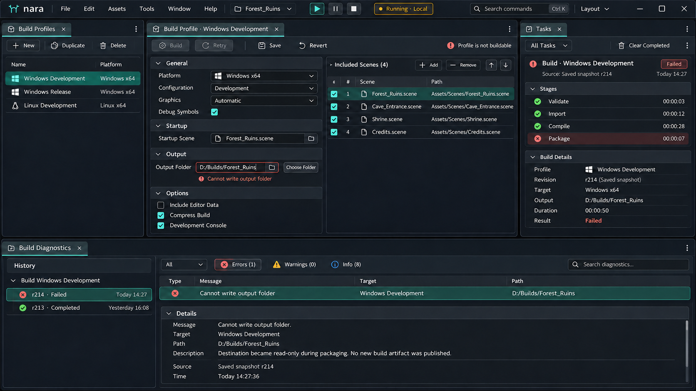

### 工作任务与布局

本工具用于配置构建目标、检查输入快照、跟踪阶段并处理失败。示例选中 `Windows Development`；Build Profile、Tasks 与 Build Diagnostics 都明确指向该配置与同一次任务。

| 区域 | 主要内容 | 复用组件 |
| --- | --- | --- |
| Build Profiles | 配置列表、复制、重命名、目标与能力 | List、TypeBadge、AddMenu、ContextMenu |
| Profile Editor | 平台、配置、图形选择、符号、场景与输出 | PropertyRow、Select、Checkbox、SceneList、PathField |
| Tasks | 输入快照、阶段、状态、进度、取消与结果 | TaskRow、StageList、Progress、StatusBadge |
| Build Diagnostics | 错误、目标、路径、来源与修复动作 | DiagnosticRow、LocationLink、ReadOnlyText、ActionRow |
| History / Artifacts | 历次尝试、版本、产物与可用动作 | DataTable、RevisionBadge、ArtifactLink |

### 构建输入与操作边界

配置需要指明平台、构建类型、入口场景、所含资源或场景、输出策略及相关工具链能力。共用的项目配置与本机路径偏好区分；绝对路径示例是可见的本机输出位置，不应不加区分地进入团队共享默认值。

存在未保存内容时，入口明确选择“保存后构建”“使用已保存版本”或受支持的编辑快照。开始后冻结并展示当次输入；示例标识为 `Saved snapshot r214`。编辑器随后产生新修改，不改变正在运行任务所声称的输入版本。

每次尝试有独立任务与结果。Retry 预填上次意图，但执行时仍创建新任务并冻结当次配置；若允许复用旧资源快照，应明确标识复用范围。不能把改过路径或目标的新尝试写回旧任务记录。

图稿中的既有本地运行可以与构建并行。该 RunSession 使用自己的启动快照；构建失败不会自动停止它，构建成功也不会无提示地把它替换成新产物。运行工具栏与构建结果分别显示各自状态。

### 阶段与失败图稿

图稿示例中 Validate、Import、Compile 已完成，Package 因 `Cannot write output folder` 失败。输出字段与诊断显示同一路径，并提供 `Choose Folder`；校验未解决前 Build/Retry 不可用。失败任务未发布新的可运行产物，因此不能亮起 `Run Artifact`。

历史成功记录可继续查看，但必须带自己的版本与目标，不能作为当前失败尝试的绿色完成状态。输出目录选择、配置保存、构建完成与启动产物分别反馈。

| 状态 | 呈现与动作 |
| --- | --- |
| 排队/执行中 | 当前阶段与实际进度；未知总量使用不定进度，不虚构百分比 |
| 请求取消 | 与已取消分开；收尾期间解释当前状态 |
| 部分任务失败 | 每个目标保留独立结果，依赖阶段标明未执行或被跳过 |
| 构建失败 | 持久诊断、原因、可定位路径与适用的重试动作 |
| 构建成功 | 结果绑定目标与输入版本，验证产物存在后提供打开/运行入口 |

关闭 Tasks 或切换布局不会取消任务。配置修改进入文档历史，构建任务与外部产物不会被普通 Undo 伪装成已回滚；撤销配置不意味着撤销已经执行的构建。验收重点是目标、快照、阶段、失败原因和可用产物之间一致。

### 本轮工具图的使用边界

八张工具图用于验证同一套组件与 docking 规则能否适应不同创作任务。表格中的其他状态是后续实现要求，不代表每张图已画出所有状态。图中的追踪数据、音频波形、粒子计数和示例资源均为设计内容；精确行为仍按本文及 v0.3 的基础契约实现和验收。

## 37 组件复用、覆盖范围与实施验收

本轮以不同任务检验同一套组件。相同的数据语义复用相同操作规则；场景视口、动画时间轴、性能采集轨道和音频推子保留各自的专用表达。复用的目标是让用户能迁移操作经验，并让插件与内建面板采用同一条校验和事务路径。

### 组件与工具的对应关系

| 组件族 | 本轮主要使用位置 | 必须保持一致的规则 |
| --- | --- | --- |
| PropertyRow / ComponentSection | Inspector、Importer、项目设置、粒子模块、音频效果、构建选项 | 标签、单位、帮助、来源与校验位置稳定；折叠与启用分开 |
| Numeric / Vector / Range | Transform、动画关键帧、粒子参数、音量与构建参数 | 非法文本保留；手势一次事务；单位明确；多选逐目标恢复 |
| Enum / Flags / Toggle | 导入格式、输入动作类型、粒子模式、音频开关、构建选项 | 稳定值与显示名分开；混合值和未知值可解释；禁用给出原因 |
| Asset / Entity Reference | 场景组件、导入预览、动画绑定、粒子材质、音频片段、构建场景 | 空值与丢失分开；保留引用身份；拖放先验证；定位不改值 |
| Tree / List / Table | Hierarchy、资产目录、动画轨道、日志、输入绑定、任务步骤 | 稳定行身份；排序过滤保持选择；结构修改才产生内容事务 |
| Search / Filter / Picker | 组件选择、资源查找、日志检索、设置搜索、命令与绑定选择 | 查询与选中对象分开；异步结果校验请求；空结果可恢复条件 |
| Curve / Gradient | 动画、粒子生命周期、音频效果参数 | 轴、单位、时间或生命周期域可见；精确字段与手柄共享数据路径 |
| Toolbar / Segmented Control | 投影、列表/网格、Dope Sheet/Curves、性能表示、预览模式 | 局部表示切换与 DockTab 分开；视图设置不使内容 Dirty |
| Menu / Command Palette | 所有工作区 | 同一命令身份与可用性；文本编辑优先；执行前重新核对目标 |
| Task / Diagnostic / Empty State | 导入、性能采集、日志、设备、粒子编译、音频加载、构建 | 真实来源和状态；失败可查询；取消不等于完成；重试目标明确 |
| Confirm / Resolve Dialog | 丢失引用修复、输入冲突、未保存配置、构建前置问题 | 展示影响与作用范围；取消保留工作；不为普通可撤销编辑增加确认 |

### 图片与规范的覆盖边界

C01 / C02 是组件及状态示例图板，每个小区块可以展示不同控件状态，不能按单一运行现场解释。T01–T08 是八个独立工作情境的概念截图；每张图只展示一个可读的任务截面，未画出的加载、错误、冲突和恢复状态由对应章节定义。

性能轨道、曲线、粒子分布、音频电平与任务进度只用于设计信息层级。用户必须能在真实实现里追溯读数来源、单位、时间和目标，不能把图中的示例数值转成引擎默认值、产品上限或性能承诺。

第 28–36 章对图中可见状态与规范补充作区分。具体标签、示例资源和小数值可随实际项目变化，状态关系与操作行为需要保持一致。

### 新增实施验收情境

下表是后续实现验收目标，本轮视觉检查不代表这些交互已经运行。

| 编号 | 操作情境 | 通过条件 |
| --- | --- | --- |
| V04-01 混合值 | 多选两个 Transform，只修改 X，再撤销；同时让其中一个对象变为只读 | 仅改可编辑目标的 X；保留各自 Y / Z；作用数量与排除原因可见；撤销恢复各自原值 |
| V04-02 非法输入与保存 | 在粒子数值或输入设置字段输入非法文本后保存，再切换面板 | 非法缓冲不被清空或写零；保存说明阻塞目标；切换后能继续修正；焦点与校验标记同时存在 |
| V04-03 来源状态 | 修改 Prefab 实例字段并保存，再恢复来源值 | 保存只清文档 Dirty；来源覆盖标记继续存在；恢复来源与恢复类型默认分开 |
| V04-04 丢失引用 | 删除被音频事件或粒子组件引用的资源，拖入错误类型后重新定位正确资源 | 保留失效身份；错误拖放不修改引用；修复动作可撤销；空值与丢失状态可辨认 |
| V04-05 集合稳定性 | 过滤资产列表、改变排序、异步载入缩略图，再执行选中资源的菜单命令 | 选择依赖稳定身份；命令不误作用到同一行号的新资源；查询与选中集合可分别恢复 |
| V04-06 导入草稿 | 修改导入设置、预览、Apply；随后在新版本请求后让旧导入结果返回 | 草稿、已保存设置和已生成产物分别可见；旧结果不覆盖新版本；失败保留上一次可用产物并标注来源 |
| V04-07 动画编辑 | 将选中的关键帧移动一段时间、取消，再切换帧/秒显示并播放预览 | 取消完整恢复；改变显示单位不改时间；播放与选择独立；普通预览不创建关键帧 |
| V04-08 性能与日志 | 切换采集目标和选中时间范围，再打开一条旧运行日志 | 采集范围、CPU / GPU / 线程等来源清楚；日志定位原会话；新数据不伪装成旧帧采样；截图值不当作指标 |
| V04-09 绑定捕获 | 开始输入绑定捕获后按取消，再尝试一个冲突绑定并切换设备 | 捕获期间输入所有者明确；取消不生成绑定；冲突说明作用范围；设备断开保留可编辑配置 |
| V04-10 粒子预览 | 调整生命周期曲线，重启预览，再撤销；模拟重编译失败 | 曲线域和单位明确；重启只影响预览；字段修改可撤销；旧预览标注版本，不假装成功更新 |
| V04-11 音频推子与试听 | 连续拖动音量推子，切换试听来源，停止试听并撤销修改 | 推子手势一次事务；增益与电平单位分别标注；试听状态与保存内容分开；Stop 目标明确 |
| V04-12 构建任务 | 启动某配置的构建，修改配置并切换目标，再取消原任务 | 原任务保留启动时配置快照和输出目标；配置编辑可撤销；取消不声称撤销已生成文件；结果仍可追溯 |

### 优先落地的复用顺序

先实现 PropertyRow、ComponentSection、Numeric / Vector、引用字段和稳定身份的 Tree / Table，再实现搜索选择器、菜单、任务与诊断。用 Scene / Inspector 与 Asset / Importer 验证这些基础组件之后，再扩展时间轴、粒子模块和混音通道。专业工具新增能力时，继续复用第 21–27 章的文档、上下文、运行和任务契约。

## 38 图片索引与版本说明

本轮新增图片优先用于组件和工具面板评审。文件名携带版本，完整包保持同一 images 目录；单独图片包只包含十张 v0.4 新图，便于集中查看本轮成果。六张继承参考保留在完整包内。

### v0.4 新增图片

| 编号 | 图片 | 对应章节 | 主要观察内容 |
| --- | --- | --- | --- |
| C01 | [属性编辑与字段状态](images/nara-components-properties-v0.4.png) | 第 28 章 | 数值、向量、混合值、覆盖、引用、颜色与曲线等复合控件 |
| C02 | [集合、导航与反馈](images/nara-components-navigation-feedback-v0.4.png) | 第 28 章 | 树、表格、搜索、选择器、菜单、任务反馈和对话框 |
| T01 | [场景与 Inspector](images/nara-scene-inspector-v0.4.png) | 第 29 章 | 层级、场景视口、多对象属性、Prefab 来源与编辑上下文 |
| T02 | [资源浏览与导入](images/nara-assets-importer-v0.4.png) | 第 30 章 | 资源网格和列表、导入设置、依赖、预览与导入状态 |
| T03 | [动画编辑](images/nara-animation-editor-v0.4.png) | 第 31 章 | 姿态预览、轨道、关键帧、曲线与精确属性 |
| T04 | [性能分析与诊断](images/nara-profiler-console-v0.4.png) | 第 32 章 | 采集目标、时间范围、性能轨道、事件详情与日志来源 |
| T05 | [项目设置与输入映射](images/nara-project-input-settings-v0.4.png) | 第 33 章 | 设置搜索、作用域、动作映射、绑定捕获与冲突 |
| T06 | [粒子效果编辑](images/nara-particle-editor-v0.4.png) | 第 34 章 | 模块栈、粒子预览、生命周期曲线与颜色渐变 |
| T07 | [音频混音](images/nara-audio-mixer-v0.4.png) | 第 35 章 | 通道条、推子、电平、路由、效果与独立试听 |
| T08 | [构建配置与任务](images/nara-build-profiles-v0.4.png) | 第 36 章 | 目标配置、场景清单、构建步骤、取消与结果诊断 |

### 继承参考图片

| 图片 | 版本 | 保留用途 |
| --- | --- | --- |
| [Scene 与 Shader 并排停靠](images/nara-docking-scene-shader-v0.3.png) | v0.3 | 停靠关系的延伸示例；组内标签对齐规则继续有效 |
| [Scene、Game 与浮动 Inspector](images/nara-docking-scene-game-float-v0.3.png) | v0.3 | 运行输出、输入捕获和多窗口关系的补充参考 |
| [基础组件细节](images/nara-components-v0.2.png) | v0.2 | 基础控件细节参考；扩充状态优先采用第 28 章 |
| [Shader Graph](images/nara-shader-graph-v0.2.png) | v0.2 | 专业内容参考；旧外层标签不作为停靠依据 |
| [动画控制器](images/nara-animation-controller-v0.2.png) | v0.2 | 状态与转换细节参考；旧外层标签不作为停靠依据 |
| [早期动画时间轴](images/nara-animation-timeline-v0.2.png) | v0.2 | 基础关键帧与曲线参考；新版工作区见第 31 章 |

v0.2 专业工具图中的全局大标签和局部伪停靠页签不再作为外层布局规则。所有工具遵循 v0.3 起确立的 DockGroup / ViewInstance 模型；v0.4 不改变该模型。旧 Shader 图只承担一个专业工具案例，不代表所有工具都采用节点编辑器布局。

已认可的品牌 SVG 仍位于 assets，未以 SVG 重画任何 UI 面板。图像生成的最终提示词与参考说明位于 design-process；正式参数、状态和行为以本规范与 nara-design-tokens.json 为准。
