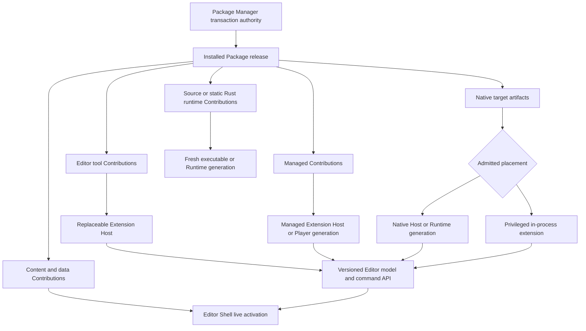

# Nara Package and Extension Product Contract - Plan

## Goal Capsule

- **Objective:** Define the product-facing Package model and extension freedom Nara must eventually provide without collapsing Rust plugins, managed modules, native libraries, content, and editor tools into one execution mechanism.
- **Product authority:** `STRATEGY.md`, Accepted ADRs, and the decisions recorded in this Product Contract constrain later planning; this artifact does not accept an ADR or activate implementation.
- **Qualification boundary:** Research, a first concrete owner API, a first local Package workflow, shared protocol freeze, and supported product/platform claims are separate stages. OQ-031 tracks unresolved choices, not a blanket research veto; historical reference-game unit IDs and registration do not authorize or prohibit a named bounded experiment.

---

## Product Contract

### Summary

Nara will present one language-neutral Package experience for installing, inspecting, updating, activating, and removing content and executable extensions.
Internally, each Package contains typed Contributions with lifecycle and placement appropriate to their role. A replaceable isolated semantic Host is the leading ordinary-tool path; trusted source-built companions remain valid, and privileged in-process integration can be studied for named native authority or latency needs. This is a product contract and staged qualification plan, not evidence that installable Packages, dynamic adapters or their protocols are implemented.

### Problem Frame

Nara aims to combine Rust-native, strongly typed game authoring with the integrated editor and extension ecosystem expected from mature engines.
A Cargo crate and a runtime `Plugin` are excellent Rust composition units, but neither by itself represents editor UI, asset imports, build support, content ownership, platform artifacts, update recovery, or an Asset Store installation identity.

Treating every extension as a dynamically loaded Rust object would appear flexible but would make ABI compatibility, unloading, stale callbacks, ECS type lifetime, and editor recovery unreliable.
Treating Package as a C#-only unit would make the distribution model depend on one optional authoring language and weaken Rust as the complete official path.

The product therefore needs one coherent Package workflow above several honest execution boundaries.
Users should normally remain inside the Editor while Nara reloads data, replaces an Extension Host, or reconstructs a Play runtime, while deep engine integration may still require an explicit Editor restart.

### Key Decisions

- **Package is a language-neutral distribution unit.** (session-settled: user-approved - chosen over defining Package as a Rust functional bundle or C# assembly: one installable unit must be able to carry content, runtime functionality, editor UI, importers, build support, and target artifacts.)
- **Ordinary installed semantic Editor extensions use an isolated Extension Host by default.** (session-settled: user-directed - chosen over loading all trusted C# or native extensions into the long-lived Editor process: process replacement gives a truthful recovery baseline. Source-built companions retain their existing trusted path; privileged placement may address named native authority or latency needs.)
- **Activation is graduated rather than universally hot-reloadable.** (session-settled: user-directed - chosen over promising arbitrary live native replacement: the product must distinguish immediate activation, Extension Host replacement, Runtime replacement, and Editor restart.)
- **Rust remains the complete official runtime authoring path.** A source/static Rust `Plugin` keeps full typed ECS, schedule, resource, and domain freedom; managed and native Contributions add optional paths rather than redefining `Plugin`.
- **Project settings do not grant executable authority or select arbitrary providers by string identity.** (session-settled: user-directed - chosen over `nara.toml` physics or backend lookup: compiled Rust recipes remain authoritative for source-built runtime selection. A future admitted workflow may select installed, declared Packages under Host-owned target/trust policy; settings cannot make absent code available, approve execution or promise schema interchangeability.)
- **A first complete integration precedes a cross-provider Interface.** (session-settled: user-approved - chosen over requiring two physics or other backends up front: the first official plugin owns its coherent domain API, and a portable Interface requires later independent variation pressure.)
- **Distribution governance follows the stronger Unity precedent while execution layering follows the stronger Godot precedent.** (session-settled: user-approved - chosen over copying either engine wholesale: Nara needs dependency and ownership semantics beyond an archive installer, while preserving distinct content, editor, managed, runtime, native, and built-in lifecycles.)

#### Activation Classification

`Runtime replacement` is one top-level activation class. Play Runtime, managed Player, Rust Runtime, and native Runtime generations are subtypes used for implementation and measurement; they do not create additional user-facing activation levels.

| Activation class | Required condition | Escalation evidence |
|---|---|---|
| Immediate | The candidate can publish through its owner's transaction boundary without replacing an executable process generation or invalidating active native state | Validation proves the affected data, content, or compatible body-only change can publish independently |
| Extension Host replacement | Changed executable contributions and code-bearing leases have a declared replaceable owner; restored UI state is data | Coexist-and-switch retires old physical leases after routing publication; Stop-first retains a restartable last-good cohort/data without promising an active predecessor |
| Runtime replacement | Gameplay/runtime structure needs a fresh generation while the Shell preserves workspace authority | Publish only a complete Ready cohort; exclusive-authority Stop-first may temporarily have no active Runtime and must expose recovery |
| Editor restart | Admitted in-process Editor code or ABI changes, or the current owner cannot prove quiescence, retirement, or compatible reconstruction | The operation records why Immediate, Extension Host replacement, and Runtime replacement cannot carry the change; `deep change` alone is not sufficient |

#### Isolation and Privileged Placement

An isolated Extension Host provides lifecycle replacement and crash containment by default; it is not an OS confidentiality or integrity sandbox. Contributions sharing one Host share its fault domain and ambient process authority; group them only when approved effective authority matches. Otherwise use separate processes without claiming OS security-principal separation, and do not pass Editor secrets to child Hosts by default.

Trusted in-process placement is a serious bounded alternative for a named native authority need or a measured latency/throughput requirement. Studying it does not require first implementing an unsuitable complete IPC path. A supported privileged seam still requires an admission review of the minimum surface, exact artifact and trust, compatibility window, callback/drop retirement, fault domain and restart fallback. Ordinary source-built Rust companions do not acquire a compulsory IPC boundary from this plan.

Separate processes do not by themselves create separate OS security principals or restrict ambient native I/O. Grouping must account for actual effective authority, not only matching protocol grants. Disabling a Contribution can revoke Host protocol authorization and fence late results, but cannot revoke arbitrary native filesystem, network or process access; physical termination/reclamation and any claimed OS confinement require their own evidence.

#### Replacement Mode And Recovery Promise

Activation class alone does not decide replacement order. Each operation declares one mode:

- **Coexist-and-switch:** prepare and validate a complete candidate while the predecessor remains
  serviceable; quiesce affected admissions where needed; publish one required-cohort route; then
  physically retire the old owners. Candidate failure before the switch leaves the old route
  active. Post-publication retirement failure retains physical custody and reports cleanup debt;
  it does not silently undo an already active new route.
- **Stop-first:** exclusive native authority or admitted overlap limits require old physical
  retirement before candidate readiness. Prepare everything that can safely precede that boundary,
  preserve a compatible last-good executable/data/reconstruction recipe, then explicitly enter
  interruption. After retirement begins, cancellation cannot promise the old instance is still
  active. Candidate failure yields truthful RecoveryRequired/Restoring/Unavailable observations;
  successfully restarting the preserved last-good is a new activation, not rollback of reality.

Admission quiesce is reversible only where the specific owner proves resume safe; it is not
physical retirement. Preview the irreversible boundary, expected interruption and whether
last-good is active, restartable or unavailable. Neither mode promises recovery from arbitrary
external effects. Existing Stop-first Play is not evidence of coexist-and-switch.

Required-cohort validation includes the selected adapters' bounded cross-owner Schema/binding
read-sets and live code-bearing objects, not only which Package releases change. This remains
distinct from Package dependency resolution and does not introduce another source resolver.

### Operating Model

The Package Manager owns installation identity, release receipts, user confirmations, and install, update, enablement, disablement, and removal transactions.
The Editor Shell owns workspace state, documents, undo, selection, windows, its selected frontend, and user-visible status; current Dear ImGui adapters can render a bounded semantic tool before a complete Nara UI toolkit exists.
Concrete Extension, Runtime, Import, Build, and Native Hosts own executable activation and retirement for their domains.

### Actors

- A1. **Project user:** Installs, updates, enables, disables, and removes Packages without reconstructing their internal language or Host topology.
- A2. **Package author:** Publishes one coherent release containing typed Contributions, target coverage, dependencies, trust facts, samples, and documentation.
- A3. **Editor Shell:** Preserves the workspace and renders extension UI while child Hosts or Play runtimes are replaced.
- A4. **Contribution Host:** Validates, starts, supervises, retires, and reports one executable Contribution generation.
- A5. **Product composition root:** Maps installed Package Contributions to the exact implementations compiled or admitted for the selected product and target.
- A6. **Package Manager:** Owns resolved installation identity and coordinates release validation, preview, confirmation, update, enablement, disablement, required-cohort publication, inspection, and removal transactions.

### Requirements

**Package identity and governance**

- R1. A Package must have a language-neutral identity and may contain content, source/static Rust, managed, native, editor, importer, build/export, sample, documentation, and migration Contributions.
- R2. Every executable Contribution must declare its role, execution target, subject target, compatibility requirements, trust class, and activation effect without sharing one universal executable trait.
- R3. Installation state must record resolved release provenance, direct and transitive Package relationships, target artifacts, and file ownership strongly enough to support deterministic inspection and safe removal.
- R4. Cargo must remain authoritative for Rust source dependency resolution, and NuGet/MSBuild must remain authoritative for managed dependency resolution; Nara may orchestrate both but must not invent one merged source resolver.
- R5. Package installation, Contribution enablement, active executable generation, and project content state must remain separately observable.

**Activation and recovery**

- R6. The top-level activation classes are Immediate, Extension Host replacement, Runtime replacement, and Editor restart. The Editor must remain open for the first three classes; Play Runtime, managed Player, Rust Runtime, and native Runtime are Runtime replacement subtypes. Escalation to Editor restart requires recorded evidence that the earlier classes cannot preserve correctness, compatibility, or truthful retirement.
- R7. Before install, update, enable, disable, or removal, show source/integrity, work, effective trust, target, migration, activation class and replacement mode. Expose phase, cancelability, publication and any earlier irreversible retirement boundary. Project mutation or Package code execution requires explicit confirmation after code-free preflight. Cancellation during reversible preparation preserves prior installed/enabled/active facts; after Stop-first retirement it reports interruption and recovery, not a fictitious still-active predecessor.
- R8. Validate an immutable complete candidate before routing publication and reject late retired results. Coexist-and-switch preserves the active last-good on pre-switch failure; Stop-first preserves a compatible launchable executable/data/reconstruction cohort and reports recovery explicitly. Post-publication old-owner retirement failure retains cleanup custody, not automatic rollback. Last-good status distinguishes Active, Restartable and Unavailable.
- R9. Required activation must not expose an incompatible mixed cohort. Validate bounded cross-owner Schema/binding read-sets, including unchanged consumers; reject or reprepare/migrate affected dependents, leaving independent owners alone. Code-bearing prepared values, bindings, callbacks and destructors retain matching code until physical disposal; pure data Schema need not pin code. Unrelated content, documents and workspace retain separate authority.
- R10. Removal must delete only unmodified, ownership-proven Package files and derived state; modified, adopted, or provenance-ambiguous project content must be preserved and reported. Removal that breaks required dependents is blocked by default; an explicit previewed and confirmed cascade may remove the affected required-dependent closure, never silently leave an invalid enabled graph.

**Extension freedom**

- R11. The Editor extension surface must eventually cover panels and docks, menus and commands, inspectors and property editors, gizmos and viewport tools, importers, build/export steps, diagnostics, and package-owned settings through toolkit-neutral models and commands.
- R12. Ordinary installed semantic Editor extensions must not depend on egui, Nara UI implementation objects, raw window handles, the gameplay `World`, or renderer handles; the Editor Shell renders semantic contributions and owns input, focus, text/IME, accessibility, layout, and undo authority. This does not prohibit current trusted source-built frontend adapters or separately admitted privileged integrations.
- R13. A Rust runtime `Plugin` must retain direct typed ECS and schedule composition inside a freshly built Runtime generation; Package integration must not replace this path with RPC or a universal provider Interface.
- R14. C# may be a first-class optional authoring language for managed gameplay and Editor Contributions, but C# is neither required by Package nor authorized for production until its owning trials pass. Same-task Lua-family/C# comparison is allowed without first proving one candidate fails; neither a mandatory VM nor two production SDKs are selected.
- R15. A trusted Native Extension may ship `.dll`, `.so`, `.dylib`, framework, static-library, or Wasm artifacts as target policy allows, but raw Rust ABI and `dyn Plugin` values must not become the ecosystem binary contract.
- R16. Deep toolkits such as Dear ImGui, native SDKs, and high-frequency viewport integrations must remain possible without granting ordinary Packages unrestricted Editor internals. A named native authority requirement or measured latency/throughput pressure may justify a privileged in-process or high-bandwidth tracer without first completing an IPC implementation. Support requires a representative workload and an admission review of the minimum surface, artifact-bound trust, compatibility, effective authority, retirement behavior, and restart fallback.

**Trust, composition, and portability**

- R17. Isolated Extension Host placement must be the default for ordinary installed executable semantic Editor Contributions, not for all source-built Rust companions or gameplay calls. It promises lifecycle and crash containment, not an OS sandbox. Contributions may share a Host only when approved effective authority matches; otherwise use separate processes and separately qualify any claimed OS security-principal separation. Same-process managed or native placement must be explicit, fully trusted, and permitted to return `restart required` when retirement cannot be proven. Child Hosts must not inherit Editor secrets by default, without implying that ambient access by arbitrary native code is confined.
- R18. Cross-process and future binary protocols must use stable IDs, bounded values and messages, generation-stamped opaque handles, structured diagnostics, and explicit cancellation; they must not carry Rust references, trait objects, process-local ECS IDs, callbacks without leases, or native ownership implicitly.
- R19. Package target selection must reject missing or ambiguous artifacts before activation and must distinguish Host execution platform from the product/export target.
- R20. `nara.toml` may request semantic product capabilities and settings, but it must not load arbitrary code, grant executable authority or select an arbitrary physics, renderer, UI, or other provider by string identity. An admitted future workflow may select installed, declared Packages within Host-authorized availability, target and trust constraints; source-built runtime selection remains a compiled recipe fact.
- R21. Package trust UI must distinguish data-only content, build-time code, isolated executable code, trusted in-process code, and any genuinely enforced sandbox without describing a process boundary or permission list as an OS sandbox. It must show effective file, project, network, process, environment and credential authority, including ambient native authority not restricted by protocol grants.

**Package admission, operation, and authoring safety**

- R22. Every direct or transitive Package, Contribution, and target artifact must bind to and verify an immutable source identity plus a content digest or equivalent toolchain-authenticated evidence before unpack, build, or activation. Missing, ambiguous, or mismatched evidence fails closed, and update preview must expose source or integrity changes without requiring Nara to replace Cargo, Git, NuGet, or another source resolver.
- R23. Source resolution, dependency-graph construction, manifest processing, and archive inspection before the trust decision must execute no Package-controlled code and must enforce domain-owned limits for encoded bytes, file count, path depth, expanded size, dependency nodes, time or bounded work, and disk use. Any step that cannot be inspected without code execution must be labeled and approved before invocation.
- R24. Package file writes must use host-issued filesystem capabilities and fail closed on traversal, symlink, junction or other reparse-point escape, case-fold or path-alias collision, unproved mount or filesystem transitions, and ambiguous ownership. Installation and update must not overwrite or claim existing unowned files, and migration write sets must be previewed and transactionally recoverable.
- R25. Every executable, build-time, and migration Contribution must declare its required engine and project permissions. Host admission denies ungranted protocol authority; trusted in-process approval binds to source, Package release, exact artifact, and effective authority. A source, artifact, or authority expansion requires reauthorization. Disablement and removal revoke the affected generation's Host protocol grants and publication rights; that is not revocation of arbitrary native ambient I/O or proof of physical retirement.
- R26. A migration runs against an isolated project candidate; its qualified persistence owner and routing protocol expose only a mutually compatible data/executable cohort. Do not assume a distributed atomic commit with arbitrary processes or external effects. Failed validation publishes no new cohort. If a compatible restartable predecessor cannot be retained, reject automatic replacement or require a separately approved destructive workflow rather than label it last-good.
- R27. The Package Manager must provide one inspect-and-reconcile flow that shows the effective current state and blocker first, followed by installed release, Contribution enablement, active and last-good generations, retained project content, and one clear next action for every inconsistent or failed state.
- R28. Install, confirm, cancel, retry, inspect, disable, and remove must be keyboard-operable. Package Manager state transitions must place and restore focus predictably, expose semantic progress and error announcements, and never encode trust, blocking, or restart impact by color alone.
- R29. Package authors must be able to assemble typed content, Rust, managed, native, Editor, importer, build, documentation, sample, and migration Contributions with target, dependency, integrity, trust, and permission facts; run the same bounded structural validation used by installation; and produce an immutable release candidate and receipt consumable from local, Git, or Cargo-backed sources without requiring a remote registry.

### Delivery Phases And Requirement Closure

R1-R29 remain the complete product requirement set. They are not one indivisible implementation
gate, and the phases below do not claim any new runtime behavior. A first concrete API need not
wait for a shared abstraction, while every supported operation must satisfy its applicable safety
invariants. Unsupported roles, sources, migrations and targets reject explicitly rather than
acquiring speculative implementations.

| Classification | Requirement IDs | Delivery meaning |
|---|---|---|
| Baseline invariants | R1-R10, R12-R13, R17-R28 | Preserve identity, toolchain authority, truthful activation/state, source-built freedom, strict admission, bounded preflight, file ownership, trust and accessible lifecycle behavior whenever the corresponding operation exists. These are not proof that every activation class, platform or role is supported. |
| First local product surface | R11, R29, under all applicable baseline invariants | Deliver one semantic tool facet plus content and a local immutable release/receipt. The full facet catalogue, source-form matrix and authoring families are later qualification, not prerequisites for that first surface. |
| Separately qualified capability families | R14-R16; expansion of R6, R11, R18-R19, R22, R25-R26, R29 | Admit optional languages, privileged/native seams, additional roles, activation classes, sources and targets only with matching concrete evidence. Invariants still apply; no new resolver or universal service/extension kernel is implied. |

**P0 - Bounded comparison and first owner API.** Use current Dear ImGui and a window-free session
to plan one legal semantic edit, preview it, submit it, observe its exact action result and prove
Undo/Save/Reopen. This can use the current trusted source-built path; it is not package installation
or a dynamic SDK. A bounded Rust child tool may next return a proposal to the same document owner
without rebuilding Editor. Compare source-built, isolated semantic Host and trusted in-process
placement on the same tool for author concepts, native authority, edit latency, Shell continuity,
crash/disable/update recovery and callback lifetime. Name the experiment and pin its comparison
task, tested target, cost and stop conditions; freeze numeric goals before measurement. No full
Nara UI toolkit, marketplace, historical RGF result or second implementation is a research gate.

**P1 - First local Package workflow.** Build one immutable local release containing content and
one concrete semantic command/property tool in a replaceable child Host, with the current Shell
frontend rendering the declared data. Pin one desktop Host/target profile before implementation.
Implement F1-F6 for this bounded release: author validation and receipt; code-free bounded metadata
preflight; strict staging and ownership records; preview/confirm/cancel; inspectable installed,
enabled and active states; candidate update/disable/crash recovery; and safe removal. The tool
returns proposals, never a `World`, raw UI/window/GPU handle or file authority. Prove exact edit
results, Undo/Save/Reopen, stale-result rejection, required-dependent blocking and explicit cascade.
Exercise applicable R1-R13 and R17-R29; R11 is one semantic facet and R29 is the local content/tool
authoring subset, not all listed families. The selected next consumer is the independently built
EnemyStats finite C# child under the [local release plan](2026-10-28-local-source-tool-release-plan.md);
that concrete artifact does not select an official managed SDK or require a duplicate Rust tool.
R13 retains the complete source-built runtime path.
Validate explicitly declared Package relationships; do not add version solving or a source resolver.
Reject schema-migration-required updates and unsupported artifacts explicitly; R26's no-publication
rule applies without claiming a migration engine. This slice does not require another authoring
language, a stable native ABI, importer/build plugins, Git/Cargo transport adapters or a remote
registry. The selected finite C# artifact retains its separately stated runtime prerequisites.

**P2 - Shared boundary qualification.** Challenge the first role-specific API with an independent
consumer before freezing a reusable protocol. Compare the placements on the same semantic tool;
a named native authority need may select an in-process trial even if an isolated tool meets its
latency target. Qualify only the claimed facet and compatibility window, with bounded codecs,
explicit trust, callback/drop retirement, restart fallback and first-/third-party parity. Do not
turn that proof into a universal Widget, `PackageDefinition`, service locator or source resolver.
P1 may remain a concrete bounded product without extracting a shared protocol.

**P3 - Contribution and target qualification.** Add only named capability closures: more Editor
facets, importer/build/export, migrations, Git/Cargo-backed consumption, native/managed artifacts
or additional targets. Optional Lua-family/C# candidates use the same bounded gameplay task and
Rust control; no mandatory VM or dual production SDK is selected. A gameplay VM normally runs
inside its Player at explicit phases, not through Editor IPC for every query. Proposed owner-local
managed module/catalog generations require isolated state migration, exact owner snapshots,
required-cohort publication and physical retirement; they do not mutate admitted native layouts.
Use process replacement or restart when retirement cannot be proven. Each supported workflow
needs its own end-to-end, recovery, security and platform evidence; the full success criteria below
apply only to the scope claimed. No phase retroactively grants implementation status to a proposal.

### Key Flows

- F1. **Create and validate a Package release**
  - **Trigger:** A2 assembles one or more typed Contributions for local, Git, or Cargo-backed consumption.
  - **Actors:** A2, A5, A6.
  - **Steps:** Assemble Contribution declarations and target artifacts; freeze source identities and integrity evidence; validate dependencies, targets, permissions, file ownership intent, and required cohorts; run code-free bounded structural preflight; authorize any required build step separately; emit an immutable release candidate and validation receipt.
  - **Outcome:** A consumer can inspect and install the same coherent release without a remote registry or a language-specific Package identity.
  - **Covered by:** R1-R4, R19, R22-R25, R29.
- F2. **Install and preview**
  - **Trigger:** A1 selects a local, Git, Cargo-backed, or future registry Package release.
  - **Actors:** A1, A3, A5, A6.
  - **Steps:** Resolve metadata and dependencies against immutable evidence; run code-free bounded preflight; stage through host-issued filesystem capabilities; validate target, ownership, and Contribution declarations; present source, integrity, permission, migration, target, and activation effects; enter a cancellable confirmation state; after explicit confirmation, run separately authorized code-bearing steps and commit the installation transaction.
  - **Outcome:** The Package is installed and inspectable, but executable Contributions have not gained authority merely because files exist.
  - **Covered by:** R1-R7, R19, R21-R25, R27-R28.
- F3. **Activate or update executable Contributions**
  - **Trigger:** An installed release is enabled or replaced.
  - **Actors:** A3, A4, A5, A6.
  - **Steps:** Build/acquire approved immutable artifacts; validate isolated data migration, owner dependency/read-sets and predecessor reconstruction. Coexist-and-switch prepares all required members, switches compatible routing, then retires old owners. Stop-first exposes the irreversible retirement cut before readiness-dependent activation and retains last-good reconstruction; never publish a partly Ready cohort. Document/filesystem publication uses its qualified owner, not an assumed distributed atomic commit with arbitrary processes.
  - **Outcome:** New compatible routing is active, old routing remains active on reversible failure, or interrupted Stop-first reports recovery/restartability. Post-publication cleanup failure stays observable with retained custody. None implies arbitrary external-effect rollback.
  - **Covered by:** R5-R9, R13-R20, R22, R25-R27.
- F4. **Inspect and reconcile Package state**
  - **Trigger:** A1 opens an installed Package or an operation enters blocked, failed, retained-content, or last-good state.
  - **Actors:** A1, A3, A6.
  - **Steps:** Show the effective current state and blocker first; show the installed release, enabled Contributions, active and last-good generations, retained content, and relevant receipts separately; offer one explicit retry, authorize, reconcile, disable, or remove action appropriate to that state.
  - **Outcome:** A1 can understand and repair Package state without reconstructing Host topology or confusing installed files with active authority.
  - **Covered by:** R5, R7-R8, R10, R21, R27-R28.
- F5. **Use Package-provided editor functionality**
  - **Trigger:** A Package contributes a panel, Inspector, gizmo, importer, or build command.
  - **Actors:** A1, A3, A4.
  - **Steps:** The Extension Host registers semantic contributions; the Editor Shell renders them and sends bounded commands; generation-owned registrations are revoked automatically on disable, failure, or replacement.
  - **Outcome:** Tooling can change dynamically without transferring workspace, UI toolkit, window, GPU, or undo authority to ordinary extension code.
  - **Covered by:** R6, R11-R12, R16-R18, R21, R25, R28.
- F6. **Remove a Package**
  - **Trigger:** A1 requests uninstall.
  - **Actors:** A1, A3, A4, A5, A6.
  - **Steps:** Preview reverse dependencies and affected documents. Block removal by default if any installed Package, enabled or disabled, requires the target. Offer only an explicit separately confirmed cascade over the complete affected required-dependent closure; preview all removals, retained files, activation effects and unavailable documents before commit. Revalidate the closure; withdraw the whole selected enabled/routing graph without an invalid intermediate enabled graph, fence late results, and retain physical custody until executable retirement is proven. Remove only ownership-proven unchanged files and derived state; preserve ambiguous or modified content.
  - **Outcome:** Cancellation or pre-publication failure leaves the prior installed/enabled graph unchanged. Routing withdrawal may report Retiring; removal completes only after the owning lifecycle proves physical retirement, with a valid enabled graph and retained files reported. Never delegate deletion authority to an uninstall callback. This is not a global rollback transaction over unrelated documents, exports or native side effects.
  - **Covered by:** R3, R5, R7-R10, R21, R24-R25, R27-R28.

### Acceptance Examples

- AE1. **Covers R5-R6.** Given a data-only Package update, when the new release validates, then its content may activate immediately without restarting an Extension Host, Runtime, or Editor.
- AE2. **Covers R6, R11-R12, R14, R17.** Given a C# Package that adds a standard Inspector and Dock through semantic models without UI-toolkit objects or raw handles, when its code updates, then Nara may replace its Extension Host and restore declared panel state while the Editor workspace remains open.
- AE3. **Covers R6, R13, R20.** Given a source Rust physics Package whose plugin keeps direct typed ECS and schedule composition, when its structural code changes, then Nara rebuilds and replaces the Rust Runtime generation while the Editor remains open; `nara.toml` does not choose the solver by provider string.
- AE4. **Covers R7, R15, R17.** Given a native library that owns process-level callbacks and cannot prove quiescence, when it updates, then Nara records why the earlier activation classes cannot carry the change and reports the required Host or Editor restart before activation instead of claiming a hot reload.
- AE5. **Covers R8-R9.** Given a candidate that fails build, ABI negotiation, Schema validation, startup or final-member readiness, activation publishes no partial cohort. Coexist-and-switch leaves old routing active; Stop-first reports the retained compatible recovery target as Restartable/Restoring/Unavailable, never as an instance already retired. Pending or failed retirement retains custody; post-switch failure does not invent rollback.
- AE6. **Covers R3, R10.** Given a Package sample that the user modified after installation, when the Package is removed, then Nara preserves the file and reports why it was not deleted.
- AE7. **Covers R13, R20.** Given two unrelated runtime plugins that can coexist under their own contracts, when a game composes both, then the official recipe accepts both without forcing an exclusive provider slot; a real conflict remains an explicit plugin/domain error.
- AE8. **Covers R22-R24.** Given a Package source with missing or mismatched integrity evidence, an over-limit archive, a path or link escape, or an ownership collision, when preflight runs, then it fails before Package code executes or project state changes.
- AE9. **Covers R21, R25.** Given an executable update that expands project, file, network, process, environment, or credential authority, when activation is requested, then the new generation remains denied until the exact release, artifact and effective authority are approved. Disablement or removal revokes Host protocol grants and publication rights, while ambient native I/O and physical retirement are reported separately.
- AE10. **Covers R8-R9, R26.** Given a migration that cannot prove predecessor compatibility or whose candidate fails validation, when update runs, then it changes only the isolated project candidate, publishes no new cohort, and leaves the original launchable project state selected.
- AE11. **Covers R1-R4, R19, R22, R29.** Given a Package author assembles content, an Editor tool, and Rust and managed dependencies, when local validation succeeds, then Cargo and NuGet/MSBuild retain their respective resolution authority while one immutable Nara release and receipt can be consumed from local, Git, or Cargo-backed sources without a remote registry.
- AE12. **Covers R5, R7-R8, R10, R27.** Given a candidate failure and retained user-modified content, when A1 inspects the Package, then the effective blocker appears first and installed, enabled, active, last-good, and retained-content states remain distinct with one clear recovery action.
- AE13. **Covers R7, R21, R28.** Given a keyboard and screen-reader user, when they install, confirm, cancel, retry, inspect, disable, and remove a Package, then focus remains predictable, state changes are announced semantically, and trust or restart impact never depends on color alone.
- AE14. **Covers R1, R5, R7, R10, R21, R27.** Given a representative first-time project user in a clean environment, when they install, update, disable, and remove a multi-role Package, then they can correctly predict downloads, build or reimport work, permissions, target coverage, activation class, and retained content without learning the internal language or Host topology.
- AE15. **Covers R16-R17.** Given a native SDK authority requirement or representative high-frequency viewport workload, when placement is compared, then a trusted in-process tracer may be studied without completing IPC first. A supported seam still requires minimum-surface, artifact/trust, compatibility, retirement and restart review; meeting an isolated latency target does not disprove a distinct native authority need.
- AE16. **Covers R17, R21.** Given two executable Editor Contributions with different approved effective authority, when Host placement is resolved, then they do not share one Host, neither inherits Editor secrets by default, and the UI does not imply that two processes are an OS sandbox or that protocol revocation confines ambient native I/O.
- AE17. **Covers R18.** Given an Extension Host sends an oversized value, a stale generation handle, a process-local ECS identity, or a result after cancellation, when the Editor protocol validates the message, then it rejects or retires the message without mutating Editor state and reports a bounded structured diagnostic.
- AE18. **Covers R3, R7-R10, R25, R27-R28.** Given an installed Package, enabled or disabled, requires the requested uninstall target, when ordinary removal is requested, then Nara blocks without changing the graph. An explicit cascade shows and confirms the complete affected closure; cancellation preserves it, and routing withdrawal leaves no invalid enabled dependents, preserves modified/adopted/unknown files and reports Retiring until physical removal can complete.

### Success Criteria

| Signal | Target | Evidence |
|---|---|---|
| Multi-role coherence | One clean-room Package can contribute content, one Editor tool, and one runtime role under one release identity without a universal callback | External package fixture and package preview snapshot |
| Author release closure | The same multi-role Package produces one immutable candidate and validation receipt consumable from local, Git, and Cargo-backed sources without a registry | External authoring fixture and receipt golden files |
| Editor continuity | 100% of immediate, Extension Host replacement, and Runtime replacement test cases keep the Editor process and workspace alive | End-to-end lifecycle tests with process and workspace identities |
| Activation honesty | Every Editor restart case records why Immediate, Extension Host replacement, and Runtime replacement cannot carry the change; an unclassified `deep change` fails admission | Cross-classification decision fixtures and review receipts |
| Last-good safety | Pre-publication build, validation, migration and startup failure exposes zero partial new cohort members and preserves a data-compatible launchable predecessor when one exists; post-publication retirement failure retains custody and reports the active route without inventing rollback | Fault-injection, migration and physical-retirement matrix |
| Supply-chain integrity | Every direct and transitive source and artifact verifies immutable evidence before unpack, build, or activation; missing, ambiguous, mismatched, and limit-plus-one cases fail with no Package code execution or project mutation | Resolver-adapter, archive-budget, and integrity fixtures |
| Filesystem containment | Traversal, reparse-point, alias, ownership-collision, and unproved-filesystem cases cannot escape or overwrite through a strict host-issued capability | ADR 0050 platform and installation-ledger tests |
| Trust honesty | Every code-bearing preview shows actual placement and effective grants; an isolated process is never labeled sandboxed without proven OS enforcement | UX snapshot, permission-policy audit, and secret-canary tests |
| Protocol boundary | Ordinary installed semantic extension SDK fixtures compile without importing `World`, Bevy ECS IDs, UI toolkit internals, raw window/GPU handles, or Rust ABI objects; trusted frontend/privileged adapters are separate tiers | Public API and dependency audit |
| Target determinism | Missing and ambiguous artifact selections fail before code loads; repeated equal inputs select the same artifact and impact level | Cross-target resolution fixtures |
| Operation recovery | Reversible-preparation cancellation preserves prior facts; after Stop-first retirement, report actual interruption and compatible recovery. Every failure distinguishes Active/Restartable/Unavailable last-good and offers only valid retry/recovery | Replacement-mode fault matrix and UX snapshots |
| State comprehensibility | Every defined installed, enabled, active, last-good, retained-content, blocked, and failed fixture shows one effective state first and one valid next action | Package Manager state-model snapshots |
| Accessibility | 100% of critical Package lifecycle actions are keyboard-operable with deterministic focus restoration, semantic state announcements, and non-color status cues | Keyboard automation, accessibility-tree snapshots, and manual screen-reader checks |
| User lifecycle outcome | At least four of five representative first-time users complete install, update, disable, and remove without assistance and correctly identify execution, permission, restart, target, and retained-content impact | Moderated clean-environment task study with success rate and completion-time record |
| Removal safety | Required-dependent removal is blocked by default; an explicitly previewed cascade leaves a valid enabled graph, and modified, adopted or provenance-ambiguous user files survive every removal fault case | Reverse-dependency, installation-ledger and filesystem fixtures |
| Iteration performance | For every claimed activation path, its owning trial freezes a numeric P50/P95 target before measurement and measured P95 must meet it; results include full Editor restart and the relevant source-built control. Managed Player needs its R14 qualification and does not block earlier Rust-first slices | Reference-package workflow measurements and scoped qualification record |

### Scope Boundaries

**Deferred for later**

- Reusable Package manifest, project dependency and lock formats beyond P1's concrete local release/receipt; registry protocol, signing model, marketplace governance, payment, ratings, and remote build service.
- The exact permission vocabulary, approval UX, platform sandbox mechanisms, stable Native Extension C ABI, binary SDK compatibility window, in-process CoreCLR optimization, Widget wire format, custom drawing protocol, and measured Host grouping policy.
- Mobile, Web, console, NativeAOT, broad trimming guarantees, and complete prebuilt binary matrices beyond independently admitted targets.

**Outside this product's identity**

- A mandatory second author language, a universal Behavior Host, or a requirement that every Package use C#.
- A promise that arbitrary Rust or native structural edits hot-unload in place.
- A universal `Extension`, `Provider`, `PhysicsBackend`, or UI-toolkit Interface inferred from a single integration. Independent consumers qualify shared semantics; a first concrete owner API does not need a second implementation.
- Arbitrary cross-engine Package compatibility or an Asset Store that treats untrusted executable code like validated content.

### Dependencies and Assumptions

Replacement qualification exercises: two required members with the final member failing
readiness; old retirement Pending; failure after new routing publication; and zero active callbacks
while an old code-bearing prepared/binding object remains. Check active routing, compatible
restartability and physical custody separately. Newer source edits are retained and disclosed,
not rolled back to conceal activation failure.

- Each claimed activation path needs truthful generation, candidate, publication, Stop and last-good boundaries; unrelated paths do not block a semantic tool experiment.
- Current Dear ImGui and window-free sessions can qualify a narrow command/property workflow. A shared widget or custom-surface contract needs its own representative independent tools, not completion of a full Nara UI toolkit first.
- Stable Schema identities and UI-neutral tooling models/commands remain the semantic bridge for editor inspection and cross-language contributions.
- The complete Rust path and reference game remain production controls. A named package or optional-language experiment may challenge architecture now; supported product/platform claims require fresh matching evidence, not historical RGF IDs or missing registration.

### Outstanding Questions

**Deferred until evidence**

- Which project file records direct Package dependencies and which generated lock or receipt records resolution and installed ownership while `nara.toml` remains project settings authority?
- Does enablement operate only at whole-Package level in the ordinary UI, or may advanced users independently enable target-specific Contributions when the Package declares that split safe?
- Should ordinary Extension Hosts be per Package, per trust group, or per project after startup cost, memory, fault isolation, and update behavior are measured?
- Which first custom panel or viewport workload proves that standard semantic UI models are insufficient and admits a high-bandwidth surface contract?
- Which concrete native SDK or precompiled extension first justifies a stable C-compatible ABI and its compatibility window?

### Alternatives Considered

#### Option A: One universal dynamically loaded Rust plugin

This gives familiar direct access but depends on unstable Rust ABI and cannot prove that ECS drop glue, callbacks, trait objects, threads, and native state have retired before unloading.
Rejected as an ecosystem contract; source/static Rust remains the complete typed path.

#### Option B: C# as the Package and Editor extension model

This resembles Unity's dominant authoring path and enables managed reload, but couples distribution identity to an optional language and still cannot guarantee cooperative `AssemblyLoadContext` unload.
Rejected as the Package definition; C# remains a first-class optional Contribution family.

#### Option C: Content archive plus independent plugin enablement

This resembles Godot's current Asset Library workflow and keeps installation simple, but lacks dependency resolution, lock state, owned-file removal, atomic update, and coherent multi-role identity.
Rejected as Nara's long-term package governance model.

#### Option D: Language-neutral Package plus typed Contributions and graduated Hosts

This preserves one user-facing Package workflow while letting each contribution use an honest lifecycle and trust boundary.
Selected as the product model, with concrete protocols and loaders admitted only through real tracers.

### Risks and Mitigations

| Risk | Severity | Likelihood | Mitigation |
|---|---|---|---|
| Package management becomes a second Cargo or NuGet | Critical | Medium | Keep each language toolchain authoritative and limit Nara to product-level orchestration, contribution facts, receipts, and UX |
| Isolation reduces extension freedom or responsiveness | High | Medium | Compare the same semantic tool across placements, batch high-volume exchanges, and retain a trusted privileged tier for named native authority or measured latency needs |
| Privileged extensions destabilize the Editor | Critical | Medium | Require workload evidence, artifact-bound permissions, a minimum admitted surface, generation-owned leases, restart classification, and process/runtime replacement wherever feasible |
| An isolated Host is mistaken for a sandbox | Critical | Medium | State lifecycle/fault guarantees, disclose ambient native authority, withhold inherited Editor secrets, group only matching effective authority and qualify OS confinement separately |
| Package source or archive compromises the project before trust review | Critical | Medium | Require immutable evidence, code-free bounded preflight, and handle-bound filesystem capabilities before any write or execution |
| Migration invalidates the previous launchable generation | Critical | Medium | Isolate migration; retain compatible predecessor code/data; qualify persistence/routing consistency instead of assuming arbitrary distributed rollback |
| UI protocol freezes before independent tool evidence | High | High | Prove a narrow semantic tool with current frontend adapters now; defer shared widget/custom-surface freeze until its own representative consumers challenge it |
| Package, enablement, and active generation state confuse users | High | High | Show each state and impact separately and use one Package Manager workflow to coordinate them |
| Cross-platform native artifacts become ambiguous | High | Medium | Use structured target selectors, reject zero or multiple equal matches, and validate export closure before activation |
| Ecosystem architecture delays delivery | Critical | Medium | Keep P0 research, P1 local product and later capability qualification distinct; preserve the Rust control and avoid an all-requirements or historical-plan gate |

### Sources and Research

- `STRATEGY.md`
- `docs/architecture/README.md`
- `docs/architecture/open-questions.md` OQ-007, OQ-031, and OQ-045
- `docs/architecture/foundation-architecture-reassessment.md` D01, D03, D06, and D18
- `docs/architecture/extension-package-concept-guide.md`
- `docs/architecture/source-extension-package-interface-design.md`
- `docs/knowledge/engineering/extension-ecosystem-engine-research.md`
- `docs/knowledge/engineering/godot-csharp-integration-research.md`
- `docs/knowledge/engineering/godot-unity-package-extension-lifecycle-research.md`
- `docs/architecture/adr/0049-untrusted-project-input-and-parse-budget-policy.md`
- `docs/architecture/adr/0050-asset-root-symlink-junction-and-package-trust-policy.md`
- `docs/architecture/adr/0068-global-resource-budgets-metrics-and-diagnostic-privacy.md`
- [Godot Editor plugins](https://docs.godotengine.org/en/stable/tutorials/plugins/editor/making_plugins.html)
- [Godot GDExtension](https://docs.godotengine.org/en/stable/engine_details/engine_api/gdextension/what_is_gdextension.html)
- [Godot GDExtensionManager](https://docs.godotengine.org/en/stable/classes/class_gdextensionmanager.html)
- [Unity package dependencies](https://docs.unity3d.com/6000.0/Documentation/Manual/upm-dependencies.html)
- [Unity lock files](https://docs.unity3d.com/6000.0/Documentation/Manual/upm-conflicts-auto.html)
- [Rust Reference ABI](https://doc.rust-lang.org/reference/items/external-blocks.html#abi)
- [.NET assembly unloadability](https://learn.microsoft.com/en-us/dotnet/standard/assembly/unloadability)

## Review Resolution

### 2026-10-23 Scope Correction

- **Delivery-phase ambiguity resolved:** R1-R29 are preserved and classified as baseline invariants,
  the first local content/semantic-tool workflow, or separately qualified families. P0-P3 distinguish
  experiments, concrete APIs, reusable protocol freeze and supported scope. Exact implementation
  units and schemas remain later work; this document is still requirements-only.
- **Required-dependent removal resolved:** R10, F6 and AE18 select default blocking and an explicit
  previewed cascade over the complete affected required-dependent closure. They preserve user-owned
  files, a valid enabled graph and truthful physical-retirement reporting without a universal
  rollback claim.
