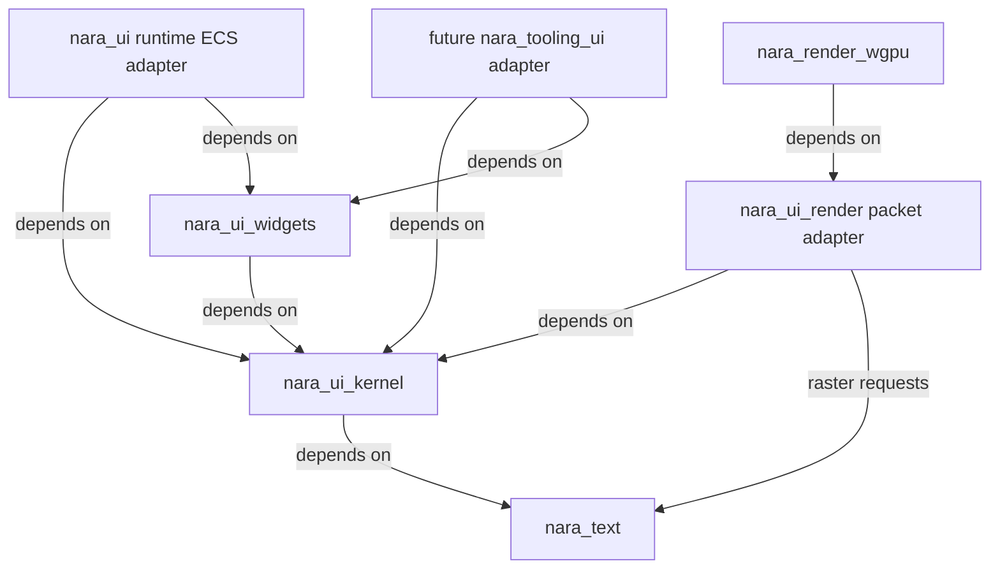
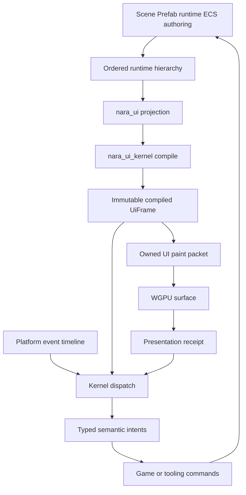
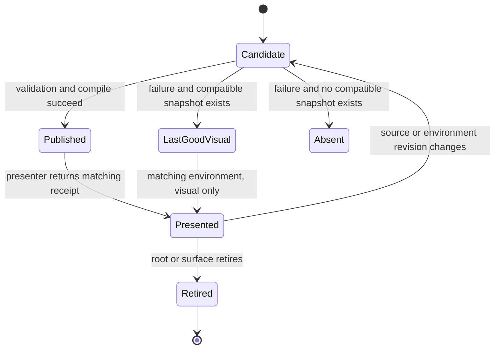

# Ordered UI Kernel and Engine Boundary Correction - Plan

## Goal Capsule

- **Objective:** Replace the UI-local ordering patch with one persistent ordered structure contract, build a small renderer-neutral UI kernel with dedicated text and headless-widget modules, remove confirmed false extension surfaces and duplicate authorities, and prove the result through the reference game's readable HUD, terminal overlay, Retry interaction, packaged desktop path, and truly presentation-free headless path.
- **Authority:** Accepted ADRs remain durable authority. NUI-U1 must admit the focused ordered-structure and UI-topology decisions, atomically activate this plan, and supersede the current RUI plan before any behavior-bearing unit starts. Until then, the current RUI plan remains the sole active execution authority.
- **Product contract:** This plan implements the scope confirmed in the 2026-08-04 design discussion. It intentionally combines the UI product slice with the already verified foundation defects that would otherwise preserve duplicate authority, false extensibility, mutable render-resource reads, or headless/presentation coupling.
- **Execution profile:** This is pre-1.0 fearless refactoring. Rust APIs, Cargo features, plugin recipes, and in-repository persistent fixtures may break. The executor removes obsolete paths instead of adding compatibility wrappers, performs proof-first or characterization-first changes, runs Cargo commands serially with `CARGO_BUILD_JOBS=1`, and may create precise Conventional Commits between coherent units.
- **Stop conditions:** Stop the affected path and reconcile authority if ordered placement cannot produce an exact inverse, the UI kernel requires ECS/Scene/Host/WGPU ownership, the presented-frame revision cannot govern both render and interaction, a headless content recipe still installs presentation infrastructure, or a P0/P1 review finding contradicts a requirement or Accepted ADR.
- **Tail ownership:** `ce-work` or an equivalent executor owns implementation, review, commits, verification, and final cleanup. Progress is recorded outside this file. The plan remains a decision artifact and is not mutated into a status ledger.

---

## Product Contract

### Summary

Nara will establish one ordered persistent hierarchy and compile game-facing ECS UI authoring into an immutable `UiFrame` that owns layout, paint, hit testing, focus, and semantics for a specific surface revision. Dedicated text and widget crates will enforce deep module boundaries, while runtime, editor, and renderer adapters retain separate product authority.

### Problem Frame

The current RUI plan fixes equal-order UI nodes by adding `UiNode::sibling_order`, but Nara's persistent Scene and Prefab documents do not own sibling order and runtime `Children` explicitly does not promise it. A UI-only rank would therefore become a second structural authority, leave Scene Patch undo unable to restore exact placement, and keep renderer and interaction behavior coupled to runtime `Entity` allocation.

The current UI implementation also publishes compiler internals such as computed layouts, extraction DTOs, queue functions, and batches. It reads render targets from renderer-owned data, dispatches interaction against ECS entities, has no stable logical widget identity, and has no coherent text, accessibility, logical-pixel, failure-isolation, or presented-frame contract.

Several adjacent foundation surfaces would preserve the same ownership error during a UI rewrite. The runtime installs an ECS tooling workspace even though the process Host owns the real editor workspace. The asset layer exposes an unused generic importer registry. The render layer exposes arbitrary phase and dependency construction without a consumer. The `runtime-2d` product feature installs presentation infrastructure into headless content. WGPU submission still re-reads live image assets after preparation instead of consuming a complete immutable resource snapshot.

### Actors

- A1. A Rust game developer or data author declares Scene/Prefab hierarchy and runtime UI through public Nara components, ordered placement operations, and typed semantic actions.
- A2. A player reads the reference-game HUD and terminal state, navigates or points at the Retry button, and receives exactly one Retry attempt per intent.
- A3. Desktop, packaged, editor, and headless Hosts compose only the content, input, presentation, tooling, and backend capabilities they own.
- A4. A future editor adapter consumes the shared UI kernel and headless widgets without persisting editor session state into game documents or receiving Host mutation authority.
- A5. A render backend consumes an owned frame packet and cannot recover missing pixels by reading the gameplay World during submission.

### Requirements

#### Authority And Boundary Correction

- R1. NUI-U1 atomically makes this the sole active implementation-ready plan, marks the RUI predecessor as superseded through reciprocal `supersedes`/`superseded_by` metadata, corrects the older SRT `successor` field, updates the architecture map and ledger exactly once, and replaces stale active engineering-memory registrations without deleting predecessor evidence.
- R2. Before behavior code changes, six focused Accepted ADRs must cover: persistent ordered placement/runtime projection; renderer-neutral UI/text/widget/presented-frame topology; concrete domain-owned asset import execution; Host-owned Editor workspace installation; a closed first-party render plan; and explicit content-versus-presentation product composition. They carry reciprocal refinement/supersession links to every earlier Accepted decision they narrow, including early crate admission, runtime/editor adapter separation, presented-frame dispatch, and legacy-format rejection.
- R3. The implementation removes the ECS `ToolingPlugin` workspace copy, the unconsumed generic typed/erased importer registry, arbitrary public render phase/dependency construction, and public UI extraction/queue/batch internals. No replacement registry, provider kernel, compatibility alias, or public lifecycle protocol is added.
- R4. Root facade features, plugin recipes, preludes, crate manifests, and independently locked consumers expose only real product capabilities. Direct `bevy_ecs` dependencies that duplicate `nara_ecs` without a real direct consumer are removed from affected crates.
- R5. `runtime-2d` becomes content/simulation-safe and does not install render, image preparation, or sprite submission. Presentation composition is explicit, and the same reference-game content recipe can run on a dedicated headless Host without presentation crates in its resolved plugin plan.

#### Persistent Ordered Structure

- R6. `SceneDocument` and `PrefabDocument` own one ordered root list, while each parent record owns one ordered child list. Entity records remain canonical by stable entity ID for deterministic lookup and serialization, and every entity appears exactly once in either the root list or one parent's child list.
- R7. The corrected document shape removes `SceneEntityRecord::parent` as a second persistent authority. Missing placement, duplicate placement, dangling children, cycles, duplicate children, and root/child overlap fail before publication. The repository rewrites every first-party source and fixture to the corrected canonical `format_version = 1`; prior experimental shapes are rejected and never silently rewritten.
- R8. Add, move, reparent, reorder, remove, and restore operations use one stable placement vocabulary with root-or-parent ownership and stable before/after anchors. Every successful operation has an exact inverse, invalid anchors fail before mutation, and a batch commits all-or-nothing.
- R9. Prefab expansion, nested instance identity, overrides, copy/export, authoring snapshots, persistence, and Scene Patch round trips preserve ordered placement without reconstructing order from map iteration, runtime entity allocation, or a numeric rank.
- R10. `nara_hierarchy` exposes one ordered runtime projection mutated only through its writer/commands contract. Parent and ordered child reads are synchronized results of one transaction; direct component mutation cannot become an alternate runtime authority. Scene spawning lowers persistent placement into this projection without changing order.

#### UI Kernel And Authoring

- R11. The physical dependency DAG is `nara_text <- nara_ui_kernel <- nara_ui_widgets`, with `nara_ui` depending on the kernel/widgets plus ECS/Scene/input adapters, `nara_ui_render` depending directly on the kernel and `nara_text` raster boundary rather than ECS UI authoring types, and `nara_render_wgpu` depending on backend-neutral render/UI packets. `nara_ui_kernel` knows no ECS, Scene, Editor, Host, window backend, or WGPU type; `nara_input` remains below UI and does not acquire text, kernel, window-backend, render, or WGPU dependencies.
- R12. A backend-neutral `UiSurfaceId` is allocated and retired by the owning Host/window adapter, is stable and non-reused for one surface lifetime, and never derives from a native handle, render target, view index, or ECS entity. Its immutable environment snapshot owns logical viewport size, finite positive scale factor, route/presentation revision, theme revision, and font revision. The platform adapter records the explicit `WindowId`/surface mapping; typed root layers remain authored UI facts. ECS authoring does not read `ExtractedViews` or renderer-owned target data during kernel compilation.
- R13. Every stable root has a unique adapter-supplied `UiRootKey`, and every authored interactive or stateful node projects an exact logical `UiKey` scoped beneath it. Keys are validated segmented values capped at 256 UTF-8 bytes and compare by exact content rather than a collision-prone digest. A persistent Scene root derives its root key from stable source identity plus expanded root `SceneEntityId`, and descendants use expanded stable `SceneEntityId`; runtime-created roots/nodes must carry explicit caller/domain keys. No key derives from runtime `SceneInstanceId`, `Entity::to_bits()`, query order, source location, or sibling index. Private generated fragments extend their owner's lineage with a typed local tag. Missing required keys and duplicates on one surface produce bounded diagnostics and cannot participate in interaction or semantics.
- R14. The kernel accepts a bounded validated `UiAuthoringSnapshot` through one concrete fallible builder, privately normalizes it, and compiles it with the environment into an immutable revisioned `UiFrame` containing resolved logical geometry, typed root layers, stacking contexts, clip chains, one paint stream, a reverse hit index, focus/navigation facts, semantic nodes, and bounded diagnostics. Cross-crate API is limited to concrete snapshot construction, compile, and presented-frame dispatch; normalized IR nodes, cache records, layout internals, and generated fragment types remain private.
- R15. Compilation is failure-atomic per stable root. A failed root may retain a last-good visual only when `UiSurfaceId` and the complete layout/presentation environment revision, including logical extent, scale, theme, and font, still match; an authored-source revision may differ, but that visual is explicitly non-interactive and contributes no semantic actions. A root with no compatible snapshot is absent, other valid roots continue, and no failure publishes a partial root frame.
- R16. Painter and hit order derive only from `surface -> typed root layer -> ancestor stacking context -> local z -> persistent structural order -> private fragment order`. Roots sharing one layer use the snapshot's explicit ordered root sequence, projected from persistent root placement or the runtime hierarchy writer; the compiler never reconstructs root order from ECS query iteration or key sorting. Draw walks forward, hit testing walks backward, clipping follows the same fragment lineage, and batching may merge only adjacent compatible primitives.
- R17. State ownership is explicit: Scene/ECS owns authored state; the game or tooling domain owns product values; the kernel owns geometry-coupled hover, focus, capture, navigation, scroll, and modal-scope state; and `nara_ui_widgets` owns behavior-local reducer state. Adapters store these opaque session values but do not reinterpret them. Every ephemeral value is bounded and keyed by stable lineage. Editor session state never enters a game Scene/Prefab document.
- R18. Authoring uses logical pixels. Percent values resolve against the containing logical box, text sizes are logical, input coordinates normalize to logical space at ingress, and render submission converts to physical pixels with a documented snapping policy. Layout and text caches include logical size, scale factor, theme, font, wrapping width, and content revisions. The first layout surface is Flex plus Absolute; Grid and CSS selectors are not implicit promises.
- R19. The first game authoring vocabulary is closed and concrete: `UiRoot`, `UiNode` with `UiStyle`, `UiVisual`, `UiText`, controlled `UiButton`, optional non-widget `UiSemantics`, immutable `UiTheme`, bounded `UiActionId`, and emitted `UiIntent`. Typed style/theme snapshots cover layout, inherited text properties, brushes, borders, radii, spacing, visibility, overflow, focus visuals, and disabled state. Theme resolution is a kernel responsibility, not a separate crate, generic Widget component, stringly typed property bag, callback, data-binding engine, or Unity/Godot-style second object model. Persistent components keep canonical unsuffixed names and schema version 1; first-party sources are rewritten and old `UiRoot` render-target fields, panel-material shape, missing required keys, and field-default interaction flags are rejected rather than compatibility-decoded.
- R20. Runtime UI and future Editor UI share only the kernel, text engine, widget state machines, semantic vocabulary, and backend-neutral presentation infrastructure. Runtime keeps ECS/Scene authoring and game actions; Editor keeps read-only tooling models, session persistence, and domain commands. Docking, native multi-window policy, and an editor-shell migration are deferred.
- R21. Nara does not depend on Open-GPUI at runtime and does not copy its App/Window/Entity/Element lifecycle. Behavioral ideas may be reimplemented from tests and documented contracts. Any future source-level reuse requires per-file provenance, Apache-2.0/NOTICE compliance, and proof that no adjacent GPL lineage entered the copy.

#### Text And Glyphs

- R22. `nara_text` owns a typed immutable font face, shaping, bidi direction, singleton-family fallback/missing-glyph behavior, line breaking, measurement, glyph runs, raster requests, and bounded diagnostics without system-font discovery. Font containers are capped at 2 MiB. The first bundled face is Fira Sans Bold 4.106 from Bevy commit `1f2feb69f85f691874be54fa2f56b66c08a70ff6`, file `FiraSans-Bold.ttf`, face index 0, 438,028 bytes, SHA-256 `12b632bf96ea4e760691f345ef7743c549ca387a018681e11094fcf6146244f1`. It ships with the matching Mozilla Fira SIL Open Font License 1.1 text pinned at commit `fd8c8c0a3d353cd99e8ca1662942d165e6961407`; Bevy's neighboring Mona Sans `OFL.txt` is not valid provenance for this face.
- R23. The implementation uses Taffy 0.10 inside `nara_ui_kernel` for Flex/Absolute layout; Parley 0.11.0, Swash 0.2.6, and `ttf-parser` 0.25.1 inside `nara_text` for shaping/line layout, rasterization, and bounded face admission; and Guillotiere 0.7.0 inside `nara_ui_render` for CPU atlas allocation, unless locked dependency verification finds an MSRV or correctness blocker. Third-party types do not cross their owning crate boundary or enter the ordinary Nara facade.
- R24. Persistent `UiText` owns at most 16 KiB of UTF-8 content, a finite logical size in `(0, 256]`, color/theme role, wrapping and overflow policy, alignment, and semantic text. It supports single-line and at most 256-line display text, while any one frame admits at most 4,096 shaped glyphs. Editable text, rich spans, localization catalogs, project font import, and world text remain deferred.
- R25. Glyph caches and atlas pages are runtime data with typed owner-local limits and immutable generation snapshots: `nara_text` owns raster masks/keys but no atlas, `nara_ui_render` owns CPU atlas allocation/pages, and `nara_render_wgpu` owns GPU residency/upload. The first default policy is at most 4,096 entries, four 1,024 x 1,024 R8 pages (4 MiB CPU plus 4 MiB logical GPU storage), a 256 x 256 glyph extent, 256 newly rasterized glyphs and 1 MiB of atlas upload per presented frame, two presented-frame retention epochs, and 64 coalesced diagnostics per frame. Tests may inject smaller limits; these limits do not enter persistent data or the ordinary root prelude. A failed admission never partially publishes a page: an exact compatible glyph may retain its last-good snapshot, otherwise only the affected glyph is omitted. Missing glyphs, atlas saturation, stale generations, and upload deferral never fabricate `ImageAsset` provenance or mark the render backend unavailable.

#### Input, Widgets, And Semantics

- R26. `nara_input` owns one globally ordered platform-event timeline retaining at most 4,096 fixed-size entries with a non-wrapping monotonic `u64` sequence. Entries use a low-level opaque `InputRouteStamp`, so input has no UI dependency. Pointer, button, wheel, key, gamepad, focus, leave, resize, scale-factor, accessibility-action, and close entries retain route/window/surface/seat/pointer identity, event-time logical position where applicable, the current opaque presentation epoch captured at ingress, and a typed cancellation or invalidation reason. The UI adapter maps that stamp to `UiSurfaceId` and a presentation receipt. Pointer events stamp their surface directly; keyboard/accessibility/gamepad routing uses the seat's focused-surface snapshot; an unstamped event remains available to gameplay but cannot target UI.
- R27. Platform ingress performs one capacity/sequence preflight before publishing any projections of an event. Admission failure is a typed bounded ingress outcome, never a silent drop or partial update. Frame observation, UI routing, and gameplay action resolution use independent cursors. Observation plus UI routing/cancellation run on a documented pause-safe stage. While paused, the action cursor advances over entries that cannot affect a registered ActionMap but retains action-bearing button edges unresolved for the first resumed action pass; UI-consumed edges are skipped then. Surface retirement still fails UI closed even if the bounded timeline cannot admit another lifecycle entry.
- R28. UI dispatch reads only a `UiFrame` paired with a matching `UiPresentationReceipt`. A presenter emits the receipt only after the exact frame packet was accepted and presented for its surface/environment revision; a rejected packet never advances authority, and headless tests must use an explicit test presenter rather than marking compilation as presentation. The runtime adapter retains the current plus two prior receipt/frame pairs through bounded shared ownership. The event's ingress route stamp selects an exact retained pair; an older retired pair fails with a typed non-activation outcome. A route mismatch, stale geometry, duplicate key, hidden/inert target, or retired root also fails closed, so layout compiled or presented after an event cannot retroactively receive it.
- R29. The kernel owns capture-target-bubble routing, pointer capture, focus scopes, modal underlay inertness, focus restoration, keyboard/gamepad navigation, and generic routed press/release/cancel facts. `nara_ui_widgets` owns the headless controlled Button reducer and its behavior-local state first, and emits no closure that can mutate a World or tooling model.
- R30. Widgets emit bounded typed semantic intents such as Activate, ValueChanged, Submit, and Dismiss. Runtime and Editor adapters map intents to their own domain commands. A supported local-command collection anchor lets the reference game coalesce Enter and Retry activation to at most one existing `retry_draft()` submission without depending on the engine-private `GameplayCommandSet::MapLocalActions` phase.
- R31. Every presented frame includes an accessibility semantic tree with stable keys, roles, names, values, enabled/selected/expanded state, supported actions, focus, and logical geometry. The desktop adapter maps this snapshot and accessibility actions through the platform AccessKit path; semantic facts never come from a separate widget tree.

#### Render Ownership And Failure Classification

- R32. `nara_ui_render` consumes `UiFrame` and produces one owned backend-neutral paint packet containing ordered solid, image, and glyph primitives plus exact frame, clip, environment, and surface revisions. The kernel defines the backend-neutral `UiPresentationReceipt`; only the concrete presentation backend returns one for the exact packet it successfully presents. `nara_ui_render` neither queries ECS UI components nor exports extract/queue/sort/batch functions or mutable intermediate resources as ordinary API.
- R33. A frame packet retains the exact immutable prepared image and glyph-atlas snapshots required by its primitives, using bounded shared ownership rather than per-frame pixel copies. WGPU submission reads only the captured packet, device/surface state, and backend caches; it does not re-read live `Assets<ImageAsset>` or the gameplay World to recover resource bytes.
- R34. Resource failure classification is closed and observable. Content budget rejection, missing/stale packet resources, and last-good fallback are packet/content outcomes; surface loss, device loss, and backend initialization failure are backend outcomes. A content defect cannot make the required render service unavailable.

#### Reference Product And Closure

- R35. The running reference game presents readable wave, health, score, enemy, movement, and auto-fire facts from its existing gameplay snapshot in a compact safe-margin HUD. Terminal state presents a centered dim modal overlay above an inert underlay, VICTORY or DEFEAT, final score, visible failure/retry state, a focusable Retry button, and an Enter-to-Retry affordance. At 640 x 480, 1,280 x 720, and 1,920 x 1,080 logical viewports and the scale factors in AE4, text and controls remain inside the viewport without overlap or truncation; Retry has at least a 44 x 36 logical hit target and visually distinct normal, focused, pressed, disabled/pending, rejection, and success/removal states.
- R36. Pointer, keyboard, gamepad, and accessibility activation of Retry enter the same typed intent path. Pending Retry disables repeated activation. A rejected Retry keeps terminal state and surfaces a bounded reason. A successful Retry removes terminal UI with the new run generation. Concurrent Enter and button activation submit at most one command.
- R37. Source desktop and packaged desktop products embed the exact font and render equivalent nonblank glyph output from arbitrary current working directories. The headless product uses the same game content and Retry authority but resolves no window, render, image-preparation, sprite-submission, UI-render, WGPU, or Editor tooling plugin.
- R38. Public APIs, crate features, migration notes, ADR ledger rows, architecture maps, examples, independent consumers, tests, and verification evidence describe only the landed boundaries. Closure requires no unresolved P0/P1 review finding, no entity-allocation ordering fallback, no abandoned experiment, and no compatibility surface for removed pre-1.0 contracts.

### Key Flows

- F1. Ordered authoring to runtime projection
  - **Trigger:** A1 loads or edits a Scene/Prefab containing ordered roots and children.
  - **Actors:** A1, A3
  - **Steps:** The document candidate validates unique placement, publishes atomically, lowers to the ordered runtime hierarchy, and the UI adapter projects stable UI keys and structural order.
  - **Outcome:** Runtime hierarchy and UI ordering preserve the authored placement without a numeric sibling rank.
  - **Covered by:** R6-R10, R13, R16
- F2. Authoring to presented frame
  - **Trigger:** Authored UI, domain facts, surface metrics, theme, or font revisions change.
  - **Actors:** A1, A2, A3
  - **Steps:** The runtime adapter builds a normalized tree, the kernel compiles root outcomes, valid roots compose one `UiFrame`, and presentation records the exact revision that reached the surface.
  - **Outcome:** Paint, hit, focus, and semantics describe the same immutable frame.
  - **Covered by:** R11-R19, R22-R25, R32
- F3. Presented input to domain command
  - **Trigger:** A2 points, clicks, navigates, presses Enter/gamepad Activate, or invokes an accessibility action.
  - **Actors:** A2, A3
  - **Steps:** Platform ingress atomically records the event, UI dispatch routes it against the matching presented frame, the Button state machine emits Activate, and the reference-game adapter coalesces local Retry intent.
  - **Outcome:** Exactly one existing gameplay command enters the authoritative queue.
  - **Covered by:** R26-R31, R36
- F4. Compile or resource failure
  - **Trigger:** One UI root is invalid, its environment becomes stale, a glyph cannot be admitted, or a packet resource is missing.
  - **Actors:** A2, A3, A5
  - **Steps:** The owning boundary classifies the failure, publishes a bounded diagnostic, keeps only compatible last-good visual data, disables stale interaction, and continues unrelated valid roots/resources.
  - **Outcome:** The product remains truthful and the render backend is not poisoned by content failure.
  - **Covered by:** R15, R25, R28, R34
- F5. Desktop versus headless composition
  - **Trigger:** A3 constructs the same reference-game content recipe for desktop and headless targets.
  - **Actors:** A1, A3, A5
  - **Steps:** The Host resolves content/simulation capabilities first, then adds presentation and backend capabilities only for desktop.
  - **Outcome:** Gameplay and Retry authority match while the headless plugin graph contains no presentation owner.
  - **Covered by:** R5, R37
- F6. Future editor adoption
  - **Trigger:** A4 later ports a complete editor panel.
  - **Actors:** A4
  - **Steps:** The adapter projects tooling views into kernel input and maps semantic intents back to tooling commands while the Editor Host retains persistence and mutation authority.
  - **Outcome:** Runtime and Editor share the deep UI engine without sharing product state or top-level interfaces.
  - **Covered by:** R17, R20-R21

### Acceptance Examples

- AE1. Stable ordering after unrelated allocation
  - **Covers:** R6, R10, R13, R16
  - **Given:** Two overlapping UI siblings have persistent structural order and equal local z.
  - **When:** Unrelated entities spawn, despawn, or receive different ECS allocation IDs.
  - **Then:** Paint, hit, focus, and semantic traversal order remain unchanged.
- AE2. Exact move and undo
  - **Covers:** R8-R10
  - **Given:** A child is between stable siblings A and B.
  - **When:** A patch moves it to another parent and the generated inverse is applied.
  - **Then:** The original parent and exact before/after placement are restored byte-for-byte in canonical output.
- AE3. Legacy source rejection
  - **Covers:** R7-R9
  - **Given:** A prior experimental scene encodes `parent` on entity records and has no ordered placement closure.
  - **When:** The source is loaded after NUI-U6.
  - **Then:** Publication fails with a bounded migration diagnostic and never guesses sibling order or rewrites the file.
- AE4. Fractional scale factors
  - **Covers:** R12, R18, R22-R25
  - **Given:** The same UI content is compiled at scale factors 1.0, 1.25, 1.5, and 2.0.
  - **When:** Layout, hit testing, text measurement, rasterization, and physical snapping run.
  - **Then:** Logical layout and hit regions remain equivalent, physical pixels follow the declared snapping rule, and no stale cache crosses an environment revision.
- AE5. Failed root with last-good visual
  - **Covers:** R15, R28, R34
  - **Given:** A presented root has a valid last-good frame.
  - **When:** New authoring introduces a duplicate key or invalid finite value.
  - **Then:** The compatible old visual may remain, the new source revision cannot receive interaction or semantic actions, and other roots update normally.
- AE6. Resize between press and release
  - **Covers:** R26-R30
  - **Given:** A press captures the Retry button on one presented surface revision.
  - **When:** Resize or scale-factor invalidation occurs before release.
  - **Then:** Capture is cancelled with the typed reason and no activation occurs against stale geometry.
- AE7. Concurrent Retry intents
  - **Covers:** R30, R36
  - **Given:** Enter and pointer release activate Retry during the same frame.
  - **When:** The local-command adapter observes both typed intents.
  - **Then:** It submits exactly one `retry_draft()` and preserves the existing authoritative reset path.
- AE8. Atlas saturation
  - **Covers:** R25, R33-R34
  - **Given:** The glyph atlas has reached its configured entry/page/byte limit.
  - **When:** A new glyph is requested.
  - **Then:** The affected glyph is omitted or a compatible last-good glyph is retained, one bounded diagnostic is observable, and the WGPU backend remains available.
- AE9. Packet-owned image replacement
  - **Covers:** R33-R34
  - **Given:** Frame N captured image generation G and the asset is replaced with G+1 before submission.
  - **When:** Frame N submits.
  - **Then:** It uses the immutable G snapshot. Live replacement alone never makes the captured packet stale, and submission never reads G+1 from the World.
- AE10. Truly headless content
  - **Covers:** R5, R37
  - **Given:** The reference game is built with the headless recipe.
  - **When:** Its plugin plan is resolved and a complete run plus Retry executes.
  - **Then:** Gameplay outcomes match desktop semantics and no presentation/tooling plugin or backend resource exists.
- AE11. Accessibility parity
  - **Covers:** R29-R31, R35-R36
  - **Given:** The terminal modal and Retry button are presented.
  - **When:** A platform accessibility Activate action targets the semantic button.
  - **Then:** Focus, enabled state, accessible name, and resulting Retry intent match pointer and keyboard behavior.
- AE12. Arbitrary working directory package
  - **Covers:** R22, R35-R38
  - **Given:** A packaged desktop candidate is launched outside the repository and user home.
  - **When:** The HUD and terminal render.
  - **Then:** The embedded font resolves without filesystem discovery and the glyph readback is nonblank and equivalent to the source candidate within the declared target scope.
- AE13. Supported viewport readability
  - **Covers:** R18-R19, R29, R31, R35-R36
  - **Given:** The running HUD or terminal modal is presented at each supported logical viewport and fractional scale factor.
  - **When:** Content reaches its longest first-party label, Retry changes through every interaction state, and the viewport resizes between supported sizes.
  - **Then:** Text remains legible and unclipped, facts do not overlap, the terminal stays centered above an inert underlay, Retry retains its minimum hit target, and focus/pressed/disabled/rejection state is visually and semantically distinguishable.

### Success Criteria

| Criterion | Observable signal |
|---|---|
| One structural authority | Scene/Prefab canonical fixtures encode ordered roots/children, no persistent `parent`, exact Patch inverse tests pass, and UI has no sibling-order field. |
| One frame authority | A serialized/headless `UiFrame` snapshot proves layout, paint, hit, focus, and semantics share one revision and stable keys. |
| Deep module boundaries | The crate graph matches R11, kernel internals stay out of root preludes, and independently locked consumers compile against intended surfaces. |
| Product readability | Desktop and packaged reference-game tests observe real text pixels, supported-viewport HUD/modal geometry, distinct Retry states, and one Retry command across pointer/keyboard/gamepad/accessibility paths. |
| Headless integrity | The headless resolved plugin plan contains content/simulation only and completes the same gameplay/Retry workflow without presentation resources. |
| Render snapshot ownership | WGPU submit paths consume captured image/glyph snapshots and tests prove live asset mutation cannot alter an already captured frame. |
| Failure containment | Invalid roots, stale routes, atlas saturation, and missing packet resources remain bounded content outcomes and do not poison unrelated roots or the backend. |
| Governance closure | Direct authority inspection, Accepted ADR relations, ledger evidence, migration notes, active registration, and plan supersession agree with landed code. |

### Scope Boundaries

#### Included

- Persistent ordered roots/children and stable-anchor placement across Scene, Prefab, Patch, runtime hierarchy, tooling, export, and reference content.
- Removal of the four verified false/duplicate surfaces and affected facade/dependency cleanup.
- Content/presentation product composition split for 2D and UI paths.
- Dedicated `nara_text`, `nara_ui_kernel`, and `nara_ui_widgets` crates with small intentional cross-crate interfaces.
- Separate locked Scene and UI/text consumer workspaces that prove those module boundaries without widening the root facade.
- Flex/Absolute layout, logical units, typed theme/style, display text, modal Button behavior, pointer/keyboard/gamepad navigation, semantic actions, accessibility projection, and owned WGPU submission.
- Reference-game source, packaged desktop, and headless workflow proof.

#### Deferred To Follow-Up Work

- Grid layout, CSS selectors, generic data binding, rich text, editable text, IME platform integration, clipboard, localization catalogs, project font import, font-family fallback policy, and world text.
- General virtual collections, variable-height tables, inventory/chat virtualization, and reveal APIs until a real runtime or editor workload supplies data-volume evidence.
- Editor UI migration, docking, native multi-window/multi-viewport policy, editor shell construction, graph/timeline widgets, and editor session-layout persistence.
- UI animation/motion, arbitrary portals beyond typed root layers, custom materials/shaders, offscreen UI, post-processing, a public RenderGraph, or a replaceable UI/text backend.
- 3D, networking, browser, mobile, console, and scripting work.

#### Outside Nara's Product Identity

- A second official object/property language modeled after Unity VisualElement/UXML/USS or Godot Object/Variant.
- A GPUI App/Window/Entity runtime, public Element lifecycle, callback-owned widget tree, or direct Open-GPUI dependency.
- A universal provider registry, plugin marketplace protocol, generic importer executor, or arbitrary public render phase graph without a named product consumer.

---

## Planning Contract

### Key Technical Decisions

- KTD1. **Use one master correction plan.** The UI product slice and every currently verified structural defect in R3-R5 remain in one dependency-ordered plan so execution cannot close UI while preserving the ownership errors beneath it. (session-settled: user-approved — chosen over a family of smaller successor plans: one plan keeps execution authority and completion criteria coherent.)
- KTD2. **Preserve predecessor plans as superseded evidence.** NUI-U1 changes metadata and active pointers but does not physically delete the RUI or SRT plan because repository architecture checks and future audits require the reciprocal history.
- KTD3. **Make ordered placement generic before UI.** UI consumes Scene/Prefab/runtime structural order and never introduces `UiNode::sibling_order`. (session-settled: user-approved — chosen over a UI-local numeric rank: ordering is a persistent structural fact needed by Scene Patch, Prefab, tooling, and UI.)
- KTD4. **Create physical deep-module boundaries early.** `nara_text`, `nara_ui_kernel`, and `nara_ui_widgets` are admitted before multiple mature consumers, but their APIs remain narrow and consumer-driven. (session-settled: user-directed — chosen over delaying crate extraction until a second consumer: machine-enforced dependency ownership is valuable in an AI-developed repository.)
- KTD5. **Share a kernel, not a product interface.** Runtime and Editor may share text, compilation, interaction state machines, semantics, and paint packets; they do not share authoring identity, persistence, Host authority, or domain commands. (session-settled: user-approved — chosen over one top-level UI interface for games and Editor: the products have different state and mutation authority.)
- KTD6. **Keep ECS/Scene as authoring authority and compile privately.** Persistent entities remain inspectable game data, while the kernel may materialize private fragments and caches without requiring one ECS entity per rendered fragment. (session-settled: user-approved — chosen over an ECS execution tree or a second retained object model: authoring and hot execution have different ownership needs.)
- KTD7. **Dispatch only against the presented frame.** Input targets the last frame known to have reached the matching surface revision, then systems mutate authored/domain state for a later compile. (session-settled: user-approved — chosen over same-frame ECS layout routing: rendered geometry is the only truthful interaction surface.)
- KTD8. **Break experimental formats instead of migrating guessed order.** First-party documents and fixtures are rewritten, old shapes fail closed, canonical names remain unsuffixed, and the migration guide explains the break. (session-settled: user-approved — chosen over a compatibility reader: the old format never stored enough information to recover order truthfully.)
- KTD9. **Finish game UI before Editor migration.** This plan defines the Editor adapter boundary but does not build docking, multi-window, or a replacement Editor shell. (session-settled: user-directed — chosen over immediate Editor convergence: the game workflow supplies the first complete UI product evidence.)
- KTD10. **Use Open-GPUI as behavioral evidence, not source architecture.** Adopt stable element lineage, one frame journal, semantic actions, headless state machines, focus/overlay failure semantics, and virtualization lessons through Nara-owned designs. (session-settled: user-approved — chosen over direct dependency or broad source copying: Nara has different ECS, Host, renderer, persistence, and licensing boundaries.)
- KTD11. **Use proven layout and text engines behind Nara types.** Taffy, Parley, Swash, `ttf-parser`, and Guillotiere own their established algorithms; Nara owns budgets, revisions, diagnostics, assets, state, and product semantics under R18 and R22-R25.
- KTD12. **Use controlled state machines and typed intents.** Widgets expose controlled state plus semantic outcomes, never callbacks with World/App/Editor authority. Capture, focus, modal, and accessibility behavior are kernel-owned per R27-R31.
- KTD13. **Separate content from presentation in product composition.** Existing `runtime-2d` and `runtime-ui` feature meanings are corrected instead of adding parallel compatibility features; desktop recipes explicitly add presentation and backend groups per R5 and R37.
- KTD14. **Freeze resource snapshots before submission.** Prepared image bytes and glyph-atlas pages use bounded shared immutable storage retained by the frame packet, so submit never races mutable World assets and does not copy full pixels each frame.
- KTD15. **Close extension surfaces until evidence reopens them.** Render phases, import executors, kernel internals, and widget implementation details stay private or closed. A future real consumer must pass the applicable ADR trigger before a new provider or graph interface becomes public.
- KTD16. **Expose a validated snapshot, not compiler IR.** Runtime and future Editor adapters build one concrete bounded `UiAuthoringSnapshot`; the kernel privately normalizes it. This keeps the physical crate boundary usable without publishing Taffy nodes, cache records, lifecycle hooks, or provider traits.
- KTD17. **Commit presentation explicitly.** Compilation and packet construction do not imply that pixels reached a surface. Only a matching `UiPresentationReceipt` enters the bounded three-frame journal and advances interaction authority, which makes resize, surface loss, packet rejection, earlier-event routing, and retired-frame failure testable.
- KTD18. **Start with bounded first-party defaults.** Text, event, atlas, upload, retention, and diagnostic limits are concrete typed policies sized well above the reference workflow, injectable downward in tests, and kept out of persistent schemas and ordinary preludes until a product needs configuration.

### High-Level Technical Design

The following diagrams are directional architecture guidance. Unit-local code and names may adjust if they preserve the requirements and dependency direction.

#### Crate Dependency Direction



#### Cross-Crate Boundary

| Owner | Narrow boundary | Owns | Must not own |
|---|---|---|---|
| `nara_text` | Validated face plus bounded shape/measure/raster requests -> immutable text results | Font admission, shaping, line layout, glyph keys, raster masks and diagnostics | UI tree, ECS, atlas residency, GPU resources or system discovery |
| `nara_ui_kernel` | Concrete fallible `UiAuthoringSnapshot` builder; compile; presented-frame dispatch; read-only `UiFrame` accessors | Private normalized IR, layout, stacking, clipping, hit/focus routing, semantic projection and geometry-coupled session state | ECS/Scene/Host/window/WGPU types, widget catalogue, callbacks or public lifecycle stages |
| `nara_ui_widgets` | Controlled widget specs/reducers over kernel primitives -> typed semantic intents | Button behavior-local state, widget composition and reusable interaction fixtures | Product values, World/tooling mutation, rendering or platform authority |
| `nara_ui` | ECS/Scene projection plus opaque kernel/widget sessions -> game UI actions | Authoring component codecs, stable entity/key mapping, surface-session storage and game-action adaptation | Compiler IR, Editor persistence or GPU submission |
| future `nara_tooling_ui` | Read-only tooling views plus Editor session state -> tooling commands | Editor-specific projection and command adaptation | Game documents, Host persistence/mutation, docking or native-window policy |
| `nara_ui_render` | Read-only `UiFrame` -> owned backend-neutral packet | Private bounded text-raster requests, primitive lowering, CPU glyph-atlas allocation/snapshots and captured resource references | ECS queries, live asset recovery, surface presentation or public extract/queue/batch stages |
| `nara_render_wgpu` | Owned packet plus device/surface state -> kernel-defined presentation receipt | GPU cache/upload, surface submission and backend failure classification | Gameplay World reads, UI authoring or synthetic receipts for rejected packets |

The two behavior-bearing kernel operations are compile and dispatch. Snapshot construction is a concrete validated input path, not an extensibility protocol. Dispatch receives an immutable frame, its matching presentation receipt, normalized event entries, and opaque session state; it returns bounded state deltas, routed widget events, typed intents, and diagnostics. Adapters store the opaque state and map intents but cannot bypass the kernel's routing or reinterpret widget reducers.

#### Initial Game Authoring Vocabulary

| Concept | First contract |
|---|---|
| `UiRoot` | Marks one authored tree, selects only the first-party primary surface slot in persistent data, and declares the closed `Base`, `Overlay`, or `Modal` root layer. Runtime maps that semantic slot to `UiSurfaceId`; no `RenderTarget` or view index is persisted. |
| `UiNode` / `UiStyle` | Owns Flex/Absolute layout, finite logical sizing/position, bounded local z, visibility and overflow. Parent/child/root order comes only from ordered hierarchy placement. |
| `UiVisual` | Owns typed solid or image brush, border, radius and theme roles. It replaces `UiPanel`/`UiPanelMaterial` rather than wrapping them. |
| `UiText` | Owns the bounded display-text contract in R24 and inherited text theme roles; it does not imply editable text, rich spans or a project font handle. |
| `UiButton` | Owns controlled enabled state, bounded `UiActionId`, accessible name and Button semantics. It composes `UiNode`/visual/text facts and emits `UiIntent::Activate`; it stores no callback or domain command. |
| `UiSemantics` | Adds role/name/value/state/actions only for a non-widget node that needs explicit semantics; widget and text defaults do not require a duplicate component. |
| `UiTheme` | Is an immutable revisioned runtime snapshot with one built-in first-party default; persistent nodes select typed roles, not arbitrary property names. |
| Runtime-only key binding | Programmatically created roots/stateful nodes receive explicit `UiRootKey`/`UiKey` through the runtime authoring bundle. Persistent Scene/Prefab nodes use R13 source identity and do not persist a second key hierarchy. |

The ordinary root prelude exposes only these authoring concepts, the UI plugin, surface-safe action observations, and construction errors. `UiAuthoringSnapshot`, kernel sessions/frames, text shaping/raster types, widget reducer internals, packet primitives, presentation receipts, and caches remain direct-module or hidden integration APIs according to their owner.

#### Frame And Action Flow



#### Persistent Placement Shape

```text
SceneDocument / PrefabDocument
  ordered roots: [stable entity id]
  canonical entity records: sorted by stable entity id

Entity record
  components
  prefab instance, when present
  ordered children: [stable entity id]

Placement operation
  target entity
  root or stable parent
  first / last / before stable sibling / after stable sibling
```

The parent relation is derived from placement closure. Runtime lowering preserves that closure in the hierarchy writer's atomic projection.

#### Root Compilation State



#### Resource Admission And Presentation Outcomes

| Condition | Published/submitted result | Interaction/backend result |
|---|---|---|
| Invalid font, text, tree, finite value, key or root budget | Reject that candidate root before partial frame publication; retain only an environment-compatible last-good visual | No new semantic actions; unrelated roots and backend continue |
| New glyph exceeds extent, entry, page or CPU-byte budget | Do not mutate/publish the candidate atlas page; reuse an exact compatible glyph snapshot or omit that glyph | Coalesced content diagnostic; backend remains ready |
| Exact glyph snapshot exists but per-frame raster/upload budget is exhausted | Reuse an already resident exact generation; otherwise omit for this frame and retry only from a later bounded compile request | No unbounded pending queue and no backend fault |
| Packet primitive lacks its captured image/glyph snapshot or revisions disagree internally | Reject the packet before draw, keep the previous presented receipt/frame, and report a packet/content outcome | Earlier presented frame remains interaction authority; backend remains ready |
| Live image asset changes from G to G+1 after packet capture | Submit the packet-owned G snapshot | G+1 becomes eligible only in a later prepared packet |
| Surface/environment revision changes before present | Reject the old packet and emit no receipt | Cancel stale capture/focus routes; new input cannot target old geometry |
| Device or surface is lost | Emit the existing typed backend recovery/failure outcome and no receipt | Content diagnostics do not alter classification; recovery uses packet-owned bytes when admitted |

#### Authority-To-Unit Map

| ADR | First implementation owners | Closure owner |
|---|---|---|
| 0101 ordered persistent placement/runtime projection | NUI-U6 through NUI-U8, consumed by NUI-U13 | NUI-U16 |
| 0102 UI/text/widget/presented-frame topology | NUI-U9 through NUI-U15 | NUI-U16 |
| 0103 concrete domain-owned asset import | NUI-U3 | NUI-U16 |
| 0104 Host-owned Editor workspace installation | NUI-U2 | NUI-U16 |
| 0105 closed first-party render plan | NUI-U4 and NUI-U14 | NUI-U16 |
| 0106 content/presentation product composition | NUI-U5 and NUI-U15 | NUI-U16 |

### Sequencing

1. Activate authoritative decisions and close governance contradictions.
2. Remove duplicate/false boundaries and split content from presentation before new crates depend on those surfaces.
3. Migrate persistent ordered placement through Scene, Prefab, Patch, tooling, runtime hierarchy, and reference content.
4. Build text, kernel, input, widgets, and semantics as headless modules with snapshot tests.
5. Replace the runtime ECS adapter and render submission path end-to-end.
6. Prove the reference-game desktop, packaged, accessibility, and headless workflows.
7. Tighten public surfaces, independent consumers, evidence, and documentation only after the product flow passes.

### Implementation Constraints

- Never run Cargo commands concurrently in this checkout. Reuse `target` and set `CARGO_BUILD_JOBS=1` for substantial gates.
- Use `cargo nextest` for test execution and `cargo fmt --all` for Rust formatting.
- Keep code, API docs, technical docs, migration notes, and user guides in English.
- Preserve concurrent work and inspect the working tree before each unit, formatting pass, stage, and commit.
- Keep `repo-ref/` read-only. Copy only the selected OFL font plus its license in NUI-U9; reimplement Open-GPUI behavior without a source dependency.
- Do not add scripts that parse Rust source or mirror compiler behavior to prove APIs. Use compile tests, independent consumers, runtime assertions, snapshots, and product workflows.
- Do not add provider traits, backend registries, stringly typed style properties, generic callbacks, public layout-node lifecycles, or a RenderGraph to make the new crate topology appear complete.

### System-Wide Impact

| Domain | Change | Required protection |
|---|---|---|
| Architecture authority | Six focused Accepted decisions refine existing hierarchy, UI/text/input, asset, tooling/Host, render-plan, and product-composition ADRs while this plan replaces RUI authority. | Reciprocal links, exact catalogue/ledger membership, one active plan and registration. |
| Persistent data | Scene/Prefab/Patch placement shape breaks and all first-party content changes. | Candidate validation, fail-closed legacy handling, canonical fixtures, migration guide, exact inverse. |
| Runtime hierarchy | Child order becomes a guaranteed projection and mutation writers gain placement operations. | Atomic writers, cycle/duplicate/anchor checks, no direct mutation path. |
| Tooling | Editor workspace leaves the runtime World; Inspector commands gain ordered placement. | Host-owned persistence, exact undo/redo, cross-adapter command parity. |
| Asset import | Generic importer metadata/executor surfaces are removed. | Image import remains executable through its concrete typed owner and independent tests. |
| Product composition | 2D/UI content and presentation features/plugins split. | Feature-matrix tests and headless plugin-plan inspection. |
| Input and gameplay | Platform events retain route/revision facts and UI actions join local command collection. | Atomic ingress, independent cursors, pause/cancel tests, exactly-once Retry. |
| UI and text | Three new crates replace ECS execution-tree and panel-only assumptions. | Dependency DAG checks, bounded inputs, stable key snapshots, no third-party facade leakage. |
| Rendering | UI and image resources become packet-owned snapshots. | Generation/device-epoch tests, capacity matrices, transient/content/backend error separation. |
| Accessibility | Presented semantics and actions join platform adapters. | Stable-key parity, focus/action tests, no separate semantic tree. |
| Reference product | HUD, terminal, package, and headless paths change together. | Source/package pixel proof, host parity, arbitrary-CWD launch, headless capability proof. |
| Public ecosystem | Features, preludes, examples, and module consumers break intentionally. | Canonical unsuffixed APIs, independent locked consumers, migration notes, strict Clippy/docs. |

### Risks And Dependencies

| Risk | Consequence | Mitigation |
|---|---|---|
| Ordered document migration expands beyond UI | Scene, Prefab, Patch, tooling, and reference fixtures can diverge. | Finish NUI-U6 through NUI-U8 before the runtime UI adapter and require canonical round-trip plus exact inverse evidence. |
| Early crates become shallow type warehouses | The dependency graph looks clean while behavior remains scattered. | Give each crate one deep responsibility, keep internals private, and reject APIs without a unit's real consumer. |
| Taffy/text dependencies exceed Rust 1.95 or change behavior | The plan cannot compile reproducibly across locked workspaces. | Verify exact locked versions and MSRV in NUI-U9/NUI-U10 before public types land; stop rather than silently change algorithms. |
| Stable keys duplicate persistent entity identity | Two identity systems drift. | Treat `UiKey` as adapter-projected logical identity with one documented source per node; never persist a second hierarchy or parent relation. |
| Last-good visuals accept stale input | Players activate controls that are no longer authored. | Bind dispatch to presented source/environment revisions and make stale roots visual-only per R15/R28. |
| A compiled frame is mistaken for a presented frame | Events route to geometry that was rejected, lost, or arrived after the event. | Require an exact presentation receipt, stamp its opaque route epoch at ingress, and retain a bounded three-frame journal so normal prior-frame events route truthfully while older backlog fails closed. |
| A paused action cursor pins the input timeline | A long pause or high-rate pointer stream fills the bounded buffer and later events are rejected. | Keep the 4,096-entry policy explicit, advance pause-safe UI/observation cursors plus non-action action-cursor entries, surface typed backpressure, and prove resume ordering without silent eviction. |
| Accessibility becomes a late parallel tree | Screen-reader behavior differs from hit/focus behavior. | Generate semantics from the same `UiFrame` fragments and stable keys in NUI-U10/NUI-U12. |
| Glyph/image snapshots duplicate large memory | Frame packets exceed runtime tail budgets. | Use bounded `Arc`-backed immutable resources, exact retention accounting, and packet/cache stats rather than per-frame copies. |
| Content failure poisons WGPU | One missing glyph or image disables the renderer. | Implement the closed R34 classification and assert backend state after every content failure case. |
| Headless feature split breaks existing recipes | Product capabilities compile but install the wrong services. | Update root, reference-game, module-consumer, and host parity fixtures in the same unit; no compatibility feature aliases. |
| One master plan loses execution clarity | Units become partially complete or reviews mix unrelated deltas. | Keep unit ownership narrow, dependency-order execution, per-unit commits/evidence, and one active unit registration. |
| Open-GPUI copying contaminates license posture | Apache/GPL provenance becomes ambiguous under Nara's dual license. | Clean-room behavior reimplementation by default; only the OFL font copy is authorized in this plan. |

---

## Implementation Units

### Unit Index

| Unit | Title | Primary files | Depends on |
|---|---|---|---|
| NUI-U1 | Activate decisions and successor authority | architecture ADRs, plan metadata, ledger, memory registration | - |
| NUI-U2 | Remove duplicate runtime tooling authority | `crates/nara_tooling`, `src/product.rs`, host tests | NUI-U1 |
| NUI-U3 | Retire the unconsumed importer registry | `crates/nara_asset`, `crates/nara_image`, asset examples/tests | NUI-U1 |
| NUI-U4 | Close render/UI internals and clean dependency edges | `crates/nara_render`, `crates/nara_ui_render`, manifests, facade | NUI-U1 |
| NUI-U5 | Split content from presentation composition | root features/product recipes, project capabilities, reference game | NUI-U2, NUI-U4 |
| NUI-U6 | Publish canonical ordered Scene/Prefab documents | `crates/nara_scene` document/format/validation/migration | NUI-U1 |
| NUI-U7 | Add exact ordered placement Patch and tooling commands | Scene Patch/authoring, tooling Inspector/persistence | NUI-U6 |
| NUI-U8 | Lower ordered placement into runtime hierarchy | `crates/nara_hierarchy`, Scene spawn/export/prefab, content fixtures | NUI-U7 |
| NUI-U9 | Build the bounded text module | new `crates/nara_text`, font asset/license, dependencies | NUI-U1 |
| NUI-U10 | Build the renderer-neutral UI frame compiler | new `crates/nara_ui_kernel`, Taffy, headless snapshots | NUI-U8, NUI-U9 |
| NUI-U11 | Establish one normalized input timeline | `crates/nara_input`, `crates/nara_winit`, schedules/gameplay anchor | NUI-U1, NUI-U4 |
| NUI-U12 | Build headless widgets, focus, and semantics | new `crates/nara_ui_widgets`, kernel dispatch, accessibility adapter | NUI-U10, NUI-U11 |
| NUI-U13 | Replace the ECS runtime UI adapter | `crates/nara_ui`, codecs, examples, runtime authoring tests | NUI-U8, NUI-U10, NUI-U12 |
| NUI-U14 | Publish owned UI/image packets through WGPU | UI render, render prepare, image, WGPU backend/cache/tests | NUI-U3, NUI-U4, NUI-U9, NUI-U13 |
| NUI-U15 | Complete the reference-game product proof | `reference-game`, packaged probes, headless/desktop tests | NUI-U5, NUI-U11, NUI-U12, NUI-U13, NUI-U14 |
| NUI-U16 | Close public surfaces and evidence | facade/features, module consumer, docs, ledger, full gates | NUI-U2 through NUI-U15 |

### NUI-U1. Activate Decisions And Successor Authority

- **Goal:** Establish truthful architecture and execution authority before behavior changes.
- **Requirements:** R1-R2, R21, R38.
- **Dependencies:** Current repository baseline and completed RUI-U1 evidence.
- **Files:** `docs/plans/2026-08-04-001-feat-readable-runtime-ui-and-deterministic-text-plan.md`; `docs/plans/2026-08-02-001-refactor-startup-scene-activation-and-atomic-retry-plan.md`; this plan; `docs/architecture/{README.md,open-questions.md,nara-foundation.md}`; `docs/architecture/adr/{README.md,implementation-status.md}`; existing ADRs `0005`, `0006`, `0007`, `0012`, `0017`, `0025`, `0026`, `0031`, `0033`, `0038`, `0040`, `0041`, `0043`, `0044`, `0046`, `0047`, `0056`, `0079`, `0082`, `0085`, `0094`, `0095`, `0096`, `0097`, and `0100`; new ADRs `0101` through `0106`; migration guide and engineering-memory registration/evidence.
- **Approach:** Admit ADR 0101 for ordered persistent placement/runtime projection, 0102 for renderer-neutral UI/text/widget/presented-frame topology, 0103 for concrete domain-owned asset import execution, 0104 for Host-owned Editor workspace installation, 0105 for the closed first-party render plan, and 0106 for content/presentation product composition. Add reciprocal refinement or supersession links to the named predecessors and not-started ledger rows. Mark RUI superseded and this plan active in one change, correct SRT metadata, close stale research registration, update exact active pointers, and record NUI-U2 as the next unit only after the direct authority and engineering-memory audit passes.
- **Audit scenarios:** Exactly one active plan and active implementation registration; reciprocal new-plan/RUI and RUI/SRT plan relations; exact six-ADR catalogue/ledger membership and predecessor links; Accepted versus implementation-state separation; valid internal links; predecessor plans remain readable evidence.
- **Verification:** Engineering-memory validate/render/check reports one NUI lane; `git diff --check` passes; direct inspection shows every authority source points to this plan exactly once. No custom executable parses architecture prose into a second governance authority.

### NUI-U2. Remove Duplicate Runtime Tooling Authority

- **Goal:** Make the process Host the sole editor workspace and persistence authority.
- **Requirements:** R3-R5, R17, R20, R38.
- **Dependencies:** NUI-U1.
- **Files:** `crates/nara_tooling/src/{lib.rs,workspace.rs,play.rs,persistence.rs}`; `src/{lib.rs,product.rs,project_host}`; root feature wiring; tooling and host tests; `reference-game` editor/host parity paths.
- **Approach:** Delete `ToolingPlugin`, its ECS `EditorWorkspace` copy, plugin IDs/slots/groups, and runtime product capability claims. Retain pure tooling models, snapshots, commands, diagnostics, and egui adapter behavior. Construct and mutate editor sessions only through the existing Host-owned workspace and persistence boundaries.
- **Test scenarios:** Editor open/edit/save/reopen and Play/Retry flows retain behavior; runtime Worlds contain no editor workspace resource; headless/desktop recipes cannot install tooling by capability accident; egui responses remain commands rather than direct mutation.
- **Verification:** Focused `nara_tooling`, editor persistence, workspace Play, product capability, project boot, and host parity tests pass; public API review finds no runtime tooling plugin surface.

### NUI-U3. Retire The Unconsumed Importer Registry

- **Goal:** Remove false generic asset-import execution while preserving the real Image workflow.
- **Requirements:** R3-R4, R21, R38.
- **Dependencies:** NUI-U1.
- **Files:** `crates/nara_asset/src/{lib.rs,import.rs,artifact.rs}`; `crates/nara_image/src/import`; affected facade exports, examples, tests, and documentation.
- **Approach:** Delete unused `TypedImporter<T>`, generic `ImportedAsset<T>`, erased importer registry, registration APIs, and metadata that has no executor. Keep concrete Image read-budget-decode-publish behavior and the stable source/artifact identity it actually consumes. Do not replace the registry with another provider abstraction.
- **Test scenarios:** Image import and replacement still validate budgets and publish exact revisions; no public registry can claim executable importer dispatch; independently compiled asset/image examples use only the concrete path; stale artifact behavior remains unchanged.
- **Verification:** Focused `nara_asset`/`nara_image` suites, image safety tests, affected examples, API diff, and strict changed-target Clippy pass.

### NUI-U4. Close Render And UI Internals

- **Goal:** Remove arbitrary render topology and technical UI pipeline APIs before the new packet boundary lands.
- **Requirements:** R3-R4, R11, R21, R32, R38.
- **Dependencies:** NUI-U1.
- **Files:** `crates/nara_render/src/{lib.rs,pass_plan.rs}`; `crates/nara_ui_render/src/{lib.rs,extract.rs,queue.rs,types.rs}`; root preludes/features; affected manifests and render tests.
- **Approach:** Replace constructible `RenderPhaseLabel` and unconsumed public pass dependencies with the smallest closed first-party phase plan. Internalize or delete UI extraction, queue, compare, batch, material-key, and DTO exports. Remove affected redundant direct `bevy_ecs` dependencies where source uses only `nara_ecs`.
- **Test scenarios:** First-party sprite/UI ordering remains deterministic; external code cannot create arbitrary phases/dependencies or call pipeline stages; ordinary prelude exposes product concepts only; internal render plans still reject invalid first-party topology.
- **Verification:** Focused render/UI-render tests, root public-surface tests, feature checks, API review, and manifest dependency audit pass.

### NUI-U5. Split Content From Presentation Composition

- **Goal:** Make 2D and UI content usable without installing presentation infrastructure.
- **Requirements:** R4-R5, R11, R37-R38.
- **Dependencies:** NUI-U2, NUI-U4.
- **Files:** `Cargo.toml`; `src/{lib.rs,product.rs}`; `crates/nara_project` capability schema/fixtures; `reference-game/Cargo.toml`, recipe, plugin tests, and headless/desktop/host-parity tests; module-consumer manifests where affected.
- **Approach:** Redefine existing pre-1.0 content features without aliases, introduce explicit presentation composition only where a real desktop recipe consumes it, and keep WGPU as a separate backend capability. Apply the same split to runtime UI authoring versus UI rendering.
- **Test scenarios:** Minimal/headless 2D content resolves sprite/tilemap/gameplay without render/image-prepare/sprite-render/UI-render/WGPU/tooling; desktop adds the exact presentation groups once; invalid capability pairs fail before App mutation; independently locked consumers select each supported slice.
- **Verification:** Product capability, plugin composition, project boot, runtime runner, reference-game headless/desktop/host parity, and feature-matrix checks pass.

### NUI-U6. Publish Canonical Ordered Scene And Prefab Documents

- **Goal:** Make persistent root and sibling placement explicit, unique, and canonical.
- **Requirements:** R6-R9, R38.
- **Dependencies:** NUI-U1.
- **Files:** `crates/nara_scene/src/{document.rs,prefab.rs,format.rs,validation.rs,migration.rs,diagnostics.rs,lib.rs,tests.rs}`; Scene/Prefab JSON/RON fixtures; project/reference-game source documents; migration guide.
- **Approach:** Add ordered roots and parent-owned children, remove record-owned parent, preserve record sorting by stable ID, validate the complete placement closure before publication, and keep corrected in-repository sources at canonical `format_version = 1`. Reject the old shape with a bounded actionable diagnostic.
- **Test scenarios:** Empty and multi-root documents; nested order; duplicate/missing placement; duplicate child; root/child overlap; dangling child; cycle; oversized depth/item/byte budgets; canonical round trip; legacy parent-shape rejection; Scene and Prefab parity.
- **Verification:** Focused Scene document/format/validation/migration suites and project/reference content ingest tests pass with exact golden fixtures.

### NUI-U7. Add Exact Ordered Placement Patch And Tooling Commands

- **Goal:** Make insert, move, reorder, remove, undo, and redo preserve exact placement.
- **Requirements:** R8-R9, R17, R20, R38.
- **Dependencies:** NUI-U6.
- **Files:** `crates/nara_scene/src/{patch.rs,authoring.rs,prefab.rs,product_transaction.rs}`; `crates/nara_tooling/src/{inspector.rs,workspace.rs,persistence.rs,snapshot.rs}`; Scene authoring/patch/Inspector/persistence tests and examples.
- **Approach:** Replace bare reparenting with the stable placement vocabulary, make batch preflight resolve anchors against one candidate state, generate exact inverses, and project the same command through tooling adapters. Preserve Host persistence and one undo record per committed user action.
- **Test scenarios:** First/last/before/after insert; same-parent reorder; cross-parent move; root move; missing/retired/self anchors; cycle; multi-operation anchor dependency; failure atomicity; exact inverse after target deletion/recreation rejection; Prefab override ordering; save/reopen and undo/redo parity.
- **Verification:** Scene Patch, authoring session, Inspector, editor persistence, workspace Play, prefab round-trip, and product transaction tests pass.

### NUI-U8. Lower Ordered Placement Into Runtime Hierarchy

- **Goal:** Make runtime hierarchy order a faithful atomic projection of persistent placement.
- **Requirements:** R6, R8-R10, R13, R16, R38.
- **Dependencies:** NUI-U7.
- **Files:** `crates/nara_hierarchy/src/{relation.rs,writer.rs,validation.rs,error.rs,lib.rs,tests.rs}`; `crates/nara_scene/src/{spawn.rs,export.rs,prefab.rs,product_transaction.rs}`; hierarchy/scene/root tests and all first-party spawn call sites.
- **Approach:** Extend construction and runtime mutation writers with ordered placement, keep relation components non-constructible outside the owner, validate and commit batches atomically, and preserve order through spawn, replace, prefab expansion, export, retirement, and Retry. Remove any consumer that sorts children by entity allocation.
- **Test scenarios:** Ordered attach/move/detach; unrelated entity allocation; deep hierarchy; batch rollback; direct-mutation prevention; Scene spawn/export equality; Prefab nested order; product replacement and retirement; runtime-created ordered HUD roots.
- **Verification:** Focused hierarchy, Scene spawn/export/product transaction, stable identity, startup replacement, and reference-game content tests pass.

### NUI-U9. Build The Bounded Text Module

- **Goal:** Create one reusable CPU text owner with a validated bundled face and deterministic bounded output.
- **Requirements:** R11, R18, R22-R25, R38.
- **Dependencies:** NUI-U1.
- **Files:** workspace manifests/lockfile; new `crates/nara_text/{Cargo.toml,src,assets}`; copied Fira Sans face and its pinned Mozilla Fira license text; focused tests and the independent UI module consumer.
- **Approach:** Admit Parley, Swash, and `ttf-parser` at the exact versions in R23, validate font containers/face index/byte ceilings before shaping, disable system discovery, own singleton fallback/missing-glyph semantics, expose Nara-owned bounded layout/glyph/raster results, and expose no atlas/backend type. Record both source commits and hashes; do not copy Bevy's Mona Sans `OFL.txt` as Fira provenance.
- **Test scenarios:** Exact font and license hash/provenance admission; corrupt/truncated/multi-face/oversized rejection; empty and bounded UTF-8; Latin/non-ASCII shaping; bidi direction and missing-glyph diagnostics; line break/measurement; scale/wrap revision; deterministic repeated output; limit exhaustion without partial publication.
- **Verification:** `nara_text` nextest, locked dependency/MSRV check, font provenance inspection, standalone consumer compile, strict Clippy, and API review pass.

### NUI-U10. Build The Renderer-Neutral UI Frame Compiler

- **Goal:** Compile normalized roots into immutable frame facts without ECS, window, or renderer ownership.
- **Requirements:** R11-R19, R22-R25, R38.
- **Dependencies:** NUI-U8, NUI-U9.
- **Files:** new `crates/nara_ui_kernel/{Cargo.toml,src,tests}`; workspace dependency wiring; headless snapshots/fixtures and the independent UI module consumer.
- **Approach:** Admit Taffy 0.10 here, define the concrete validated authoring snapshot and small compile/dispatch boundary, privately lower it to Taffy-backed Flex/Absolute IR, and implement stable key/fragment lineage, typed layers/stacking/clipping, logical units and snapping metadata, typed style/theme resolution, text measurement integration, exact last-good compatibility, paint/hit/focus/semantic projections, presentation-receipt matching, and bounded caches.
- **Test scenarios:** Nested Flex/Absolute layout; logical/percent values; 1.0/1.25/1.5/2.0 scale factors; root layers/z/structural order; multiple same-layer roots preserving explicit placement across unrelated ECS allocation; clipping; Scene source/root/expanded-entity and runtime key sources; repeated Scene instances, Prefab anchors and Retry; missing/oversized/duplicate exact keys; NaN/infinite/limit rejection; root-local failure and exact last-good compatibility; panel/text interleaving; cache revision invalidation; compiled-without-presented rejection; current/prior/retired frame-journal dispatch; deterministic headless frame snapshot through the explicit test presenter.
- **Verification:** Kernel nextest and snapshot suites, dependency graph audit, standalone compile, property tests for order/clip/hit invariants, strict Clippy, and performance/allocation review pass.

### NUI-U11. Establish One Normalized Input Timeline

- **Goal:** Preserve event-time route facts and independent consumer progress across active and paused frames.
- **Requirements:** R26-R28, R30, R38.
- **Dependencies:** NUI-U1, NUI-U4.
- **Files:** `crates/nara_input/src/lib.rs`; `crates/nara_winit/src`; `crates/nara_window/src`; `crates/nara_app` schedule docs/tests if required; `crates/nara_gameplay/src/lib.rs`; input/window/runtime runner tests.
- **Approach:** Replace reduced pointer state as the interaction authority with the 4,096-entry sequence timeline, retain low-level route/window/surface/seat/pointer identity, event-time logical coordinates, and opaque ingress presentation epochs, preflight every multi-projection event atomically, add observation/routing/action cursors, route UI and cancellation on a pause-safe stage, advance non-action entries without resolving paused actions, and expose one supported local-command collection anchor.
- **Test scenarios:** Move/press/move/release ordering; pointer versus focused-seat keyboard/gamepad/accessibility stamps; unstamped gameplay-only events; multi-window/seat/pointer separation; focus/leave/resize/scale/close cancellation; capacity and sequence exhaustion; no partial event projection; paused UI routing/observation then gameplay resolution after resume; independent cursors; consumed UI transition excluded from gameplay action mapping.
- **Verification:** Focused input, winit, window, App pause, gameplay mapping, runtime runner, and desktop ingress tests pass.

### NUI-U12. Build Headless Widgets, Focus, And Semantics

- **Goal:** Add controlled Button behavior and unified interaction/accessibility facts on the presented frame.
- **Requirements:** R14-R17, R26-R31, R38.
- **Dependencies:** NUI-U10, NUI-U11.
- **Files:** new `crates/nara_ui_widgets/{Cargo.toml,src,tests}`; kernel dispatch/focus/semantic modules; platform accessibility adapter in the owning window/winit crate; standalone widget consumer and accessibility snapshots.
- **Approach:** Keep geometry-coupled routing/focus/capture state in the kernel and Button-local reducer state in `nara_ui_widgets`. Implement capture-target-bubble routing, modal focus scopes, roving keyboard/gamepad focus, focus restoration, pointer capture/cancel, controlled Button state, typed intents, and semantic tree/action mapping. Keep callbacks, World access, Editor commands, and AccessKit types outside widget/kernel interfaces.
- **Test scenarios:** Hover/press/release/cancel; release outside; disabled/hidden/inert target; modal underlay; Tab/arrows/D-pad navigation; Enter/Space/gamepad/accessibility activation; focus restore after root retirement; stale frame rejection; semantic name/role/state/action/geometry parity.
- **Verification:** Widget/kernel/input/accessibility nextest, headless semantic snapshots, standalone consumer, and public API review pass.

### NUI-U13. Replace The ECS Runtime UI Adapter

- **Goal:** Make ECS/Scene UI an authoring adapter over ordered hierarchy and the kernel rather than the execution tree.
- **Requirements:** R6, R10-R20, R24, R28-R31, R38.
- **Dependencies:** NUI-U8, NUI-U10, NUI-U12.
- **Files:** `crates/nara_ui/src/{lib.rs,codec.rs,style.rs,layout.rs,interaction.rs,tests.rs}` with modules deleted/replaced as needed; root plugin composition; `examples/runtime_ui_panel.rs`; Scene component fixtures and reference-game authoring helpers.
- **Approach:** Replace `ComputedUiLayouts`, ECS hit testing, `UiPointerRoute`, entity tie-breaks, coarse visibility/focus flags, `UiPanel`/`UiPanelMaterial`, and renderer-bound `UiRoot` fields with R19's closed authoring vocabulary plus private projection/frame state. Keep corrected component schemas at canonical version 1, reject legacy missing/defaulted shapes, derive structural order from hierarchy, project stable keys, compile by surface environment, dispatch presented input, and publish typed actions.
- **Test scenarios:** Exact component catalogue and canonical version-1 codecs; old root/panel/interaction shape rejection; runtime-created and Scene-authored root-key provenance; repeated Scene/Prefab instances; stable keys/order after allocation/rebuild/Retry; missing/oversized/duplicate key/root failure; surface and presented-journal revision; UI action publication; visibility/overflow/theme/text changes; no renderer-owned query in compile; no technical compiler types in ordinary prelude.
- **Verification:** Focused UI/Scene/plugin tests, runtime UI example, public-surface checks, and API diff pass.

### NUI-U14. Publish Owned UI And Image Packets Through WGPU

- **Goal:** Submit the exact immutable UI and image resources captured for a frame without live World reads.
- **Requirements:** R25, R32-R34, R37-R38.
- **Dependencies:** NUI-U3, NUI-U4, NUI-U9, NUI-U13.
- **Files:** `crates/nara_ui_render/src`; `crates/nara_render/src/{lib.rs,prepare.rs}`; `crates/nara_image/src`; `crates/nara_render_wgpu/src/{lib.rs,backend.rs,quad.rs,ui.rs,sprite.rs,texture.rs,telemetry.rs}`; focused GPU/readback tests.
- **Approach:** Admit Guillotiere 0.7.0 in `nara_ui_render`, resolve `UiFrame` glyph requests through `nara_text`'s bounded raster API, build one ordered paint packet, allocate and snapshot CPU R8 atlas pages, capture `Arc`-backed prepared image pixels and pages with exact generations, remove submit-time `Assets<ImageAsset>` reads, cache GPU resources by snapshot/device epoch, enforce R25's CPU/GPU/raster/upload/retention matrix, classify failures per R34, and emit a receipt only after the exact packet reaches presentation.
- **Test scenarios:** Solid/image/glyph interleaving and clipping; unchanged snapshot reuse; asset replacement after capture always uses the captured generation; missing/stale/mismatched packet resource; atlas first-load/replacement saturation; raster/upload deferral; surface mismatch produces no receipt; device epoch reset; bounded eviction/retirement; content error leaves backend ready; nonblank glyph and image readback.
- **Verification:** UI-render, render-prepare, image, WGPU sprite/UI submitter, telemetry, fallback-adapter readback, and desktop render tests pass.

### NUI-U15. Complete The Reference-Game Product Proof

- **Goal:** Deliver readable runtime feedback and one semantic Retry path across source, package, desktop, accessibility, and headless Hosts.
- **Requirements:** R5, R26-R38.
- **Dependencies:** NUI-U5, NUI-U11, NUI-U12, NUI-U13, NUI-U14.
- **Files:** `reference-game/{Cargo.toml,src,tests,scenes,prefabs}`; root packaging/launch fixtures; selected font packaging inputs; desktop render/readback and headless parity probes.
- **Approach:** Build the safe-margin HUD and centered terminal UI from gameplay snapshots, use typed root layers and Button intent, map Enter/button/gamepad/accessibility through one coalescer to `retry_draft()`, expose every interaction state in R35, embed the exact font/license, and compose desktop versus headless capabilities explicitly.
- **Test scenarios:** Running HUD facts; victory/defeat terminal; 640 x 480, 1,280 x 720 and 1,920 x 1,080 layout at every declared scale factor; longest labels and minimum Retry target; pointer/keyboard/gamepad/accessibility Retry; concurrent intent coalescing; pending/rejected/successful Retry; resize/scale/capture cancel; unrelated allocation; source/package arbitrary-CWD glyph equivalence; headless run/Retry without presentation owners.
- **Verification:** Reference-game default, desktop, editor/host parity, render, first-wave, headless CLI/snapshot/tracer, packaged candidate, and manual desktop workflow gates pass.

### NUI-U16. Close Public Surfaces And Evidence

- **Goal:** Make the landed code, public product boundary, documentation, and completion evidence say the same thing.
- **Requirements:** R1-R5, R11, R20-R21, R37-R38.
- **Dependencies:** NUI-U2 through NUI-U15.
- **Files:** root facade/features/preludes; all affected crate docs/examples; existing Scene-only `module-consumer`; new separately locked `ui-module-consumer`; architecture ADRs/map/foundation/open questions/ledger; migration guide; plan/memory verification evidence; CI/feature fixtures where already owned.
- **Approach:** Remove dead experiments and obsolete exports, keep kernel internals out of ordinary preludes, preserve `module-consumer` as the direct Scene-domain regression fixture, add a separate excluded workspace that directly consumes renamed `nara_text`/kernel/widgets dependencies, update only implementation evidence proven by the final commit, close the active registration, and leave deferred Editor/virtualization/text features trigger-gated.
- **Test scenarios:** Minimal and all-feature facade compilation; direct module consumption with renamed root where applicable; no old type/feature/plan pointers; docs links and metadata; full source/package/headless flow; clean diff contains no abandoned implementation.
- **Verification:** Every gate in the Verification Contract passes serially, final API/architecture/correctness/simplicity reviews have no P0/P1 finding, and final diff/commit/evidence inspection matches the plan scope.

---

## Verification Contract

### Execution Rules

- Run Cargo commands one at a time with `CARGO_BUILD_JOBS=1` and reuse the repository `target` directory.
- Start each behavior-bearing unit with its focused proof or characterization test, then run the unit gate before integration gates.
- Documentation-only authority edits do not require a workspace build. NUI-U1 uses direct pointer/link inspection plus engineering-memory validation; architecture prose is not compiled into a Rust governance test.
- Before each behavior unit, move only its owning new ADR ledger row from `not-started` to a truthful unit-scoped `partial` statement without invented code anchors; add code/verification anchors only after the unit gate passes, and reserve `implemented` closure for NUI-U16 evidence.
- GPU tests may use the existing fallback adapter. A genuinely unavailable adapter may skip only the hardware-specific readback with explicit evidence; CPU packet, cache, classification, and reference product proofs remain mandatory.

### Automated Gates

| Gate | Command | Applies to | Done signal |
|---|---|---|---|
| V1 Persistent structure | `cargo nextest run --locked -p nara_scene -p nara_hierarchy -p nara_tooling --test-threads=1` | NUI-U6-NUI-U8 | Canonical placement, exact inverse, runtime projection, and tooling persistence pass. |
| V2 Foundation boundaries | `cargo nextest run --locked -p nara_asset -p nara_image -p nara_render -p nara_tooling --test-threads=1` | NUI-U2-NUI-U5 | Removed surfaces have no consumer regression and product composition tests pass. |
| V3 UI core | `cargo nextest run --locked -p nara_text -p nara_ui_kernel -p nara_ui_widgets -p nara_ui -p nara_input --test-threads=1` | NUI-U9-NUI-U13 | Text, frame, widget, adapter, and timeline behavior passes headlessly. |
| V4 Render path | `cargo nextest run --locked -p nara_ui_render -p nara_render_wgpu --all-features --test-threads=1` | NUI-U14 | Owned packet, cache, error classification, and GPU/fallback tests pass. |
| V5 Root integration | `cargo nextest run --locked --workspace --all-features --test-threads=1` | NUI-U2-NUI-U16 | All root workspace tests pass without exclusions or RUI waivers. |
| V6 Reference headless | `cargo nextest run --manifest-path reference-game/Cargo.toml --locked --test-threads=1` | NUI-U5, NUI-U15-NUI-U16 | Gameplay/Retry parity passes and presentation owners are absent. |
| V7 Reference desktop | `cargo nextest run --manifest-path reference-game/Cargo.toml --locked --features desktop --test-threads=1` | NUI-U14-NUI-U16 | HUD, terminal, input, package, and pixel proofs pass. |
| V8 Reference host parity | `cargo nextest run --manifest-path reference-game/Cargo.toml --locked --features host-parity --test-threads=1` | NUI-U2, NUI-U5, NUI-U15-NUI-U16 | Desktop/editor/headless Host authority remains coherent. |
| V9 Scene module consumer | `cargo nextest run --manifest-path module-consumer/Cargo.toml --locked --test-threads=1` | NUI-U6-NUI-U16 | The existing direct Scene-domain surface and renamed root compile independently. |
| V10 UI module consumer | `cargo nextest run --manifest-path ui-module-consumer/Cargo.toml --locked --test-threads=1` | NUI-U9-NUI-U16 | Direct renamed text/kernel/widget dependencies compile without the root facade or Scene-only fixture drift. |
| V11 Locked compilation | `cargo check --workspace --all-targets --all-features --locked -j 1` | Every code unit | Workspace manifests, features, examples, and targets compile with the lockfile. |
| V12 Reference compilation | `cargo check --manifest-path reference-game/Cargo.toml --all-targets --all-features --locked -j 1` | NUI-U5, NUI-U15-NUI-U16 | Separate reference workspace compiles every supported target. |
| V13 Strict lint | `cargo clippy --workspace --all-targets --all-features --locked -j 1 -- -D warnings` | NUI-U16 and risky shared units | No changed or dependent target warning remains. |
| V14 Formatting | `cargo fmt --all -- --check` | Every Rust unit before commit | Formatting is clean and the diff contains no unrelated churn. |

### Behavioral And Review Gates

- Run the packaged desktop candidate from a directory outside the repository and user home. At each supported viewport and at 1.0 plus one fractional scale, observe readable HUD and terminal glyphs, distinct focus/pressed/disabled states, the minimum Retry target, keyboard/pointer activation, and rejection/pending/success behavior.
- Inspect the resolved headless plugin plan and runtime resources to prove that presentation and tooling owners are absent rather than merely idle.
- Capture a deterministic headless `UiFrame`/semantics snapshot and a nonblank WGPU glyph readback for the declared target environment.
- Review final changes for correctness, architecture, data integrity, performance/resource bounds, public API contracts, testing quality, and code simplicity. Resolve every P0/P1 finding before closure.
- Inspect `git diff`, Cargo manifests, root preludes, and public docs for compatibility aliases, dead experiments, direct Open-GPUI code, obsolete plan pointers, or accidentally exported internal types.

---

## Definition of Done

### Global Completion

- The Product Contract requirements and acceptance examples are implemented and traced to passing unit/integration/product evidence.
- This plan is the sole active authority during execution and is closed through immutable evidence without mutating its readiness into a progress status.
- Persistent order, `UiFrame`, semantic actions, and render snapshots each have exactly one owner; no fallback uses ECS allocation, query iteration, duplicated parent fields, or live submit-time asset reads.
- Desktop, packaged, accessibility, and headless reference-game workflows pass through public product APIs and ordinary recipes.
- New crates are independently understandable deep modules with narrow APIs and no speculative provider surface.
- Every automated and behavioral gate applicable to the final repository passes serially.
- No P0/P1 review finding, stale active registration, obsolete compatibility path, abandoned attempt, dead code, unused dependency, or unrelated formatting change remains.
- Final Conventional Commits are scoped, reviewable, and contain only intended files/hunks.

### Unit Completion Signals

| Unit | Completion signal |
|---|---|
| NUI-U1 | Accepted decisions, active pointers, reciprocal plan/ADR relations, and one active registration are proven by direct inspection and engineering-memory validation. |
| NUI-U2 | Runtime Worlds no longer own tooling workspaces and Host/editor journeys remain intact. |
| NUI-U3 | Generic importer execution surfaces are gone and concrete Image import remains complete. |
| NUI-U4 | Arbitrary render/UI pipeline APIs are gone and intended first-party phases remain deterministic. |
| NUI-U5 | Headless content resolves no presentation/tooling owner while desktop composition remains complete. |
| NUI-U6 | Canonical Scene/Prefab sources own ordered placement and reject the old parent shape. |
| NUI-U7 | Every ordered placement mutation is failure-atomic and exactly invertible through tooling. |
| NUI-U8 | Runtime hierarchy/spawn/export/Retry preserve persistent order without entity-ID fallback. |
| NUI-U9 | Bounded text shaping/measurement/raster requests pass with the exact embedded font and no system discovery. |
| NUI-U10 | One immutable headless frame owns layout, paint, hit, focus, semantics, and root failure outcomes. |
| NUI-U11 | One atomic event timeline and independent cursors preserve route facts through pause/cancel/resume. |
| NUI-U12 | Button, focus, modal, navigation, semantic intent, and accessibility behavior agree on the presented frame. |
| NUI-U13 | ECS/Scene authoring compiles through the kernel and old computed-layout/interaction public surfaces are removed. |
| NUI-U14 | UI/image/glyph submission uses packet-owned snapshots and content failures cannot poison WGPU. |
| NUI-U15 | Reference-game HUD/terminal/Retry/package/headless acceptance examples pass. |
| NUI-U16 | Facades, independent consumers, docs, ledger, evidence, full gates, and final reviews match landed code. |

---

## Appendix

### Research Sources

- `STRATEGY.md`
- `docs/architecture/README.md`
- `docs/architecture/adr/0025-runtime-ui-system.md`
- `docs/architecture/adr/0031-text-and-font-strategy.md`
- `docs/architecture/adr/0041-input-routing-actions-text-focus-and-accessibility.md`
- `docs/architecture/adr/0085-hierarchy-transform-and-visibility-semantics.md`
- `docs/architecture/adr/0100-runtime-structural-hierarchy-and-completed-2d-transform-projection.md`
- `docs/architecture/ui-product-boundaries-editor-dogfood-and-porting-strategy.md`
- `docs/plans/2026-08-04-001-feat-readable-runtime-ui-and-deterministic-text-plan.md`
- `crates/nara_scene/src/{document.rs,patch.rs,prefab.rs,spawn.rs}`
- `crates/nara_hierarchy/src/{relation.rs,writer.rs}`
- `crates/nara_ui/src/{lib.rs,layout.rs,interaction.rs,codec.rs}`
- `crates/nara_ui_render/src/{extract.rs,queue.rs,types.rs}`
- `crates/nara_render_wgpu/src/{lib.rs,backend.rs,texture.rs,ui.rs}`
- `repo-ref/open-gpui/crates/gpui/src/{element.rs,window/frame_journal.rs}` at commit `67f0048d681e0c44dd7c2e70c8d6386f42b3601b`
- `repo-ref/open-gpui/crates/ui_core/src/{focus.rs,virtualizer.rs}`
- `repo-ref/open-gpui/crates/ui_components/src/button.rs`
- `repo-ref/open-gpui/docs/ui/component-contract.md`
- `repo-ref/open-gpui/{LICENSE-APACHE,NOTICE}`
- `repo-ref/bevy/crates/bevy_ui_widgets/src/lib.rs` at commit `1f2feb69f85f691874be54fa2f56b66c08a70ff6`
- `repo-ref/bevy/crates/bevy_text/Cargo.toml` at the same commit
- `repo-ref/bevy/assets/fonts/FiraSans-Bold.ttf` at the same commit
- Mozilla Fira `LICENSE` at commit `fd8c8c0a3d353cd99e8ca1662942d165e6961407` (`https://raw.githubusercontent.com/mozilla/Fira/fd8c8c0a3d353cd99e8ca1662942d165e6961407/LICENSE`)
- `repo-ref/bevy/assets/fonts/FiraMono-LICENSE` as a local matching Fira-family license reference; `repo-ref/bevy/assets/fonts/OFL.txt` is Mona Sans and must not be copied for Fira
- `repo-ref/godot/scene/gui/{control.h,container.cpp}`

### Reference Interpretation

- Bevy contributes mature algorithm choices and controlled headless widget semantics, but Nara retains its fallible App lifecycle, stable documents, single runtime World, and bounded packet model.
- Godot contributes integrated container, focus, theme, and accessibility vocabulary, but Nara does not adopt Node/Object/Variant as a second authoring language.
- Unity's retained visual-tree and binding experience validates declarative authoring, but Nara does not adopt UXML/USS, CSS selectors, or property bags as its persistent model.
- Open-GPUI contributes stable element lineage, frame-journal coherence, focus/overlay cases, semantic-action ideas, and future virtualization evidence, but its public Element/App/Window lifecycle and broad neutral-core surface are rejected.

### Future Admission Triggers

- A real inventory, chat, hierarchy, or data-table workload with measured materialization pressure may admit virtual collections and reveal/overscan APIs.
- A complete Editor panel followed by a heterogeneous editor workload may admit `nara_tooling_ui`, broader editor dogfooding, docking, or multi-window policy.
- A project custom-font workflow may admit font import, family fallback, localization, and public font handles.
- An editable-text workflow may admit IME, clipboard, grapheme/UTF-16 conversion, selection, composition, and caret candidate geometry.
- Measured render topology or performance pressure may admit an offscreen path, post-processing branch, RenderGraph, or second render World through a new focused ADR.
