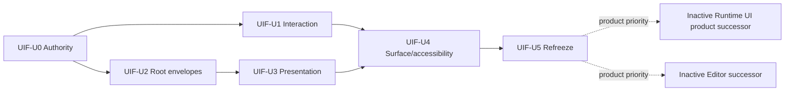

# UI Foundation Correction - Plan

## Goal Capsule

- **Objective:** Re-establish a deep, renderer-neutral UI Foundation whose compile, present and
  dispatch Interfaces preserve one exact presented revision across layout, paint, hit testing,
  focus, semantics, resources and typed intent.
- **Scope:** Correct only shared contracts already claimed by the landed UI architecture. Do not
  add a general component catalogue, binding language, docking framework, multi-window policy,
  virtualization engine, or second public renderer topology.
- **Product order:** Runtime UI product acceptance is paused until this plan publishes a new
  Foundation Conformance Baseline. The Reference Game remains a late acceptance carrier and may
  provide neutral reproductions, but it cannot design a shared Interface.
- **Authority:** This is the sole active UI execution plan. The predecessor remains immutable
  historical evidence. Successor plans are inactive until UIF-U5 publishes completion evidence.
- **Execution profile:** Nara is pre-1.0. Prefer owning-module fearless refactors and deletion of
  obsolete paths over compatibility wrappers. Keep Cargo commands serial with one build job.

## Product Contract

### Shared Interface

```text
compile(authoring_snapshot, environment, limits)
    -> Compiled(UiFrameCandidate) | CompileRejected(diagnostics)
present(PresentationRequest {
    candidate, target, surface_slot_generation,
    environment_revision, capability_generation, gpu_generation,
})
    -> Presented(OneShotPresentationCommit)
     | ContentRejected
     | Deferred(retry_identity)
     | BackendFault
OneShotPresentationCommit::commit() -> UiPresentationReceipt
dispatch(presented_receipt, input_event)
    -> Consumed | PassThrough | RejectedClosed + typed intents
```

The exact Rust names may evolve during implementation, but the following facts are durable:

1. A candidate is immutable and revisioned. Root-local failures are candidate outcomes; global
   identity, profile or capacity failures return `CompileRejected` without a candidate.
2. A receipt is returned only by consuming the backend-issued one-shot commit for the exact packet,
   target, Surface Slot, environment, capability and GPU generations. Consumers and journals cannot
   construct or advance receipt authority directly.
3. Only that receipt may route pointer, keyboard, gamepad or platform accessibility actions.
4. `RejectedClosed` changes no session, widget reducer or intent-journal state. Geometry/capture
   reconciliation is represented as a successful consumed transition when it must mutate state.
5. `PassThrough` leaves UI state unchanged and explicitly permits gameplay routing.
6. `ContentRejected` and `Deferred` do not replace last-presented state. A deferred retry is valid
   only for its exact generations; `BackendFault` retires the GPU generation and every retry bound
   to it.

### Foundation invariants

- Root-local authoring failure cannot discard valid sibling roots. Global snapshot limits and
  identity errors remain whole-snapshot failures.
- A compatible last-good root stores relative root-local facts. Current layer and structural order
  are rebound from the current root envelope; stale global paint coordinates are never reused.
- Pointer position, focus, capture, semantic target and route stamps are tied to a presentation
  and geometry revision. A resize or scale change cancels stale capture and cannot reuse old
  coordinates.
- A semantic snapshot is read-only. It cannot invent or publish focus that the presented session
  did not commit.
- Glyph, primitive, node, atlas and upload limits are enforced without resetting the allowance for
  each text node or root. The owning budgets are deliberately split: kernel compilation owns
  candidate-wide node, shaped-glyph and logical-paint admission; the presentation planner owns
  target-plan-wide expanded primitives, referenced resources, atlas memory and packet retention; the
  concrete backend owns device upload, instance-buffer and residency work. First-party authoring
  capabilities close before packet acceptance. This baseline admits one bounded uniform corner
  radius for fill, image and border; the planner closes it into renderer-neutral rect facts and the
  first-party WGPU adapter must render it. Asymmetric radii remain deferred.
- Each Surface Slot has a stable identity, endpoint binding, route/presentation/geometry generation,
  retirement generation and one exact `SurfaceContentTransform`. UIF exposes only the current
  all-roots authoring scope and current theme/font environment; generic root selection and per-surface
  theme choice remain private/deferred until render-target UI or an Editor Viewport consumes them.
  Multiple surfaces do not overwrite one another through map iteration.
- During this Foundation baseline one presentation target admits at most one active Surface Slot.
  Multiple slots are supported only when they have distinct presentation targets; target aggregation,
  compositing and viewport fan-in are deferred to a named successor.
- Platform accessibility actions, if enabled for a product, enter the same exact presented-session
  transaction as normalized input. A platform-neutral semantic action remains a valid Foundation
  proof without claiming OS adapter acceptance.
- A current modal barrier is envelope state, not cached root-body state. If a modal body fails but a
  compatible last-good visual exists, the visual is inert while the current barrier still blocks
  underlay UI and gameplay. A modal failure without a valid barrier/fallback rejects the candidate
  and preserves the prior presented session.

### Budget failure domains

Budget dimensions are not silently truncated and are not re-granted per root or packet. Allocation
and failure scope are deterministic in current structural order, then paint/resource key order:

| Owner | Dimensions | Admission point | Failure disposition |
|---|---|---|---|
| `nara_ui_kernel` | root count, node count, shaped glyphs, logical paint, depth/diagnostic bounds | snapshot preflight and tentative candidate compilation | whole-candidate `CompileRejected` before revision/cache/LRU mutation |
| `nara_ui_render` planner | expanded primitives, referenced images/glyphs, atlas pages/bytes, retained packet bytes | target-plan preflight and staged resource planning | `ContentRejected`; last-presented packet and planner state remain unchanged |
| concrete backend | device upload bytes, instance-buffer bytes, residency/queue work | backend frame submission | `Deferred` when retryable, `BackendFault` for device failure; no receipt advances |

Root-local authoring errors remain isolated until a shared candidate budget is exhausted. There is
no partial target presentation and no order-dependent silent truncation. A retryable backend budget
may make residency progress, but it never publishes a receipt until the complete packet is accepted.

### Foundation baseline lineage

UIF-U5 publishes a **Foundation Conformance Baseline**, not a claim of product validation. Runtime
and Editor successors pin its immutable record. If either exposes a shared defect, that product plan
is suspended, a focused UIF correction publishes a successor baseline, and the product explicitly
rebases before resuming. Historical evidence is never edited. A **Product-Validated Baseline** may be
published only after a complete product workflow consumes a pinned conformance baseline.

## Reference pressure policy

The [UI Foundation Design](../architecture/ui-foundation-design.md) pressure matrix is required
evidence, not implementation authority. Open-GPUI supplies stable-key, frame-journal, focus,
virtualization and logical-docking pressure; Dear ImGui supplies Editor adapter and viewport
failure pressure; Godot supplies Control and author workflow pressure; Bevy supplies layout/text/
controlled-widget/render algorithm pressure. Unity remains a secondary organization analogy until a
primary source/version and neutral assertion are pinned. Nara rejects external lifecycle, identity,
global-service and public render-topology models.

## Planning Contract

### Execution order



Execution remains operationally serial as UIF-U1, U2, U3, U4 and U5 so that one active registration
and one Cargo owner exist at a time. The graph records technical dependencies rather than inventing a
dependency between unrelated owners. UIF-U5 admits exactly one product successor as the next active
plan; the other remains independently eligible against the same pinned conformance baseline.

### Alternatives considered

1. **Continue the 16-unit master plan.** Rejected because Foundation correction, product
   acceptance and final cleanup share one closure point and repeatedly reopen one another.
2. **Finish U15B and record Foundation defects as debt.** Rejected because the confirmed defects
   violate the exact-session, root-local failure and resource-bound claims that U15B would consume.
3. **Create one public crate per lifecycle owner now.** Rejected because internal seams are enough
   until an independent dependency closure or second adapter proves a real crate seam.
4. **Sequential Foundation plan with inactive product successors.** Accepted because it preserves
   one active authority while making each shared Interface independently reviewable.

### Risks and mitigations

| Risk | Mitigation |
|---|---|
| Foundation scope expands into a widget framework | UIF units admit only existing claimed invariants; product breadth remains in successors |
| Refactor invalidates useful product WIP | Preserve the WIP unstaged, migrate only after UIF-U5, and do not claim it as evidence |
| Internal module split becomes shallow indirection | Test through the three external Interfaces and keep private seams replaceable |
| Resource closure introduces excessive work | Use one target-frame budget and one representative backend proof, not repeated product matrices |
| Authority drifts again | Every unit publishes an immutable registration/evidence successor and renders derived rollups |

## Verification Contract

| Gate | Command or evidence | Applies to |
|---|---|---|
| V1 Interaction owners | `cargo nextest run --locked -p nara_ui_kernel -p nara_ui_widgets -p nara_ui --test-threads=1` | UIF-U1 |
| V2 Root compiler | `cargo nextest run --locked -p nara_ui_kernel --test compile_order --test failure_atomic --test validation --test-threads=1` | UIF-U2 |
| V3 Presentation owners | `cargo nextest run --locked -p nara_ui_kernel -p nara_ui_render -p nara_render_wgpu --all-features --test-threads=1` | UIF-U3 |
| V4 Surface/platform adapter | `cargo nextest run --locked -p nara_ui_kernel -p nara_ui_widgets -p nara_input -p nara_ui -p nara_winit --all-features --test-threads=1` | UIF-U4 |
| V5 Neutral examples | `cargo run --locked -p nara_ui_kernel --example layout_gallery -j 1`; `cargo run --locked -p nara_ui --example interaction_lab -j 1`; `cargo run --locked --example ui_presentation_gallery --features presentation-ui,desktop-winit,render-wgpu -j 1` | UIF-U5 |
| V6 Independent consumer | `cargo nextest run --manifest-path ui-module-consumer/Cargo.toml --locked --test-threads=1` | UIF-U5 |
| V7 Compile/lint/format | serial locked check, changed-target clippy with `-D warnings`, and `cargo fmt --all -- --check` | Every code unit; full shared gate at UIF-U5 |

Documentation-only UIF-U0 uses link/frontmatter inspection plus engineering-memory validation. No
Reference Game product matrix is required by UIF-U0 through UIF-U4.

### Unit index

| Unit | Owning seam | Depends on | Stop condition | Successor |
|---|---|---|---|---|
| UIF-U0 | Architecture authority | predecessor evidence | More than one active plan/registration remains | UIF-U1 |
| UIF-U1 | Presented-session dispatch | UIF-U0 | A rejection must mutate uncommitted UI state to stay correct | UIF-U2 |
| UIF-U2 | Snapshot/compiler boundary | UIF-U0 | Root-local failure cannot coexist with global identity safety | UIF-U3 |
| UIF-U3 | Presentation planner/backend | UIF-U2 | Legal authoring requires submit-time live World/asset reads | UIF-U4 |
| UIF-U4 | Host Surface Slot/platform adapter | UIF-U1 and UIF-U3 | Platform identity must enter the kernel or two surfaces share mutable state | UIF-U5 |
| UIF-U5 | Public neutral consumers | UIF-U1 through UIF-U4 | A conformance Interface still has an unresolved P0/P1 owner defect | one product successor |

## Implementation Units

### UIF-U0 — Authority rebaseline

**Depends on:** completed NUI evidence and the superseded master plan.

**Goal:** Replace the 16-unit cross-domain execution authority with this Foundation plan and register
the Runtime UI and Editor successor plans without pretending they are active.

**Files:** active plan, roadmap, architecture map, ADR 0102 and focused successor ADRs, ledger,
engineering-memory registration/evidence.

**Verification:** Direct frontmatter/link inspection, no stale active registration and reciprocal
`supersedes` links. The predecessor plan permits this one controlled frontmatter authority transition
to `superseded`; its body and all historical evidence remain immutable.

**Exit:** One active UIF registration points here; the predecessor is `superseded`; successor plans
are inactive and reference this plan.

### UIF-U1 — Atomic presented-session interaction

**Depends on:** UIF-U0.

**Goal:** Fix the owning transaction/session contract and refreeze disabled-focus identity.

**Files:** `crates/nara_ui/src/interaction/**`, `crates/nara_ui_kernel/src/interaction/**`,
`crates/nara_ui_widgets/**`, neutral interaction lab, focused tests and the migration guide for
the intentional transaction/input break.

**Required cases:** rejected disabled/retired/stale routes leave session, reducer and journal
unchanged; consumed reconciliation commits capture/hover cleanup atomically; resize/scale cancels
capture; disabled focus remains the navigation origin but not a destination; re-enable of the same
key restores the visual focus state, including the focused-plus-disabled visual composition; semantic
snapshots report only committed focus. A disabled current item remains the navigation origin while
enabled candidates alone are destinations, including middle-item sequential and directional cases.
Publishing a newer presented frame reconciles removed or changed controls before their stable keys can
be reused, so capture, focus and reducer state cannot survive a remove/reinsert cycle. When a route has
pending lifecycle reconciliation, that cleanup commits before an otherwise rejected input is
classified; unsupported input cannot postpone required cleanup.

**Verification:** owning nextest, the public interaction lab, and a focused regression for each
disposition. No Reference Game matrix.

**Exit:** A new immutable evidence record names the exact transaction and focus assertions.

### UIF-U2 — Root envelopes and order-safe fallback

**Depends on:** UIF-U0. It executes after UIF-U1 but does not consume interaction implementation.

**Goal:** Make root-local validation and fallback independent while preserving current structural
order.

**Required cases:** one malformed root does not suppress valid roots; an invalid root body contributes
no hit/focus/semantics/action; a last-good root rebinds current layer/sequence after reorder or layer
change; global identity/limit errors remain fail-closed. Current modal membership and barrier policy
belong to the envelope rather than cached body facts: an inert retained modal still blocks underlay UI
and gameplay, while a modal with no valid barrier/fallback rejects the candidate and preserves the
previous presented session. Every whole-candidate rejection retires any older unpresented candidate
for that surface; only an already committed presented session may remain authoritative.

**Verification:** kernel compile/order nextest, a neutral multi-root example, and an explicit
reorder-while-invalid regression.

**Exit:** The compiler exposes root-local outcomes through the existing candidate boundary without
leaking normalized IR or cache types.

### UIF-U3 — Presentation planner and capability closure

**Depends on:** UIF-U2.

**Goal:** Make resource ownership and limits truthful at the presented-frame boundary.

**Required cases:** kernel candidate-wide node/shaped-glyph/logical-paint budgets and planner
target-plan-wide primitive/resource/atlas/retention budgets are each enforced once; packet-owned
image and glyph snapshots survive backend submission; bounded uniform radii for fill/image/border are
closed by the planner and rendered by WGPU; staged planner state and the last-presented packet are
unchanged on `ContentRejected`; backend upload/residency work may return `Deferred` only with an exact
retry identity and without advancing receipt authority; `BackendFault` retires its GPU generation.
Text measurement cannot multiply expensive shaping across callbacks before applying the shared
candidate allowance. Only a backend-issued one-shot presentation commit can publish a receipt.

**Verification:** `nara_ui_render`/WGPU focused nextest, one neutral presentation gallery, and one
representative readback. No repeated product hash matrix.

**Exit:** Presentation planner owns the complete packet/resource/capability decision and the backend
does not re-read live gameplay assets.

### UIF-U4 — Surface slots and accessibility ingress

**Depends on:** UIF-U1 and UIF-U3.

**Goal:** Make surface identity and platform action ownership explicit without coupling the kernel to
Winit or AccessKit.

**Required cases:** a precise `SurfaceContentTransform` defines platform-logical, physical-surface,
physical-content and authored-logical coordinates, safe-area ordering, forward/inverse mapping and
outside-content behavior; one active slot per presentation target; retirement releases all endpoint
state; transform changes cancel stale pointer/capture state; multiple distinct targets do not
overwrite focus or routes. Platform accessibility actions become receipt-stamped typed events before
dispatch; semantic actions are advertised only when a controlled behavior owner resolves them.
Generic root selectors, per-surface theme selection and target aggregation remain deferred.

**Verification:** kernel surface lab, Winit adapter test where the feature is enabled, and a two-
surface route isolation regression.

**Exit:** Host owns endpoints and platform lifecycles; kernel sees only backend-neutral Surface Slot
facts and exact receipts.

### UIF-U5 — Neutral refreeze and handoff

**Depends on:** UIF-U1 through UIF-U4.

**Goal:** Publish a Foundation Conformance Baseline that is safe for product integration without
claiming product validation.

**Verification:** `layout_gallery`, `interaction_lab`, `ui_presentation_gallery`, UI module consumer,
focused shared nextest, serial formatting/lint, and direct public-inventory audit. The baseline
record includes the exact commit, public inventory, invariants, assertions, reference pressure
matrix revision, and predecessor record it supersedes.

**Exit:** Close UIF and activate exactly one product successor against the pinned conformance record.
Runtime UI is the default next delivery priority; Editor remains independently eligible and is not a
technical descendant of Runtime UI.

## Non-goals and admission triggers

- No complete Editor shell, docking, detached native windows, or multi-viewport implementation.
- No generic binding/expression language, importer/provider registry, RenderGraph, RenderApp,
  virtualization framework, or second official author language.
- No broad widget implementation merely to fill a catalogue. A new shared widget needs a named
  invariant, a real workload, and either independent comparative pressure or a second heterogeneous
  consumer.

## Definition of Done

- UIF-U0 through UIF-U5 have immutable evidence and one active successor registration.
- Three deep Interfaces remain free of ECS, Host, WGPU and toolkit identity leakage.
- Every UIF-U1 through UIF-U4 failure scenario is fail-closed and tested through the owning seam.
- No stale active plan, orphan test, compatibility alias, duplicate order authority, live submit-
  time asset read, or redundant Cartesian/hash smoke remains in the affected path.
- The Runtime UI and Editor plans can pin the conformance baseline. A shared defect follows the
  suspend/correct/rebase lineage instead of rewriting the baseline or silently widening a product plan.
