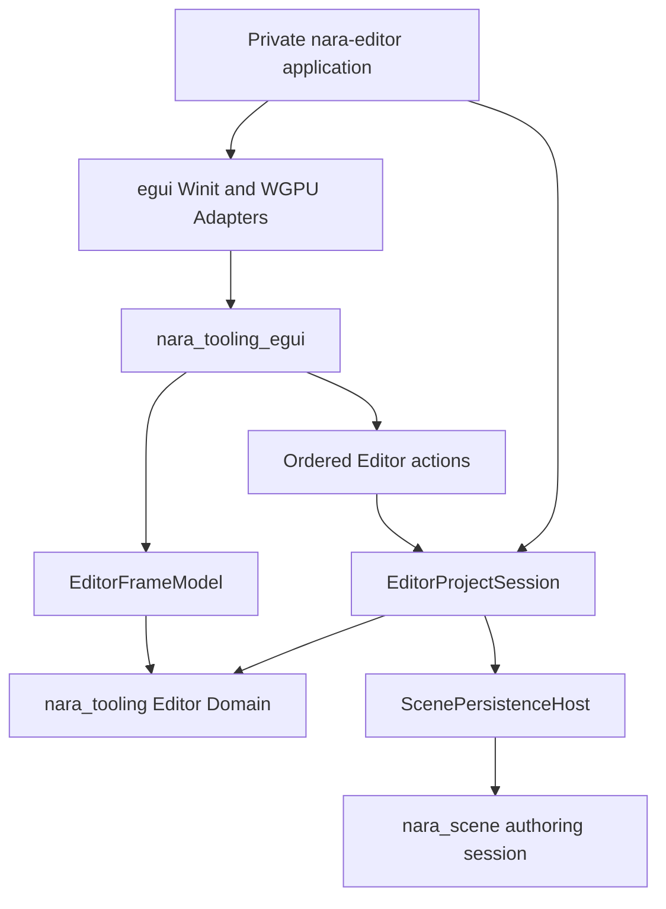
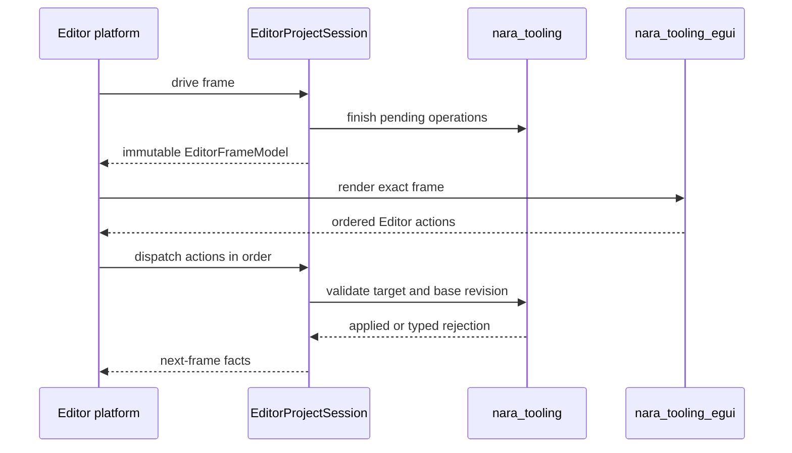
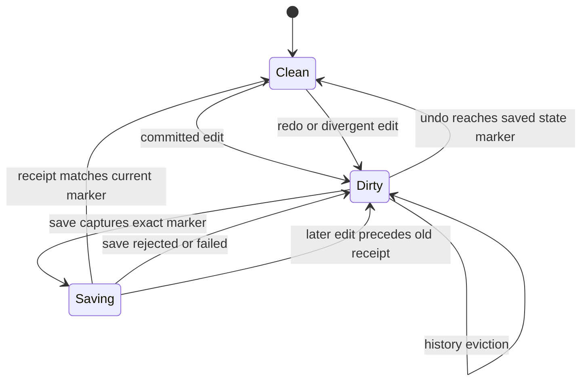

# Editor Authoring Loop v1 - Plan

## Goal Capsule

| Field | Contract |
|---|---|
| Objective | Deliver a bounded Editor Authoring Loop v1: open the startup Scene, inspect its canonical tree, apply one exact edit, prove Undo and Redo, save, close and reopen, and let the existing project commands consume the same source change. |
| Product owner | A private first-party `nara-editor` application composes `EditorProjectSession`, the egui Adapter, and native platform integration. |
| Architecture authority | Accepted ADRs 0015, 0026, 0047, 0104, and 0107 remain authoritative. This plan does not create a second Editor Domain or reopen Runtime UI Foundation. |
| Execution profile | Five dependency-ordered units, focused owner tests, one authoring trajectory, and one local native-window canary. |
| Stop conditions | Stop the affected path if exact document authority cannot close inside the existing Scene/Tooling owners, if the private application would require runtime crates to depend on Editor code, or if implementation requires an unresolved Viewport, missing-schema, or Play-placement decision. |
| Tail ownership | The final unit updates the ADR implementation ledger and engineering-memory evidence. Plan progress remains derived from Git and memory shards, not this file. |

---

## Product Contract

### Summary

Editor Authoring Loop v1 deepens the existing Editor Domain and egui Adapter into one launchable single-window product slice.
It deliberately proves authoring before Viewport, docking, multi-document, or custom Nara Editor UI expansion.

Product Contract preservation: changed with user approval — the former multi-document, Viewport, continuous-gesture, IME, and OS-accessibility scope is narrowed to the first bounded startup-Scene authoring loop; those capabilities remain explicit successors. This plan does not publish the first complete Editor Product-Validated Baseline under ADR 0041; that claim still requires a focused keyboard, focus-recovery, semantic-output, and IME slice.

### Problem Frame

Nara already has UI-neutral Editor workspace state, Scene inspection and patching, receipt-backed persistence, Host-owned runtime control, and an egui Adapter.
It does not have a launchable Editor application, and several current seams are unsafe for a real UI: mutations may target the current active document implicitly, Inspector drafts are not revision-bound, selection is mirrored between owners, history is unbounded, and dirty state compares monotonic revisions instead of document content state.

Building another general Foundation would preserve those defects behind a larger Interface.
Building the Shell first would freeze them into a product.
This plan corrects the owning contracts, then delivers one bounded author workflow through existing engine modules.

### Key Decisions

- KD1. **Use egui for the first Editor product layer.** (session-settled: user-approved — chosen over immediately forcing Nara UI: the custom toolkit has not yet proven a complete dense Editor panel.) Governs R1, R8, R12.
- KD2. **Ship one startup-Scene authoring loop before broader Editor features.** (session-settled: user-approved — chosen over the former multi-document, Viewport, IME, and docking scope: a smaller workflow provides product evidence without reopening unrelated architecture.) Governs R8, R10, R11, R13, R15.
- KD3. **Preserve a complete-panel path to a custom-drawn Nara Editor.** (session-settled: user-approved — chosen over permanent egui lock-in: a later Nara UI Inspector must consume the same immutable model and ordered action trace.) Governs R9, R14.
- KD4. **Keep the application private and product-specific.** (session-settled: user-approved — chosen over new public Editor Foundation crates: the first product consumer should deepen existing owners before introducing reusable public seams.) Governs R1, R8, R12.

### Requirements

#### Editor authority and action identity

- R1. `nara_tooling` owns document, selection, history, dirty, diagnostics, and Editor action semantics; toolkit and platform code only project models and return typed actions.
- R2. Every document mutation, Undo, and Redo action carries a non-optional `EditorDocumentId` and exact base `SceneAuthoringRevision`; workspace navigation carries its exact target but does not invent a revision.
- R3. Missing, stale, reopened, or mismatched mutation targets reject before document, history, selection, persistence, or runtime state changes.
- R4. Each document slot is the single selection authority; Inspector models consume selection and do not retain a second durable selected entity.
- R5. The Scene Tree model follows the canonical ordered `roots + children` projection and supplies depth and parent facts; Adapters do not independently sort or reconstruct hierarchy.

#### History, dirty state, and persistence

- R6. `SceneAuthoringSession` bounds combined Undo and Redo history through `SceneAuthoringHistoryLimits`. The v1 defaults are 256 records, 1,048,576 patch-operation-equivalent structural items, 1,048,576 value nodes, and 64 MiB of logical payload in total, with per-inverse ceilings of 262,144 operations or embedded structural records, 262,144 nodes, and 16 MiB. Value cost reuses deterministic `ComponentValueCost`; the structural budget also charges embedded entity records, child edges, component records, and nested patch operations, while logical bytes include their stable identifiers. A single over-limit inverse rejects before document publication, while total-budget pressure evicts the oldest Undo records after a successful edit. Limits are fixed when the session is constructed rather than changed while history is live.
- R7. Document revision remains monotonic for conflict detection, while an opaque branch-safe content-state marker identifies the current history state and the saved checkpoint without introducing another content digest. A Save request captures document identity, exact revision, exact content-state marker, and serialized bytes as one persistence checkpoint whose identity survives history eviction.
- R8. Undo to the saved content state makes the document clean, while Redo or a divergent edit makes it dirty again; history eviction never falsely reports clean. A source that requires canonical upgrade remains dirty until a verified Save receipt clears that condition, even when current and saved content-state markers otherwise match.
- R9. Only a verified persistence receipt advances the saved checkpoint to the exact marker captured by that Save request; edits accepted while Save is pending remain dirty when the older receipt arrives. Save or Reopen failure preserves the prior document, dirty state, selection, and actionable diagnostics.

#### Launchable Editor product

- R10. A private `publish = false` `nara-editor` workspace package opens one project capability and its configured startup Scene under the complete-schema-only policy.
- R11. The application presents one native window with a fixed layout: a full-width Undo, Redo, Save, and Reopen toolbar; Scene Tree on the left; Inspector as the primary right-hand work area; and full-width Diagnostics below. Each content panel scrolls independently, the layout has explicit minimum window and panel sizes, and narrow-window overflow never introduces a docking or persistent layout model. Toolbar enabled state comes only from the frame model: history availability controls Undo/Redo, dirty plus persistence-idle controls Save, and operation conflicts control Reopen.
- R12. One immutable `EditorFrameModel` represents the post-drive facts for a frame, and one ordered action list is the only Adapter-to-Host mutation ingress. In v1, one document may receive at most one revision-advancing action from a frame; revision-free navigation may precede it, and a second mutation receives a typed rejection instead of implicit revision chaining.
- R13. Dirty close and exit use the existing Save, Discard, or Cancel outcomes; no close path silently drops a dirty document or leaves a persistence operation partially applied.
- R14. The private application owns native window, event-loop, egui platform, and egui renderer lifetimes; no toolkit ID, WGPU handle, Winit handle, or egui memory enters durable Editor Domain data.
- R15. Open failure for a missing startup Scene, invalid project capability, unavailable schema, or invalid source returns bounded terminal diagnostics and never presents a partially usable document. Field validation and stale-action failures render both inline and as durable Diagnostics entries; Save/Reopen failures remain visible and retryable until their matching operation succeeds or the user dismisses them; successful unrelated operations do not clear them.

#### Product trajectory and successor compatibility

- R16. One ordinary starter-project source edit follows the exact sequence Edit → stale-action rejection → Undo to clean → Redo to restore the edit → Save → Close → Reopen verification → Close, then is consumed by existing check, generated-product run, and source-carrying export paths.
- R17. The future Nara UI Inspector parity successor consumes the same `EditorFrameModel` and ordered Editor actions; this plan does not create a cross-toolkit Widget trait or compatibility layer.
- R18. Verification remains proportional: owner-level state tests, one product trajectory, one local native-window canary, and the final affected feature check replace matrix smoke, opaque hash catalogs, and script-side source interpretation.

### Key Flows

- F1. **Open and edit**
  - **Trigger:** The user launches `nara-editor` with a project root.
  - **Steps:** The application opens the project capability, resolves the configured startup Scene, constructs one `EditorProjectSession`, presents one coherent frame model, selects an entity, and submits one exact revision-bound edit.
  - **Outcome:** The edit either applies atomically and creates one history record or rejects without state change.
  - **Covered by:** R1-R5, R10-R12, R15.
- F2. **Undo, save, and reopen**
  - **Trigger:** The active document contains an applied edit.
  - **Steps:** The user undoes or redoes, saves through the persistence Host, closes or reopens the document, and observes a new frame model.
  - **Outcome:** Dirty state follows the content-state checkpoint, only a verified receipt marks the source clean, and obsolete drafts cannot target the reopened session.
  - **Covered by:** R2-R4, R6-R9, R12-R13.
- F3. **Consume the edited source outside the Editor**
  - **Trigger:** The Editor has saved and closed the project.
  - **Steps:** Existing project check, generated-product run, and export paths load the same project root.
  - **Outcome:** All three consumers observe the saved semantic change without an Editor-private hook or Reference Game-specific presenter.
  - **Covered by:** R16, R18.

### Acceptance Examples

- AE1. **Exact edit applies once.** Given document D at revision 7, when the Inspector submits one action for D at revision 7, then the document advances once, one history record is created, and the next frame reports the new revision.
- AE2. **Stale draft fails closed.** Given a draft produced for document D revision 7, when Reopen replaces it with revision 8 before submission, then the old action is rejected and no document, history, selection, or dirty fact changes.
- AE3. **Undo can restore clean state.** Given a saved checkpoint followed by one edit, when Undo returns to that checkpoint, then the monotonic revision advances but the document reports clean; Redo reports dirty.
- AE4. **Save failure preserves authority.** Given a dirty document, when persistence fails before a verified receipt, then the saved checkpoint does not advance and the application remains open with diagnostics.
- AE5. **Dirty close is explicit.** Given a dirty document, when the user closes the window, then Save, Discard, or Cancel is required and Cancel leaves the session unchanged.
- AE6. **Same-source handoff.** Given a saved starter-project edit, when existing check, generated-product run, and export consume the project, then each observes the edited value without changing Rust source.

### Scope Boundaries

#### Deferred to Follow-Up Work

- Embedded Viewport, picking, gizmos, shared render-target leases, and shared GPU ownership remain gated by OQ-022.
- In-Editor Play placement, child-process control, and local transport remain gated by OQ-039; existing `EditorProjectSession` Play behavior is preserved but is not exposed by the v1 Shell.
- Multi-document tabs, per-document persistence lanes, cross-document transactions, Prefab documents, Asset Browser, and external merge recovery require separate workflows.
- Continuous Slider, drag, gizmo, text composition, IME, clipboard, and OS accessibility require their own interaction slice under ADR 0026.
- Unavailable-schema lossless authoring remains gated by proposed ADR 0090; v1 is complete-schema-only and fail-closed.
- Structured data assets remain gated by OQ-033 and a concrete reusable weapon, enemy, item, or balance-data workflow.
- Docking, detached windows, multi-viewport, EditorPlugin contribution registries, and custom panel distribution remain deferred.
- Nara UI Editor convergence starts with one complete Inspector parity successor after this plan, not with isolated widget ports.
- Before any complete Editor Product-Validated Baseline, a focused ADR 0041 successor must prove keyboard reachability, focus recovery, semantic output, platform accessibility publication, and one IME-backed text-edit path without reopening this plan's document and persistence architecture.

#### Outside This Plan

- New Reference Game content, a second game, runtime UI widget breadth, a generic binding language, a generic async job framework, RenderGraph, or a new public Editor Foundation crate.
- A compatibility layer that preserves optional-document mutation commands, duplicate selection state, unbounded history, or fragmented egui response channels.

---

## Planning Contract

### Key Technical Decisions

- KTD1. **Split navigation from revision-bound mutation.** `EditorWorkspaceCommand` stops acting as one permissive bag of optional targets. UI-neutral ordered actions distinguish workspace navigation from exact document mutation, and `EditorProjectSession` performs the only dispatch. One frame may contain ordered navigation plus at most one revision-advancing action per document; later mutations reject rather than rebasing or forming an implicit transaction. Implements R1-R4 and R12.
- KTD2. **Use branch-safe content-state identity instead of another digest.** `SceneAuthoringSession` assigns opaque identities to committed history states, moves the current marker during Undo and Redo, and records only the exact marker captured by a verified persistence receipt. The captured marker remains valid independently of retained inverse records; source-upgrade-required remains an additional dirty condition until verified Save. Revision remains monotonic and independent. Implements R6-R9.
- KTD3. **Build one coherent frame snapshot.** The Host drives pending persistence and workspace state before constructing an immutable `EditorFrameModel` containing workspace, active document, ordered tree, operation states, diagnostics, and a model revision. The Adapter never joins facts from multiple Host reads. Implements R5, R9, R12.
- KTD4. **Use a private direct egui platform stack.** (session-settled: user-approved — chosen over eframe ownership: the concrete Editor application must remain the owner of event-loop, native-window, and GPU lifetimes.) The private application uses the official egui Winit and WGPU Adapters and aligns the workspace egui version with the companion crates and the existing Winit/WGPU major versions. Implements R10-R11 and R14.
- KTD5. **Keep the first Shell fixed.** Scene Tree ordering comes from tooling; Inspector and Diagnostics consume the same frame; transient layout, focus, scroll, and field buffers remain application or Adapter state. No logical docking model is introduced. Implements R11-R15.
- KTD6. **Deepen existing owners and split only private implementation.** (session-settled: user-approved — chosen over creating future-facing public crates: the current domain, Host, and Adapter already form the required dependency closure.) Large touched files may split into private submodules while their public Interfaces shrink or remain stable. Implements R1, R10, R17.
- KTD7. **Amend existing ADRs instead of adding a new Editor umbrella ADR.** ADR 0026 receives exact mutation and bounded history refinements, ADR 0047 receives single-selection and v1 document-scope refinements, and ADR 0015/0107 receive implementation links only when the corresponding code lands. Implements R1-R18.
- KTD8. **Verify through owners plus one workflow.** (session-settled: user-approved — chosen over broad smoke and digest matrices: the first Editor needs behavioral confidence without rebuilding a verification product.) Implements R18.

Revision vocabulary is exact: `SceneAuthoringRevision` is the mutation precondition; `EditorFrameRevision` identifies one immutable frame snapshot; workspace and operation generations retain their existing typed identities. Inspector drafts bind to the document and `SceneAuthoringRevision`, never to the frame revision or an unqualified “source revision.”

This plan pins Foundation Conformance Baseline `a628828a8ff941239d79a0b8b3d60316`. A shared UI defect suspends the affected Editor unit, requires a focused Foundation successor, and resumes only after this plan explicitly rebases; historical evidence remains immutable.

History accounting is deterministic and serializer-independent. `SceneAuthoringHistoryLimits` counts Undo and Redo records together. Value-node cost comes from existing `ComponentValueCost`; logical bytes add stable structural identifiers, and operation-equivalent work adds embedded entity records, child edges, component records, and nested patch operations so structural-only patches are not free. A new successful edit clears Redo, appends its admitted inverse, and evicts oldest Undo entries until all total ceilings hold. Undo and Redo move one admitted record between stacks without a second budget allocation.

### High-Level Technical Design

#### Module topology



`nara_tooling` owns durable Editor semantics.
`nara_tooling_egui` and the private application are replaceable product Adapters.
Runtime crates do not depend on the Editor application.

#### Frame and action sequence



The Adapter never mutates the workspace and never retries a rejected action against a newer active document.

#### History and dirty-state lifecycle



Revision advances on every accepted document transition.
Clean and dirty derive from the current content-state marker versus the receipt-backed saved marker.
Canonical source upgrade remains an independent dirty reason until the upgraded bytes receive a verified persistence receipt.

### Output Structure

```text
editor/
├── Cargo.toml
├── src/
│   ├── main.rs
│   ├── app.rs
│   └── platform.rs
└── tests/
    ├── application_contract.rs
    └── authoring_loop.rs
```

The first package stays intentionally small.
Platform internals split further only if implementation shows a concrete owner or independent test seam.

### Sequencing

U1 closes document and history correctness before UI code can depend on it.
U2 publishes one Host-owned frame/action seam and privately separates the existing Host implementation.
U3 migrates the egui Adapter to that seam.
U4 creates the native application only after the Adapter no longer exposes unsafe authority.
U5 proves the workflow and publishes documentation/evidence.

### System-Wide Impact

- Public Tooling command shapes may break because Nara is pre-1.0 and optional target fallback is intentionally removed.
- `SceneAuthoringSession` history behavior changes for all authoring consumers, while runtime Scene loading and ECS projection remain unchanged.
- The egui dependency aligns with the official platform/render companion crates; Runtime UI and WGPU submission topology remain unchanged.
- The new application is a first-party product consumer of the root facade and does not enter gameplay preludes.
- Future agent or AI editing can emit the same exact Editor actions and receive the same typed rejection outcomes as the GUI.

### Risks and Dependencies

| Risk | Mitigation |
|---|---|
| Shell work freezes unsafe optional-document commands | U1 and U2 are hard dependencies of Adapter and application work. |
| Bounded history loses clean-state truth after eviction | Content-state identity remains valid independently of retained inverse records; eviction cannot synthesize a clean result. |
| An old Save receipt marks newer edits clean | Save captures an exact content-state marker; receipt application advances only that marker and re-evaluates dirty against the current marker. |
| egui platform integration becomes a second engine runtime | Keep it inside `editor/src/platform.rs`; do not generalize `nara_winit::WinitRunner`, expose GPU handles, or modify Runtime UI Foundation. |
| Dependency alignment causes unrelated egui regressions | Upgrade the workspace egui family together and run the existing `nara_tooling_egui` suite before application work. |
| Fixed Shell expands into docking or Viewport | The application has no docking graph, render-target lease, or panel contribution Interface in this plan. |
| Product trajectory becomes another verification framework | Use one starter project and existing check/run/export owners; do not add a matrix runner or source parser. |

### Sources and Research

- `STRATEGY.md` — complete workflows drive generalization; horizontal crate and ADR expansion needs direct product or safety pressure.
- `docs/architecture/adr/0015-editor-tooling-and-dogfooding-boundary.md` — Editor Domain and toolkit Adapter ownership.
- `docs/architecture/adr/0026-editor-command-patch-and-undo-model.md` — validated patches, inverse history, and future continuous transaction semantics.
- `docs/architecture/adr/0047-editor-workspace-and-scene-document-state.md` — workspace, document, selection, persistence, and Play state ownership.
- `docs/architecture/adr/0104-host-owned-editor-workspace-installation.md` — concrete Host-owned workspace installation.
- `docs/architecture/adr/0107-shared-ui-foundation-and-independent-product-layers.md` — egui-first Editor and later complete-panel Nara UI parity.
- `docs/knowledge/engineering/verification/2026-08/2026-08-12T051123Z-uifd-u2-successor-foundation-conformance-baseline-a628828a8ff941239d79a0b8b3d60316.md` — pinned shared UI Foundation baseline and rebase protocol.
- `crates/nara_tooling/src/workspace.rs`, `crates/nara_tooling_egui/src/lib.rs`, and `src/project_host/runtime/editor.rs` — current owners and unsafe optional-target/frame-join seams.
- Official `egui-winit` 0.36.1 and `egui-wgpu` 0.36.1 documentation — companion platform/render Adapters aligned with Winit 0.30 and WGPU 30.
- `docs/solutions/` is absent; no institutional solution artifact overrides the current ADR and code evidence.

---

## Implementation Units

### U1. Exact document authority and bounded clean-aware history

**Goal:** Make every authoring mutation exact, failure-atomic, bounded, and capable of returning to a saved content state.

**Requirements:** R2-R9; KTD1-KTD2.

**Dependencies:** None.

**Files:**

- `crates/nara_scene/src/authoring.rs`
- `crates/nara_scene/src/lib.rs`
- `crates/nara_tooling/src/workspace.rs`
- `crates/nara_tooling/src/inspector.rs`
- `tests/scene_authoring_session.rs`
- `tests/scene_inspector.rs`
- `tests/editor_persistence.rs`
- `reference-game/tests/editor_journey.rs`
- `docs/architecture/adr/0026-editor-command-patch-and-undo-model.md`
- `docs/architecture/adr/0047-editor-workspace-and-scene-document-state.md`

**Approach:**

1. Replace optional active-document mutation fallback with exact document and base-revision preconditions while keeping navigation actions revision-free.
2. Make the workspace slot the only selection authority and derive Inspector selection from it.
3. Project Scene Tree rows from canonical roots and ordered children with depth and parent facts.
4. Add bounded history admission and branch-safe content-state identity inside `SceneAuthoringSession`.
5. Capture the exact content-state marker in the persistence checkpoint and advance only that marker through the existing verified receipt path.
6. Amend ADR 0026 and ADR 0047 only for the durable rules implemented by this unit.
7. Migrate the independent Reference Game Editor journey to exact document and base-revision actions without making it an architecture authority.

**Patterns to follow:** `ScenePatchDocument` atomic apply/inverse behavior, `EditorPersistenceAuthority`, ADR 0101 ordered placement, and existing typed `EditorWorkspaceCommandReport` rejections.

**Test scenarios:**

1. Covers AE1. An exact document/revision edit applies once and creates one bounded history entry.
2. Covers AE2. A stale revision or wrong document rejects before document, history, selection, and dirty state change.
3. Covers AE3. Undo reaches the saved content-state marker and reports clean while revision remains monotonic; Redo reports dirty.
4. A divergent edit after Undo receives a new branch-safe state identity and does not falsely match the prior saved marker.
5. History record and logical-cost limits evict only eligible old inverses without corrupting the current state marker.
6. An individual inverse above the hard limit rejects the originating edit before publication.
7. The Scene Tree model emits roots and descendants in canonical order with exact depth and parent facts.
8. Save failure leaves the prior saved marker, dirty state, and document untouched.
9. A Save receipt for an older marker cannot make later edits clean, even after history eviction.
10. A migrated source remains dirty until the canonical upgraded bytes receive a verified Save receipt.

**Verification:** Exact mutation, canonical tree, history bound, and receipt-backed clean-state tests pass through Scene and Tooling owners without UI fixtures.

### U2. Coherent Editor frame and ordered Host dispatch

**Goal:** Give all Editor Adapters one immutable frame and one ordered action ingress while keeping `EditorProjectSession` a small public facade.

**Requirements:** R1-R5, R9, R12-R15, R17; KTD1, KTD3, KTD6.

**Dependencies:** U1.

**Files:**

- `crates/nara_tooling/src/lib.rs`
- `crates/nara_tooling/src/frame.rs`
- `crates/nara_tooling/src/workspace.rs`
- `src/project_host/runtime/editor.rs`
- `src/project_host/runtime/editor/actions.rs`
- `src/project_host/runtime/editor/model.rs`
- `src/project_host/runtime/editor/persistence.rs`
- `src/project_host/runtime/editor/play.rs`
- `src/project_host/runtime/tests.rs`
- `tests/workspace_play_runtime.rs`
- `reference-game/tests/editor_journey.rs`

**Approach:**

1. Define an immutable UI-neutral `EditorFrameModel` and an ordered Editor action vocabulary in `nara_tooling`.
2. Drive pending Host operations before snapshot publication so one frame cannot mix workspace, persistence, and diagnostics generations.
3. Add one `EditorProjectSession` dispatch path that applies ordered navigation, admits at most one revision-advancing action per document and frame, and returns typed per-action outcomes without implicit rebasing.
4. Split the existing Host implementation into private responsibility modules without exposing a generic Editor Host trait.
5. Preserve existing Play and Apply Changes semantics internally, but do not add v1 Shell controls or change placement.

**Patterns to follow:** `EditorProjectView`, existing generation-scoped Play commands, `UiFrame` immutable-generation discipline, and private product-composition lowering.

**Test scenarios:**

1. A frame published after Host drive contains one coherent workspace revision, operation state, selection, tree, and diagnostic set.
2. Navigation emitted from one frame affects the next frame; a mutation may target only document and entity facts present in its originating frame and never silently retarget to the newly selected entity.
3. An early rejected action does not cause later actions to replay against a silently changed active document.
4. Save completion publishes the verified clean checkpoint in the next frame and not in the frame that only requested Save.
5. Existing Play/Stop, Apply Changes, retirement, and failure tests remain behaviorally unchanged after the private module split.
6. A second mutation from the same document frame rejects without changing the result of the first mutation or any later frame authority.

**Verification:** Host and workspace tests prove one-frame coherence and ordered dispatch through the public `EditorProjectSession` Interface.

### U3. Revision-bound egui Adapter and fixed panel model

**Goal:** Make egui a pure renderer of one Editor frame that returns one ordered action list with revision-bound transient drafts.

**Requirements:** R1-R5, R11-R12, R14, R17; KD1, KD3; KTD3, KTD5-KTD6.

**Dependencies:** U2.

**Files:**

- `crates/nara_tooling_egui/src/lib.rs`
- `crates/nara_tooling_egui/src/editor.rs`
- `crates/nara_tooling_egui/src/inspector.rs`
- `crates/nara_tooling_egui/src/fields.rs`
- `crates/nara_tooling_egui/src/tests.rs`
- `crates/nara_tooling_egui/Cargo.toml`
- `crates/nara_tooling/src/persistence.rs`
- `src/project_host/runtime/editor/persistence.rs`
- `tests/editor_persistence.rs`

**Approach:**

1. Replace category-specific response vectors and booleans with the ordered UI-neutral Editor action list.
2. Bind every field buffer and field error to document, source revision, entity, component, and field identity.
3. Invalidate obsolete drafts on Reopen, document replacement, revision change, or target removal.
4. Render the fixed toolbar, canonical Scene Tree, Inspector, and Diagnostics from one frame model.
5. Apply the fixed layout, independent scrolling, toolbar enabled-state rules, inline field errors, and persistent operation diagnostics from the frame model.
6. Split the Adapter implementation by responsibility while keeping egui types private to this crate.
7. Stamp rejected and failed persistence results with the exact Save or Reopen request kind, and allow only a matching document/request retry while the result remains visible.

**Patterns to follow:** Existing `EguiSceneEditorPanel`, controlled `SceneInspectorModel`, typed `SceneInspectorCommand`, and immutable frame/action direction from KTD3.

**Test scenarios:**

1. Covers AE1. The Adapter emits the exact document and base revision supplied by its frame.
2. Covers AE2. Reopen or revision change removes the old field draft and prevents its submission.
3. Scene Tree selection emits one navigation action, the next frame presents the newly selected entity, and only that later frame may emit its Inspector edit.
4. Diagnostics render without granting the Adapter access to persistence or Host mutation methods.
5. No egui ID, Context, response, or memory type enters `nara_tooling` public data.
6. Toolbar actions preserve Undo, Redo, Save, and Reopen order and disabled-state rules; Save failure remains visible and retryable.

**Verification:** The egui crate tests prove exact action output, stale-draft invalidation, ordered responses, and absence of Editor Domain ownership.

### U4. Private native Editor application

**Goal:** Launch one native fixed-layout Editor window from a project root without introducing a public Editor application framework.

**Requirements:** R10-R15; KD1-KD2, KD4; KTD4-KTD6.

**Dependencies:** U3.

**Files:**

- `Cargo.toml`
- `Cargo.lock`
- `crates/nara_tooling_egui/Cargo.toml`
- `editor/Cargo.toml`
- `editor/src/main.rs`
- `editor/src/app.rs`
- `editor/src/platform.rs`
- `editor/tests/application_contract.rs`

**Approach:**

1. Add `editor/` as a private workspace member that consumes the root `nara` facade with `default-features = false` and the exact `project-workflow` plus `tooling-egui` features; the former supplies the runtime, serialization, check, generated-product run, and export closure required by the application and U5.
2. Align the workspace egui family with companion Winit and WGPU Adapters compatible with the existing platform/render major versions.
3. Let `main.rs` own argument and terminal diagnostic presentation, `app.rs` own `EditorProjectSession` plus frame/action orchestration, and `platform.rs` own native and egui lifetimes.
4. Open exactly one startup Scene and present the fixed layout from U3.
5. Implement dirty window-close handling through existing Save, Discard, or Cancel intents.
6. Keep all renderer/device/window facts private and omit Viewport, Play buttons, docking, and plugin contributions.

**Patterns to follow:** Root `nara` facade feature composition, `DirectoryCapability` project opening, existing native Winit/WGPU lifecycle handling for failure reporting, and move-only presentation ownership.

**Test scenarios:**

1. A valid starter project opens one Editor session and produces the first coherent frame without private engine imports.
2. Invalid project root, missing startup Scene, and unavailable required schema each fail with bounded diagnostics before a document is presented.
3. Covers AE5. Dirty native close enters Save, Discard, or Cancel; Cancel preserves the session and Save failure keeps the window open.
4. Platform resize and repaint do not mutate document or workspace state.
5. A local native-window canary displays the fixed toolbar, Tree, Inspector, and Diagnostics layout, exercises Undo/Redo/Reopen and dirty-close Cancel, and exits cleanly without a second window or GPU owner.

**Verification:** The private package builds and its non-GUI application contract tests pass; one local native-window canary confirms real platform integration without a matrix.

### U5. Bounded authoring trajectory and documentation handoff

**Goal:** Prove that one starter-project source change crosses the Editor and existing product pipeline, then publish the exact implementation evidence.

**Requirements:** R9, R13, R15-R18; KD2-KD3; KTD7-KTD8.

**Dependencies:** U4.

**Files:**

- `editor/tests/authoring_loop.rs`
- `tests/editor_persistence.rs`
- `tests/scene_inspector.rs`
- `.github/workflows/ci.yml`
- `docs/architecture/adr/implementation-status.md`
- `docs/architecture/README.md`
- `docs/plans/ui-program-roadmap.md`
- `starters/desktop-2d/v1/README.md`
- `docs/architecture/adr/0015-editor-tooling-and-dogfooding-boundary.md`
- `docs/architecture/adr/0107-shared-ui-foundation-and-independent-product-layers.md`
- `docs/knowledge/engineering/verification/2026-08/`
- `docs/knowledge/engineering/registry/2026-08/`

**Approach:**

1. Create the versioned `desktop-2d/v1` project through `prepare_desktop_2d_project(ProjectCreationRequest)` and publish it into an isolated authorized parent; do not copy the incomplete starter source directory as if it were an admitted project.
2. Apply one visible schema-backed field change and execute the exact sequence Edit → stale rejection → Undo → Redo → Save → Close → Reopen verification → Close.
3. Use the existing check, generated-product run, and export owners against the same saved and closed project root; do not parse source in the test harness or add a new script.
4. Keep automated coverage to one domain/product trajectory and one private application contract suite.
5. Update the starter README with the supported Editor entry and handoff to existing check/run/export commands.
6. Update ADR 0015/0107 implementation links, the implementation ledger, architecture index, UI roadmap, and engineering-memory lineage with the proving commit and exact verification commands.

**Patterns to follow:** FPER starter-copy and source-carrying export ownership, existing `tests/editor_persistence.rs`, and immutable engineering-memory shards with derived rollups.

**Test scenarios:**

1. Covers AE1-AE3. The isolated project completes exact edit, stale rejection, Undo to clean, Redo to restore the edit, Save, Close, Reopen verification, and final Close through ordinary Editor interfaces.
2. Covers AE4. Injected persistence failure leaves the project source and saved checkpoint unchanged and remains retryable.
3. Covers AE5. Dirty close Cancel preserves the document; Save and Discard produce their distinct terminal outcomes.
4. Covers AE6. Existing check, one generated-product run, and export observe the same edited semantic value.
5. The Editor package stays `publish = false`, no runtime crate depends on it, and no Editor-only type enters gameplay or backend preludes.

**Verification:** One serial acceptance trajectory, the affected owner suites, final all-feature compilation, and one native canary cover the shipped workflow; the evidence record distinguishes automated assertions from the manual window observation.

---

## Verification Contract

All Cargo work runs serially in this checkout with `CARGO_BUILD_JOBS=1` and reuses the repository `target` directory.

| Gate | Scope | Done signal |
|---|---|---|
| `cargo fmt --all -- --check` | All Rust changes | Formatting passes with the pinned toolchain. |
| `cargo nextest run -p nara_scene -p nara_tooling -p nara_tooling_egui` | U1-U3 owner contracts | Exact action, selection, tree, history, frame, and Adapter tests pass. |
| `cargo nextest run --test scene_authoring_session --test scene_inspector --test editor_persistence --test workspace_play_runtime` | Root integration seams | Persistence, Inspector, and preserved Play behavior pass after the refactor. |
| `cargo nextest run --manifest-path reference-game/Cargo.toml --test editor_journey` | Independent existing Editor consumer | The excluded Reference Game migrates to exact actions without restoring optional-document compatibility. |
| `cargo nextest run --manifest-path editor/Cargo.toml` | U4-U5 private product | Application contract and authoring trajectory pass. |
| `cargo check --all-targets --all-features` | Final root feature closure | egui alignment and public Tooling changes compile under the complete ceiling. |
| Local `nara-editor` canary | One Windows development machine | One window opens the starter project, shows the fixed toolbar and Tree/Inspector/Diagnostics layout, exercises Undo/Redo/Reopen and dirty-close Cancel, and exits cleanly. |
| Engineering-memory validation | Final evidence | New immutable verification and registration shards validate; derived views match their render. |

No additional resolution matrix, platform matrix, digest catalog, screenshot oracle, or generalized smoke script is required by this plan.

---

## Definition of Done

- U1: document mutation, Undo, and Redo require exact document and base revision; selection is single-owner; canonical tree order and bounded clean-aware history are implemented.
- U2: `EditorProjectSession` publishes one coherent immutable frame and dispatches one ordered action trace through a small facade; existing Play and persistence behavior remains intact.
- U3: egui drafts are document/revision-bound, the fixed panels consume one frame, and the Adapter returns only ordered UI-neutral actions.
- U4: the private `nara-editor` package launches one native fixed-layout window and owns all platform/toolkit lifetimes without adding a public Editor framework.
- U5: one isolated starter source change crosses Editor edit, stale rejection, Undo, Redo, Save, Close/Reopen/Close, check, generated-product run, and export through ordinary owners.
- Complete-schema-only and no-Viewport/no-docking/no-in-Editor-Play boundaries remain explicit and no deferred architecture is partially implemented. This plan publishes an Editor authoring-slice conformance record, not the first complete Editor Product-Validated Baseline under ADR 0041.
- ADR amendments state only landed durable rules; ADR 0090 and OQ-022/OQ-033/OQ-039 remain unactivated.
- Focused automated gates and one native canary pass serially; evidence records exact commands and separates observed behavior from automated assertions.
- Dead-end experiments, compatibility shims, unused abstractions, duplicate selection state, optional-target mutation paths, and obsolete tests are removed before completion.
- The final diff is split into precise Conventional Commits and engineering memory points to the proving commits without copying plan progress into the plan file.
