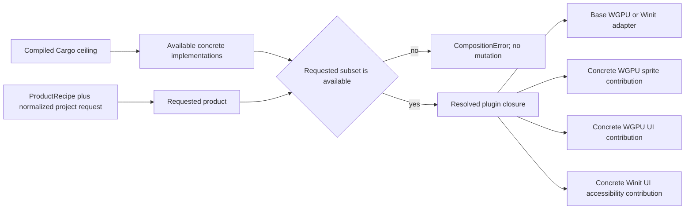

# Product Composition Contribution Correction - Plan

## Goal Capsule

- **Objective:** Restore the invariant that Cargo features define only compiled availability while
  the requested product and its resolved plugin plan exclusively decide which WGPU submitters and
  Winit accessibility behavior are installed.
- **Trigger:** Under `--all-features`, a project requesting only `render-wgpu` fails because the
  compiled `ui-submitter` feature changes `WgpuRenderPlugin` to require `UiRenderPlugin`. The same
  compile-time leak makes Winit create platform-accessibility state for products that did not
  request UI presentation.
- **Scope:** Split concrete first-party backend/platform contributions from their base adapters and
  remove the second raw plugin/provider edit authority from ordinary file-backed Host intents. Keep
  the existing plugin planner, product capability vocabulary and closed render topology.
- **Resume rule:** Publish one Product Composition Conformance Baseline, update the implementation
  ledger, then explicitly reactivate RUP-U3. RUP keeps its existing UI Foundation baseline and pins
  this composition baseline independently. Historical RUP and Foundation evidence remains
  immutable.

## Owning Contract

Product composition has three distinct authorities:

Compiling a contribution may make its Rust implementation available, but it cannot change a base
plugin declaration, register systems, create platform sessions, drain queues or publish semantics.
Only an installed concrete contribution may do so. These first-party contributions are closed
product implementation details, not a submitter trait, provider registry or third-party render SPI.

Ordinary file-backed Host actions accept one `ProductRecipe` plus execution policy. Advanced callers
may still apply an explicitly named `project_host::advanced` runtime overlay to a real recipe, and
direct `App` composition may still install raw plugins, but those paths are not parallel authorities
hidden inside ordinary Headless, Desktop or Editor intents. A schema-owning extension enters a
file-backed Host only through `SchemaContribution`; no advanced Host overlay carries an independent
schema-provider list.

Direct Rust products select concrete first-party contribution plugins explicitly from the backend
surface. `WgpuBackendPlugins` remains base-only, and `PresentationUiPlugins` remains
backend/platform-neutral. These are closed product choices rather than inferred behavior, another
cross-product group or a generic registry.

## Requirements

- R1. `WgpuRenderPlugin` has one feature-invariant declaration requiring only `RenderPlugin` and the
  `render-wgpu` product capability.
- R2. Concrete `WgpuSpriteSubmitterPlugin` and `WgpuUiSubmitterPlugin` own domain payload collection
  and, for UI, exact backend-outcome completion. Neither introduces a public submitter trait,
  registry, dynamic phase or RenderGraph.
- R3. The resolved product installs the sprite contribution only for
  `render-wgpu + presentation-2d`, and the UI contribution only for
  `render-wgpu + presentation-ui`.
- R4. Base WGPU remains a valid clear-only backend. A compiled but uninstalled contribution cannot
  read, clear or complete its domain queue.
- R5. Winit platform accessibility is enabled only by one explicit contribution installed for
  `desktop-winit + presentation-ui`. Compiling `platform-accessibility` alone creates no hidden
  window behavior, AccessKit session, bridge queue drain or native accessibility semantic
  publication.
- R6. The Winit adapter captures one opaque installed-contribution fact. It does not read root
  `ProductCapabilitySet`, scan plugin IDs at runtime or introduce a generic contribution registry.
- R7. Ordinary Headless, Desktop and Editor product intents own only a `ProductRecipe` plus their
  execution policy. Raw `configure`, `disable`, relative insertion and parallel schema-provider
  lists are removed from those intents without compatibility wrappers.
- R8. Existing products and reconstructible probes migrate to typed recipe entries or
  `SchemaContribution`. A non-replayable Host test probe may use a recipe-anchored
  `project_host::advanced` overlay, but that overlay has no schema-provider channel; engine-internal
  Host bridges remain private lowering details.
- R9. Under both a narrow relevant compiled ceiling and the all-features ceiling, requested-subset
  tests prove exact plugin absence and presence for base WGPU, 2D presentation, UI presentation and
  desktop accessibility combinations.
- R10. Capability normalization, contribution selection, plugin-plan resolution and schema
  resolution reject before candidate App creation. A later plugin build or bridge-capture failure
  poisons and retires the unpublished candidate; it does not publish a runtime. The same request
  resolves to the same plugin closure regardless of unrelated compiled features.

## Implementation Units

### PCC-U1 — Concrete WGPU contribution plugins

**Goal:** Make base WGPU feature-invariant and move Sprite/UI payload ownership into two installed
first-party contribution plugins.

**Files:** `crates/nara_render_wgpu/src/{lib,backend,frame,plugin,sprite,ui}.rs`, `src/product.rs`,
backend facade exports and focused composition tests. `frame.rs` and `plugin.rs` are created as the
private frame-transaction and concrete-plugin modules.

**Approach:** Keep one private WGPU frame owner with ordered reset, collect, seal, submit and
complete sets. The base plugin owns device, queue, surfaces, caches, topology sealing and submit.
The Sprite contribution writes only Sprite payload before seal. The UI contribution drains exact
prepared attempts and writes UI payload before seal; base submit writes one private terminal record;
the UI contribution alone consumes that record after submit and completes every exact attempt.
`ProjectProfilePlugins` installs concrete contributions from requested capability intersections.
Direct Rust products explicitly add `WgpuSpriteSubmitterPlugin` or `WgpuUiSubmitterPlugin` from the
backend surface; neither concrete plugin enters the gameplay prelude or another cross-product group.

**Test scenarios:** A native `desktop-winit + render-wgpu` base-only clear path under all features;
a no-view base-only path without a desktop target; compiled-but-uninstalled Sprite/UI isolation;
direct-App Sprite-only contribution; direct-App UI-only contribution; resolved product with both
contributions exactly once; topology rejection without surface acquisition; every admitted UI
reservation completes exactly once; `App::add_plugins(ProductRecipe)` remains valid.

**Exit:** The original `render-wgpu`-only red reproduction passes and no base declaration or system
parameter varies with a submitter compile feature.

### PCC-U2 — Explicit Winit UI accessibility contribution

**Goal:** Make native accessibility a requested product contribution rather than a Cargo-feature
side effect.

**Files:** `crates/nara_winit/src/{lib,accessibility}.rs`, `src/ui_presentation.rs`,
`src/ui_presentation/accessibility.rs`, `src/product.rs` and focused Winit/product tests.

**Approach:** Composition admission verifies the root contribution before candidate App creation.
Its build installs both halves of the existing bridge and an opaque Winit activation fact; a
partial build poisons the unpublished candidate and can never reach runner startup. Before native
window startup, the runner captures exactly one
crate-private result: `Disabled`, `Enabled(opaque access)` or `Partial(error)`. Every hidden-window,
AccessKit session, update-drain, event-forwarding and wake path reads that captured mode. Absence is
a valid disabled mode; `Partial` rejects before runner/window startup and the unpublished candidate
is retired. `ProjectProfilePlugins` installs the root contribution from the requested
`desktop-winit + presentation-ui` intersection; direct Rust products add the same concrete root
contribution explicitly.

**Test scenarios:** Desktop-only and presentation-UI-only requests install no contribution; the pair
installs exactly one; compiled-but-disabled runner mode creates no accessibility session; complete
bridge capture enables exact receipt-stamped publication; partial installation rejects before run.

**Exit:** Product behavior is identical for the same request under narrow and all-features compiled
ceilings, and `nara_winit` remains independent from root product-capability types.

### PCC-U3 — ProductRecipe as the ordinary Host composition authority

**Goal:** Remove the second ordinary plugin/provider edit channel while preserving explicit advanced
composition.

**Files:** `src/project_host.rs`, `src/project_host/{composition,runtime/action,runtime/editor}.rs`,
advanced facade exports, recipe and Host boundary tests, first-party recipes/fixtures and the
migration guide.

**Approach:** Delete raw edit/provider fields and fluent methods from ordinary intents. A recipe may
only add or configure recipe-owned plugins; profile-owned Image, Tilemap, window and other built-in
settings remain project/profile facts. Move recipe-anchored non-replayable Host overlays into an
explicit `project_host::advanced` harness that lowers through `project_runtime_plugins` and
`resolve_runtime_plan`; keep raw `App` plugins as a separate direct path, and remove schema-provider
lists from both ordinary intents and advanced overlays. Existing helpers that duplicate a whole
product closure migrate to the official recipe plus one probe overlay or are deleted. Do not add a
public base intent, implicit edit DSL or generic contribution trait.

**Test scenarios:** Shared recipe parity across Headless/Desktop/Editor; configured runtime-only
entry; schema contribution parity; stale raw ordinary methods absent; internal Editor runtime bridge
still lowers privately; one non-replayable fault probe uses the explicit advanced overlay; the
advanced surface cannot attach a schema provider independently; direct App composition remains
available through its own explicit API.

**Exit:** One inspectable recipe is the complete ordinary Rust composition input, and no ordinary
intent can detach a plugin from its schema authority.

### PCC-U4 — Product composition baseline and RUP rebase

**Depends on:** PCC-U1, PCC-U2 and PCC-U3.

**Status:** Complete at Product Composition Conformance Baseline
`180d0dfe0a41417a9633c11cccb91eab`.

**Goal:** Publish the corrected product-composition lineage and resume Runtime UI validation without
rewriting prior evidence.

**Files:** immutable verification/registration shards, this plan, the RUP frontmatter, ADR ledger,
migration guide and derived engineering-memory rollups.

**Exit:** Product Composition Conformance Baseline `180d0dfe0a41417a9633c11cccb91eab`
names the proving commits and exact serial gates. This plan is inactive. RUP retains its UI
Foundation `baseline_record`, pins the distinct `composition_baseline_record`, and RUP-U3 is again
the sole active product unit.

## Sequencing

PCC-U1, PCC-U2 and PCC-U3 belong to one composition contract but are not invented technical
dependencies on each other. They execute serially in this checkout to keep Cargo load and commits
reviewable. PCC-U4 is the only convergence unit and cannot start until all three behavior units are
green.

## Verification Contract

- Cargo commands run serially with `CARGO_BUILD_JOBS=1`; focused nextest precedes broader gates.
- V1: the recorded red command
  `cargo nextest run --locked --all-features --test plugin_composition -E
  'test(render_wgpu_profile_satisfies_the_shared_render_plugin)' --test-threads=1 --no-tests fail`
  becomes green without weakening its requested subset.
- V2: the same named root `plugin_composition` requests run once with their narrow relevant feature
  ceiling and once with `--all-features`, proving identical base-only, Sprite-only, UI-only,
  combined and desktop-accessibility closures with exact absence as well as presence assertions.
- V3: serial `cargo nextest run --locked -p nara_render_wgpu --features sprite-submitter`,
  `cargo nextest run --locked -p nara_render_wgpu --features ui-submitter`, and
  `cargo nextest run --locked -p nara_render_wgpu --features sprite-submitter,ui-submitter` gates
  prove installed-contribution queue ownership, topology and UI completion. A serial
  `cargo nextest run --locked -p nara_winit --features platform-accessibility` gate proves
  disabled, enabled and partial runner modes. Focus expressions may narrow these commands while a
  unit is active; the baseline records the complete commands.
- V4: focused root Host/runtime nextest gates prove one recipe across Headless/Desktop/Editor, the
  direct-App concrete contribution fixtures, and explicit advanced recipe-anchored overlays without
  exposing raw edits through ordinary intents.
- V5: `cargo fmt --all -- --check`, scoped strict Clippy, `git diff --check`, engineering-memory
  validation/render checks and a final Standards/Spec review close PCC-U4.
- Do not add a Cartesian Cargo powerset runner. The named requested-subset matrix is the complete
  admission surface for this correction.

## Non-Goals

- Any change to `nara_ui_kernel`, UI layout, widgets, interaction or presented-session algebra.
- A generic backend contribution trait, submitter registry, RenderGraph or public phase topology.
- Dynamic plugin loading, package distribution, external backend replacement or platform discovery.
- Reference Game role preflight, performance telemetry, package trust/provenance or new product
  features; those remain RUP work after this correction.
- Editor UI, docking, multi-window, viewport or toolkit convergence.

## Success Metrics

| Metric | Target | Evidence |
|---|---:|---|
| Base WGPU requirements changed by unrelated compile features | 0 | Declaration and paired compiled-ceiling subset tests |
| Unrequested Sprite/UI/Winit accessibility contribution plugins | 0 | Resolved-plan absence assertions |
| Requested concrete contributions | Exactly once | Combined product plan snapshots |
| Ordinary Host plugin/provider authorities | 1 `ProductRecipe` | Public inventory and migrated consumer tests |
| Generic registries, submitter traits or new public render phases | 0 | Dependency/API review |
| Failed pre-candidate composition mutation | 0 | Retryable normalization/plan/schema tests |
| Failed candidate build publication | 0 runtimes | Candidate poison/retirement tests |

## Risks and Mitigations

| Risk | Severity | Mitigation |
|---|---|---|
| Splitting systems breaks exact UI attempt completion | Critical | Keep one private frame slot and test every reservation reaches one terminal outcome. |
| Contribution ordering becomes another public phase API | High | Use private system sets inside `nara_render_wgpu`; expose only concrete plugins. |
| Accessibility bridge is partially installed | High | Capture both bridge halves atomically and reject partial state before native window startup. |
| Removing ordinary edit methods makes tests awkward | Medium | Model real extensions as recipes; keep raw plan editing in explicit advanced fixtures only. |
| More plugin types expand the gameplay API | Medium | Export concrete backend contributions only through backend/advanced surfaces, not gameplay prelude. |
| The correction absorbs unrelated RUP debt | High | Enforce the Non-Goals and resume RUP for product-specific preflight, measurement and packaging work. |

## Definition of Done

- R1-R10 have executable evidence bound to clean commits.
- ADR 0040, ADR 0046, ADR 0079 and ADR 0106 consistently distinguish the compiled ceiling,
  requested product, installed first-party contributions and unadmitted public SPI.
- The root compiled ceiling, normalized request and installed closure are independently inspectable
  and cannot substitute for one another.
- Obsolete ordinary intent edit APIs and their tests are removed rather than deprecated.
- The Product Composition Conformance Baseline and registration lineage explicitly restore RUP-U3
  without replacing the pinned UI Foundation baseline; no Editor or unrelated successor is
  activated.
