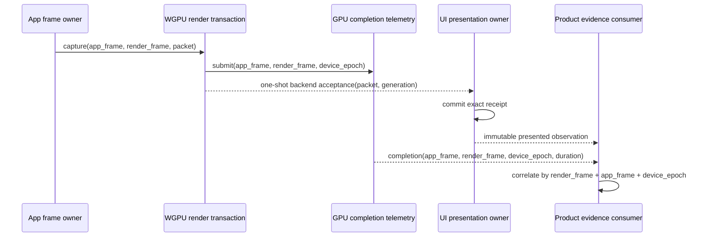

# Presented UI Evidence Correlation Correction - Plan

## Goal Capsule

- **Objective:** Make a Product-Validated desktop observation originate from the exact backend
  submission accepted by the presentation owner, with distinct App-frame and Render-transaction
  identities and a post-readiness measurement window that cannot splice unrelated frames.
- **Trigger:** The RUP-U3 audit proved that WGPU completion samples expose only the App frame while
  the candidate probe compares that value with a Render transaction. The same probe reads the
  latest compiled UI candidate rather than the exact frame whose backend acceptance minted the
  presentation receipt, then joins resource and timing facts across mutable resources.
- **Scope:** Correct WGPU completion identity, publish one immutable owner-produced presented
  observation, and replace the candidate probe's global warmup drain with a bounded post-readiness
  state machine. Resume RUP-U3 after a focused conformance record is published.
- **Non-expansion rule:** This correction adds no UI widget, Surface abstraction, RenderGraph,
  generic telemetry registry, benchmark framework, Editor work, or package workflow.

## Owning Contract

The WGPU backend owns submission identity and completion timing. The presentation bridge owns the
only transition from an accepted packet to a presentation receipt. The product probe is a consumer:
it may filter and summarize immutable facts, but it cannot infer a receipt from a candidate frame,
join identities by counter coincidence, or treat pre-readiness samples as product performance.

The presentation owner publishes one narrow, read-only observation after receipt commit. It binds:

- the exact receipt and packet identity;
- the exact immutable UI frame contained in that packet;
- backend generation and device epoch;
- App-frame and Render-transaction identities;
- the exact UI payload and resource counters captured for that submission.

The observation is a doc-hidden first-party evidence seam, not a general analytics API. It is
available only from the advanced presentation surface and has no mutation methods.

## Requirements

- R1. `WgpuFrameCompletionSample` retains distinct App-frame and Render-transaction identities.
  No ambiguous accessor is used for correlation.
- R2. WGPU submission records both identities at the point where the exact frame is submitted.
  Paused or stepped execution may make the counters differ without invalidating evidence.
- R3. The presentation owner publishes one immutable observation only after consuming the exact
  backend acceptance and committing the matching receipt. Non-presented outcomes publish nothing.
- R4. The observation's packet, frame, backend generation, device epoch, App frame, Render
  transaction, payload facts and resource facts all originate from that one accepted submission.
- R5. The Reference Game candidate path reads the exact presented frame from the owner observation;
  it does not use `latest_ui_frame` or reconstruct presentation authority from mutable resources.
- R6. Candidate measurement has explicit `AwaitPresentedReady -> Warmup -> Measure -> Seal`
  states. Samples observed before readiness are discarded. Fewer than the configured warmup or
  measurement samples remain pending until the existing deadline.
- R7. Every retained sample matches the armed backend/device generation and carries both frame
  identities. Lost samples, generation transitions and mismatched submissions fail closed.
- R8. Existing structured UI output remains readable by the package smoke consumer, but the
  performance payload names App and Render identities separately.
- R9. The correction remains owner-local: `nara_render_wgpu` owns completion identity,
  `ui_presentation` owns receipt-bound observation, and Reference Game owns only the bounded
  acceptance state machine.

## Implementation Units

### PUEC-U1 — Exact WGPU completion identity

**Goal:** Preserve App-frame and Render-transaction identities from capture through completion.

**Files:** `crates/nara_render_wgpu/src/{backend,telemetry}.rs` and focused tests.

**Approach:** Replace the single completion counter with two explicitly named fields and pass the
captured App frame plus `RenderFramePacket::frame_index()` into the completion token. Remove
ambiguous correlation in new code; compatibility accessors are removed if no admitted consumer
requires them.

**Test scenarios:** Equal counters; App ahead of Render; device-generation transition; bounded
sample loss; the exact Render transaction is found without offset arithmetic.

**Exit:** No completion consumer can confuse App-frame progress with Render-transaction progress.

### PUEC-U2 — Receipt-bound presented observation

**Depends on:** PUEC-U1.

**Goal:** Publish one immutable observation from the only owner that can commit a receipt.

**Files:** `src/ui_presentation.rs`, the advanced UI presentation facade, WGPU transaction facts,
and focused root integration tests.

**Approach:** Stage the observation from the accepted packet and backend transaction, then publish
it only after `commit_prepared_ui_presentation` succeeds. Store the exact packet frame by `Arc` so a
consumer cannot substitute a newer candidate. Keep the resource latest-only and read-only; the
receipt remains the authority, not the observation resource.

**Test scenarios:** Exact accepted packet publishes one observation; stale or rejected attempt
publishes none; a newer unpresented candidate cannot replace the observed frame; App and Render
counters may differ; receipt, packet, backend and device identities match field-for-field.

**Exit:** One owner-produced value proves what was accepted and which presented session advanced.

### PUEC-U3 — Post-readiness product measurement and baseline

**Depends on:** PUEC-U1 and PUEC-U2.

**Goal:** Make the desktop candidate consume the exact observation without cross-frame sticky state.

**Files:** `reference-game/src/bin/desktop_candidate_smoke`, structured performance observation and
smoke schema tests, immutable verification/registration shards, parent RUP authority and ADR ledger.

**Approach:** Arm measurement only after an exact presented product observation satisfies packet,
glyph and resource readiness. Drain pre-arm samples, count warmup samples from admitted product
frames only, and seal only after an exact observed Render transaction has a matching GPU completion.
Rename ambiguous JSON fields rather than maintaining a misleading compatibility alias.

**Test scenarios:** Pre-ready samples never satisfy warmup; zero through the warmup count remain
pending; App/Render mismatch correlates correctly; foreign device or Render transaction rejects;
one exact accepted product frame seals; structured output and package parser agree.

**Exit:** A conformance record binds clean commits and focused serial gates, this plan becomes
inactive, and RUP-U3 resumes without replacing its UI Foundation or Product Composition baselines.

## Alternatives Considered

### Option A — Join existing live resources in the Reference Game

**Pros:** Small local diff.

**Cons:** Candidate frame, backend stats, texture cache, completion samples and receipt can advance
independently; tests can still manufacture a convincing but impossible product frame.

**Decision:** Rejected because it preserves the structural defect.

### Option B — Owner-produced immutable observation (selected)

**Pros:** The only receipt owner binds the facts once; consumers stay simple; failure and stale
candidate cases are naturally fail-closed.

**Cons:** Adds a narrow advanced observation type and requires explicit backend fact capture.

**Decision:** Selected as the smallest deep-module correction.

### Option C — General telemetry/event registry

**Pros:** Could serve future profilers and Editor tooling.

**Cons:** Introduces a speculative public framework, retention policy and provider lifecycle before
there is a second consumer.

**Decision:** Rejected. Future tooling may consume or replace the narrow seam after real pressure.

## Verification Contract

- Cargo commands run serially with `CARGO_BUILD_JOBS=1`.
- V1: focused `nara_render_wgpu` telemetry/backend tests prove dual identity, device transition and
  bounded sample behavior.
- V2: focused root UI presentation tests prove an exact accepted packet publishes one receipt-bound
  observation and all rejected/stale paths leave the prior observation unchanged.
- V3: focused Reference Game candidate tests prove pre-ready discard, pending warmup, exact matching
  and structured schema output.
- V4: one bounded desktop candidate run captures a real WGPU submission where packet, receipt,
  App frame, Render transaction, glyph/resource closure and completion sample all match.
- V5: `cargo fmt --all -- --check`, scoped strict Clippy, `git diff --check`, engineering-memory
  validate/render checks and final Standards/Spec review pass.

## Success Metrics

| Metric | Target | Evidence |
|---|---:|---|
| Completion samples with ambiguous frame identity | 0 | API inventory and focused tests |
| Presented observations assembled by product code | 0 | Root owner integration tests |
| Pre-readiness samples admitted into warmup | 0 | Candidate state-machine tests |
| Foreign generation or transaction samples accepted | 0 | Negative correlation tests |
| Exact accepted product observations per receipt | 1 | Root and desktop candidate evidence |
| New generic registries, phases or public callbacks | 0 | Public API and dependency review |

## Risks and Mitigations

| Risk | Severity | Mitigation |
|---|---|---|
| Observation is published before receipt commit | Critical | Construct locally, publish only in the infallible post-commit tail, and test rejected paths. |
| Latest-only resource hides an unconsumed observation | Medium | It is evidence, not delivery authority; receipt history remains canonical and the probe tracks exact identities. |
| Backend stats advance before product reads them | High | Copy exact facts into the owner observation at commit rather than retaining backend references. |
| Warmup waits forever on a lost completion | Medium | Preserve the existing bounded deadline and fail with structured lost/mismatch diagnostics. |
| Advanced evidence seam becomes a product API | Medium | Keep it doc-hidden, read-only, first-party and absent from gameplay preludes. |

## Non-Goals

- UI layout, widgets, focus, input arbitration, Surface lifecycle or accessibility semantics.
- Generic profiling, trace export, metrics registry, benchmark runner or long-term performance SLA.
- RenderGraph, multi-target aggregation, backend extension SPI or resource streaming policy.
- Reference Game source roundtrip, packaging, missing-resource policy or visual design.
- Editor UI, docking, viewport, multi-window or Nara UI toolkit convergence.

## Definition of Done

- R1-R9 have executable evidence bound to clean commits.
- The WGPU completion API and structured candidate schema name App and Render identities separately.
- Only the presentation owner can publish an exact receipt-bound observation.
- The candidate measurement state cannot use pre-ready, foreign-generation or unrelated-frame data.
- The final review has no unresolved P0/P1 finding in this correction scope.
- One immutable conformance record deactivates this plan and explicitly resumes RUP-U3.
