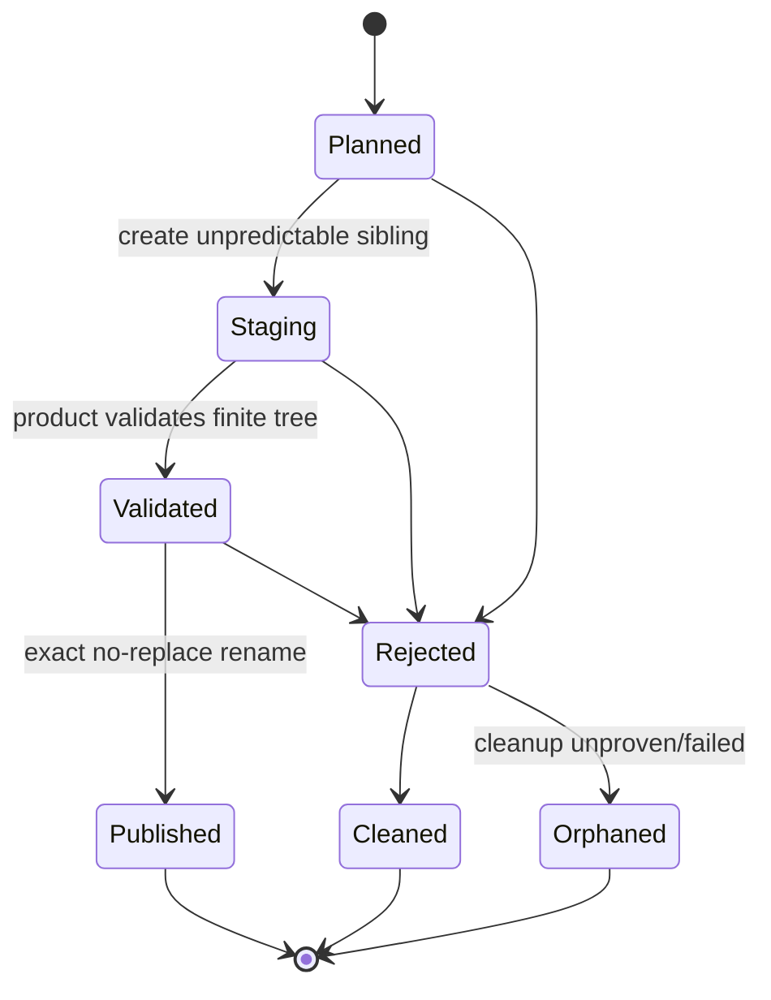

# Capability Directory Publication Foundation - Plan

## Goal Capsule

- **Objective:** Implement the reserved ADR 0070 primitive that publishes one known finite staging
  directory as one absent destination child without overwrite, ambient-path fallback or false
  rollback claims.
- **Trigger:** Fresh Project and source-carrying export both require old-or-absent directory
  publication. ADR 0070 already selects the authority and exact Windows/Linux proof matrix, but the
  implementation is still an `Unsupported` placeholder associated with a nonexistent old unit.
- **Scope:** `nara_fs` owns native directory creation, child capabilities, same-parent no-replace
  rename, proof tiers and terminal cleanup/orphan facts. Product domains continue to own member
  plans, content validation, policy and acceptance.
- **Successor rule:** Completion publishes one Directory Publication Conformance Baseline. It does
  not activate the Fresh Project successor automatically.

## Contract

- **R1 — Capability-relative authority.** The Host supplies one read-write parent
  `DirectoryCapability`, one validated absent destination child and bounded staging-name entropy.
  No public operation accepts or returns a native path as authorization.
- **R2 — Truthful directory source binding.** The transaction creates the staging directory through
  the parent handle and retains its live directory handle/identity. Product writers receive only
  that child capability. Windows publication binds the live source handle; Linux publication is
  explicitly name-bound and is admitted only under the cooperative local-writer tier.
- **R3 — Platform and trust matrix.** V1 strict handle-bound publication supports x86-64 Windows on
  a runtime-proven local NTFS parent. V1 Linux support is x86-64 Linux 5.6+ on a runtime-proven local
  ext4 parent under `TrustedLocal`: the parent/mount and destination no-overwrite facts are proven,
  while the source remains `NameBound` and the receipt records that weaker tier. Other
  filesystems/platforms reject before staging. Proof is bound to the concrete parent
  capability/volume, not inferred from compile target.
- **R4 — Atomic no-replace naming.** Windows uses handle-bound
  `FileRenameInformationEx` without replace flags. Linux uses same-parent `renameat2` with
  `RENAME_NOREPLACE`. Destination collision, cross-volume/mount drift or unrecognized native results
  fail closed. Check-then-rename and ordinary replacing rename are forbidden fallbacks.
- **R5 — Visibility, not crash durability.** A successful receipt proves an atomic name switch and
  exact source/parent/destination identity facts. It reports directory-sync progress separately and
  does not claim power-loss durability where the adapter cannot prove it.
- **R6 — Honest failure terminality.** Before publication the final child remains absent. Cleanup is
  attempted only through an identity-bound directory primitive. If exact cleanup is unavailable or
  fails, the outcome discloses a recoverable staging orphan; it never claims rollback or performs
  `stat(name) -> recursive delete`.
- **R7 — Deep bounded Interface.** The public surface is a move-only directory publication
  transaction plus typed receipt/outcome. It is not a recursive file manager, export API, template
  API, VFS, recovery journal or general rename service.
- **R8 — No product semantics.** `nara_fs` does not know project names, starter members, package
  layouts, Cargo artifacts, Scene/Prefab formats or product validation rules.

## Key Technical Decisions

- **KTD1 — One transaction owns staging authority.** A successful begin operation returns a
  move-only transaction that exposes a shared child directory capability for bounded writes while
  retaining publication authority. Publication consumes it. The transaction never upgrades a
  platform's actual source-binding tier.
- **KTD2 — Runtime proof, not OS tables alone.** Parent capability creation and the publication
  primitive probe filesystem/volume/mount facts required by R3. Static platform matrices remain
  conservative availability ceilings.
- **KTD3 — Directory cleanup is separately proven.** Windows may use the live staging handle to mark
  an empty directory for deletion. Linux needs an exact object-bound or otherwise explicitly proven
  empty-directory cleanup primitive; if that cannot be proven in this unit, rejection returns
  `Orphaned` and the product must surface it. No unsafe name-based cleanup is added to meet a test.
- **KTD4 — No public recursive tree writer.** Product code creates its known finite directory/member
  plan through child capabilities. This unit may add direct-child directory/file creation primitives
  needed to construct that plan, but it does not enumerate or recursively copy ambient trees.
- **KTD5 — Evidence tiers remain independent.** Parent authorization, source binding, destination
  conflict protection, atomicity, identity observation and durability progress remain distinct
  receipt fields; no broad `safe` or `atomic` boolean is added.

### Non-goals

- Project creation, templates, export, archives, Cargo build, Scene/Prefab parsing or Runtime Host.
- Overwrite, merge, destination recovery, orphan reclamation or recursive delete.
- Asset file move/rebind, identity-guarded general rename, unknown-schema repair or editor save.
- macOS, ReFS, XFS, Btrfs, tmpfs, OverlayFS, NTFS3, remote or custom filesystem support without a
  dedicated successor and live proof.

## Implementation Units

### CDPF-U1 — Directory staging and capability ownership

**Goal:** Create and retain one unpredictable same-parent staging directory as a move-only
transaction.

**Files:** `crates/nara_fs/src/{capability,error,proof}.rs`, a focused directory-publication Module,
platform adapters and owner-local tests.

**Approach:** Add exclusive direct-child directory creation, validate live directory facts, issue a
child capability sharing the parent session/generation, and retain exact parent/source observations
in the transaction. Add injected proof seams only where needed to exercise public fail-closed paths.

**Test scenarios:** success; read-only parent; invalid destination/staging component; staging
collision; wrong object kind; reparse/symlink; cross-volume fact; unsupported filesystem; duplicate
begin; transaction is move-only and no raw path escapes.

**Exit:** Product code can fill a known finite staging tree without owning publication or native
path authority.

### CDPF-U2 — Exact no-replace publication and terminal outcomes

**Depends on:** CDPF-U1.

**Goal:** Consume the staging transaction into one truthful Published, Rejected-clean or Orphaned
terminal result.

**Approach:** Implement the exact Windows and Linux primitives from ADR 0070. Windows revalidates
the handle-bound source/parent/volume facts; Linux revalidates parent/mount and the observed
name-bound source under the cooperative tier. Map native collision distinctly, capture
post-publication identity/durability evidence, and implement only proven empty-staging cleanup.

**Test scenarios:** successful publication; destination collision; source/parent identity drift;
wrong volume/mount; native unsupported/unproven result; publish error; cleanup success/failure;
double publication impossible; final destination never partially visible; existing destination
never changes.

**Exit:** A finite validated directory candidate can be published old-or-absent on the exact support
matrix, with every non-success path truthfully terminal.

### CDPF-U3 — External conformance and successor baseline

**Depends on:** CDPF-U2.

**Goal:** Prove the public Interface independently of Fresh Project and publish a clean baseline.

**Approach:** Add a small external consumer fixture that stages a nested finite tree, validates it,
publishes it and reopens it through ordinary capability APIs. Run hosted Windows/NTFS evidence in
this checkout; Linux/ext4 remains unavailable until its dedicated hosted job runs, and must remain
reported as unverified rather than inferred. Audit public API/dependencies, update ADR 0070/ledger,
and publish immutable verification plus a completed registration.

**Test scenarios:** external consumer success; collision; injected unproven parent; bounded nested
members; no product identity; Windows live local-volume case; Linux code/tests compile without a
false hosted-proof claim.

**Exit:** The conformance record names the exact supported/proven combinations and proving commit;
this plan becomes inactive. The Fresh Project plan may be activated only by a later registration.

## Verification Contract

- Cargo commands run serially with `CARGO_BUILD_JOBS=1`; use focused `cargo nextest run` and reuse
  the workspace target.
- **V1:** owner-local tests cover transaction typestate, capability lineage, proof classification,
  collision and failure terminality.
- **V2:** Windows platform tests and one live local-NTFS integration prove handle-bound source/parent
  and no-replace naming; Linux implementation tests prove the `renameat2` mapping and its explicit
  `NameBound`/cooperative receipt without claiming a live ext4 baseline in this Windows session.
- **V3:** an external compile/runtime fixture consumes only the public `nara_fs` Interface and
  publishes/reopens one finite nested tree.
- **V4:** public inventory contains no project/export/template/recovery vocabulary and no new
  general recursive filesystem API.
- **V5:** `cargo fmt --all -- --check`, scoped strict Clippy, `git diff --check`, engineering-memory
  validate/render and final Standards/Spec review pass on the proving commit.

## Success Metrics

| Metric | Target |
|---|---:|
| Overwritten existing destinations | 0 |
| Partial final destinations after pre-publication failures | 0 |
| Unproven platform/filesystem combinations reported as supported | 0 |
| Raw/native path authorization in the public Interface | 0 |
| Product-domain concepts in `nara_fs` | 0 |
| Public directory-publication transactions with terminal outcomes | 1 |

## Risks and Mitigations

| Risk | Severity | Mitigation |
|---|---|---|
| Windows no-replace flags accidentally permit replacement | Critical | Dedicated native wrapper, exact flag test and live collision case |
| Linux source can be replaced by a non-cooperating writer | Critical | Admit only `TrustedLocal`; record `NameBound` and never claim strict source binding |
| Cleanup code deletes the wrong tree | Critical | Only identity-bound empty-directory cleanup; otherwise return Orphaned |
| Foundation grows into a file manager | High | No enumeration/copy/delete API; external consumer supplies known members |
| Receipt collapses independent guarantees | High | Preserve ADR 0070 axes and assert them separately |

## Definition of Done

- R1-R8 and KTD1-KTD5 have executable evidence.
- The reserved ADR 0070 same-capability no-replace directory primitive is implemented by one deep,
  capability-relative transaction.
- Windows local NTFS is proven in this session; every other combination is represented truthfully as
  proven, unproven or unsupported by its actual evidence.
- No product, recursive-file-manager or recovery abstraction entered `nara_fs`.
- Final review has no unresolved P0/P1; plan, ADR 0070, ledger and engineering memory agree.
