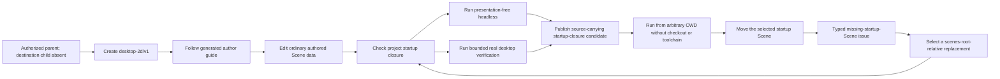
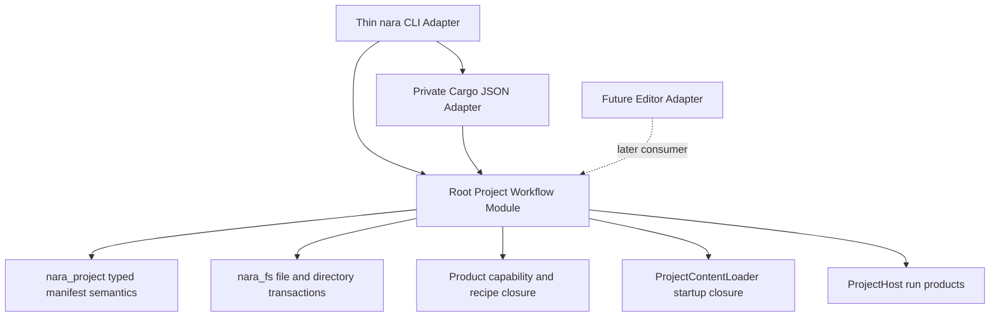

# Fresh Project, Source-Carrying Export, and Explicit Repair - Plan

## Goal Capsule

- **Objective:** Deliver one complete first-party workflow from an authorized parent with an absent
  destination child to a versioned desktop-2D project, normal desktop and presentation-free
  headless execution, a checkout-free source-carrying startup-closure export, an actionable
  missing-startup-Scene failure, and an explicit repair followed by successful rerun and re-export.
- **Product outcome:** A Rust author chooses one starter and one supported Nara dependency source;
  the tool owns agreement among Cargo, `nara.toml`, ProductRecipe, schema and initial content.
- **Architecture outcome:** One root project-workflow Module owns creation, check, export and repair
  transactions. `nara_project` remains the pure manifest-semantics owner, `nara_fs` remains the
  native filesystem substrate, and Runtime `ProjectHost` remains a consumer of authorized content.
- **Activation gate:** This plan remains inactive until the Directory Publication Foundation plan
  publishes its conformance baseline and a new registration explicitly activates FPER-U0.
- **Scope guard:** Reference Game and its Python package tools remain fixed historical product
  fixtures. They are not mandatory consumers and are not modified or generalized by this plan.

## Product Contract

### Primary author flow

### Project creation and identity

- **R1 — One closed starter request.** `new desktop-2d/v1` has no per-layer override surface. It
  selects matching generated entry points, Cargo features, manifest capabilities, ProductRecipe,
  built-in schema closure and initial content. Existing direct-App and advanced composition
  Interfaces remain outside this plan and are neither removed nor narrowed.
- **R2 — Dependency distribution is explicit and separate.** Creation accepts one typed
  `NaraDependencySource`: an authorized local checkout represented by a relative Cargo path when the
  destination relation permits it, or an immutable Git URL plus exact revision. The starter selects
  compatibility; the request selects distribution. Starter version, manifest schema, Scene envelope
  and dependency identity remain distinct receipt facts. Absolute checkout paths, branch heads and
  implicit network fallback are forbidden. A local-path project is location-bound by contract.
- **R3 — Directory publication uses the predecessor baseline.** Creation publishes a known finite
  tree through the exact Directory Publication Foundation receipt. The destination must not exist;
  no check-then-rename or overwrite fallback is allowed.
- **R4 — Normal project authority.** The created project is admitted by the ordinary
  `ingest_project_manifest -> product closure -> ProjectContentLoader` path. There is no
  starter-only loader, hidden provider list or Reference Game plugin.
- **R5 — Complete-schema-only v1.** Check, run, repair and export fail closed when required schema is
  unavailable. Unknown fields or unavailable schema are not preserved through repair.

### Runtime products

- **R6 — Two normal products.** The generated project owns explicit `desktop` and `headless`
  binaries over one source authority and ordinary ProductRecipe. The desktop binary provides a
  documented bounded verification mode that uses its real Winit/WGPU path and exits through normal
  App/Host shutdown after a precise startup/presentation condition; test-private plugins cannot
  satisfy this proof.

### Source-carrying startup-closure export

- **R7 — Existing content owners produce the member inventory.** Export consumes one validated,
  bounded startup-content closure and exact manifest/schema facts. It does not parse Scene, Prefab,
  image metadata or Rust source to rediscover dependencies.
- **R8 — The claim is deliberately narrower than a complete project export.** Version one publishes
  selected executables plus an executable-relative `project/` tree containing the exact startup
  runtime closure. Unreferenced or dynamically requested content is not implicitly included. The
  artifact is neither a complete source-project backup nor a cooked/source-free catalog.
- **R9 — Runtime source remains source.** The candidate may contain `nara.toml`, Scene/Prefab
  documents, images, `.meta` files and schema facts. ADR 0088 remains Proposed.
- **R10 — Cargo artifacts are selected structurally.** A private build Adapter accepts one Cargo
  JSON stream and matches exact invocation identity, manifest/workspace, package ID, binary target
  kind/name, target triple, named profile and normalized features. A unique executable and its byte
  digest enter the build receipt; target-directory scans and timestamp guesses are forbidden.
- **R11 — Publication and acceptance are distinct.** All member, digest, source-change and layout
  validation completes before directory publication. Publication then yields a non-forgeable
  receipt. Post-publication process acceptance may return `PublishedButUnaccepted`; the candidate is
  retained and no rollback is claimed.

### Diagnostics and repair

- **R12 — Typed issue, no policy callback.** Check reports a privacy-safe missing-startup-Scene
  issue bound to project capability identity, manifest digest and validated settings lineage.
  Diagnostics are observational and cannot mutate the project.
- **R13 — Explicit selection, not rename inference.** The author supplies a logical Scene path
  relative to the effective `paths.scenes` authority. Repair does not infer a rename, preserve asset
  stable identity, search candidates, rewrite arbitrary references or perform Fix All.
- **R14 — Honest cooperative file transaction.** All first-party manifest writers take the existing
  exclusive cooperative lock. Repair validates the expected manifest identity/digest, replacement
  Scene digest and full closure, canonically rewrites all modeled manifest fields through
  `nara_project`, and publishes through `nara_fs`. Unknown fields reject; comments, field order and
  original formatting are not preserved. The receipt reports the actual replacement proof tier.
  A post-publication authoritative check is required: mismatch returns `PublishedButNotRepaired`
  rather than a success receipt. This plan does not claim strong CAS against non-cooperating writers.

### Evidence discipline

- **R15 — One linked trajectory.** One machine-readable record links exact create, manifest,
  content-closure, desktop, headless, build, export, issue, repair and re-export receipts under one
  project capability lineage. A step must consume its precise predecessor; colocated but unrelated
  fixture results cannot be spliced into the record.
- **R16 — Moderate proof.** Owner-local tests cover state machines and failure algebra; one bounded
  real process trajectory proves the product. No platform-by-state Cartesian matrix, opaque image
  hash or duplicate smoke implementation is admitted.
- **R17 — Author usability is observed.** The starter includes a minimal generated guide with the
  real create/check/run/edit/export/repair commands and one observable data edit. A clean-terminal
  rehearsal follows only public instructions and records command count plus first-run, first-export
  and repair completion time as observations, not frozen SLAs.

### Key Technical Decisions

- **KTD1 — Root deep Module, thin Adapters.** Reusable transactions live in one root
  project-workflow Module. CLI/Cargo/process code is a thin Adapter. A compile-only consumer with the
  smallest product features calls creation planning, check and repair without depending on the CLI,
  Cargo process Adapter or desktop presentation; failure moves the seam before it becomes public.
- **KTD2 — Dependency source is not starter policy.** `NaraDependencySource` is a closed v1 value,
  not a registry/provider. Local-relative and immutable-Git sources share compatibility validation
  and privacy-safe receipts; they do not create a package manager.
- **KTD3 — One immutable starter.** `starters/desktop-2d/v1/` is source-controlled input. Generated
  files become project-owned copies. There is no template registry, download, update, inheritance,
  merge, placeholder language or marketplace lifecycle.
- **KTD4 — Export reuses a validated startup closure.** The first export serves the runtime shape
  Nara actually owns today. Complete project inventory, dynamic asset requests, cook catalogs and
  archive transport require their own concrete successors.
- **KTD5 — Repair one manifest selection.** Asset move/rebind, `.meta` transactions, unknown-schema
  preservation, recovery journals and project-wide reference rewrites remain behind their Proposed
  ADRs/open questions.
- **KTD6 — Semantic canonical rewrite.** `nara_project` owns pure typed mutation and a deterministic
  writer for its modeled manifest schema. It does not promise lossless TOML syntax editing.
- **KTD7 — Two explicit binaries and one bounded desktop mode.** Desktop and headless are separate
  thin product Adapters. The desktop verification mode is product-owned, exercises the real window
  and WGPU path, and exits normally; it is not a hidden test presenter.
- **KTD8 — Predecessor before activation.** Product code cannot begin until the exact directory
  publication baseline is pinned. Finishing that Foundation plan does not activate this plan
  automatically.

### Non-goals

- Full project backup/export, dynamic content inventory, cooked catalogs, artifact stores, mounts,
  DLC, archives, signing, store upload or supply-chain provenance.
- Template/provider registries, starter upgrades, project overwrite/merge or creation into an
  existing destination.
- Generic importer/exporter SPI, build trait, process framework or diagnostic action bus.
- Automatic asset rename correlation, stable-ID rebind, `.meta` move, unknown-schema save,
  degraded Editor open or Fix All.
- Editor Shell, docking, Viewport, multi-window, scripting language or UI Foundation expansion.

## Planning Contract

The root Module exposes concrete request/outcome families for one starter creation, one project
check, one startup-closure export and one startup-selection repair. It does not expose a mutable
service, native path authority, Cargo message types, toolkit IDs or Reference Game identities.

### Failure algebra

| Owner | Representative outcomes | Publication rule |
|---|---|---|
| Starter planning | invalid name/source, unsupported starter, inconsistent closure | no staging directory |
| Directory publication | unsupported proof, collision, write/sync failure, orphaned staging | final destination absent; orphan disclosed |
| Project check | invalid manifest, unavailable schema, missing dependency, source changed | no runtime/export publication |
| Build Adapter | Cargo failure, incomplete artifact key, missing/ambiguous executable | no export staging |
| Export | member changed/missing, limit/collision/special-file rejection | final destination absent |
| Acceptance | process startup or arbitrary-CWD failure | candidate retained as `PublishedButUnaccepted` |
| Repair prepare | stale manifest, invalid Scene, closure invalid, lock unavailable | manifest unchanged |
| Repair acceptance | publication succeeded but fresh check disagrees | `PublishedButNotRepaired`; no false success |

## Implementation Units

### FPER-U0 — Versioned starter and deep project-workflow Module

**Goal:** Create a normal Nara project from one closed first-party starter.

**Approach:** Implement the typed dependency sources, immutable starter plan, generated author guide,
pure project plan/receipt types, thin `nara` CLI Adapter and compile-only non-CLI consumer. Validate
all bytes and product-layer agreement before staging, publish through the pinned Directory
Publication baseline, then reopen through ordinary capabilities.

**Test scenarios:** exact inventory; unsafe name; destination collision; invalid dependency source;
cross-volume local source rejection; immutable Git formatting; feature/manifest/recipe mismatch;
unrelated CWD; ordinary manifest/content load; two binary targets; no absolute checkout path,
placeholder or fixture identity.

**Exit:** One public command creates and admits the project, and the root Module is independently
consumable without CLI/Cargo/desktop coupling.

### FPER-U1 — Shared check and two normal run products

**Depends on:** FPER-U0.

**Goal:** Make one project source authoritative for check, headless and desktop.

**Approach:** Return the smallest validated startup-closure receipt needed by export. Generated
products share project root, manifest lineage, recipe, schema and startup content. Add the bounded
real desktop verification mode and normal shutdown contract.

**Test scenarios:** ordinary Scene edit changes both products; missing startup Scene and unavailable
schema fail before runtime publication; unrelated process CWD cannot change source authority;
desktop verification presents then exits through App/Host cleanup; headless remains presentation-free.

**Exit:** Both normal products consume one source authority and export can reuse a validated closure.

### FPER-U2 — Rust-owned startup-closure standalone export

**Depends on:** FPER-U1 and the Directory Publication baseline.

**Goal:** Publish a checkout-free, toolchain-free directory for the exact admitted startup closure.

**Approach:** Bind exact Cargo artifacts using the full R10 key, assemble a finite member plan from
the validated closure, complete every validation before publication, publish through `nara_fs`, and
run the two real product processes from an unrelated CWD. Keep archive transport and Reference Game
scripts outside the Interface.

**Test scenarios:** missing/ambiguous artifact; wrong feature/profile/target; source mutation after
planning; missing closure member; special file/link/reparse/case collision; limits; output collision;
receipt privacy; arbitrary-CWD headless and bounded desktop acceptance.

**Exit:** One fresh starter candidate runs without checkout, Cargo or toolchain and carries no claim
about unreferenced/dynamic content.

### FPER-U3 — Explicit startup Scene repair and complete trajectory

**Depends on:** FPER-U1 and FPER-U2.

**Goal:** Close the first actionable recovery loop without inventing asset identity repair.

**Approach:** Move the selected startup Scene, return a typed issue, accept one scenes-root-relative
replacement, take the cooperative manifest lock, validate manifest/Scene/closure identities,
canonically publish modeled manifest fields, then run a fresh authoritative check. Rerun both
products and publish a new destination. Emit the linked trajectory record and author rehearsal.

**Test scenarios:** missing Scene; valid replacement; traversal/outside authority; malformed or
wrong-kind Scene; stale issue; lock conflict; publication failure; unknown manifest field; semantic
preservation of every modeled field; post-publication mismatch; prior export unchanged; new export
succeeds; every trajectory link matches its predecessor.

**Exit:** R1-R17 have clean, linked evidence; the ADR ledger and engineering memory agree; this plan
becomes inactive without activating Editor work.

## Verification Contract

- Cargo commands run serially with `CARGO_BUILD_JOBS=1`; focused `cargo nextest run` is preferred.
- **V1:** starter/root Module tests prove closed product planning, typed dependency sources, ordinary
  project admission and the independent compile consumer.
- **V2:** check/run tests prove one source authority, a presentation-free headless product and a
  bounded real desktop product with normal shutdown.
- **V3:** export tests prove the full Cargo artifact key, exact startup closure, pre-publication
  validation, no-overwrite publication and receipt privacy.
- **V4:** manifest tests prove semantic canonical rewrite, scenes-root-relative path semantics,
  cooperative-lock/stale rejection and truthful post-publication outcomes.
- **V5:** one real linked trajectory creates, edits, runs, exports, breaks, repairs, reruns and
  re-exports from public instructions and unrelated process CWDs.
- **V6:** public/dependency inventory rejects a template registry, exporter SPI, generic importer,
  build framework, diagnostic callback bus or Reference Game identity.
- **V7:** `cargo fmt --all -- --check`, scoped strict Clippy, `git diff --check`, engineering-memory
  validate/render and final Standards/Spec review pass on the proving commit.

## Success Metrics

| Metric | Target |
|---|---:|
| Manual product-layer edits after creation | 0 |
| Partial or overwritten final destinations after pre-publication failures | 0 |
| Source parsers duplicated in project/export code | 0 |
| Checkout/toolchain requirements in exported runtime | 0 |
| Automatic asset rename/rebind decisions | 0 |
| Linked create-to-repair product trajectories | 1 |
| Generic registries/traits added for one consumer | 0 |

## Risks and Mitigations

| Risk | Severity | Mitigation |
|---|---|---|
| Local dependency source is mistaken for portable distribution | High | Explicit source kind, location-bound contract and immutable-Git alternative |
| Startup closure is mistaken for complete project export | High | Name the artifact and reject unproven dynamic-content claims |
| Root Module absorbs CLI/Cargo/platform details | High | Independent compile consumer and private Adapters |
| Desktop evidence hangs or uses a test-only shortcut | High | Product-owned bounded mode with real presentation and normal shutdown |
| Manifest rewrite loses unknown or user-formatted content silently | Critical | Complete-schema-only rejection and explicit semantic-only preservation |
| Repair publishes but content changes before acceptance | Critical | Exact Scene/closure facts plus post-publication authoritative check |

## Definition of Done

- R1-R17 and KTD1-KTD8 have executable evidence bound to reviewable commits.
- `desktop-2d/v1` is created through one deep Module and ordinary Nara project authority.
- Desktop and presentation-free headless consume one source lineage without Reference Game glue.
- A source-carrying startup-closure candidate runs from arbitrary CWD without checkout or toolchain.
- A moved startup Scene produces a typed issue and an explicit, stale-safe, truthfully qualified
  repair restores run/export without claiming automatic asset rebind or strong non-cooperative CAS.
- Final review has no unresolved P0/P1; plan, Accepted ADR, ledger and engineering memory agree.
