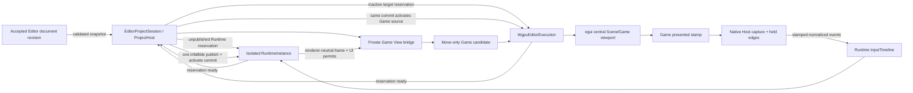
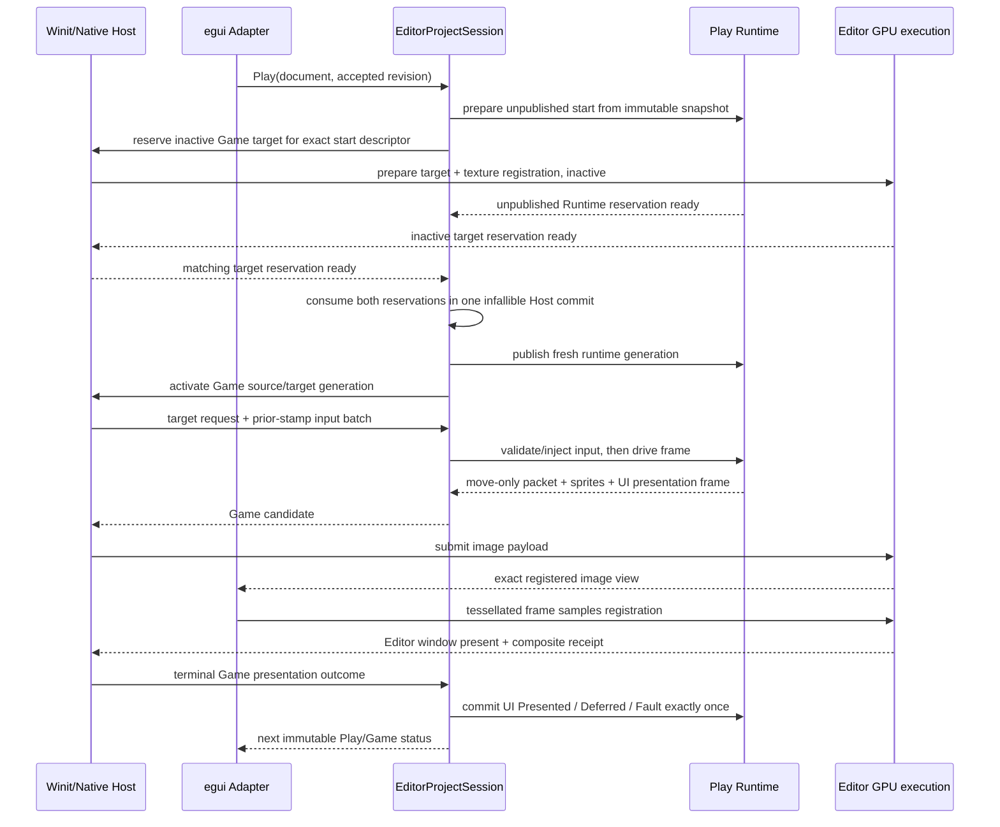
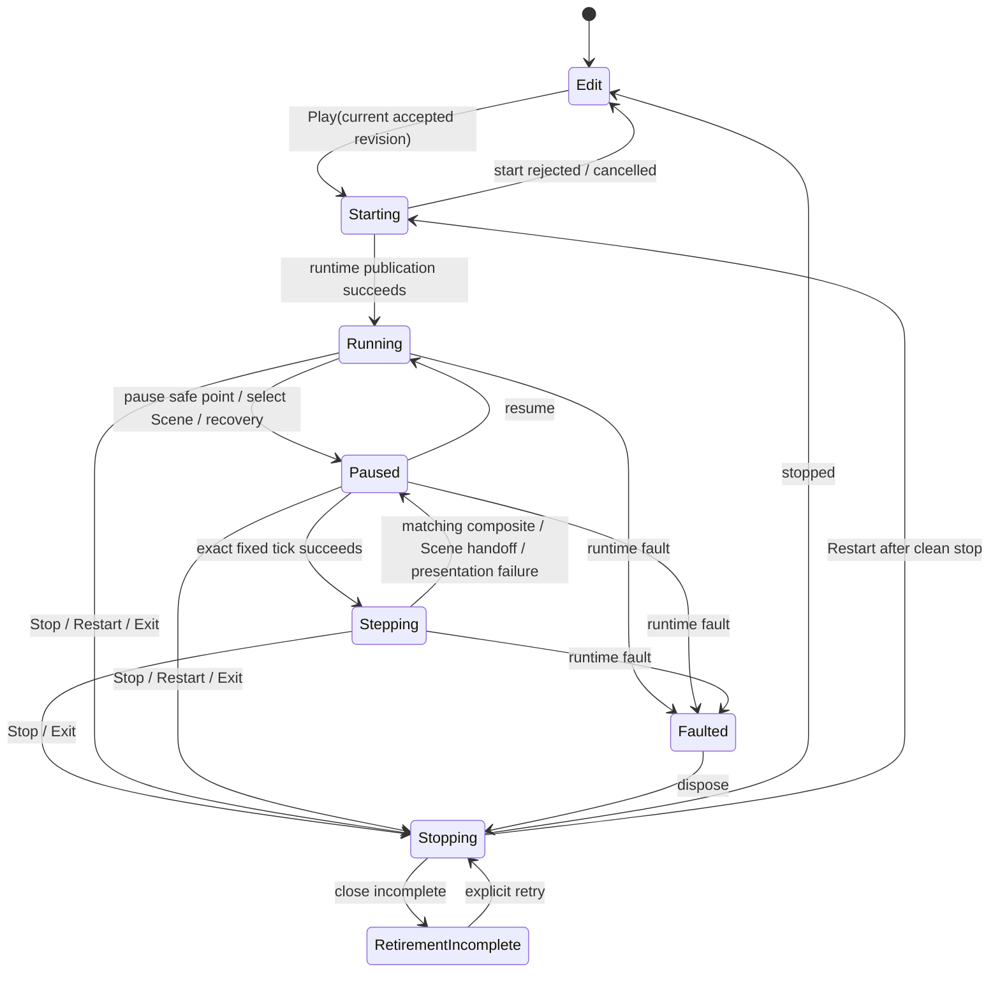
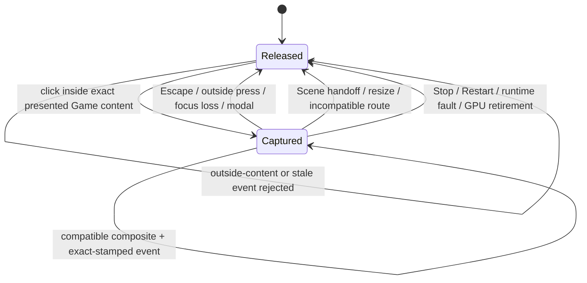

# Editor Game View v1 - Plan

## Goal Capsule

| Field | Contract |
|---|---|
| Objective | Extend the completed Editor Authoring Loop and Scene View with one embedded Game View that starts a real isolated in-process Play Runtime from the current accepted edit revision, presents its 2D and Runtime UI output through the Editor's existing GPU authority, routes keyboard and pointer input only against the exact visible generation, and preserves the existing Play/Stop/Pause/Step/Restart and explicit Apply Changes semantics. |
| Product owner | The private `nara-editor` application remains the product Host. `EditorProjectSession` owns the Play start attempt and runtime lifecycle; the published `RuntimeInstance` owns simulation; `NativeEditorHost` owns the native window, GPU, viewport target, egui integration, and physical input arbitration. |
| Architecture authority | Accepted ADRs 0034, 0076, 0082, 0084, 0107, 0108, 0109, and 0111 remain authoritative. EGV-U1 must accept a focused ADR 0112 before shared runtime/render behavior changes. The ADR resolves only the first in-process embedded Game View placement, logical-runtime-window mapping, and external Runtime UI outcome rendezvous; OQ-039 remains open for a second placement or measured in-process failure, and OQ-040 remains open for live edit. |
| Execution profile | Five dependency-ordered units, one focused renderer-neutral tracer, owner-level contract tests, one serial starter-project trajectory, and one local native Game View canary. No platform, input-state, or target Cartesian matrix is required. |
| Stop conditions | Stop the affected path if Runtime UI outcome permits cannot cross the private Host boundary without losing exact-once completion, if a Game input event cannot be tied to the final Editor-window composite receipt, if the private Play plan requires a second product-composition authority, or if implementation requires a public RenderGraph, general target registry, raw `World` access, or a second GPU device. Record the rejection and split a successor instead of weakening the contract. |
| Tail ownership | EGV-U5 updates ADR/OQ links, the implementation ledger, current-state index, and one engineering-memory verification record. The plan carries no progress state; Git and the evidence record remain the completion authority. |

---

## Product Contract

### Summary

The Editor can now author and visually inspect a Scene, but pressing Play still produces only lifecycle state and diagnostics. The author cannot see the actual isolated runtime, send it ordinary gameplay input, pause on a visible result, or verify that an unsaved accepted edit is the source of the current Play generation.

This plan adds the smallest complete Game View workflow. The central Editor work area gains mutually exclusive `Scene` and `Game` tabs. `Scene` continues to show the edit-world preview. `Game` displays one renderer-neutral frame emitted by the real Host-owned Play Runtime, including first-party sprite and Runtime UI content, through the same Editor WGPU device and final window presentation transaction. Input enters the Play Runtime only after that exact Game image has been sampled by egui and the Editor window has presented it.

Product Contract preservation: newly bootstrapped from the user-approved scope in this session. The completed Editor Authoring Loop, Scene View, Runtime UI Product Slice, and existing Play runtime lifecycle remain immutable predecessor evidence.

### Problem Frame

Nara already has most of the difficult ingredients independently: an isolated Play Runtime, exact pause/step semantics, renderer-neutral frame packets, a single-authority Editor WGPU execution path, a presented UI transaction, normalized input timelines, and an egui-first Editor shell. The missing product is the ownership-preserving connection between them.

A shallow implementation would either run the desktop product inside the Editor and create another window/device, read the Play `World` directly, forward current winit events without presentation identity, or add a general Viewport/RenderGraph abstraction before a second topology exists. The correct seam is narrower: a private placement-specific bridge lets one Play Runtime produce one move-only image candidate, the existing Editor execution authority submits it, and one exact composite receipt enables one bounded input route.

### Key Decisions

- KD1. **Use the existing in-process managed Play Runtime for Game View v1.** (session-settled: user-approved — chosen over a child process because embedded rendering, exact local input, pause/step, and fast iteration are the first product need.) `EditorProjectSession` remains the only Play owner and `RuntimeInstance` remains the only simulation owner. This is one concrete placement, not closure of OQ-039 for child-process, remote, crash-isolated, or second production placements. Governs R1-R8, R16-R18.
- KD2. **Start from the current accepted edit revision, not the last saved file.** (session-settled: user-approved — chosen so Play answers what the author has actually committed in the Editor.) Uncommitted Inspector text drafts are excluded; accepted unsaved document mutations are included; Play does not force Save. Governs R2-R4, R18.
- KD3. **Keep Play isolated and write-back explicit.** (session-settled: user-approved — chosen over automatic Stop write-back because runtime mutation is not authoring authority.) Stop discards runtime state. Existing Apply Changes remains the only write-back path and retains its revision/schema limits. Editing during Play marks the runtime out of date; Restart creates a fresh generation from the newest accepted revision. Governs R3-R4, R16-R18.
- KD4. **Use one mutually exclusive Editor viewport slot.** (session-settled: user-approved — chosen over simultaneous Scene/Game targets because the current proven topology is one image followed by one Editor window.) `Scene` and `Game` are central tabs, but only the active tab owns the image target, egui registration, composite receipt, and input eligibility. Switching tabs retires the old viewport generation. Selecting Scene while Play is Running first requests a safe-point Pause; the source handoff occurs only after Paused is visible, and returning to Game does not resume automatically. Governs R5, R9-R12, R16-R17.
- KD5. **Treat Game input as an explicit Host capture lease whose events use an exact visible receipt.** (session-settled: user-approved — chosen over `egui_wants_*`, latest-frame inference, or direct raw-event forwarding.) A click inside current Game content enters logical capture for one stable runtime/viewport/geometry/input-route lease. Each injected event is stamped with the latest compatible visible receipt. Escape, focus loss, Editor modal activation, tab/source handoff, resize, Stop/Restart, incompatible route supersession, runtime fault, and GPU retirement release capture and synthesize bounded releases; ordinary compatible frame-to-frame receipt progression does not. Governs R12-R16.
- KD6. **Support renderer-neutral Runtime UI in the first Game View, not only sprites.** (session-settled: user-approved — chosen to avoid a Game View architecture that immediately fails on Nara's existing runtime UI product.) The Play Runtime retains one logical primary window for Camera, Runtime UI, and normalized input. The private Editor GPU owner maps that logical window frame to its single offscreen viewport texture; shared UI Surface target semantics do not become a general image-target catalog. Governs R5-R12, R18.

### Requirements

#### Play source and lifecycle

- R1. The fixed Editor toolbar exposes `Play`, `Stop`, `Pause`, `Resume`, `Step`, and `Restart` through the existing UI-neutral `EditorPlayAction`/`EditorPlayCommand` boundary. The UI displays `Edit`, `Starting`, `Running`, `Paused`, `Stepping`, `Stopping`, `Faulted`, and incomplete retirement/close states without creating a second lifecycle model. Scene/Game tabs, lifecycle controls, presentation status, source-freshness feedback, diagnostics, and capture status use semantic egui widgets with keyboard focus/activation and explicit selected, disabled, pending, and fault states; releasing Game capture restores Editor focus to the Game panel.
- R2. Play start binds one non-optional `EditorDocumentId`, accepted `SceneAuthoringRevision`, project-content/schema lineage, runtime recipe identity, and fresh non-reused runtime generation. The current accepted in-memory Scene is prepared through the ordinary startup-scene materializer. Save is not a prerequisite, and an uncommitted toolkit draft is never part of the snapshot.
- R3. Start preparation remains unpublished and failure-atomic through one Host-owned two-phase protocol. `RuntimeStartAttempt` retains an unpublished Runtime reservation while `NativeEditorHost` retains an inactive viewport-target/texture-registration reservation for the same document revision, profile/recipe lineage, runtime generation, logical-window request, backend instance, and device epoch. Only after both reservations succeed may one infallible Host commit publish the Runtime and activate the Game source together. Validation, prefab/asset resolution, private presentation contribution admission, runtime startup, target initialization, or reservation-identity failure aborts both reservations and publishes no runnable Game session, active target registration, texture ID, or input route; the edit document, history, selection, Scene View, and persistence state remain unchanged.
- R4. The Play world remains isolated. Stop discards it; runtime changes never automatically mutate the edit document; existing Apply Changes remains explicit. Accepted edits made while Play is active do not mutate that generation and set the existing out-of-date fact. Restart performs stop-first retirement and starts from the latest accepted revision.

#### Private runtime placement and candidate handoff

- R5. Game View uses the exact project profile explicitly selected when opening the Editor, but the profile does not own product code or `ProductRecipe`. The concrete Host derives one closed private placement plan from the profile's validated content, schema, capabilities, and runtime/window requirements plus the exact `EditorProjectIntent` recipe supplied by the launching product. This placement policy runs before ordinary profile required-slot materialization: it installs the logical window, renderer-neutral 2D/UI producers, and private Game bridge while the Editor Host externally satisfies native/GPU presentation; WGPU backend/submitter, Winit runner, and platform-accessibility required slots are never added to the Play Runtime and are not added then disabled. The generic `nara-editor` CLI keeps its current empty recipe; a compiled first-party product may call a private `nara-editor` launch entry with its existing typed intent/recipe. Shipping desktop/headless plans and direct-App composition remain unchanged. A profile without the required presentation capabilities may still run headless Play, but Game View is structurally unavailable; the Editor never synthesizes or silently adds capabilities. Unsupported native-owner requirements reject Play explicitly. No dynamic project-code loader, public plan-edit DSL, manifest mutation, plugin registry, or second schema-provider channel is added.
- R6. A private runtime bridge owns one logical-window request and one move-only candidate exchange. The request binds `WindowId::PRIMARY`, the exact logical/physical resolution, and geometry generation. A Game candidate binds the runtime generation, source document/revision, render frame identity, logical `RenderWindowPacket`, geometry generation, renderer-neutral `RenderFramePacket`, sprite batches, and the exact Runtime UI backend presentation frame when Runtime UI is installed. It contains no `World`, runtime `Entity`, native handle, WGPU value, private image handle, or egui ID.
- R7. Candidate ownership is exact-once. Capturing Runtime UI work reserves its outcome capacity before leaving the runtime. Presentation, content rejection, deferral, target/device fault, supersession, Stop, and runtime retirement each consume or return every move-only UI outcome permit exactly once. A dropped or replaced candidate cannot strand a reservation or allow a later frame to reuse its authority.
- R8. The Play Runtime owns simulation, camera/view extraction, Runtime UI compilation/session state, and frame production. The Editor Host may install the private image target and route through the bridge, but it cannot mutate arbitrary runtime ECS state or call render/UI internals through unrestricted `World` access.

#### One viewport target and exact presentation

- R9. The private Editor admits at most one active offscreen viewport target. In a stable presentable state the source is exactly one of `ScenePreview` or `GameRuntime(runtime_generation)`; source handoff, suspension, and fault recovery may temporarily own zero targets. Changing source, extent, logical window generation, runtime generation, backend instance, or device epoch retires the prior target registration, texture binding, composite receipt, retry eligibility, and input route before the successor is admitted. Scene and Game never render simultaneously in v1, and source handoff cannot be implemented by clearing counters or accepting a foreign packet implicitly.
- R10. The Play Runtime retains one logical primary window. Its initial `WindowResolution` comes from the selected profile. For a resizable profile, a non-zero Game content extent change is admitted as an exact logical-window resize before the successor frame; for a non-resizable profile, the logical extent remains fixed and the Editor letterboxes it into the panel. Zero extent suspends presentation and never publishes a zero-sized logical window. Camera target, Runtime UI Surface Slot/route, and `InputWindowId` continue to use existing window semantics. The existing `UiSurfaceContentTransform` remains the sole authored-logical/physical-content mapping. `WgpuEditorExecution` privately maps the admitted logical window packet to its offscreen viewport image; no `UiSurfaceEndpoint::Image`, public offscreen surface catalog, shared-target aggregation, or general compositor is introduced.
- R11. `WgpuEditorExecution` remains the only GPU execution authority. It accepts one logical-window viewport payload containing the exact sprite/UI work, writes it into the private image, lets egui sample the matching texture registration, presents the Editor window, and advances a composite receipt only when source handoff generation, runtime/render frame, logical window, private target generation, backend instance, device epoch, texture-registration generation, window-surface generation, and Editor composite generation all match. Offscreen success without final window presentation is not visible authority and cannot commit Runtime UI presentation or enable input.
- R12. The Host stores one private Game presented stamp by composing, rather than copying, the existing WGPU composite receipt with runtime generation, source revision, runtime/render frame identity, geometry/content-transform generation, and any committed Runtime UI receipt. Last-good pixels may remain visible with a stale/recovering overlay, but input is disabled whenever the runtime has advanced beyond the exact visible stamp.

#### Input, pause, and step

- R13. Game View owns an explicit logical capture state: `Released` or `Captured(lease, held inputs)`, where the lease binds runtime generation, source-handoff generation, viewport-target generation, geometry/content-transform generation, and input-route generation. The first primary click inside the exact aspect-preserving content rect enters capture but is not forwarded as gameplay input. Each later event is stamped with the latest compatible exact presented receipt; ordinary compatible composite advancement rebinds event authority without changing the lease or dropping held input. Black-bar/outside-content motion is never forwarded or clamped. An outside-content press while Captured first performs balanced cleanup, then remains Editor input. v1 supports absolute pointer movement, mouse buttons, and physical keyboard keys through the existing normalized input driver APIs. Wheel, relative mouse lock, cursor confinement, gamepad, IME, clipboard, and touch are deferred until they have an admitted runtime-scoped driver contract.
- R14. The native Host arbitrates winit events before either egui or Play consumes them. Escape releases Game capture and is not forwarded to the game. Focus loss, Editor modal activation, Scene-tab/source handoff, pointer departure while a button is held, resize/scale invalidation, Stop/Restart, runtime fault, incompatible receipt/route supersession, and GPU retirement emit bounded pointer-leave/key/button release cleanup to the same virtual Game endpoint that received each press. Compatible frame-to-frame receipt succession does not release capture. Capture never resumes automatically, and the panel exposes `Game input captured — Esc to release` while the lease is active.
- R15. Every injected Game event retains both the stable capture lease and the exact prior presented stamp used to admit it. Host control actions are applied before the Game input batch; Stop/Restart or invalidation therefore cancels the batch instead of delivering it to a retiring generation. The Host then injects accepted events through `RuntimeDriverScope` and the existing `InputTimeline` driver functions before driving the next runtime frame. Stale, foreign-generation, incompatible-lease, outside-content, or post-retirement input is rejected without mutating runtime input state.
- R16. Running Play installs one bounded native drive cadence through the existing event loop; cadence belongs to the Play lifecycle, not to successful presentation. While Game is the selected tab, a Running Runtime continues to advance at the bounded cadence even when its presentation is unavailable, zero-extent, occluded, deferred, or recovering; those states skip/defer GPU work, disable input, and never advance presentation authority. A non-presenting profile therefore remains honest headless Running rather than event-driven frozen. Selecting Scene first pauses, after which event-driven waiting resumes. The cadence has an explicit epoch: entering Paused, completing the Scene handoff, or platform suspension terminates the current epoch; Resume, re-entering a drive-capable Game state, or platform recovery starts a fresh epoch whose first drive excludes all paused/suspended wall time. Pause stops ordinary virtual/fixed simulation while preserving task/platform liveness and Game presentation. For a resizable profile, a paused panel resize admits one successor logical-window/geometry generation and redraws the same runtime state without advancing a gameplay tick; a fixed-size profile only changes the Editor letterbox. Step is accepted only from stable Paused, executes exactly one fixed tick once, then enters the existing visible `Stepping` state with a Host-owned presentation join. The join ends as `Presented`, `CancelledByLifecycle`, or `Failed`: transient target deferral may retain `Stepping`; Stop/Exit proceeds to Stopping, Scene-tab handoff or terminal presentation/GPU failure returns to Paused with a bounded diagnostic, and Runtime fault proceeds to Faulted. None of these paths re-executes the tick. Restart and repeated Step are rejected while Stepping. Only `Presented` reports a visible Step result and restores input eligibility. Resume does not catch up hidden wall time. The cadence uses bounded wait-until scheduling and never busy-spins, blocks, or adds an async render thread.

#### Recovery and product evidence

- R17. Zero extent, occlusion, target deferral, content rejection, Editor-window presentation failure, Runtime fault, close failure, device loss, and backend unavailability remain distinct outcomes. Target-local failure retires only the active viewport target and capture. Device failure releases capture, requests a safe-point Pause when the runtime is still healthy, retires the target, texture registration, egui renderer/context, receipt, and GPU owner, then applies the existing one automatic replacement plus explicit retry policy. Recovery never resumes simulation automatically. Runtime faults remain observable and closeable and do not automatically restart. The document, accepted revision, unsaved state, and isolated Play snapshot survive GPU replacement.
- R18. Two bounded carriers close the workflow without pretending the generic Editor can load arbitrary project Rust code. One serial `desktop-2d/v1` starter trajectory proves: create/open with its explicit desktop profile → make an accepted unsaved visible Scene edit → Play from that revision → present the changed built-in 2D content → Pause/resize/Step through exact receipts → switch to Scene while Paused → perform one ordinary Inspector/composition edit → observe the visible out-of-date state → Restart from the newer revision and observe freshness restored → Stop without automatic write-back → Save/Reopen. A focused Host regression separately performs one supported typed runtime edit plus explicit Apply Changes while Game View is installed and proves normal history/dirty/out-of-date facts plus Stop isolation. One native Reference Game launch uses a focused compiled `wave_game_view_intent()` through the private Editor launch entry; that intent selects the `desktop` profile and `desktop_wave_recipe_or_panic()` so `ReferenceDesktopPlugin`, gameplay input mapping, Camera/sprite projection, and Runtime UI are each installed exactly once. The canary proves visible gameplay input, Pause/Step, combined sprite+Runtime UI presentation, and one ordinary resize. Focused requested-subset tests, rather than rerunning check/run/export, prove shipping composition is unchanged. Reference Game is a real heterogeneous compiled-product consumer, not the architecture authority, and no generic dynamic project-code loading claim is made.

### Interaction State Contracts

The toolbar keeps one stable control order. Repeated submissions are disabled while the matching
operation is pending; the adapter does not infer legality independently from button state.

| Play lifecycle state | Enabled primary controls | Product behavior |
|---|---|---|
| `Edit` | `Play` | Starts from the exact accepted revision shown by the current Editor frame. |
| `Starting` | `Stop` | Cancels/disposes the unpublished or newly published start attempt; no second Play is accepted. |
| `Running` | `Stop`, `Pause`, `Restart` | `Restart` is stop-first replacement. Selecting Scene first requests Pause. |
| stable `Paused` | `Stop`, `Resume`, `Step`, `Restart` | `Step` may be submitted once; Resume never catches up hidden wall time. |
| `Stepping` | `Stop` | The fixed tick is never repeated; Stop terminalizes the join and proceeds to Stopping. Restart and repeated Step reject as busy. |
| `Stopping` | none | Shows bounded retirement progress and suppresses new lifecycle/input actions. |
| `Faulted` | `Stop`, `Restart` | Restart remains stop-first and does not reuse the failed generation. |
| retirement/close incomplete | explicit retry only | Retry continues the existing retirement/close obligation; it is not a new Play action. |

Scene/Game tab intent is shell-local but its transition is Host-validated:

| Play lifecycle state | Scene/Game tab behavior |
|---|---|
| `Edit` | Scene is the default; Game may be selected and shows `NoRuntime`. |
| `Starting` | Game remains selected. A Scene click records one pending shell handoff; start success immediately requests Pause before switching, while rejection/Stop returns to Scene. |
| `Running` | Scene click requests safe-point Pause; Game remains selected and capture is released only when Paused permits the source handoff. |
| stable `Paused` | Scene/Game switches immediately through the typed source handoff; returning to Game does not Resume. |
| `Stepping` | Scene click terminalizes only the presentation join as `CancelledByLifecycle`, keeps the Runtime Paused, then switches; it never repeats the tick. |
| `Stopping` | Scene becomes available after Game candidate/target retirement; the global Stopping diagnostic remains visible. |
| `Faulted` | Scene becomes available after capture/candidate cleanup; Game may retain last-good pixels with the Runtime fault diagnostic. |
| retirement/close incomplete | Scene remains available while the global incomplete-retirement diagnostic and explicit retry stay visible. |

Scene Tree, Inspector, and composition authoring are enabled in `Edit` and on the Scene tab after a
stable Paused or Faulted handoff. They remain disabled during Starting, Running, Stepping, and
Stopping. A successful accepted edit updates only the document, releases no Runtime isolation, and
sets the existing Play source out-of-date fact.

Source freshness is a third orthogonal UI fact: `Current(play_source_revision)` or
`OutOfDate(play_source_revision, accepted_document_revision)`. The latter is shown in the toolbar
and Game overlay as `Game View out of date — Restart to apply accepted edits`; it clears only when a
fresh Runtime generation starts from the matching accepted revision or Play stops.

Game presentation status is orthogonal to the Play lifecycle. The Runtime may be Running or Paused
while the panel is unavailable, waiting, or recovering; those states never fabricate a second Play
lifecycle.

| Game presentation status | Pixels and capture | Visible action / exit condition |
|---|---|---|
| `NoRuntime` | No Game pixels; capture disabled | Show Play guidance; exits when a Runtime is published. |
| `WaitingFirstFrame` | Placeholder or prior Scene content; capture disabled | Stop/Pause remain lifecycle controls; exits on first composite or a terminal presentation outcome. |
| `Presented` | Exact current composite; capture eligible only on active Game tab | Show capture hint while leased; exits when a newer compatible composite replaces it or an invalidation occurs. |
| `Unavailable` | No Game pixels; capture disabled | Explain that the selected profile is non-presenting; Running headless Play keeps the bounded drive cadence and lifecycle controls remain usable. |
| `Deferred` | Last-good pixels may remain with overlay; capture disabled | A Running Runtime keeps its bounded drive cadence; retry presentation on the next admitted redraw/resize, and terminalize a pending Step join on persistent unavailability. |
| `ContentRejected` | Last-good pixels may remain with diagnostic; capture disabled | Wait for a valid successor candidate or use Restart/Stop. |
| `StaleOrRecovering` | Last-good pixels may remain with stale overlay; capture disabled | Exit only after matching target/GPU generations publish a successor composite. |
| `RuntimeFaulted` | Last-good pixels optional; capture disabled | Offer Stop/Restart through the Play controls. |
| `AwaitingExplicitGpuRetry` | No authoritative pixels; capture disabled | Offer the existing explicit GPU retry action; successful recovery remains Paused. |

### Actors

- **Editor author:** switches between Scene and Game, controls Play, and expects visible input/lifecycle feedback without forced Save.
- **Editor Domain:** owns document identity/revision, selection, history, persistence, UI-neutral Play commands/views, and Apply Changes models.
- **`EditorProjectSession`:** owns the private Editor Play placement plan, unpublished Runtime reservation, published `RuntimeInstance`, stop-first replacement, Game target requests, candidate exchange, and presentation completion handoff; it owns no native/GPU object and cannot publish the Runtime before the matching native target reservation exists.
- **Play `RuntimeInstance`:** owns one isolated `App`/`World`, runtime generation, simulation/time/input/UI session state, renderer-neutral extraction, faults, and close obligations.
- **Private Game View bridge:** moves one target request/input batch into the runtime and one renderer-neutral candidate/outcome back to the Host without exposing `World` or transport abstractions.
- **`NativeEditorHost`:** owns the Editor window/event loop, Scene/Game tab presentation choice, physical input arbitration, logical capture, egui context/renderer, GPU recovery, and the single `WgpuEditorExecution`. It coordinates the one start commit only after it holds both the unpublished Runtime reservation and matching inactive target reservation.
- **`WgpuEditorExecution`:** owns the WGPU instance/device/queue, Editor surface, at most one inactive-or-admitted viewport image reservation, resource caches, image submission, and final Editor-window composite receipt.
- **egui adapter:** renders toolbar/tabs/status, samples the Host-owned texture, reports the content rect and transient interactions, and owns no document/runtime/GPU authority.

### Key Flows

#### F1. Start from the accepted edit revision

1. The author accepts an edit but does not save it.
2. `Play` submits the exact document/revision shown by the current immutable Editor frame.
3. `EditorProjectSession` prepares the ordinary startup Scene and retains one unpublished Runtime reservation while `NativeEditorHost` prepares a matching inactive Game target/texture-registration reservation. Any failure aborts both and leaves the current Scene source active.
4. One infallible Host commit consumes both reservations, publishes the fresh runtime generation, and activates the Game source together. The central tab may show Starting beforehand, but no target, texture, Runtime, or input route becomes externally authoritative from a partial reservation. Input remains disabled until the first composite presentation succeeds. Clean Stop returns the central tab to Scene. Selecting Scene while Play is Running first requests a safe-point Pause, then releases capture and performs the source handoff; returning to Game remains Paused until explicit Resume.

#### F2. Produce and present one Game frame

1. The Host installs or updates one logical primary-window request for the current runtime generation and Game content extent.
2. The Play Runtime applies accepted input, drives one frame under existing pause/step semantics, and exports one move-only candidate containing exact 2D and optional Runtime UI work.
3. `WgpuEditorExecution` submits the image; egui samples its matching registration; the Editor window presents.
4. The Host commits Runtime UI backend outcomes and publishes a Game presented stamp only after the final composite receipt exists. Any earlier failure completes the move-only candidate with the matching rejection/deferred/fault outcome and leaves input disabled.

#### F3. Capture and route input

1. The author clicks inside the content rect of the exact presented Game stamp.
2. The Host enters logical capture and records held input ownership against a stable runtime/viewport/geometry/input-route lease and virtual Game endpoint.
3. Subsequent accepted keyboard/pointer events are normalized, lease-validated, stamped with the latest compatible visible receipt, and injected before the next runtime drive. Compatible frame progression keeps the lease alive.
4. Escape, an outside-content press, or any lease invalidation emits balanced cleanup, releases capture, and returns the triggering/later Editor input to egui without forwarding Escape to gameplay.

#### F4. Pause, resize, step, and restart

1. Pause reaches the runtime safe point and stops gameplay simulation.
2. For a resizable profile, resizing the Game panel retires the old target/geometry route, applies one logical-window resize, redraws the paused state into a successor target, and publishes a new receipt without advancing a fixed tick. A fixed-size profile only changes its letterbox.
3. Step executes exactly one fixed tick, then waits for the matching post-step composite. Presentation success returns input-eligible Paused; lifecycle cancellation or terminal presentation failure closes the join without repeating the tick.
4. An accepted document edit during Play marks the runtime out of date; Restart stops the old generation and starts a fresh one from the newer revision.

### Acceptance Examples

- AE1. An accepted unsaved transform edit appears in the first Game View generation while the on-disk Scene remains unchanged. The unpublished Runtime and inactive target reservations share one exact start identity and commit once; failed Runtime or target preparation, identity mismatch, or either abort publishes no runtime, active target, texture registration, or input route.
- AE2. The runtime produces an image/UI candidate and the image submission succeeds, but the Editor window does not present. No new Game presented stamp or Runtime UI presented receipt is published, and input remains disabled.
- AE3. A pointer press and key press are held by capture lease `L` for runtime generation `R` and geometry generation `G`. Compatible composites `C`, `C+1`, and `C+2` admit exact-stamped events without releasing `L`; resize, Escape, focus loss, tab/source handoff, Stop, or GPU replacement emits matching releases exactly once, and the events cannot reappear in generation `R+1`.
- AE4. Black-bar input does not enter capture. While Captured, an outside-content press releases the lease before remaining Editor input. Pointer coordinates inside content use the exact inverse transform from the displayed receipt and are never clamped from outside the content rect.
- AE5. A resizable profile's paused resize changes logical-window/target/geometry/composite generation while the simulation tick remains unchanged; a fixed-size profile changes only letterboxing. A long Pause, Scene handoff, or platform suspension followed by Resume/re-entry starts a fresh cadence epoch and does not convert hidden wall time into fixed ticks. Step advances exactly one fixed tick. A matching post-step frame reports visible completion, while Stop/tab handoff/terminal presentation failure closes the pending join without rerunning that tick.
- AE6. Editing the document during Play leaves the current runtime unchanged and marks it out of date. Restart creates a new runtime generation from the new accepted revision; Stop does not write runtime changes back.
- AE7. Device loss retires the Game target, texture registration, capture, and receipt before replacement. One automatic owner replacement may restore the same document and Play snapshot; a second failure waits for explicit retry rather than looping.
- AE8. Scene and Game tabs never own two active image targets. Switching back to Scene from Running first reaches Paused, then restores the independent edit-preview camera/selection path and cannot reuse a Game receipt or virtual input endpoint; switching back to Game does not resume automatically.

### Scope Boundaries

#### In scope

- One single-window, in-process, embedded Game View in the private first-party Editor.
- Mutually exclusive Scene/Game central tabs and at most one admitted image target, with explicit zero-target handoff/recovery states.
- Current accepted unsaved revision as Play source; existing isolated runtime and explicit Apply Changes semantics.
- First-party 2D sprite and Runtime UI image presentation through the Editor GPU owner.
- One private `nara-editor` launch entry that accepts an already compiled `EditorProjectIntent`; the generic CLI remains empty-recipe and no dynamic project-code loader is introduced.
- Physical keyboard, absolute pointer, and mouse-button routing through one virtual Game endpoint.
- Play/Stop/Pause/Resume/Step/Restart UI and exact post-step presentation.
- Zero-extent/resize/occlusion, target deferral, Runtime fault/close, and bounded GPU-owner recovery.

#### Deferred to successors

- Child-process, crash-isolated, remote, hybrid, or multiple simultaneous Play placements under OQ-039.
- Live document-to-runtime projection, hot reload, or merge behavior under OQ-040.
- Simultaneous Scene and Game rendering, multiple Game Views, multiplayer local simulations, docking, detached windows, and native multi-window.
- Wheel, relative mouse mode, cursor confinement, gamepad, touch, IME, clipboard, drag/drop, and platform accessibility for the embedded runtime surface.
- Generic project-code discovery/build/loading or a stable dynamic plugin ABI; v1 accepts only recipes already compiled into the launching first-party product.
- Audio-device/editor mixing policy, profiler/timeline, system breakpoints, remote inspection, and persistent replay.
- Nara UI Editor convergence and a generic cross-toolkit viewport widget.

#### Explicitly rejected for this plan

- Launching the desktop product as an unmanaged nested application or handing Play a second native event loop.
- Giving the Play Runtime or egui a second WGPU instance/device/queue/surface.
- Reading or mutating the live Play `World` from the Editor UI/platform layer.
- Forwarding raw latest winit events without a presented-generation stamp.
- Requiring Save before Play or automatically writing runtime changes back on Stop.
- General RenderGraph, target registry, runtime-session trait, transport protocol, binding DSL, or plugin contribution registry work.

### Success Criteria

- A generated first-party project opens in the generic Editor and Play visibly runs its current accepted unsaved built-in Scene content; its explicit runtime edit/Apply Changes/Restart/Stop/Save path remains correct.
- The compiled Reference Game opens through the same private Editor Host with its exact existing recipe; captured input changes visible gameplay, Pause freezes it, and one Step produces one matching visible result alongside Runtime UI.
- Sprite and admitted Runtime UI image work share one exact Game candidate and one final composite presentation boundary.
- No input enters gameplay before an exact visible Game receipt; compatible composite progression preserves one capture lease, while every lease invalidation produces balanced cleanup and stale input fails closed.
- Pause, paused resize, exact fixed Step, Stop, and Restart remain consistent with ADRs 0034/0076/0084 and are visible in the product UI.
- Scene View and Game View coexist as independent product sessions over one mutually exclusive target without creating a public viewport/render graph abstraction.
- Shipping desktop/headless composition, direct-App use, Editor documents, history, persistence, and Apply Changes behavior remain valid requested subsets.

### Outstanding Questions

#### Resolved during planning

- **Placement:** use the existing in-process managed Runtime for v1; do not claim this as the only future placement.
- **Play source:** use the current accepted document revision without forcing Save; exclude uncommitted toolkit drafts.
- **Viewport topology:** use one mutually exclusive Scene/Game target and the existing image-to-Editor-window fixed edge.
- **Write-back:** retain explicit Apply Changes only; no automatic Stop write-back or live edit.
- **Input ownership:** the Host owns one stable runtime/viewport/geometry/input-route capture lease, while every event is admitted against the latest compatible final composite receipt; Escape and lease invalidation release it, but ordinary compatible receipt succession does not.
- **Execution model:** keep the native first implementation synchronous inside the current private event-loop/GPU transaction. Do not introduce an async render worker or async Editor Domain API.

#### Deferred

- OQ-039 decides the smallest local connection only when a second placement or measured in-process failure triggers it.
- OQ-040 decides live edit only when a real workflow requires updating an active runtime without Restart.
- A focused successor must decide relative mouse/gamepad/IME/accessibility and simultaneous/multi-window Game Views from real product pressure.

### Sources and Research

#### Repository authority and implementation

- `STRATEGY.md` — complete product workflows, explicit deep modules, and consumer-driven generalization.
- `docs/architecture/adr/0034-editor-play-mode-world-boundary.md` — isolated Play world, current document revision, Stop discard, and explicit Apply Changes.
- `docs/architecture/adr/0076-play-runtime-debug-control-and-observation.md` — Play commands/views, exact fixed Step, safe-point mutation, and bounded observation.
- `docs/architecture/adr/0082-process-host-authority-and-runtime-construction-topology.md` and ADR 0084 — Host-owned unpublished start, runtime generation, driver authority, pause/step, close, and restart.
- `docs/architecture/adr/0107-shared-ui-foundation-and-independent-product-layers.md` — Editor Host owns GPU/Viewport/Play lifecycle while egui remains an adapter.
- `docs/architecture/adr/0108-ui-surface-presented-session-and-atomic-interaction.md` — exact Surface Slot/input transaction, logical window/content-transform authority, and move-only backend presentation commitment.
- `docs/architecture/adr/0109-root-local-ui-compilation-and-presentation-closure.md` — Runtime UI compile/presentation outcome ownership, backend capability closure, and exact terminal completion.
- `docs/architecture/adr/0111-editor-scene-view-execution-and-picking-authority.md` — one Editor GPU authority, one image-to-window fixed transaction, exact composite receipt, and bounded recovery.
- `src/project_host/runtime/editor.rs`, `src/project_host/runtime/editor/play.rs`, and `src/project_host/runtime/editor/preview.rs` — existing Play owner, current-revision startup, private driver port, and renderer-neutral preview candidate pattern.
- `editor/src/platform.rs` and `crates/nara_render_wgpu/src/editor_execution.rs` — current one-device image submission, egui sampling, Editor window presentation, and recovery owner.
- `crates/nara_input` and `crates/nara_ui_render` — normalized input routes and move-only Runtime UI backend outcome permits.

#### Comparative source evidence

- Godot `repo-ref/godot/editor/run/game_view_plugin.cpp` and `embedded_process.cpp` — ordered Play/Stop, explicit focus/capture cleanup, content rects, and pause/step product behavior. Nara rejects its child-process/native-window embedding and forced autosave for v1.
- Bevy `repo-ref/bevy/examples/ui/widgets/viewport_node.rs` and `crates/bevy_ui/src/widget/viewport.rs` — camera-to-image-to-UI projection and target-relative input. Nara adds exact presented-generation authority and rejects ECS Entity/Handle as durable Editor identity.
- egui `repo-ref/egui/crates/egui-wgpu/src/renderer.rs` and `egui-winit/src/lib.rs` — external texture registration is adapter state; `egui_wants_*` is not a Game input authority.
- Open-GPUI `repo-ref/open-gpui/crates/gpui_docking/src/viewport_*` and `crates/gpui_wgpu` — generation-stamped stale routes and whole-GPU-context recovery. Nara rejects docking/multi-window registries and blocking retry sleeps in v1.
- No `docs/solutions/` or `CONCEPTS.md` learning corpus exists; this plan therefore inherits no undocumented local precedent.

---

## Planning Contract

### Key Technical Decisions

- KTD1. **Project profile selection remains the capability authority; the launching intent remains the recipe authority.** The Editor uses the profile explicitly selected at open time and never synthesizes missing presentation capabilities. A root-private Editor Play placement policy branches before ordinary `ProjectProfilePlugins` required-slot materialization, combines that validated profile with the exact `EditorProjectIntent` recipe already supplied by the launching product, installs only logical-window/renderer-neutral/runtime-bridge contributions inside Play, and records native/GPU requirements as externally owned by the Editor Host. It never constructs then disables required WGPU/Winit/accessibility slots. The lowering preserves normalized capability, domain/schema, and recipe lineage without claiming the profile owns product code. A non-presenting profile yields headless Play plus a structured unavailable Game View. The private `nara-editor` package may expose a launch-with-intent entry to compiled first-party products; no root-facade recipe discovery or dynamic loader is added. This implements KD1/KD6 and R5 without reopening ordinary ProductRecipe authority.
- KTD2. **Use a move-only `GameViewCandidate`-style envelope and explicit terminal completion.** The runtime bridge transfers packet/sprite/UI work out of the Runtime only after UI outcome capacity is reserved. The Host must return exactly one terminal result before another candidate, Stop, or replacement can proceed. `Deferred` completes the current attempt by returning its exact retry authority to the Runtime; a later bridge export may retry only that identity until Presented or superseded. This follows the existing UI backend permit pattern rather than adding callbacks or shared mutable queues. Implements R6-R8.
- KTD3. **Generalize only the private Editor image owner from Scene-specific to active-viewport-specific and add explicit source handoff.** `WgpuEditorExecution` still owns capacity for at most one image target and one fixed image→egui→window transaction; handoff/recovery may temporarily leave the slot empty. Private Scene-named texture/sample helpers may be fearlessly renamed to viewport terms. Scene-preview and managed-runtime producer streams can replace one another only through a typed retirement/admission transition that invalidates old receipts and retries. No public multi-target scheduler or registry is added. Implements KD4 and R9-R12.
- KTD4. **Map one logical runtime window to the private viewport image.** Camera, Runtime UI, input, and renderer-neutral packets retain the profile's logical `WindowId::PRIMARY` and `WindowResolution`. Only the private WGPU execution maps that logical target into its current viewport texture, and the composite receipt records both identities. This avoids a new UI image-endpoint model while preserving exact target and input semantics. Implements KD6 and R6-R12.
- KTD5. **Keep physical input arbitration in the native Editor Host.** The egui panel reports exact content geometry and transient tab/modal facts; the Host owns the stable capture lease, held edges, winit-to-Nara key conversion, current compatible receipt validation, and injection through existing `RuntimeDriverScope` input functions. Game input is not an `EditorAction`, and the adapter never sees Runtime internals. Implements KD5 and R13-R15.
- KTD6. **Make visible Step a terminal Host-level join without changing runtime tick semantics.** The Runtime still owns and completes one exact fixed tick once. The Editor keeps only the product presentation join pending until it is Presented, cancelled by lifecycle, or failed; no terminal path may execute the fixed tick again. Implements R16.
- KTD7. **Stay synchronous and deepen existing modules.** Add private `game_view`/`viewport`/`game_input` modules under existing Host, adapter, and Editor package owners. Do not add a new crate, async worker, generic executor, or public Host trait. The browser-async boundary in ADR 0078 remains unaffected.

### Ownership Map

| Fact or operation | Sole owner | Consumers | Forbidden ownership |
|---|---|---|---|
| Accepted Scene document/revision, selection, history, persistence | `nara_tooling` workspace + `nara_scene` session | Editor Host, Scene View, Play start, Apply Changes | egui, Game View target, Runtime world |
| Selected profile/capabilities and supplied product recipe | project manifest + launching `EditorProjectIntent`, lowered by `EditorProjectSession` | private Play placement, `RuntimeStartAttempt`, diagnostics | profile-owned recipe fiction, synthesized capability set, manifest mutation, adapter-local plugin list |
| Unpublished Runtime reservation, active runtime, stop-first replacement | `EditorProjectSession` / `ProjectHost` | native Host start coordinator, UI-neutral Play view | egui, WGPU owner, tooling model storage |
| Simulation, camera extraction, input timeline, Runtime UI session | active `RuntimeInstance` | private bridge, observations | Editor UI/platform direct `World` access |
| Target request and move-only Game candidate exchange | private runtime bridge owned by `EditorProjectSession` | Play Runtime and native Host | public API, persistent document, arbitrary plugins |
| Inactive target reservation, coordinated start commit, active Scene-or-Game source, source-handoff generation, and target lifecycle | `NativeEditorHost` + its `WgpuEditorExecution` | `EditorProjectSession`, egui adapter, runtime bridge | Runtime GPU owner, Scene/Game simultaneous owners |
| WGPU instance/device/queue/surface/image/cache and composite receipt | `WgpuEditorExecution` | private Editor renderer/presenter | Runtime, tooling, persistent models |
| egui `TextureId`, tab state, panel/modal geometry | egui adapter/private Editor shell | `NativeEditorHost` | document/runtime/GPU receipt authority |
| Physical event arbitration, capture lease, held edges, and current compatible Game stamp | `NativeEditorHost` | runtime input driver, egui | Runtime latest-frame inference, `egui_wants_*` |
| Apply Changes write-back | existing Editor Domain/Host path | document/history/persistence | Stop, Game target, Runtime automatic mutation |

### High-Level Technical Design

The diagrams are authority sketches, not exact Rust APIs.







`Running` remains the existing Play lifecycle state. Before the first matching Game composite, or
while its presentation is deferred/recovering, the Game panel reports a separate non-interactive
presentation status; it does not keep the Runtime in `Starting` or create a second Play lifecycle.



### Assumptions and Constraints

- The repository remains pre-1.0; private/doc-hidden Scene-specific seams may be renamed or removed instead of receiving compatibility wrappers.
- The completed Scene View one-device transaction is trusted predecessor evidence; this plan extends its active image source rather than rebuilding it.
- The first native implementation uses the locked egui/egui-wgpu 0.36.1 and wgpu 30 APIs already used by the Editor.
- One native window and one Play Runtime are sufficient for v1.
- The project has complete schema/content admission. Missing-schema degraded authoring is not introduced by Game View.
- Verification must remain serial and proportional. No concurrent Cargo commands, broad workspace stress run, or repeated native matrix is required unless a focused failure demands it.

### Sequencing

```text
EGV-U1  Focused target/UI/presentation tracer + ADR 0112
   |
   v
EGV-U2  Private Editor Play placement + move-only runtime bridge
   |
   v
EGV-U3  Single Scene/Game viewport target + exact composite completion
   |
   v
EGV-U4  Capture/input arbitration + visible pause/step controls
   |
   v
EGV-U5  Resize/fault/recovery trajectory + native evidence + documentation closure
```

### System-Wide Impact

- **Product composition:** adds one root-private Editor placement lowering. Ordinary project capability resolution, ProductRecipe, desktop/headless products, and direct-App composition must remain unchanged.
- **Runtime lifecycle:** reuses `EditorProjectSession` and `ProjectHost`; Game View cannot introduce a second runtime owner or a second frame scheduler.
- **Render:** broadens the private Editor image payload and naming, not the public target topology. One active image plus one Editor window remains the complete transaction.
- **Runtime UI:** admits the first focused Host-external completion rendezvous for an existing logical-window route. The private image mapping remains inside the Editor WGPU owner. This is a real consumer-triggered refinement of ADRs 0108/0109 and must preserve exact permits, receipts, and input sessions.
- **Input:** uses existing normalized driver APIs and timeline cleanup. The new state is Host-local capture/geometry authority, not another general input subsystem.
- **Editor adapter/package:** the growing native platform owner should split into private GPU/viewport/input modules rather than extend the current monolithic file. Toolkit IDs remain transient.
- **Persistence/data:** no file write occurs during Play start, presentation, input, Pause, Step, Stop, or GPU recovery. Apply Changes remains the only runtime-to-document path.
- **Diagnostics:** failures use bounded typed product diagnostics; arbitrary backend/toolkit error strings do not become persistent or public authority.
- **Performance:** v1 adds one Play extraction and one offscreen image submission before the existing Editor window present. Measure the native canary sufficiently to detect obvious frame-loop or allocation regressions, but do not freeze an SLA or add a telemetry framework.

### Risks and Mitigations

| Risk | Severity | Mitigation |
|---|---|---|
| Runtime becomes visible before Game target admission completes | Critical | Retain move-only Runtime and inactive target reservations, validate their shared start identity, and consume both through one infallible Host commit; abort both on any preparation failure. |
| Private Play plan becomes a second product-composition authority | Critical | Branch through one closed root-private placement policy before required-slot construction, preserve validated capability/recipe/schema lineage, reject unsupported native-owner requirements, and add requested-subset tests. |
| Runtime UI permit leaves the Runtime and is lost on resize/Stop/fault | Critical | Use one move-only candidate with pre-reserved outcome capacity and an explicit exact-once terminal path before replacement or further capture. |
| Offscreen image is submitted but the Editor window never shows it | Critical | Commit Runtime UI presentation and Game input authority only after the exact Editor composite receipt; otherwise return Deferred/Fault and keep input disabled. |
| Capture is either dropped every frame or leaks into a new runtime/geometry route | Critical | Bind held input to a stable lease, stamp each event with the latest compatible composite, preserve ordinary frame progression, and release/reject on lease invalidation before RuntimeDriverScope mutation. |
| Scene View and Game View silently create multiple targets or devices | High | Make central tabs mutually exclusive and retain one `WgpuEditorExecution` image slot; require a successor for simultaneous targets. |
| Pause/Step product semantics drift or a completed tick waits forever for pixels | High | Keep fixed-tick execution in `RuntimeInstance`; make the Host presentation join terminal on success, lifecycle cancellation, or failure; prove paused resize does not advance simulation. |
| Game View bridge becomes raw `World` access or a universal runtime-session trait | High | Use one private typed port/envelope; no `World`, Entity, native, WGPU, or transport values cross it. |
| Input capture conflicts with egui focus or leaves sticky keys | High | Host arbitrates before consumers, Escape/modal/focus/resize/Stop release capture, and held-edge tests cover balanced cleanup. |
| GPU recovery discards the document or restarts Play unexpectedly | High | Replace only the GPU owner/bindings, preserve Editor/Runtime owners, and require explicit runtime Restart after runtime fault. |
| Scope expands into child process, docking, accessibility, or relative mouse | Medium | Keep them in Deferred scope and block any public abstraction whose only consumer is hypothetical. |

---

## Implementation Units

### EGV-U1. Logical Game window, Runtime UI rendezvous, and authority ADR

**Goal:** Prove and freeze the smallest renderer/UI contract required to present one real Play frame in the existing Editor transaction.

**Requirements:** R5-R12, R17-R18. **Flows:** F2. **Acceptance examples:** AE2, AE7-AE8. **Decisions:** KD4, KD6; KTD2-KTD4.

**Primary files:**

- `docs/architecture/adr/0112-editor-game-view-runtime-presentation-and-input-authority.md` (new)
- `docs/architecture/open-questions.md`
- `src/ui_presentation.rs`, `crates/nara_ui_render/src/integration.rs`, and focused integration tests
- `crates/nara_render_wgpu/src/editor_execution.rs`, `frame.rs`, `presented.rs`, and focused tests
- `editor/src/platform.rs` and its private GPU/viewport owner only for inactive target reservation and commit integration
- `crates/nara_render/src/lib.rs` only if the closed producer/target stamp needs a renderer-neutral refinement

**Approach:**

- Accept ADR 0112 before implementation changes shared UI/render behavior. Refine ADRs 0108/0109's focused external presentation/completion trigger and ADR 0111's Game View deferral without claiming a universal placement.
- Retain the Runtime UI Surface Slot and presentation route on one logical primary window. Add only the private external-backend rendezvous required to move one exact UI presentation frame to the Editor Host and return its completed outcomes before the next Runtime input/compile cycle.
- Generalize the private Editor image submission from Scene-only payload naming to one active viewport payload. The Game form consumes a logical-window packet plus sprites and Runtime UI packet/submission work, maps that logical window into one private image target, and records both identities in the terminal receipt.
- Add a typed source-stream handoff between Editor-preview and managed-runtime generations. Handoff is permitted only after prior target/presentation/retry/UI obligations are terminal and makes every old receipt ineligible.
- Define the inactive Game target reservation used by Play start. Preparation may allocate/configure the private target and texture registration, but it exposes no active source or texture ID; one move-only commit token binds the exact start descriptor and can be consumed only alongside the matching unpublished Runtime reservation. Abort is explicit and terminal.
- Define explicit terminal mapping for image content rejection, window-present deferral, target fault, device fault, supersession, and successful final composite. Runtime UI `Presented` is issued only after the Editor-window composite succeeds.
- On `Deferred`, return the exact retry identity to the Runtime before its next input/compile cycle. The Runtime reinstalls and re-exports only that retry against the same eligible backend generation; source/runtime/device supersession terminalizes the retry instead of silently dropping or replaying it.
- Keep the tracer synthetic and owner-local. It should establish move-only UI completion and receipt joins before a live Runtime bridge is added.

**Test scenarios:**

- Existing logical-window UI routes retain exact target/endpoint behavior; Game View does not add a public image Surface route or alter ordinary window consumers.
- A prepared Runtime UI submission is completed exactly once for Presented, Deferred, ContentRejected, target fault, device fault, and superseded candidate paths.
- Deferred → exact Runtime retry → re-export → Presented proves liveness across the Host boundary; Deferred → source/runtime/device supersession proves the retry and every permit terminalize exactly once.
- Image submit without matching egui sample or final window present produces no composite and no UI presented commit.
- Scene-preview and managed-runtime packet identities cannot alias even when target handles or local counters match.
- Scene→Game→Scene and old-runtime→fresh-runtime handoff retire prior source, target, receipt, and retry authority before admitting the successor.
- A matching unpublished Runtime reservation plus inactive target reservation commits once; target preparation failure, identity mismatch, or either dropped reservation publishes neither side and preserves the Scene source.
- Base renderer/runtime consumers that do not install Game View still compile and drive without reading Game-bridge or private viewport resources.

**Exit:** ADR 0112 is Accepted; one focused tracer proves two-phase Runtime/target start admission, exact logical-window→private-image/UI/composite outcomes, and source handoff; no public graph, target registry, image Surface endpoint, or new crate exists.

---

### EGV-U2. Private in-process Play placement and move-only runtime bridge

**Goal:** Let the existing Host-owned Play Runtime produce one exact renderer-neutral Game candidate from the current accepted document revision.

**Dependencies:** EGV-U1. **Requirements:** R1-R8, R16-R18. **Flows:** F1-F2, F4. **Acceptance examples:** AE1, AE6. **Decisions:** KD1-KD3, KD6; KTD1-KTD2, KTD7.

**Primary files:**

- `src/project_host/runtime/editor.rs`
- `src/project_host/runtime/editor/play.rs`
- `src/project_host/runtime/editor/game_view.rs` (new private module)
- `src/project_host/runtime.rs` and private composition helpers as required
- `src/product/profile.rs` and `src/project_host/composition.rs` for the root-private pre-required-slot placement policy
- `editor/Cargo.toml` and `editor/src/{lib,app,platform}.rs`
- `tests/workspace_play_runtime.rs`
- focused project-composition/requested-subset tests

**Approach:**

- Add one closed Editor Play placement lowering that combines the explicitly selected profile's validated candidate, capability set, schema snapshot, startup Scene, logical window, and runtime settings with the exact recipe already carried by `EditorProjectIntent`; the profile never manufactures or discovers that recipe. Branch before ordinary required-slot construction: install logical `WindowPlugin`, renderer-neutral presentation, and the private bridge inside Play, while omitting WGPU backend/submitters, Winit native runner, and platform-accessibility contributions entirely. Do not build the shipping profile plan and then call disable on required slots.
- Enable `desktop-winit` and `presentation-ui` in the private Editor package's compiled feature ceiling so supported desktop/Runtime UI profiles pass ordinary manifest ingest. This changes availability only; requested intersections and the private placement still decide which native/backend contributions are installed.
- Add a private `nara-editor` launch-with-intent entry. The ordinary CLI delegates with its current empty-recipe intent, while an already compiled first-party product may pass its existing typed intent (for example Reference Game's focused `wave_game_view_intent()`, which selects the desktop profile and desktop recipe). Do not add root-facade recipe lookup, project dylib loading, or a second provider channel.
- Keep `RuntimeStartAttempt` and `RuntimeInstance` ownership unchanged. Install the bridge as a private first-party contribution and reject any project requirement that cannot be safely hosted in this placement. `RuntimeStartAttempt` remains unpublished until the native Host returns the matching inactive target reservation; one private commit consumes both, while any rejection aborts both before `RuntimeOwnerState::Active` is published.
- If the selected profile lacks presentation capabilities, preserve headless Play and publish a structured unavailable Game View; do not modify the manifest, choose a different profile implicitly, or add capabilities.
- Add a logical-window-request/input-ingress/candidate-outcome port owned by `EditorProjectSession`. The Runtime updates its logical primary-window extent before extraction and captures one move-only candidate after the ordinary frame; authored Camera and UI target semantics remain logical-window based.
- Candidate capture includes sprites and Runtime UI work only when their product capabilities are present. It never creates a fake window or backend receipt.
- Enforce candidate terminality before the next capture, Stop, Restart, Close, Reopen, or Exit. Pending UI permits remain under a visible owner during incomplete close.

**Test scenarios:**

- Accepted unsaved revision starts under the explicit selected profile; stale document/revision, invalid Scene, or unsupported placement rejects with no runtime/candidate/target mutation.
- The starter desktop profile and one Runtime UI desktop profile both pass the Editor's compiled feature ceiling before private placement lowering; unsupported requested capabilities still reject during ordinary ingest.
- The generic `nara-editor` CLI retains an empty recipe, while a private launch with an explicit compiled product recipe installs that recipe exactly once and preserves its schema/content lineage.
- A non-presenting profile starts headless Play while Game View reports unavailable; it does not gain an implicit presentation capability.
- Shipping desktop/headless runtime plans remain unchanged and still install their ordinary native/backend contributions.
- The Editor placement never materializes WGPU/Winit/accessibility required slots inside Play, so no `RequiredSlotDisabled` workaround is possible; normalized capability/profile lineage remains identical and shipping requested subsets are byte-for-byte unaffected.
- Runtime preparation plus inactive target preparation commit exactly once as one Game start, while target failure, reservation mismatch, or abort leaves Runtime ownership unpublished and Scene View active.
- The Play Runtime owns a runtime-generation logical-window render packet and produces no native window, WGPU backend, or platform accessibility session.
- Sprite-only, UI-only, and combined candidate capture preserve exact target/frame identity without a state×capability matrix; one combined case plus focused absences is sufficient.
- An unconsumed candidate blocks or is explicitly completed before next capture, Stop/Restart, Close/Exit, or runtime retirement; no UI outcome reservation is stranded and every path completes exactly once.
- Edit during Play leaves the live generation unchanged and out of date; Restart uses the newest accepted revision and a new runtime generation.

**Exit:** One real in-process Play Runtime and one inactive native target reservation can be committed atomically into an active Game session that produces an exact move-only candidate, without raw `World` access, required-slot disablement, or a second composition authority.

---

### EGV-U3. Single Scene/Game viewport presenter and composite publication

**Goal:** Present either Scene Preview or Game Runtime through one central viewport target and one Editor-window composite receipt.

**Dependencies:** EGV-U2. **Requirements:** R9-R12, R17-R18. **Flows:** F2, F4. **Acceptance examples:** AE2, AE7-AE8. **Decisions:** KD4, KD6; KTD3-KTD4, KTD7.

**Primary files:**

- `editor/src/platform.rs`, split into private `platform/{mod,gpu,viewport}.rs` where ownership becomes clearer
- `editor/src/app.rs`
- `crates/nara_tooling_egui/src/editor.rs`
- `crates/nara_tooling_egui/src/scene_view.rs`
- `crates/nara_tooling_egui/src/game_view.rs` or one private central-viewport module
- `crates/nara_render_wgpu/src/editor_execution.rs`

**Approach:**

- Add fixed `Scene | Game` central tabs. Tab state remains transient Editor shell/adapter state and is not persisted into workspace documents.
- When Running, selecting Scene submits the existing Pause command and waits for the safe-point Paused view before retiring the Game source. Returning to Game stays Paused until Resume; tab selection never creates a hidden Running-but-undriven state.
- After a stable Paused/Faulted handoff to Scene, re-enable Scene Tree, Inspector, and composition authoring against the exact current Editor frame. Accepted edits mutate only the document and publish the existing out-of-date fact; they never live-patch the Play Runtime.
- Replace Scene-specific private presenter duplication with one active-viewport presenter whose source enum distinguishes Scene Preview and exact Game Runtime generation. Reuse the existing composite receipt directly rather than copying backend/device/target fields into parallel stamps.
- Keep at most one admitted image target and egui texture binding. Stable presentable states have exactly one; a source switch, suspension, or recovery retires presentation/target/retry authority plus the inactive producer's extent request, allows an explicit zero-target interval, then installs the successor logical source.
- For Game, submit the candidate payload and return the terminal outcome to `EditorProjectSession`. Promote the private Game presented stamp only after exact texture sampling and window presentation; stale pixels are labeled and non-interactive.
- Preserve Scene View's independent preview camera/picking behavior. Game never reuses Scene selection, edit camera, hit facts, or document mutation.

**Test scenarios:**

- Scene→Game→Scene switches produce strictly newer source-handoff/viewport/texture/composite generations and never leave two active image targets.
- Scene selection from Running reaches the existing safe-point Paused state before Game source retirement; returning to Game remains Paused until explicit Resume.
- Paused Scene authoring uses the exact current document revision, leaves the Runtime generation unchanged, and marks source freshness out of date for visible Restart recovery.
- A Game candidate cannot be presented through a Scene registration or a foreign runtime generation.
- Exact image sample + window present promotes one composite once; missing sample/window, stale target, or foreign backend does not.
- UI completion returned to the Runtime matches the candidate terminal result and cannot be committed twice.
- Target-local resize/deferral preserves Editor document/runtime ownership and shows a bounded non-interactive state.

**Exit:** The native Editor can display one exact Game frame in the central tab while retaining the one-image fixed topology and independent Scene View semantics.

---

### EGV-U4. Game input capture and visible Play control transaction

**Goal:** Route ordinary keyboard/pointer input to the exact visible Play generation and make Pause/Step/Stop/Restart product-complete.

**Dependencies:** EGV-U3. **Requirements:** R1, R12-R16, R18. **Flows:** F3-F4. **Acceptance examples:** AE3-AE5. **Decisions:** KD5; KTD5-KTD7.

**Primary files:**

- `editor/src/platform/game_input.rs` (new private module) and event-loop integration
- `editor/src/app.rs`
- `crates/nara_tooling_egui/src/editor.rs` and Game View adapter tests
- `src/project_host/runtime/editor/game_view.rs`
- `crates/nara_input` only for owner-level reuse/fixes revealed by the real virtual endpoint
- focused `tests/workspace_play_runtime.rs` additions

**Approach:**

- Add explicit Host-local capture-lease and held-edge state. Reuse the established physical-key/mouse conversion and normalized `nara_input` driver APIs; do not copy a second winit map or use `nara_winit::WinitRunner`.
- Have the Game adapter return content rect, tab/modal state, transient capture intent, and the capture-status hint. The Host validates lease identities against the exact current compatible Game presented stamp before changing capture or injecting an event.
- Render the normative toolbar/tab action states, presentation status, and source-freshness badge from the immutable Editor frame. Use semantic egui controls with keyboard traversal/activation and restore Editor focus to the Game panel after capture release; no toolkit memory becomes lifecycle authority.
- Separate physical ingress from Editor actions. Apply toolbar/control actions first, discard invalidated Game ingress, inject the remaining stamped batch through `RuntimeDriverScope`, then drive the Runtime.
- Emit balanced release/leave cleanup for Escape, an outside-content press, focus loss, modal, tab/source handoff, pointer invalidation, resize, Stop/Restart, runtime fault, incompatible route supersession, or GPU retirement. Escape is consumed by the Host release operation; compatible composite succession preserves the lease.
- Keep only the Step presentation join pending after the one fixed tick. Define explicit Presented, lifecycle-cancelled, and failed terminals; paused redraw and resize must not advance or repeat fixed simulation.
- While Running, schedule one bounded Play-lifecycle cadence through the existing event loop whether presentation is active, unavailable, zero-extent, occluded, deferred, or recovering. Non-presenting states suppress Game GPU work and input but continue honest runtime drive. Scene selection first reaches Paused; only then does ordinary runtime drive stop and event-driven waiting resume, except for explicit Step, recovery, and lifecycle work. No busy loop or async render worker is introduced.
- Model cadence epoch explicitly in the native Host. Pause, completed Scene handoff, and platform suspension retire the current timing origin. Resume, re-entry into a drive-capable Game state, and platform recovery establish a fresh origin before the next Runtime drive, so paused/suspended elapsed time is never passed through `real_delta` or converted into fixed-step catch-up.

**Test scenarios:**

- Inside-content click captures; black-bar/outside click does not. An outside press while Captured releases first and then remains Editor input. Coordinates use the exact prior content transform.
- The fixed toolbar action table is honored in every Play lifecycle state; repeated pending submissions are disabled rather than queued.
- Scene/Game tabs and Play controls expose selected/disabled/pending/fault semantics, support keyboard traversal/activation, and restore Game-panel focus after capture release.
- Keyboard/mouse presses reach only the current runtime generation and virtual endpoint; compatible frame-to-frame receipts preserve held input, while stale, foreign, incompatible-lease, or post-retirement stamps reject before input mutation.
- Escape, focus loss, modal, Scene tab, resize, Stop, and GPU retirement each release held keys/buttons exactly once without forwarding Escape.
- Pause prevents ordinary simulation while allowing redraw; paused resize changes geometry/presentation only.
- A long Pause, completed Scene handoff, or platform suspension followed by Resume/re-entry starts a fresh cadence epoch and produces no hidden-wall-time fixed-tick catch-up.
- Step advances one fixed tick once, then reaches Presented, lifecycle-cancelled, or failed without repeating the tick; a foreign or missing presentation cannot report visible success.
- Stop/Restart ordered in the same Editor frame wins over queued Game input and prevents delivery to a retiring generation.
- Running progresses under the bounded cadence even while presentation is unavailable, zero-extent, occluded, deferred, or recovering; Scene-tab handoff reaches Paused before runtime drive stops, and Paused presentation states neither spin nor advance gameplay accidentally.
- WaitingFirstFrame, Unavailable, Deferred, ContentRejected, StaleOrRecovering, RuntimeFaulted, and AwaitingExplicitGpuRetry render distinct bounded status/action contracts without fabricating Play lifecycle states.
- Accepted Paused Scene edits show `Game View out of date — Restart to apply accepted edits`; Restart clears the badge only after a fresh matching runtime generation is published.

**Exit:** Game input and Play controls are usable in the native Editor, exact-generation-bound, and free of sticky input across every admitted invalidation class.

---

### EGV-U5. Bounded recovery, starter trajectory, and authority closure

**Goal:** Prove the full workflow across the generic starter and one compiled first-party game without expanding the matrix or claiming dynamic project-code loading.

**Dependencies:** EGV-U4. **Requirements:** R1-R18. **Flows:** F1-F4. **Acceptance examples:** AE1-AE8. **Decisions:** all.

**Primary files:**

- one focused Editor Game View integration trajectory using the first-party `desktop-2d/v1` starter and its explicit `desktop` profile
- one bounded native combined sprite+Runtime UI canary using Reference Game's focused compiled `wave_game_view_intent()`
- `editor/src/{lib,app,platform}.rs` and the Reference Game canary/evidence seam
- `reference-game/src/lib.rs`, its canary binary/tests, and manifest dependency wiring only as required to consume the private `nara-editor` library
- affected focused owner tests
- `docs/architecture/adr/implementation-status.md`
- `docs/architecture/open-questions.md`
- `docs/architecture/README.md` and derived current-state index only as required
- one new `docs/knowledge/engineering/verification/2026-08/` record

**Approach:**

- Run one serial guarded-project trajectory using ordinary starter creation/opening, the explicit `desktop` profile, and the generic Editor Host. Make one accepted unsaved built-in Scene edit, prove Play presents it, then exercise Pause, paused resize, one exact Step receipt, Scene-tab handoff, one ordinary Inspector/composition edit while Paused, visible out-of-date feedback, Restart/freshness recovery, Stop without write-back, and Save/Reopen. Do not pretend the starter's generated Rust crate has been loaded into the generic Editor.
- Keep explicit Apply Changes as one focused Host regression: with Game View installed, apply a supported typed runtime transform into the exact document, prove one history/dirty/out-of-date transition, then Stop without any additional write-back. Do not add this branch to the native canary.
- Add a focused `wave_game_view_intent()` for the canary rather than changing the existing headless/parity `wave_editor_intent()`. It selects the `desktop` profile and `desktop_wave_recipe_or_panic()` under the required desktop/editor feature ceiling, so `ReferenceDesktopPlugin`, Camera/sprite projection, input mapping, and Runtime UI are each installed exactly once.
- Use one local native Reference Game WGPU canary through the private launch-with-intent entry to prove the same Game View transaction runs that exact compiled product recipe, carries combined sprites and Runtime UI, produces one visible response to captured input, supports Pause plus one visible Step result, and survives one ordinary resize. It is heterogeneous product pressure, not a rerun of the Runtime UI Product Slice or the architecture authority. Deterministic owner-level tests—not extra native runs—prove deferral, stale-route, fault, recovery, and retry algebra.
- Distinguish target-local failure, Runtime fault/close, and terminal GPU replacement. Reuse the existing one automatic owner replacement and explicit retry policy; no retry loop or blocking sleep is added.
- Remove dead Scene-specific compatibility shims or duplicated presenter stamps exposed by the fearless private refactor.
- Update ADR 0112 implementation evidence, OQ-039/OQ-040 notes, implementation ledger, and one verification record. Do not rewrite predecessor evidence or claim child-process/live-edit completion.

**Test scenarios:**

- The starter trajectory proves the accepted unsaved revision, built-in Scene presentation, Play/Stop isolation, exact Pause/Step receipts, Paused Scene authoring, visible out-of-date feedback, Restart freshness, and Save/Reopen persistence without a project-code loading claim.
- A focused Host regression proves explicit Apply Changes still produces one normal history/dirty/out-of-date transition and Stop adds no implicit write-back.
- The Reference Game canary proves the `desktop` profile and `ReferenceDesktopPlugin` are installed exactly once, then proves a nonblank combined sprite+Runtime UI Game target, one exact Game presented stamp, one visible captured-input response, Pause plus one visible Step result, and one ordinary resize. It does not inject target, Runtime, or GPU faults.
- Focused owner-level tests prove target deferral, stale routes, one terminal GPU-owner replacement, repeated-recovery explicit retry, and preservation of the document and Play snapshot.
- A focused owner-level Runtime-fault test remains observable/closeable, releases capture, and does not auto-restart or write back.
- Final public/requested-subset and boundary checks find no new public Viewport/RenderGraph/runtime-session API and no private Editor dependency from engine crates.

**Verification:** One serial starter trajectory, one bounded Reference Game native canary, affected focused nextest suites, the private `nara-editor` package check, formatting, and documentation consistency. No check/run/export rerun, Runtime UI product revalidation, injected native fault matrix, or broad platform matrix is required.

**Exit:** The first-party Editor owns a complete embedded Game View workflow and the repository authority chain accurately records the bounded in-process scope.

---

## Verification Contract

### Required gates

1. **Documentation and authority:** `git diff --check`; ADR 0112, ADRs 0034/0076/0082/0084/0107/0108/0109/0111 links, OQ-039/OQ-040, implementation status, and the completion record agree on the bounded in-process scope.
2. **Composition and Host:** focused tests prove the private Editor placement branches before required-slot materialization, preserves project/schema/capability/recipe lineage, never installs or disables native/WGPU/accessibility required slots inside Play, prepares matching unpublished Runtime and inactive target reservations, commits both once from the exact accepted revision, aborts both on preparation failure, and leaves shipping requested subsets unchanged.
3. **Runtime/UI candidate:** focused tests prove one runtime-generation logical-window packet, sprite/UI candidate capture, pre-reserved UI outcome capacity, Deferred→matching retry→Presented and Deferred→supersession liveness, plus exact-once completion across success/rejection/deferral/fault/supersession/Stop/Close/Exit/runtime retirement.
4. **GPU/viewport:** focused tests prove at most one admitted Scene-or-Game target, explicit zero-target handoff/recovery states, logical-window→private-image mapping, texture registration retirement, exact image sample/window composite receipt, source/runtime/backend/device mismatches, resize, and bounded owner replacement.
5. **Input/control:** focused tests prove content-rect capture, exact stamp validation, compatible receipt succession preserving the stable lease, incompatible lease/route succession releasing it, balanced cleanup, Stop-before-input ordering, paused redraw, fresh cadence epochs after Pause/Scene/platform suspension, and the fixed-Step-plus-presentation join.
6. **Editor package:** the private `nara-editor` package and its feature closure check successfully; no engine/public crate depends on the private Editor package.
7. **Generic product trajectory:** one serial guarded starter-project trajectory proves accepted unsaved built-in Scene edit → embedded Play → exact Pause/resize/Step receipts → Paused Scene-tab authoring → visible out-of-date state → fresh Restart → Stop without write-back → Save/Reopen, without claiming the generated Rust recipe was loaded. One focused Host regression separately proves explicit Apply Changes and Stop isolation.
8. **Compiled-product native canary:** one local Reference Game launch through the private launch-with-intent entry proves `wave_game_view_intent()` selects the desktop profile and desktop recipe exactly once, then proves combined sprite+Runtime UI WGPU presentation, one visible receipt-stamped captured-input response, Pause plus one visible Step result, and one ordinary resize. Fault/recovery/stale-route branches remain deterministic owner-level evidence; this is heterogeneous product evidence, not a screenshot, OS, adapter, GPU, or RUP revalidation matrix.
9. **Formatting:** inspect the final diff, then run repository Rust formatting checks. Cargo commands remain serial and focused.

### Evidence Rules

- An image submission is not a visible Game frame. Only the final Editor-window composite receipt can enable Game input or commit Runtime UI presentation.
- A current runtime frame is not automatically the displayed frame. Evidence must bind runtime generation/frame, target/geometry, backend/device, texture registration, and composite presentation.
- A component fixture is not native Game View evidence. The final record labels owner-level, runtime, GPU, native, and downstream source assertions separately.
- Do not manufacture coverage through capability×state×input×target matrices, opaque hashes, sticky cross-frame booleans, or script-side Rust parsing. Use one exact generic starter trajectory, one bounded compiled-product native canary, and one focused owner-level negative per failure class.
- Reference Game is used once as the compiled-product behavior/Runtime UI carrier, not as the architecture authority. The starter and generic private Editor workflow own source/lifecycle closure; neither carrier implies dynamic project-code loading.

---

## Definition of Done

### Global

- [ ] ADR 0112 is Accepted and implemented as a focused refinement of Host-external logical-window UI completion plus embedded in-process Game View authority; the image mapping stays private to the Editor WGPU owner, and OQ-039/OQ-040 retain their deferred scopes.
- [ ] Play starts from the exact accepted document revision without forcing Save; matching unpublished Runtime and inactive target reservations commit together through one infallible Host transaction, every preparation failure aborts both without a partial owner, Play remains isolated, and write-back occurs only through existing explicit Apply Changes.
- [ ] The Play Runtime contains no native window, WGPU backend/submitter, egui state, or platform accessibility owner; the Editor Host contains no unrestricted Play `World` access.
- [ ] Scene and Game admit at most one mutually exclusive private viewport target, allow a zero-target handoff/recovery state, and share one Editor GPU authority. Game Runtime presentation retains logical-window/UI/input semantics and maps to the private image only inside the GPU owner. No second device, public image Surface endpoint, target registry, RenderGraph, new crate, async render worker, or universal runtime-session Interface was added.
- [ ] Sprite and admitted Runtime UI work cross one move-only candidate boundary, and every backend outcome permit reaches exactly one terminal result.
- [ ] A Game presented stamp exists only after exact image submission, egui sampling, and Editor-window presentation; Runtime UI presentation and gameplay input cannot advance from image-only or latest-candidate facts.
- [ ] Keyboard/pointer capture uses one stable runtime/viewport/geometry/input-route lease, each event uses the latest compatible exact receipt, outside-content input stays with the Editor, compatible frame progression preserves held input, and every lease invalidation releases it exactly once.
- [ ] Pause, paused resize, exact fixed Step plus a terminal presentation join, Stop, Restart, runtime fault, close, and GPU recovery obey their existing owner/state contracts; cadence restart excludes paused/suspended wall time, and a presentation failure never repeats an already completed tick.
- [ ] One real starter trajectory proves accepted source, exact lifecycle receipts, Paused Scene authoring, visible out-of-date/fresh Restart, Stop isolation, and Save/Reopen without a project-code loading claim; one focused Host regression preserves explicit Apply Changes, and one bounded Reference Game canary supplies compiled-recipe visible input, Pause/Step, and Runtime UI pressure without becoming the architecture authority.
- [ ] Abandoned experiments, obsolete Scene-specific compatibility shims, duplicated receipt fields, and temporary test-only production seams are removed or confined to their correct owner.
- [ ] The implementation ledger and one immutable verification record identify the proving commits and leave no conflicting active-plan/current-state claim.

### Per-unit

- **EGV-U1:** ADR/tracer proves inactive target reservation plus two-phase start admission, logical-window→private-image mapping, source handoff, move-only Runtime UI completion, and final composite authority without expanding shared target topology.
- **EGV-U2:** private Play placement branches before required-slot materialization, commits exact accepted-source Runtime/target reservations together, and exports one runtime candidate without native/GPU ownership, required-slot disablement, or raw `World` access.
- **EGV-U3:** the central Scene/Game viewport admits at most one target, models zero-target handoff/recovery explicitly, and preserves exact texture/composite generations plus correct terminal feedback to the Runtime.
- **EGV-U4:** Play controls, logical capture, normalized input, balanced cleanup, paused redraw, and post-step presentation tests pass.
- **EGV-U5:** the starter trajectory, native canary, bounded recovery, requested-subset checks, and documentation/evidence closure pass.
