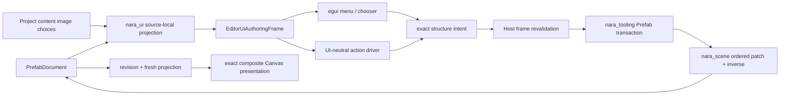
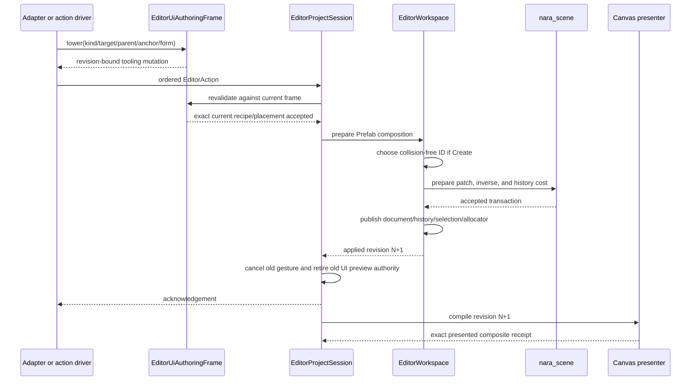

# Editor UI Prefab Structural Composition v1 - Plan

## Goal Capsule

| Field | Contract |
|---|---|
| Objective | Let an author create, delete, reorder, and reparent source-local UI nodes in one real UI Prefab through the existing Editor; preserve exact document identity, ordered placement, one-record Undo/Redo, Save/Reopen, Canvas authority, and explicit Game Restart consumption. |
| Product owner | The private `nara-editor` application remains the product Host. `nara_scene` owns failure-atomic ordered Prefab patches; `nara_ui` owns the closed UI composition catalog and legal source-local placement facts; `nara_tooling` owns document revision, stable-ID allocation, selection, history, and ordered actions; the root Editor Host binds those facts; egui remains a replaceable Adapter. |
| Architecture authority | Accepted ADRs 0006, 0015, 0026, 0047, 0101, 0104, 0107, and 0113 remain authoritative. EUSC amends ADR 0113 with source-local structural composition authority; it does not select a final Editor toolkit or create a public widget/catalog/plugin framework. |
| Execution profile | Five dependency-ordered units, focused owner tests, one UI-neutral action-driver parity test, one real Reference Game authoring trajectory, and one extension of the existing bounded native UI Canvas canary. No widget, placement, platform, DPI, or GPU Cartesian matrix is required. |
| Stop conditions | Stop the affected path if structural editing requires expanding a Prefab into a Scene and saving it back, if egui must allocate persistent IDs or build raw patches, if a failed operation consumes an ID or changes selection/history, if stale Canvas facts can select or mutate the new structure, or if implementation requires nested Prefab overrides, a generic component registry, drag-and-drop framework, Binding DSL, docking, or another GPU owner. |
| Tail ownership | EUSC-U5 updates ADR 0113 links, the implementation ledger, derived current-state index, and one verification record. This plan does not activate itself and does not alter predecessor evidence. |

---

## Product Contract

### Summary

Nara's Editor can open a real UI Prefab, inspect and edit its existing nodes, preview unsaved values
through Nara UI, manipulate supported absolute pixel geometry, save the source, rebuild immutable
project content, and explicitly restart the game from the saved generation. The remaining ordinary
Godot/Unity-style gap is structural composition: an author cannot yet add a Text, Image, Button, or
Container; choose its parent and sibling order; move an existing node; or remove a subtree.

This plan closes that bounded workflow. It deliberately does not design a complete widget catalog,
plugin contribution registry, general hierarchy drag-and-drop system, layout-template language, or
cross-toolkit abstraction. The first product proof is a closed first-party catalog and explicit
menu/dialog workflow over the current source-local Prefab.

Product Contract preservation: bootstrapped from the user-confirmed scope in this session and the
completed Editor Scene Composition, Editor UI Prefab Authoring and Canvas, Fresh Project, and
Reference Game workflows. Those predecessor plans and verification records remain immutable.

### Problem Frame

The needed mechanisms exist, but their ownership stops at different boundaries:

- `ScenePatchOperation` already models ordered `AddEntity`, `RemoveEntity`, `RestoreEntity`, and
  `MoveEntity`, but Prefab authoring currently rejects every structural operation.
- Scene Composition already proves stable-ID allocation, selection replacement, ordered placement,
  failure-atomic history, and exact document revision, but its public vocabulary is intentionally
  Scene-specific (`Empty`, `ColoredSprite`, component add/remove).
- `nara_ui` already projects a source-local UI hierarchy with typed components, exact order, Canvas
  geometry, and source mapping, but it has no closed creation recipes or legal placement model.
- The root-private `EditorUiAuthoringFrame` already binds one Prefab revision to UI semantics and
  lowers field/direct edits, but it cannot lower a structural intent.
- egui already renders the UI hierarchy, typed Inspector, Canvas, and ordered action batch, but it
  has no create/move/delete workflow and must not become document or patch authority.

A shallow solution would expose raw `ScenePatchDocument` construction to egui, reuse Scene
Composition's sprite catalog, allocate IDs in the dialog, let missing anchors fall back to `Last`,
or mutate an expanded Runtime tree. Those shortcuts break failure atomicity, source locality,
Undo/Redo, stale-action rejection, and future Adapter parity.

### Key Decisions

- KD1. **Edit only the current source-local UI Prefab structure.** (session-settled: user-approved)
  Structural actions target records physically owned by the open Prefab. Nested Prefab overrides,
  expanded Runtime IDs, Scene anchors, and cross-document moves remain out of scope. Chosen over an
  override system because source-local identity and persistence are already proven. Governs R1-R4,
  R7-R12.
- KD2. **Ship a closed first-party catalog: Container, Text, Image, and Button.**
  (session-settled: user-approved) Each kind lowers to one complete, validated component bundle.
  Arbitrary component composition, custom widgets, templates, and plugin registration remain
  deferred. Chosen over a generic catalog because four concrete product nodes are enough to prove
  the ownership seam. Governs R5-R8.
- KD3. **Use menus plus an explicit parent/order chooser.** (session-settled: user-approved) v1 does
  not implement Tree or Canvas drag-and-drop. A command records an exact parent and stable sibling
  anchor rather than an inferred array index. Chosen to close correctness before complex pointer
  arbitration and drop affordances. Governs R9-R11, R15-R16, R19.
- KD4. **Keep the existing `UiRoot` protected.** Structural composition requires a valid current
  source-local UI projection; v1 neither creates, deletes, nor moves UI roots. This avoids a second
  root lifecycle and keeps the authored surface/profile contract unchanged. Governs R3, R6, R9,
  R12.
- KD5. **Allocate persistent entity IDs only inside the Prefab workspace transaction.** The Adapter
  and `nara_ui` describe kind and placement but never choose an ID. The allocator advances only
  after successful document publication and reconstructs a collision-free candidate after Reopen.
  Chosen over random or toolkit IDs to preserve deterministic, testable source identity. Governs
  R7, R13-R14.
- KD6. **Treat structure changes as ordinary revision-bound authoring transactions.** One successful
  create, delete, reorder, or reparent operation publishes one Prefab revision and one history
  record. Failure changes no document, ID allocator, selection, gesture, history, or Canvas
  authority. Chosen over a separate hierarchy command stack. Governs R12-R18.
- KD7. **Preserve the existing Adapter-neutral action seam.** egui and a non-egui action driver ask
  the same exact `EditorUiAuthoringFrame` to lower a high-level composition intent. The Host
  revalidates it against the current frame before `nara_tooling` commits it. Chosen over a toolkit
  callback registry or public UI Editor trait. Governs R15-R20.

### Requirements

#### Source and hierarchy authority

- R1. Structural actions are available only when the active document is a Prefab, the exact
  document/revision/session lineage matches the current `EditorUiAuthoringFrame`, and its source-
  local UI projection is accepted. Missing/invalid UI roots or a stale frame disable structure
  controls with a typed reason while existing field editing and last-good inert pixels retain their
  current contracts.
- R2. Every target, parent, and sibling anchor is a stable `SceneEntityId` from the current direct
  Prefab source. Expanded runtime identities, nodes owned by another Prefab/Scene, and records not
  present in the exact projection reject before mutation. Structure preflight also walks the
  complete ordered Prefab source topology independently of the UI projection; projection omission
  never makes a source record safe to ignore. No path parsing or display-label matching is an
  identity seam.
- R3. Every source-local entity carrying `UiRoot` is protected from create-root, delete, move, or
  reparent operations. A move or delete also rejects when the complete affected source subtree
  contains another `UiRoot` or any record omitted from the accepted UI projection. A root may be
  selected as a parent when its required `UiNode` is valid. v1 does not repair
  multiple/missing/invalid roots or manipulate hidden mixed-content descendants.
- R4. The hierarchy model exposes source order, parent, depth, derived display label, closed
  hierarchy classification, structural capability, and exact legal placement choices. Hierarchy
  classification is distinct from the creation catalog and is exactly `Root`, `Container`, `Text`,
  `Image`, `Button`, or `ExistingOther`; `Root` and `ExistingOther` are never creatable catalog
  kinds. Chooser rows show kind plus hierarchy path and append a short stable-ID suffix only when
  visible paths still collide. Display labels, paths, egui IDs, and row positions never become
  persistent identity.

#### Closed catalog and complete recipes

- R5. The catalog is exactly `Container`, `Text`, `Image`, and `Button`. `nara_ui` owns their UI
  meaning, accepted schemas, default authored values, required components, editable initial
  parameters, and read-only/unavailable reasons. `nara_tooling` and egui do not duplicate component
  field paths or schema versions.
- R6. `Container` creates a valid `UiNode`; `Text` creates `UiNode + UiText`; `Image` creates
  `UiNode + UiVisual` with an image brush; `Button` creates the complete controlled-button bundle
  `UiNode + UiVisual + UiButton + UiButtonVisuals`. Controlled Button lowering continues to derive
  its text and semantic presentation; v1 does not persist duplicate generated children.
- R7. A creation recipe is a bounded set of complete `SceneComponentRecord` values without an
  entity ID. The root Host binds it to the exact document/revision and `nara_tooling` allocates the
  identity only while preparing the failure-atomic Prefab patch. Missing schema/capability, invalid
  defaults, duplicate components, or budget rejection fails before allocation is committed.
- R8. Creating an Image requires selecting one exact currently admitted project image choice. The
  choice is bound to current project-content generation and source identity, then encoded through
  a semantic `AssetRef` field in the persistent brush schema. Brush-bearing UI schemas advance to
  successor versions with canonical migrations from the legacy overloaded reference string; role
  strings and optional image asset references become distinct fields. Runtime/Canvas lowering
  derives `UiImageId` only after the path reference is validated, and project-content dependency
  discovery must retain an image even when the created UI node is its sole reference. If no image
  is available, Image creation is
  unavailable with an explanation; no placeholder, arbitrary filesystem picker, or unvalidated
  string path is substituted. Button creation requires a non-empty bounded label and syntactically
  valid action identity but does not require a general action registry.

The creation form and authored defaults are fixed for v1:

| Kind | Form input | Common authored geometry | Kind-specific authored values | Initial focus |
|---|---|---|---|---|
| Container | Parent and order only | Flow position, `240 x 160 px`, visible, column/start/stretch, zero gap/padding, grow `0`, shrink `1` | `UiNode` only; the selected Canvas outline makes the otherwise paint-free container inspectable | Parent chooser |
| Text | Text content, initially `Text` | Flow position, `160 x 32 px`, same common flex/visibility defaults | `UiText` uses logical size `16`, primary-text role, start alignment, clip overflow, and no separate semantic override | Text field |
| Image | Explicit current project image; no initial selection | Flow position, `128 x 128 px`, same common flex/visibility defaults | Image brush with white tint and the exact chosen current image identity | Image chooser |
| Button | Label initially `Button`; required action has no default | Flow position, `160 x 44 px`, same common flex/visibility defaults | Enabled Button with `UiVisual::role(Panel)`, logical text size `16`, and exact `UiButtonVisuals::new()` defaults: primary normal text, accent/surface hover, positive/surface press, focus/focus with `2 px` border, disabled/secondary-text disabled state; Create stays disabled until action identity is valid | Label field |

All common authored geometry also initializes `left/top` to `0 px`, z index `0`, visible overflow,
and no stacking context. These are source defaults, not resolved-layout writeback. The compact form may
edit only the fields named in the table before creation; all other values use the exact recipe.

#### Placement, move, and deletion

- R9. Create and Move use the existing `ScenePlacement` algebra: exact owner plus `First`, `Last`,
  `Before(sibling)`, or `After(sibling)`. The chooser presents only placements valid in the current
  projection. It may suggest the selected valid parent or current root, but confirmation always
  carries the explicit parent and anchor; the Host never silently falls back when either becomes
  stale.
- R10. Reparenting excludes the moved entity and its descendants from parent choices, excludes
  anchors outside the selected parent, and rejects cycles, self-parenting, missing anchors, and
  cross-source targets. Descendant and cycle checks use the complete Prefab source topology, not
  only projected hierarchy rows. Reordering is the same Move operation with an unchanged parent
  and a new stable sibling anchor. Moving to the normalized current placement is an acknowledged
  no-op with no revision or history entry.
- R11. Delete removes one selected source-local non-root subtree after explicit Adapter
  confirmation. The confirmation is derived from the complete source subtree, not only visible UI
  rows; v1 rejects instead of deleting when that subtree contains an unprojected record or protected
  root. Its inverse restores exact records and ordered placement through the existing
  `RestoreEntity` operation. On success, selection moves to the surviving parent or clears for a
  root-owned child; Undo restores the document but does not invent a second selection history.
- R12. Prefab authoring admits only `AddEntity`, `RemoveEntity`, `RestoreEntity`, `MoveEntity`, and
  existing validated field operations. Arbitrary `AddComponent`, `RemoveComponent`, and
  `ReplaceComponent` remain rejected for Prefabs in this slice; every catalog node enters as one
  complete `AddEntity` record.

#### Transaction, history, and presentation safety

- R13. A successful structural action is one exact-document/base-revision transaction. Patch and
  inverse history cost are admitted before publication. Document revision, content-state identity,
  selection, and the Prefab allocator publish together; the allocator does not advance on
  rejection, no-op, stale input, or history-budget failure.
- R14. The Prefab slot owns a bounded deterministic entity-ID allocator. It skips every identity
  already in the document, detects exhaustion, and reconstructs a collision-free next candidate on
  Open/Reopen without persisting an Editor-only counter in the source document.
- R15. Structural dialogs and menus are transient Adapter state keyed by document, authoring-session
  lineage, base revision, target, and relevant project-content generation. They are not keyed by
  `EditorFrameRevision`, which advances during ordinary publication. The current frame is a
  revalidation input on every render and submit. Reopen, document switch, successful mutation,
  source replacement/content-generation change, or target removal closes stale UI. Escape/cancel
  emits no action and consumes no ID.
- R16. Structural mutation is not a continuous Canvas gesture. If a same-document gesture is
  active, the Host stages and validates the structure transaction first; only a successful publish
  cancels the gesture and retires its preview. A failed structural transaction leaves that gesture
  and accepted Canvas authority unchanged.
- R17. Every accepted structure revision invalidates the old UI authoring projection and makes its
  prior Canvas pick/source map inert immediately by exact revision mismatch. The next frame builds
  a fresh projection and candidate. Projection, planner, GPU, or composite-presentation failure
  never rolls back accepted source; last-good pixels may remain visible only with stale/inert
  status.
- R18. Undo/Redo uses the existing Prefab authoring history and preserves monotonic revision. Undo
  of create removes the exact generated entity; Undo of delete restores the exact subtree and
  placement; Undo of move restores the exact prior placement. Save/Reopen and explicit Game
  Restart keep the completed EUA source-refresh contract unchanged.

#### Adapter and product workflow

- R19. The egui Adapter exposes Add, Move/Reparent, and Delete through the existing fixed UI
  authoring surface. Familiar icon buttons receive tooltips; creation uses a closed kind menu and a
  compact form; parent/order selection uses stable hierarchy labels; destructive delete requires
  confirmation. The Adapter only renders frame facts and appends the Host-lowered action to the
  existing ordered action batch.
- R20. One UI-neutral action-driver test lowers and dispatches the same composition intent without
  egui. This proves future Nara UI Inspector parity at the action boundary without introducing a
  public agent API, MCP server, CLI, widget trait, or plugin registry.
- R21. The Reference Game trajectory opens the real UI Prefab, creates one catalog node, reorders or
  reparents it, deletes or undoes one structural change, saves, closes/reopens, and explicitly
  restarts the existing product from the same saved source. One extension of the existing native UI
  authoring canary proves a non-empty Canvas and one successful structural interaction; it does not
  repeat the full persistence trajectory or create a platform matrix.

### Interaction State Contracts

#### Create dialog

```text
Closed
  -> Editing(exact document/lineage/revision, kind, parent, anchor, bounded fields)
  -> Submitting(exact lowered intent)
  -> Closed                         on accepted mutation
  -> Editing(reason)                on current validation rejection
  -> Closed(stale)                  on revision/source/document change
```

- Opening the form does not reserve an entity ID.
- Changing kind replaces kind-specific transient fields; it does not mutate the Prefab.
- `Create` is enabled only when the current frame still admits the entire recipe and placement.
- A rejected current-form value remains editable; a stale form closes instead of rebasing, and a
  submit racing with that closure rejects against its captured revision.

#### Structure transaction

```text
Intent
  -> Frame preflight
  -> Workspace prepare(ID candidate + patch + inverse + history cost + selection)
  -> Publish(document + revision + content state + selection + allocator)
  -> Retire old gesture/Canvas authority
  -> Acknowledge
```

Any failure before Publish leaves every state listed in R13 and R16 unchanged. Nothing after
Publish is allowed to fail in a way that could make the source transaction appear rejected.

#### Canvas and hierarchy authority

```text
Current(revision N, presented stamp N)
  -> Structure accepted(revision N+1)
  -> Pixels may be last-good but pick is inert
  -> Candidate N+1
  -> Presented(revision N+1, exact composite receipt)
  -> Pick authority current again
```

Hierarchy selection remains workspace-owned throughout. Canvas does not synthesize structure
commands and does not retain mutation authority across a revision change.

### Acceptance Examples

- Given the Reference Game UI Prefab and an admitted image, when the author adds an Image as the
  first child of an explicit Container, then one stable source entity with the complete Image
  bundle is selected, one history record exists, the image remains in the refreshed project-content
  closure as its only source reference, and the next exact Canvas frame shows it.
- Given a selected Text node, when the author moves it after a sibling under another valid
  source-local parent, then source order changes exactly once and Undo restores the original parent
  and anchor.
- Given a selected Button subtree, when the author confirms Delete and then Undo, then the subtree,
  component values, and ordered placement are restored without reusing a new identity.
- Given a visible Container whose complete source subtree also contains a non-UI record or nested
  `UiRoot` omitted from the UI projection, when the author opens Move or Delete, then the operation
  is unavailable with a typed reason and no source record is changed.
- Given a create form from revision N, when another action publishes revision N+1 before submit,
  then the stale form closes and any racing submit rejects; no entity ID, document change, selection
  change, or history record is produced.
- Given a missing image choice, protected UI root, descendant parent, missing sibling anchor, or
  history-budget rejection, when the structural action is attempted, then it fails closed and the
  currently presented Canvas remains authoritative for the unchanged revision.
- Given an accepted structure change whose new Canvas render is deferred or rejected, then the
  source remains dirty and correct, old pixels are inert, hierarchy/Inspector expose the accepted
  structure, and Save/Undo remain available.

## Context and Research

### Existing Nara patterns

- The completed Scene Composition plan proves ordered create/remove/move semantics, stable-ID
  allocation, selection replacement, and one-record history for `SceneDocument`.
- The completed UI Prefab Authoring plan proves real `PrefabDocument` slots, source-local UI
  projection, typed field/direct edits, exact Canvas receipts, Save/Reopen, immutable content
  refresh, and explicit Game Restart.
- ADR 0026 already requires revision-bound failure-atomic patch/history transactions; ADR 0101
  already owns stable ordered placement; ADR 0113 owns Prefab/Canvas authority.
- `ProjectContentSnapshot::images()` and the existing UI preview image alias lowering provide the
  bounded source for Image choices. No new filesystem or asset browser authority is needed.

### Comparative pressure

Godot and Unity demonstrate the product value of a retained UI hierarchy, explicit parent/order,
complete first-party controls, Undo, and immediate visual feedback. Nara should borrow that workflow
shape, not their object system, serialization model, generalized component menu, or Editor toolkit.
The local Scene Composition and UI authoring implementations are the stronger authority for the
actual transaction boundaries in this plan.

No external research is required before implementation. A later complete Inspector or a second
structurally different game may justify a configurable catalog, templates, drag-and-drop, or nested
Prefab overrides; this first slice does not.

## Planning Contract

### Key Technical Decisions

- KTD1. Extract only private ordered-document mechanics needed for Prefab structural patch
  validation/application/inversion. Keep `SceneDocument` and `PrefabDocument` nominal public types;
  do not introduce a public generic document trait or convert Prefabs through Scenes.
- KTD2. Add a focused `nara_ui` authoring-composition Module that owns the four catalog recipes,
  structural capabilities, exact source-local placement candidates, protected-root/hidden-subtree
  policy, and canonical preflight. It consumes the accepted UI projection plus complete source
  topology and bounded image-choice facts, not Editor identities or egui state. Persistent brush
  schemas use semantic asset references rather than overloaded strings.
- KTD3. Represent a prepared catalog entity as a bounded component bundle without an entity ID.
  `nara_tooling` owns a generic Prefab composition command and allocates the stable ID inside the
  workspace transaction; catalog names and UI schema paths do not enter tooling.
- KTD4. Extend `EditorUiAuthoringFrame` with one closed structure-lowering seam. It pairs a
  `nara_ui` intent with exact Editor document/revision and returns the UI-neutral tooling mutation.
  Dispatch revalidates the mutation against the current frame before workspace commit.
- KTD5. Publish document, history, selection, content-state identity, and allocator together in the
  Prefab slot. Keep gesture cancellation and Canvas retirement as infallible post-publish Host state
  transitions in the same action dispatch.
- KTD6. Reuse revision identity as the immediate Canvas invalidation boundary. Do not add a second
  Canvas receipt, hierarchy generation, or structural preview cache.
- KTD7. Keep one ordered `EditorActionBatch` for egui and non-egui callers. Do not add an agent
  protocol, command registry, callback registry, public composition trait, or toolkit abstraction.
- KTD8. Add no crate. New implementation should remain inside `nara_scene`, `nara_ui`,
  `nara_tooling`, root-private Editor Host modules, `nara_tooling_egui`, and the private Editor app.

### Ownership Map

| Fact or behavior | Sole owner | Explicit non-owner |
|---|---|---|
| Prefab ordered records, patch validation, inverse | `nara_scene` | egui, `nara_ui`, Runtime World |
| UI catalog kind, complete component recipe, legal UI placement, hidden-subtree rejection | `nara_ui` | `nara_tooling`, root Host, egui |
| Persistent UI brush asset-reference schema and migration | `nara_ui` codec registration | project-content loader, egui |
| Project image choices and content generation | Root project-content/Editor Host | `nara_ui`, egui |
| Editor document/revision/action envelope | `nara_tooling` | `nara_ui`, egui |
| Stable entity-ID allocation | Prefab workspace slot | dialog, Adapter, `nara_ui` |
| Selection, history, dirty/saved state | Prefab workspace slot | Canvas, egui memory |
| UI facts plus exact Editor identity | Root-private `EditorUiAuthoringFrame` | individual lower crates |
| Canvas receipt, texture, physical input | Private Editor platform Host | document/session, egui panel |
| Dialog/open-menu/transient form state | egui Adapter | document, persistence, Runtime |
| Save, content refresh, Play/Restart | `EditorProjectSession` | catalog, Adapter, running Runtime |

### High-Level Technical Design

```mermaid
stateDiagram-v2
    [*] --> Current
    Current --> EditingDialog: open create/move/delete UI
    EditingDialog --> Current: cancel or Escape
    EditingDialog --> Rejected: current validation fails
    Rejected --> EditingDialog: correct current form
    EditingDialog --> Published: exact transaction accepted
    EditingDialog --> Stale: document/lineage/revision changes
    Stale --> Current: close transient UI
    Published --> InertPixels: revision advances; old pick retires
    InertPixels --> Current: exact successor Canvas presents
```







### Assumptions and Constraints

- The active UI Prefab has at least one valid source-local `UiRoot + UiNode`; root repair is not in
  scope.
- The current Prefab writer and Save/Reopen/content-refresh path remain canonical.
- Structural patches are small enough for the existing bounded patch/history accounting; this plan
  adds no serializer-size heuristic or separate hierarchy budget.
- The current UI brush codecs can register a bounded successor schema and one-step migration
  without introducing a new reflection or asset-loading framework; stable-asset references remain
  unsupported in this slice, matching the existing project-content policy.
- v1 edits one directly opened Prefab. Cross-document moves and nested override authoring remain
  unsupported even when expanded runtime hierarchy makes them look adjacent.
- The existing one-window, one-GPU Editor topology remains unchanged.
- Testing stays representative: owner algebra, one Adapter translation path, one non-egui parity
  path, one product trajectory, and one native canary extension.

### Sequencing

```text
EUSC-U1 Prefab structural patch authority
        |
        v
EUSC-U2 closed UI catalog and placement facts
        |
        v
EUSC-U3 tooling + Host exact structural transaction
        |
        v
EUSC-U4 egui product workflow and parity
        |
        v
EUSC-U5 real source/save/restart evidence and closure
```

U2 depends on U1 because catalog output must have a legal Prefab transaction. U3 depends on both
because it binds UI semantics to tooling identity. U4 must not invent missing lower-level facts.
U5 runs only after the product surface is complete.

### System-Wide Impact

- **Data flow:** current Prefab plus current project image choices produce an immutable structural
  frame; Adapter intent is lowered and revalidated; one workspace transaction publishes source;
  the next frame rebuilds projection and Canvas.
- **Error propagation:** UI-semantic errors remain typed at `nara_ui`; stale document/action errors
  remain tooling/Host outcomes; patch/history errors remain `nara_scene` diagnostics; the Adapter
  only displays them.
- **Lifecycle:** Open/Reopen initializes allocator and transient dialog scope; successful structure
  mutation advances revision and retires prior gesture/pick authority; close/target retirement drops
  transient state without touching source.
- **API surface:** only focused closed composition types and frame accessors are added. Existing raw
  patch paths remain advanced/internal evidence seams and are not used by the Editor product UI.
- **Observability:** existing Editor diagnostics report kind, document, target, and reason. No new
  telemetry system or persistent operation journal is introduced.

### Risks and Mitigations

| Risk | Severity | Mitigation |
|---|---|---|
| Scene and Prefab structural logic diverges | High | Share only private ordered-document mechanics and run the same operation algebra against both nominal documents. |
| UI catalog becomes a premature plugin system | High | Freeze four first-party enum variants and complete recipes; defer contribution/registration. |
| Adapter bypasses catalog validation | High | Adapter receives only current facts and calls root frame lowering; Host revalidates before dispatch. |
| Failed create consumes an identity | High | Allocate candidate during workspace prepare and publish allocator only with the document transaction. |
| Missing sibling silently changes order | High | Require exact stable anchor and reject; never fall back to `Last`. |
| Delete or reparent corrupts hidden source records | Critical | Preflight the complete Prefab topology; reject affected subtrees containing unprojected records or any protected root before publication. |
| Old Canvas selects new structure | Critical | Exact document revision invalidates old pick authority immediately after accepted mutation. |
| Image creation introduces filesystem authority or loses its dependency | High | Offer only current admitted project image facts and persist semantic asset references discoverable by the existing content-closure traversal; no arbitrary path or placeholder. |
| Dialog state expires every ordinary Editor frame | High | Key transient state by source lineage/revision/content generation and use frame identity only for current revalidation. |
| Test surface grows into a matrix | Medium | One representative case per owner plus one product trajectory and one native canary extension. |

### Resolved During Planning

- Structural composition is a successor to completed EUA, not an amendment to its execution state.
- The first catalog is Container/Text/Image/Button; UI roots are protected.
- v1 uses menu/dialog plus explicit parent/order, not drag-and-drop.
- Image creation requires a real current project image choice.
- Persistent UI brushes use successor semantic asset-reference schemas with canonical migration;
  an image node can be the sole owner of its project-content dependency.
- Move/Delete rejects a visible node whose complete source subtree contains hidden records or another
  protected root; v1 never treats projection omission as deletion authority.
- Stable IDs are allocated by the Prefab workspace transaction, not the Adapter or UI catalog.
- Successful structure changes invalidate prior Canvas input by revision; no new generation type is
  required.
- egui and a non-egui driver share the frame-lowering/action path; no agent protocol is added.

### Deferred Questions

- Nested Prefab structural overrides and cross-document composition.
- Tree/Canvas drag-and-drop, marquee, duplicate, copy/paste, multi-selection, and keyboard reorder.
- Custom widget/component contribution registry, templates, variants, and project-specific catalog
  entries.
- General asset browser, thumbnail picker, and missing-resource repair UI.
- Creation of additional UI roots, multi-surface root assignment, and root deletion/repair.
- Binding/expression language, animation tracks, responsive breakpoints, and layout presets.
- Nara UI Editor shell convergence, docking, detached windows, and toolkit-neutral widgets.
- Public CLI/agent/MCP structural authoring API.

## Implementation Units

### EUSC-U1. Prefab ordered structural patch authority

**Objective:** admit the bounded structural operation subset directly against `PrefabDocument`
without weakening its known-schema, canonical-writer, history, or failure-atomic contracts.

**Depends on:** completed EUA baseline and Accepted ADRs 0026, 0047, 0101, and 0113.

**Files:**

- `crates/nara_scene/src/patch.rs`
- `crates/nara_scene/src/authoring.rs`
- `crates/nara_scene/src/tests.rs`
- `tests/scene_patch_transactions.rs`
- `tests/scene_authoring_session.rs`
- `docs/architecture/adr/0113-editor-ui-prefab-authoring-and-canvas-authority.md`

**Work:**

- Extract private ordered-record lookup, current-placement, subtree, cycle, add/remove/restore/move,
  and inverse construction mechanics usable by both nominal documents.
- Admit `AddEntity`, `RemoveEntity`, `RestoreEntity`, and `MoveEntity` in
  `PrefabAuthoringSession`; retain existing field operations and continue rejecting structural
  component replacement operations.
- Preserve exact source placement preconditions, canonical order, schema validation, patch/history
  budgets, monotonic revision, branch-safe content state, and no-mutation rejection.
- Amend ADR 0113 to state that source-local UI structure uses the ordinary Prefab patch/history
  authority; do not document catalog or egui details as architecture.

**Focused tests:**

- One Prefab transaction covers add, move, remove, inverse restore, and canonical roundtrip.
- One invalid cycle/missing-anchor or history-budget case proves document/revision/history unchanged.
- One component add/remove/replace case proves that the deferred operation class still rejects.

**Exit:** a Prefab can safely apply the structural operation algebra, but no UI catalog, Editor
action, or product control exists yet.

### EUSC-U2. Closed UI catalog and exact placement facts

**Objective:** make `nara_ui` the deep owner of four complete creation recipes and legal
source-local structure choices, without importing tooling or toolkit identity.

**Depends on:** EUSC-U1.

**Files:**

- `crates/nara_ui/src/authoring_composition.rs` (new)
- `crates/nara_ui/src/authoring_model.rs`
- `crates/nara_ui/src/codec.rs`
- `crates/nara_ui/src/lib.rs`
- `src/project_host/runtime/editor/ui_preview.rs`
- `tests/project_content_boot.rs`

**Work:**

- Define the closed node-kind, bounded create parameters, high-level create/move/delete intent,
  complete entity recipe, structural capability, placement candidate, and typed rejection model.
- Build exact parent/anchor choices from the current source-local projection; protect roots; exclude
  descendant parents; normalize current placement; never synthesize fallback anchors.
- Classify every current hierarchy row independently from the four creatable kinds and produce the
  deterministic path/stable-ID disambiguation facts used by choosers and diagnostics.
- Lower Container/Text/Image/Button to complete schema-versioned component records using current
  registered UI authoring schemas and canonical codecs. Advance every persistent brush-bearing UI
  schema that can carry an image reference to a successor version; register one canonical
  legacy-string migration that separates role text from an optional semantic `AssetRef`, and make
  the codec derive `UiImageId` only after validating the admitted path form.
- Let the root Host provide bounded current project image choices with content generation and exact
  source/asset identity. Keep filesystem/project-content types outside `nara_ui`.
- Extend hierarchy rows with derived kind/display facts needed by the chooser while keeping stable
  entity identity authoritative. Build structural capabilities from complete Prefab topology as
  well as the accepted UI projection: a visible node whose affected subtree contains an omitted
  record or another root is unavailable for Move/Delete with a typed reason.

**Focused tests:**

- One representative create recipe validates each complete bundle structurally without a GUI
  matrix; Button verifies controlled lowering does not require persisted generated children.
- One placement test covers protected root, descendant exclusion, exact sibling anchors, and
  normalized no-op.
- One Image case requires an exact current choice and rejects absent/stale choices; its encoded
  semantic asset reference is discoverable when the created node is the only image reference.
- One codec migration case reads a legacy brush, writes the successor form, and preserves role
  brushes while exposing image references to ordinary project-content closure traversal.
- One complete-topology case rejects Move/Delete for an omitted descendant or nested root without
  changing projection, source records, or capabilities.

**Exit:** a current UI projection can describe and preflight every v1 structure intent without
allocating an Editor ID or creating a patch.

### EUSC-U3. Exact tooling and Host structural transaction

**Objective:** bind UI composition semantics to exact Editor identity and publish one atomic Prefab
document/history/selection/allocator transaction with correct gesture and Canvas invalidation.

**Depends on:** EUSC-U1 and EUSC-U2.

**Files:**

- `crates/nara_tooling/src/composition.rs`
- `crates/nara_tooling/src/workspace.rs`
- `crates/nara_tooling/src/frame.rs`
- `crates/nara_tooling/src/lib.rs`
- `src/project_host/runtime/editor/actions.rs`
- `src/project_host/runtime/editor/ui_authoring.rs`
- `src/project_host/runtime/editor/ui_preview.rs`
- `src/project_host/runtime/tests.rs`

**Work:**

- Add a UI-neutral Prefab composition command carrying a bounded entity draft or exact move/delete
  target and `ScenePlacement`, but no UI catalog enum, field path, egui ID, or allocated entity ID.
- Add Prefab-slot allocator state with collision scanning, exhaustion, Reopen reconstruction, and
  publish-on-success semantics.
- Prepare patch, inverse/history admission, selection result, and next allocator state before
  publishing them together. Return a typed no-op for normalized current placement.
- Extend `EditorDocumentMutation`/workspace dispatch with the exact document/base-revision command
  and include it in revision-advancing action arbitration.
- Extend `EditorUiAuthoringFrame` with structure lowering and current-frame admission. Root dispatch
  revalidates source locality, complete affected source topology, catalog recipe, image choice,
  target, parent, and anchor before workspace commit. A projection omission is a rejection, not an
  implicit permission to mutate unseen records.
- After successful publication, cancel the same-document gesture, retire the prior UI preview
  authority, and rely on revision mismatch to close any remaining platform pick window. Do neither
  after rejection/no-op.

**Focused tests:**

- Create selects the allocated entity and advances allocator once; a failed/stale create consumes
  no identity and changes no workspace fact.
- Delete chooses surviving parent/clear selection and Undo restores exact subtree/order; Move
  preserves selection and Undo restores exact placement.
- Active gesture plus successful structure mutation cancels once; a rejected mutation preserves
  gesture and current Canvas authority.
- Old revision/pick facts cannot select or mutate after publication.

**Exit:** one exact Host action can safely create/move/delete current UI Prefab structure without
any Adapter-specific behavior.

### EUSC-U4. egui structural authoring workflow and Adapter parity

**Objective:** expose the bounded Godot/Unity-like workflow through the existing egui Editor while
keeping all semantic and transaction authority below the Adapter.

**Depends on:** EUSC-U3.

**Files:**

- `crates/nara_tooling_egui/src/ui_authoring.rs`
- `crates/nara_tooling_egui/src/editor.rs`
- `crates/nara_tooling_egui/src/tests.rs`
- `editor/src/app.rs`

**Work:**

- Add icon/tooltip commands for Add, Move/Reparent, and Delete in the UI hierarchy/Inspector
  context; do not add Tree/Canvas drag-and-drop.
- Implement one revision-scoped create form for closed kind, parent, anchor, and bounded kind-
  specific values; Image uses only supplied project choices.
- Implement explicit move/reparent parent and sibling-order selection with current placement shown;
  omit invalid targets rather than accepting and repairing them.
- Add destructive subtree confirmation whose summary is based on the complete source subtree.
  Close all transient state on lineage/revision/document/content-generation change and report typed
  current rejection without retaining a stale command. Do not key retained dialog state by the
  per-publication `EditorFrameRevision`; use source lineage, base revision, target, and relevant
  content generation, then revalidate against the current frame.
- Give every icon, menu item, chooser, field, and confirmation control an accessible name; support
  keyboard-only traversal, Enter activation, and Escape cancellation. After success, return focus
  to the created/moved hierarchy row or the surviving parent after delete; after stale closure,
  restore hierarchy focus. Associate typed rejection text with the affected control and focus the
  first invalid field.
- Append only the frame-lowered mutation to the existing ordered action batch. Add one non-egui
  driver fixture that calls the same frame seam.

**Focused tests:**

- One create flow asserts exact document/revision, kind-specific values, parent/anchor, and one
  resulting ordered action.
- One move or delete flow proves explicit confirmation and stale dialog closure.
- One keyboard-only flow proves accessible control names, traversal/activation, Escape, and focus
  restoration; it reuses the representative create/delete cases instead of adding a new matrix.
- One non-egui driver produces the same lowered mutation for the same current frame.

**Exit:** a user can complete every structural action from the fixed Editor shell without egui
owning IDs, schema paths, placement validation, selection, history, or source data.

### EUSC-U5. Real source trajectory, native canary, and closure

**Objective:** prove that structural composition survives the full authoring and product lifecycle,
then register the reviewed implementation without expanding the test surface.

**Depends on:** EUSC-U4.

**Files:**

- `reference-game/tests/editor_ui_refresh.rs`
- `editor/src/platform/ui_canary.rs`
- `docs/architecture/adr/0113-editor-ui-prefab-authoring-and-canvas-authority.md`
- `docs/architecture/adr/implementation-status.md`
- `docs/architecture/README.md`
- `docs/knowledge/engineering/current-state.md`
- `docs/knowledge/engineering/verification/2026-08/`

**Work:**

- Extend the existing real Reference Game Prefab journey: create one node, change its ordered
  placement, delete or undo one operation, Save, close/reopen, refresh project content, and
  explicitly Restart/Play from the same saved source.
- Verify the runtime-visible result through existing source/product observations, not a new private
  presenter or digest-only surrogate.
- Include the brush-schema migration and sole-image-reference refresh in the same real source
  trajectory, so the evidence proves that structural composition does not create a transient-only
  image dependency.
- Extend the existing bounded native UI Canvas canary with one structural action and exact successor
  presentation; reuse its one-window/one-GPU lifecycle and do not add a platform matrix.
- Run focused owner gates serially, review the final diff, record exact commands/results/commit,
  amend ADR 0113 with the source-local structural and semantic-brush migration decisions, update
  implementation evidence links, and register completion through engineering memory. Predecessor
  records remain immutable.

**Focused tests:**

- One end-to-end trajectory proves create/order/Undo-or-delete/Save/Reopen/Restart from one real
  source copy.
- One native canary proves non-empty Canvas, one exact structural action, and exact successor
  composite receipt.

**Exit:** the Editor product, not only component fixtures, proves source-local UI structural
composition through persistence and Runtime consumption.

## Verification Contract

### Required gates

Run serially and narrow filters further when the named tests permit it:

```powershell
$env:CARGO_BUILD_JOBS='1'
cargo nextest run --locked -p nara_scene --test-threads=1
cargo nextest run --locked -p nara --features runtime-core --test scene_patch_transactions --test scene_authoring_session --test-threads=1
cargo nextest run --locked -p nara_ui -p nara_tooling -p nara_tooling_egui --test-threads=1
cargo nextest run --locked -p nara --lib --features tooling,presentation-ui,render-wgpu,project-workflow,runtime-2d,serde --test-threads=1
cargo nextest run --locked -p nara-editor --test-threads=1
cargo nextest run --manifest-path reference-game/Cargo.toml --locked --features editor-game-view-canary --test editor_ui_refresh --test-threads=1
cargo fmt --all -- --check
git diff --check
```

The native canary is one bounded manual/local product gate using the existing Editor UI canary
entrypoint after U4. Record its exact command, platform, adapter/backend identities, timeout, and
success output in the U5 verification record. Do not multiply it across catalog kinds, layout
modes, GPUs, DPIs, or platforms.

### Evidence rules

- Owner tests prove patch, catalog, workspace transaction, and Adapter translation separately; they
  may not be relabeled as native product evidence.
- The catalog/codec owner evidence must include one legacy-brush migration and one sole-image-
  reference content-closure assertion; do not expand this into a brush-kind or asset-format matrix.
- Structure owner evidence must inspect the complete Prefab source subtree for one omitted-record
  or nested-root rejection; a projection-only test is insufficient for delete/move authority.
- The non-egui parity fixture proves action-seam parity only; it is not a public agent/CLI contract.
- The product trajectory must consume a real temporary project/source and ordinary Save/Reopen/
  Restart owners. No test-private presenter, manually constructed receipt, or source-text scan may
  close U5.
- The native canary proves one visual/input path only. It does not need to duplicate persistence,
  every catalog item, every anchor, or every rejection.
- A failed or timed-out gate remains visible in the verification record; do not convert it into an
  architectural exception or add a new testing framework.

## Definition of Done

### Global

- [x] A user can create Container/Text/Image/Button nodes in the current real UI Prefab, explicitly
  choose parent/order, move/reparent/reorder an existing node, and delete a non-root subtree.
- [x] All successful structure changes are exact-document/revision, failure-atomic, one-record history
  transactions with deterministic stable IDs and correct selection.
- [x] Protected root, source-local identity, cycle, exact anchor, image choice, schema, and history
  policies fail closed without consuming IDs or invalidating unchanged authority.
- [x] Persistent image brushes use semantic asset references that survive canonical migration and remain
  discoverable when the UI node is their only project-content dependency; hidden mixed-content
  subtrees are rejected rather than silently edited.
- [x] Old Canvas pick/source facts become inert immediately after accepted structure change; only an
  exact successor composite receipt restores Canvas input.
- [x] Save/Reopen/content refresh/explicit Restart consumes the same structural source through ordinary
  product owners.
- [x] egui and a non-egui driver use the same frame-lowering/action path. No toolkit, agent, plugin, or
  generic catalog framework becomes document authority.
- [x] No new crate, GPU owner, RenderGraph, docking system, Binding DSL, nested override layer, or
  drag-and-drop framework is introduced.
- [x] Focused gates and one native canary pass; no Cartesian test matrix is added.

### Per-unit

- **EUSC-U1:** Prefab structural patch/inverse/history failure atomicity is proven.
- **EUSC-U2:** all four complete recipes and exact placement/source-local rejection
  are owned by `nara_ui`.
- **EUSC-U3:** allocator/document/history/selection publication and Canvas invalidation
  are exact and stale-safe.
- **EUSC-U4:** the product Adapter performs the bounded workflow and the non-egui
  parity driver shares the same seam.
- **EUSC-U5:** real source persistence/Restart and one native Canvas path are recorded
  against a reviewed commit and authority indexes agree.

## Sources and References

### Nara authority and landed patterns

- `STRATEGY.md`
- `docs/architecture/README.md`
- `docs/architecture/adr/0006-scene-and-prefab-data-model.md`
- `docs/architecture/adr/0015-editor-tooling-and-dogfooding-boundary.md`
- `docs/architecture/adr/0026-editor-command-patch-and-undo-model.md`
- `docs/architecture/adr/0047-editor-workspace-and-scene-document-state.md`
- `docs/architecture/adr/0101-ordered-persistent-placement-and-runtime-projection.md`
- `docs/architecture/adr/0104-host-owned-editor-workspace-installation.md`
- `docs/architecture/adr/0107-shared-ui-foundation-and-independent-product-layers.md`
- `docs/architecture/adr/0113-editor-ui-prefab-authoring-and-canvas-authority.md`
- `docs/plans/2026-08-16-1440-feat-editor-scene-view-and-composition-plan.md`
- `docs/plans/2026-08-17-1930-feat-editor-ui-prefab-authoring-and-canvas-v1-plan.md`
- `crates/nara_scene/src/patch.rs`
- `crates/nara_scene/src/authoring.rs`
- `crates/nara_tooling/src/composition.rs`
- `crates/nara_tooling/src/workspace.rs`
- `crates/nara_tooling/src/frame.rs`
- `crates/nara_ui/src/authoring_model.rs`
- `crates/nara_ui/src/codec.rs`
- `crates/nara_reflect/src/asset_reference.rs`
- `src/project_content.rs`
- `src/project_host/runtime/editor/ui_authoring.rs`
- `src/project_host/runtime/editor/ui_preview.rs`
- `crates/nara_tooling_egui/src/ui_authoring.rs`
- `editor/src/app.rs`

### Comparative sources

- `repo-ref/godot/scene/gui/control.h`
- `repo-ref/godot/editor/editor_node.h`
- `repo-ref/bevy/crates/bevy_ui/src/ui_node.rs`
- `repo-ref/open-gpui/crates/gpui_docking/README.md`

Comparative sources provide workflow pressure only. They do not authorize copying another engine's
object model, toolkit memory, docking graph, component registry, or runtime topology.
