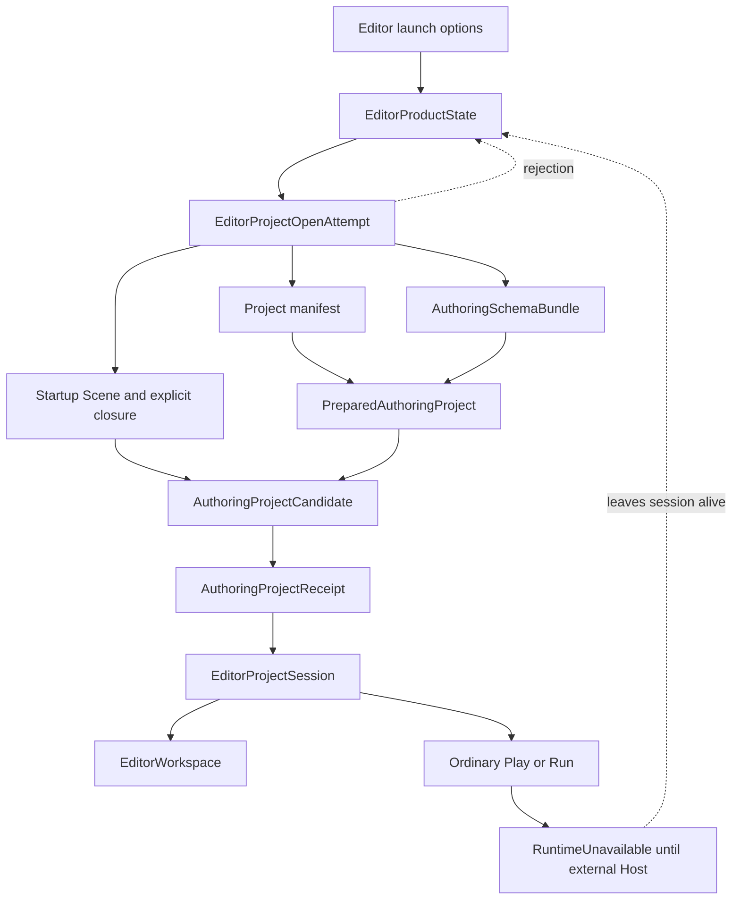
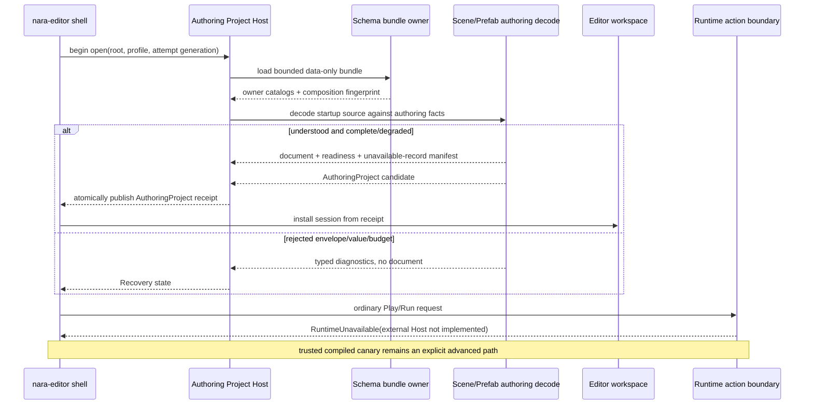
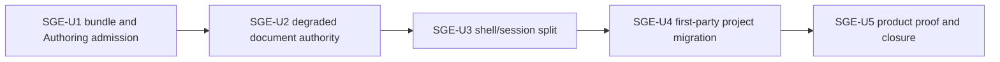

# Standalone Generic Editor Project Open and Recovery - Plan

## Goal Capsule

| Field | Contract |
|---|---|
| Objective | Make the installed `nara-editor` open and safely author any compatible Nara project without compiling or linking that project's Rust code. Missing project providers, broken project code, and preservable unavailable schemas become visible authoring/recovery states rather than process-exit conditions; provider-capable Runtime, Check, Play, Run, Cook, and Export remain strict. |
| Product owner | The private `nara-editor` owns the long-lived shell and recovery UX. The root project Host owns Authoring Project admission and exact source capability. `nara_reflect` owns the data-only schema bundle. `nara_scene` owns semantic record preservation. `nara_tooling` owns document readiness, operation gates, history, and persistence state. |
| Architecture authority | Accepted ADRs 0006, 0026, 0047, 0079, 0081, 0082, 0084, 0090, 0104, 0110, 0111, 0112, 0113, and 0114 remain authoritative. ADR 0114 selects the standalone Editor and Authoring/Runtime split; ADR 0090 owns degraded records and operation safety. |
| Execution profile | Five dependency-ordered units. Reuse the existing Scene/Prefab/workspace/persistence Modules. Add one bounded owner-local schema-bundle format, one private Authoring Project deep Module, one shell/recovery state split, first-party bundle publication, and one real Generic Open/Recovery trajectory. |
| Stop conditions | Stop the affected path if Authoring Project needs a `RuntimePlan`, native registry, project crate, `World`, project executable, ambient directory scan, raw JSON preservation, placeholder ECS component, automatic code execution, project-specific Editor binary, or a generic plugin/transport framework. |
| Tail ownership | SGE-U5 updates ADR 0090/0114 implementation rows, the architecture index, user-facing Editor launch guidance, and one reviewed verification record. This plan does not activate itself and does not rewrite predecessor evidence. |

---

## Product Contract

### Summary

Nara already has a real Editor product, but project opening is still executable-composition driven.
The standalone binary resolves a complete `RuntimePlan`, builds a native component registry, loads
runtime content, and only then creates the Editor application. That makes a missing project schema
provider or broken project Rust indistinguishable from an invalid Editor process.

This plan changes the product boundary. `nara-editor` becomes one installed, project-generic
application. It starts its shell first, opens project source through a non-executable Authoring
Project transaction, and preserves unavailable records according to ADR 0090. Runtime-demanding
actions remain separately admitted and strict. Until the supervised execution Host lands, ordinary
Play and Run are visibly unavailable rather than routed through the trusted in-process canary.

The first slice is intentionally about Open, Recovery, Scene/Prefab/UI source authoring, and strict
execution refusal. It does not implement the later child-process Play protocol, a project-wide Asset
Browser, importer execution, animation/shader tools, or an Editor extension system.

Product Contract preservation: bootstrapped from the user-confirmed standalone-editor direction in
this session, Accepted ADR 0114, completed Editor plans, and
[Standalone generic editor product model](../knowledge/engineering/standalone-generic-editor-product-model-research.md).

### Problem Frame

The current code has the right individual owners but connects them in the wrong order:

- `editor::run` calls `EditorApplication::open` before it creates the native window or event loop.
- `EditorApplication::open` constructs an empty ordinary `EditorProjectIntent` and calls
  `EditorProjectSession::open`.
- `EditorProjectSession::open` resolves a full executable product recipe and native schema registry,
  then calls runtime-oriented `ProjectContentLoader::load`.
- Scene/Prefab migration rejects an unknown component before a workspace exists.
- the Reference Game's project-owned providers are available only through its compiled recipe, so
  the generic binary exits with `scene.file-unknown-component`.

Adding a `reference-game-editor` binary or teaching `nara-editor` to link every known project would
preserve the structural defect. Adding `authoring_mode: bool` to `ProjectContentLoader` would mix two
different completeness and publication contracts. Preserving raw JSON substrings would bypass the
existing generic value grammar, canonical writer, budgets, and patch semantics.

### Key Decisions

- KD1. **One installed `nara-editor` is the ordinary product.** (session-settled: user-approved)
  A project-specific compiled companion remains an opt-in trusted Adapter, never a prerequisite for
  Open, Recovery, Scene/Prefab/UI editing, or Save. Chosen over per-project Editor builds because
  authoring availability must survive project code and toolchain failure. Governs R1-R4, R17-R22.
- KD2. **Authoring Project and Runtime Project are separate products.**
  (session-settled: user-approved) Authoring consumes data-only schema/source facts and may be
  Degraded; Runtime requires complete native bindings and executable composition. Chosen over a
  mode flag because the two paths have different identities, failure algebra, retained state, and
  publication authority. Governs R5-R9, R15-R18.
- KD3. **Accept semantic, operation-gated degraded authoring.**
  (session-settled: user-approved) ADR 0090's recognized-envelope/generic-value boundary is the
  preservation rule. Unavailable records remain exact document data and never become placeholder
  ECS components. Chosen over fail-closed whole-project Open and silent stripping. Governs R10-R16.
- KD4. **The Editor shell and recovery state exist before project admission.**
  (session-settled: user-approved) Invalid manifest, bundle, source, or startup document facts are
  displayed inside the application. Only native platform/GPU failure prevents the process from
  running. Chosen over command-line process exit because recovery is a core Editor workflow.
  Governs R2-R4, R17-R19.
- KD5. **Keep the first slice bounded to explicit source closure.** Full project browsing, native
  file pickers, directory watching, importer execution, external Play transport, and Editor plugins
  are deferred. Chosen because `nara_fs` does not yet provide an admitted handle-bound directory
  enumeration capability, and none of those features is needed to prove generic Open/Recovery.
  Governs R9, R18-R22.

### Requirements

#### Standalone product identity

- R1. The ordinary launch remains one `nara-editor` binary. Opening the first-party starter and
  Reference Game must not add the project crate, project provider crate, or a generated Editor target
  to `nara-editor`'s production dependencies.
- R2. The native shell is created before project admission. Project-root capability, manifest,
  authoring bundle, source document, or schema-readiness failure enters a bounded Editor recovery
  state with structured diagnostics; it does not return a project error from `main` or exit the
  process. Launching `nara-editor` without a project opens a minimal Project Manager with one
  project-path field, one profile field, and one Open Project action.
- R3. Invalid command-line syntax plus platform event-loop, window, and GPU initialization failures
  remain fatal `EditorRunError`s. A syntactically valid but missing, inaccessible, or invalid project
  root/profile is a project-open result shown in the shell. Project failures are not reclassified as
  platform failures, and the recovery shell never fabricates a workspace or saved checkpoint.
- R4. Closing a failed project attempt returns to the empty shell. Retrying creates a fresh project
  open attempt. A failed replacement attempt leaves an already open last-good workspace unchanged.
  An accepted replacement still passes through the existing dirty/conflict-aware finite close
  decision; Save failure, conflict, or Cancel aborts the handoff, while accepted Save or explicit
  Discard permits atomic retirement and replacement.

#### Data-only authoring schema and project admission

- R5. `nara_reflect` owns one versioned, bounded Authoring Schema Bundle file contract. The bundle
  contains a canonical ordered set of owner-local `ComponentSchemaCatalog`s keyed by an owned
  `PersistentComponentSchemaOwnerId` that can be loaded from data rather than requiring `&'static str`,
  generation, predecessor, tombstones, fields, generic values, declared reference capabilities,
  and a derived composition fingerprint. Duplicate owners/components, divergent ownership, invalid
  lineage, unsupported envelope/value grammar, or budget excess reject before publication.
- R5a. A project-controlled owner ID or catalog fingerprint is identity evidence, not authorization
  to activate a first-party typed Adapter. Typed Inspector/domain projection requires a Host-issued
  Adapter compatibility receipt bound to the exact owner, catalog fingerprint, supported generation,
  and Adapter generation. Bundle-only external owners remain generic semantic data.
- R6. The bundle contains no native binding identity, callback, codec function, migration function,
  `PluginDefinition`, Rust `TypeId`, executable path, script, toolkit object, GPU handle, or ambient
  filesystem path. Project source cannot use the bundle to authorize code loading or installation.
- R7. The project manifest names one project-wide bundle through a dedicated authoring field. The
  Authoring receipt binds exact project-root capability identity, manifest digest, bundle path and
  digest, owner/catalog facts, composition fingerprint, and open-attempt generation. Profile
  overlays do not silently replace this project-wide source authority in v1. A bundle may be a
  superset across profiles; Runtime compatibility requires exact matching definitions for every
  selected persistent owner/component and proof that every reachable source record is bound by the
  selected Runtime composition, rather than naive whole-bundle fingerprint equality.
- R8. A new root-private Authoring Project Module consumes the manifest and bundle without
  constructing `RuntimePlan`, `ComponentRegistry`, executable registry, plugin plan, or ECS
  `World`. It may reuse bounded envelope/value/catalog readers but not runtime admission or
  publication types. Admission has two nominal stages: SGE-U1 publishes an immutable
  `AuthoringSchemaReceipt` for the exact manifest and bundle basis; after generic persistent decode
  exists, SGE-U2 consumes that receipt and publishes bounded source candidates as an
  `AuthoringProjectCandidate` and then an atomic `AuthoringProjectReceipt`. Only the final project
  receipt may create `EditorProjectSession`.
- R9. v1 opens the manifest-selected startup Scene and its explicit Scene/Prefab/UI and declared
  asset-reference closure. It may also reopen an already known explicit source path. It does not
  call ambient `std::fs::read_dir`, recursively scan project directories, or claim a full Asset
  Browser. Every path is a validated project-relative component path resolved and read through the
  same exact `DirectoryCapability`; no dependency is validated and later reopened by ambient name.
  One open-attempt-wide budget bounds unique files, dependency edges, depth, path bytes, open handles,
  aggregate encoded/decoded bytes, decode work, diagnostics, and retained candidate bytes. Cycles
  and duplicates are charged deterministically. Handle-bound directory enumeration requires a
  separate `nara_fs` plan.

#### Degraded Scene and Prefab authoring

- R10. Scene/Prefab authoring decode first proves the persistent envelope, document shape, generic
  `ComponentValue` grammar, stable record boundaries, and all existing budgets. Unknown document
  version, operation, value tag, malformed boundary, or budget excess is `Rejected`, not
  `Degraded`.
- R11. Each component record is classified as `Available`, `KnownUnbound`, `UnknownSchema`,
  `Unmigratable`, or `FutureSchema` under ADR 0090. The document publishes `Complete` only when all
  required records are Available; otherwise a preservable document publishes `Degraded` with
  bounded, stable diagnostics and per-record capability facts. `Available` requires both compatible
  bundle semantics and an exact Host-issued authoring Adapter receipt; a spoofed built-in owner claim
  cannot activate first-party mutation or projection.
- R12. Preservable unavailable records retain stable component ID, schema version, complete generic
  value, entity/asset references representable by that grammar, and source location. Save/Reopen
  must preserve one canonical unavailable-record manifest: stable record identity, owner/component
  ID, schema version, owning entity/slot, semantic order where relevant, complete generic value,
  explicit references, source document identity, and total cardinality. No raw substring, arbitrary
  trailing bytes, placeholder component, or silent field stripping is used.
- R13. Existing first-party authoring Adapters remain available only for records they can prove.
  Unavailable records render explicit read-only or operation-specific reasons. v1 does not invent a
  generic project-code Inspector, migration callback, or schema metadata programming language.
- R14. The first operation-gate slice permits reading, navigation, canonical Save/Reopen, and only a
  preservation-safe whitelist of scalar edits to an Available record. The command must prove it
  cannot change topology, stable identity, reference resolution, schema lineage, dependency closure,
  unavailable-record placement, or the canonical unavailable-record manifest. Structural rewrites,
  Apply Changes, remaps, dependency pruning, reference-bearing edits, or migration reject atomically
  while any unavailable record exists. More permissive ADR 0090 operations remain unimplemented
  until separately proven.
- R15. A Degraded document uses the existing exact document identity, monotonic revision,
  branch-safe content state, bounded history, selection, persistence checkpoint, and conflict
  authority. Readiness and issue generations are additional facts, not a second document or history
  system.
- R16. Runtime materialization never consumes a Degraded Authoring receipt. Any provider-capable
  Check, Play, Run, Cook, or Export path independently resolves complete native providers and rejects
  before World, identity, asset, process, or output publication when any required record or binding
  is unavailable. In this plan the generic Editor exposes strict Authoring Check facts, but ordinary
  Play/Run remain `RuntimeUnavailable(ExternalExecutionHostNotImplemented)` even for Complete
  authoring. The trusted in-process Game View is a separately labeled advanced action, never fallback.

#### Editor shell, session, and execution preparation

- R17. `EditorApplication` owns exactly these product states: `ProjectManager`, `OpeningInitial`,
  `OpeningReplacement`, `AuthoringReady`, `AuthoringDegraded`, and `Recovery`.
  `OpeningReplacement` retains one exact last-good `EditorProjectSession`; Ready/Degraded each own one
  published session; the other states own no workspace. Document `Rejected` is an admission outcome
  that leads to `Recovery`, not a published document state. Runtime readiness is an orthogonal frame
  fact, never another application state.
- R18. `EditorProjectSession` opens only from an `AuthoringProjectReceipt`. `EditorProjectIntent` and
  `ProductRecipe` no longer participate in ordinary generic Open. The existing compiled-intent entry
  remains doc-hidden and explicitly trusted for current in-process canaries until the later external
  Play plan replaces its ordinary use; this plan does not claim successful ordinary Runtime launch.
  The ordinary Editor may expose Authoring Check and a Runtime-unavailable diagnostic, but it cannot
  manufacture native providers or a Runtime plan from project data.
- R19. v1 project opening is a small synchronous Host state machine driven at Editor frame
  boundaries. It does not add Tokio, an async trait hierarchy, worker pool, watcher, or background
  indexing framework. Any single step that cannot meet existing local-file bounds must be split by
  its owner rather than hidden behind unbounded asynchronous work.
- R20. The Project Manager exposes project path, profile, Open Project, and Exit. Recovery exposes
  the attempted root/profile, concise structured diagnostics, Retry, Close Project, and the
  distinction between Authoring readiness and Runtime readiness. Each diagnostic includes stable
  code, Authoring/Runtime phase, project-relative source location when available, operation impact,
  and a bounded repair hint. The egui Adapter provides deterministic keyboard order and moves focus
  to the first actionable control on Project Manager/Recovery entry. Native file dialogs,
  recent-project databases, templates, package discovery, and layout persistence are deferred.

#### First-party migration and product proof

- R21. `nara new` publishes the canonical built-in authoring bundle with the generated starter.
  Reference Game checks in a current data-only bundle matching its source schema composition.
  Provider-capable project verification compares selected native definitions and reachable source
  coverage against the bundle when Runtime authority is requested; divergence or an unbound reachable
  record rejects Runtime without blocking safe authoring.
- R22. One clean-room custom-owner project owns the real trajectory: generic binary launch; missing
  provider or deliberately broken project Rust; Scene/Prefab/UI browse; one whitelisted safe scalar
  edit; Save/Reopen; exact unavailable-record-manifest preservation; strict execution refusal;
  recovery to a fresh Degraded or Complete authoring generation as appropriate, without automatic
  source rewriting. A starter with only built-in authoring bindings proves Complete re-open. Reference
  Game separately proves first-party migration and ordinary generic Open through the same public
  entry. Neither proof may use a test presenter, project-specific Editor binary, raw source scan, or
  fake runtime receipt.

### Interaction State Contracts

#### Project open and replacement

| State | Retained workspace | Readiness facts | Primary actions | Allowed transitions |
|---|---|---|---|---|
| `ProjectManager` | none | none | Open Project, Exit | Open Project -> `OpeningInitial` |
| `OpeningInitial` | none | attempt-scoped | Cancel | accepted receipt -> Ready/Degraded; rejected candidate -> Recovery |
| `OpeningReplacement` | exactly one last-good session, read-only during attempt | attempt-scoped | Cancel | accepted receipt -> new Ready/Degraded after close decision; reject/cancel/save failure -> prior state |
| `AuthoringReady` | one Host-owned session | Complete authoring; Runtime may be unavailable | Edit, Save, Close, Open Project, Authoring Check, advanced canary | Open Project -> `OpeningReplacement`; Close -> `ProjectManager` |
| `AuthoringDegraded` | one Host-owned session | Degraded authoring; Runtime unavailable | Read, safe edit, Save, Close, Open Project, Retry | same as Ready; Runtime-demanding actions remain unavailable |
| `Recovery` | none | rejected initial attempt + bounded diagnostics | Retry, Close Project, Open Project | Retry -> `OpeningInitial`; Close/Open -> ProjectManager |

- Retry always creates a new attempt generation and rereads the exact source.
- A recovery diagnostic cannot advance dirty, saved, selection, history, project-content, or
  Runtime authority.
- A replacement candidate is prepared while the last-good session remains unchanged. After candidate
  acceptance, the existing finite close contract arbitrates dirty/conflict state; Save failure,
  conflict, or Cancel returns to the prior state without publishing the replacement.
- Close Project retires the current session through the existing finite close contract before
  returning to `ProjectManager`.

#### Document readiness

```text
Rejected                         envelope/value/budget boundary is not understood; admission result only
Degraded(record readiness set)   source is preservable but not executable
Complete                         every required record and authoring binding is available
```

- Provider recovery reclassifies a freshly reopened candidate. It does not mutate a live schema
  snapshot, rewrite source automatically, or retroactively make an old receipt Complete.
- Runtime readiness is a separate fact and may remain unavailable even when authoring is Complete.

### Acceptance Examples

- AE1. Launching `target\debug\nara-editor.exe .\<starter>` opens the normal authoring workspace
  without building a project-specific Editor.
- AE1a. Launching `target\debug\nara-editor.exe` without a project opens the Project Manager;
  entering a project path and selecting Open Project creates the same bounded opening attempt as the
  CLI form.
- AE2. Launching the same binary against `reference-game` opens its startup Scene and referenced UI
  Prefab from the checked-in authoring bundle even when `reference-game` is not linked into the
  Editor.
- AE3. A deliberate Rust syntax/build error in a guarded project copy leaves the Editor open and
  permits a preservation-safe scalar edit to an Available first-party field. Authoring Check remains
  usable; ordinary Play/Run reports that the external execution Host is not implemented, while the
  separately labeled trusted canary remains optional.
- AE4. A current-grammar record with an unknown owner opens read-only in a Degraded document. Save
  and Reopen preserve its component ID, version, value, and references exactly.
- AE5. An unknown value tag or future document envelope opens the recovery surface but does not
  publish or overwrite that document.
- AE6. Reopening a repaired project creates a new Complete generation only when the installed Editor
  has a Host-issued authoring Adapter receipt for every record. Otherwise it creates a fresh Degraded
  generation without silently migrating or saving the previously degraded source.
- AE7. A user may still invoke the trusted compiled Reference Game Game View canary, but generic
  Open succeeds without it and never falls back to it automatically.

## Context and Research

### Existing Nara patterns

- `ComponentSchemaCatalog` already has a canonical, bounded persistent file contract; this plan
  composes owner-local catalogs rather than inventing another schema vocabulary.
- `SceneDocument` and `PrefabDocument` already persist generic `SceneComponentRecord` values, stable
  IDs, ordered structure, and canonical output.
- `EditorWorkspace`, Scene/Prefab authoring sessions, exact revision commands, bounded Undo/Redo,
  persistence receipts, Scene View, UI Canvas, and Game View are already Host-owned and complete.
- ADR 0090 already defines the correct lossless/degraded algebra; the missing work is implementation
  and product integration.
- `ProjectContentLoader` and `RuntimePlan` are intentionally strict. They should remain so instead of
  becoming dual-mode.

### Comparative pressure

- Godot's generic Editor and missing-node/resource preservation show the value of keeping source
  available independently of executable behavior, while also showing that missing external scene
  instances need explicit unsafe boundaries.
- Unity's Asset Database and Safe Mode show the productivity value of separating serialized source
  from compilable assemblies, but its in-process managed extension model is not a Rust ABI or fault
  isolation solution.
- Unreal's deep domain editors and explicit Editor/Runtime modules show the right workflow
  decomposition, while project Editor targets and native modules show the cost of making ordinary
  authoring depend on project compilation.
- Fyrox's compiled project Editor companion is useful as a trusted power path but is not the desired
  default Nara product.

The load-bearing external findings and official links are preserved in the research note referenced
above. This plan does not treat `repo-ref/` or comparative behavior as Nara authority.

## Planning Contract

### Key Technical Decisions

- KTD1. Add `AuthoringSchemaBundle` inside `nara_reflect` as a deep, data-only file Module over a new
  owned `PersistentComponentSchemaOwnerId` and existing `ComponentSchemaCatalog`. Keep the current
  static `ComponentSchemaOwnerId` for trusted executable providers. Runtime compatibility compares
  their bounded string identities only through one exact checked bridge; untrusted file input is
  never interned or leaked into `'static` storage. Each bundle owner record contains the owned ID,
  current catalog, and the complete immediate predecessor catalog when the generation is greater than
  one. The Module validates unique owner claims, owner-local lineage, cross-owner component conflicts,
  canonical ordering, budgets, and a derived `SchemaCompositionFingerprint`. It does not expose
  provider callbacks or a package registry.
- KTD2. Add a root-private `project_host::authoring` Module with one nominal transaction lifecycle:
  `PreparedAuthoringProject` binds the exact root, manifest, bundle, and budget; owner-local readers
  produce immutable source candidates; `AuthoringProjectCandidate` contains the admitted authoring
  snapshot and readiness; one atomic publication creates `AuthoringProjectReceipt`; only that receipt
  can create `EditorProjectSession`. Keep `src/project_content` runtime-only and share only low-level
  file/value decoders plus existing prepared asset primitives.
- KTD3. Add a nominal Scene/Prefab authoring decode candidate that preserves
  `SceneComponentRecord`s before native migration/binding. Publish a document plus immutable
  readiness/classification facts only after envelope, generic grammar, structural validation, and
  budgets pass. Do not add a generic document trait.
- KTD4. Enforce allowed degraded edits through a closed preservation-safe command whitelist and by
  comparing the canonical unavailable-record manifest across the unpublished candidate. Reuse the
  existing exact document/revision transaction. A failed gate changes no document, history,
  selection, dirty state, or persistence checkpoint.
- KTD5. Refactor the private Editor product around the exact state table in this plan. Create the
  native shell and Project Manager first; project open produces a session or Recovery model. Keep
  project diagnostics in the frame model, not in `EditorRunError` or command-line-only output.
- KTD6. Remove the ordinary empty-`ProductRecipe` open path. The existing `open_with_intent` path is
  renamed/restricted as an advanced trusted Adapter rather than wrapped for compatibility. Ordinary
  Runtime preparation remains unavailable until the supervised child-process successor closes
  OQ-039; SGE must not reacquire executable authority by linking project code or inventing a transport.
- KTD7. Keep v1 synchronous, local-filesystem-only, and explicitly bounded. Do not add async tasks,
  directory enumeration, file watching, transport, native dialogs, or an extension host. If measured
  first-paint/open-phase latency violates the bounded local-file assumption, stop and plan one narrow
  background I/O owner rather than introducing a general async framework.

### Ownership Map

| Owner | New or changed responsibility | Must not own |
|---|---|---|
| `nara_reflect` | Authoring bundle envelope, bounded persistent owner identity, owner catalogs, canonical validation, fingerprint, limits | project paths, Editor session, native provider activation |
| `nara_project` | project-wide authoring bundle declaration and validation | bundle contents, Runtime composition, ambient file lookup |
| root `project_host::authoring` | exact root/manifest/bundle/source admission, open-attempt budget, immutable Authoring snapshot, and receipt | ECS World, runtime plugin plan, UI rendering |
| `nara_scene` | generic semantic record decode, readiness classification input, canonical unavailable-record manifest | project shell, provider installation, placeholder ECS types |
| `nara_tooling` | document readiness, operation capabilities, issue facts, gated transaction | filesystem, project code, native window/GPU |
| `EditorProjectSession` | Authoring receipt consumption, document/persistence/preview lifecycle, immutable Authoring snapshot | standalone window/event loop, schema parsing, ordinary Runtime construction |
| private `nara-editor` | shell state, Open/Retry/Close UX, immutable frame projection | durable document facts, direct source writes, runtime registry |
| provider-capable Runtime/Check/Play/Run/Cook/Export owners | complete native registry and exact source-required bundle/runtime compatibility | degraded-authoring authority, generic Editor fallback |

### High-Level Technical Design





### Assumptions and Constraints

- The first-party persistent Scene/Prefab formats and generic `ComponentValue` grammar remain the
  only authoring formats in this plan.
- The data-only bundle is source-controlled project input, not a build artifact fetched from an
  untrusted registry.
- One project-wide schema bundle may contain the bounded union needed by multiple profiles. A
  provider-capable Runtime path proves exact definitions for the selected subset and binds every
  reachable source record; profile-specific bundle replacement remains deferred.
- v1 admits local filesystem roots only. The Host-owned open-attempt budget bounds the manifest, one
  bundle, startup Scene, explicit closure, aggregate work, and retained candidates. Full indexing and
  latency-unbounded roots are deferred.
- The current egui shell remains the first Adapter. No final Nara UI Editor toolkit decision is made.
- Nara is pre-1.0. Obsolete complete-schema-only Editor APIs/tests may be deleted instead of wrapped.

### Sequencing



U2 owns generic source decode and the final Authoring Project receipt, so U3 consumes U2 rather than
constructing a partial session from the schema-only basis. U4 cannot claim generic product success
until both the authoring and shell boundaries exist.

### System-Wide Impact

- **API**: ordinary `EditorApplication::open` no longer returns project-content failure before an
  application exists. The trusted intent entry is narrowed and renamed; no new public plugin API is
  added.
- **Data**: projects gain one declared Authoring Schema Bundle. Scene/Prefab bytes remain canonical
  source authority. No runtime cache or project-specific editor executable becomes source.
- **Runtime**: no weakening. The ordinary generic Editor remains Runtime-unavailable. Existing
  provider-capable owners compare complete native composition against the source-required bundle
  subset and reject Degraded authoring or incompatible definitions.
- **Persistence**: existing receipt-bound Scene/Prefab saves are reused. The canonical unavailable-
  record manifest is derived for preflight and evidence, not stored as a second source format.
- **Security**: schema files remain data and cannot authorize code. Project code is absent from the
  ordinary Editor process.
- **Performance**: one bounded bundle and startup closure are read during Open. No full directory
  scan, watcher, background importer, or async runtime is introduced.
- **Observability**: project-open state and concise diagnostics enter the immutable Editor frame;
  payload contents and absolute paths remain excluded from public diagnostics.

### Risks and Mitigations

| Risk | Severity | Likelihood | Mitigation |
|---|---|---:|---|
| Authoring bundle becomes a second native registry | Critical | Medium | Keep it data-only and nominal; prohibit provider callbacks, native codecs, executable receipts, and `World` publication. |
| File-loaded owner identity is forced into a static executable ID | Critical | Medium | Introduce an owned bounded persistent identity and an exact checked provider bridge; never leak or intern untrusted strings as `'static`. |
| Degraded Save rewrites, moves, duplicates, or drops unavailable values | Critical | Medium | Preserve and compare the complete canonical unavailable-record manifest before publication; one hostile round-trip fixture is mandatory. |
| Bundle identity spoof activates a first-party Adapter | Critical | Medium | Require an exact Host-issued Adapter compatibility receipt; bundle identity alone grants no typed mutation authority. |
| Explicit source closure exhausts synchronous admission | Critical | Medium | Use one open-attempt-wide file/edge/depth/byte/work/diagnostic/retention budget and capability-relative visited identities. |
| Bundle drift lets authoring and Runtime disagree | Critical | Medium | Provider-capable owners prove exact selected definitions and source-record coverage; do not require whole-union fingerprint equality. |
| Project failure still prevents the window from appearing | High | Medium | Construct event loop/window/application shell before starting the open attempt; project failures become frame facts. |
| Shell state duplicates workspace state | High | Medium | Shell owns only project lifecycle; document/selection/history remain in the installed `EditorProjectSession`. |
| Scope expands from the minimal Project Manager into Asset Browser/extension framework | High | High | Freeze v1 to path/profile/Open/Exit plus explicit source closure; list each excluded system in unit stop conditions. |
| Existing in-process canaries dominate the design again | High | Medium | Keep them behind the trusted-intent entry and exclude them from Generic Open proof. |
| Too many tests recreate the readiness matrix | Medium | High | Use one representative Complete, KnownUnbound, UnknownSchema, and hostile-wire fixture plus one end-to-end trajectory; do not create state x document x profile matrices. |

### Resolved During Planning

- The primary product is a standalone Editor, not an `nara` subcommand that embeds project code and
  not a project-generated Editor binary.
- A compiled project companion remains useful but advanced/trusted.
- ADR 0090 is accepted rather than replaced; its semantic preservation boundary is sufficient for
  v1.
- The existing strict `ProjectContentLoader` remains runtime-owned; no dual-mode loader is added.
- Project-wide asset enumeration is excluded because the current capability layer does not admit
  it.
- The first implementation remains synchronous and bounded for admitted local roots; no async
  framework is justified without measured latency evidence.
- Ordinary external Play is the selected product direction, but its protocol is not part of this
  plan. Ordinary Play/Run therefore remain visibly unavailable in SGE.

### Deferred Questions

- OQ-039: exact child-process control, diagnostics, frame, input, crash, and restart protocol.
- OQ-031/OQ-045: Editor extension/package contribution, lifecycle, and trust.
- OQ-040: live edit beyond explicit Restart/Apply Changes.
- OQ-044: general external owner/package provenance beyond the project-local authoring bundle.
- OQ-046: any future canonical authoring format beyond current JSON/RON contracts.
- Handle-bound directory enumeration, project-wide Asset Browser, watching, reimport, and derived
  data indexing.
- Project Manager recent-project persistence, native file dialog, template gallery, and package
  acquisition.
- Animation, shader/material, audio, profiling, docking, multi-window, and final Nara UI Editor
  toolkit convergence.

## Implementation Units

### SGE-U1. Data-only authoring schema bundle and Authoring Project admission

**Goal**: Publish one exact, bounded, non-executable schema composition and consume it through a
root-private Authoring Project transaction and receipt without constructing Runtime state.

**Primary files**:

- create `crates/nara_reflect/src/authoring_bundle.rs`
- update `crates/nara_reflect/src/{lib,provider,schema}.rs`
- create `crates/nara_reflect/tests/authoring_bundle.rs`
- update `crates/nara_project/src/{manifest,sections,effective}.rs`
- create `src/project_host/authoring/{mod,bundle}.rs`
- update `src/project_host/mod.rs` and focused boundary tests

**Implementation contract**:

1. Define a persistent-file envelope for one `AuthoringSchemaBundle` containing a bounded canonical
   vector of `PersistentComponentSchemaOwnerId`, current owner-local catalog, and the complete
   immediate predecessor catalog whenever current generation is greater than one. Keep the static
   executable owner type unchanged and add one checked identity bridge; do not leak file strings into
   `'static` storage.
2. Derive, never trust from encoded input, the canonical schema-composition fingerprint. Reject
   duplicate/divergent owner or component claims, invalid generation/predecessor facts, noncanonical
   paths, unsupported envelope, and all configured limits.
3. Add a project-wide authoring bundle declaration to the manifest. Validate it as one project-
   relative file path under the existing root capability. Do not make it profile-overridable.
4. Prepare the schema basis with exact root, manifest, bundle, digest, owner, composition,
   attempt-generation, and one aggregate admission budget. Resolve the manifest and bundle through
   the exact root capability and retain their admitted handles, identities, bytes, and digests rather
   than reopening validated names.
5. Publish one immutable `AuthoringSchemaReceipt` containing that exact data-only basis. It carries
   no decoded Scene/Prefab candidate, Adapter compatibility receipt, unavailable-record manifest, or
   prepared asset. SGE-U2 consumes it after generic persistent decode exists and is the sole unit that
   may publish the complete `AuthoringProjectSnapshot`, `AuthoringProjectCandidate`, and
   `AuthoringProjectReceipt`.
6. Keep the Module free of `ProductRecipe`, `PluginPlan`, `ComponentRegistry`, `RuntimePlan`, native
   provider callbacks, `World`, and project-content publication.
7. Add a compile/boundary assertion that production `nara-editor` does not depend on Reference Game
   or another project crate.

**Focused tests**:

- one canonical multi-owner encode/decode/fingerprint round trip including a generation-greater-than-
  one owner with its immediate predecessor;
- one table-driven rejection test covering duplicate owner and divergent component ownership;
- one Host admission test proving exact root/manifest/bundle handle binding, schema-receipt
  publication, and zero Runtime types;
- one spoofed built-in owner bundle that cannot activate a first-party Adapter receipt;
- one aggregate manifest-plus-bundle budget rejection and one unsupported bundle envelope negative,
  not a format x limit matrix.

**Exit**:

- an exact data-only Authoring schema receipt can be prepared from a project root;
- no project executable or native schema provider is loaded;
- bundle mismatch is diagnosable and mutation-free.

### SGE-U2. Lossless degraded Scene/Prefab document authority

**Goal**: Open current-grammar Scene and Prefab source with unavailable component records, preserve
those records semantically, and gate edits without weakening Runtime spawn.

**Primary files**:

- create `crates/nara_scene/src/authoring_decode.rs`
- update `crates/nara_scene/src/{format,migration,document,authoring,lib}.rs`
- update `crates/nara_tooling/src/{workspace,frame,inspector}.rs`
- update `src/project_host/authoring/mod.rs`
- update `src/project_host/{persistence,runtime/editor}.rs` only at the new receipt seam
- add focused root integration tests for degraded persistence and strict runtime rejection

**Implementation contract**:

1. Split generic persistent decode from native migration/binding. First decode and validate the
   exact `SceneComponentRecord` grammar and document topology; then classify each record against the
   immutable authoring bundle and Host-issued first-party authoring Adapter receipts. Bundle identity
   alone cannot activate a typed Adapter.
2. Consume the exact `AuthoringSchemaReceipt`, traverse the startup Scene and explicit
   Scene/Prefab/UI and declared asset-reference closure through its retained root capability, and
   enforce the open-attempt-wide unique-file, edge, depth, path, handle, encoded/decoded byte,
   decode-work, diagnostic, and retained-candidate budgets from R9. Deduplicate and cycle-check by
   capability-relative identity while keeping canonical traversal order independent of hash-map
   iteration. Path references are admitted through that capability; stable-ID references are
   retained as bounded unresolved dependency facts and make the Authoring Project `Degraded` until
   a later catalog/index lane can resolve them. U2 must not scan directories or guess a path for a
   stable ID.
3. Publish one nominal authoring candidate containing the unchanged `SceneDocument` or
   `PrefabDocument`, document readiness, bounded record issues, and the canonical unavailable-record
   manifest. Do not add a generic public document trait or opaque byte container.
4. Reuse ADR 0090's closed readiness names and diagnostics. Keep raw values out of diagnostic and
   observation payloads.
5. Install readiness in the existing workspace slot. Inspector/domain projections expose an exact
   read-only reason for unavailable records; existing available first-party fields continue through
   current typed commands.
6. Before a degraded document mutation publishes, prove it belongs to the preservation-safe scalar
   whitelist, changes no topology/identity/reference/dependency/lineage fact, and leaves the complete
   unavailable-record manifest identical. Rejection changes no revision, content state, history,
   selection, dirty state, or preview.
7. Permit canonical Save/Reopen of unchanged unavailable records through existing Host persistence.
   Keep the document Degraded and preserve the exact unavailable-record manifest across the receipt.
8. Publish the complete immutable `AuthoringProjectSnapshot`, `AuthoringProjectCandidate`, and
   `AuthoringProjectReceipt` only after the bounded closure is admitted. Provide the root-private
   source bindings required by workspace, persistence, Scene View, UI Canvas, prepared images, and
   Prefab closure, but do not create a second Editor session in this unit. SGE-U3 is the sole unit
   that consumes the receipt and installs those bindings into the shell-first Editor session.
   Unavailable components are excluded from typed preview projection with an explicit reason but
   remain untouched in source and persistence.
9. Keep runtime materialization strict. Existing provider-capable `SceneSpawner`,
   `ProjectContentLoader`, Check/Cook/Export, and trusted Runtime plans reject every non-Available
   required record before mutation.

**Focused tests**:

- one Scene fixture with an Available scalar field plus one KnownUnbound record: whitelisted edit and
  Save/Reopen preserve the exact unavailable-record manifest;
- one Prefab fixture with an UnknownSchema record: read-only projection and semantic round trip;
- one future/unknown value-tag fixture: Rejected, no document publication or overwrite;
- one cyclic or fan-out closure aggregate-budget rejection with no partial project receipt;
- one shared strict runtime test proving both degraded fixtures fail before World mutation;
- no record-state x document-kind Cartesian matrix.

**Exit**:

- preservable unavailable records no longer cause whole-project Editor failure;
- the Editor cannot mutate or silently drop them;
- Runtime remains complete-binding and fail-closed.

### SGE-U3. Shell-first project lifecycle and explicit Runtime-unavailable boundary

**Goal**: Make the native Editor application exist independently of project admission and separate
ordinary Authoring Open from trusted compiled Runtime intent.

**Primary files**:

- update `editor/src/{main,lib,app,platform}.rs`
- add a focused private shell/recovery module under `editor/src/`
- update `src/project_host/runtime/editor.rs` and its private modules
- update `crates/nara_tooling/src/frame.rs` only for immutable project/readiness facts
- update `crates/nara_tooling_egui/src/editor.rs` for the bounded recovery surface
- replace affected `editor/tests/application_contract.rs` assumptions

**Implementation contract**:

1. Create the event loop, native window, GPU owner, and `ProjectManager` application before attempting
   project admission. Restrict process-exit errors to invalid CLI syntax, native platform, and GPU
   startup; valid root/profile failures become project-open results.
2. Implement exactly the Product Contract state table, including `OpeningReplacement` retaining one
   exact last-good session and document Rejected routing to Recovery rather than a workspace.
3. Refactor ordinary `EditorProjectSession::open` to consume `AuthoringProjectReceipt` and its
   `AuthoringProjectSnapshot`. Do not construct `RuntimePlan` in ordinary Open or ordinary Editor
   actions during this unit.
4. Remove the ordinary empty-`EditorProjectIntent` path and its complete-schema-only application
   test. Rename the compiled-intent entry to communicate advanced trusted use and prevent accidental
   fallback from generic Open.
5. Render the minimal Project Manager and Recovery surfaces. Project Manager has path, profile, Open
   Project, and Exit. Recovery diagnostics carry stable code, phase, relative source, impact, repair
   hint, Retry, Close Project, and Open Project. Provide deterministic keyboard order and focus the
   first actionable control on entry. Reuse existing action batches; do not add a callback, message
   bus, or second workspace.
6. Drive open attempts as small synchronous bounded phases at frame boundaries. Do not add an async
   runtime, background thread, watcher, or cancellation framework in this unit.
7. Preserve last-good workspace state across replacement preparation. After candidate acceptance,
   run the existing dirty/conflict-aware close protocol; Save failure, conflict, or Cancel aborts the
   handoff, while accepted Save or explicit Discard permits atomic replacement publication.
8. Ordinary Play/Run reports `RuntimeUnavailable(ExternalExecutionHostNotImplemented)`. Keep the
   trusted compiled Game View behind a separately labeled advanced action and never invoke it as
   fallback.

**Focused tests**:

- no-argument launch reaches Project Manager; application/window state exists before an invalid
  project attempt resolves;
- invalid manifest, missing bundle, and rejected startup document share one recovery-flow test table;
- Retry after repair publishes one session; failed replacement and canceled/failed dirty close both
  preserve the prior exact session;
- generic Open does not construct `EditorProjectIntent`/`RuntimePlan`;
- Project Manager and Recovery have deterministic keyboard/focus actions;
- ordinary Play/Run is explicitly unavailable and does not enter the trusted canary;
- one existing trusted in-process canary still enters through the explicitly advanced path.

**Exit**:

- the user's reported Reference Game failure is visible inside the Editor rather than at process
  exit even before U4 adds its complete bundle;
- ordinary Open is independent of project code;
- current trusted Game View evidence remains reachable without defining the product default.

### SGE-U4. First-party bundle publication and generic project migration

**Goal**: Make generated starters and Reference Game real consumers of the same generic Editor
boundary, and bind Authoring schema facts back to strict Runtime verification.

**Primary files**:

- update `src/project_workflow/` starter preparation/staging
- update starter template `nara.toml` and schema payloads
- update `reference-game/nara.toml` and `reference-game/schema/`
- update Reference Game schema-owner tests without adding an Editor binary
- update `src/project_host/check.rs`, Runtime composition verification, and Export preflight
- update public user guidance for generating/refreshing the authoring bundle

**Implementation contract**:

1. The first-party project creator writes one canonical built-in authoring bundle and declares it in
   `nara.toml`. Creation publication remains atomic and source-carrying under ADR 0110.
2. Reference Game checks in one canonical bundle containing the exact owner-local catalogs needed by
   its current source composition. It remains ordinary project data; do not embed it through
   `include_bytes!` in `nara-editor` and do not add a `reference-game-editor` target.
3. Provide one focused repository-owned generation/verification path that consumes existing schema
   catalog values and writes the bundle canonically. Do not extend Python packaging scripts or
   create a source-scanning schema compiler.
4. In existing provider-capable Check/Play/Run/Cook/Export owners, compare selected native persistent
   definitions against the bundle and prove every reachable source record is covered. Bundle-only
   owners are allowed; divergent selected definitions or unbound reachable records fail before
   Runtime/output publication. The native registry remains executable authority. Do not wire this
   path into ordinary generic Editor Play/Run in SGE.
5. Preserve existing trusted Reference Game Game View canaries as advanced compiled consumers, but
   remove their role as evidence that the generic Editor can open the project.
6. Add a clean-room second project fixture with one different custom owner so the bundle format and
   Editor Open are not shaped solely around Reference Game names or paths.

**Focused tests**:

- generated starter contains a valid declared bundle and opens in generic `nara-editor`;
- Reference Game and one clean-room custom-owner project open through the same binary/API;
- stale/divergent selected definitions and an unbound reachable record reject once through a shared
  provider-capable preflight test; a compatible bundle superset is accepted;
- no new project-specific Editor binary, dependency, or schema-provider list exists.

**Exit**:

- both first-party project shapes open without project compilation;
- Runtime can prove bundle/native agreement when execution is requested;
- Reference Game is a consumer, not the Editor architecture owner.

### SGE-U5. Generic Open/Recovery product trajectory and authority closure

**Goal**: Prove one complete user workflow on the final implementation and close the authority chain
without expanding into external Play or project-wide browsing.

**Primary files**:

- extend `editor/tests/application_contract.rs` or create one focused generic-open integration test
- create one guarded clean-room custom-owner Open/Recovery trajectory test
- keep one focused Reference Game generic-open migration regression
- add one bounded native Project Manager/Open/Recovery canary proving the real window remains alive
- update `editor/README.md` or the current Editor user guide
- update ADR 0090/0114 implementation rows, `docs/architecture/README.md`, current-state registration,
  and one verification record

**Product trajectory**:

1. Build the ordinary `nara-editor` once and launch it without arguments into Project Manager.
2. Create a guarded clean-room project with one custom owner, one KnownUnbound record, one Available
   built-in scalar field, and deliberately unbuildable project Rust; do not compile or link it.
3. Open that project through the Project Manager and reach the real Scene/Prefab/UI authoring
   workspace in Degraded state.
4. Apply one preservation-safe scalar edit, Save, Close, and Reopen; compare the complete
   unavailable-record manifest and exact saved content state.
5. Invoke ordinary Play/Run and observe the explicit external-execution-Host-unavailable diagnostic
   with zero Runtime/output publication while the Editor session remains usable.
6. Repair the authoring data/provider facts that are available to the installed Editor, reopen a
   fresh generation, and prove the correct fresh Degraded or Complete classification without source
   rewrite. Separately open the built-in starter to prove a Complete generation.
7. Open a guarded Reference Game copy through the same ordinary entry and prove its checked-in bundle
   reaches the expected authoring workspace without linking its crate.
8. Run the existing provider-capable compatibility test outside ordinary Editor Play/Run to prove the
   same bundle accepts compatible selected Runtime definitions and rejects divergence/unbound source.
9. Open a hostile unknown-value fixture; the native shell remains alive, the document is Rejected,
   and the source digest is unchanged.

**Focused verification**:

- one clean-room end-to-end trajectory above, not separate state x project x profile variants;
- one focused Reference Game migration/open regression;
- one native one-window Project Manager -> Recovery -> successful Open canary;
- one final dependency/public-surface inventory proving no project-specific Editor coupling;
- one existing trusted Game View canary as regression evidence only;
- no WGPU/DPI/platform matrix, full workspace nextest run, package smoke, or external process canary
  is required by this plan.

**Exit**:

- the generic Editor product promise is true for the starter, Reference Game, and one clean-room
  owner fixture, with the clean-room fixture owning the full degraded workflow;
- ADR 0090 is at least partial with exact evidence and ADR 0114 Generic Open/Recovery is implemented;
- external Play transport, full Asset Browser, and extension hosting remain explicitly unstarted.

## Verification Contract

### Required gates

Run Cargo commands serially with the shared `target` directory and `CARGO_BUILD_JOBS=1`.

1. **Bundle owner gate**

   ```powershell
   $env:CARGO_BUILD_JOBS='1'
   cargo nextest run -p nara_reflect --features serde --test authoring_bundle --test-threads=1
   ```

2. **Authoring Project, degraded document, and runtime strictness gate**

   ```powershell
   $env:CARGO_BUILD_JOBS='1'
   cargo nextest run --features project-workflow,tooling --test generic_editor_authoring --test-threads=1
   ```

3. **Private Editor application and clean-room trajectory gate**

   ```powershell
   $env:CARGO_BUILD_JOBS='1'
   cargo nextest run -p nara-editor --test application_contract --test generic_open_recovery --test-threads=1
   ```

4. **Reference Game generic-open regression**

   ```powershell
   $env:CARGO_BUILD_JOBS='1'
   cargo nextest run --manifest-path reference-game/Cargo.toml --locked --test editor_generic_open --test-threads=1
   ```

5. **Bounded native Project Manager/Open/Recovery canary**

   ```powershell
   $env:CARGO_BUILD_JOBS='1'
   $env:NARA_EDITOR_GENERIC_OPEN_CANARY='1'
   cargo run -p nara-editor -- .\tests\fixtures\generic-editor\known-unbound --profile desktop
   Remove-Item Env:NARA_EDITOR_GENERIC_OPEN_CANARY
   ```

   The doc-hidden canary mode must use the ordinary `nara-editor` binary, open one real native
   window, observe Project Manager -> Recovery -> successful Open after its guarded repair, emit one
   bounded success record, and close. It is test instrumentation, not a public command or second
   Editor product.

6. **Final formatting and focused lint**

   ```powershell
   cargo fmt --all -- --check
   $env:CARGO_BUILD_JOBS='1'
   cargo clippy -p nara -p nara-editor --all-targets --features desktop-winit,presentation-2d,presentation-ui,project-workflow,render-wgpu,runtime-ui,tooling-egui -- -D warnings
   git diff --check
   ```

Future test target names in this section are part of the plan contract; units may consolidate files
when the owner tests remain focused and the final evidence records the exact resulting commands.

### Evidence rules

- Red/green evidence is required only for the owning behavioral seam of each unit.
- Do not create a readiness-state x Scene/Prefab x profile x platform matrix.
- Component-value parsing and schema-catalog validation stay in their existing owner tests; Editor
  tests prove translation, lifecycle, and product flow.
- The final product record must distinguish real generic Editor execution from test-only model
  fixtures and trusted in-process Game View canaries.
- Project code must be genuinely absent/unbuildable in the clean-room guarded trajectory; a fake
  diagnostic injected into the Editor is not sufficient.
- No Cargo commands may run concurrently in this checkout.

## Definition of Done

### Global

- One standalone `nara-editor` opens starter, Reference Game, and a clean-room custom-owner project
  without project-specific Editor compilation or linking.
- Project admission failures appear in the live shell and never prevent the process/window from
  existing.
- Prepared Authoring transaction, candidate, receipt/snapshot, and Runtime plan are nominally
  separate; no `authoring_mode` flag or weakened runtime loader exists.
- A data-only owner-preserving schema bundle is declared, bounded, canonical, and incapable of
  granting executable authority.
- Preservable unavailable records retain exact identity, placement, cardinality, value, and reference
  facts across Save/Reopen; unknown wire boundaries remain rejected and untouched.
- Preservation-safe scalar edits are failure-atomic and cannot change unavailable-record manifests.
- Provider-capable Check/Play/Run/Cook/Export remain strict. Ordinary generic Editor Play/Run remains
  explicitly unavailable and publishes nothing through the trusted canary by fallback.
- Ordinary generic Open no longer constructs an empty `EditorProjectIntent`; trusted compiled intent
  is visibly advanced and optional.
- No project-wide directory scan, async framework, external Play protocol, plugin registry, raw Rust
  dylib loader, or project-specific Editor binary is added.
- ADR/ledger/plan links and user launch guidance agree on the product state.

### Per-unit

- SGE-U1 has one reviewed schema-bundle/Authoring Project commit and focused evidence.
- SGE-U2 has one reviewed degraded-document/strict-runtime commit and focused evidence.
- SGE-U3 has one reviewed shell/session split commit and focused evidence.
- SGE-U4 has one reviewed first-party migration/runtime-agreement commit and focused evidence.
- SGE-U5 records the final generic Open/Recovery trajectory on a clean proving commit and marks no
  successor active automatically.

## Plan Confidence

| Area | Confidence | Basis | Remaining uncertainty |
|---|---|---|---|
| Product direction | High | user-confirmed goal; Accepted ADR 0114; mature-engine research | none for Generic Open/Recovery |
| Existing Editor/workspace reuse | High | implemented ADRs 0104, 0111-0113 and completed plans | exact private type names may change during refactor |
| Data-only schema basis | High | existing persistent `ComponentSchemaCatalog`, owner lineage, generic values | owner-bundle file shape must be proven in SGE-U1 |
| Degraded semantic preservation | Medium-high | ADR 0090 already defines the algebra; documents already store generic values | current migration path must be split without duplicating validation |
| Shell-first application refactor | High | private `nara-editor` package and closed startup path | GPU initialization ordering needs one product canary |
| Full project browsing | Low and intentionally deferred | `nara_fs` directory enumeration is unsupported | requires a separate filesystem slice |
| External Play/extension hosting | Direction high, implementation unplanned | ADR 0114 and research | exact protocol and capabilities remain OQ-owned; ordinary Play/Run is intentionally unavailable in SGE |

The plan is implementation-ready for Generic Open and Recovery. It is deliberately not a complete
roadmap for a Unity/Godot-class Editor; it establishes the product boundary that makes those later
domain tools possible without project-specific Editor compilation.

## Sources and References

### Nara authority and landed patterns

- [STRATEGY.md](../../STRATEGY.md)
- [ADR 0006: Scene and Prefab Data Model](../architecture/adr/0006-scene-and-prefab-data-model.md)
- [ADR 0026: Editor Command, Patch, and Undo Model](../architecture/adr/0026-editor-command-patch-and-undo-model.md)
- [ADR 0047: Editor Workspace and Scene Document State](../architecture/adr/0047-editor-workspace-and-scene-document-state.md)
- [ADR 0079: Root Product Capabilities and Placeholder Domain Retirement](../architecture/adr/0079-root-product-capabilities-and-placeholder-domain-retirement.md)
- [ADR 0081: Schema Source, Stable Identity, Catalog, and Runtime Binding](../architecture/adr/0081-schema-source-stable-identity-catalog-and-runtime-binding.md)
- [ADR 0082: Process Host Authority and Runtime Construction Topology](../architecture/adr/0082-process-host-authority-and-runtime-construction-topology.md)
- [ADR 0084: Executable Runtime Ownership and Isolation](../architecture/adr/0084-executable-runtime-ownership-and-isolation.md)
- [ADR 0090: Unavailable Schema and Lossless Authoring](../architecture/adr/0090-unavailable-schema-and-lossless-authoring.md)
- [ADR 0104: Host-Owned Editor Workspace Installation](../architecture/adr/0104-host-owned-editor-workspace-installation.md)
- [ADR 0110: First-Party Project Workflow and Source-Carrying Export](../architecture/adr/0110-first-party-project-workflow-and-source-carrying-export.md)
- [ADR 0111: Editor Scene View Execution and Picking Authority](../architecture/adr/0111-editor-scene-view-execution-and-picking-authority.md)
- [ADR 0112: Editor Game View Runtime Presentation and Input Authority](../architecture/adr/0112-editor-game-view-runtime-presentation-and-input-authority.md)
- [ADR 0113: Editor UI Prefab Authoring and Canvas Authority](../architecture/adr/0113-editor-ui-prefab-authoring-and-canvas-authority.md)
- [ADR 0114: Standalone Generic Editor Authoring and Execution Boundary](../architecture/adr/0114-standalone-generic-editor-authoring-and-execution-boundary.md)
- [Standalone generic editor product model research](../knowledge/engineering/standalone-generic-editor-product-model-research.md)
- `editor/src/{main,app,platform}.rs`
- `src/project_host/{composition,check,runtime/editor}.rs`
- `src/project_content.rs`
- `crates/nara_reflect/src/{format,provider,schema,registry}.rs`
- `crates/nara_scene/src/{format,migration,document,authoring}.rs`
- `crates/nara_tooling/src/{workspace,frame}.rs`

### Comparative sources

Official Godot, Unity, Unreal Engine, Fyrox, and Bevy Remote sources and version notes are collected
in the research note. They remain comparative evidence only; Accepted Nara ADRs own implementation
authority.
