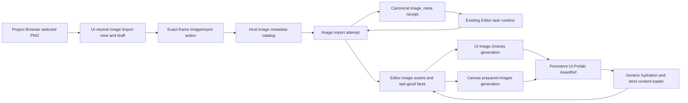

# Editor Image Import and Reimport v1 - Plan

## Goal Capsule

| Field | Contract |
|---|---|
| Objective | Let a user select a PNG in the standalone `nara-editor`, edit its per-image color-space setting, Import or Reimport it without compiling project Rust, and use the accepted image immediately in UI authoring while failed attempts preserve the last-good result. |
| Means | Complete one concrete `nara_image` recipe and metadata contract, add a bounded Host-owned image metadata catalog and import transaction, project it through UI-neutral tooling, and reuse the existing editor task and Canvas resource paths. See KTD1-KTD13. |
| Product owner | `nara_asset` owns stable identity and the generic metadata composition; `nara_image` owns image settings, hashing, decode, and prepared-image commit semantics; the project Host owns filesystem authority, transaction ordering, and the private Editor image store; `nara_tooling` owns UI-neutral state and actions; `nara_tooling_egui` owns presentation; private `nara-editor` owns native wake and canary wiring. |
| Architecture authority | Accepted ADRs 0007, 0033, 0050, 0051, 0070, 0103, 0104, 0110, 0113, and 0114 remain authoritative. A new ADR 0115 narrows the Editor image import, metadata, and authoring publication boundary without accepting proposed ADRs 0083 or 0087. |
| Execution profile | Seven dependency-ordered units. Land the typed recipe and persistent metadata first, then strict consumers, the Editor transaction, UI, authoring-resource handoff, and one product trajectory. |
| Stop conditions | Stop the affected path if implementation requires a generic importer registry, an erased settings provider, project Rust execution, ambient filesystem access, eager decoding of all project images, a new async framework, a watcher, a persistent artifact cache, or multi-product publication. |
| Tail ownership | EIR-U6 records focused verification, updates the ADR ledger and architecture map, closes the active engineering-memory registration, and leaves watcher, batch import, thumbnails, other image formats, and durable artifact cache work trigger-gated. |

## Product Contract

### Summary

The standalone Editor can browse a project's declared source roots, but image rows remain read-only.
The runtime already has a concrete bounded PNG importer, yet its color-space setting and settings
hash can disagree, and the generic Editor has no product path that safely persists image settings,
runs an import, or makes the result available to UI authoring.

This plan adds one complete PNG workflow. Selecting a PNG in the Project Browser exposes a closed
image import inspector. The user edits a local sRGB/Linear draft and explicitly presses Import or
Reimport. The Host validates the exact source-index member, publishes the canonical desired recipe,
then performs bounded decode away from the UI thread. Success updates the last-good image, the UI
image-choice catalog, and Canvas resources. Failure preserves prior pixels while metadata continues
to record the desired recipe that should be retried.

### Problem Frame

The current pieces do not form a trustworthy editor transaction. `ImageImporter` stores color space
globally while import requests accept a caller-supplied `ImportSettingsHash`. Strict project loading
and runtime reload use a default hash, so an Editor-only setting could produce an artifact identity
that does not describe the decoded image or survive restart. The Project Browser also uses
project-relative paths such as `media/icon.png`, while `AssetPath` and metadata use paths relative to
the declared assets root such as `icon.png`.

A UI-only Import button would preserve these contradictions. The product needs one exact recipe,
one source/meta admission path, one failure-atomic publication order, and one real authoring
consumer. It must retain the generic Editor boundary: no project crate is compiled or loaded, and no
domain gains ambient filesystem authority.

### Key Decisions

- KD1. **The first import product is PNG plus one real setting.** It supports per-image sRGB or
  Linear color space and no other format, preset, platform override, or batch workflow.
  (session-settled: user-approved - chosen over a generic importer framework: a complete production
  slice is more valuable than speculative extensibility.) Governs R2-R3, R8, R22.
- KD2. **Settings remain drafts until explicit Import/Reimport.** Selection changes or metadata
  generation changes discard the uncommitted draft; editing a control never writes the filesystem.
  Governs R9, R12-R14.
- KD3. **Initial Import may create missing metadata.** It generates a fresh stable ID only after a
  bounded project metadata catalog proves the selected PNG has no current sidecar or identity
  conflict. Invalid metadata is never overwritten or repaired implicitly. Governs R4-R6, R14.
- KD4. **Availability and the latest attempt are independent.** A failed, cancelled, stale, or
  superseded Reimport remains visible while the previous accepted image stays usable. Governs
  R13-R16, R18.
- KD5. **A successful import is immediately useful.** The image enters the UI image-choice catalog
  and Canvas prepared-resource set in the same accepted authoring generation. Governs R18-R20.
- KD6. **The source metadata is durable; the decoded editor result is session-local.** This plan
  does not materialize `.nara/import-cache` artifacts or claim the proposed multi-product graph.
  Governs R20-R23.
- KD7. **The standalone Editor remains generic.** Importing, previewing, saving, and reopening an
  image-backed UI Prefab never compiles, links, or loads project Rust code. Governs R1, R21-R22.

### Requirements

#### Selection, identity, and metadata admission

- R1. The installed `nara-editor` remains the only ordinary Editor binary for this workflow; no
  project-specific companion or native provider is required.
- R2. A PNG beneath the manifest's effective assets root receives an image import view when selected
  in the Project Browser, including in an AuthoringDegraded workspace with Runtime unavailable.
- R3. The Host derives `AssetPath` by removing the exact declared assets-root prefix from the
  selected project-relative browser path. The Adapter never constructs or persists this mapping.
- R4. Image metadata status is derived from a bounded Host-owned catalog tied to one accepted source
  index generation. The catalog pairs PNG sources and sidecars, records valid stable IDs, and
  reports Missing, Ready, Invalid, and IdentityConflict without decoding image pixels.
- R5. Initial Import of a Missing PNG creates one canonical sidecar with a fresh random
  `StableAssetId`, the exact assets-root-relative path, image source kind, and the submitted settings.
  Publication uses expected-missing semantics and fails if the target appears.
- R6. Malformed metadata, a wrong source kind, path mismatch, unsupported metadata version, duplicate
  stable ID, or source/meta identity drift disables Import/Reimport. The Editor never overwrites,
  regenerates, or guesses through those conflicts.
- R7. Because the project format is unreleased, repository-owned flat `asset_meta` fixtures are
  rewritten to the nested canonical v1 shape and the old reader is deleted. This plan does not
  create a compatibility reader or implicit on-open migration.

#### Typed settings and persistent recipe

- R8. `ImageImportSettings` is a closed image-domain value whose first version contains only
  `ImageColorSpace::{Srgb, Linear}`. `nara_image` owns its canonical encoding and domain-separated
  `ImportSettingsHash`.
- R9. The inspector shows committed settings and a separate local draft. Missing metadata starts a
  local sRGB draft. Revert restores the committed value, or sRGB for Missing; changing selection,
  metadata revision, or source-index generation invalidates an older draft.
- R10. Canonical `asset_meta` v1 uses the existing bounded persistent-envelope rules, denies unknown
  fields, and resets its payload to nested `asset` identity plus bounded domain-owned `settings`.
  `nara_asset` provides a serialization-only `AssetMeta<TSettings>` composition; the exact image
  instantiation uses `ImageImportSettings`. This is neither an erased payload nor a provider registry.
- R11. Editor import, Generic Authoring hydration, strict ProjectContent load, trusted Game View,
  headless/desktop Run, and runtime reload all consume the same typed settings. Callers can no longer
  provide an arbitrary settings hash that disagrees with decoded pixels.

#### Import transaction and last-good behavior

- R12. Import/Reimport enters the Host through the existing exact `EditorActionBatch` frame
  revision. The Host resolves the browser row, catalog member, source identity, and metadata facts
  from that accepted frame; the UI sends only the selected project-relative path, expected detail
  revision, and typed draft.
- R13. At most one Editor image import attempt is active. A second request is rejected rather than
  queued; project replacement and shutdown cancel and drain the active task through existing task
  ownership rules.
- R14. Import/Reimport first revalidates the source, source index, catalog, and current metadata
  revision, then atomically creates or replaces canonical metadata. Only an accepted publication
  receipt may start bounded source read and decode with the persisted desired settings; unchanged
  settings skip the metadata write.
- R15. Attempt generation, source-index generation, stable ID, source identity and digest, accepted
  metadata identity and digest, settings hash, source hash, and expected asset version are checked
  before image publication. Failed, cancelled, stale, and superseded decode work publishes no new
  pixels.
- R16. Metadata status, last-good availability, and latest attempt status are three orthogonal facts.
  A failed Reimport preserves the prior image and Canvas binding while metadata truthfully retains
  the newly submitted desired settings; availability reports whether the active image is fresh,
  SourceChanged, or SettingsChanged.
- R17. Successful metadata publication requests one normal Project Browser Refresh. Until the
  successor source-index generation is accepted, later actions cannot pretend the old snapshot
  contains the new sidecar identity.

#### Authoring and reopen behavior

- R18. Successful Import/Reimport publishes one successor authoring image generation that updates
  the UI image-choice set and Canvas prepared-image set together. A choice is never interactive when
  its prepared resource belongs to another generation.
- R19. A user can assign the imported image to a UI Image node and save the Prefab. Persistent UI
  data stores the canonical assets-root-relative `AssetRef`, not a runtime handle or browser path.
- R20. Reopening the generic Editor hydrates images referenced by the accepted Authoring closure
  from canonical metadata and source bytes through the same concrete import recipe. Unreferenced
  canonical images remain inspectable but require explicit Reimport to recreate a session-local
  last-good image.
- R21. Adding or importing an unreferenced PNG does not alter Runtime content identity, Check, Run,
  or Export membership. Once a saved Scene/Prefab references it, the existing strict content closure
  discovers and validates it normally.

#### Boundaries, responsiveness, and evidence

- R22. The plan adds no generic importer registry, erased settings payload API, plugin discovery,
  watcher, batch import, thumbnail system, persistent artifact store, multi-product graph, or project
  Rust execution.
- R23. Source reads, decoded pixels, retained last-good images, metadata catalog entries,
  diagnostics, and in-flight task work are bounded. PNG read/decode does not run on the native UI
  thread, and task completion cannot strand under `ControlFlow::Wait`.
- R24. `nara_tooling` exposes only UI-neutral image settings, state, safe diagnostics, and actions.
  It receives no `PathBuf`, capability, `FileIdentity`, raw filesystem error, `ImageAsset`, or GPU
  resource. egui retains only draft/widget transients.
- R25. Verification uses owner-level contract tests, focused Host/tooling/Adapter integration, and
  one bounded native Windows trajectory. It does not create a settings-by-failure-by-platform test
  matrix or screenshot parity suite.

### Key Flows

1. F1. **Initial Import:** the user selects a PNG with no sidecar, edits sRGB/Linear, and presses
   Import. The Host completes catalog admission, publishes canonical metadata with a new stable ID,
   decodes the source, installs last-good on success, requests Refresh, and exposes the image to UI
   authoring.
2. F2. **Reimport:** the user selects an image with valid metadata, changes the local draft, and
   presses Reimport. The desired settings publish under the same stable ID. Decode success replaces
   last-good; failure keeps the previous active image and marks it SettingsChanged.
3. F3. **Conflict and recovery:** source/meta/index facts change while work is pending. The result is
   rejected as stale or conflict, the prior generation remains visible, and Refresh supplies new
   facts before another request can start.
4. F4. **Author and reopen:** the user assigns the imported image to a UI node and saves the Prefab.
   A later generic open hydrates that referenced image using the same metadata settings and renders
   it without loading project Rust.

### Acceptance Examples

- AE1. Select `media/icon.png` with no sidecar, choose Linear, and Import. The new sidecar contains
  logical path `icon.png`, a fresh non-conflicting stable ID, the canonical Linear recipe, and the
  image becomes a valid Canvas choice. Covers R2-R5, R8, R14, R18.
- AE2. Select a PNG with Ready sRGB metadata, choose Linear, and Reimport. Metadata accepts Linear
  before decode. A successful result replaces last-good under the same stable ID; a failed result
  keeps the sRGB image visible and marks it SettingsChanged. Covers R8-R16.
- AE3. Select a PNG whose sidecar is malformed, path-mismatched, or duplicates another accepted
  stable ID. Import controls are disabled with a safe diagnostic and no file is replaced. Covers R6,
  R24.
- AE4. Replace the source or metadata before Reimport admission completes. Exact revalidation
  rejects the request before publication. If the source changes only after an accepted metadata
  receipt starts decode, the desired metadata remains accepted but no new pixels publish and the
  existing Canvas remains valid with stale availability. Covers R15-R17.
- AE5. Reimport a previously accepted image after corrupting its PNG bytes. The attempt reports a
  bounded decode failure while the exact prior last-good image remains active and desired metadata
  remains available for a later retry. Covers R14-R16.
- AE6. Import an unreferenced image, assign it to a UI Image node, save, close, and reopen the generic
  Editor. The image is hydrated with the same color space and appears on Canvas without compiling the
  fixture's intentionally failing Rust source. Covers R1, R18-R21.
- AE7. Open a project with many image sidecars and a large PNG. Metadata indexing and import remain
  bounded, the window keeps presenting, and no project-wide eager decode occurs. Covers R4, R13,
  R23.
- AE8. Add an unreferenced imported image and run existing Check/Run/Export proofs. Runtime content
  identity and membership are unchanged until a persistent document references the image. Covers
  R21-R22.

### Success Criteria

| Signal | Target |
|---|---:|
| Project-specific compilation required for Import/Reimport | 0 |
| Caller-controlled settings hashes | 0 |
| Failed or stale attempts replacing last-good | 0 |
| Successful image choices without matching Canvas resources | 0 |
| Ambient filesystem operations in image/tooling/egui code | 0 |
| Generic importer registries or persistent artifact stores added | 0 |
| Native product trajectories | 1 focused Windows trajectory |

### Scope Boundaries

In scope:

- PNG source rows under the effective assets root;
- per-image sRGB/Linear settings, explicit Import/Reimport, and Revert;
- canonical image metadata shape reset and missing-sidecar creation;
- one in-flight bounded import, safe diagnostics, last-good retention, and project replacement close;
- immediate UI image-choice/Canvas use and referenced-image hydration on reopen.

Deferred for later:

- automatic file watching, source-change reimport, drag-and-drop copy, batch import, presets, and
  project-wide import defaults;
- thumbnails, image crop/slice tools, compression, mipmaps, normal-map policy, platform overrides,
  SVG/JPEG/WebP, audio, fonts, models, shaders, and animation import;
- durable `.nara/import-cache` bytes, dependency graphs, cooking, artifact groups, and remote import;
- metadata repair, stable-ID rebind after move, rename/delete file management, and multi-user merge
  reconciliation.

Outside this product's identity:

- a universal importer executor, dynamic importer ABI, erased settings registry, or project plugin
  loader in the generic Editor.

### Dependencies

- The completed standalone Generic Open/Recovery and Project Browser plans provide the only Editor
  shell, source-index snapshot, exact frame-bound action path, document persistence, and native
  canary patterns used here.
- Accepted ADR 0103 owns concrete image-domain execution and prohibits a speculative generic
  executor. Accepted ADR 0051 owns the persistent envelope; ADR 0115 records the explicit pre-1.0
  canonical shape reset rather than adding a compatibility window.
- `nara_tasks` supplies the existing bounded task and shutdown primitives. This plan does not change
  its public scheduling model.

## Planning Contract

### Key Technical Decisions

- KTD1. **Reset the canonical metadata shape in place.** Keep `asset_meta` format v1, but reset the
  unreleased payload to nested `asset` identity and bounded `settings`. `nara_asset` owns the strict
  envelope, `AssetMetaIdentity`, and a serialization-only `AssetMeta<TSettings>` composition;
  `nara_image` supplies the exact `ImageImportSettings` instantiation. There is no raw JSON settings
  accessor, dynamic dispatch, or provider registry. Repository fixtures are rewritten and the old
  flat reader is removed.
- KTD2. **Make the recipe self-authenticating.** `ImageImportSettings` produces canonical bytes and
  its own domain-separated hash. `ImageBytesImportRequest` and `ImageFileImportRequest` accept typed
  settings, not caller-provided dependency digest, settings hash, or profile; those PNG recipe facts
  are fixed inside `nara_image`. `ImageImporter::with_color_space` and equivalent global per-asset
  configuration are removed, and the importer version advances.
- KTD3. **Build a concrete metadata catalog, not an importer database.** The Host incrementally
  parses only sidecars already present in the accepted Project Source Index, binds the catalog to
  that snapshot generation, and uses `ProjectAssetDatabase` duplicate checks for accepted identity
  cores. It does not decode PNGs or change the browser scanner.
- KTD4. **Publish desired metadata before scheduling decode.** The Host validates the current frame
  and catalog, atomically publishes or reuses canonical metadata, validates its receipt, then starts
  decode from the exact accepted recipe. Decode failure does not roll metadata back; the
  availability view marks any retained image stale against desired settings or source.
- KTD5. **Reuse the concrete image asset publication path.** Editor authoring stores accepted pixels
  in its private `Assets<ImageAsset>` and commits only through `ImageImportedAsset::commit` with
  expected version and attempt checks. Last-good facts query the actual asset value rather than
  inferring availability from `LoadState`. No new generic slot or publication trait is introduced.
- KTD6. **Reuse one Editor authoring runtime.** Refactor the current private preview `App` into a
  focused `EditorAuthoringRuntime` that owns the existing `nara_tasks` pools plus concrete
  `AssetServer`, `Assets<ImageAsset>`, state, and event resources. Scene preview and image import are
  private subsystems of that owner and share its close protocol; UI preview remains a consumer, not
  a second task or image-store owner.
- KTD7. **Keep Browser selection and image import separate.** Add `EditorImageImportView`, one
  `EditorImageImportAction::Submit { relative_path, expected_detail_revision, settings }`, and a
  closed outcome beside the Project Browser model. `EditorAction::ImageImport` uses the existing
  frame revision. The generic Browser continues to classify rows as AssetSource/AssetMeta and
  provides selection only; Host state decides whether Submit means Import or Reimport.
- KTD8. **Commit choices and prepared resources as one generation.** Host builds a union of strict or
  Authoring-closure images and accepted Editor `Assets<ImageAsset>` facts, deduplicated by stable ID
  and logical path. `EditorUiImageChoices` and `UiPreparedImages` advance from the same immutable
  catalog receipt; projection/pick state from older generations retires.
- KTD9. **Hydrate only real consumers on open.** Generic Authoring schedules import for image
  records reachable from its accepted closure. It does not decode every valid sidecar in the source
  index. Unreferenced images become session-available only after explicit Reimport.
- KTD10. **Use bounded polling, not redraw spin.** While an import task is pending, the private Editor
  exposes a short next-poll deadline through the existing native earliest-deadline composition.
  Completion is polled on the main Host and no task thread mutates Editor state.
- KTD11. **Share only proven persistence mechanics.** Extract the exact-identity/expected-missing
  temporary-file publication core from `src/project_host/persistence.rs` into a Host-private module
  used by Scene/Prefab and image metadata. Domain-specific states and outcomes remain separate.
- KTD12. **Keep safe state projection closed.** Tooling receives Metadata, Availability, and Attempt
  views as separate enums plus bounded dimensions/hashes only where useful. Error strings, native
  identities, absolute paths, capabilities, pixels, and backend resources remain private.
- KTD13. **Generate identity in the identity owner.** Add a fallible random `StableAssetId`
  constructor in `nara_asset`; the Host checks the accepted metadata catalog and permits only a
  fixed bounded number of collision retries before sidecar publication. Path- or content-derived IDs
  are rejected because moves and source edits must not change identity.

### High-Level Technical Design



The Host state is a product of three independent facts:

```text
Metadata     = Missing | Ready { revision, stable_id, desired_settings_hash }
             | Invalid | IdentityConflict
Availability = None | LastGood { generation, stable_id, source_hash,
                                  active_settings_hash, freshness }
Freshness    = Fresh | SourceChanged | SettingsChanged
Attempt      = Idle | Pending { generation, phase } | Succeeded
             | Failed | Stale | Cancelled | ReconcileRequired
```

`ReconcileRequired` is reserved for an uncertain metadata publication receipt. The Host does not
claim success, mint another ID, or retry destructively until a fresh source-index/catalog pass
observes the sidecar. This is not a general journal or repair system.

The canonical payload written by this lane is structurally fixed:

```json
{
  "asset": {
    "stable_id": "<uuid>",
    "path": "textures/example.png",
    "source_kind": "image"
  },
  "settings": {
    "color_space": "srgb"
  }
}
```

It remains inside the existing `asset_meta` v1 persistent envelope. Source hashes, artifact keys,
attempt state, last-good facts, and UI drafts are deliberately absent from the file.

### Sequencing

```text
EIR-U0 -> EIR-U1 -> EIR-U2 -> EIR-U3 -> EIR-U4 -> EIR-U5 -> EIR-U6
 authority   recipe   strict    Host      UI       Canvas    product
                       users   transaction          handoff   closure
```

- EIR-U1 must remove recipe/hash ambiguity before any Editor action persists settings.
- EIR-U2 must prove restart and runtime reload agreement before EIR-U3 publishes canonical metadata.
- EIR-U3 owns all filesystem and task mutation. EIR-U4 consumes only its view/actions.
- EIR-U5 is required before the feature can claim a usable import rather than a status-only panel.
- EIR-U6 runs the one native trajectory after focused owner tests pass.

### System-Wide Impact

- Persistent data changes from flat identity-only image sidecars to nested identity-plus-settings
  sidecars. Because the format is unreleased, repository-owned data is rewritten and the old reader
  is removed rather than retained as a second authority.
- Runtime image identity remains stable. Only settings ownership and recipe reproduction change.
- The generic Editor gains one source mutation capability, but it remains limited to image sidecars
  and the Host's existing capability-bound publication proof.
- The Editor retains decoded image memory for authoring. Aggregate image import and preview budgets
  must include both the previous last-good and the in-flight successor.
- Runtime content and Export remain source-driven. No generated image cache becomes a package member.

### Risks and Mitigations

| Risk | Severity | Mitigation |
|---|---|---|
| Desired metadata publishes but decode or image commit fails | High | KTD4-KTD5 keep desired metadata and last-good availability orthogonal; failed decode/commit leaves the exact prior image active and reports stale availability. |
| Browser path is persisted as AssetPath | High | R3 keeps conversion in Host and tests a non-root assets directory. |
| Old and canonical metadata readers drift | High | KTD1 deletes the old flat reader and rewrites repository-owned fixtures; canonical golden fixtures admit one shape only. |
| Large decode stalls the window | High | KTD6/KTD10 reuse existing tasks and bounded polling; UI thread performs only admission and publication. |
| Choice exists without a Canvas resource | High | KTD8 publishes one catalog receipt and rejects mixed generations. |
| Stable ID collides with an unscanned sidecar | High | KTD3/KTD13 require a completed generation-bound metadata catalog before initial Import. |
| External writer changes metadata in place without changing native identity | Medium | Revalidate identity and digest immediately before replace and document cooperative detection; do not claim strict external CAS from `ExpectedTarget::Identity`. |
| Generic abstractions return through settings or persistence | Medium | Keep image semantics in `nara_image`, persistence mechanics Host-private, and require a second real domain before generalizing execution. |
| Session memory grows with every imported image | Medium | Bound accepted image count and retained bytes; evict only unreferenced/non-active Editor images under an explicit policy, never an image used by current Canvas. |

### Research Sources

- `crates/nara_image/src/import.rs` and `crates/nara_image/src/reload.rs` show the current settings/hash
  split and the concrete task/publication owner.
- `src/project_content.rs` and `src/project_host/authoring/project.rs` are the strict and generic
  metadata consumers that must agree on the recipe.
- `src/project_host/authoring/source_index.rs` and
  `src/project_host/runtime/editor/project_browser.rs` provide exact generation/member/identity
  admission without metadata parsing during scan.
- `src/project_host/persistence.rs` provides the existing expected-target atomic publication pattern.
- `src/project_host/runtime/editor/ui_authoring.rs` and `ui_preview.rs` show why choices and prepared
  Canvas resources must advance together.
- Godot's official [Import process](https://docs.godotengine.org/en/stable/tutorials/assets_pipeline/import_process.html)
  documents per-asset draft settings applied by Reimport and source-adjacent committed import
  configuration.
- Unity's official [Texture Import Settings](https://docs.unity3d.com/Manual/class-TextureImporter.html)
  documents image selection in the Project window as the entry to a texture-specific Inspector.

## Implementation Units

### EIR-U0. Admit the concrete Editor image-import boundary

**Goal:** Make the image metadata, transaction, authoring publication, and non-goal boundaries
authoritative before production code changes.

**Requirements:** R1-R25; KD1-KD7; KTD1-KTD13.

**Files:**

- `docs/architecture/adr/0115-editor-image-import-metadata-and-authoring-publication.md` (new)
- `docs/architecture/adr/0033-asset-import-and-render-resource-preparation-seam.md`
- `docs/architecture/adr/0051-persistent-file-envelope-migration-and-golden-fixtures.md`
- `docs/architecture/adr/0103-concrete-domain-owned-asset-import-execution.md`
- `docs/architecture/adr/README.md`
- `docs/architecture/adr/implementation-status.md`
- `docs/architecture/README.md`
- `docs/knowledge/engineering/registry/` (new active registration)
- `docs/knowledge/engineering/current-state.md` through the normal memory render workflow

**Approach:**

- Accept ADR 0115 as the narrow owner for image settings, explicit Editor Import/Reimport,
  meta-first desired-recipe publication, session last-good, and referenced-image hydration.
- Amend ADR 0051 with the explicit unreleased `asset_meta` v1 canonical shape reset. Delete the old
  flat reader and do not accept the general durable identity/move policy in proposed ADR 0083.
- Preserve ADR 0103's concrete-domain rule and state that this first Editor consumer is not the
  second-domain trigger for a generic executor.
- Register EIR-U1 as the sole active unit only after plan, ADR, ledger, architecture map, and memory
  agree. Predecessor EPB evidence remains immutable.

**Test scenarios:**

- Authority sources name `nara_image` as recipe/publication owner and the Host as filesystem owner.
- No active source claims a generic importer registry, durable cache, watcher, or project plugin.
- The format decision names exactly one canonical input/output shape and the repository fixtures
  that must be rewritten; it grants no legacy-read compatibility.

**Verification:**

- Document link/status/active-unit consistency and `git diff --check`; no Cargo gate.

### EIR-U1. Make image settings and metadata canonical

**Goal:** Give every image import one typed recipe whose settings, hash, metadata, and decoded pixels
cannot disagree.

**Requirements:** R5-R11, R22; KTD1-KTD2, KTD13.

**Files:**

- `crates/nara_asset/Cargo.toml`
- `crates/nara_asset/src/identity.rs`
- `crates/nara_asset/src/database.rs`
- `crates/nara_asset/src/format.rs`
- `crates/nara_asset/src/lib.rs`
- `crates/nara_asset/tests/meta_format.rs`
- `crates/nara_image/src/settings.rs` (new)
- `crates/nara_image/src/import.rs`
- `crates/nara_image/src/asset.rs`
- `crates/nara_image/src/lib.rs`
- `src/lib.rs`
- `crates/nara_image/tests/image_settings.rs` (new)
- focused image import tests in `crates/nara_image/src/tests.rs` and
  `crates/nara_image/tests/image_import_limits.rs`

**Approach:**

- Split the identity core into `AssetMetaIdentity` and make `AssetMeta<TSettings>` plus its candidate
  the strict nested serialization composition. Instantiate it with typed image settings in
  `nara_image`; do not expose raw settings JSON or add a second image-specific metadata envelope.
- Add a fallible random stable-ID constructor owned by `nara_asset`; do not derive identity from path
  or source bytes.
- Remove the test-only `MissingMetaPolicy` and `insert_source_with_meta_policy` path that can create
  an identity without publishing metadata. Database insertion accepts an explicit persisted identity.
- Change byte/file import requests to carry `ImageImportSettings`. Build artifact records only from
  the request's canonical settings hash.
- Remove global color-space setters that can masquerade as per-image recipe state. Keep importer
  limits and budget host configuration independent from settings.
- Remove the old flat reader. Canonical writer output is deterministic and strict, and repository
  fixtures move in the same unit.

**Test scenarios:**

- Canonical sRGB and Linear metadata roundtrip with exact identity/path/recipe facts; their settings
  hashes and artifact keys differ.
- The former flat shape is rejected, while the nested canonical golden reopens identically and
  preserves its stable ID.
- Unknown fields, wrong kind/version, hostile shape, over-budget strings, and path mismatch fail
  without a candidate.
- A request cannot provide a hash different from its typed settings; old global color-space symbols
  no longer exist.

**Verification:**

- Focused `nara_asset` metadata and `nara_image` settings/import tests with serial nextest.
- Boundary search for removed arbitrary-hash, global-color-space, and unpersisted-identity call sites.
- `cargo fmt --all` and `git diff --check`.

### EIR-U2. Align Generic Authoring, strict load, and runtime reload

**Goal:** Make every existing consumer reproduce image pixels from the same canonical metadata
settings before the Editor starts writing that format.

**Requirements:** R6-R7, R10-R11, R20-R22; KTD1-KTD2, KTD9.

**Files:**

- `src/project_content.rs`
- `src/project_content/closure.rs` only if the closure member needs typed recipe facts
- `src/project_host/authoring/project.rs`
- `src/project_host/authoring/mod.rs`
- `crates/nara_image/src/reload.rs`
- `tests/project_content_boot.rs`
- `tests/support/project_content_fixture.rs`
- `reference-game/assets/**/*.meta`
- `reference-game/tests/image_asset_safety.rs`
- package/source fixtures that contain valid image metadata

**Approach:**

- Route image sidecars through `AssetMetaCandidate<ImageImportSettings>`, pass its identity core to
  `ProjectAssetDatabase`, and pass its already exact-decoded settings to image import. Do not
  introduce a parallel `ImageAssetMetaCandidate` or a raw settings carrier.
- Retain typed settings in `ImageSourceMetadata` so runtime reload does not reconstruct a default
  recipe. Preserve source/artifact identity and existing strict fail-before-publication behavior.
- Update canonical project fixtures and reference assets. Keep the intentionally malformed generic
  Editor metadata fixture as a negative case; add a separate valid fixture for successful import.
- Ensure generic Authoring admission can expose valid image recipe facts without decoding every
  image at project open.

**Test scenarios:**

- Strict load and runtime reload of a Linear image both retain Linear and the same settings hash.
- A source/meta path mismatch, duplicate ID, invalid recipe, or missing metadata rejects strict load
  before partial project publication.
- Generic Authoring opens with valid image recipe facts but performs no eager project-wide decode.
- Updated reference/package fixtures retain their existing arbitrary-CWD and source closure behavior.

**Verification:**

- Focused ProjectContent, Authoring Project, image reload, and reference image safety tests.
- Boundary search confirms no default settings hash remains in production image load/reload paths.

### EIR-U3. Build the Host image catalog and import transaction

**Goal:** Admit exact PNG/meta facts, publish the desired recipe, run one bounded task, and preserve
one concrete last-good `ImageAsset` per accepted image.

**Requirements:** R3-R7, R12-R17, R23-R24; KTD3-KTD7, KTD10-KTD13.

**Files:**

- `crates/nara_image/src/import.rs`
- `crates/nara_image/src/import/publication.rs`
- `crates/nara_image/src/lib.rs`
- `src/project_host/persistence/file_publication.rs` (new private module)
- `src/project_host/persistence.rs`
- `src/project_host/runtime/editor/image_import.rs` or a focused private module directory (new)
- `src/project_host/runtime/editor.rs`
- `src/project_host/runtime/editor/actions.rs`
- `src/project_host/runtime/editor/model.rs`
- `src/project_host/runtime/editor/preview.rs`
- `src/project_host/runtime/editor/authoring_runtime.rs` or a focused private module directory (new)
- focused owner tests in `src/project_host/runtime/tests.rs` and `tests/editor_persistence.rs`

**Approach:**

- Build a bounded metadata catalog from accepted source-index sidecar entries. Bind it to project
  root identity and source-index generation, parse incrementally, and publish only a complete
  immutable candidate.
- Create a concrete image import attempt from the exact frame. Derive `AssetPath` in Host, validate
  source/meta membership, choose preserved or fresh stable ID, publish or reuse the desired metadata,
  and capture the accepted receipt's identity/digest facts before scheduling decode.
- Extract the existing preview task ownership into one private Editor authoring runtime. Reuse its
  pools for owned read/decode input; main-thread polling accepts a result only for the current attempt
  and drives cancellation/close through the existing shutdown contract.
- Extract only the proven Host-private file publication mechanics. Use expected-missing for initial
  metadata and expected-identity for Reimport.
- Reserve decoded-image budget before task admission, then commit the prepared result through the
  existing `ImageImportedAsset::commit` path into the Editor's concrete `Assets<ImageAsset>`.
  Keep metadata, availability, and attempt states separate; preserve last-good on every rejection.
- Bind the accepted stable ID and logical path in the private `AssetServer`, capture the exact handle
  and expected asset version before task admission, and require the same binding at commit.

**Test scenarios:**

- Missing-meta Import creates one canonical sidecar and last-good under the same fresh stable ID.
- Ready Reimport preserves stable ID. A successful setting change advances desired metadata and
  last-good; decode failure keeps the desired metadata but leaves the exact prior image active with
  `SettingsChanged` freshness.
- Target appearance and stale frame/index/catalog facts before the metadata receipt publish neither
  metadata nor pixels. After an accepted receipt, source/meta replacement, budget/decode failure,
  cancellation, and superseded completion publish no image successor; the metadata outcome remains
  separate from the exact previous last-good and is never rolled back speculatively. Use
  representative cases, not a Cartesian state matrix.
- An uncertain receipt enters ReconcileRequired and cannot mint another identity until Refresh.
- Project replacement cancels and drains the task, releases retained budget, and exposes no result
  to the successor project.

**Verification:**

- Focused Host/image authoring and persistence tests with serial nextest.
- Search the Host path for ambient filesystem APIs, raw error projection, generic importer traits,
  and second task-pool construction.

### EIR-U4. Add the image import Inspector and native wake path

**Goal:** Present committed settings, local drafts, Import/Reimport, Revert, progress, and safe
last-good diagnostics in the Project Browser Inspector.

**Requirements:** R2, R8-R13, R16-R17, R23-R25; KTD7, KTD10, KTD12.

**Files:**

- `crates/nara_tooling/src/image_import.rs` (new)
- `crates/nara_tooling/src/frame.rs`
- `crates/nara_tooling/src/lib.rs`
- `crates/nara_tooling_egui/src/image_import.rs` (new)
- `crates/nara_tooling_egui/src/project_browser.rs`
- `crates/nara_tooling_egui/src/editor.rs`
- `crates/nara_tooling_egui/src/lib.rs`
- focused Adapter tests in `crates/nara_tooling_egui/src/project_browser_tests.rs` or a new module
- `src/project_host/runtime/editor/actions.rs`
- `editor/src/app.rs`
- `editor/src/platform.rs`

**Approach:**

- Add a closed UI-neutral view and action algebra. Map `EditorImageColorSpace` to domain settings only
  inside Host; do not add a `nara_image` dependency to tooling.
- Invoke a dedicated egui image-import panel from the Project Browser inspector for eligible PNG
  selection. Key the draft by selected path plus metadata/catalog revision.
- Use a segmented sRGB/Linear control and command buttons. Import/Reimport emits one ordered Host
  action; Revert stays Adapter-local. Disable duplicate submission while pending.
- Project safe status codes and phases. Do not display raw metadata content or backend errors.
- Add import task polling to the existing pending-work/deadline composition without continuous
  redraw when idle.

**Test scenarios:**

- Selecting a PNG shows the correct Missing/Ready/Invalid/IdentityConflict state and button label;
  non-PNG/metadata rows retain the existing generic inspector.
- Changing color space emits no action. Import/Reimport emits one exact typed action from the current
  frame; Revert restores the committed value.
- Selection or metadata generation change clears the old draft; stale actions are rejected without
  changing Host state.
- Pending, failed-with-last-good, and ReconcileRequired states render fixed safe text and keep layout
  bounded.
- Native deadline composition wakes pending import polling and returns to `ControlFlow::Wait` when
  terminal.

**Verification:**

- Focused `nara_tooling` and `nara_tooling_egui` tests plus Host action tests.
- Boundary search confirms tooling/egui contain no filesystem, image-domain, task, or GPU authority.

### EIR-U5. Publish imported images to UI authoring and restore referenced images

**Goal:** Make successful import a real authoring resource and reproduce referenced images after
generic reopen.

**Requirements:** R18-R21, R23-R24; KTD5, KTD8-KTD10.

**Files:**

- `src/project_host/runtime/editor/ui_authoring.rs`
- `src/project_host/runtime/editor/ui_preview.rs`
- `src/project_host/runtime/editor/content_refresh.rs`
- `src/project_host/runtime/editor/image_import.rs`
- `src/project_host/runtime/editor/preview.rs`
- focused tests in `src/project_host/runtime/tests.rs`
- `editor/tests/generic_open_recovery.rs` or a new focused image authoring integration test
- `reference-game/tests/editor_ui_refresh.rs` only if it is the smallest strict handoff consumer

**Approach:**

- Build one immutable authoring image catalog receipt from closure-backed images plus accepted
  Editor image assets. Reject stable-ID/path conflicts and deduplicate an exact same product.
- Derive both `EditorUiImageChoices` and `UiPreparedImages` from that receipt. Advance generations
  together and retire older Canvas/pick state before accepting input.
- When a Prefab save introduces the reference, let existing ProjectContent refresh discover it.
  Accept a strict successor only when stable ID, source/settings hash, and path match the Editor
  image fact; then retire any redundant session copy when safe.
- On generic reopen, hydrate only images reachable from the accepted Authoring closure through the
  same bounded import service. Keep unrelated valid image metadata lazy.

**Test scenarios:**

- An imported image appears exactly once in choices and has a matching prepared Canvas resource in
  the same generation.
- A stale/missing prepared resource makes the choice non-interactive; an older Canvas receipt cannot
  select or commit against a successor catalog.
- Create or edit a UI Image node to use the imported path, save, refresh, close, and reopen. The image
  renders with the same color space without project Rust execution.
- An unreferenced canonical image is not eagerly decoded on reopen and becomes available after one
  explicit Reimport.
- Failed hydration preserves the last complete authoring projection and reports a bounded resource
  diagnostic.

**Verification:**

- Focused UI authoring/preview and generic reopen tests.
- One strict content-refresh handoff test; do not repeat the full Reference Game presentation matrix.

### EIR-U6. Prove the standalone product trajectory and close the lane

**Goal:** Demonstrate the complete workflow in the real standalone Editor and record durable
evidence without expanding the importer surface.

**Requirements:** R1-R25, AE1-AE8; KTD1-KTD13.

**Files:**

- `editor/src/platform/image_import_canary.rs` (new private module)
- `editor/src/platform.rs`
- `editor/src/lib.rs`
- `editor/README.md`
- `editor/tests/image_import.rs` or the smallest existing standalone integration test
- a dedicated generic Editor image fixture with valid, missing, invalid, conflicting, and referenced
  PNG cases
- `docs/architecture/adr/implementation-status.md`
- `docs/architecture/README.md`
- `docs/knowledge/engineering/verification/` (new record)
- `docs/knowledge/engineering/registry/` (completed registration)
- `docs/knowledge/engineering/current-state.md` through the normal memory render workflow

**Approach:**

- Add a separate bounded image-import canary module rather than expanding the existing Generic Open
  canary state machine. Reuse the same installed binary, one window, temporary project, deadlines,
  and fixed JSON evidence style.
- Drive Missing -> Import -> Canvas use -> save/reopen -> Linear Reimport -> corrupt-source failure.
  Verify last-good remains visible and the fixture's project Rust compile-error sentinel is never
  executed.
- Keep invalid/duplicate metadata and stale lineage in focused Host tests; the native canary proves
  one representative product journey only.
- Run simplification and code review after the trajectory is green. Remove abandoned format shims,
  duplicated task owners, and dead image state before recording closure.

**Test scenarios:**

- The standalone Windows Editor imports a missing-meta PNG, uses it on Canvas, saves, reopens, and
  reimports Linear without project compilation.
- Corrupting the source before the final Reimport yields a safe failure and preserves the exact prior
  last-good Canvas image.
- Runtime Check/Run/Export facts remain unchanged for an unreferenced imported image.
- Public diagnostics exclude guarded absolute paths, `FileIdentity`, raw metadata, and underlying
  error strings.

**Verification:**

- Run focused owner and integration nextest suites serially with `CARGO_BUILD_JOBS=1`.
- Run one native PowerShell canary on Windows; do not use WSL.
- Run architecture/ledger/memory consistency checks, `cargo fmt --all`, and `git diff --check`.

## Verification Contract

### Required Gates

- Never run Cargo commands concurrently in this checkout. Use `CARGO_BUILD_JOBS=1` and focused
  `cargo nextest run ... --test-threads=1` filters for the current unit.
- Run owner-level metadata/settings tests before Host integration. Run the native Editor trajectory
  only after image, ProjectContent, Host, tooling, and Canvas tests pass.
- Use one representative case for each high-risk boundary: missing create, canonical-shape
  rejection, invalid refusal, stale conflict, failed Reimport with last-good, and referenced reopen.
  Do not multiply these across both color spaces and every platform.
- Run boundary searches for arbitrary settings hashes, global image color-space configuration,
  ambient filesystem access, generic importer/executor symbols, second task-pool ownership, raw
  diagnostic leakage, and `.nara/import-cache` publication.
- Use PowerShell for the native Windows gate. Do not invoke WSL.
- Run `cargo fmt --all`, inspect the affected diff before staging, run `git diff --check`, and leave
  user-owned `.codex-research/` content untouched and unstaged.

### Evidence Requirements

- Recipe evidence proves sRGB/Linear settings produce distinct canonical hashes/artifact keys and
  survive strict load and reload.
- Host evidence proves exact source/meta/index revalidation, create-vs-replace publication, accepted
  desired metadata before decode, and last-good retention across post-receipt decode failure.
- UI evidence proves drafts are local, actions are exact-frame, and diagnostics contain only safe
  bounded facts.
- Authoring evidence proves choices and prepared images share one generation and referenced reopen
  reproduces the same settings.
- Product evidence proves one standalone binary, no project Rust execution, and a responsive window
  throughout import.

## Definition of Done

### Global

- R1-R25 and AE1-AE8 are satisfied with no launch-blocking question left unresolved.
- Image settings, settings hash, metadata, strict load, runtime reload, Editor import, and Canvas use
  all derive from one concrete recipe.
- Missing metadata creation and existing metadata replacement are capability-bound and conflict-safe;
  invalid metadata is never silently repaired.
- Failed, stale, cancelled, superseded, or uncertain work never replaces last-good or reports false
  success.
- The generic Editor can use and reopen a referenced imported image without compiling project Rust.
- No generic importer registry, watcher, persistent artifact store, batch workflow, second task
  runtime, or raw filesystem authority is introduced.
- Focused verification and one native trajectory pass. Abandoned experiments, dead compatibility
  shims, duplicate states, and unused public exports are removed.
- ADR, ledger, architecture map, verification, and engineering-memory records agree before the lane
  closes; predecessor plans and evidence remain immutable.

### Per Unit

- EIR-U0: ADR 0115 and the active authority chain define the narrow image-import product.
- EIR-U1: typed settings, canonical image metadata, stable ID generation, and artifact identity agree.
- EIR-U2: Generic Authoring, strict load, trusted products, and runtime reload consume the same recipe.
- EIR-U3: one Host transaction owns catalog, decode task, metadata receipt, and concrete last-good.
- EIR-U4: the Project Browser inspector exposes exact drafts/actions/status without domain authority.
- EIR-U5: imported choices and Canvas resources advance together and referenced reopen restores them.
- EIR-U6: one standalone trajectory and durable records close the product lane without scope expansion.

## Appendix

### Research Breadcrumbs

- `docs/architecture/adr/0103-concrete-domain-owned-asset-import-execution.md` rejects generic
  importer execution until a second production domain proves duplicated policy.
- `docs/plans/2026-08-19-001-feat-editor-project-browser-and-source-index-v1-plan.md` leaves image
  metadata uninterpreted and explicitly trigger-gates Import/Reimport.
- `crates/nara_asset/src/{database.rs,format.rs,identity.rs}` own current identity and metadata core.
- `crates/nara_image/src/{asset.rs,import.rs,reload.rs}` own the complete current PNG path and expose
  the settings/hash mismatch this plan corrects.
- `src/project_host/runtime/editor/{actions.rs,project_browser.rs,ui_authoring.rs,ui_preview.rs}` are
  the existing exact-frame and authoring-resource integration seams.

### Product Contract Preservation

No upstream requirements-only artifact exists. This Product Contract preserves the session-approved
scope: concrete PNG Import/Reimport in the standalone generic Editor, one real color-space setting,
canonical metadata, last-good behavior, immediate authoring use, and no generic importer framework.
