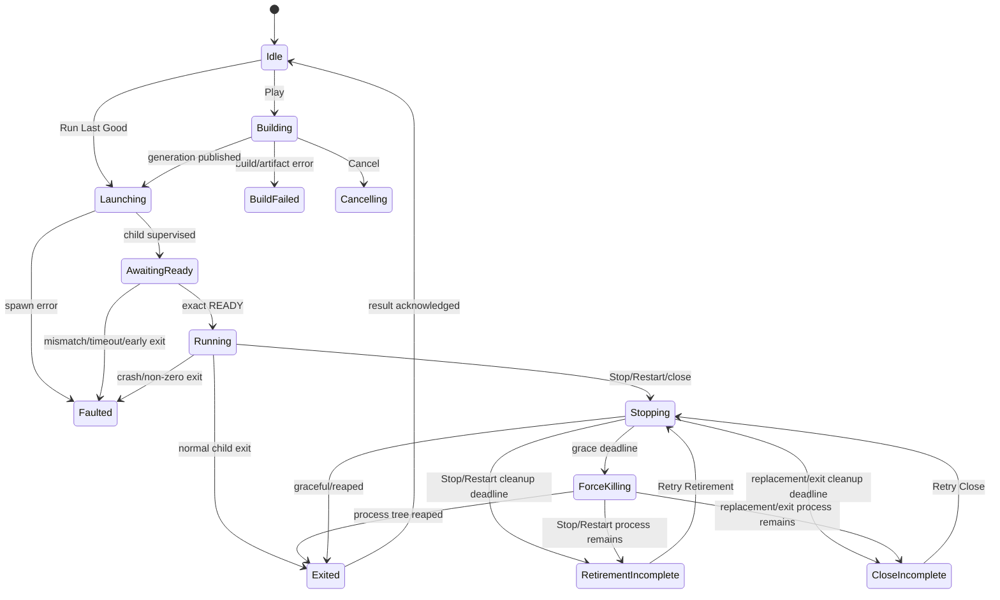
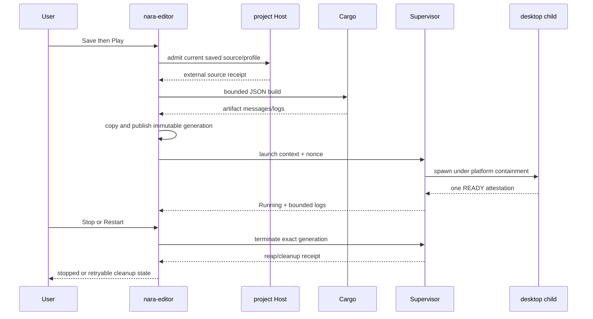

# Standalone Supervised Play v1 - Plan

## Goal Capsule

| Field | Contract |
|---|---|
| Objective | Make the installed `nara-editor` complete the ordinary edit-to-result loop by building and supervising one external desktop product process with Play, Stop, Restart, bounded logs, exact startup identity, and truthful cleanup. |
| Means | Add a narrow Editor-owned build/artifact pipeline, immutable executable generations, a one-shot startup attestation, a platform-owned process supervisor, and a small integration with the existing UI-neutral Play algebra and native event loop. |
| Product owner | Private `nara-editor` owns build orchestration, process authority, external-window lifecycle, logs, and close/replacement policy. The project Host owns source/profile/runtime identity receipts. `nara_tooling` owns neutral Play state/actions. The project product owns only its existing runtime startup and one-shot attestation. |
| Architecture authority | Accepted ADRs 0082, 0084, 0110, 0112, and 0114 remain authoritative. Proposed ADR 0086 is design evidence but is not accepted wholesale by this narrower slice. OQ-039 is narrowed only for this concrete local supervised placement; generic transport, remote execution, embedded frame transport, live edit, and extension hosting remain open. A focused ADR 0116 is admitted before production code changes. |
| Execution profile | Six dependency-ordered units: authority and launch-context contract, private process substrate, Cargo/artifact generation, product attestation, Editor integration, and focused generic plus Reference Game closure evidence. |
| Stop conditions | Stop the affected path if implementation requires a public process trait, a general IPC/session protocol, Tokio or another async runtime, project Rust loaded in the Editor, mutable Cargo target binaries as runtime authority, ambient filesystem access, silent last-good fallback, or process cleanup that cannot prove reaping. |
| Tail ownership | SPL-U5 records the real trajectory, updates ADR/OQ/implementation status and engineering memory, and leaves watcher/reimport, embedded transport, live edit, remote targets, animation, shader authoring, and plugins trigger-gated. |

## Product Contract

### Summary

The standalone Editor can now open generic projects, browse source, author Scene/Prefab/UI data,
save, reopen, and import images without compiling project Rust in the Editor process. Its ordinary
Play action still reports `ExternalExecutionHostNotImplemented`. That leaves the most important
production loop incomplete: a user can edit a project but cannot press Play and see the actual
desktop product without switching to a separate command-line workflow.

This plan adds one concrete external-window placement. The Editor builds the selected desktop
profile through a bounded Cargo JSON adapter, copies the exact executable into an Editor-owned
immutable generation, launches it with an explicit project/profile launch context, accepts one
bounded READY attestation bound to the project/profile/schema/content/executable facts, and then
supervises the process until normal exit, Stop, Restart, crash, timeout, or cleanup completion.
The Editor remains generic and fault-isolated: project Rust is compiled and loaded only in the
child product process, never linked into the long-lived Editor.

### Problem Frame

The existing in-process Game View is a deliberate trusted first-party adapter. It proves local
render/input ownership but is not the ordinary product execution boundary. Reusing it for generic
projects would make the Editor responsible for arbitrary project runtime code and would hide crash
or process-tree failures inside the Editor fault domain.

The existing export Cargo adapter and acceptance probes already prove useful sub-protocols, but
they are synchronous release/export workflows: they select multiple products, run one-shot
acceptance, and do not own a long-lived interactive Play session. Copying them wholesale into the
Editor would create a second authority and a public framework before a second consumer exists.

The current product binaries also infer a project root from `current_exe` or a compiled manifest
root. Copying an executable into an Editor generation directory therefore cannot be treated as a
complete launch contract. Play must pass an explicit launch context and make the child attest the
same source facts the Editor admitted.

Reference Game is the first proof target, not the product boundary. The resulting path must select
a desktop-capable Nara product from the opened project's manifest/profile and Cargo convention, so a
starter or clean-room project can use the same ordinary `nara-editor` without a Reference-Game-
specific launch path.

### Key Technical Decisions

- **KTD1. Use one external desktop window as the first ordinary Play placement.**
  (session-settled: user-approved — chosen over embedded frame transport and a general IPC layer
  because it closes the edit-to-result loop while preserving crash isolation and keeps the first
  transport concrete.) The installed `nara-editor` remains the product binary; there is no
  project-specific Editor binary and no `nara play` replacement in this slice. Governs R1-R4,
  R18-R20.

- **KTD2. Keep the transport one-shot and private.** The child receives a bounded launch context and
  returns one length-limited READY attestation over a private bootstrap channel. stdout/stderr are
  diagnostics, not an authority channel. There is no bidirectional command protocol, frame
  transport, remote endpoint, authentication layer, or public `RuntimeSession` trait. Governs
  R7-R10, R22-R24.

- **KTD3. Make the executable generation immutable before launch.** Cargo output is only an input;
  the running process uses a private generation directory containing the selected executable and
  a canonical launch manifest. The generation binds only stable facts: a generation ID,
  executable digest, project/profile identity, captured authoring/build-selection receipt, and
  launch-context version. The executable digest is the runtime authority; v1 does not claim a
  reproducible proof of every Rust compiler/build-script input. Each Play, Restart, or Run Last Good launch creates a separate session
  envelope with a fresh session nonce; that nonce is never part of the immutable generation.
  READY echoes the stable facts and session nonce, and contributes the strict Runtime
  schema/content receipt that only the compiled child can publish. A mutable `target/debug` path
  is never used as the runtime authority.
  Governs R5-R8, R10, R12-R14.

- **KTD4. Use an explicit runtime launch context instead of CWD inference.** The child receives
  an absolute, normalized project root as launch authority and selected profile through a narrow
  product launch context, while retaining packaged sibling-project behavior for ordinary packaged
  products. The root path is operational input, not durable identity. The child reopens the root
  through its own capability boundary and reports the resulting persistent source facts in READY.
  CWD is never treated as project identity. Governs R6-R10, R14.

- **KTD5. Keep OS process authority inside private Editor modules.** `PublishedEditorProject` is
  the natural lifetime owner, but `EditorProjectSession`, `TrustedCompiledEditorLane`, and
  `nara_tooling` must not own `Child`, Job handles, process groups, raw paths, or Winit types.
  The private Play module owns build, supervision, logs, and cleanup; the Host contributes only a
  durable source receipt. Governs R2, R11, R16, R21-R22.

- **KTD6. Use bounded synchronous workers, not a general async runtime.** Cargo, process waiting,
  and stdout/stderr draining may use a small number of dedicated threads and a bounded observation
  queue. `EventLoopProxy` wakes the existing Winit loop; the UI thread never blocks on Cargo,
  pipe reads, or process wait. No Tokio dependency or public async API is introduced. Governs
  R11, R17, R21, R23.

- **KTD7. Preserve last-good explicitly, never silently.** A failed build or failed startup keeps
  the last successfully READY-admitted immutable generation available as a separately labeled
  `Run Last Good`
  choice only while the current saved `EditorExternalPlaySourceReceipt` still equals the accepted
  source receipt that the generation previously started against. The per-launch session nonce and
  child-only strict Runtime receipt are activation evidence and do not participate in this source
  eligibility comparison. v1 does not snapshot or restore old mutable project data.
  Normal Play always targets the current saved source/profile facts; it never silently falls back.
  The existing Play algebra gains only the narrow action/state needed to express this explicit
  choice. Governs R3, R15, R19.

- **KTD8. Reuse the existing Play lifecycle and disable unsupported controls honestly.** Play,
  Cancel, Stop, Restart, retirement, and close-incomplete semantics remain the single lifecycle.
  Pause, Resume, and Step are unavailable for the external placement until a future control
  protocol exists; the UI reports a typed capability reason instead of sending fake commands.
  Governs R2-R4, R11, R16, R20, R22.

- **KTD9. Cleanup is a receipt, not a Drop side effect.** Every successfully spawned build or game
  process is explicitly waited/reaped. Windows uses a Job Object with kill-on-close and verifies
  the active process count. Supported Unix uses a dedicated process group with bounded TERM/KILL
  and direct-child reap, while documenting the weaker hard-kill and descendant-escape guarantees.
  If cleanup is incomplete, the owner remains retained and Restart/close cannot create a second
  child. Governs R11, R16-R18, R20-R21.

- **KTD10. Use one closed trusted desktop build profile for v1.** `nara.toml` continues to own Nara
  product settings and cannot inject Cargo arguments. The private Editor build policy resolves the
  root Cargo package, bin target `desktop`, feature `desktop`, Cargo profile `dev`, the host target,
  and locked resolution. Projects that do not satisfy that convention report external Play
  unavailable. Custom package/bin/features/toolchain selection remains later trusted Host policy,
  not project data or a generic build registry. This is a Nara project convention, not a
  Reference-Game-specific rule. Governs R2, R5-R7, R22.

- **KTD11. Gate external Play on a versioned product execution contract.** A desktop profile must
  declare `[profiles.desktop.execution] contract = "desktop-supervised-play/v1"` before the Editor
  advertises external Play. The starter and
  Reference Game own the matching product-side activation hook; an older project without the
  declaration remains editable and receives a typed unavailable reason plus source-upgrade guidance
  before Cargo runs. The declaration is only preflight eligibility: the child must still prove the
  exact contract through READY. No compatibility shim guesses support from a bin name. Governs R2,
  R6, R9-R10, R22-R24.

- **KTD12. Keep one lifecycle authority through a value-only effect seam.** The Host admits a
  generation-stamped Play action and publishes an `EditorExternalPlayRequest` plus exact source
  receipt. `PublishedEditorProject` owns the private process effect and returns only bounded,
  generation-stamped observations. The Host applies those observations before publishing the next
  frame. OS resources never move into `EditorProjectSession`, and the Editor application never
  intercepts neutral actions ad hoc. Governs R2-R4, R11-R18, R20-R21.

- **KTD13. Publish READY at the first playable-present boundary.** After
  `ProjectHost::complete_start` publishes the Runtime, the desktop product arms one value-only
  observer. Winit invokes it exactly once only after the primary window/surface exists and the first
  playable frame has been presented. The observer finishes the bootstrap attestation and closes the
  endpoint; any pre-present failure or deadline is a startup failure, never Running. The hook is
  versioned and product-local/doc-hidden, not a runtime-session trait, callback registry, or
  post-start command channel. Governs R9-R11, R22-R24.

### Requirements

#### Product identity and ordinary workflow

- **R1.** The installed `nara-editor` is the only ordinary Editor binary. A project-specific
  companion Editor is neither required nor built.
- **R2.** A saved generic project with a resolvable desktop-capable profile and the exact
  `desktop-supervised-play/v1` declaration exposes Play through the existing Editor toolbar and
  UI-neutral Play action path. Open, browse, edit, import, and Save never compile code
  automatically; explicit Play, including the UI's Retry label for a new Play attempt, is the
  trusted code-build and execution boundary. The Editor never links or loads project Rust in
  process. Missing or older execution contracts remain editable and report a typed repair hint
  without invoking Cargo.
- **R3.** Play on unsaved authoring documents is rejected or routed to the existing Save decision;
  it never builds a source revision that the user has not explicitly accepted as saved.
- **R4.** The external placement reuses the current Play state algebra and reports typed states for
  preparing, starting, running, stopping, faulted, retirement-incomplete, and close-incomplete.

#### Build and immutable generation

- **R5.** The Editor invokes one bounded Cargo build through the same private process substrate used
  for game supervision, using JSON messages rather than `cargo run`. Build stdout/stderr are drained
  concurrently and retained under explicit byte/record limits; Cancel cannot complete until the
  build process tree and readers are terminal.
- **R6.** Artifact selection is exact: root package, manifest, target name/kind, Cargo profile,
  explicit feature set, host target, executable path, and successful build completion must match
  the trusted v1 desktop build profile from KTD10. `nara.toml` cannot inject Cargo flags.
  Ambiguous, missing, stale, or non-executable artifacts fail closed.
- **R7.** A successful artifact is copied and atomically published into an Editor-owned immutable
  generation. The generation stores a bounded launch manifest with a stable generation ID,
  executable digest, selected project/profile, captured manifest/authoring-bundle/saved-document/
  Cargo-manifest/lock facts, bounded Cargo package-graph and toolchain observations, build selection,
  and launch-context version. The selected Cargo manifest and lockfile are revalidated immediately
  before publication; drift marks the attempt Superseded and publishes no generation. A separate
  launch session envelope carries the fresh session nonce. The generation does not claim the
  child-only strict Runtime content receipt before startup or a complete reproducible Rust-source
  closure.
- **R8.** A later Cargo build cannot mutate a running generation. Play and Restart retain the exact
  generation identity they launched; a new admitted build or different executable digest produces
  a successor generation.
  Publishing build bytes does not advance last-good. Only exact READY admission publishes the
  activation record. Restart relaunches the exact admitted generation after complete cleanup with
  a fresh session nonce; Play targets the current saved source and may build a successor.

#### Launch context and child attestation

- **R9.** The child receives the absolute normalized project root, selected profile, generation
  identity, launch-context version, and fresh session nonce through one child-only inherited
  bootstrap channel, not command-line arguments or ambient environment variables. Cargo inherits
  only its declared output streams; the game child inherits only bounded stdout/stderr plus the
  bootstrap endpoint. Every other handle/descriptor is non-inheritable or close-on-exec. No shell,
  batch file, `cmd.exe`, discoverable bootstrap name, or raw command-string protocol is used.
- **R10.** After Runtime publication, the child activation observer is armed; after the first
  successful primary-window/surface presentation it emits exactly one bounded READY attestation
  containing
  protocol version, session nonce, project/profile identity, an exact echo of the captured
  authoring/build-input facts, executable identity, child product identity, and the strict Runtime
  schema/content receipt produced by the compiled product. Missing, duplicated, malformed,
  mismatched, or late READY is a typed startup failure. The strict receipt becomes part of the
  accepted activation record; the generic Editor does not fabricate it in advance.
- **R11.** READY is not a general command channel. After admission, the Editor observes only
  bounded lifecycle facts and logs; Stop/Restart use OS process authority, not an invented control
  protocol.

#### Supervision and lifecycle

- **R12.** Build and game processes have absolute monotonic deadlines for spawn, READY,
  platform-appropriate stop, force kill, reap, reader cancellation, and post-exit drain. Each event
  carries a session generation; stale observations and timers are ignored. Windows v1 has no
  cooperative post-READY control channel and therefore uses bounded Job termination; supported Unix
  may use TERM before KILL.
- **R13.** stdout and stderr are continuously drained into bounded ring logs by supervisor-owned,
  cancellable I/O: overlapped private pipes plus `CancelIoEx` on Windows, and nonblocking descriptors
  plus poll on supported Unix. Overflow is explicit (`truncated`/dropped counts); a slow UI cannot
  block the child, and cleanup cannot complete until readers terminate.
- **R14.** On Windows 10 / Server 2016 or newer, the native extended-startup path supplies both the
  Job list and inherited-handle allowlist before project code can execute, uses a tested fixed
  Windows argument encoder for the small non-authority argument set, enables kill-on-close, and
  verifies the Job has no active processes before reporting cleanup complete. Supported Unix
  launches in a dedicated process group with an inherited-fd allowlist, sends bounded TERM/KILL to
  that group, and always waits/reaps the direct child; it does not claim containment after Editor
  hard kill or deliberate child escape from the group. Unsupported or unprovable setups report
  unavailable rather than running unsupervised.
- **R15.** Build failure, spawn failure, exited-before-ready, normal exit, non-zero exit, user Stop,
  force kill, READY timeout, and cleanup failure remain distinguishable. A non-zero Windows exit
  code is not automatically labeled a crash.
- **R16.** Stop, Restart, project replacement, and Editor exit use the same explicit cleanup owner.
  A timeout retains the owner and never drops handles or assumes success. Stop/Restart timeouts
  project as retirement-incomplete with the existing retirement retry action; project replacement
  and Editor-exit timeouts project as close-incomplete with Retry Close.
- **R17.** A child that crashes or exits remains a bounded result/fault in the Editor. The Editor
  window, documents, dirty state, and session-scoped last-good generation remain usable.

#### UI and platform integration

- **R18.** The Editor stays responsive while building, waiting for READY, draining logs, running,
  and cleaning up. Pending external work participates in the existing Winit wake/deadline path,
  including no-presentation and zero-size frames.
- **R19.** A failed current Play exposes an explicit `Run Last Good` action only when a valid last-
  good generation exists and the current saved `EditorExternalPlaySourceReceipt` exactly matches
  that generation's accepted source receipt. The comparison excludes the per-launch session nonce
  and child-only strict Runtime receipt; those remain part of the activation evidence, not source
  eligibility. Run Last Good never changes the current source, restores old project data, or
  pretends the current build passed.
- **R20.** For `ExternalSupervised`, the Authoring viewport remains selected and the Game tab is
  disabled with a typed “running in external window” reason; `TrustedInProcess` retains its existing
  Game View behavior. Browse, edit, import, and Save remain available while the child runs but never
  mutate that child. If the saved source receipt diverges, the running generation is visibly
  out-of-date: Restart relaunches the exact admitted generation, while Stop then Play builds current
  saved source. Pause, Resume, and Step are disabled with a typed external-control reason. “Retry”
  after build/start failure is only the UI label for the existing Play action once cleanup is
  complete; no generic Retry operation is added. Stop, Restart, Retry Retirement, Retry Close,
  Cancel, Play, and Run Last Good retain exact action outcomes.
- **R21.** `nara_tooling` receives only UI-neutral availability, state, result, generation, and
  bounded diagnostics. No `PathBuf`, `Child`, Job/PGID, native handle, capability, or raw process
  output crosses the crate boundary.

#### Boundaries and evidence

- **R22.** This slice does not add embedded frame transport, live edit, remote execution, watcher/
  hot reload, plugin discovery, animation/Shader authoring, a generic process trait, a general
  IPC protocol, or a public artifact cache.
- **R23.** Every retained source receipt, launch manifest, log buffer, queue, and handshake message
  is bounded. Structured diagnostics and durable evidence are path-safe and do not expose raw
  absolute roots, native handles, or process IDs as durable identities. Raw Cargo/child text is
  explicitly untrusted, local, bounded, memory-only per-project-session output that may contain
  paths. Ring eviction and project replacement/Editor exit purge it. Raw text never enters project
  files, crash attachments, telemetry, receipts, or verification records verbatim.
- **R24.** Verification includes owner-level state/build/protocol tests, one Windows process-tree
  test on the current host, one supported-Unix process-tree test with its weaker guarantee, one
  spawn-boundary canary, one Winit wake test, one lightweight starter/clean-room conformance
  trajectory, and one real Reference Game native trajectory. It does not create a
  platform-by-error-by-profile Cartesian matrix.

### Key Flows

1. **F1 — Current Play:** user saves an authoring project, presses Play, the Host publishes an
   exact external source receipt, Cargo produces a matching artifact, the Editor publishes an
   immutable generation, the child attests READY, and the external desktop window is observable as
   Running.
2. **F2 — Build failure:** Cargo fails or artifact selection is ambiguous. The Editor remains in
   the workspace, exposes bounded diagnostics and Retry, and preserves any last-good generation
   without launching a new child.
3. **F3 — Stop and Restart:** user presses Stop; the supervisor terminates the exact process tree,
   drains/reaps it, and publishes cleanup complete. Restart cannot begin until that receipt exists,
   then relaunches the exact admitted artifact generation in a fresh session envelope.
4. **F4 — Child fault:** the child exits before READY or with a non-zero status. The Editor records
   the typed fault, retains documents and last-good state, and does not confuse a crash with normal
   Stop.
5. **F5 — Run Last Good:** current Play fails after a prior successful generation. The user selects
   Run Last Good explicitly; the Editor launches that immutable generation in a new session envelope
   with a fresh session nonce and labels the result as last-good, without changing source facts.
6. **F6 — Author while running:** the external child remains bound to its accepted source receipt.
   The user may continue editing and saving; divergence marks the running generation out-of-date but
   does not hot-reload it. Restart preserves that exact generation, while Stop then Play targets the
   current saved source.
7. **F7 — Replacement/exit:** while build, launch, or running is active, the user replaces the
   project or closes the Editor. The retained supervisor advances the same finite cleanup protocol;
   only a complete receipt releases the old project/session.

### Acceptance Examples

- **AE1.** Open `reference-game`, save the current Scene/Prefab, press Play, observe a separate
  desktop window and a matching READY record, then Stop. The Editor remains open and no child or
  descendant remains after cleanup. Covers R1-R18, R24.
- **AE2.** Edit a field without saving and press Play. The action is rejected with the existing
  save-required decision; Cargo is not invoked and no process is spawned. Covers R3, R4.
- **AE3.** Make the selected desktop target fail to compile. The Editor remains usable, shows
  bounded compiler diagnostics, offers Play under a Retry label and (if available) Run Last Good,
  and launches no new process until the user acts. Covers R5-R7, R15, R17-R20.
- **AE4.** Alter one source/profile/schema/content fact between build and READY, or return a
  wrong executable digest/nonce. READY admission rejects the child before Running and leaves the
  prior last-good generation untouched. Covers R7-R11, R15.
- **AE5.** Make the child emit more than the pipe capacity on both stdout and stderr. The child
  remains drainable, the Editor reports bounded truncation facts, and no deadlock occurs. Covers
  R12-R13, R23-R24.
- **AE6.** Press Stop while the child has a descendant. On Windows the Job contains and reaps both;
  the supported Unix path terminates the process group and reaps the direct child. A Stop timeout
  leaves the existing retirement-incomplete state and retirement retry action rather than falsely
  reporting Stopped. A project replacement or Editor-exit timeout instead leaves close-incomplete
  and Retry Close. Covers R14-R16.
- **AE7.** After a successful generation, change only Rust code so the next build fails while the
  saved authoring/source receipt remains equal, then choose Run Last Good. The old immutable
  generation launches in a new session with a fresh session nonce and an explicit last-good label.
  If saved project data changes instead, Run Last Good is unavailable because v1 does not retain an old data
  snapshot. Covers R7-R8, R17-R19.
- **AE8.** While external Play is Running, edit and Save a Scene value. The external child remains
  unchanged, the Authoring viewport remains usable, the Game tab explains that presentation is in
  an external window, and the running generation becomes out-of-date. Restart launches the exact
  admitted generation; Stop then Play builds the saved successor. Covers R8, R18-R21.
- **AE9.** Close or replace the project while Play is Starting or Running. The same supervisor owner
  performs cleanup before the old session is released; no orphan process remains and a replacement
  can be retried after a cleanup timeout. Covers R16, R18, R24.
- **AE10.** Launch a development artifact from an Editor generation directory. The child receives
  its launch context through the inherited bootstrap channel, rather than `argv`, ambient
  environment, `current_exe`, or CWD inference, and attests the exact opened project root/profile
  facts. Covers R6, R9-R10.
- **AE11.** Open a starter-style project declaring `desktop-supervised-play/v1`; Play reaches READY
  through the same generic path as Reference Game. Remove or downgrade that declaration and the
  toolbar reports a typed source-upgrade requirement before Cargo runs. Covers R2, R6, R22-R24.

### Success Criteria

| Signal | Target |
|---|---:|
| Project Rust linked or loaded into the Editor process | 0 |
| Unsupervised external child processes accepted as Running | 0 |
| Running generations mutable after publication | 0 |
| READY attestations accepted without exact identity match | 0 |
| Unbounded stdout/stderr or handshake retention | 0 |
| Silent last-good fallback | 0 |
| Orphaned direct child or contained descendant after successful Stop/close trajectory | 0 |
| Generic public process/transport/async framework added | 0 |
| Non-Reference-Game projects using a product-specific launch path | 0 |
| Real external-window Reference Game trajectories | 1 focused Windows trajectory |

### Scope Boundaries

In scope:

- one Nara desktop product profile admitted by the existing runtime contract;
- one private trusted v1 Cargo selection: root package, `desktop` bin/feature, dev profile, host
  target, and locked resolution;
- Cargo JSON build supervision and exact artifact selection;
- immutable Editor-owned executable generations and durable source launch receipts;
- one-shot launch context and READY attestation;
- one versioned `desktop-supervised-play/v1` admission declaration and narrow activation observer;
- Windows Job Object and supported Unix process-group supervision where the platform contract is
  proven;
- bounded stdout/stderr diagnostics, Play/Stop/Restart/Run Last Good, crash and cleanup states;
- Winit wake/deadline integration, one lightweight starter/clean-room conformance trajectory, and
  one Reference Game product trajectory.

Deferred for later:

- embedded frame or texture transport for the external child;
- Pause/Resume/Step/live edit and a bidirectional control channel;
- file watcher, hot reload, automatic rebuild, remote targets, distributed builds;
- arbitrary build systems, multiple products per Play, mobile/Web targets, editor plugins;
- automatic compatibility for projects that predate `desktop-supervised-play/v1`;
- animation timelines, Shader/material editing, script debugging, multiplayer/remote attach;
- persistent build cache, installation manager, signing, anti-tamper executable identity;
- Linux cgroups, subreaper/watchdog helpers, pidfd-based adoption, child-escape containment, or
  cross-platform equalized crash cleanup guarantees.

Outside this product's identity:

- a universal `ProcessHost`/`RuntimeSession` trait;
- a public IPC/transport crate or wire protocol;
- a project-specific Editor binary or a child process embedded inside the Editor window.

### Dependencies

- The completed SGE, EPB, and EIR plans provide the shell, generic authoring session, source index,
  document persistence, image/runtime resource facts, bounded task/wake conventions, and the
  installed Editor product boundary.
- ADR 0114 and OQ-039 own the execution placement. ADR 0112 remains the trusted in-process Game
  View placement and is not widened.
- `src/bin/nara/export/cargo.rs` and `acceptance.rs` provide artifact-selection and bounded
  observation patterns; their release/export ownership is not moved into the Editor.
- `reference-game/tests/support/child_process.rs` provides a bounded reader/reap precedent only;
  the product supervisor owns a smaller private implementation.
- The current workspace is Rust edition 2024 with MSRV 1.95, `winit` 0.30.13, `rustix` 1.1.4,
  and `windows-sys` 0.61.2. Target-specific process dependencies belong to the private Editor
  package, not `nara_fs` or `nara_tooling`.
- Proposed ADR 0086 supplies build-generation rationale, but SPL accepts only the KTD10 closed
  desktop policy and its exact immutable generation. Its broader independent-workspace matrix,
  custom trusted build profiles, and complete source-revision contract remain unaccepted scope.

## Context and Research

### Repository patterns used

- `editor/src/shell.rs` and `editor/src/app.rs`: `PublishedEditorProject` is the lifetime boundary
  for workspace/replacement; SPL adds supervised-play cleanup to that transaction rather than
  storing OS handles in the session.
- `crates/nara_tooling/src/play.rs` and `src/project_host/runtime/editor/play.rs`: existing Play
  command/state/result algebra, retirement, and close-incomplete behavior are reused.
- `editor/src/platform.rs`: existing `ControlFlow::Wait`, `WaitUntil`, no-presentation driving,
  and native canary deadline patterns are extended with a coalesced supervisor wake.
- `src/bin/nara/export/cargo.rs`: exact Cargo JSON artifact selection and project path authority
  are extracted only where they are pure source/artifact facts; Editor-specific process spawning,
  cancellation, log ownership, and generation publication stay in the private Editor Play owner.
- `src/bin/nara/export/acceptance.rs` and `reference-game/tests/support/child_process.rs`:
  bounded deadline, log, kill, wait, and receipt patterns are evidence, not new public APIs.
- `reference-game/src/bin/support/project_root.rs`: current-executable root inference is retained
  only for packaged products; SPL introduces an explicit launch context for generation launches.

### External and official grounding

- Cargo JSON message behavior and `compiler-artifact.executable` support the exact build adapter;
  malformed/non-JSON output is treated as bounded diagnostics rather than an alternate protocol.
  Source: Cargo Reference, "JSON Messages".
- Rust `Child`/`Command`/`Stdio` behavior requires explicit wait/reap and concurrent pipe draining.
  Source: Rust standard library documentation for `std::process`.
- Windows Job Objects provide process-tree containment and kill-on-close for the Windows product
  canary. Source: Microsoft Learn, "Job Objects" and job object limit documentation.
- Linux/Unix process groups provide only the bounded in-process-lifetime containment available to
  the supported Unix path. Source: Linux manual pages for `setpgid`, `kill`, and `waitpid`.
- Winit `EventLoopProxy` provides a wake path from supervisor threads without turning the Editor
  loop into a polling or async framework. Source: winit 0.30 `EventLoopProxy` documentation.

## High-Level Technical Design

### Ownership topology

```mermaid
flowchart LR
    UI[egui Play controls]
    Tool[nara_tooling neutral Play view/actions]
    App[EditorApplication]
    Session[PublishedEditorProject + EditorProjectSession]
    Host[Host external source receipt]
    Play[private editor/supervised_play owner]
    Artifact[shared pure artifact selector]
    Build[Cargo/artifact adapter]
    Gen[immutable generation]
    Launch[explicit launch context]
    Proc[platform supervisor]
    Child[desktop product process]
    Wake[EventLoopProxy wake]

    UI --> Tool --> App
    App --> Session
    Session --> Host
    App --> Play
    Host --> Play
    Play --> Build --> Artifact --> Gen --> Launch --> Proc --> Child
    Proc --> Wake --> App
    Child -. READY/log/exit .-> Proc
```



The durable source receipt crosses the Host/Play boundary; capabilities, native identities,
`Child`, Job handles, process groups, and Winit types do not. The Editor Play owner is private to
the `editor` package and is not a new engine crate.

### Private module shape

```text
editor/src/supervised_play/
├── mod.rs                 # private facade and composition only
├── build.rs               # Cargo invocation and structured artifact facts
├── generation.rs          # immutable publication, retention, and scavenging
├── handshake.rs           # bounded bootstrap codec and READY admission
├── supervisor.rs          # one session state machine and cleanup receipt
├── log.rs                 # bounded redacted projection over raw memory rings
└── process/
    ├── mod.rs             # platform-neutral concrete process-owner contract
    ├── windows.rs         # extended startup, Job, inherited handles, overlapped I/O
    └── unix.rs            # process group, fd allowlist, poll, TERM/KILL, reap
```

`build.rs` consumes the concrete process owner; it does not implement another child/reaper. The
session supervisor composes generation, handshake, and process facts but does not parse Cargo JSON
or perform filesystem publication. `app.rs` owns orchestration and close/replacement transactions;
`platform.rs` owns only native wake/deadline delivery. Host `external_play.rs` owns only the
value-only request/observation seam. If implementation makes one of these outer files re-own a
deeper responsibility, split the owner rather than growing a second authority.

### Lifecycle state



Every event and deadline carries the session generation. A previous generation cannot mutate a
new Play session. `RetirementIncomplete` and `CloseIncomplete` retain the same private supervisor
owner but expose the context-specific retry operation already defined by the Play/close algebra.

### Play sequence



## Implementation Units

### SPL-U0. Admit the supervised Play contract and launch context

**Depends on:** completed SGE/EPB/EIR plans; no production behavior before this unit.

**Owner files:**

- `docs/architecture/adr/0116-standalone-supervised-editor-play.md`
- `docs/architecture/open-questions.md`
- `docs/architecture/adr/implementation-status.md`
- `docs/knowledge/engineering/registry/**`
- narrow Host/product launch-context source files identified by the existing runtime owner
- a hidden shared artifact-fact module under the existing `project_workflow`/Host owner if U1 proves
  Export and Editor would otherwise duplicate pure Cargo JSON selection

**Approach:**

- Accept ADR 0116 as the focused resolution of the first OQ-039 placement: one local supervised
  desktop child, one-shot attestation, no general transport.
- Define `EditorExternalPlaySourceReceipt` as a persistent, capability-free fact set containing
  project/profile identity, manifest/schema/content/executable-relevant digests, selected product
  target, launch-context version, and bounded relative source facts. It may reuse existing opaque
  lineage/digest types when they are already capability-free and redacted. It must not contain
  `DirectoryCapability`, `FileIdentity`, a native handle, or a raw root path as durable identity.
- Define the explicit launch-context contract needed to avoid `current_exe`/CWD inference. Preserve
  packaged sibling-project behavior, but require development/generation launches to carry the
  selected project root and profile and to re-prove the same receipt in the child.
- Define `[profiles.desktop.execution] contract = "desktop-supervised-play/v1"`, the one-shot
  post-Runtime activation
  observer, and the value-only request/observation effect seam before either side implements them.
  Existing projects without the declaration remain editable and receive a typed source-upgrade
  diagnostic; no compatibility detector infers support from source text or a successful build.
- Record platform asymmetry and the honest unsupported ceiling. Do not mark OQ-039 globally closed.

**Test scenarios:**

- A source receipt round-trips through bounded canonical encoding without capabilities or absolute
  identity leakage.
- A changed profile, schema, content, or launch-context version is rejected as a different source
  receipt.
- Development and packaged root-resolution cases select the intended project without CWD fallback.
- The execution-contract declaration is exact and versioned; missing/unknown versions are
  unavailable before Cargo, while declaration alone cannot bypass child READY admission.

**Verification:** accepted ADR, OQ-039 text, implementation ledger, registration, and plan all
name the same SPL scope and leave generic transport/remote/live-edit work deferred.

### SPL-U1. Establish the private cancellable process substrate

**Depends on:** SPL-U0.

**Owner files:**

- `editor/src/supervised_play/process/mod.rs`
- `editor/src/supervised_play/process/windows.rs`
- `editor/src/supervised_play/process/unix.rs`
- `editor/src/supervised_play/log.rs`
- `editor/src/supervised_play/mod.rs`
- target-specific dependencies in `editor/Cargo.toml`
- focused private tests under `editor/src/supervised_play/tests.rs` or `editor/tests/`

**Approach:**

- Define one concrete, private `SupervisedProcessOwner` used for Cargo and desktop products. It owns
  spawn, platform containment, inherited-stream allowlists, cancellable output I/O, absolute
  deadlines, wait/reap, and a terminal cleanup receipt. It is not a public trait or engine crate.
- Windows: use `CreateProcessW` with extended startup attributes that install the Job list and exact
  inherited-handle list before project code can execute. Support Windows 10 / Server 2016 or newer,
  use a tested fixed Windows argument encoder for the small non-authority argument set, private
  overlapped pipes, and `CancelIoEx`; fail closed if any pre-execution proof is unavailable.
- Supported Unix: use a new process group, close-on-exec by default with an explicit fd allowlist,
  nonblocking pipes plus poll, bounded TERM/KILL, and direct-child wait/reap. Keep the documented
  hard-kill and deliberate group-escape ceiling.
- Cargo inherits only its bounded output streams. A game child additionally inherits one anonymous
  bootstrap endpoint. A sentinel Editor handle/fd must not appear in either child, and a local
  process without that endpoint cannot spoof READY.
- Raw output rings are memory-only and scoped to the open project session. Superseded records follow
  the fixed ring limit; all raw text is purged on project replacement or Editor exit and is never
  written to project files, crash attachments, telemetry, receipts, or verification evidence.

**Test scenarios:**

- Fake-owner state tests cover spawn failure, normal exit, non-zero exit, cancellation, force kill,
  reader cancellation, post-exit drain deadline, stale observation, and cleanup retry.
- A helper floods both output streams beyond capacity; the child remains unblocked and truncation is
  explicit. A helper retaining a writer cannot prevent the owner from cancelling I/O finitely.
- Windows proves pre-execution Job containment for a direct child plus descendant. Supported Unix
  proves group termination and direct-child reap; unsupported targets publish unavailable.
- A spawn-boundary canary proves sentinel handle/fd non-inheritance and rejects READY from a process
  that lacks the inherited bootstrap endpoint.

**Verification:** focused state/log tests, one Windows Job test, one supported-Unix process-group
test, and one spawn-boundary canary; no Cargo build is needed to prove the owner contract.

### SPL-U2. Build one exact desktop artifact and publish an immutable generation

**Depends on:** SPL-U0 and SPL-U1.

**Owner files:**

- `editor/src/supervised_play/build.rs`
- `editor/src/supervised_play/generation.rs`
- `editor/src/supervised_play/mod.rs`
- hidden pure artifact-selection helpers under `src/project_workflow/**` if shared with Export
- focused private tests under `editor/src/supervised_play/tests.rs` or `editor/tests/`

**Approach:**

- Split the existing export Cargo adapter into a pure hidden artifact-fact selector and
  owner-specific orchestration. Apply KTD10's closed profile and derive root package identity from
  Cargo while keeping the `desktop` bin/feature convention explicit and typed.
- Record bounded `cargo metadata`, Cargo version, `rustc -vV`, selected manifest, and lockfile facts
  for diagnostics and build selection. Revalidate the selected manifest and lock immediately before
  publication. Do not add a source-tree crawler, dep-info parser, build-script input DSL, or partial
  Rust compiler frontend. Explicit Play trusts Cargo and author build scripts to produce the selected
  executable; the copied executable digest is the exact runtime authority, not a claim that Nara can
  reproduce every transitive compiler input.
- Run locked Cargo JSON through U1's process owner. Preserve structured compiler diagnostics
  separately from bounded raw output. Cancel is terminal only after Cargo/rustc/linker descendants,
  readers, and handles have a cleanup receipt.
- Require one successful `compiler-artifact` and `build-finished` result matching package, manifest,
  target, profile, features, and executable. Reject duplicate, stale, ambiguous, or non-executable
  selections.
- Copy the executable and canonical launch manifest into an Editor-owned generation directory,
  verify digest after copy, and publish atomically. Never launch mutable Cargo output. Retain at most
  the active generation, one session-scoped last-good generation required by ADR 0114, and one
  in-flight candidate; active generations cannot be evicted. Store them beneath a uniquely owned
  per-Editor-run directory with an owner marker. Complete project close deletes that store. Editor
  startup conservatively scavenges only validated inactive stores under fixed count/byte/age bounds
  and never touches a store whose live-owner marker can still be proven. Generations do not become
  user-visible persistent cache and do not survive Editor restart in v1.

**Test scenarios:**

- Unique matching artifact and `fresh: true` select successfully.
- Compiler failure, malformed JSON, duplicate artifact, wrong target, and non-executable artifact
  produce typed build failures without a generation or child.
- A later build cannot alter an already published generation; digest and launch manifest remain
  unchanged. Manifest/lock drift between admission and publication produces Superseded. Build
  completion alone does not advance last-good.
- Build cancellation uses the U1 owner and reaps its process tree before the attempt is terminal.

**Verification:** focused Cargo-message fixtures, generation digest/immutability/retention tests,
and one bounded build-process cancellation test.

### SPL-U3. Add the versioned launch context and one-shot READY attestation

**Depends on:** SPL-U0, SPL-U1, and SPL-U2.

**Owner files:**

- `crates/nara_project/src/manifest.rs`, `profile.rs`, `effective.rs`, and focused tests for the
  versioned desktop execution declaration
- `src/project_host/runtime/action.rs` and `desktop_verification.rs`, deepening the existing
  `DesktopRun` first-present owner into the narrow activation observer
- starter/runtime product entry points used by selected desktop profiles
- `reference-game/src/bin/support/project_root.rs` and `reference-game/src/bin/desktop.rs` as the
  first real proof consumer
- `editor/src/supervised_play/handshake.rs`
- `editor/src/supervised_play/supervisor.rs`

**Approach:**

- Add the optional profile field `[profiles.<name>.execution] contract`, admit only the closed enum
  value `desktop-supervised-play/v1`, and require it before availability.
  Update the current starter and Reference Game sources to implement the same Nara-owned activation
  hook. Existing projects are not rewritten automatically and receive a typed repair path.
- Read the bounded launch context from U1's inherited anonymous bootstrap channel. Keep packaged
  sibling-project behavior, but remove the obsolete development CWD/`current_exe` inference once all
  supervised consumers use the channel.
- After normal capability-bound project open and `ProjectHost::complete_start`, arm one value-only
  activation observer. The existing desktop first-playable-present owner invokes it after primary
  window/surface creation and the first accepted presentation, then emits exactly one READY record
  and closes the endpoint. Any exit, presentation failure, or deadline before that point is startup
  failure. Normal packaged runs pass no observer and retain their existing behavior.
- Validate length, protocol version, fresh session nonce, generation/source/profile/schema/content/
  executable facts, single-record cardinality, and EOF. No post-READY command language or public
  runtime-session trait is created.
- Compose the U1 process owner, U2 immutable generation, and handshake into one concrete session
  supervisor. Internal CleanupIncomplete is projected as retirement-incomplete for Stop/Restart or
  close-incomplete for replacement/Editor exit; stale generation events are ignored.

**Test scenarios:**

- Valid starter-style and Reference Game launch contexts arm before Winit, produce one exact READY
  only after the first accepted presentation, and then close the channel.
- Wrong nonce, profile, source digest, schema/content fact, executable digest, duplicate record,
  oversized message, late record, and EOF-before-READY all fail closed.
- Missing/unknown execution declaration is unavailable before Cargo; packaged sibling and
  development generation layouts both resolve the intended project without development CWD fallback.
- Supervisor composition covers spawn failure, early exit, READY timeout, normal exit, non-zero
  exit, Stop, stale session, cleanup retry, and prevention of overlapping Restart.

**Verification:** one product activation test, Host/Editor handshake contract tests, one lightweight
starter/clean-room conformance trajectory, and no generic transport or bidirectional-command test.

### SPL-U4. Integrate Host, tooling, Editor application, UI, and native wake

**Depends on:** SPL-U3.

**Owner files:**

- `src/project_host/runtime/editor/play.rs`, a private adjacent `trusted_play.rs`, and
  `external_play.rs`
- `crates/nara_tooling/src/play.rs`, `crates/nara_tooling/src/frame.rs`, and related view tests
- `crates/nara_tooling_egui/src/editor.rs` / the existing Play/diagnostics presentation module
- `editor/src/app.rs`, `editor/src/shell.rs`, and private `editor/src/supervised_play/**`
- `editor/src/platform.rs`

**Approach:**

- Replace the ordinary `ExternalExecutionHostNotImplemented` availability with a typed supervised
  capability while retaining `TrustedInProcess` for the existing first-party Game View adapter.
- Mechanically extract the existing in-process runtime owner into `trusted_play.rs` before adding
  the value-only external receipt/observation seam. The two placements share the neutral lifecycle,
  not one mixed owner enum containing both `RuntimeInstance` and OS process state.
- Add the KTD12 effect seam explicitly: Host action admission publishes an
  `EditorExternalPlayRequest` plus source receipt; `PublishedEditorProject` executes it; bounded,
  generation-stamped observations return to the Host before the next frame. Cancellation, Restart,
  result acknowledgement, retirement, and close all pass through this one lifecycle authority.
- Extend the neutral Play contract only for the concrete actions and facts needed by SPL:
  external availability, build/start/READY/log/exit/cleanup diagnostics, and explicit Run Last
  Good. Keep `Child`, path, capability, process ID, Job/PGID, and Winit details private.
- Route Play/Restart through a Host-produced source receipt and the private Editor Play owner. The
  Host checks saved document/source/profile freshness; the Editor owner performs build and process
  work. Do not put OS process state in `EditorProjectSession`.
- Attach the supervisor to `PublishedEditorProject` replacement/exit and existing `advance_close`
  semantics. A failed close retains the old project/session and shows Retry Close; a successful
  receipt is required before releasing it.
- Add `EventLoopProxy` or the smallest equivalent coalesced wake path. External pending work must
  participate in `WaitUntil`/no-presentation/zero-size lifecycle drive; the UI thread only drains
  bounded observations and requests redraw.
- For `ExternalSupervised`, keep Authoring selected and disable the Game tab with a typed “running in
  external window” explanation; leave the current Game tab unchanged for `TrustedInProcess`.
  Authoring and Save stay enabled. Compare saved source to the accepted generation, show an
  out-of-date marker after divergence, keep Restart exact, and require Stop then Play for current
  saved source.
- Update egui Play controls to show Build/Starting/Running/Stopping/Faulted/Last Good facts and
  disable Pause/Resume/Step with typed reasons. “Retry” renders the existing Play action only after
  the failed attempt is clean; no extra retry command or general console is added. Reuse the existing
  diagnostics/log presentation with bounded lines.
- Remove the replaced ordinary-path `ExternalExecutionHostNotImplemented` variant, obsolete
  development root-inference helpers, and temporary compatibility entry points in the same units
  that move their consumers. Keep the accepted `TrustedInProcess` placement and packaged-root
  behavior; do not retain dual authorities or deprecated aliases.

**Test scenarios:**

- Neutral view/action tests prove external availability, explicit Last Good, unsupported controls,
  and exact result/state transitions without OS types.
- Host admission/effect tests reject dirty or stale source, preserve documents/last-good atomically,
  and reject stale process observations before frame publication.
- Adapter tests prove external placement keeps Authoring usable, disables Game with a typed reason,
  marks saved divergence out-of-date, and leaves `TrustedInProcess` Game View unchanged.
- Application replacement and Editor close retain the owner during incomplete cleanup and release
  it only after the typed receipt.
- Native wake test proves a background observation changes state under `ControlFlow::Wait` without
  busy spinning or blocking the UI thread.

**Verification:** one focused editor integration test plus one native wake/cleanup canary; existing
trusted Game View tests remain unchanged except for exhaustive availability matches.

### SPL-U5. Prove the generic and Reference Game trajectories and close the lane

**Depends on:** SPL-U4.

**Owner files:**

- `reference-game/tests/editor_supervised_play.rs` (or the existing Editor journey owner)
- `reference-game/src/bin/desktop.rs` and support launch-context code as required by U2
- `editor/src/platform/supervised_play_canary.rs` or the existing private canary module
- `docs/architecture/adr/0116-standalone-supervised-editor-play.md`
- `docs/architecture/adr/implementation-status.md`
- `docs/knowledge/engineering/registry/**`
- `docs/knowledge/engineering/verification/**`
- `docs/knowledge/engineering/current-state.md` and engineering log/memory handoff

**Approach:**

- Use one bounded Windows trajectory on the real installed Editor and Reference Game: open,
  author/save a small source change, Play/build, observe the distinct external window and exact
  READY facts, capture bounded logs, Stop/reap, make a second saved change, Restart or Play the
  successor, then close the Editor cleanly.
- Include one failure branch: inject a build failure or READY identity mismatch and prove the
  workspace/last-good generation remains available with no child accepted as Running.
- Add one lightweight starter/clean-room contract trajectory, below the native canary layer, that
  reaches READY and Stop through the same generic path. Its paired legacy fixture omits or changes
  `desktop-supervised-play/v1` and proves an actionable unavailable reason before Cargo. This is not
  a second native platform matrix.
- Assert no orphan direct child/descendant remains after Stop and Editor exit, without introducing a
  broad process-scanning test as product authority. Use the supervisor's own cleanup receipt plus a
  bounded canary observation.
- Record exact source/profile/schema/content/executable generation facts and platform limits in the
  verification record. Close OQ-039 only for this selected local placement; leave general transport,
  remote, embedded, and live-edit questions open.

**Test scenarios:**

- Real edit/save -> Play -> external window -> READY -> Stop -> no orphan -> edit/save -> successor
  Play/Restart -> clean Editor exit.
- Build failure or handshake mismatch leaves the Editor usable and makes no false Running claim.
- A conforming starter/clean-room project reaches READY through the generic contract; a legacy or
  unknown protocol declaration is unavailable before build with exact repair guidance.
- A close while Starting/Running reaches a terminal cleanup receipt or an explicit retryable
  incomplete state before the project is replaced.

**Verification:** one structured native Reference Game record, one focused Rust native trajectory,
one lightweight clean-room conformance test, and final authority/ledger/memory consistency checks.
Do not add a second native launch or a full OS/profile/error matrix.

## System-Wide Impact

### API and ownership surfaces

- `nara_tooling` gains only neutral external Play availability/actions/results and a bounded
  diagnostic projection. It remains usable by egui and future adapters without process knowledge.
- The project Host publishes a capability-free external source receipt and validates saved/current
  revision facts. It does not own OS process handles.
- `EditorApplication` and `PublishedEditorProject` become the close/replacement lifetime boundary
  for the private external-play owner. `EditorProjectSession` remains the document/runtime-source
  owner and does not gain `Child`/Job/PGID fields.
- `editor/src/platform.rs` gains a wake/deadline seam only; rendering, window creation, and process
  containment remain separate concerns.
- Reference Game and starter runtime entry points gain a narrow launch-context/attestation path;
  packaged sibling-root behavior remains supported.

### Failure propagation

Build, launch, handshake, runtime exit, and cleanup failures remain separate typed facts. A failure
before READY never becomes Running. A child crash does not discard documents. A cleanup timeout does
not release the old project or permit an overlapping Restart. A stale event cannot change a newer
generation.

### Performance and resource limits

Cargo and process work are off the UI thread. Cancellable readers and queues are bounded. Retention
is at most the active generation, one session-scoped last-good generation, and one in-flight
candidate. Raw rings are purged after complete project close. Generations live in one marked
per-run store, are normally deleted on close, and are conservatively scavenged on a later startup
under fixed count/byte/age bounds after the prior owner is proven inactive. No eager source scan,
persistent build cache, or project-wide log accumulation is introduced.

### Security and data handling

Project source does not grant executable trust to the Editor. Arguments are not shell-evaluated.
Absolute roots, native handles, and process IDs are not durable receipt identity. Structured
diagnostics are safe projections; raw local build/child logs remain untrusted and short-retention.
The immutable generation digest plus per-launch nonce contract prevents accidental execution of a
stale or wrong build, but SPL does not claim code-signing or anti-tamper security.

## Risks and Dependencies

| Risk | Mitigation / planning gate |
|---|---|
| Windows Job assignment or handle inheritance race | Windows 10 / Server 2016+ native extended startup supplies the Job list and inherited-handle list before execution; any failure rejects Play. Never silently fall back to `Child::kill()`. |
| Copied executable resolves the wrong project | Explicit launch context and child receipt; never rely on CWD or `current_exe` alone. |
| Cargo output changes while a game is running | Copy, digest, and atomically publish an immutable generation before spawn. |
| Pipe backpressure or escaped writer deadlocks cleanup | Cancellable overlapped/nonblocking pipe I/O, bounded ring, explicit truncation, reader-cancel and post-exit drain deadlines. |
| Editor close leaves an orphan | Same retained supervisor owner in replacement/exit; explicit wait/reap receipt; Retry Close on timeout. |
| Unsupported platform is accidentally unsupervised | Capability is published per platform/session; setup failure is typed unavailable. |
| `Run Last Good` masks current source failure | Explicit action and label only; compare the current `EditorExternalPlaySourceReceipt` with the generation's accepted source receipt, excluding session/Runtime activation facts; normal Play never falls back. |
| Runtime launch changes widen product API | Keep launch context/attestation private or product-local; no universal runtime transport trait. |
| New dependencies increase build cost | Add only target-specific `rustix/process` and `windows-sys` process/job features to the private Editor package; no Tokio. |
| Build scripts or project code are mistaken for sandboxed data | Compile only after explicit Play/Retry, label it trusted author code, and never trigger it from Open/Save/source observation. |
| Editor crash leaves generation directories | Per-run owner markers, normal close deletion, and conservative bounded startup scavenging that never touches a provably live owner. |

## Open Questions and Deferred Decisions

### Resolved during planning

- **Which first execution placement?** One external desktop window, selected under KTD1.
- **Should this create a general IPC layer?** No; one-shot READY only under KTD2.
- **Should Play use the existing `target/debug` executable?** No; immutable generation under KTD3.
- **How does a copied development binary find the project?** Explicit launch context under KTD4.
- **Should the Editor add async/Tokio?** No; bounded threads plus Winit wake under KTD6.
- **What does build failure do?** Preserve last-good but require explicit KTD7 choice.
- **Who selects Cargo package/bin/features?** The trusted closed v1 profile in KTD10; project data
  cannot inject build arguments.
- **How are legacy projects handled?** They remain editable but external Play is unavailable until
  the source adopts the explicit `desktop-supervised-play/v1` product contract under KTD11.
- **Where does READY originate?** One post-Runtime observer armed before Winit and committed only at
  the first playable presentation under KTD13.
- **Does this keep compatibility shims?** No. Pre-1.0 fearless refactors remove superseded ordinary
  execution placeholders and development root inference as their consumers migrate.

### Still open under OQ-039

- Bidirectional runtime control and live edit;
- embedded Game View/frame transport for the external child;
- remote/console/mobile execution and authenticated transport;
- crash recovery after the Editor itself is forcibly killed on Unix;
- launcher/anti-tamper hardening beyond product identity and digest.

## Verification Contract

### Required focused evidence

1. Source receipt and launch-context owner tests prove exact facts, bounded encoding, and no
   capability/native-handle leakage; manifest tests prove the exact versioned execution declaration.
2. Private process-owner tests prove cancellable bounded I/O, cleanup receipts, inherited-authority
   allowlists, local READY spoof rejection, and stale-observation rejection.
3. Cargo JSON fixtures prove unique artifact selection, malformed/foreign output rejection,
   cancellation, and immutable generation publication.
4. Handshake/first-present fixtures prove valid READY, nonce/fact mismatch,
   duplicate/oversized/late messages, EOF-before-ready, and that Runtime publication without a first
   accepted presentation never becomes Running.
5. One Windows process-tree test proves Job cleanup; one supported Unix test proves process-group
   termination and direct-child reap with its documented weaker guarantee; unsupported targets fail
   closed.
6. One Winit wake test proves external pending work progresses under `ControlFlow::Wait` and
   no-presentation/zero-size lifecycle drive.
7. One lightweight starter/clean-room contract test proves the same generic launch path and typed
   pre-build rejection of a missing/unknown execution declaration; it is not a second native canary.
8. One real Reference Game trajectory proves external-window Play, exact READY, Stop/reap,
   successor Restart/Play, build or handshake failure recovery, and clean Editor exit.

### Verification constraints

- Prefer focused `cargo nextest` targets and one `CARGO_BUILD_JOBS=1` process at a time.
- Do not build a Cartesian matrix of profiles, platforms, log sizes, or failure variants.
- Do not use process enumeration as the primary product assertion; use the supervisor's owned
  containment and cleanup facts, with one bounded platform canary as supporting evidence.
- Do not claim Windows and Unix provide identical orphan guarantees; record the actual platform
  contract in the evidence.

## Sources and References

### Repository authority and patterns

- [ADR 0114: Standalone Generic Editor Authoring and Execution Boundary](../architecture/adr/0114-standalone-generic-editor-authoring-and-execution-boundary.md)
- [OQ-039 in Open Questions](../architecture/open-questions.md)
- [ADR 0052: Task Backpressure, Cancellation, and Long-Running Diagnostics](../architecture/adr/0052-task-backpressure-cancellation-and-long-running-diagnostics.md)
- [ADR 0082: Process Host Authority and Runtime Construction Topology](../architecture/adr/0082-process-host-authority-and-runtime-construction-topology.md)
- [ADR 0084: Executable Runtime Ownership and Isolation](../architecture/adr/0084-executable-runtime-ownership-and-isolation.md)
- [Proposed ADR 0086: Rust Project Build and Executable Generation](../architecture/adr/0086-rust-project-build-and-executable-generation.md)
- [`crates/nara_tooling/src/play.rs`](../../crates/nara_tooling/src/play.rs)
- [`src/project_host/runtime/editor/play.rs`](../../src/project_host/runtime/editor/play.rs)
- [`src/bin/nara/export/cargo.rs`](../../src/bin/nara/export/cargo.rs)
- [`src/bin/nara/export/acceptance.rs`](../../src/bin/nara/export/acceptance.rs)
- [`reference-game/src/bin/support/project_root.rs`](../../reference-game/src/bin/support/project_root.rs)

### Official platform/library behavior

- [Cargo JSON messages](https://doc.rust-lang.org/cargo/reference/external-tools.html#json-messages)
- [Rust `std::process::Command`](https://doc.rust-lang.org/std/process/struct.Command.html)
- [Rust `std::process::Child`](https://doc.rust-lang.org/std/process/struct.Child.html)
- [Rust `std::process::Stdio`](https://doc.rust-lang.org/std/process/struct.Stdio.html)
- [Winit `EventLoopProxy`](https://docs.rs/winit/0.30.13/winit/event_loop/struct.EventLoopProxy.html)
- [Windows Job Objects](https://learn.microsoft.com/windows/win32/procthread/job-objects)
- [Windows `TerminateJobObject`](https://learn.microsoft.com/windows/win32/api/jobapi2/nf-jobapi2-terminatejobobject)
- [Windows `UpdateProcThreadAttribute`](https://learn.microsoft.com/windows/win32/api/processthreadsapi/nf-processthreadsapi-updateprocthreadattribute)
- [Windows `CancelIoEx`](https://learn.microsoft.com/windows/win32/api/ioapiset/nf-ioapiset-cancelioex)
- [Windows `CreateNamedPipeW`](https://learn.microsoft.com/windows/win32/api/winbase/nf-winbase-createnamedpipew)
- [Rust Unix `CommandExt::process_group`](https://doc.rust-lang.org/std/os/unix/process/trait.CommandExt.html#method.process_group)
- [Linux `kill(2)`](https://man7.org/linux/man-pages/man2/kill.2.html)
- [Linux `setpgid(2)`](https://man7.org/linux/man-pages/man2/setpgid.2.html)
- [Linux `waitpid(2)`](https://man7.org/linux/man-pages/man2/waitpid.2.html)

## Definition of Done

- [ ] ADR 0116 is Accepted and OQ-039 records only this concrete supervised desktop placement as
      resolved; generic transport/remote/embedded/live-edit scopes remain open.
- [ ] A capability-free external source receipt and explicit launch context bind project/profile/
      captured authoring/build-selection/executable facts across the Editor/child boundary; the child
      contributes the strict Runtime schema/content receipt only after startup.
- [ ] `[profiles.<name>.execution] contract = "desktop-supervised-play/v1"` gates availability
      before Cargo, while missing/unknown versions preserve editing and show exact upgrade guidance.
- [ ] Cargo build/artifact selection is exact, bounded, cancellable, and separated from Export.
- [ ] A running executable always comes from an immutable Editor-owned generation.
- [ ] READY is one-shot, bounded, nonce-bound, exact, and emitted only after the first playable
      presentation; mismatches or pre-present failures never enter Running.
- [ ] Last-good advances only after exact READY admission, never at build completion.
- [ ] Windows Job and supported Unix process-group supervision have truthful finite cleanup with
      explicitly different orphan guarantees.
- [ ] stdout/stderr use cancellable platform I/O, drain continuously with bounded memory-only
      retention and explicit truncation, and are purged at the project/Editor lifetime boundary.
- [ ] Play/Stop/Restart/Run Last Good and close/replacement use the existing lifecycle with typed
      external states; Pause/Resume/Step are honestly unavailable.
- [ ] Run Last Good is available only while the current saved external source receipt equals the
      generation's accepted source receipt; session nonce and child Runtime activation facts are
      excluded, and v1 makes no old-data restoration claim.
- [ ] The Editor remains responsive during build, launch, logs, running, and cleanup, including
      no-presentation/zero-size frames.
- [ ] The external placement keeps Authoring usable, disables embedded Game with a typed reason,
      and marks saved-source divergence without mutating the child; `TrustedInProcess` is unchanged.
- [ ] Superseded ordinary execution placeholders, development CWD inference, and temporary aliases
      are deleted as consumers move; no dual authority or compatibility shim remains.
- [ ] A clean-room contract test proves the generic path and typed legacy-project rejection without
      adding a second native canary.
- [ ] The Reference Game native trajectory proves edit/save -> external Play -> READY -> Stop ->
      successor Play/Restart -> clean close with no orphan accepted by the cleanup receipt.
- [ ] Implementation status, registry, verification record, current-state index, and ADR links
      agree on the final commit and exact residual OQ scope.

## Handoff Notes

The implementation should begin with SPL-U0 and stop if the launch-context or platform containment
contract cannot be proven. After SPL-U0, units may be delegated by ownership, but the final Editor
integration must preserve one private Play owner and one neutral tooling contract. The next product
lane after this one should be selected from evidence: watcher/reimport is the likely follow-up;
animation, Shader/material authoring, and plugins remain separate trigger-gated plans.
