# Refactor Nara's 2D foundation contracts

## Goal Capsule

**Objective:** A game author can build, inspect, extend, and restart a small general-purpose 2D game without learning Nara's internal proof and execution choreography.

**Means:** Refactor existing ownership boundaries and migrate real consumers through one composition, content, and presentation path (KTD1–KTD7).

This is a proposed implementation plan, not activation of another lane. Accepted ADRs remain authoritative until their affected decisions are explicitly revised. `docs/architecture/README.md` and engineering-memory registration currently designate Standalone Supervised Play (SPL) as the sole active lane. U1 reconciles that lane before code execution; this planning session changes neither registration nor Accepted ADRs. The executor owns implementation, focused verification, and precise Conventional Commits; publishing or merging is outside this plan.

Stop when the finite consumer trajectories in the Definition of Done work. No claim of eliminating all future refactoring is made. If a proposed abstraction needs an unplanned subsystem to justify it, omit that abstraction and record the concrete future trigger.

## Product Contract

### Summary

Continue Nara and replace problematic public contracts before building more game features. Preserve the functioning typed ECS, content identity, immutable runtime schema, private rendering backend, neutral tooling, and physical task retirement. Remove parallel author-facing paths and restrictions whose cost now exceeds their demonstrated benefit.

### Problem Frame

Nara already implements substantial infrastructure, but ordinary authors encounter candidate admission, schema providers, frame receipts, and multiple execution entry points. Several restrictions also obstruct normal 2D work: primitive-kind sorting overrides layer order; cameras have single-view, position-only assumptions; persistent application rejects native lifecycle effects. The new correctness audit demonstrates that adding receipts does not repair an incomplete state model or a preparation baseline invalidated by its own flush.

The opportunity for differentiation is a coherent 2D workflow: authored scenes, reliable resources, useful defaults, transparent failures, and a small extension surface. Rust, wgpu, ECS, and fewer engine features alone do not establish differentiation. Whether developers prefer the result remains a product hypothesis, validated here by concrete author workflows rather than a new feature checklist.

### Key Decisions

- **KD1 — General-purpose 2D first** (session-settled: user-directed — chosen over a genre-led core). Lightweight genre examples must not determine core contracts. Governs R1, R10.
- **KD2 — Desktop first, Web later** (session-settled: user-directed — chosen over simultaneous Web delivery). Platform differences stay in adapters. Governs R1, R9.
- **KD3 — Correct concepts before feature accumulation** (session-settled: user-directed — chosen over preserving unsuitable pre-1.0 APIs). Remove obsolete mechanisms during migration. Governs R2–R11.
- **KD4 — Editor toolkit remains open** (session-settled: user-directed). Existing egui remains an adapter while Dear ImGui or custom drawing stays possible. Governs R8.

### Requirements

- **R1.** The foundation serves ordinary 2D games on Windows, Linux, and macOS without baking a specific genre or desktop OS into the game model. This plan reserves portable interfaces; native platform support is claimed only with platform evidence.
- **R2.** A Rust game/plugin definition registers its systems, durable components, migrations, and shutdown responsibilities once and is reused by headless run, desktop run, strict Check, and Export.
- **R3.** Ordinary execution has one lifecycle owner, predictable startup failure, restart isolation, and retryable physical closure; authors do not manually admit and promote candidates.
- **R4.** Persistent documents, logical assets, runtime instances, and derived artifacts have explicit identity scopes; rename and duplication do not silently retarget references.
- **R5.** A failed load attempt does not hide a valid published resource, and structural transactions use one valid baseline without losing lifecycle invalidation.
- **R6.** Persisted game configuration can drive plugins with native lifecycle effects, with honest distinctions between committed data, runtime readiness, and failure.
- **R7.** Sprites and tilemaps share meaningful 2D ordering; camera mapping, multiple views, and material customization do not expose renderer orchestration to game code.
- **R8.** Tool actions use the same document transactions through native UI or a programmatic caller. Geometry-sensitive input uses the displayed frame; toolkit identity stays outside core contracts.
- **R9.** Save and supervised Play preserve ownership on failure, remain responsive during slow work, and report unsupported platform guarantees before avoidable effects.
- **R10.** The foundation preserves seams for trusted Rust plugins, content packs, and an optional script adapter without implementing a universal extension platform.
- **R11.** Validation occurs where facts can become invalid; verification demonstrates observable behavior without approximating Rust name resolution or freezing private spelling.

### Actors and Acceptance Examples

The primary actor is a Rust game author. A plugin author contributes a domain implementation; an editor user or programmatic tool edits documents through the same transactions. A player may later install content/script mods, but this refactor does not deliver a mod distribution product.

- **AE1 — One authored game:** A clean independent Cargo consumer adds one custom durable component and gameplay system. The same definition runs headlessly and on desktop, and its compiled project performs strict Check/Export with that component.
- **AE2 — Recoverable change:** Publish image B, fail attempt C before Prepare, and still render B. A stale completion cannot replace a newer accepted revision.
- **AE3 — Native state:** Commit a configuration revision, create hook-owning transient state, replace/remove it, and observe cleanup. Injected runtime creation failure reports that revision as unavailable instead of pretending the previous native world was restored.
- **AE4 — Ordinary 2D:** An actor moves behind a foreground tile, two views compose predictably, rotated-camera picking matches the image, and an optional integer-scaled canvas letterboxes correctly.
- **AE5 — Tool and lifecycle recovery:** A multi-field edit is one undoable transaction; stale concurrent edits fail. Play can be canceled during publication, quiet children do not cause endless redraw, and a failed close exposes a reachable retry before another session starts.

### Scope Boundaries

Included: ownership changes, narrow API breaks, necessary format migration, concrete audit corrections, one material example, and small consumer fixtures. Existing features must migrate through the chosen contracts rather than retain a parallel production path.

Deferred: full audio/physics implementations, gameplay frameworks, built-in universal saves, Lua runtime integration, binary Rust plugin hot-unload, C#/isolated extension hosts, marketplace/package solver, general multi-product import graphs, public render graphs, another RHI, full editor replacement, networking, and Web delivery. A content-pack fixture tests identity/conflict policy; it is not a package manager. A native-effect fixture tests reconciliation; it is not a new physics abstraction.

The older requirements-only `docs/plans/2026-07-20-001-feat-package-extension-product-contract-plan.md` records broader future aspirations. It remains inactive and is neither deleted nor treated as this plan's implementation authority.

## Planning Contract

### Evidence and Confidence

Nara source was studied at `b91223a`; concurrent HEAD `757fb6a23946a51d6245751dcfa480d564c15ae6` adds `docs/verification/2026-10-15-foundation-correctness-audit.md`. Existing staged, unstaged, and untracked work is not part of this plan's authorship. Before execution, inspect the current diff and reconcile changed assumptions without discarding anyone's work.

Comparisons are pinned local development snapshots: Bevy `4e6bd141ed3f5a53fab3e5e88e13e89c2d97792c` (`0.20.0-dev`) and Godot `d824ca9fe29137edbcbf682f1bafabb74a435eab` (`4.8dev`). Nara uses Bevy ECS/reflection 0.19, wgpu 30, and winit 0.30. This is conceptual comparison, not a dependency-upgrade plan.

Three source studies contain alternatives, call-chain evidence, counterexamples, and deletion targets:

- `docs/research/2026-10-15-foundation-design/runtime-concepts.md`
- `docs/research/2026-10-15-foundation-design/content-concepts.md`
- `docs/research/2026-10-15-foundation-design/render-concepts.md`

Confidence is high in the observed restrictions and audit failure modes, medium in the proposed author-facing composition shape, and medium in reconciliation ergonomics until AE1/AE3 run. Those two uncertain seams receive small real consumers in U6/U8 before additional subsystems. Source comparison alone does not prove ergonomics or portability. No builds or probes were run during this planning session; the audit's executed evidence belongs to its author and baseline.

### Key Technical Decisions

**KTD1 — One execution lifecycle; App builds configuration.** Consume the configured World, schedules, and frozen plugin plan into the existing managed execution owner. Refactor the current `DesktopRun::from_recipe` path into the normal desktop entry; embedded execution exposes start/advance/request-stop/close progress. Candidate admission, sticky faults, generation fencing, and task retirement stay private. Delete the competing raw App production run/shutdown path after migrating consumers. This is responsibility consolidation, not another launcher wrapping two surviving authorities. Merging all runtime state into App is viable but would relocate the same necessary lifecycle semantics and require more revalidation without reducing the author's contract. Supports R2/R3; refine ADRs 0003/0084.

**KTD2 — One immutable game definition, with project-owned strict validation.** Extend existing typed plugin/schema contribution composition rather than add another registration framework. Freeze a definition once, then reuse it for execution, schema export, and strict validation. The existing project headless executable gains an explicit tool mode entered before gameplay startup. The generic CLI discovers/builds that target without requiring schema-dependent strict content admission, then requests Check or Export. The project process owns the directory capabilities and strict closure throughout Check and Export; process-local receipts are never reconstructed from returned digests. Generic Editor recovery remains data-only and does not load unknown native plugins. Keep durable schema owner/type/field identity and migrations; hide provider receipts and binding catalogs from ordinary registration. Configuration fingerprints establish declaration agreement, not equivalence of arbitrary Rust factory behavior. Native plugins remain trusted and restart-based. Supports R2/R4/R10; refine 0046/0081/0098 and 0110/0114 only where affected.

**KTD3 — Durable data is transactional; arbitrary native effects are not.** Decode, migrate, resolve references, and atomically publish persistent configuration. Domain systems reconcile required native state and own creation, update, and cleanup. Plain components can serve both roles; do not duplicate every component into two representations. Document failure keeps the previous document. Runtime reconciliation failure leaves an explicit degraded/unavailable revision with retry/reconstruction; it does not promise rollback of played audio or external effects. A startup candidate remains unpublished when startup fails. Strict old-or-new native activation needs a concrete domain's prepare/activate protocol. Keep the existing narrow lifecycle-free transaction path until its consumers migrate. Supports R6; explicitly revise the relevant guarantees in 0006/0027/0081/0100/0101 before changing code.

**KTD4 — Scope identity narrowly; separate published resource from latest attempt.** Retain logical UUID, locator, derivation key, and process-local handle as different facts. Initially support one principal durable product and one entity-bearing document per source; auxiliary importer products stay private. Use opaque document-local entity IDs, structured prefab provenance, and explicit runtime instance selection. Saved dynamic objects may use the existing persistent UUID; links to authored instances require a declared binding. Do not introduce a universal save format. Resource preparation consumes an available published revision independently of the latest failed attempt. Supports R4/R5; refine 0033/0037/0038/0058/0101/0103/0115 as affected, without implementing Proposed 0083/0087/0088 wholesale.

**KTD5 — Ordered 2D content, bounded views, private GPU execution.** Sort content per view by layer/sort-group, an opt-in Y anchor within its group, and stable tie order. Primitive kind must not dominate depth. Batch only adjacent compatible items; UI has an explicit overlay position and its own painter order. A view owns an invertible camera/projection mapping, viewport, visibility, order, and clear/load policy; a target owns physical configuration; presentation maps the target into a window or panel. Initially execute a bounded ordered view list serially, including two split views on one target and one explicitly sequenced offscreen target. Optional virtual canvas, nearest filtering, integer scaling, and snapping are presentation policies; simulation remains fractional. Keep previous/current simulation state and presentation interpolation under one existing update/extract owner. Supports R7; supersede ADR 0105's fixed primitive ordering and the cardinality restrictions in 0111/0112, retaining exclusive ownership and resource-complete packets.

**KTD6 — Toolkit-neutral document actions and presentation authority.** Document mutation is a transaction against a base revision, committed once with one undo entry. Reuse ScenePatch operations; reject another actor's stale transaction without OT/CRDT or implicit rebase. Exact presented-frame identity remains necessary for picking and drag geometry. Content/target/device/presented-frame identities remain distinct because they invalidate independently, but one private presentation module performs their join and issues an opaque token. Toolkit texture registration belongs in the native Editor adapter. Supports R8/R11; refine 0040/0078/0107 and affected exact-frame clauses rather than discard displayed-frame correctness.

**KTD7 — Keep checks at changing boundaries; replace repeated proof choreography with ownership.** External bytes need bounded decoding and schema/reference checks. Async results need revision/owner checks at commit. Filesystem/process effects need concrete capability checks and retained cleanup ownership. Plugin dependencies/schema collisions are checked while building a frozen definition. A private immutable value should not be re-proven by each same-owner downstream consumer. First close mutable Registry/reporter replacement escapes; only then remove redundant fences or reduce diagnostic checks. Preserve the temporary-reporter-swap counterexample in `tests/runtime_instance.rs`. Never collapse all generations into one counter or treat trusted native plugins as sandboxed. Supports R5/R9/R11 and ADR 0099's rejection of a general proof framework.

### Concept Ownership

| Concept | Owning responsibility | What callers should know |
|---|---|---|
| Game definition / Rust plugin | Build systems, schema, and cleanup declarations once | Contribute domain behavior; obtain useful diagnostics |
| Execution owner | Startup, advance, fault, restart, physical close | Request lifecycle operations and observe progress |
| Authoring document | Persistent data, revision, atomic edits and undo | Base revision and transaction result |
| Content source / logical asset | Resolve identity and publish usable revisions | Stable reference, availability, latest diagnostic |
| Runtime instance / reconciliation | Materialize domain state from accepted configuration | Instance selection and readiness |
| View / target / presentation | Order content, execute into targets, map displayed coordinates | Camera and display policy; opaque presented token |
| Content pack / script adapter | Data resolution / authorized domain commands | These are separate extension roles, not native plugin aliases |

This is an ownership map, not a list of new public traits. Prefer existing types and private functions; introduce a public abstraction only for a demonstrated consumer seam.

```mermaid
flowchart LR
    A[Game definition] --> B[Frozen composition]
    B --> C[Compiled project: Check / Export / Run]
    D[Authoring document] --> E[Validated persistent revision]
    C --> F[Single execution owner]
    E --> G[Domain reconciliation]
    F --> G
    G --> H[Ordered views and private renderer]
    H --> I[Presentation token]
    I --> J[Native UI adapter]
    J --> K[Document transaction or frame-bound pick]
    K --> D
```

### Validation Placement

| Boundary | Keep | Simplify only after |
|---|---|---|
| File/mod/script input | Size/path/schema/reference/capability limits | Input has become a privately owned immutable value |
| Definition construction | Dependencies, ID collisions, native binding compatibility | A frozen definition is the only registration authority |
| Async work completion | Owner, content revision, cancellation and current target/device where relevant | No temporal gap exists and private ownership proves identity |
| Authoring commit | Base revision, source-save race, all-or-nothing data operations | Never remove concurrency checks merely to improve throughput |
| Frame-sensitive input | Actual displayed geometry identity | Non-geometric commands have moved to document revisions |
| Close and publication | Physical completion, platform-instance capability, retry ownership | Effect and its cleanup have the same owning module |

### Migration and Execution Constraints

Use the dependency table, not numeric order, to choose reviewable commits. U1 establishes authority; U2–U4 correct state/ownership defects. After U5 consolidates execution, U12 can close the carried supervised-Play work without waiting for content/material/multi-view changes. U6 then enables content and document-tooling work; U7/U8 establish identity and reconciliation, while U9/U10 establish 2D presentation. U11 may move document transactions first while retaining current geometry checks until U10 migrates their tokens. U13 integrates the resulting workflows. This sequencing does not authorize concurrent Cargo jobs or conflicting edits to shared owners.

Pre-1.0 breaking changes are permitted. Migrate the starter, examples, Reference Game, tools, and independent consumers in the same owning unit, then remove obsolete paths. No indefinite compatibility facade. Durable fixture migration must be explicit, preserve original input on failure, and report unresolved references; a single versioned conversion is sufficient. UUID collisions between mounted content sources fail explicitly. Copy-as-new allocates new IDs and rewrites references only inside the copied closure; immutable packs are never silently remapped.

Preserve independently meaningful generations and the finite-close/task-completion contract. Strict filesystem publication must preflight the actual admitted capability instance, not only an OS support table. A failure after temporary creation must retain cleanup authority; never delete an unverified path merely to clear an orphan.

ADR changes are limited to decisions whose behavior actually changes. Use focused amendments or successors, not an architecture-document rewrite campaign. Update implementation evidence only for work actually verified. `repo-ref/` remains read-only and uncommitted.

### Deferred Decisions and Triggers

- Independent imported subproducts become public only when a real importer needs separately durable references.
- Lua scheduling/permissions/save-state policy is selected with the first script-mod workflow; this plan introduces no VM or language-neutral behavior bridge.
- Native audio/physics activation protocols are selected with actual SDK adapters; U8's fixture establishes the lifecycle boundary only.
- General viewport dependency scheduling or screen-read passes require a concrete effect that cannot fit explicit private sequencing. U9's palette example requires neither.
- Shader contributions are registered at startup; shader-code changes take effect on restart. Runtime shader replacement and last-good pipeline retention wait for an actual material-editing or hot-reload workflow.
- A lighter trusted-local Play contract may reduce attestation cost, but is not selected here. ADR 0116's exact generation/handle/digest/nonce/first-present obligations remain binding in U12. Native Cargo projects already execute trusted build/native code; attestation is not sandboxing.
- Dear ImGui/custom UI and Web adapters remain future work. A fake adapter validates separation without committing to another toolkit.

## Implementation Units

| Unit | Title | Primary files | Depends on |
|---|---|---|---|
| U1 | Contract and lane transition | `docs/architecture/`, engineering registration | — |
| U2 | Structural baseline and lifecycle invalidation | `nara_hierarchy`, scene retirement | U1 |
| U3 | Published resource and attempt state | `nara_asset`, `nara_image` | U1 |
| U4 | Effect preflight and cleanup ownership | `nara_fs`, tooling persistence | U1 |
| U5 | One execution lifecycle | `nara_app`, project runtime, starter | U2 |
| U6 | One game/schema definition and strict project tools | `src/product.rs`, composition, CLI | U5 |
| U7 | Bounded durable identity and migration | `nara_identity`, `nara_scene`, project content | U6 |
| U8 | Persistent configuration and domain readiness | reflect/scene/ecs, image consumer | U2, U3, U6, U7 |
| U9 | Ordered 2D stream and concrete material seam | sprite renderer, material, WGPU | U3, U6 |
| U10 | View, target, presentation | render, WGPU, viewport adapter | U9 |
| U11 | Revision-based tool transactions | tooling, Host actions, egui adapter | U6 |
| U12 | Responsive private supervised Play | Editor supervisor/build/generation, Host | U4, U5 |
| U13 | Consumer closure and obsolete proof removal | consumers, CI, architecture tests | U7–U12 |

### U1. Establish the transition and finite contract changes

**Goal / requirements:** Make implementation authority unambiguous (R1–R11).

**Files:** `docs/architecture/README.md`, `docs/architecture/nara-foundation.md`, affected files under `docs/architecture/adr/`, `docs/architecture/adr/implementation-status.md`, the current SPL registration and a successor record under `docs/knowledge/engineering/registry/`.

**Approach:** Inspect current SPL work with its owner. On execution of this plan, make one explicit lane handoff that carries unfinished SPL obligations into U12, preserving its committed and working evidence. Do not run two competing active lanes. Record KTD1–KTD7 as focused contract changes; land each required Accepted amendment before its behavior-changing implementation. Correct the current ledger's contradictory completed/active wording, without claiming U3–U5 evidence that does not exist.

**Test scenarios / verification:** Documentation-only; no Cargo. A reader can identify the one active owner, which SPL work is carried forward, the exact guarantees changed, and unchanged guarantees. No new registry/ADR validator is added.

### U2. Use one structural baseline and complete lifecycle invalidation

**Goal / requirements:** Atomic hierarchy operations cannot validate against state they invalidate themselves (R5/R11; audit F01/F02).

**Files:** `crates/nara_hierarchy/src/{writer,relation,lib,tests}.rs`, `crates/nara_scene/src/runtime_hierarchy.rs`, relevant scene retirement callers.

**Approach:** Materialize admitted deferred work before resolving topology. Prevent another flush/callback from changing the semantic baseline between preparation and commit. Track lifecycle invalidation for childless roots as well as relation-bearing entities. Keep ordered structural transactions and separate hierarchy from lifetime. Raw ECS escape mutations invalidate completion instead of masquerading as another equivalent writer.

**Test scenarios:** Queue root despawn before placement; placement cannot return success with a dead root. Remove a leaf root; completion changes. Reject a batch without partial topology publication; same-tick transform consumers observe a completed structure. Scene replacement exercises the same owner.

**Verification:** Focused hierarchy library and scene transaction tests, then affected root hierarchy/scene integration tests. Keep proof types private; do not add a new public transaction coordinator.

### U3. Separate published resource availability from load attempts

**Goal / requirements:** Render valid retained content after a failed retry (R5; AE2; audit F03).

**Files:** `crates/nara_asset/src/{storage,state}.rs`, `crates/nara_image/src/{prepare,reload}.rs`, affected `crates/nara_render/src/prepare.rs` consumers and image tests.

**Approach:** Expose published value/revision, desired recipe, and latest attempt/diagnostic independently within existing owners. Prepare the published revision; replace or invalidate derived resources only for successful replacement, removal, or identity invalidation. Remove downstream `Loaded` gates that wrongly infer value absence from attempt failure. Retain async stale-result rejection.

**Test scenarios:** Publish B, fail C before first Prepare, then prepare B; fail after preparation and retain B; accept D and derive D; remove or invalidate identity and stop using B. An old completion cannot republish after D.

**Verification:** Focused asset/image libraries and one resource-to-WGPU trajectory, with no general asset cache/cooking framework.

### U4. Preflight actual publication capabilities and retain cleanup ownership

**Goal / requirements:** Unsupported or failed publication cannot create unowned temporary effects (R9/R11; audit F04).

**Files:** `crates/nara_fs/src/{capability,file,host_handle}.rs`, `crates/nara_fs/src/platform/`, `crates/nara_tooling/src/persistence.rs`, `src/project_host/runtime/editor/persistence.rs`, focused publication tests.

**Approach:** Check strict publication support on the admitted handle/trust instance before creating/writing/syncing a temporary file. Preserve the existing capability-relative effect owner through post-creation failure and retry. Distinguish unsupported-before-effect from failed-with-owned-cleanup. Reconcile ongoing filesystem edits instead of replacing them wholesale.

**Test scenarios:** A Linux name-bound capability rejects strict publication before creation; injected write/sync/publication failure retains cleanup ownership; retry closes it; adversarial name replacement cannot cause deletion of an unrelated file. Existing supported Windows publication still replaces atomically under its contract.

**Verification:** Focused filesystem/publication tests on Windows plus native Linux evidence for the instance-specific behavior. Lack of a Linux host is reported as unverified, not a simulated portability pass.

### U5. Consolidate execution behind the existing managed owner

**Goal / requirements:** A game author starts, stops, and restarts without candidate choreography (R3; AE1/AE5).

**Files:** `crates/nara_app/src/{lib,plugin}.rs`, `src/project_host/runtime.rs`, `src/project_host/runtime/action.rs`, `examples/windowed_sprites.rs`, `starters/desktop-2d/v1/`, Reference Game entry points, `tests/{runtime_instance,runtime_runner_contract,runtime_driver_boundary,project_runtime_boot}.rs`.

**Approach:** Move execution/fault/closure authority into the managed owner; make App configure and build. Reuse DesktopRun for normal desktop launch and one embedded lifecycle for tooling/headless use. Migrate consumers, then remove the competing raw execution path. Close generic World replacement access to authority-bearing registry/reporter state before simplifying same-generation fences. Remove unused public capability/service declarations with no production consumers.

**Test scenarios:** Minimal launch requires no reservation/seal/admit/promote calls. Startup fails after creating a worker and still retires it. Close failure can be retried; restart cannot receive an old callback. A temporary reporter replacement cannot bypass authority checks. No duplicate shutdown authority remains.

**Verification:** Existing runtime integration tests and migrated starter/independent consumer compile. Success means fewer caller obligations, not fewer internal state transitions.

### U6. Unify game/schema composition and compiled-project tooling

**Goal / requirements:** Register custom persisted gameplay once across execution and strict tools (R2/R10; AE1).

**Files:** `src/product.rs`, project host composition and runtime modules, `src/bin/nara/{args,check,export}.rs`, `src/bin/nara/export/{cargo,acceptance}.rs`, the existing project invocation/protocol modules, `crates/nara_reflect/src/{provider,registry}.rs`, starter/Reference Game headless entry points and library definitions, `module-consumer/`, `tests/{project_workflow_check,project_runtime_boot}.rs`, registry contract tests.

**Approach:** Let typed Rust contributions own systems, durable component/migration registration, and close responsibilities at one declaration point. Freeze and reuse the resolved definition. Add an explicit tool mode to the existing headless entry, selected before gameplay startup. The CLI performs bounded manifest/Cargo target discovery and builds the headless target without the current empty-ProductRecipe strict precheck. It then passes explicit project root, profile, operation, and export destination in a bounded request and receives diagnostics/result summaries. Missing tool mode, version mismatch, or build failure is an explicit error, never an empty-definition fallback.

The project tool process acquires its own admitted capabilities and performs strict Check with its selected definition. For Export it retains the resulting StartupContentClosureReceipt, performs the existing preparation/build-input revalidation and selected-product agreement checks, then prepares/publishes in that same process. Move reusable export adapter code out of CLI-only modules rather than duplicate it. The initial headless bootstrap build is not export agreement evidence; the strict in-process export path must still establish the required source/schema/product agreement before publication. Its build can reuse Cargo artifacts serially. Observation summaries never transfer capabilities or authorize publication in the parent. Generic Editor recovery remains data-only; no native loading into it or general service bus is introduced.

**Test scenarios:** A fresh unbuilt project with a custom component succeeds in Check/Run/Export without the former strict-check-before-build cycle. Missing tool mode, version mismatch, and bootstrap build failure return actionable errors without publishing output or starting gameplay. A source change during strict export invalidates its preparation. Native type rename with stable durable IDs survives. Missing migration, cross-owner ID collision, omitted/re-enabled schema owner, and native/catalog mismatch produce local diagnostics. Equal configuration hashes never count as proof of arbitrary factory behavior.

**Verification:** Root project-workflow tests, registry contracts, and the independent consumer's real compiled entry. Update the starter and Reference Game without keeping a second schema registration list.

### U7. Migrate the smallest coherent durable identity model

**Goal / requirements:** Stable references survive ordinary authoring operations (R4/R10).

**Files:** `crates/nara_identity/src/types.rs`, `crates/nara_asset/src/{identity,database,artifact}.rs`, `crates/nara_scene/src/{prefab,export}.rs`, `src/project_content.rs`, `tests/fixtures/formats/`, scene format/prefab tests, a small content-source fixture.

**Approach:** Preserve UUID metadata and separate logical reference from locator/artifact/handle. Replace concatenated prefab selectors and exported fallback names as durable authority with structured provenance and instance selection. Use role components for gameplay selection. Add an explicit pre-1.0 fixture conversion with failure preservation. Test two resolved content sources; no general mount manager, package solver, or multi-product graph is required.

**Test scenarios:** Asset rename retains identity; copy-as-new rewrites only internal copied references; duplicate mounted UUIDs fail; two nested prefab instances resolve distinctly; a declared saved-instance binding selects one restored instance. Runtime bake/export does not claim lossless authoring or universal save semantics.

**Verification:** Focused identity/scene format tests and the independent custom-content fixture. Remove old string parsing once its consumers migrate.

### U8. Establish persistent configuration and domain reconciliation

**Goal / requirements:** Native-effect plugins fit without fictitious universal rollback (R6; AE3).

**Files:** `crates/nara_reflect/src/persistent_apply.rs`, `crates/nara_scene/src/{spawn,product_transaction}.rs`, `crates/nara_ecs/src/transaction.rs`, relevant runtime content application, image-to-prepared/WGPU consumers, scene transaction tests and a small hook-owning fixture.

**Approach:** Keep persistent validation/publication pure. Reconcile committed configuration in documented domain phases with revision-bound readiness/errors. Prove the seam with the existing Image pipeline and an ordinary system that creates a runtime component with RequiredComponents/on_add behavior. Include replacement/removal cleanup, not only insertion. Retain strict legacy guards until every affected consumer leaves that path; do not simply allow arbitrary hooks inside rollback-protected mutation. No universal Hydrator, SaveCapability, or compensating-transaction framework.

**Test scenarios:** Invalid persistent data preserves the old document. Valid configuration commits and produces native state; injected creation failure reports the accepted revision unavailable. Replace/remove cleans the old transient owner; retry/reconstruction is explicit. Startup failure never promotes its candidate. AE2 still renders the published image after the next attempt fails.

**Verification:** Focused reflect/scene/ECS tests, the real image consumer, and one external plugin fixture. Full audio/physics SDKs are unnecessary to establish this contract.

### U9. Share 2D ordering and implement one real material extension

**Goal / requirements:** Depth and material customization are ordinary game-author operations (R7).

**Files:** `crates/nara_sprite_render/src/{types,queue,lib}.rs`, `crates/nara_material/src/lib.rs`, tilemap extraction/preparation, WGPU sprite execution, root preludes, one palette-material example and ordering tests.

**Approach:** Use the shared per-view ordering contract before adjacent batching. Preserve chunk caching privately. Choose a narrow trusted Rust material contribution registered at startup from the palette example: parameters, texture references, alpha semantics, shader input contract and supported capabilities. Shader-code changes require restart in this scope. Keep Device/Queue and intermediate mutable collections private. Remove the unused Material2dDescriptor/key/hash model after connecting the real representation; do not keep two material authorities or copy Bevy's whole generic framework.

**Test scenarios:** Foreground tile occludes an actor, translucent interleaving remains ordered, equal keys are deterministic, stock/palette materials share ordering, material parameters/textures obey their declared contract, and unsupported capabilities fail locally. No shader hot reload, public screen-read effect, or graph is required.

**Verification:** Queue/material unit tests, consumer compilation, and a bounded native render probe with pixel/order assertions where supported.

### U10. Separate view, target, and presentation ownership

**Goal / requirements:** Normal camera/presentation choices share one coordinate model (R7/R8; AE4; audit F05).

**Files:** `crates/nara_render/src/lib.rs` and focused view/target/frame modules split from it, `crates/nara_render_wgpu/src/{frame,surface,editor_execution,presented}.rs`, backend surface configuration, `editor/src/platform/viewport.rs`, camera/input tests.

**Approach:** Replace position-only/single-view assumptions with KTD5's bounded view list and invertible mapping. Centralize content/target/device/frame joins and issue an opaque accepted/presented token. Move egui registration identity into the native adapter. Include requested and selected/fallback present mode in configuration state, so a same-size request reconfigures when needed without retrying an unavailable mode every frame. Pixel policy and interpolation live in presentation/extraction, not simulation mutation.

**Test scenarios:** Two views share a target with clear-once/load-next; a separate offscreen target executes explicitly; camera rotation/zoom picking matches display; HiDPI/letterbox and an undersized window behave deterministically; target/device replacement invalidates old tokens; same-size present-mode changes are honored once or report fallback without a loop.

**Verification:** Pure mapping/configuration tests, affected render/presentation tests, one native probe, and a fake toolkit adapter. Headless tooling imports no egui/WGPU types.

### U11. Move document editing concurrency out of frame admission

**Goal / requirements:** Native UI and programmatic callers share useful atomic commands (R8/R11; AE5).

**Files:** `crates/nara_tooling/src/frame.rs`, `src/project_host/runtime/editor/actions.rs`, persistence/edit callers, `crates/nara_tooling_egui/src/`, `tests/scene_patch_transactions.rs`, editor action-driver fixtures.

**Approach:** Replace the current one-batch-per-frame/one-revision-advancing-mutation-per-document coupling with explicit revision-bound transactions. Multiple operations commit once and create one undo entry. Keep geometric picking/drag actions bound to the exact displayed mapping, retaining current frame checks if U10 has not landed; U10 migrates that geometry token when it lands. Selection and diagnostic acknowledgment do not consume a document mutation slot. Existing adapters and programmatic callers receive the same transaction/revision/conflict result; no new agent tool protocol is necessary.

**Test scenarios:** Change position and layer atomically; undo once; another caller's stale destructive transaction fails with current revision and actionable conflict context. Keyboard/programmatic commands work without forcing redraw. Stale geometric picks still fail after resize or scene replacement. Existing dirty/save/recovery behavior remains visible.

**Verification:** ScenePatch/Host action tests and one UI-neutral action consumer. U13 combines it with U10's fake presentation adapter to verify final context/action parity; U11 does not wait for new multi-view presentation.

### U12. Consolidate responsive supervised Play effects

**Goal / requirements:** Slow work and close failure do not trap the Editor (R3/R9; AE5; audit F06–F08).

**Files:** `editor/src/supervised_play/{owner,supervisor,build,generation}.rs` and their current submodules, `editor/src/platform.rs`, `editor/src/app.rs`, Host `runtime/editor/{external_play,trusted_play}.rs`, product-launch child/protocol code, existing generation and supervised-Play tests.

**Approach:** Integrate the active SPL work rather than independently rewrite it. One private owner handles requests, current state, deadlines, cancellation, and changed observations. Move large hash/copy/sync and launch-validation work off the UI thread into bounded cancellable work phases with explicit retirement ownership. Admit close retry while closing; block replacement until required cleanup completes. Keep ADR 0116's current exact generation and first-present contract. No general filesystem job system, generic IPC bus, or additional manager layer.

**Test scenarios:** Inject close failure, then retry through the ordinary UI/Host action and reach closed. A quiet child produces no repeated observation-driven redraw. Cancel during slow publication; the Editor still handles input, owns partial files/work, and closes physically. Stop during build/startup, stale READY, wrong generation, wrong working directory, and restart preserve isolation and explicit project-root selection.

**Verification:** Focused Editor/Host/generation tests and existing native supervised-Play canaries. Measure the slow-path responsiveness with injected pending work rather than a fragile wall-clock threshold. Windows/Linux/macOS adapters require their own native evidence; missing coverage is an explicit limitation.

### U13. Close workflows and remove obsolete verification machinery

**Goal / requirements:** The promised simpler architecture works outside its defining crate (R1–R11; AE1–AE5; audit F09/F10).

**Files:** `module-consumer/`, `ui-module-consumer/`, `starters/desktop-2d/v1/`, lightweight examples, relevant `.github/workflows/`, `tests/{schedule_extension_contract,project_host_boundary,ci_policy}.rs`, focused public-surface fixtures, architecture evidence/ledger.

**Approach:** Grow the existing independent consumer instead of building an acceptance framework. Exercise AE1–AE5 with small fixtures and an ordinary native flow. Put the excluded UI consumer into an explicit maintained CI command or fold its useful checks into the existing consumer. Replace parser-like Rust source inference and parameter-name/job-count assertions with real compile/privacy consumers, dependency direction, and behavior. Migrate brittle checks in the owning earlier unit when they block a legitimate refactor; U13 removes remaining obsolete machinery. Keep meaningful safety/failure tests. Record only new verified progress and unresolved platform limits.

**Test scenarios:** A harmless internal rename/re-export is allowed; accidentally public effect authority fails compile/privacy checks. Fresh starter uses the normal lifecycle and one game definition. Independent custom gameplay passes strict tools and runs. Headless tooling remains toolkit-free; bounded 2D/editor/native trajectories satisfy the acceptance examples.

**Verification:** Focused tests and checks below, followed by the maintained CI suite for affected public/persistence boundaries. No new validator that attempts Rust symbol resolution, call-graph inference, or source-code proof.

## Verification Contract

Planning changes require document/link/diff review only; no Cargo commands were run for this plan. During implementation, inspect current diffs before formatting and never revert another author's edits.

Run Cargo serially, reuse `target`, and use `CARGO_BUILD_JOBS=1` for substantial work. Select tests by the active unit; do not run every listed command after every commit. Existing test filters may change when an API is intentionally removed; migrate behavior coverage with that change.

| Area | Representative focused command / evidence |
|---|---|
| Hierarchy and resources | `cargo nextest run -p nara_hierarchy -p nara_asset -p nara_image --lib` |
| Persistence/reconciliation | `cargo nextest run -p nara_fs -p nara_reflect -p nara_scene -p nara_ecs --lib` and registry integration contracts |
| Execution | `cargo nextest run -p nara --test runtime_instance --test runtime_runner_contract --test runtime_driver_boundary --test project_runtime_boot` |
| Project tools and edits | `cargo nextest run -p nara --test project_workflow_check --test scene_patch_transactions` |
| 2D/render contracts | Focused `nara_sprite_render`, `nara_render`, and `nara_render_wgpu` library tests plus one native render probe |
| Editor | Focused `nara-editor` tests for changed supervisor/generation/application behavior, then the existing native Play canary |
| Real external consumers | `cargo check --manifest-path module-consumer/Cargo.toml --locked` and `cargo check --manifest-path ui-module-consumer/Cargo.toml --locked`, or the consolidated successor |
| Formatting / static checks | `cargo fmt --all --check`; affected-package Clippy and maintained CI commands appropriate to changed public contracts |

Use offline mode only when dependencies are already cached. Nextest library success cannot substitute for project schema integration, real native presentation, or native Linux/macOS process/filesystem behavior. A cross-target check is compile evidence only. Release claims wait for missing native evidence; the platform-neutral core can be completed without claiming those releases.

Meaningful failure gates are the explicit counterexamples in U2–U12. No global proof score, evidence graph, source parser, generic journal, or extra full-workspace test matrix is introduced. A failed external-input check returns a useful local error; a failed close retains its owner and exposes retry.

## Definition of Done

- AE1–AE5 run through the migrated consumer paths, including an actual desktop trajectory and focused failure injection.
- Ordinary game authors register one definition and use one execution lifecycle. No production caller still performs candidate choreography or maintains a duplicate native schema list.
- Persistent identity, document transactions, runtime readiness, published resources, and presentation each have one owning interpretation. No unit leaves a parallel deprecated authority or abandoned prototype.
- The concrete F01–F09 failure modes are corrected or their source-proven obsolete path is removed with equivalent behavior coverage; F10's consumer/evidence drift is corrected without inventing another validator.
- Native lifecycle effects are handled honestly: data publication is atomic, runtime readiness is explicit, cleanup is owned, and arbitrary external rollback is not promised.
- A small material extension, ordered sprite/tile content, bounded multi-view composition, and a toolkit-neutral action/presentation consumer work without exposing private renderer stages.
- Accepted ADR amendments match implemented behavior; the sole execution lane and implementation evidence agree. Unverified platform behavior is visible and is not described as supported release evidence.
- Additional audio/physics/gameplay/editor/mod-distribution work can now proceed against these seams. Completion does not wait for the deferred systems or promise that no later refactor will ever be needed.
