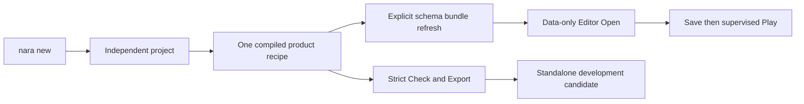
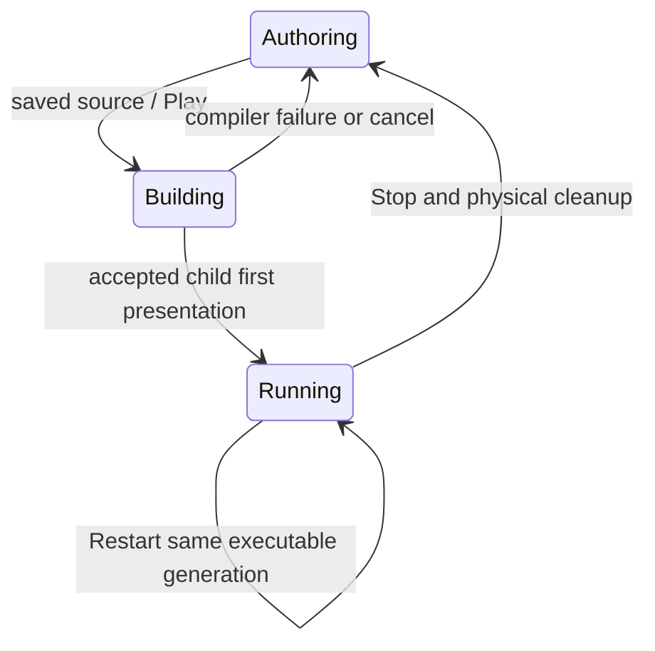

# First 2D Author Workflow - Plan

## Goal Capsule

Objective: A Rust developer can create an independent Nara project, finish a small
2D collection game, edit and play it, and run an exported development candidate
by following one reproducible guide.

Means: Exercise the existing starter and ordinary product tools, fixing the
concrete handoff gaps in KTD1-KTD4. The implementation owner verifies and commits
locally; pushing, PR publication, and formal release are outside this work.

Authority: STRATEGY.md, Accepted ADRs, this plan, then verification evidence.
Amend ADR 0110's contained-only local dependency clause before replacing it.
Stop only an affected path if a verified authority conflict or missing native
platform prevents its acceptance; preserve work and record the exact limitation.

## Product Contract

### Summary

Make the first complete author workflow concrete with a small public-API consumer,
rather than expanding the engine's subsystem inventory.

### Problem Frame

The foundation is committed, but local project creation requires a parent inside
the engine checkout. Project-owned schema also lacks an ordinary refresh command.
These gaps prevent a genuine independent developer walkthrough. The previous full
review excluded files that were untracked at review time and later committed in
ca3d803; that coverage gap needs a bounded successor review.

### Requirements

#### Independent creation and compiled tooling

- R1. Create an independent local project outside the engine checkout on one
  usable filesystem, with explicit engine selection and a relative Cargo path.
  Reject unsupported roots before publication; preserve no-overwrite and
  published-but-unadmitted outcomes.
- R2. Generate/check the declared data-only authoring schema bundle from the same
  compiled product recipe used by Check, runtime, and Export. This is an explicit
  author command; generic Editor Open remains data-only and Check remains read-only.

#### Complete lightweight consumer

- R3. Provide a small collection game with keyboard movement, three targets, a
  visible success state, and reset. Include a player Prefab, an image, a separate
  Cargo gameplay plugin, and a lightweight content variant. Use public APIs and
  document formats; keep runtime state separate from authored configuration.
- R4. Explain and exercise ordinary Editor Open, supported scalar edits,
  Undo/Redo, Save/Reopen, image import/reimport, and supervised external Play/Stop.
  Rust changes use Stop then Play; Restart reuses the existing executable generation.
  KnownUnbound custom records remain honestly read-only and losslessly preserved.
- R5. Export and run the actual headless and desktop development candidate from
  an unrelated CWD. All required game content belongs to the startup closure.
  Explain that this source-carrying candidate is not formal release packaging.

#### Evidence and usability

- R6. Write one reproducible tutorial alongside a maintainable consumer. Capture
  first build and representative data/Rust iteration wall times with actual cache
  and platform context. Record ergonomic obstacles without speculative frameworks.
- R7. Review the previously excluded implementation files, verify newly changed
  contracts, and prove a clean committed-source trajectory. Native Windows results
  do not establish Linux/macOS release support.

### Flows and Acceptance Examples

- F1. From an unrelated CWD, create a project under a sibling games directory,
  build it, and run strict Check without starting gameplay.
- F2. Add the game plugin to product_recipe, refresh schema explicitly, reopen in
  the ordinary Editor, edit a built-in Transform or Camera value, Undo/Redo, Save,
  reopen, and observe the saved value in the next external game child.
- F3. Play, move and collect, reset, Stop; introduce a deliberate compiler error,
  observe a useful failure while authoring remains available, repair, then Play.
- F4. Export into an absent destination and run its products outside the source
  project CWD. Apply the content variant explicitly and repeat strict validation.
- AE1. Sibling paths containing spaces resolve to the exact selected checkout;
  no absolute dependency coordinate is written into Cargo.toml.
- AE2. A stale authoring bundle is reported by explicit schema check; schema write
  publishes the recipe-derived successor, and reopening retains the custom record.
- AE3. A collected target resets without despawning authored persistent entities;
  saved source remains unchanged by gameplay.

### Scope Boundaries

The initial Prefab/Scene is authored as ordinary project source. A full visual
Prefab creator, generic custom-component editor, embedded gameplay viewport,
physics, audio, scripting VM, module marketplace, automatic watchers, final editor
toolkit selection, and formal distribution packaging are outside this slice.
The content variant demonstrates supported data replacement, not a new mod manager
or dynamic native-plugin ABI. Desktop design targets Windows/Linux/macOS; only
available native hosts produce platform evidence.

## Planning Contract

### Key Technical Decisions

- KTD1. Replace the contained-only local dependency relation with one common
  ancestor directory capability and named checkout/parent descendant coordinates.
  Derive both endpoints through the same capability session, revalidate both before
  staging and after publication, and derive one relative Cargo coordinate. Do not
  add an ambient absolute-path fallback. Cross-volume or inaccessible ancestor
  authority is an explicit local-mode limitation. This is a finite replacement of
  the old relation, not a general filesystem path-resolution framework. Governs R1.
- KTD2. Add an explicit schema check/write operation through the existing compiled
  headless project-tool boundary, using product_recipe and the existing declared
  bundle path/publication discipline. Do not copy Reference Game's standalone
  authoring tool or compile project code during Editor Open. Governs R2.
- KTD3. Keep the game as a small independent Cargo workspace under samples/,
  excluded from the engine workspace, with its own gameplay-plugin crate. Start the
  real external proof with nara new; copy normal game source while retaining that
  generated project's selected dependency coordinate. Do not build an overlay
  generator, starter family, or consumer-specific Host harness. Governs R3/R5/R6.
  (session-settled: user-approved — chosen over another subsystem-first foundation
  expansion: a complete author workflow supplies concrete architecture pressure.)
- KTD4. Use supported built-in editor operations, source-authored Prefab/Scene,
  and explicit schema refresh/reopen. If image assignment blocks the ordinary
  flow, implement only the existing revision-bound AssetRef edit path and a small
  adapter control; otherwise document the source step honestly. Never weaken schema
  readiness rules for a tutorial. Governs R4.
- KTD5. Reuse the existing build cache with serial Cargo and one build job. A
  detached committed source copy can share target for completeness evidence;
  this is not a cold-cache benchmark. Measure bounded observations without invented
  latency thresholds or transplanted Reference Game benchmark values. Governs R6/R7.

### Design and Sequencing

Assumptions: Cached dependencies and Windows native presentation are available.
Initial source authoring is acceptable for this Rust-first walkthrough. Linux and
macOS native proof is deferred to an available host, not substituted by compilation.
There are no launch-blocking product questions. The final CLI spelling and narrow
UI control belong to their implementing units, following existing patterns.

## Implementation Units

### U1. Close the previous review coverage gap

- Goal: Review the implementation files excluded from the prior tracked-only review.
- Requirements: R7. Dependencies: none.
- Files: ca3d803 paths absent from the earlier tracked diff; existing review evidence.
- Approach: Compute the concrete excluded set, inspect its high-risk lifecycle,
  filesystem, protocol and public-contract behavior, and fix verified defects only.
- Test Scenarios: A newly found failure gets a focused regression; no speculative
  proof scripts or repeated full matrix merely to restate prior passing evidence.
- Verification: Record reviewed scope and remaining platform limitations.

### U2. Support repository-external local projects

- Goal: Generate a sibling project with the correct explicit local dependency.
- Requirements: R1/R7. Dependencies: U1 findings on affected owners.
- Files: ADR 0110; src/bin/nara/new.rs; src/project_workflow/{dependency,creation,
  starter,publication}.rs; starter/product_contract.rs; nara_fs/path.rs; direct callers.
- Approach: KTD1; remove obsolete depth-only receipt/constructor concepts and update
  callers. Keep capability publication/admission behavior and exact parsed TOML checks.
- Test Scenarios: sibling/spaces; existing descendant; wrong supplied parent;
  checkout/parent drift before and after publication; unsupported common authority;
  destination collision. Expensive real Cargo trajectory runs once in U6.
- Verification: Focused workflow nextest plus actual sibling CLI creation.

### U3. Refresh project-owned authoring schema explicitly

- Goal: Let authors regenerate or check the declared bundle with one normal command.
- Requirements: R2/R4. Dependencies: none; integrate with U2 before U6.
- Files: src/bin/nara CLI owners; src/project_tooling and protocol; schema publication
  owners; starter README; focused tooling tests.
- Approach: KTD2. Reuse the compiled recipe, declared capability-relative path and
  transactional writer. Reject missing declarations and unsupported requests clearly.
- Test Scenarios: custom contribution; stale versus current bytes; check is read-only;
  write failure preserves prior bytes; no gameplay during tooling; unknown protocol
  operations remain rejected. No generic operation registry is needed.
- Verification: Focused protocol/tooling nextest and the external consumer command.

### U4. Build the public-API collection game

- Goal: Deliver the finite game and small plugin/content extension examples.
- Requirements: R3/R5. Dependencies: U2/U3 integration for the real external proof.
- Files: samples/collect-game/; engine workspace exclusion only where necessary.
- Approach: KTD3. Preserve generated library/headless/desktop composition. Use
  fixed simulation commands with a desktop input adapter and a finite headless
  acceptance path. Keep score/collected/reset state runtime-only; use startup content.
- Test Scenarios: movement, three collections, visible win, reset, untouched source,
  content variant and schema agreement. Gameplay tests assert outcomes, not internals.
- Verification: Independent plugin/game checks and deterministic headless acceptance.

### U5. Make ordinary editing and iteration reproducible

- Goal: Complete the supported editor portion without trusted-game adapters.
- Requirements: R4/R6. Dependencies: U3/U4.
- Files: docs/guides/first-2d-game.md; editor/README.md; minimal affected tooling UI
  and transaction owners only if KTD4's concrete image-assignment gap requires them.
- Approach: Explain source setup, schema refresh/reopen, scalar editing and external
  Play. If needed, reuse the existing typed field-edit transaction for AssetRef
  selection; do not introduce an asset-browser framework.
- Test Scenarios: Save/Reopen and Undo/Redo; custom record remains read-only and
  preserved; image assignment/import/reimport; dirty-source Play refusal; compiler
  error then recovery; Stop and editor exit retire the owned child.
- Verification: Ordinary generic Editor/native canary where available; explicitly
  distinguish action-driven native tests from manual interactive observations.

### U6. Prove the committed external workflow and document results

- Goal: Finish the tutorial with executable and timing evidence.
- Requirements: R5/R6/R7. Dependencies: U1-U5.
- Files: tutorial; successor verification/registration; implementation ledger and map.
- Approach: Commit implementation, use clean committed sources and shared target,
  create outside the engine checkout, add game source, schema/check/build/run,
  ordinary Editor Play, export, and execute exported products from unrelated CWD.
- Test Scenarios: F1-F4 plus first-present and physical cleanup; distinguish a
  published-but-unaccepted export from success. Collect actual command wall times,
  reporting cache state and any unmeasurable visible-result interval explicitly.
- Verification: Commands below, final focused review, precise local commits.

## Verification Contract

Root owns all Cargo invocations; set CARGO_BUILD_JOBS=1 and run serially. Prefer
`cargo nextest run` with affected package/test filters, then
`cargo check --workspace --all-features --all-targets --locked --offline` for shared
contract integration. Run `cargo fmt --all --check` and `git diff --check`.
Independent sample/plugin commands use their explicit manifest and shared target.
Nested-Cargo/native ignored acceptance tests run explicitly and serially; do not
start them concurrently with another build. New project bootstrap may create its
first lockfile; subsequent invocations retain it. No release:validate command is
invented where this repository has none.

Use actual nara/nara-editor executables and native presentation for desktop claims.
Record concrete command, revision, platform, cache/features/profile, result and
scope. No source-only fixture proves external process or exported execution.
Final review covers changed public APIs, filesystem mutations and lifecycle paths.
Memory render/check and validate are required for new evidence shards.

## Definition of Done

- U1-U6 outcomes and acceptance examples have concrete evidence or a precisely
  recorded unavailable native-platform limit that does not prevent Windows delivery.
- The tutorial works with the committed consumer using ordinary commands and public
  APIs; no test-support imports, private Host hooks, manually maintained schema JSON,
  or tutorial-only bypasses remain.
- New contract behavior and failures are tested at their owning boundary; prior
  foundation evidence is not rewritten to claim a broader review scope.
- All implementation fixes are reviewed, obsolete relation code and abandoned
  attempts are removed, and work is committed locally with a clean scoped diff.
- Follow-up ergonomic findings identify a real obstacle and trigger; they do not
  create an unimplemented framework or imply Linux/macOS release acceptance.

## Appendix

Local design evidence: ADRs 0090, 0110, 0114-0117; starter/product_contract.rs;
tests/project_workflow_cli.rs; editor/tests/supervised_play_clean_room.rs;
crates/nara_tooling/src/inspector.rs; crates/nara_scene/src/authoring_decode.rs;
docs/guides/rust-product-recipes.md. Reference Game illustrates public composition,
but its dedicated lifecycle/proof harness is not copied into the new consumer.

Cargo's [dependency documentation](https://doc.rust-lang.org/cargo/reference/specifying-dependencies.html)
and [build cache documentation](https://doc.rust-lang.org/cargo/reference/build-cache.html)
confirm relative path dependency and shared target behavior; they do not expand
Nara's own capability or release contracts.
