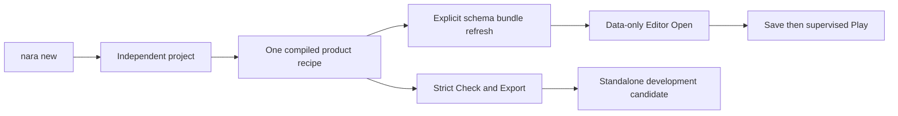
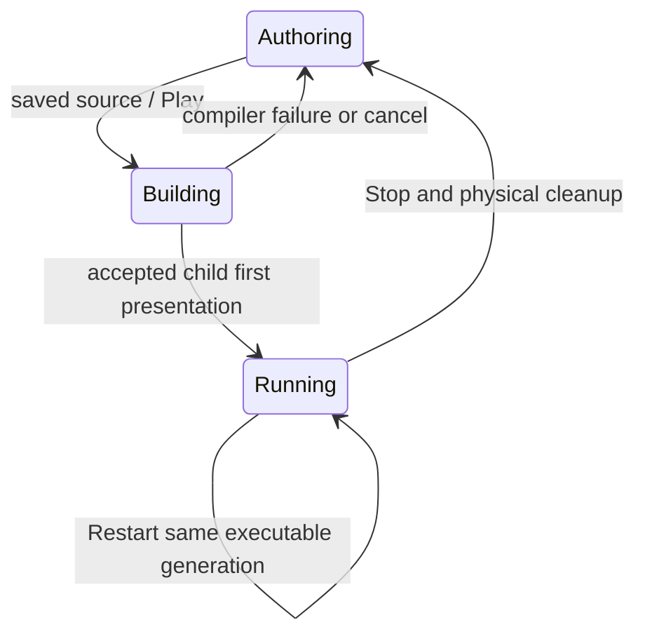

# First 2D Author Workflow - Plan

## Goal Capsule

Objective: A Rust developer can create an independent Nara project, finish a small
2D collection game, edit and play it, and run an exported development candidate
by following one reproducible guide.

Means: Exercise the existing starter and ordinary product tools, fixing the
concrete handoff gaps in KTD1-KTD4. The implementation owner verifies and commits
locally; pushing, PR publication, and formal release are outside this work.

Authority: STRATEGY.md, Accepted ADRs, this plan, then verification evidence.
Amend ADR 0110's contained-only local dependency clause before replacing it.
Stop only an affected path if a verified authority conflict or missing native
platform prevents its acceptance; preserve work and record the exact limitation.

## Product Contract

### Summary

Make the first complete author workflow concrete with a small public-API consumer,
rather than expanding the engine's subsystem inventory.

### Problem Frame

The foundation is committed, but local project creation requires a parent inside
the engine checkout. Project-owned schema also lacks an ordinary refresh command.
These gaps prevent a genuine independent developer walkthrough. The previous full
review excluded files that were untracked at review time and later committed in
ca3d803; that coverage gap needs a bounded successor review.

### Requirements

#### Independent creation and compiled tooling

- R1. Create an independent local project outside the engine checkout on one
  usable filesystem, with explicit engine selection and a relative Cargo path.
  Reject unsupported roots before publication; preserve no-overwrite and
  published-but-unadmitted outcomes.
- R2. Generate/check the declared data-only authoring schema bundle from the same
  compiled product recipe used by Check, runtime, and Export. This is an explicit
  author command; generic Editor Open remains data-only and Check remains read-only.

#### Complete lightweight consumer

- R3. Provide a small collection game with keyboard movement, three targets, a
  visible success state, and reset. Include a player Prefab, an image, a separate
  Cargo gameplay plugin, and a lightweight content variant. Use public APIs and
  document formats; keep runtime state separate from authored configuration.
- R4. Explain and exercise ordinary Editor Open, supported scalar edits,
  Undo/Redo, Save/Reopen, image import/reimport, and supervised external Play/Stop.
  Rust changes use Stop then Play; Restart reuses the existing executable generation.
  KnownUnbound custom records remain honestly read-only and losslessly preserved.
- R5. Export and run the actual headless and desktop development candidate from
  an unrelated CWD. All required game content belongs to the startup closure.
  Explain that this source-carrying candidate is not formal release packaging.

#### Evidence and usability

- R6. Write one reproducible tutorial alongside a maintainable consumer. Capture
  first build and representative data/Rust iteration wall times with actual cache
  and platform context. Record ergonomic obstacles without speculative frameworks.
- R7. Review the previously excluded implementation files, verify newly changed
  contracts, and prove a clean committed-source trajectory. Native Windows results
  do not establish Linux/macOS release support.

### Flows and Acceptance Examples

- F1. From an unrelated CWD, create a project under a sibling games directory,
  build it, and run strict Check without starting gameplay.
- F2. Add the game plugin to product_recipe, refresh schema explicitly, reopen in
  the ordinary Editor, edit a built-in Transform or Camera value, Undo/Redo, Save,
  reopen, and observe the saved value in the next external game child.
- F3. Play, move and collect, reset, Stop; introduce a deliberate compiler error,
  observe a useful failure while authoring remains available, repair, then Play.
- F4. Export into an absent destination and run its products outside the source
  project CWD. Apply the content variant explicitly and repeat strict validation.
- AE1. Sibling paths containing spaces resolve to the exact selected checkout;
  no absolute dependency coordinate is written into Cargo.toml.
- AE2. A stale authoring bundle is reported by explicit schema check; schema write
  publishes the recipe-derived successor, and reopening retains the custom record.
- AE3. A collected target resets without despawning authored persistent entities;
  saved source remains unchanged by gameplay.

### Scope Boundaries

The initial Prefab/Scene is authored as ordinary project source. A full visual
Prefab creator, generic custom-component editor, embedded gameplay viewport,
physics, audio, scripting VM, module marketplace, automatic watchers, final editor
toolkit selection, and formal distribution packaging are outside this slice.
The content variant demonstrates supported data replacement, not a new mod manager
or dynamic native-plugin ABI. Desktop design targets Windows/Linux/macOS; only
available native hosts produce platform evidence.

## Planning Contract

### Key Technical Decisions

- KTD1. Replace the contained-only local dependency relation with one common
  ancestor directory capability and named checkout/parent descendant coordinates.
  Derive both endpoints through the same capability session, revalidate both before
  staging and after publication, and derive one relative Cargo coordinate. Do not
  add an ambient absolute-path fallback. Cross-volume or inaccessible ancestor
  authority is an explicit local-mode limitation. This is a finite replacement of
  the old relation, not a general filesystem path-resolution framework. Governs R1.
- KTD2. Add an explicit schema check/write operation through the existing compiled
  headless project-tool boundary, using product_recipe and the existing declared
  bundle path/publication discipline. Do not copy Reference Game's standalone
  authoring tool or compile project code during Editor Open. Governs R2.
- KTD3. Keep the game as a small independent Cargo workspace under samples/,
  excluded from the engine workspace, with its own gameplay-plugin crate. Start the
  real external proof with nara new; copy normal game source while retaining that
  generated project's selected dependency coordinate. Do not build an overlay
  generator, starter family, or consumer-specific Host harness. Governs R3/R5/R6.
  (session-settled: user-approved — chosen over another subsystem-first foundation
  expansion: a complete author workflow supplies concrete architecture pressure.)
- KTD4. Use supported built-in editor operations, source-authored Prefab/Scene,
  and explicit schema refresh/reopen. If image assignment blocks the ordinary
  flow, implement only the existing revision-bound AssetRef edit path and a small
  adapter control; otherwise document the source step honestly. Never weaken schema
  readiness rules for a tutorial. Governs R4.
- KTD5. Reuse the existing build cache with serial Cargo and one build job. A
  detached committed source copy can share target for completeness evidence;
  this is not a cold-cache benchmark. Measure bounded observations without invented
  latency thresholds or transplanted Reference Game benchmark values. Governs R6/R7.

### Design and Sequencing





Assumptions: Cached dependencies and Windows native presentation are available.
Initial source authoring is acceptable for this Rust-first walkthrough. Linux and
macOS native proof is deferred to an available host, not substituted by compilation.
There are no launch-blocking product questions. The final CLI spelling and narrow
UI control belong to their implementing units, following existing patterns.

## Implementation Units

### U1. Close the previous review coverage gap

- Goal: Review the implementation files excluded from the prior tracked-only review.
- Requirements: R7. Dependencies: none.
- Files: ca3d803 paths absent from the earlier tracked diff; existing review evidence.
- Approach: Compute the concrete excluded set, inspect its high-risk lifecycle,
  filesystem, protocol and public-contract behavior, and fix verified defects only.
- Test Scenarios: A newly found failure gets a focused regression; no speculative
  proof scripts or repeated full matrix merely to restate prior passing evidence.
- Verification: Record reviewed scope and remaining platform limitations.

### U2. Support repository-external local projects

- Goal: Generate a sibling project with the correct explicit local dependency.
- Requirements: R1/R7. Dependencies: U1 findings on affected owners.
- Files: ADR 0110; src/bin/nara/new.rs; src/project_workflow/{dependency,creation,
  starter,publication}.rs; starter/product_contract.rs; nara_fs/path.rs; direct callers.
- Approach: KTD1; remove obsolete depth-only receipt/constructor concepts and update
  callers. Keep capability publication/admission behavior and exact parsed TOML checks.
- Test Scenarios: sibling/spaces; existing descendant; wrong supplied parent;
  checkout/parent drift before and after publication; unsupported common authority;
  destination collision. Expensive real Cargo trajectory runs once in U6.
- Verification: Focused workflow nextest plus actual sibling CLI creation.

### U3. Refresh project-owned authoring schema explicitly

- Goal: Let authors regenerate or check the declared bundle with one normal command.
- Requirements: R2/R4. Dependencies: none; integrate with U2 before U6.
- Files: src/bin/nara CLI owners; src/project_tooling and protocol; schema publication
  owners; starter README; focused tooling tests.
- Approach: KTD2. Reuse the compiled recipe, declared capability-relative path and
  transactional writer. Reject missing declarations and unsupported requests clearly.
- Test Scenarios: custom contribution; stale versus current bytes; check is read-only;
  write failure preserves prior bytes; no gameplay during tooling; unknown protocol
  operations remain rejected. No generic operation registry is needed.
- Verification: Focused protocol/tooling nextest and the external consumer command.

### U4. Build the public-API collection game

- Goal: Deliver the finite game and small plugin/content extension examples.
- Requirements: R3/R5. Dependencies: U2/U3 integration for the real external proof.
- Files: samples/collect-game/; engine workspace exclusion only where necessary.
- Approach: KTD3. Preserve generated library/headless/desktop composition. Use
  fixed simulation commands with a desktop input adapter and a finite headless
  acceptance path. Keep score/collected/reset state runtime-only; use startup content.
- Test Scenarios: movement, three collections, visible win, reset, untouched source,
  content variant and schema agreement. Gameplay tests assert outcomes, not internals.
- Verification: Independent plugin/game checks and deterministic headless acceptance.

### U5. Make ordinary editing and iteration reproducible

- Goal: Complete the supported editor portion without trusted-game adapters.
- Requirements: R4/R6. Dependencies: U3/U4.
- Files: docs/guides/first-2d-game.md; editor/README.md; minimal affected tooling UI
  and transaction owners only if KTD4's concrete image-assignment gap requires them.
- Approach: Explain source setup, schema refresh/reopen, scalar editing and external
  Play. If needed, reuse the existing typed field-edit transaction for AssetRef
  selection; do not introduce an asset-browser framework.
- Test Scenarios: Save/Reopen and Undo/Redo; custom record remains read-only and
  preserved; image assignment/import/reimport; dirty-source Play refusal; compiler
  error then recovery; Stop and editor exit retire the owned child.
- Verification: Ordinary generic Editor/native canary where available; explicitly
  distinguish action-driven native tests from manual interactive observations.

### U6. Prove the committed external workflow and document results

- Goal: Finish the tutorial with executable and timing evidence.
- Requirements: R5/R6/R7. Dependencies: U1-U5.
- Files: tutorial; successor verification/registration; implementation ledger and map.
- Approach: Commit implementation, use clean committed sources and shared target,
  create outside the engine checkout, add game source, schema/check/build/run,
  ordinary Editor Play, export, and execute exported products from unrelated CWD.
- Test Scenarios: F1-F4 plus first-present and physical cleanup; distinguish a
  published-but-unaccepted export from success. Collect actual command wall times,
  reporting cache state and any unmeasurable visible-result interval explicitly.
- Verification: Commands below, final focused review, precise local commits.

## Verification Contract

Root owns all Cargo invocations; set CARGO_BUILD_JOBS=1 and run serially. Prefer
`cargo nextest run` with affected package/test filters, then
`cargo check --workspace --all-features --all-targets --locked --offline` for shared
contract integration. Run `cargo fmt --all --check` and `git diff --check`.
Independent sample/plugin commands use their explicit manifest and shared target.
Nested-Cargo/native ignored acceptance tests run explicitly and serially; do not
start them concurrently with another build. New project bootstrap may create its
first lockfile; subsequent invocations retain it. No release:validate command is
invented where this repository has none.

Use actual nara/nara-editor executables and native presentation for desktop claims.
Record concrete command, revision, platform, cache/features/profile, result and
scope. No source-only fixture proves external process or exported execution.
Final review covers changed public APIs, filesystem mutations and lifecycle paths.
Memory render/check and validate are required for new evidence shards.

## Definition of Done

- U1-U6 outcomes and acceptance examples have concrete evidence or a precisely
  recorded unavailable native-platform limit that does not prevent Windows delivery.
- The tutorial works with the committed consumer using ordinary commands and public
  APIs; no test-support imports, private Host hooks, manually maintained schema JSON,
  or tutorial-only bypasses remain.
- New contract behavior and failures are tested at their owning boundary; prior
  foundation evidence is not rewritten to claim a broader review scope.
- All implementation fixes are reviewed, obsolete relation code and abandoned
  attempts are removed, and work is committed locally with a clean scoped diff.
- Follow-up ergonomic findings identify a real obstacle and trigger; they do not
  create an unimplemented framework or imply Linux/macOS release acceptance.

## Desktop 2D Starter With Editable Actions

Foundation R12 uses a second game to test the cost of writing gameplay and taking it through an
external project workflow. `nara new desktop-2d/v2` ships a movement example and an editable action map
with its own primary Product. The existing creation owner stages and admits the selected version's
inventory. The generated Windows desktop target selects the controller collector from the same
Nara checkout or immutable Git revision. Headless, Cook and Player use the shared project recipe.
[Foundation R12](2026-10-23-foundation-architecture-rebaseline-plan.md#r12-consumer-integration-and-canonical-contract-consolidation)

The push-box consumer adds an authored pressure plate and door through one project-owned Schema
contribution. Its fixed-step system reads the same actions, buffers presses in order and tries one
grid move per tick. The independent trajectory compares fresh keyboard and normalized gamepad runs.
It edits a plate through the prepared source document owner without selecting it, exercises
Undo/Redo and Save/Reopen, and follows the original Cook-to-Player path after moving the installation.

The comparison follows Godot's project-owned action definitions and Bevy's direct gameplay reads.
The input map changes device bindings. The game source decides how those actions affect play.
[Godot Input Map](https://github.com/godotengine/godot/blob/b070e63b161aa816afac71dcfc9d60859d38f220/core/input/input_map.cpp) ·
[Bevy keyboard example](https://github.com/bevyengine/bevy/blob/03ed5a27c92715c8fa2188f31f04e454ec39942f/examples/input/keyboard_input.rs)

### Desktop keyboard admission

The stock Winit adapter owns one table for physical conversion and for validating authored
keyboard bindings. It covers the unshifted ASCII punctuation positions, including Semicolon and
BracketRight. The source loader selects validation using the admitted `DesktopWinit` capability.
The same compiled rule checks the global Input Product on processed startup and in deep delivery
validation. The generic codec retains its existing keyboard vocabulary for headless and alternate
input adapters. The project-tool protocol publishes the input file path and diagnostic code;
direct reports also give the original binding index and its character code point. Processed
startup gives the Input Product identity with that binding information.

On Windows x64 with Rust 1.95.0, the affected adapter, source Check, desktop Cook and processed
startup cohort passed 144/144 (`8d5336cb-a3a5-47ae-9ff2-b619ba9d5041`). Two native cases passed
(`a1ae686a-d28d-4a7f-89a6-3a8cdfd7a1e6`). Injected Win32 key messages traversed the Winit
loop to the action owner, including pressed and released edges. The independent generated v2
scenarios passed 2/2 (`5fa16f56-09df-4fcb-a5d6-f4de54163568`). The desktop project accepts
Semicolon and BracketRight in Check, rejects `é` with the authored map's path, and completes
first presentation and source Export. The normalized `é` input produces the same fixed-step
trace in the Headless source project and the relocated Cooked Player.

Independent review corrected the reduced `desktop-winit,serde` feature build and retained the
Input Product in the Host diagnostic. That exact feature combination passes a library check.
The processed Host refusal regression passed 1/1 (`f9bcaaf1-97a4-496b-8a55-216728d957c1`),
including the Product, binding index, code point and release of the failed acquisition.
Correctness Clippy and workspace formatting pass.

[Round eleven reproduction](../audits/2026-11-22-starter-input-authoring-and-runtime-review.md#p2--desktop-check-accepts-keyboard-bindings-the-stock-runner-cannot-deliver) ·
[Input guide](../guides/input-actions.md#desktop-keyboard-bindings)

### Starter Cargo package identity

The same creation owner derives `nara-project-<source-universe-uuid>` for the Cargo package in
both starter versions. `nara.toml` carries that source universe alongside the requested project
name and window title. An author can create a local project named `nara`, and two projects with
the same slug receive distinct Cargo names. Check and Export select the built workspace
package from Cargo metadata. The generated Cook and Desktop entry points use the package facts
provided by Cargo.

Godot's project dialog stores the author-supplied name in project settings. Bevy's example
metadata supplies display names within its `bevy` package.
[Godot project dialog](https://github.com/godotengine/godot/blob/b070e63b161aa816afac71dcfc9d60859d38f220/editor/project_manager/project_dialog.cpp) ·
[Bevy example metadata](https://github.com/bevyengine/bevy/blob/03ed5a27c92715c8fa2188f31f04e454ec39942f/Cargo.toml)

The pre-fix Windows binary created `nara` at version `0.1.0` beside the path dependency with
the same package identity. Its first `nara check` reproduced Cargo's lockfile collision.
The new name is assigned before publication.
[Round eleven reproduction](../audits/2026-11-22-starter-input-authoring-and-runtime-review.md#p3--project-creation-can-publish-a-local-game-that-cargo-cannot-resolve)

On Windows x64 and Rust 1.95.0, the affected creation and CLI cohort passed 17/17
(`32c0f81e-e4ba-44bb-b956-acb92ca9c11d`). The v1 project named `nara` completes its first
ordinary Check from a fresh directory. The lockfile records the engine and generated game
as separate packages with their actual dependency edge. The regression confirms the project
name, stable label and desktop title alongside locked Cargo metadata and all-target,
all-feature compilation. Preparation tests cover independent same-slug identities in both
starter versions with an immutable Git coordinate.

Four selected release workflows passed on the same Windows toolchain
(`20f80a2d-9a49-4ac3-984d-d56bb8242cbb`). The v1 regression exercised two independently
created games with the same project name through Check, Export, Cook and relocated Player
execution. The two v2 projects named `nara` exercised the push-box authoring and binding
workflow, relocated Player execution, DX12 first presentations and both source Export
startup observations. The independent v1 Cook workflow also built and relocated its
custom game and checked the generated Cargo package in the delivery manifest. These builds
used the local checkout dependency.
[Generated author workflow](../../tests/project_author_workflow.rs) ·
[Independent Cook workflow](../../tests/project_cook.rs)

The clean-room Editor workflow passed 1/1 (`5f9fbbe9-c667-46c3-b475-134d5a70aded`).
It loaded the generated project, completed Save/Reopen and Prefab extraction, then built
the project in supervised Play, reached Ready, stopped the game and closed the Editor.
Correctness Clippy for the selected workflow targets, compilation of the independent
project-workflow consumer, workspace formatting and changed-document links passed.
[Supervised Play workflow](../../editor/tests/supervised_play_clean_room.rs)

### Run the independent v2 workflow

The public fixture creates and builds a new project beside the engine checkout. The first test
needs a supported local publication filesystem, Rust 1.95 and a populated offline Cargo cache.
The second test also needs an interactive Windows desktop
with WGI and a usable DX12 adapter. Run the two tests serially. The shell example uses the engine's
existing target directory. [Public fixture](../../tests/project_author_workflow.rs)

```powershell
$env:RUSTUP_TOOLCHAIN = '1.95.0'
$env:CARGO_BUILD_JOBS = '1'
$env:CARGO_TARGET_DIR = Join-Path (Get-Location) 'target'
$env:CARGO_NET_OFFLINE = 'true'
cargo nextest run --release --locked --offline -p nara --no-default-features --features project-workflow-cli,tooling --test project_author_workflow --run-ignored only -E 'test(=generated_v2_puzzle_observes_the_edited_scene_and_input_after_source_removal)' --test-threads=1 --success-output immediate
$env:WGPU_BACKEND = 'dx12'
$env:NARA_WGPU_FORCE_FALLBACK = '0'
cargo nextest run --release --locked --offline -p nara --no-default-features --features project-workflow-cli,tooling --test project_author_workflow --run-ignored only -E 'test(=generated_v2_desktop_verifies_first_present)' --test-threads=1 --success-output immediate
```

### Authoring and delivery evidence

The generated project runs one fixed tick through its normal Headless entry. An independent
fixed-step observer drives the unmodified movement recipe through public Input and checks that
holding D moves on consecutive ticks, releasing D stops movement, and Enter resets the player.
The push-box game replaces its project-owned gameplay and authors two persistent components under
one Schema provider. It uses one gameplay plugin and five action names. The common sequence uses
`move.right` and the binding-order control also exercises `move.up`. The game converts semantic
presses directly into local controls, with zero generic gameplay-command encodes or decodes.
The external project uses the published engine interfaces for each change. The engine changes
needed to ship this template concern creation, the generated inventory and dependency selection.

The data-only Editor selects the camera while reading the pressure plate. It previews column 3
from the prepared candidate while the live column remains 2, rejects a stale candidate and
obsolete query bases, and verifies history, the actual Save digest and Reopen. The same normalized
input sequence opens the door at tick 2 before the edit and at tick 6 after it. A plate behind
the door leaves the player and box blocked outside it. Two taps delivered together move the box
in two fixed ticks. Two actions admitted by one input retain their order. A fresh run with only
D-pad Right bound to `move.right` matches the keyboard baseline for the saved Scene.

The actual generated Cook publishes the Player, pack and package manifest. The test moves those
files, removes its source project and local Cook cache, and launches from an unrelated empty
directory. The processed Scenes and input map reproduce the source trace. The sealed exact launch
also completes 4,096 ticks with neutral input. The Windows run exercises both first presentations,
Headless with the shared `desktop` Cargo feature, and both source Export product observations.
The exported Scene, Schema and action map are byte-identical to the project sources.

The implementation is recorded in `45748c2`. Five process scenarios passed on Windows x64 with
Rust 1.95.0 on November 22
(`c3e27c79-c8ff-4ff2-8df7-8b2ef207a898`). The run covers the two v2 scenarios, v1 dual-project
delivery and Prefab metadata recovery, and the existing custom-Schema Cook path. The native run
selected DX12 with `NARA_WGPU_FORCE_FALLBACK=0`. The first Export attempt reached the cold release
build and crossed the fixture's 900-second deadline. The retry raised the fixture's Export
allowance to 1,800 seconds and reused completed Cargo artifacts. The v1 delivery fixture also
needed `walking.rs` in its project copy and Cook input lists. Native input evidence covers WGI
startup and teardown. Gameplay traces use normalized keyboard and gamepad events. Physical
controller use, other native targets, a graphical cooked Player and general performance budgets
remain separate qualification work.

The CPU batch passed 41 of 42 tests (`8de315b0-4416-408c-9232-5d72c4b1ce1e`). The existing
`hosted_ci_runs_complete_locked_suites_on_supported_platforms` assertion rejects the
`reference-game` dependency patches already present at `910ca36` before it reads the CI workflow.
Both the manifest and the assertion retain their baseline contents. The edited workflow passed
YAML parsing and the Windows run executed the new source-free scenario.

The targeted workflow owner run passed all 104 tests (`91a8c8d9-328d-48b1-9901-95457fc690a1`),
including refusal of creation success when ordinary startup admits a different valid action map.
The independently locked project-workflow consumer and the Editor application contract,
authoring loop, and supervised Play clean-room targets passed compile checks.
The root workflow targets passed correctness Clippy. The workspace, independent consumer and
embedded starter sources passed formatting checks.

One warm-cache observation on the i9-13900KF workstation measured 24,017 ms from installing the
game change to the verified result, including compiled Schema and Check. The Scene path took
165 ms from preparing the edit through history, Save/Reopen and a fresh source run. The binding
edit took 140 ms through a fresh source run. These are single developer-workflow observations.

## Appendix

Local design evidence: ADRs 0090, 0110, 0114-0117; starter/product_contract.rs;
tests/project_workflow_cli.rs; editor/tests/supervised_play_clean_room.rs;
crates/nara_tooling/src/inspector.rs; crates/nara_scene/src/authoring_decode.rs;
docs/guides/rust-product-recipes.md. Reference Game illustrates public composition,
but its dedicated lifecycle/proof harness is not copied into the new consumer.

Cargo's [dependency documentation](https://doc.rust-lang.org/cargo/reference/specifying-dependencies.html)
and [build cache documentation](https://doc.rust-lang.org/cargo/reference/build-cache.html)
confirm relative path dependency and shared target behavior; they do not expand
Nara's own capability or release contracts.
