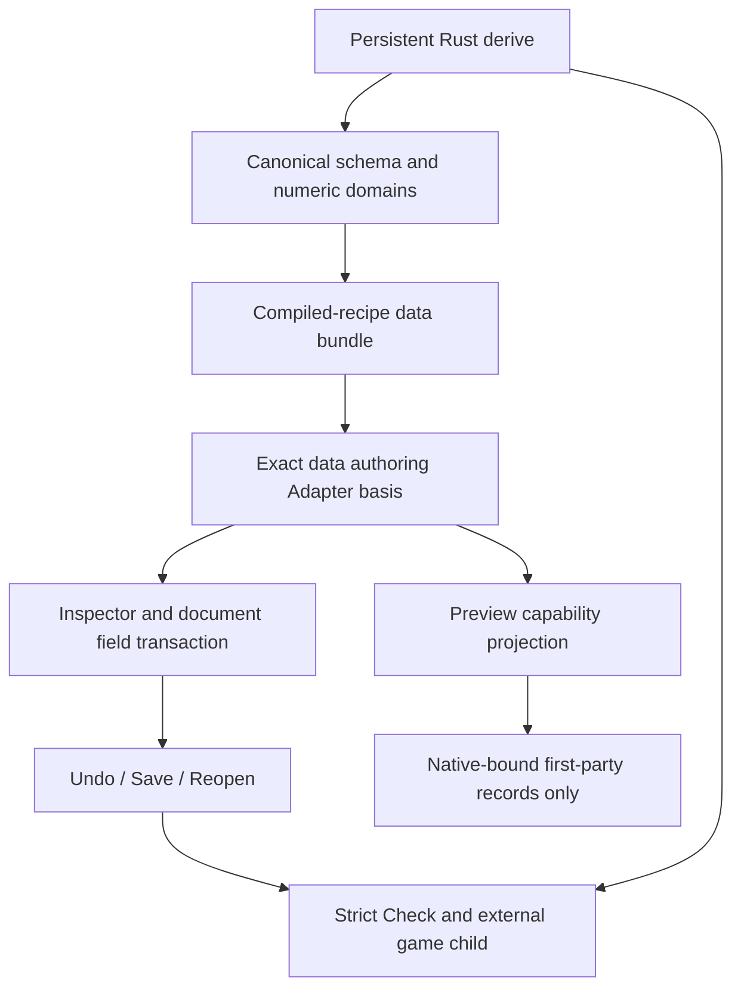

# Custom Component Authoring - Plan

## Goal Capsule

Objective: A developer derives ordinary Rust gameplay configuration, refreshes its
schema, and edits supported custom fields in the installed Editor with Undo,
Save/Reopen and strict runtime agreement.

Means: Extend the existing finite scalar codecs and data-only authoring Adapter.
Keep gameplay Rust outside the Editor process and reuse document transactions.
Authority: STRATEGY.md and Accepted ADRs 0081, 0090, 0114 and 0117; amend the
schema-only Adapter boundary before implementing it. Root verifies and commits
locally. Push, PR publication and formal release are outside this work.

## Product Contract

### Problem Frame

The collection game had to use u64 for naturally fractional configuration because
PersistentComponent admits only i64/u64/Vec2/EntityReference. The ordinary Editor
knows the custom schema but cannot edit even its simple fields. Requiring a
project-specific Editor executable would retain that product obstacle.

### Requirements

- R1. Derive bool, String, f32/f64, i8/i16/i32/i64 and u8/u16/u32/u64 using the
  existing ComponentValue grammar. Preserve i64/u64/Vec2/EntityReference behavior.
  Reject wrong kinds, narrowing overflow and non-finite floating values. Normal
  finite f64-to-f32 rounding is allowed; no silent integer truncation/clamping.
- R2. The installed Editor can inspect/edit declared simple custom fields without
  compiling or loading project Rust. A root-installed engine-owned schema Adapter
  binds an exact owned catalog identity. Absent schema, future versions and
  unsupported records retain their honest readiness and preservation behavior.
- R3. Editing and native preview are separate capabilities. Data-editable custom
  records stay in source documents and are omitted with an explicit reason from
  a first-party typed preview that has no native binding. Runtime remains strict.
- R4. Scene and Prefab edits use existing revision/history/persistence paths.
  Invalid or out-of-domain edits leave document, revision, history and source
  unchanged. Browser Open, Reopen and external Play re-admission agree on support.
- R5. A real collection-game custom field is edited through the ordinary Editor,
  undone/redone, saved/reopened, then consumed by the compiled game with an
  observable changed outcome. Preserve unrelated unsupported records. Publish a
  reproducible guide and actual verification evidence.

### Flows and Acceptance Examples

- F1. Declare fractional speed/radius, regenerate the compiled recipe's schema,
  open the generic Editor, edit the custom field, Undo/Redo, Save and Reopen.
- AE1. An out-of-f32-range finite F64 or an out-of-u8-range U64 is rejected before
  a field transaction publishes, while the previously accepted value/history stay.
- AE2. A data-editable custom record is absent from native preview but remains in
  the saved document, and strict Check/runtime accepts its valid authored value.
- AE3. Stale/missing/future/unsupported schema is never made editable merely because
  the Editor contains a generic control. Missing project Rust does not prevent Open.

### Scope Boundaries

No project-specific Editor is required. No arbitrary executable Adapter installation,
native DLL loading, reflection VM, placeholder ECS components, generic package
manager, watchers or new history/persistence system is introduced. Numeric domains
describe the finite admitted Rust widths; this is not a general validation language.
Pointer-sized integers, i128/u128, collections, enums, aliases requiring name
resolution and arbitrary user codecs remain deferred until a real consumer needs
them. Manual arbitrary syntax/AST resolution is deliberately not built.

## Planning Contract

### Key Technical Decisions

- KTD1. Extend the sealed PersistentFieldCodec and derive's finite admitted-type
  table. Keep wire I64/U64/F64 kinds; carry finite numeric-domain metadata for
  narrower admitted types in ComponentFieldSchema. Validate domain-kind coherence,
  defaults, values, lineage and fingerprints through the existing reflect owner.
  Missing metadata preserves legacy full-width meaning and existing fingerprints.
- KTD2. Add a schema-owned exact Adapter identity distinct from executable provider
  receipts. Root installs it from the admitted data bundle only for the existing
  understood simple-field contract. Native first-party coverage wins; overlapping
  coverage is not silently accepted. The adapter does not leak owned IDs into static
  executable owner types and does not call project codecs.
- KTD3. Authoring readiness may be Available for the schema Adapter while native
  preview support remains false. Carry the support fact with exact Adapter evidence;
  preview projection omits those records. Source records and strict Runtime binding
  remain unchanged. Update Accepted ADRs 0090/0114 for this concrete revisit trigger.
- KTD4. Reuse the same root Adapter construction during Open and external Play
  re-admission; retained document basis supplies browser/Prefab/Reopen behavior.
  Field transactions share reflect's numeric-domain check, avoiding a second Rust
  validator or schema authority.

### High-Level Technical Design

### Risks and Alternatives

Static companion Editors can reuse native codecs but do not solve installed-Editor
authoring; reserve them for advanced tools. A schema-only Adapter is appropriate
only for semantics represented by its finite descriptor. Domain metadata prevents
the traced f32/narrow-integer mismatch without invoking arbitrary project callbacks.
Metadata that is absent cannot promise hidden game-specific invariants: strict
Check remains authoritative for those. Unknown schema fields remain rejected by
older readers rather than guessed. Existing schemas without numeric metadata keep
their identity; new metadata changes exact catalog identity intentionally.

## Implementation Units

### U1. Admit common scalar codecs and numeric domains

- Goal: Make normal gameplay configuration derivable and round-trippable. R1/AE1.
- Dependencies: none.
- Files: crates/nara_reflect/src/{authoring,schema,registry,lib}.rs;
  crates/nara_reflect_derive/src/lib.rs; crates/nara_reflect/tests/derive_schema.rs;
  affected UI compile fixtures and authoring-bundle tests.
- Approach: KTD1; add finite descriptors and checked codecs. Preserve prior schema
  fingerprints when metadata is absent. Keep existing required-field semantics.
- Test scenarios: all admitted kinds round-trip; signed/unsigned edges reject
  overflow/wrong kind; f32 limits and non-finite encoding; catalog domain identity,
  schema-kind mismatch and invalid defaults; prior derive diagnostics stay useful.
- Verification: focused reflect nextest, derive compiler fixtures and fmt.

### U2. Install exact data authoring support and separate preview

- Goal: Enable generic custom field editing without native execution. R2-R4/AE1-AE3.
- Dependencies: U1; amend ADRs 0090/0114 first.
- Files: crates/nara_scene/src/{authoring_decode,authoring_preview,patch}.rs and
  owning tests; src/project_host/authoring/adapter.rs;
  src/project_host/runtime/editor/{open,external_play}.rs;
  relevant authoring project/session/tooling tests; architecture ADRs.
- Approach: KTD2-KTD4. Owned exact catalog receipt, finite support, explicit preview
  omission and shared domain checks at candidate validation. Existing transactions
  keep unavailable-manifest preservation and all-or-nothing history publication.
- Finite admission: Cover only nonempty Scene+Inspect component schemas whose
  complete persistent field contract uses Bool/I64/U64/F64/String kinds understood
  by this Adapter. Fields still need their declared Edit capability. Do not grant
  schema-only support to a partially understood component; Map/List/EntityRef and
  other unsupported contracts retain KnownUnbound preservation. Existing exact
  first-party AssetRef authoring stays on its owning admitted path.
- Complete-value validation: Before a schema-only record becomes Available, check
  its required paths, present value kinds and numeric domains through the canonical
  reflect validator. Reuse that validator for candidate writes before document,
  revision or history publication. An admitted schema never proves that arbitrary
  payload data conforms to it.
- Retention and preview: Keep the exact Adapter basis through project/session and
  document publication so Browser Open, Scene/Prefab Reopen and external Play
  re-admission use the same rules. Native preview requires its own exact supported
  Adapter evidence; schema-only Available records receive an explicit omission
  reason in the temporary preview projection and remain intact in source data.
- Test scenarios: exact custom schema editable without code; mismatch/future/
  unsupported record stays protected; narrowed value rejects atomically; native
  preview omits schema-only records; malformed required paths/kinds/domain values
  cannot become Available; mixed supported/unsupported component fields stay
  protected; browser/Prefab/Reopen/Play share classification.
- Verification: focused Scene/tooling/Host tests and ordinary generic Editor checks.

### U3. Exercise custom edits through the collection game

- Goal: Demonstrate installed-Editor authoring with compiled runtime agreement. R5/F1.
- Dependencies: U1-U2.
- Files: samples/collect-game/gameplay-plugin/src/lib.rs; authored sample Scene/
  Prefab/schema and gameplay tests; editor/tests/first_game_workflow.rs or a focused
  ordinary custom-authoring integration test; docs/guides/first-2d-game.md.
- Approach: Migrate configuration to natural floating types with an explicit schema
  version/content update when the wire kind changes. Generate the bundle through
  the public schema tool. Use an external disposable copy for action-driven Editor
  edit/Undo/Redo/Save/Reopen, strict Check and changed gameplay outcome.
- Test scenarios: custom radius/speed editable and saved; out-of-range input retains
  accepted state; absent/future records preserved; preview available; headless
  gameplay and native external Play accept saved content.
- Verification: independent sample nextest, real external schema/Check/run, ordinary
  Editor integration and Windows first presentation. No manual-keyboard claim.

### U4. Review and close the finite workflow

- Goal: Deliver reviewed committed source with accurate documentation. R1-R5.
- Dependencies: U1-U3.
- Files: guide, implementation ledger, architecture map and successor engineering
  memory registration/verification.
- Approach: Review changed persistent contracts and public surfaces, resolve real
  findings, verify clean committed-source consumer after implementation commits,
  record actual commands/platform/cache and remaining concrete follow-up triggers.
- Verification: serial workspace all-feature/all-target check, focused nextest,
  root/sample fmt, diff check, memory render/check/validate and precise commits.

## Verification Contract

Root owns serial Cargo with CARGO_BUILD_JOBS=1, CARGO_INCREMENTAL=0 and the existing
target. Tests assert public outcomes and preservation, not source spellings. Use
nextest for affected libraries/integration; run compiler fixtures explicitly.
Broaden to workspace all-features/all-targets locked offline compilation for the
persistent/public changes. Independently build the sample workspace. Document
Windows native evidence without inferring Linux/macOS release acceptance.

## Definition of Done

R1-R5 and U1-U4 have actual source/test/consumer evidence. The installed Editor
edits supported custom fields without project execution, and preview, Runtime and
unavailable preservation keep their distinct authorities. All required fixes are
reviewed, code/docs are committed locally, and the lane closes through successor
memory rather than rewriting completed predecessor evidence.

## Appendix

Local evidence: crates/nara_reflect/src/authoring.rs;
crates/nara_reflect_derive/src/lib.rs; crates/nara_scene/src/authoring_decode.rs;
crates/nara_scene/src/authoring_preview.rs; src/project_host/authoring/adapter.rs;
Accepted ADRs 0090 and 0114; prior acceptance 7a2024c6678b43a48a069406d6eb729d.
Rust numeric casts follow the official [Rust Reference](https://doc.rust-lang.org/reference/expressions/operator-expr.html#numeric-cast).
