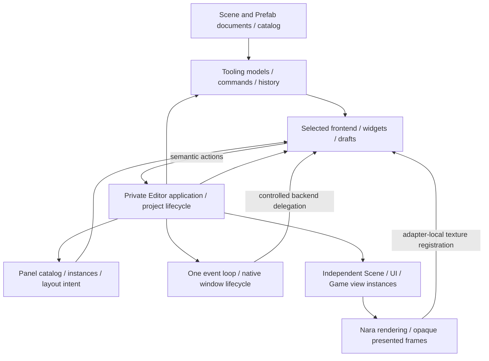
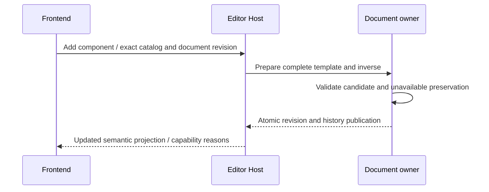
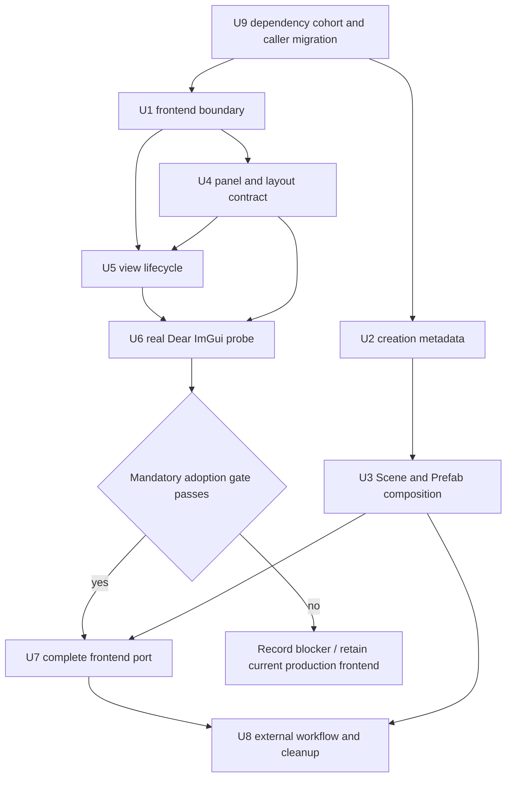

# Editor Foundation and Frontends - Plan

## Goal Capsule

Objective: A developer builds and edits a general-purpose 2D game in a dockable Editor, including custom component creation, without rebuilding the Editor for ordinary project data.

Means: Preserve Nara's document and execution owners, replace toolkit coupling in the private Editor, and evaluate dear-imgui-rs 0.20.0 through a real Nara workflow before making it the default frontend.

Authority: STRATEGY.md and Accepted ADRs 0015, 0081, 0090, 0114, 0117 and [0118](../architecture/adr/0118-editor-workspaces-frontends-and-creation-templates.md).
The completed foundation, First 2D Author Workflow and Custom Component Authoring plans remain closed evidence.
This is their new editor successor, not a reopening of their acceptance claims.
Implementation and verification are separate from this planning delivery; local commits are authorized, while push, PR publication and formal release are outside this work.

## Product Contract

### Summary

Make document editing, panel composition and native presentation independent enough to support a dockable Dear ImGui frontend and a later Nara-rendered frontend.
Complete schema-driven component creation/removal for ordinary Scene and Prefab documents.
Deliver the replacement through the existing installed-Editor workflow, then remove the superseded frontend rather than maintaining two production products.

### Problem Frame

The current Editor has meaningful authoring, history, persistence, recovery and isolated Play capabilities, but its private application state contains egui panels and drafts.
One native window and one viewport slot serve several view kinds by switching between them.
Component composition is restricted to hard-coded built-ins, and generic authoring rejects structural patches.
Changing the UI library alone would carry those restrictions into a new implementation.

### Requirements

**Authoring**

- R1. The ordinary Editor creates an empty entity and adds/removes an admitted component by stable component identity in both Scene and Prefab documents, with selection, one transaction, Undo/Redo and Save/Reopen.
  The first slice excludes arbitrary entity deletion/reparenting and removal of unavailable component records.
- R2. An optional complete creation template is published as data in the exact admitted component catalog.
  Creation never invokes project code, changes missing-field decode semantics, or fabricates a value from its primitive kinds.
- R3. Unknown, future and unsupported records retain their complete unavailable manifest through admitted operations and inverses.
  Unsupported operations show a reason before dispatch and remain rejected at the document owner.

**Editor product and extension**

- R4. Document state, selection, history, dirty tracking, persistence, project recovery and Play lifecycle remain independent from GUI types.
  The application consumes frontend-neutral semantic input/output, while each frontend owns its widgets and transient drafts.
- R5. Built-in panels use stable registration and instance identities, with explicit document/view targets, open/close behavior and layout restore.
  A separately compiled trusted sample panel integrates through that same registration without a new central built-in match arm.
- R6. Scene View and an admitted Game View can be visible together with independent camera, extent, displayed-frame and input focus state.
  A generic external-window Play process is not represented as an embedded shared-GPU Game View.
- R7. Window-internal docking is the baseline; detached native windows are enabled only on an explicitly supported backend profile.
  Unsupported profiles retain working docking and concurrent render views with a visible capability reason for detachment.

**Migration and future UI**

- R8. The Dear ImGui adoption decision follows a real Nara integration probe and a feature parity matrix covering the existing ordinary Editor.
  A demo window or an upstream checkbox is insufficient evidence.
- R9. A future custom frontend can reuse document commands, semantic models, panel identities and Nara render views without depending on Dear ImGui types.
  Its widgets, docking implementation and frontend-specific layout data may require replacement.
- R10. Preserve generic project opening without executing project Rust, strict compiled-project Check/Play/Export, existing recovery and lossless saving.
  Desktop design covers Windows, Linux and macOS; release claims name the native platform/backend actually verified.
- R11. Upgrade dependency families across breaking versions when they resolve a concrete correctness, integration or maintenance obstacle in this refactor.
  Existing versions are research baselines, not design ceilings; migrate affected callers and remove obsolete compatibility code rather than preserving an inferior architecture for an old API.

### Acceptance Examples

- AE1. Covers R1-R3: In an ordinary Scene and an ordinary Prefab, create an entity, add a custom scalar component from its creation template, edit it, remove it, Undo/Redo, Save and Reopen; unrelated unavailable records compare equal in full.
- AE2. Covers R2-R3: A component with no template is inspectable when otherwise admitted but cannot be added; an invalid template is rejected at catalog admission rather than on a click.
- AE3. Covers R4-R5: A trusted source-built sample panel observes the active selection and submits an existing action; closing/reopening it does not close the document or reset its history.
- AE4. Covers R6-R7: Render Scene and admitted embedded Game views together, resize one, and type in an Inspector; only the focused view receives gameplay/editor input, and picking uses its actual displayed mapping.
- AE5. Covers R7-R8: On a supported native profile, detach a panel, move it between monitors, redock it, close the secondary window and exit with no residual window/GPU lease; on Wayland, detachment is unavailable while in-window docking remains usable.
- AE6. Covers R8-R10: Open a clean external project in the selected frontend, browse/import an image, edit Scene/Prefab/custom data, Save/Reopen, start supervised external Play, repair a compiler error and run strict Check/development Export from saved source.

### Scope Boundaries

The scope includes fearless changes to private application, frontend, window/view coordination, generic document composition and creation metadata.
Existing durable identity, revision, source-race, runtime-isolation and physical cleanup guarantees remain owned by their current modules.

### Deferred to Follow-Up Work

- A full custom Nara editor widget library, shared game/editor widget tree, advanced graph/timeline tools and large UI virtualization need concrete workloads after this refactor.
- Arbitrary entity deletion with reference closure, generic unavailable-record deletion and richer creation expressions need their own finite operation proof.
- Native dynamic plugin loading/hot-unload, script execution, marketplace/package governance and Web support remain outside this slice.
- Complete native accessibility integration is a separate product requirement; this migration records actual capability and must not claim parity that neither frontend has demonstrated.

### Considered and Not Built

- No universal widget IR, UI DSL or renderer RHI: the two intended frontends do not require identical widget implementations.
- No generic event bus, extensible command serialization protocol or universal plugin kernel: existing typed actions and a private source registration are sufficient consumers.
- No duplicate validation at every projection layer or source-parsing architecture checker: admission and mutation owners keep their checks; frontend projections report their results.
- No editor-wide transactional rollback of native side effects: document transactions and native resource reconciliation retain ADR 0117's distinct semantics.

## Planning Contract

### Key Technical Decisions

- KTD1. Keep `nara_tooling` and document owners canonical; extract frontend-specific code from `editor/src/app.rs` and `editor/src/shell.rs` into private frontend modules.
  A second toolkit is not a reason to duplicate workspace, history or project state.
- KTD2. Add optional `ComponentSchema.authoring_initial_value` as a complete `ComponentValue`, validated through the existing canonical schema/value validator.
  Extend validation within that owner to require full template field coverage, including fields that ordinary decode permits to be absent; do not change ordinary record validation to achieve this.
  Absent metadata retains existing fingerprints; present metadata affects catalog identity/generation but not the same-version durable decode comparison.
  A template-only update advances catalog generation without a component wire-version bump.
  Field `default_value` remains missing-field compatibility metadata.
- KTD3. The derive accepts finite scalar literal creation attributes through the existing sealed codecs, with all fields supplied if the component opts in.
  Rust type checking handles literal types; reject unsupported syntax without name resolution, arbitrary callbacks or invoking `Default` while opening the Editor.
  Existing built-ins can publish explicit full-record templates, including their existing reference semantics; no new sentinel/null reference rule is introduced.
- KTD4. Replace `SceneCompositionComponentKind` with stable type identity and exact admitted creation/removal capabilities.
  Extract reusable data topology/patch preparation inside the existing document owners, and generalize Scene/Prefab tree and Inspector projections without turning Prefab into a Scene instance.
  Preserve the specialized UI Prefab domain admission gate.
- KTD5. Panel descriptors/instances and layout intents are semantic; panel painting and toolkit layout blobs are frontend-specific.
  Registration is static trusted Rust in the Editor composition, with read-only model access and existing action output, not mutable session/World/GPU access.
  A source extension may provide an optional frontend companion; arbitrary project packages are not loaded on Open.
- KTD6. Keep one native event loop and one device-creation authority in the concrete product Host.
  A selected adapter may own secondary windows/surfaces through an explicit lifecycle delegation; it must not create a second device or compete with Nara's view submission ownership.
  Replace the singleton viewport slot with independent view instances and one registration/retirement owner per instance.
  Extend the current private scoped GPU integration to permit the selected backend's same-lineage retained handles, including Instance/Adapter for secondary surfaces; do not expose them through tooling or panel APIs.
- KTD7. Use dear-imgui-rs tag `v0.20.0` (`af2942c78651b280d18af621de55b5462bb1e10a`) as the initial researched baseline for direct Winit/WGPU integration, not `dear-app`.
  Its WGPU 30/Winit 0.30.13 align with Nara, but its native multi-viewport path is experimental and excludes Wayland.
  U9 may select a newer coherent stable cohort; record the exact chosen versions and recheck affected capabilities before the probe rather than silently applying the tag's conclusions to another release.
- KTD8. Pass the adoption gate in U6 before porting the complete frontend in U7.
  If a mandatory baseline capability cannot be provided within a narrow adapter fix, retain egui as the production frontend and revise only the backend choice with evidence; U1-U5 remain useful and must not be undone.
  Windows-first evidence does not imply Linux/macOS release support.
- KTD9. Stable pane/command/document identities are preserved across future frontend changes; toolkit dock IDs and layout blobs are replaceable user preferences.
  Discard an incompatible toolkit blob with an explicit default-layout reset, without changing source documents or dirty state.
  Share runtime rendering through existing render-view/opaque presentation seams, not a public Device/Queue escape.
- KTD10. Resolve and migrate dependency families in U9 before freezing replacement interfaces.
  Prefer supported stable releases, keep tightly coupled Bevy ECS/reflection/macros and GUI/backend families coherent, and include toolchain/MSRV, shared math types and lockfile fixtures in the same migration.
  An unreleased/beta API needs a concrete blocker that stable versions cannot solve; a higher version number alone is not a reason to add a second window/GPU stack.
  Do not mass-upgrade unrelated dependencies or build a custom compatibility resolver.

### High-Level Technical Design

### Module Refactor Map

| Current location | Planned responsibility / removal | Preserved owner |
|---|---|---|
| `editor/src/app.rs`, `shell.rs` | Remove `Egui*` state and rendering inputs; retain project/product transitions | Private application / project Host |
| `editor/src/frontend/` (new) | Frontend-specific panels, drafts, toolkit input/output conversion | Selected private frontend |
| `editor/src/platform.rs` | Extract native windows, per-view presentation and adapter integration; remove single-slot assumptions | One concrete native Host |
| `crates/nara_render_wgpu/src/editor_execution.rs` | Replace the singleton target/sampled-view path and extend the private same-device integration boundary | Existing WGPU execution owner |
| `crates/nara_tooling/src/{workspace,inspector,composition,frame}.rs` | Common document projection and stable component capabilities | Workspace/document authority |
| `crates/nara_reflect/src/{schema,registry,format,authoring_bundle}.rs` | Pure creation metadata; reuse value validation and catalog lineage | Reflect/catalog authority |
| `crates/nara_scene/src/{authoring,authoring_decode,patch}.rs` | Data-only structural preparation/inverses without fake native registry | Scene/Prefab sessions |
| `crates/nara_tooling_egui/` | Temporary characterization frontend; remove after replacement parity | No permanent compatibility layer |
| `crates/nara_tooling_imgui/` (new if useful) | Private or explicitly scoped toolkit adapter consumed by the Editor | No Host/process/GPU authority |

### Assumptions and Execution-Time Decisions

Start with one editable document target at a time and independent Scene/Game presentation instances; multiple concurrent source documents are not required by this slice.
Only one frontend is selected in a production executable.
During migration the current frontend remains buildable until the replacement passes parity.
Exact private helper names and whether the selected adapter needs a separate crate are implementation decisions, not reasons to establish more public APIs.

The U6 native probe determines platform behavior, external texture registration, focus transfer, IME composition and retirement details.
Static source evidence does not resolve them.
The bounded gate below determines adoption, rather than an unqualified promise to replace egui.

## Implementation Units

### U9. Select and migrate a coherent dependency cohort

**Goal:** Remove concrete dependency constraints before committing to new editor interfaces.
**Requirements:** R11. **Dependencies:** none.
**Files:** `Cargo.toml`, `Cargo.lock`, `rust-toolchain.toml` if present or newly required; affected crate manifests/source and CI toolchain declarations; lockfile/dependency consumer fixtures; `docs/research/2026-10-16-editor-foundation/dependency-cohort.md`; migration guide; existing `crates/nara_ecs/tests/`, `crates/nara_reflect/tests/`, render/native tests and `tests/derive_dependency_fixtures.rs` according to the chosen upgrade.
**Approach:** Apply KTD10 using official release/migration information and the resolved lockfile, not manifest requirements alone.
Select versions by actual workflow needs; record a reason for every breaking family upgrade and every retained family with a known relevant limitation.
Prioritize the WGPU 30.0.1 patch's documented non-Windows Vulkan/Metal fixes over the current exact 30.0.0 pin.
Evaluate Bevy 0.20 ECS/reflection/macros as one family, with its required compiler and math-type migration, without adding Bevy's application/renderer or its unrelated Dear ImGui backend.
**Execution note:** Upgrade related families in reviewable increments and retain the existing ordinary Editor as the integration consumer; do not combine an unexplained lockfile refresh with the full GUI port.
**Test scenarios:**

1. The selected GUI/platform/WGPU cohort resolves without competing major GPU/window API types; the existing native Editor still opens, renders and closes.
2. Any Bevy/math upgrade preserves component derives, deferred structural semantics, reflection codecs, lifecycle cleanup and external renamed-dependency consumers.
3. Native platform checks and migrated fixture locks agree with the documented MSRV/toolchain; no old-API wrapper remains solely to avoid migrating its callers.

**Verification:** The selected version matrix, source migrations and affected focused tests are committed before downstream interface changes; unsupported native targets remain qualified rather than claimed from cross-compilation.

### U1. Remove GUI types from application and project state

**Goal:** Preserve all current product states through a frontend-neutral application boundary.
**Requirements:** R4, R9-R10. **Dependencies:** U9.
**Files:** `editor/src/{app,shell,lib,platform}.rs`; new `editor/src/frontend/{mod,egui}.rs`; `editor/tests/{application_contract,generic_open_recovery,authoring_loop}.rs`.
**Approach:** Follow KTD1; move existing widget state and drawing into the egui frontend while retaining the existing action/revision contract and project lifecycle owner.
Do not replace toolkit types with renamed wrappers carrying the same hidden ownership.
**Execution note:** Characterize the application transitions before moving large state blocks; preserve existing behavior rather than writing duplicate tests for every moved method.
**Test scenarios:**

1. Project Manager -> Opening -> Editing -> Close and rejection -> Recovery -> repair still use the same application transitions without an egui Context.
2. Last-good replacement and supervised Play cleanup survive frontend recreation without a second project session.
3. Existing ordinary edit/Undo/Save trajectory agrees with a neutral action consumer.

**Verification:** Existing application suites pass; application and shell state contain no GUI types; no new alternate persistence/history authority exists.

### U2. Publish explicit component creation templates

**Goal:** Let project schemas describe creation without executing project Rust in the Editor.
**Requirements:** R2-R3. **Dependencies:** U9.
**Files:** `crates/nara_reflect/src/{schema,registry,format,authoring_bundle}.rs`; `crates/nara_reflect_derive/src/lib.rs`; `crates/nara_reflect/tests/{derive_schema,derive_ui,catalog_format,authoring_bundle}.rs`; built-in component schema owners; affected catalog fixtures.
**Approach:** Apply KTD2-KTD3, documenting the intentional catalog source/fixture conversion where required.
Expose creation capability from the retained exact authoring basis, including when the document has no entities/components.
**Test scenarios:**

1. A complete finite scalar template round-trips through a bundle and is copied by value; a missing template is legal and cannot create.
2. Wrong kind/domain, incomplete record, duplicate field and non-finite template fail catalog admission; unsupported derive expressions fail clearly at compile time.
3. A template-only catalog generation change preserves wire version and decode behavior, invalidates old catalog-dependent actions, and agrees between published schema and compiled project.
4. Existing catalogs without the metadata retain their fingerprints; required fields remain required during native decode regardless of a creation template.

**Verification:** Reflect/derive and compiled-schema export tests prove one canonical validation path; no project callback or zero-value synthesis is added.

### U3. Unify generic Scene and Prefab composition

**Goal:** Complete ordinary custom component creation/removal through document-owned transactions.
**Requirements:** R1-R3, R10; AE1-AE2. **Dependencies:** U2.
**Files:** `crates/nara_tooling/src/{workspace,inspector,composition,frame}.rs`; `crates/nara_scene/src/{authoring,authoring_decode,patch}.rs`; `src/project_host/runtime/editor/{actions,document_open}.rs`; current frontend Inspector; `crates/nara_scene/tests/authoring_decode.rs`; `tests/scene_component_composition.rs`; new `editor/tests/generic_component_composition.rs`.
**Approach:** Apply KTD4; replace the closed built-in component enum and field-only generic patch admission at their owners.
Reuse existing revision/history and topology helpers for empty-entity insertion and component inverses.
Publish one shared document tree/Inspector projection with document kind retained; preserve Scene presentation and specialized UI authoring as separate capabilities.
**Test scenarios:**

1. Covers AE1: Add/edit/remove a custom component in Scene and Prefab, Undo/Redo, Save/Reopen and consume saved values in strict compiled Check/gameplay.
2. Empty-document creation offers available catalog types; duplicate component, absent template and stale catalog/document revision leave document/history unchanged.
3. Unknown/future/unbound records and their references remain equal in the complete unavailable manifest across every admitted operation and inverse.
4. Removing an unavailable record or crossing the UI Prefab structure gate remains rejected; generic Prefab composition does not gain native/UI authority.

**Verification:** No fake native registry enters generic authoring; custom types do not require a new match arm; existing preservation/persistence suites remain valid.

### U4. Introduce panel instances and workspace layout ownership

**Goal:** Register and arrange panels without distributing application ownership among widgets.
**Requirements:** R4-R5, R9; AE3. **Dependencies:** U1.
**Files:** new `editor/src/workspace/{mod,panels,layout}.rs`; `editor/src/frontend/`; `crates/nara_tooling/src/frame.rs` only for genuinely shared semantic facts; new `editor/tests/{panel_contributions,workspace_layout}.rs`; a trusted source-built panel fixture under `module-consumer/`.
**Approach:** Apply KTD5/KTD9; register existing built-ins and one finite sample through the same path.
Keep panel kind, instance, document target and render-view identity distinct; default layout and reset are part of the product.
Persist user layout outside Scene/Prefab data, using existing product settings ownership where available.
**Test scenarios:**

1. Covers AE3: An independently compiled panel observes selection and emits an existing action; no central panel match arm or mutable session access is required.
2. Close/reopen, hide/show and duplicate allowed panel instances preserve document state and keep drafts scoped to the correct target.
3. Restore layout with a missing contribution, incompatible toolkit blob or off-screen window produces a usable default and a reason; document dirty state stays unchanged.

**Verification:** Built-ins exercise registration; the sample proves extension installation and lifecycle, not native dynamic loading or a universal plugin API.

### U5. Replace the singleton window/view presentation assumptions

**Goal:** Present independent render views and own their native resources through close, resize and focus changes.
**Requirements:** R6-R7, R9-R10; AE4. **Dependencies:** U1, U4.
**Files:** `editor/src/platform.rs`, `editor/src/platform/{viewport,game_input}.rs`; new private `editor/src/platform/{windows,views,input}.rs`; `crates/nara_render_wgpu/src/editor_execution.rs`; affected `src/project_host/runtime/editor/{presentation,preview,game_view}.rs`; `editor/tests/application_contract.rs`; new `editor/tests/view_instances.rs`; existing native platform canary modules.
**Approach:** Apply KTD6; split the current viewport slot into per-instance preparation, presented-frame registration and retirement.
Keep external process Play distinct from an embedded runtime view and retain the opaque render bridge.
Route events by native window and focused panel/view; preserve geometry-bound picking and document-revision transactions as different authorities.
**Test scenarios:**

1. Covers AE4: Scene and embedded Game render concurrently; resizing or retiring one cannot replace another view's texture/mapping.
2. Text focus, shortcuts, drag capture and focus loss release the correct view inputs; a stale displayed frame cannot pick into its successor.
3. Close a secondary presentation during pending GPU work and close/reopen the project; resources retire once and the event loop remains responsive.

**Verification:** A real Windows native run demonstrates concurrent views and physical close; CPU fixtures cover identity/input routing without claiming other native platforms.

### U6. Prove the direct Dear ImGui integration and decide adoption

**Goal:** Resolve frontend feasibility with a working Nara slice before the full port.
**Requirements:** R7-R10; AE4-AE5. **Dependencies:** U1, U4, U5.
**Files:** private `editor/src/frontend/imgui/`; optional `crates/nara_tooling_imgui/`; `editor/Cargo.toml`, workspace dependency/lock files; new `editor/tests/imgui_integration.rs`; native canary modules; `docs/research/2026-10-16-editor-foundation/adoption-evidence.md` (new).
**Approach:** Apply KTD7-KTD8 with one real Inspector, hierarchy/diagnostics panel and actual Nara Scene/Game images.
Integrate application-owned primary presentation and explicitly delegated secondary backend presentation without duplicate submissions.
Use the synchronous prepared-frame route first and preserve the Host's existing device-loss/recovery policy; a backend resource-generation mismatch is a qualification blocker, not an implicit second recovery system.
**Execution note:** Start with a native smoke slice; automated semantic tests cannot establish monitor, IME, surface or visual behavior.
**Test scenarios:**

1. Covers AE5: In-window docking, layout persistence, detach/redock on supported profiles, mixed-DPI move/resize, secondary close and full shutdown work with actual engine textures.
2. Edit a string using Chinese IME, clipboard and keyboard navigation; record preedit/caret behavior and any frontend regression with a concrete disposition.
3. A render-target replacement and font/texture update do not cross toolkit context identity or retire a live registration.
4. Wayland refuses detachment honestly without preventing docking; Win/X11/macOS claims are recorded separately with the profile used.

**Verification / adoption gate:** Windows must pass the actual slice, preserve current authoring and cleanup semantics, and have no unresolved regression in committed text input, clipboard, keyboard navigation or the existing accessibility capability actually provided.
Record first-present, idle/frame timing and retained resources against the same egui workload; any reproducible regression that prevents the workflow blocks adoption until resolved.
Full accessibility completion and native Linux/macOS qualification remain explicitly separate from this gate.
If the gate fails, record the smallest confirmed blocker, retain the current frontend and reconcile U7 before implementation; do not keep an abandoned competing product.

### U7. Port the complete Editor and select one frontend

**Goal:** Deliver the chosen dockable frontend with the current product's usable capabilities intact.
**Requirements:** R4-R10; AE3-AE6. **Dependencies:** U3, U6 adoption pass.
**Files:** `editor/src/frontend/`; selected toolkit adapter; `editor/src/{main,lib,app,shell,platform}.rs`; `editor/tests/{application_contract,authoring_loop,generic_open_recovery}.rs`; frontend-specific panel tests; user documentation.
**Approach:** Port through the parity matrix below and existing semantic contracts, retaining specialized UI Canvas, image import and both Play placements.
Make the selected frontend the default only when each current capability is either verified or carries an explicit pre-existing platform limit.
**Test scenarios:**

1. Project Manager, Opening, Recovery, last-good replacement, browser Refresh/Open, image Import/Reimport, diagnostics and Save/Reopen match existing behavior.
2. Generic Scene/Prefab/custom editing and specialized UI Canvas manipulation retain Undo/Redo, missing-schema reasons and displayed-frame input mapping.
3. Supervised external Play build error -> repair -> new generation -> stop/close remains physically cleaned up; admitted embedded Game remains independent from edit state.
4. Closing/reopening panels and project replacement discard stale local drafts without silently discarding accepted source edits.

**Verification:** The full ordinary Editor runs the parity matrix; no product action is implemented only as a toolkit-local direct mutation.

### U8. Close the external workflow and remove superseded paths

**Goal:** Prove the result from committed source and leave one understandable production architecture.
**Requirements:** R1-R10; AE1-AE6. **Dependencies:** U3-U7.
**Files:** obsolete `crates/nara_tooling_egui/` and references; root facade/features and dependency fixtures; `samples/collection-game/`; `editor/tests/`; clean external consumer acceptance fixture; architecture ledger, migration/user guides and engineering verification evidence.
**Approach:** Run the completed authoring workflow against a clean external project, remove the old frontend and temporary dual-path glue, and update only the admitted contract/dependency surface.
Document future custom frontend work as a new adapter and widget implementation, without claiming this run proved an unbuilt toolkit.
**Test scenarios:**

1. Covers AE6: A clean external project performs ordinary creation/composition/editing/import/Play repair/Check/Export with actual saved data affecting gameplay.
2. A trusted source extension panel works outside the main Editor module and closes cleanly.
3. Runtime/headless dependency consumers do not acquire editor, Dear ImGui, Winit or WGPU dependencies unless their selected product requires them.
4. The selected toolkit and source catalog fixtures compile after obsolete aliases, adapters and experimental paths are removed.

**Verification:** Committed-source acceptance and independent code review name exact scope, native platform and remaining limitations; obsolete paths and abandoned probe code are absent.

## Verification Contract

### Frontend Parity Matrix

| Workflow | Semantic evidence | Native evidence |
|---|---|---|
| Project Manager / Open / Recovery / replacement | Application and generic-open tests | Ordinary product transitions |
| Project Browser / image Import and Reimport | Existing catalog/transaction suites | Browser and Inspector interaction / last-good display |
| Scene / Prefab tree and scalar Inspector | Revision/history/preservation suites | Add/remove/edit/Undo/Save/Reopen |
| UI Prefab Canvas and image choices | Specialized authoring suites | Picking, dragging, overlays and assigned image |
| Scene and embedded Game views | View identity / mapping / runtime suites | Concurrent rendered views, resize and focused input |
| Supervised external Play | Generation/process lifecycle suites | Error repair, child first-present and physical cleanup |
| Dock layout / detached windows | Stable instance and restore tests | Actual docking, monitors, focus and secondary close |
| Text / clipboard / shortcuts / accessibility | Action routing and honest capability facts | Chinese text entry, existing baseline comparison |
| Strict Check / Run / development Export | Compiled-project product agreement | External project from unrelated working directory |

Use `cargo nextest run` for focused affected crates and suites, then workspace all-target checks across supported feature profiles and `cargo fmt --all -- --check` after integration.
Retain all-feature checks where the feature set remains compatible; do not combine mutually exclusive third-party renderer/platform routes merely to satisfy an all-features command.
Run Cargo serially, reuse `target`, and set `CARGO_BUILD_JOBS=1` for substantial builds.
Production API changes require real compile/dependency consumers; source-pattern assertions must not emulate Rust resolution.
Documentation-only planning does not claim these tests have run.

## Definition of Done

- The selected production frontend satisfies R1-R11 and the parity matrix, with a reproducible external project acceptance record.
- The chosen dependency cohort is recorded and verified; breaking upgrades migrate all relevant callers, toolchain declarations and dependency fixtures without permanent old-API wrappers.
- Document and Host authorities remain single-owned; application/tooling state has no selected toolkit types.
- Generic component composition uses exact creation metadata and complete preservation checks rather than native bindings or built-in component enums.
- A trusted source-built panel proves modular contribution, and concurrent render views prove the Host replacement beyond a docking demo.
- The old production frontend, compatibility aliases, duplicate projections and abandoned experiments are removed after parity.
- ADR implementation evidence and migration guides describe the actual committed result, including honest native platform, IME and accessibility limits.
- If U6 blocks adoption, U7-U8 are not declared complete: retain useful landed boundaries and record the concrete backend follow-up rather than inventing acceptance.

## Sources

- [Dear ImGui 0.20 study](../research/2026-10-16-editor-foundation/dear-imgui-020.md).
- [Mature editor study](../research/2026-10-16-editor-foundation/mature-editors.md).
- [Nara module seam study](../research/2026-10-16-editor-foundation/nara-module-seams.md).
- [Dependency cohort study](../research/2026-10-16-editor-foundation/dependency-cohort.md).
- Completed [Custom Component Authoring](2026-10-16-1101-feat-custom-component-authoring-plan.md), [First 2D Author Workflow](2026-10-16-0940-feat-first-2d-author-workflow-plan.md) and [2D foundation contracts](2026-10-15-1636-refactor-2d-foundation-contracts-plan.md).
- [UI boundary guide](../architecture/ui-product-boundaries-editor-dogfood-and-porting-strategy.md) and [ADR implementation ledger](../architecture/adr/implementation-status.md).
