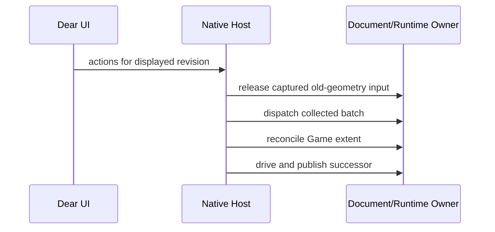
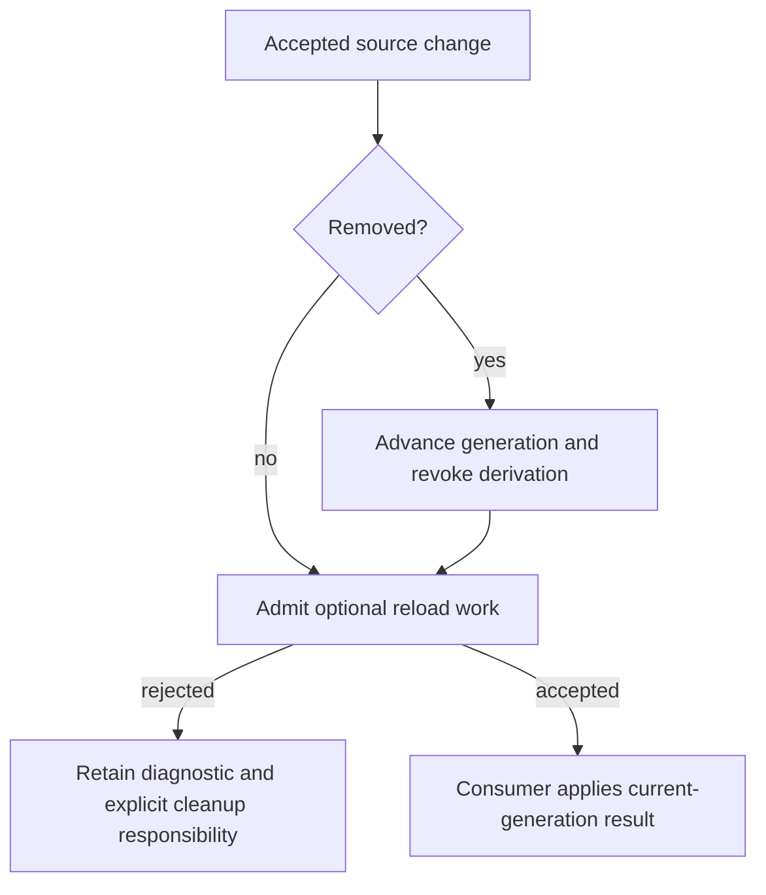

# Foundation Correctness Closure - Plan

## Goal Capsule

Objective: Developers can continue authoring and running a Nara project without retaining deleted content, losing same-frame input, or stopping a usable game for a rejected Restart.

Means: Correct the existing asset, native-frame and launch-admission owners, then make their evidence repeatable (KTD1-KTD4).

Authority: `STRATEGY.md`, Accepted ADRs 0115-0118, and `docs/verification/2026-10-17-foundation-and-extension-audit.md` at `09b03c6`.
This is a new successor to completed plans; its activation and progress are registered in engineering memory.
Repository workflow requires the activation field above; progress and verification remain outside this decision artifact.
Implementation, local verification and precise local commits are authorized; remote publication is outside this execution.

Stop only an affected path if new evidence requires a different durable architecture or conflicts with an Accepted ADR.
The confirmed Restart policy is implemented by refining ADR 0116 before changing its admission path.

---

## Product Contract

### Summary

Close the audit's four behavior defects and the verification/documentation gaps around their owners.
Keep the established runtime and Editor architecture while removing misleading or redundant validation machinery.

### Problem Frame

The recent foundation and Dear Editor plans have real acceptance evidence.
The new audit nevertheless found rejected asset removals retaining derivation authority, native-frame publication invalidating freshly collected input, placement-blind redraw polling, and Restart retiring a working child before detecting source divergence.
Some critical tests are outside continuous execution, and current authoring instructions still describe superseded APIs.

### Key Decisions

- **Keep the current child when Restart cannot reuse its admitted saved source.** Governs R3.
  (session-settled: user-directed — chosen over introducing old-source snapshots: preserve the working process and use Stop then Play for new source.)
- **Use mature-engine domain semantics within existing Rust ownership boundaries.** Governs R7.
  (session-settled: user-approved — chosen over another whole-foundation rewrite: current owner boundaries have working consumers and concrete correction points.)

### Requirements

**Runtime and native authoring**

- R1. An accepted source-removal fact revokes the asset's usable derivation even when request/consumer admission fails; ordinary Modified failure retains last-good content.
- R2. Actions collected from one displayed Editor frame are dispatched before host-owned extent reconciliation publishes its successor, preserving exact presented-geometry admission.
- R3. Restart checks the current saved source closure before retiring the external child and rejects divergence while preserving that child; unchanged Restart and Stop then Play remain usable.
- R4. Quiet external Play does not cause animation-rate Editor redraw, while embedded runtime cadence, lifecycle observation and input progress remain correct.

**Verification and maintainability**

- R5. Vendor patch tests run against the production WGPU 30 resolution in CI; native Windows/DX12 acceptance has an executable, explicit qualification gate without claiming unobserved hosted or cross-platform support.
- R6. The persistent-component guide matches current registration/codec/scalar APIs, and current architecture navigation/ledger no longer reproduce superseded limitations.
- R7. Replace source-name/text pseudo-proofs with actual consumer, privacy and behavior evidence; retain existing ownership, last-good, strict schema and presentation contracts.

### Acceptance Examples

- AE1. Covers R1: b is published, a Modified consumes the queue budget, and b Removed is rejected; b has no usable derivation on this and the next frame, including after obsolete completion.
- AE2. Covers R2: an embedded Game extent changes while another panel submits selection/edit input; the displayed-frame batch is admitted exactly once before the successor is published.
- AE3. Covers R3: Save changes an admitted Scene/Prefab while external Play runs; Restart is unavailable/rejected without stopping the child, and Stop then Play admits the new source.
- AE4. Covers R4: a quiet external child receives bounded process observation without continuous Editor presentation; embedded Run/Resume/Step still reaches presented frames.
- AE5. Covers R5-R7: the exact renderer cohort's patch tests, a real native critical trajectory, and a manual-codec external consumer pass with current source, without forbidden-name source scanning.

### Scope Boundaries

This plan implements audit F01-F09 through existing owners.
It does not reopen completed foundation/authoring plans or add another GUI, public process service, transaction kernel, source snapshot store, or symbol-resolution script.
Ordinary generic Open remains data-only, and exact source/nonce/READY and displayed geometry validation remain binding.

#### Deferred to Follow-Up Work

- A saved/reopened real Tilemap workload, private culling/cache and an explicit multipart visual sorting group form the next measured rendering slice.
- ADR 0092's finite color-correctness closure precedes a formal authored-color/screenshot correctness claim.
- Linux/macOS native qualification and a permanently provisioned native CI runner need their own observed platform evidence.

---

## Planning Contract

### Key Technical Decisions

- KTD1. **Revocation precedes optional work admission.** The resolver owns removal generation/state invalidation; downstream CPU/GPU storage may remain physically alive without derivation authority (R1, ADR 0117).
- KTD2. **One ordered UI-output tail.** Flush old captured input, dispatch collected actions, reconcile extents, then drive/publish; distinguish maintenance wake from presentation demand (R2/R4).
- KTD3. **Compare actual saved source before effectful Restart.** Reuse the existing compiled-source receipt machinery and rejection type, with frontend availability derived from the owner (R3).
  The source-race check in the child remains authoritative; a later external edit may still reject startup.
- KTD4. **Use the workspace lock for the production vendor cohort.** Make the local renderer a workspace member, test only WGPU 30 for Nara, and exclude that multi-backend package from blanket all-features invocations (R5).
  This avoids a second dependency resolution or a custom lockfile resolver.
- KTD5. **Keep validation behavioral and documentation single-owned.** Compile the manual codec in an existing independent consumer; remove name/text scans while retaining Cargo graph, real execution and privacy checks (R6/R7).

### Execution Constraints and Risks

- Cargo commands are serial, use the existing target and one build job; the primary execution owner runs verification and integration commits.
- The initial untracked log and vendor lock/INI files are outside this work and must be preserved.
- Workspace membership can expose upstream mutually exclusive feature families and formatting scope; inspect changes and update every affected blanket gate explicitly.
- Native tests require a desktop and actual adapter. Local evidence and the manual qualification gate must name the actual source/platform; CI configuration alone is not a native pass.
- Source receipt verification performs filesystem work. Reuse current bounded ownership and avoid introducing another public execution or snapshot subsystem.

### High-Level Technical Design

### Sources

The audit contains the current source traces, executed removal probes and official Unity/Godot references.
Retain its distinctions between cached object lifetime and source authority, and between sorting groups and compositing groups.
Existing patterns include `AssetStates::invalidate_publication`, revision-bound `dispatch_editor_actions`, the supervised source receipt, and the native lifecycle/input fixtures.

---

## Implementation Units

### U1. Revoke removed assets across admission failure

**Goal:** Close F01 at asset resolution.
**Requirements:** R1, AE1, KTD1.
**Dependencies:** None.
**Files:** `crates/nara_asset/src/reload/resolution.rs`, `crates/nara_asset/src/reload/tests_requests.rs`, `crates/nara_asset/src/reload/tests_resolution.rs`; Image regression files only if needed for actual derivation evidence.
**Approach:** Separate accepted removal invalidation from queue/consumer admission, preserving generation checks and ordinary reload last-good behavior.
**Execution note:** Establish the failing public-observable removal regression before changing the resolver.
**Test scenarios:**

1. Loaded b removed after a occupies the one-item queue loses usable derivation.
2. Byte-limit and absent/unclaimed-consumer rejection also revoke b, including a later quiet frame.
3. A stale completion cannot restore removed publication; a later fresh successful publication can.
4. Modified overload/failure retains the previous usable publication.

**Verification:** Focused asset/Image tests pass and the audit probe's removed-publication result is corrected.

### U2. Reconcile native actions and cadence coherently

**Goal:** Close F02/F04 in the native Host without weakening frame authority.
**Requirements:** R2/R4, AE2/AE4, KTD2.
**Dependencies:** None; integration follows U1.
**Files:** `editor/src/platform/imgui.rs`, `editor/src/platform/imgui/cadence_tests.rs`, relevant native Game/input lifecycle tests; small private helper/test modules if they improve ownership clarity.
**Approach:** Consolidate the production output tail and placement-aware drive/redraw decision, preserving local UI and lifecycle deadlines.
**Test scenarios:**

1. Same-output Game resize and another panel's exact-frame action succeed once.
2. Mixed action batches retain document revision validation and unchanged stale geometry is still rejected.
3. Quiet external Running has no animation redraw demand, including process maintenance wake with an unchanged observation.
4. Embedded Run/Resume/Step and child exit still drive their required work.

**Verification:** Editor owner/frontend tests and actual native cadence/input/view trajectories pass.

### U3. Reject source-diverged Restart before retirement

**Goal:** Close F03 across ADR, Host and widgets.
**Requirements:** R3, AE3, KTD3.
**Dependencies:** None; integrate after U2.
**Files:** `docs/architecture/adr/0116-standalone-supervised-editor-play.md`, `src/project_host/runtime/editor/external_play.rs`, its source-tracking tests, `editor/src/frontend/imgui/project.rs`, relevant supervised owner/native tests, and `editor/README.md` Restart instructions.
**Approach:** Refine the ADR first, then compare saved closure at Restart admission and project consistent availability/reason in the existing frontend.
**Test scenarios:**

1. Changed saved Scene/Prefab rejects Restart without producing a retirement request or losing the running generation.
2. Externally changed saved files are checked even if the published out-of-date flag was stale.
3. Unchanged saved source restarts; unsaved authoring edits do not silently redefine the saved receipt.
4. Stop then Play accepts current saved source; child exact-receipt checks remain unchanged.

**Verification:** Real saved-source Host tests and the external Play path prove no-stop rejection, with current widget availability and wording.

### U4. Protect the production renderer cohort and native qualification

**Goal:** Close F05 and establish F06's explicit native gate.
**Requirements:** R5, AE5, KTD4.
**Dependencies:** U2/U3 for final native trajectories.
**Files:** `Cargo.toml`, `Cargo.lock`, `vendor/dear-imgui-wgpu/Cargo.toml`, `.github/workflows/ci.yml`, `vendor/dear-imgui-wgpu/NARA_PATCH.md`, `docs/verification/native-editor-qualification.md` (new).
**Approach:** Integrate vendor tests into the root resolution and CI using one backend cohort; document and execute a finite Windows/DX12 native qualification with the existing ignored tests.
The manual qualification remains required until a controlled native runner is actually provisioned.
**Test scenarios:**

1. Vendor unit/integration tests execute with adapter-required behavior under the root lock.
2. Workspace default and all-features gates select valid backend features.
3. Native qualification reaches real presented cadence, Game input, and detach/close/reopen/recovery trajectories and records the actual source/platform.

**Verification:** Root-cohort vendor tests pass, affected workspace/consumer checks remain valid, and native evidence names passes or a concrete environment limitation without an invented CI result.

### U5. Repair author contracts and remove pseudo-proofs

**Goal:** Close F07-F09 with current, compilable author instructions and genuine boundaries.
**Requirements:** R6/R7, AE5, KTD5.
**Dependencies:** U1-U4 for final ledger reconciliation.
**Files:** `docs/guides/persistent-components.md`, `docs/guides/rust-product-recipes.md`, `docs/architecture/README.md`, `docs/architecture/adr/implementation-status.md`, `tests/reference_game_contract.rs`, `tests/runtime_runner_contract.rs`, and an existing external Reflect/component consumer's source/tests.
**Approach:** Consolidate composition instructions, correct codec/scalar examples, remove method-name/source-substring proofs, and replace duplicated chronology with owner navigation.
**Test scenarios:**

1. The documented manual codec compiles and round-trips through the external consumer.
2. Genuine product/graph/privacy consumer tests still pass after scanner removal.
3. Current ledger rows acknowledge ADR 0117's shared order, resource-complete packets and bounded multiview.

**Verification:** Consumer compilation/behavior and documentation links are valid; historical plans/evidence remain intact.

---

## Verification Contract

Use Rust 1.95.0, serial Cargo, `CARGO_BUILD_JOBS=1`, the existing target, focused nextest and one test thread.
Run `cargo fmt --all` after inspecting the diff and review any new vendor formatting scope.
Focused gates cover asset/Image, full Editor non-native tests, source-tracking Host tests, the actual root-cohort renderer patch tests, and the external codec consumer.
The final runtime/public surface change also requires workspace check and relevant shared-runtime/persistence/public consumer suites; feature-heavy checks exclude the vendor's intentionally mutually exclusive backends.
Execute the native critical trajectories separately with ignored cases explicitly selected and adapter/backend requirements recorded.
Remote CI/release is not claimed from local execution.

## Definition of Done

All R1-R7 behaviors and unit-specific regressions pass, blocking independent review findings are resolved, and verification records identify their source revision and environment.
ADR 0116, the current ledger and author guides agree with the landed behavior.
No abandoned approaches, duplicate compatibility paths, custom source resolver, or unintended formatting changes remain.
Record precise local commits and close the plan's engineering-memory registration after the final verification; preserve the initial unrelated untracked files.
