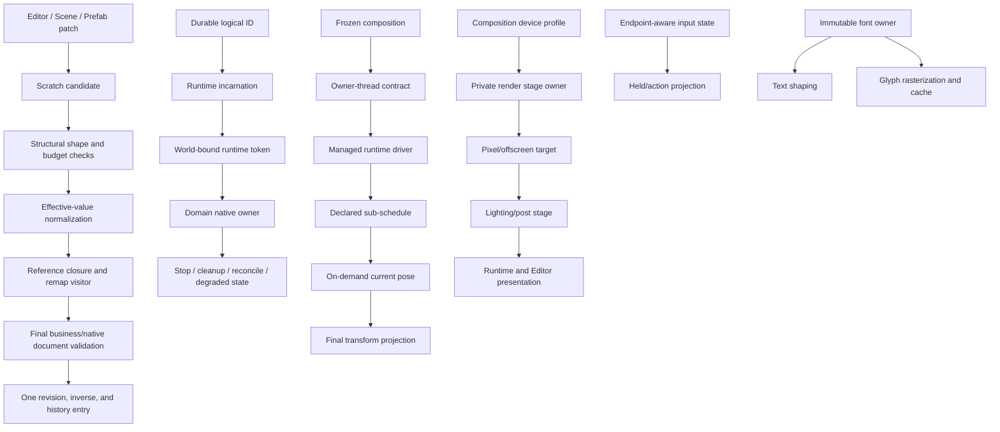
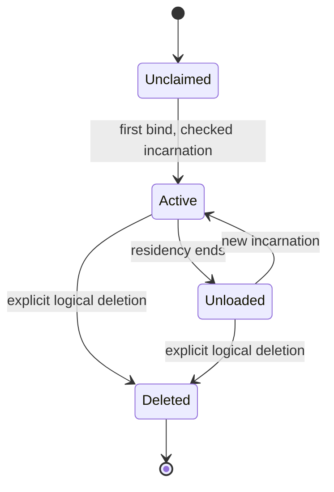
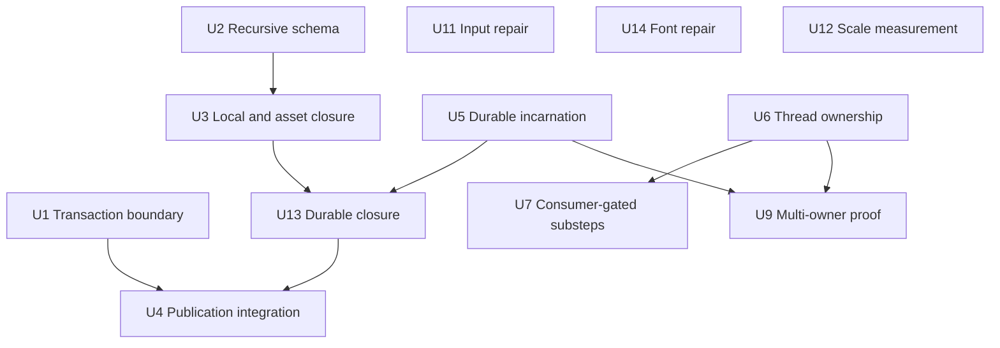

# Refactor: Harden Foundation Contracts Before New Engine Domains

## Goal Capsule

- **Objective:** make Nara's persistent-data, runtime-ownership, execution, and presentation foundations safe for the next complete 2D consumers before Tilemap, streaming, physics, audio, or larger editor workflows encode the current seams.
- **Means:** apply breaking, owner-contract refactors where evidence shows future redesign cost; retain the thin `bevy_ecs` substrate, frozen composition, one managed runtime owner, and semantic Editor boundaries.
- **Evidence:** every changed contract has a failing characterization or integration case before implementation, focused serial `cargo nextest` coverage after implementation, and an updated ADR or implementation-status row when its durable meaning changes.
- **Stop condition:** stop and ask when a proposed change alters product behavior outside this plan or requires changing an Accepted ADR's meaning without an explicit contract revision.
- **Current baseline:** F01 Scene asset-context loss and F02 glyph-cache identity collision are already repaired in `ad97c1f` and `5ae2c83`; this plan treats them as closed baseline fixes.

## Execution Checkpoint

The required implementation and consumer verification are complete within this plan's scope.
All six P1 findings are repaired; ten of seventeen findings are fixed. The seven remaining P2
items have concrete consumer or measurement triggers rather than speculative new APIs. This table
records execution, not release authority; details and limits live in the audit validation register
and immutable engineering records.

| Units | Current evidence | Next gate |
| --- | --- | --- |
| U1, U6 | Transaction boundary `10efbdf`; executable thread ownership `722e3ee`; owning and real-consumer suites pass | Retain transaction and thread-owner regressions for future domains |
| U5, U11, U14 | Incarnations `5d42599`, endpoint provenance `8a975db`, custom font owner `47d449d`; focused and real-consumer proof recorded; U13 durable matrix passes | No native Editor release claim; future domains retain these owner contracts |
| U2 | Recursive schema/catalog v2 committed as `1a96a25`; 388 owning tests, independent Inspector/Prefab/export consumer, UI and reference-game checks pass; historical metadata preserved | Retain recursive shape, lineage, budget and diagnostic privacy regressions |
| U3 | Effective-value owner and cross-entry closure landed as `53586dc`; 174 Reflect, 129 Scene/Prefab/Export, 47 tooling and 10 root Inspector tests pass | Retain source omission, explicit Null, selected limits and private Prefab source namespace |
| U4, U13 | Final closure, selected policy propagation, available source-authoring and typed durable residency outcomes landed as `784f4ab`; 361 Reflect/Scene, 7 independent durable-consumer and 53 root consumer tests pass. Final Editor authoring loop and 34 reference-game consumers pass | Preserve regressions; native Editor release qualification remains outside this slice |
| U9 | Real Task/Image preparation plus hook-owned native consumer landed as `237997b` and passes 8 tests; three complementary root Host close/successor tests pass | Keep production physics/audio and broader successor compositions as named consumers; no universal coordinator |
| U7, U8, U10, U15 | Source/consumer review retains current contracts with exact admission triggers; shared substeps/current-pose/pixel-canvas/device-profile APIs are not implemented. Concrete Surface extent defect is fixed as `4c0b49f`, with 107 WGPU tests passing | Reopen only for the real repeated-step, same-phase pose, shared logical-canvas or non-default capability consumer described in the audit |
| U12 / F11 | Hierarchy candidate overlay, private trusted baseline epoch and raw-dirty fallback land in the current F11 slice; three trusted timing processes pass the 4,096 independent-eight P95 <1 ms investigation target, and 32 trusted allocation windows remain counter-consistent | Retain full validation for raw escapes, retirement and private Scene preparation. RSS, GPU memory, general leak safety and native frame qualification remain outside this baseline; a future prepared consumer must preserve its owner-controlled no-flush window |

Final integration passes `cargo check --locked --workspace --all-targets --all-features`, workspace
and independent-consumer formatting, and whitespace checks. Reference-game authoring, desktop
render and first-wave suites pass all 34 tests (run `d2a6ab99-69b6-4d84-b932-6bc520dfe27c`); the Editor authoring-loop check passes with its
separate native qualification skipped. No additional native release claim follows from this closure.

## Product Contract

### Problem Frame

Nara already has a coherent first 2D slice, but several foundational contracts are only correct for the current narrow consumer set. Adding domains now would make those assumptions part of public authoring, runtime, and editor workflows, increasing the cost of later fearless refactoring. The work therefore hardens the contracts that future consumers must share and defers feature expansion until the contracts have a real proof.

### Requirements

**Persistent data and identity**

- R1. Persistent document edits remain failure-atomic and publish one coherent revision, while valid multi-operation edits are allowed to pass through intermediate states that are invalid only until the final candidate.
- R2. Schema shape, field location, default normalization, asset references, entity references, remapping, export, and editor diagnostics describe the same effective value.
- R3. Durable logical identity and runtime incarnation are separate: unloading invalidates an incarnation without destroying the logical identity, while old tokens and cross-world references remain invalid.

**Execution and consumers**

- R4. Runtime, admission, close, and native ownership have explicit thread semantics before thread-affine or `NonSend` domains are added.
- R5. New schedules, spatial reads, native owners, presentation stages, device requirements, input endpoints, and fonts enter through the existing managed ownership model rather than parallel registries or unrestricted public graphs.
- R6. Performance changes are admitted by measured workload budgets and preserve the existing simple implementation as a correctness reference until the measured trigger is met.

**Migration policy**

- R7. Breaking changes are allowed in this pre-1.0 engine; obsolete paths are removed after consumers migrate instead of being preserved by speculative compatibility layers.

### Scope Boundaries

In scope are the contracts and consumer-backed vertical slices needed to satisfy R1–R6. The plan includes required ADR revisions, schema/identity migrations, focused reference-game or first-party consumer updates, and the tests that prove ownership and failure semantics.

Deferred for follow-up work are a complete Tilemap authoring feature, a general save format, a full physics or audio backend, arbitrary script ABI, dynamic native plugin hot-unload, a public render graph/RHI, gamepad support, full IME/CJK production parity, and a universal constraint or input graph. These consumers may supply the proof workload for a seam but are not implemented as part of this plan.

The standalone HTML audit is a delivery artifact outside the repository in the user's Downloads directory; the repository retains the Markdown evidence only.

## Planning Contract

### Key Technical Decisions

- KTD1. **Owner contracts over compatibility layers** (session-settled: user-directed — chosen over preserving existing public shapes because the engine is pre-1.0 and later domain migration is more expensive than a coordinated breaking change). Each unit fixes its owning contract and migrates its in-repo consumers.
- KTD2. **Final-candidate validation.** The technical recommendation is to use atomic document publication as the business-invariant boundary. Per-operation path, shape, permission, and budget checks remain.
- KTD3. **One effective-value/reference visitor.** Keep omission on disk and compute a bounded effective value for validation and traversal. Explicit Null stays explicit; an absent optional field without a default stays absent. This avoids entry-point-specific reference exceptions and load-time document rewrites.
- KTD4. **Durable identity plus incarnation.** Amend ADR 0058 explicitly, keeping durable identity independent from runtime binding so old asynchronous work cannot affect a rematerialized entity.
- KTD5. **Private staged execution owners.** Concrete consumers determine the smallest stable sub-schedule/render seam; retain the prohibition on a speculative universal graph.
- KTD6. **Measure before scale optimization.** Keep correct simple algorithms until measured consumer evidence justifies their replacement.

KTD2–KTD6 are technical recommendations grounded in the audit and local source studies; they are not represented as detailed designs the user already approved. Their owning ADR revisions and focused regressions make the final contracts reviewable during execution.

### High-Level Technical Design

The persistent path must complete effective-value and reference work before final publication. Identity and thread ownership make runtime and native reconciliation safe. U11 input and U14 font repairs are independent of the render-stage spike. Hierarchy and transform measurements are independent of all these refactors.

Durable references identify the logical record. Runtime tokens additionally bind World and incarnation and remain stale after any rebinding. No silent UUID reuse or claim-history reset is part of this plan.

### Dependency Order

1. U1 establishes transaction characterization and the final-candidate validation boundary.
2. U2 and U3 co-design recursive value shape and current scalar/local reference semantics; U5 then defines durable identity states, U13 integrates those states into the closure, and U4 completes patch publication against the resulting closure.
3. U6 enforces executable owner-thread semantics before U7–U9 add independent execution or native owners.
4. U7/U8 require an actual consumer before extending managed sub-schedules or current-pose reads; U9 proves native reconciliation with two real owners.
5. U10 and U11 close presentation/input/font seams as concrete runtime and Editor consumers require them.
6. U12 measures hierarchy/transform cost and only then admits an incremental algorithm.

## Implementation Units

### U1. Separate Patch Operation Checks From Final Candidate Validation

**Goal:** let coupled field edits reach a valid final candidate while preserving failure-atomic publication, inverse generation, budgets, and structural safety.

**Requirements:** R1, R7, KTD2.

**Dependencies:** none.

**Files:** `crates/nara_scene/src/patch.rs`, `crates/nara_scene/src/validation.rs`, `crates/nara_scene/src/authoring.rs`, `crates/nara_scene/src/tests.rs`, `crates/nara_scene/tests/data_authoring.rs`, `crates/nara_scene/tests/format_contract.rs`.

**Approach:**

1. Keep source validation, operation target/path/version/capability checks, value shape checks, structural preconditions, and work ceilings at each operation.
2. Stop calling the complete business/native/reference validator for each intermediate scratch state.
3. Canonicalize the completed scratch candidate, run one complete final validation, and publish one inverse/history entry only after it passes.
4. Apply the same boundary to Scene and Prefab patch preparation. Preserve the public scratch-to-publish atomic path separately from the private unpublished-candidate-only helper, and audit every Prefab/Editor caller before removing intermediate business validation.

**Execution note:** start with a failing characterization using a component invariant `x == y` and two `SetField` operations that move `(1,1)` to `(2,2)`.

**Patterns to follow:** existing `PreparedScenePatch` publication, `validate_patch_source`, bounded diagnostic reports, and authoring revision/history ownership.

**Test scenarios:**

- A two-field patch whose intermediate state violates a cross-field invariant succeeds when the final state is valid.
- The same patch with an invalid final state fails without changing the source document, revision, inverse, or history.
- Invalid field paths, stale schema versions, unsupported operations, and work-budget exhaustion still fail before publication.
- Scene and Prefab paths produce equivalent final-candidate behavior and inverse restoration.
- A private unpublished-candidate helper may leave its disposable candidate partially changed on failure, but no Prefab or Editor caller can mistake that candidate for a published document.

**Verification:** focused `nara_scene` patch/authoring suites pass, including existing rollback cases; no public caller observes a partially published candidate.

### U2. Introduce Bounded Recursive Schema Shape and Lineage

**Goal:** make nested scalar, struct, list, map, optional, and reference shapes describable without turning `ComponentValue` into an unrestricted Rust reflection runtime.

**Requirements:** R2, R7, KTD3.

**Dependencies:** U1 only for final integration; shape design may proceed in parallel with U1.

**Files:** `crates/nara_reflect/src/schema.rs`, `crates/nara_reflect/src/registry.rs`, `crates/nara_reflect/src/value.rs`, `crates/nara_reflect_derive`, `crates/nara_reflect/tests/registry_contract.rs`, `crates/nara_reflect/tests/catalog_format.rs`, `crates/nara_scene/tests/format_contract.rs`.

**Approach:**

1. Add a finite recursive description layer with stable root field identities, list/map element shapes, optional/reference leaves, and explicit opaque leaves.
2. Keep the existing wire/value representation where it remains lossless; separate shape metadata from runtime value storage.
3. Version shape lineage and fingerprints independently from editor presentation metadata.
4. Bound recursion depth, collection work, and encoded size at the existing admission limits.
5. Reset the pre-1.0 component-schema catalog to a new canonical envelope version and rewrite all repository fixtures in this breaking unit; do not add a silent flat-catalog compatibility shell.
6. Defer enum/tuple/variant shape until a real component requires it; extend this shape language under a later contract rather than inventing a second schema path.

Amend the owning schema clauses in ADRs 0011/0045/0081 and preserve ADR 0090 unknown-record rules. Include `crates/nara_reflect/src/format.rs`, `crates/nara_reflect/tests/derive_schema.rs`, `crates/nara_reflect/tests/authoring_bundle.rs`, `tests/fixtures/formats` and generated reference-game catalogs in the catalog-version migration. A real separately compiled nested-reference component must prove derive through codec, Inspector access, remap and export; hand-built values alone are insufficient.

**Patterns to follow:** existing schema owner/provider snapshots, `ComponentSchemaVersion`, catalog format tests, and Bevy `TypeInfo`/`ListInfo` as local reference evidence.

**Test scenarios:**

- Nested list/map/optional values round-trip through JSON and RON with stable shape fingerprints.
- Incompatible nested shape changes are rejected or migrated explicitly rather than silently accepted.
- Depth, collection-count, and value-byte limits reject adversarial nested values with bounded diagnostics.
- Existing scalar schemas preserve their current wire and migration behavior.

**Verification:** schema catalog, codec, derive and real-consumer suites pass; canonical new fixtures round-trip and the previous unsupported envelope rejects explicitly. Persistent component lineage/migration rules remain distinct from resetting an unshipped catalog envelope.

### U3. Unify Effective Values and Reference Visitors

**Goal:** make Scene spawn, Prefab expansion, Export, patch validation, asset closure, entity remap, and Editor diagnostics consume one normalized effective value and one bounded visitor contract.

**Requirements:** R2, R3, KTD3.

**Dependencies:** U2. This unit closes existing local/asset references; U13 adds durable runtime outcomes after U5.

**Files:** `crates/nara_reflect/src/asset_reference.rs`, `crates/nara_reflect/src/entity_reference.rs`, `crates/nara_reflect/src/registry.rs`, `crates/nara_scene/src/validation.rs`, `crates/nara_scene/src/prefab.rs`, `crates/nara_scene/src/export.rs`, `crates/nara_scene/src/spawn.rs`, `crates/nara_scene/src/tests.rs`, `crates/nara_scene/tests/data_authoring.rs`.

**Approach:**

1. Normalize defaults into a pure effective view used for validation, collection, remap, export, and native preflight. Preserve omission on disk, explicit Null, and absent optional fields without defaults.
2. Classify required presence separately from target existence for current local and asset references; leave durable unloaded/deleted outcomes to U13.
3. Drive collection, validation, remap, export, and diagnostics from schema shape and relative visitor paths rather than independent absolute-path scans.
4. Preserve bounded redaction and unknown-record behavior; do not treat every missing durable reference as a malformed document.

**Patterns to follow:** existing asset closure receipts, entity-reference plans, prefab provenance, sensitive diagnostic fields, and Bevy's explicit component remap capability.

**Test scenarios:**

- Explicit and default asset/entity references produce the same closure and diagnostic result in Scene, Prefab, Export, and patch admission.
- A missing local target is handled consistently at spawn, Prefab expansion, and Export.
- Omission-preserving round trips and unknown-schema preservation do not rewrite references without schema authority.
- Nested collection references are collected, remapped, exported, and bounded by the same visitor limits.

**Verification:** a matrix test covers explicit/default, required/optional, local/asset references across all four admission paths. U13 adds the durable unloaded/deleted rows.

**Implementation refinement:** the effective-value primitive only fills declared defaults. It
does not reject unrelated missing required fields, validate complete components, resolve targets,
or grant schema authority. Full validation remains a separate consumer so authenticated partial
native records retain reference collection. No-insertion borrowed/owned paths avoid cloning and
rescanning the raw payload. When expansion is needed, preflight combined values, shared missing
ancestors, key bytes and depth before allocation; preserve explicit Null and reject sparse List
holes. Use a finite explicit `ComponentValueMaterializationLimits` port, distinct from schema
description limits and reference-path work limits. Retain selected `SceneFileLimits` through
canonical publication and pass actual Scene/Prefab/Patch limits into existing decode contexts;
convenience entry points name their finite default policy. Do not add a general budget framework.

**Landed evidence:** `ComponentValueMaterializationLimits` now bounds default expansion separately
from schema and reference-work budgets. The Reflect, Scene/Prefab/Export, tooling and root Inspector
suites pass 174, 129, 47 and 10 tests respectively. Prefab source patching has a private
source-namespace validation seam; public patch final validation retains local closure. U4 still
owns final patch asset closure and U13 owns durable residency outcomes.

### U4. Integrate Final Reference Closure Into Patch and Authoring Publication

**Goal:** connect U1's final-candidate transaction boundary to U2/U3's effective schema and reference semantics without adding entry-point exceptions.

**Requirements:** R1, R2, R7.

**Dependencies:** U1, U2, U3, U13.

**Files:** `crates/nara_scene/src/patch.rs`, `crates/nara_scene/src/authoring.rs`, `crates/nara_scene/src/prefab.rs`, `crates/nara_scene/src/export.rs`, `crates/nara_scene/src/tests.rs`, `crates/nara_scene/tests/data_authoring.rs`, `editor/tests/authoring_loop.rs`.

**Approach:** use the same normalized candidate and visitor output for final business validation, inverse/history publication, prefab override application, export admission, and Editor diagnostic projection. Remove obsolete intermediate validation branches once all callers use the final closure.

**Test scenarios:**

- A multi-operation patch that creates a valid nested reference closure publishes one revision and one inverse.
- A final dangling reference rejects atomically after all operations have been applied to scratch.
- Editor field edits and Prefab overrides report the same reference diagnostics as headless Scene admission.

**Verification:** `nara_scene` and the authoring-loop consumer retain existing revision/history/privacy guarantees while exercising nested reference data.

### U5. Split Durable Identity From Runtime Incarnation

**Goal:** allow a logical entity to unload and rematerialize while making old runtime tokens, stale commands, and cross-world references fail closed.

**Requirements:** R2, R3, R7.

**Dependencies:** none for identity state design. U13 integrates the resulting outcomes into U3's visitor. Complete before U9 or streaming/save consumers.

**Files:** `docs/architecture/adr/0058-stable-runtime-identity-and-entity-references.md`, `crates/nara_identity/src/domain.rs`, `crates/nara_identity/src/types.rs`, `crates/nara_identity/src/remap.rs`, `crates/nara_identity/src/tests.rs`, `crates/nara_identity/src/lib.rs`, `crates/nara_scene/src/spawn.rs`, `crates/nara_scene/src/tests.rs`, `tests/fixtures/module-consumer/tests/durable_identity.rs`, `tests/fixtures/module-consumer/tests/support/durable_identity.rs`, `reference-game/tests/first_wave.rs`, `docs/architecture/adr/implementation-status.md`.

**Approach:**

1. Revise ADR 0058 before changing code to define `Unclaimed -> Active(N) -> Unloaded(last N) -> Active(N+1)` and terminal `Deleted`, plus `StaleRuntime` for old incarnation locators.
2. Keep world binding and generation checks on runtime tokens; never make an old token resolve to a new incarnation.
3. Keep a bounded durable logical-object ledger and checked global incarnation allocation; repeated reloads update one logical record instead of allocating historical claims. Do not silently forget Deleted/Unloaded records; explicit logical-record retirement or budget rejection must preserve stale-runtime failure.
4. Migrate scene replacement, gameplay command targets, diagnostics, and later streaming consumers to the new resolution matrix.

**Test scenarios:**

- A durable NPC identity survives unload and reload while its old runtime token becomes stale.
- A deleted identity cannot be rebound without the explicit deletion policy defined by the revised ADR.
- Duplicate active bindings, cross-world tokens, stale async commands, and incarnation counter exhaustion fail explicitly.
- Repeated load/unload cycles do not exhaust a history-sized claim table under the bounded policy.

**Verification:** identity, Scene, and reference-game suites prove old-instance isolation and rematerialization before any streaming feature is accepted.

### U6. Make Runtime and Admission Thread Ownership Explicit

**Goal:** prevent `RuntimeInstance: Send` from silently permitting wrong-thread access or destruction when a configured App contains `NonSend` or thread-affine resources.

**Requirements:** R4, R5, R7.

**Dependencies:** none. Identity rematerialization is not needed to close the existing owner-thread gap.

**Files:** `crates/nara_app/src/runtime.rs`, `crates/nara_app/src/lib.rs`, `crates/nara_app/tests/schedule_registry.rs`, new `crates/nara_app/tests/runtime_ownership.rs`, `src/project_host/runtime.rs`, `src/project_host/runtime/tests.rs`, `docs/architecture/adr/0084-executable-runtime-ownership-and-isolation.md`, `docs/architecture/adr/implementation-status.md`.

**Approach:** distinguish transportable definition/recipe state from sealed/admitted/executing state that owns thread-affine resources. Capture owner-thread identity before NonSend admission, enforce it at drive/close/drop boundaries, and keep quarantine draining on that owner thread. Add only the narrow NonSend close operation required by a real consumer.

**Test scenarios:**

- Compile-time assertions document which recipe, candidate, runtime, and close types are `Send` or `!Send`.
- A configured NonSend resource cannot cross the owner-thread boundary before or after admission.
- Drive, pause, exact step, close retry, and destruction on the owner thread preserve existing runtime behavior.
- Independent runtimes can still be constructed on separate threads when they have no thread-affine ownership.

**Verification:** runtime ownership and project-host suites pass with wrong-thread cases rejected before effects; no universal executor is introduced.

### U7. Close the Managed Sub-Schedule Execution Seam

**Goal:** let a concrete physics/animation substep schedule be configured by plugins and executed by the same managed runtime owner without exposing unrestricted host scheduling.

**Requirements:** R5, R7.

**Dependencies:** U6; requires a real repeated-step consumer fixture before the public seam is finalized.

**Files:** `crates/nara_app/src/lib.rs`, `crates/nara_app/src/runtime.rs`, `crates/nara_app/tests/schedule_registry.rs`, `crates/nara_app/tests/schedule_compatibility.rs`, `crates/nara_gameplay`, `crates/nara_transform`, `reference-game/tests` or a first-party domain consumer, `docs/architecture/adr/0003-own-app-plugin-and-schedule-lifecycle.md`, `docs/architecture/adr/implementation-status.md`.

**Approach:** first identify a separately compiled consumer with real repeated-step behavior. Keep current custom schedules inert until that consumer proves that ordinary `FixedUpdate` sets cannot meet its need. Then add a declared sub-schedule driver sharing time, pause, fault, deferred-command and safe-point rules. A counter-only demo does not justify public API; absent a qualifying consumer, retain the current behavior and record this trigger.

**Test scenarios:**

- A plugin adds systems to the declared sub-schedule and the managed driver runs them the requested number of fixed substeps.
- Pause and exact Step execute or skip substeps according to one explicit contract.
- Sub-schedule faults, deferred commands, and configuration freeze behave like existing managed stages.
- Ordinary `FixedUpdate` consumers remain unchanged.

**Verification:** schedule registry tests prove configuration and execution are one path; the named consumer uses it without a second registry.

### U8. Add an On-Demand Current-Pose Read Boundary

**Goal:** support a real animation/physics same-tick read-then-write flow without adding arbitrary global transform completion barriers.

**Requirements:** R5, R6.

**Dependencies:** a concrete same-tick pose consumer. U7 applies only if it needs substeps; current world/entity tokens suffice for ordinary stale-entity handling.

**Files:** `crates/nara_transform/src/lib.rs` and its existing test module, `crates/nara_transform/src/propagation.rs`, `crates/nara_hierarchy/src`, `tests/fixtures/module-consumer/tests` for a new current-pose consumer, `docs/architecture/adr/0117-2d-foundation-ownership-and-authoring-contracts.md` if its durable boundary changes.

**Approach:** first revise ADR 0100's prohibition on independent ancestor traversal to admit a single transform-owner current-pose helper. Expose a bounded read from admitted local state, clearly distinguishing it from completed cached globals. Consumers use this helper instead of copying traversal. Preserve final propagation and immutable render extraction.

**Test scenarios:**

- Animation changes a parent, the consumer reads the current child pose, and final propagation publishes the writeback in the same tick.
- Stale entities, cycles, malformed hierarchy, and non-finite transforms fail without partial projection.
- Existing post-propagation consumers observe unchanged completed values.

**Verification:** a real vertical slice proves current-pose reads and final projection ordering; no generic completion transaction is added.

### U9. Validate Concrete Multi-Owner Reconciliation Before Extracting Coordination

**Goal:** test the existing Image pipeline and external hook-owning domain together during replacement/close; identify the actual coordination gap before adding a common interface.

**Requirements:** R3, R4, R5, R7.

**Dependencies:** U5, U6; use U7/U8 only if the chosen owners need them.

**Files:** `crates/nara_scene/src/spawn.rs`, `crates/nara_ecs/src/__private.rs`, `crates/nara_app/src/runtime.rs`, `crates/nara_image/src`, `tests/fixtures/module-consumer/tests/support/domain_reconciliation.rs`, `tests/fixtures/module-consumer/tests/domain_reconciliation.rs`, `src/project_host/runtime/tests.rs`, ADR 0117 and implementation status if the owner boundary changes.

**Approach:** compose existing image/task ownership with the external hook-owning domain's real cleanup effects, then prove stop/cleanup/reconcile/retry ordering. Add only the coordination those consumers cannot express today. Keep strict lifecycle-free guards until each owner migrates; do not build universal native rollback. This finite proof does not claim production physics/audio lifecycle acceptance; those remain named later consumers.

**Test scenarios:**

- Replacement and unload release both native owners exactly once.
- Pending native work retains its owner and completes or reports degraded state after document acceptance.
- One owner failing to reconcile leaves the accepted document intact and exposes an explicit retry path.
- Stale entities and old incarnations cannot reactivate native effects.

**Verification:** the external reconciliation fixture exercises both owners and a project-host stop/restart path. If the existing contract is sufficient, retain it with this evidence; the next production physics/audio owner still requires its own acceptance.

### U10. Prove One Private Pixel-Canvas Execution Path

**Goal:** give Runtime and Editor one private owner for a fixed offscreen scene plus integer upscale/composite/present path, without introducing lighting, a general post stack, a public graph, or an RHI.

**Requirements:** R5, R7.

**Dependencies:** U6. Use the existing sprite/UI consumer as the canvas content; U15 is needed only if the proof requires a non-default device feature.

**Files:** `crates/nara_render/src/frame.rs`, `crates/nara_render/src/lib.rs`, `crates/nara_render_wgpu/src/frame.rs`, `crates/nara_render_wgpu/src/backend.rs`, `crates/nara_render_wgpu/src/editor_execution.rs`, `crates/nara_render_wgpu/src/readback_tests.rs`, `editor`, `tests`, ADR 0105/0111/0117 and implementation status as applicable.

**Approach:** use one fixed internal stage sequence for offscreen scene rendering and integer upscale/composition in both Runtime and Editor Game View. Reuse existing packet, target, device-epoch and receipt owners for readback, resize, skip, retirement and recreation. Keep `RenderFramePacket`'s bounded multi-view topology and closed payload ownership. No extension registry is required.

**Test scenarios:**

- Runtime and Editor execute the same stage order and target lifetime for an offscreen pixel path.
- A fixed logical resolution maps consistently to the physical viewport and inverse picking transform.
- Resize, skipped frames, target retirement, readback, and device recreation preserve exact ownership and diagnostics.
- Existing single-target/multi-view sprite/UI packets remain unchanged.

**Verification:** WGPU readback and Editor integration tests prove the private owner; native qualification is required before making a platform release claim.

### U11. Preserve Input Endpoint Identity Through Action Projection

**Goal:** retain window/seat/pointer and press-route identity through gameplay action projection while preserving convenient single-player queries.

**Requirements:** R5, R7.

**Dependencies:** none; input correctness must not wait for rendering changes.

**Files:** `crates/nara_input/src/lib.rs`, `crates/nara_input/src/timeline.rs`, `crates/nara_input/src/timeline/types.rs`, `crates/nara_input/tests/timeline_runtime.rs`, `crates/nara_ui/src/adapter_tests.rs`, `crates/nara_winit/src/tests.rs`, ADR 0041/0108 and implementation status as applicable.

**Approach:** retain canonical endpoint-aware timeline facts in action outcomes and held-action ownership. Derive convenient single-player `ButtonInput` state from endpoint-held membership; releasing one endpoint cannot clear another. Preserve press-route delivery even after route replacement. Do not create a general input bus.

**Test scenarios:**

- Two seats press/release the same key independently without clearing the other seat's held state.
- Focus loss or window removal clears only the affected endpoint and emits one deterministic action transition.
- A consumed UI press retains its delivery ownership across route replacement; its release never leaks into gameplay.

**Verification:** timeline, action, UI-routing and platform-consumer tests prove both endpoint-stamped outcomes and the convenience projection.

### U12. Measure Hierarchy and Transform Scale Before Incremental Optimization

**Goal:** establish a repeatable budget and only then replace whole-forest hierarchy/transform work with dirty-subtree or membership-based algorithms when the measured trigger is exceeded.

**Requirements:** R6.

**Dependencies:** none for baseline measurement. Any optimization must preserve the authority/invalidation contracts it touches; it does not require a new sub-schedule or pose consumer.

**Files:** `crates/nara_hierarchy/src/writer.rs`, `crates/nara_hierarchy/src`, `crates/nara_transform/src/propagation.rs`, `crates/nara_transform/src/presentation.rs`, `crates/nara_transform/src/lib.rs` and its existing test module, `crates/nara_sprite_render/tests`, `reference-game/tests`, an explicitly identified new benchmark/evidence file in the owning crate.

**Approach:** measure static-map/active-actor ratios, hierarchy depth, mutation count, fixed steps, interpolation, allocations, and completion time against the current algorithm. Preserve the current algorithm as an oracle. If a documented budget is exceeded, add dirty-subtree and affected-chain state with invalidation tests; otherwise record the bounded baseline and defer implementation.

**Test scenarios:**

- Unchanged worlds retain current completion behavior and allocation bounds.
- Reparent, remove, pause, exact Step, interpolation, and raw-mutation invalidation produce the same projections under baseline and incremental implementations.
- Independent plugin mutation producers have measured cost that is not silently multiplied by whole-world copies.

**Verification:** benchmark/evidence records include workload dimensions and compare output correctness, CPU time, allocations, and memory; no optimization is claimed from operation counts alone.

### U13. Integrate Durable Resolution Into Reference Closure

**Goal:** close the persistent-reference matrix after the value visitor and identity state machine exist, without a dependency cycle.

**Requirements:** R2, R3.

**Dependencies:** U3, U5.

**Files:** `crates/nara_reflect/src/entity_reference.rs`, `crates/nara_scene/src/validation.rs`, `crates/nara_scene/src/export.rs`, `crates/nara_scene/src/spawn.rs`, `crates/nara_scene/src/tests.rs`, `tests/fixtures/module-consumer/tests/durable_identity.rs`.

**Approach:** preserve a well-formed durable reference as a semantic value independently of residency. An operation requiring a currently live entity checks the binding/incarnation and returns the explicit unloaded/deleted/missing outcome. Required local closure is checked against the final document namespace. Export cannot silently rewrite unknown schema or default references differently from spawn.

**Test scenarios:**

- Explicit/default and required/optional references behave consistently through spawn, Prefab, Export and final patch validation.
- Unloaded logical targets remain durable references; deleted targets and stale incarnation commands fail at existence-requiring boundaries.
- Lossless unknown-schema authoring preserves data without claiming typed remap/export authority.

**Verification:** the complete matrix passes through all four entry points and a separately compiled consumer.

### U14. Share One Immutable Font Owner Across Shaping and Rasterization

**Goal:** make the existing custom `UiCompiler(FontFace)` surface usable with presentation while preserving the bundled-font convenience path.

**Requirements:** R5, R7.

**Dependencies:** none; F02 cache identity is already repaired.

**Files:** `crates/nara_text/src/face.rs`, `crates/nara_text/src/engine.rs`, `crates/nara_text/src/raster.rs`, `crates/nara_ui_kernel/src/compiler.rs`, `crates/nara_ui_render/src/planner/mod.rs`, `crates/nara_ui_render/src/atlas.rs`, `crates/nara_ui_render/src/packet_tests.rs`, `crates/nara_render_wgpu/src/texture.rs`, `crates/nara_render_wgpu/src/ui.rs`, `crates/nara_ui/src/adapter_tests.rs`.

**Approach:** construct shaping and raster engines from one immutable face resource and revision. Admit a caller-selected face to the existing planner; do not add a dynamic provider, font fallback set, locale service or mutable World lookup. Keep resource-complete packets and atlas owner identity.

**Test scenarios:**

- One custom face shapes and renders nonblank glyph pixels through the ordinary UI adapter/planner/backend path.
- A foreign face run rejects before upload without replacing last-good output.
- Clone, font revision change and target recreation preserve same-page reuse and cross-owner isolation.

**Verification:** text, UI adapter/planner and real WGPU readback tests prove the custom-face integration.

### U15. Admit a Minimal Device Profile When a Concrete Stage Requires It

**Goal:** resolve a concrete required/optional GPU capability before device creation without a speculative feature catalog.

**Requirements:** R5.

**Dependencies:** a U10 or later effect consumer that actually requires a non-default feature/limit.

**Files:** `crates/nara_render_wgpu/src/backend.rs`, `crates/nara_render/src` only for the necessary backend-neutral request, `crates/nara_render_wgpu/src/readback_tests.rs`, root product-profile lowering and its existing tests if required.

**Approach:** freeze only the consumer's named request, resolve required rejection/optional fallback before target creation, and apply the admitted profile after device recreation. Keep WGPU handles private and reuse coarse product-capability selection. If U10 needs only default capabilities, retain the default device with an explicit trigger for this unit.

**Test scenarios:**

- Unsupported required capability rejects before resource publication; optional fallback is explicit.
- The admitted profile stays consistent across Runtime/Editor ownership and device epoch changes.

**Verification:** adapter/device tests and the actual requesting stage demonstrate the profile; a feature-free dummy request does not count as a consumer.

## Verification Contract

| Gate | Required evidence | Scope |
| --- | --- | --- |
| Contract regressions | Failing characterization before each behavior change, then focused passing nextest | U1–U5, U7–U11, U13–U15 when admitted |
| Schema/reference compatibility | JSON/RON golden formats, migration and matrix tests | U2–U4 |
| Runtime ownership | Compile-time mobility tests plus wrong-thread and close-retirement integration | U5–U9 |
| Presentation/input | Shared WGPU readback, endpoint-aware action tests, Runtime/Editor consumer tests | U10–U11, U14–U15 |
| Scale decision | Repeatable benchmark/evidence with workload dimensions and correctness oracle | U12 |
| Repository hygiene | `cargo fmt --all`, `git diff --check`, precise Conventional Commits, no changes to `myeasylog.log`, `vendor/`, or `repo-ref/` | Every delivery slice |

Cargo commands run serially with `CARGO_BUILD_JOBS=1`, reuse the existing `target`, and use `cargo nextest run --locked` wherever the package has nextest coverage. Native Editor claims use `docs/verification/native-editor-qualification.md`; a focused WGPU or headless test is not a substitute for that gate.

## Definition of Done

- F01 and F02 remain fixed with their existing focused and consumer regressions green.
- U1–U6, U11, U13 and U14 have code changes, focused passing regressions and affected real-consumer proof; an ADR-only deferral cannot close these required units or mark the goal complete.
- U7–U10 and U15 produce the bounded consumer proof described in their units, or record why the existing contract is sufficient for the admitted consumer and identify the exact trigger for broader work. They cannot hide a reproduced defect behind a new document.
- At least one real consumer proves every new execution, identity, native, presentation, input, or font seam before it is generalized.
- U12 either lands a measured incremental optimization or records a reproducible budget showing why the current algorithm remains the correct bounded baseline.
- Affected Accepted ADRs and `docs/architecture/adr/implementation-status.md` describe the resulting durable contract and remaining trigger, without copying the entire plan.
- Focused package suites, reference-game tests, formatting, diff checks, and required native gates pass for the changed scope.
- No Tilemap/gameplay feature is accepted merely because a foundational seam was added; the next domain starts only after its prerequisite unit is green.

## Deferred to Follow-Up Work

- Full Tilemap editing, scene streaming, save/export format, physics/audio backend implementation, script ABI, dynamic native plugins, public render graph/RHI, gamepad, CJK/IME parity, and collaborative editing.
- Generic task-pool redesign, generic asset-loader abstraction, Linux filesystem redesign, and live stable-UUID relocation beyond a concrete second asset domain.
- Any compatibility wrapper whose only purpose is to preserve the pre-refactor API in this pre-1.0 repository.

## Assumptions

- The user has authorized this plan and the active goal to make breaking pre-1.0 refactors within the repository.
- The audit's two confirmed defects are already landed and are not reopened unless a later consumer regression proves a remaining owner bug.
- Proposed directions do not amend Accepted ADRs until the relevant unit produces a concrete contract change and updates the ADR explicitly.
- External web research is unnecessary for this plan because the repository and pinned Bevy/Godot snapshots provide the required evidence; `repo-ref/` remains read-only.

## Source And Audit Traceability

| Audit items | Plan coverage | Completion rule |
| --- | --- | --- |
| F01, F02 | Existing repairs and regressions | Preserve baseline green evidence |
| F03 | U1, U4 | Required code and consumer proof |
| F04, F05 | U2, U3, U4, U13 | Required recursive catalog, closure and publication proof |
| F06 | U5, U13 | Required ADR revision and rematerialization/stale-token code proof |
| F07 | U9 | Existing Image/task/hook consumer proof, with honest limits |
| F08, F10 | U7, U8 | Qualifying consumer before API expansion |
| F09 | U6 | Required type-level owner-thread repair |
| F11, F12 | U12 | Required workload evidence; algorithm change only on trigger |
| F13, F14 | U10, U15 | Fixed canvas consumer first; non-default capabilities only when used |
| F15, F16 | U11, U14 | Required endpoint and custom-face integration repairs |
| F17 | U15 source review | Concrete Surface extent admission fixed without a speculative device profile |

Owning context is `STRATEGY.md`, `docs/architecture/README.md`, the audit origin and the Accepted ADRs named in each unit. Reference mechanisms are grounded in pinned local Bevy `85503941e488152711a4695bbe248e9ed9f453fc` and Godot `81ab961f91066a63bcbf3ec340962bb1a1ada558`; their architectures are evidence rather than templates to copy.
