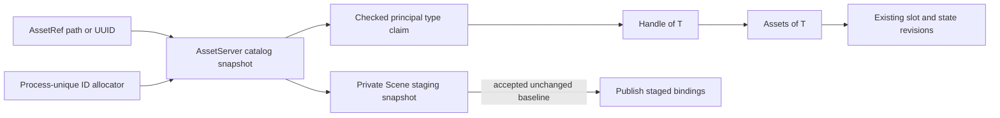
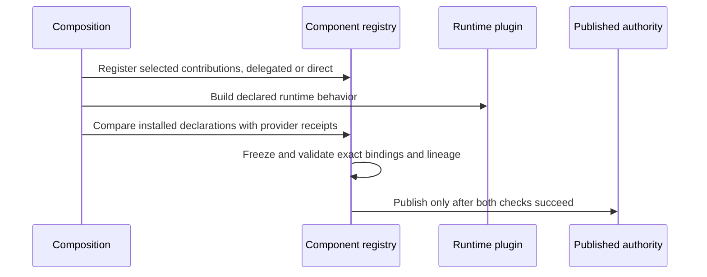
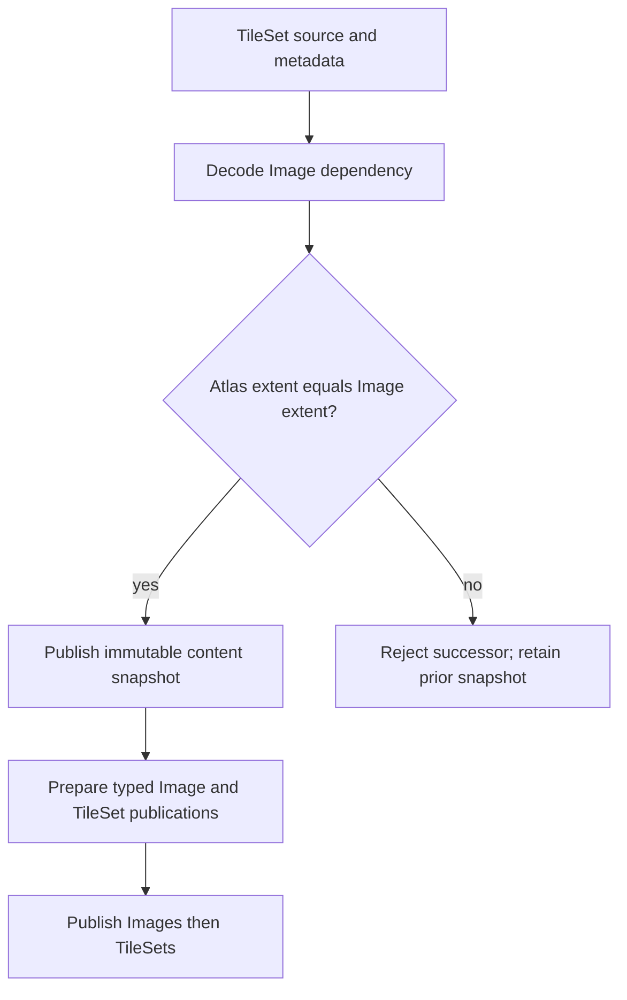

# Component, Plugin and Asset Contracts - Plan

## Goal Capsule

**Objective:** Game and extension authors can reuse components and assets across direct Apps,
file-backed games and existing trusted Editor startup sessions without silently selecting a
different asset or publishing a different component catalog. Generic Editor source hydration
remains a successor milestone.

**Means:** Repair runtime asset identity, typed source binding and declared schema closure;
validate the existing file-backed TileSet against its decoded Image (KTD1–KTD5).

**Authority:** The user request and `STRATEGY.md` define scope. Accepted ADRs remain binding;
amend the affected contract with its implementation. Earlier review suggestions are hypotheses,
not authorization to replace intentional architecture.

**Execution:** Five implementation units, serial Cargo verification, existing `target`, and
`CARGO_BUILD_JOBS=1`. This document proposes implementation; the current request authorizes research
and planning. The implementing agent owns integration and review. Publishing and release need their
own authority and evidence.

**Stop conditions:** Reassess the affected unit if a supported consumer persists runtime asset IDs,
requires two unrelated principal Rust asset types for one source, or requires a different atlas-size
policy. Do not add a compatibility layer or a generic provider framework to hide that conflict.

## Product Contract

### Summary

Keep the existing ECS/component/plugin architecture and repair three concrete contracts before
expanding Tile authoring. Preserve standalone data workflows and ordinary typed Rust composition.

### Problem Frame

Nara already distinguishes ECS data, persistent component schemas, shared typed assets and plugin
installation. Its frozen registry and managed execution support the intended editor and game
workflows. The review found narrower weaknesses rather than a reason to replace that architecture.

Independent and cloned `AssetServer` catalogs can issue the same runtime ID for different sources.
Ordinary lookup and Handle-to-AssetRef export can consequently select unrelated content. A source
can also be reserved as different Rust types while sharing untyped state and events. Direct App
sealing does not compare declared schema providers with actual registry contributions. Finally,
TileSet UVs assume an image extent that file-backed admission does not check.

These findings are grounded in source and existing tests. No failing reproducer or new runtime
measurement was executed during planning. Each repair starts with a behavioral regression.

### Requirements

#### Asset identity and types

- R1. Independently allocated runtime asset identities must not alias, including allocations made
  after catalog snapshots diverge.
- R2. A catalog snapshot preserves its existing bindings and transaction isolation; rejected
  staging publishes no catalog, component, value, state or event changes.
- R3. One principal source identity may acquire at most one Rust asset type within a catalog;
  an incompatible typed reservation or conversion rejects without overwriting that binding.
- R4. Same-runtime reload preserves the asset handle, while a fresh runtime resolves durable
  `AssetRef` values again. Supported persistent formats contain no runtime asset IDs.

#### Composition and content admission

- R5. Direct App sealing verifies that actual provider receipts match the final installed
  declarations' provider set before runtime schema authority is published.
- R6. Delegated `SchemaContribution` registration, raw App composition, standalone registries and
  asset-free or staged Sprite/Tilemap codecs retain their supported workflows.
- R7. File-backed TileSet admission rejects an atlas/Image extent mismatch before publishing a
  new project-content snapshot or typed TileSet value.

#### Integration

- R8. Migrate public consumers to checked identity operations without retaining unchecked public
  constructors as a compatibility escape. Existing revision, removal and last-good guards remain.
- R9. Demonstrate these contracts through owning tests and separately compiled/public consumers,
  with documentation distinguishing verified behavior from later Tile/editor work.

### Key Decisions

- **Correct pre-1.0 contracts rather than add compatibility wrappers.** Governs R1–R9
  (session-settled: user-approved — chosen over retaining flawed interfaces behind local fixes:
  avoid multiplying consumers before foundation contracts are corrected).

### Acceptance Examples

- AE1. Covers R1, R4. Two independent games reserve different first images. Their handles differ;
  querying the second store with the first handle returns missing, and exporting it through the
  wrong server returns an unknown-handle error rather than the second image's path.
- AE2. Covers R2. A staged Scene reserves an asset, then another component fails preparation.
  The live catalog and World retain their previous contents; a later allocation never reuses
  the abandoned ID.
- AE3. Covers R3. Source-change routing reserves an untyped identity. Image claims it once;
  a later incompatible type claim fails without changing the Image's usable state.
- AE4. Covers R5, R6. A plugin registers an undeclared provider or omits a declared provider.
  Direct publication rejects; a valid delegated recipe still produces the same schema as the
  file-backed Host.
- AE5. Covers R7. A 16-by-16, two-column atlas expects a 32-by-16 image. A 64-by-16 dependency
  rejects instead of stretching two image cells into one rendered cell.

### Scope Boundaries

The implementation units cover identity allocation/type binding, schema closure and the existing
single-atlas file source. The earlier TileSet cold-start slice remains the starting baseline.

Considered and not built:

- A store token on every Handle: publication already owns exact slot/state-store revisions;
  correcting runtime ID allocation closes accidental ordinary-lookup aliasing (KTD1).
- A mandatory AssetPlugin dependency or identity/reload plugin split: current persistent apply
  supports staged identity resolution without Task/reload installation (KTD4).
- An active-plugin schema owner token: delegated registration is intentional, and durable owner
  identity already belongs to provider receipts (KTD3).
- A global resource/system ownership ledger: unrestricted trusted Rust mutation would bypass it;
  a real exclusive-resource conflict must establish the narrower contract first.
- Plugin semver resolution, dynamic ABI and arbitrary capability tags: Cargo and compiled typed
  contributions meet the current workflow. Tags alone do not implement editor semantics.
- Chunk caches and mandatory dirty-field setters: no renderer consumes the current dirty-chunk
  API, and ADR 0096 requires measured scaling pressure before choosing a cache mechanism.

#### Deferred to Follow-Up Work

The successor milestones below are outside this plan's completion claim: typed TileSet reload,
generic Editor source hydration, semantic cell editing, a logical tile-definition table, external
Tiled/LDtk import, and measured map scaling. Their order is specified under Successor Milestones.

## Planning Contract

### Research Reassessment

| Previous suggestion | Verified evidence | Decision |
|---|---|---|
| Add AssetPlugin to Sprite/Tilemap | `crates/nara_reflect/src/persistent_apply.rs:447` stages a cloned/default server; `crates/nara_scene/src/tests.rs:3290` resolves stable refs without AssetPlugin | Retract the mandatory dependency change |
| Add schema owner tokens | `src/product.rs:75` deliberately registers for contributors; provider owner and PluginId are different identities | Repair final declaration/receipt closure instead |
| Add store provenance to every Handle | `crates/nara_image/src/tests.rs:1375` already rejects publication into foreign stores | Repair ordinary identity and checked type conversion; keep existing guards |
| Introduce TileSource/TileDefinition/TilemapLayer now | Tilemap is already one layer per entity; current atlas index is well-defined while layout stays fixed | Defer logical tile definitions to layout remapping/metadata consumer |
| Public fields already break render cache invalidation | `crates/nara_sprite_render/src/extract.rs:136` visits all cells; dirty chunks have no renderer consumer | Do not invent a cache bug or fix it with unconsumed setters |

### Key Technical Decisions

- KTD1. Allocate opaque `u64 AssetId` values from one checked process-wide monotonic allocator.
  Never reuse or wrap; exhaustion returns an error. Catalog Clone remains a value snapshot:
  existing bindings keep IDs, while allocations in independent forks are unique. Discarded work
  may consume numbers without publishing bindings. Do not include allocator position in catalog
  equality, so an unrelated server allocation cannot invalidate a prepared transaction.
  This is smaller than adding namespaces and fork allocators to every ID (R1, R2, R4).
- KTD2. Record a first Rust `TypeId` claim for each principal runtime identity in its catalog.
  Preserve identity-only source reservation. Checked typed conversion requires catalog membership
  and a compatible claim; errors leave bindings unchanged. Remove ordinary public raw-ID minting
  and unchecked Handle retyping. Keep Handle Copy and existing storage-revision guards.
  This fits ADR 0117's single-principal-product profile without a multi-product importer (R3, R8).
- KTD3. Compare provider-ID sets at direct registry sealing using installed declarations and
  actual receipts. Diagnose missing/unexpected providers before publishing authority. Keep exact
  owner/binding/lineage validation in the registry. Preserve the existing union semantics when
  several declarations name a provider; a new one-claimant rule is not needed for this repair (R5).
- KTD4. Keep trusted `Plugin::build(&mut App)` and the existing `SchemaContribution` interface.
  The registration helper's PluginId is diagnostic attribution, not an authorization token.
  Asset-free and staged codecs do not require the asynchronous AssetPlugin (R6).
- KTD5. For the current file-backed single-atlas source, require the decoded image extent to
  equal the atlas's computed full extent, including margin and spacing. Compare without lossy
  integer truncation or accepting overflow. A reusable tile-domain validator receives actual
  dimensions; decoding alone cannot prove this dependency constraint. Project-content admission
  validates after image decoding and before snapshot publication; runtime preparation reuses the
  validator for its typed publication boundary. Raw code-first TileSet construction remains an
  advanced caller-owned path, not an implied proof of image admission (R7).

### High-Level Technical Design

### Sequencing and Migration

U1 and U2 form one asset-identity migration; integrate them before broad consumer verification.
U3 is logically independent. U4 uses the existing cold-start slice and does not require a new asset
executor. U5 verifies the integrated public workflows. Keep edits sequential around shared files;
research/review may run in parallel, Cargo may not.

Expected source breakage is intentional: raw Handle constructors and fabricated IDs migrate to
typed reservation or checked conversion. Keep runtime IDs out of canonical output and test
numeric equality only where identity itself is the subject. No durable Scene/Prefab/TileSet
format migration is expected; inspect actual serializers before confirming that claim.

Amend ADRs 0007/0037 for ID allocation and typed claims, and 0046/0081 for schema closure. Record
the file-source extent policy in the TileSet guide. Update the implementation ledger only after
actual verification. Do not turn this planning document into an Accepted ADR.

### Successor Milestones

| Milestone | Trigger and prerequisites | Required outcome before expansion |
|---|---|---|
| M1: typed TileSet reload and Editor hydration | U1–U5; extend the real Image + TileSet workflow | Image/TileSet completion in either order cannot publish mixed dependencies; last-good retention and removal revocation; runtime/editor source consumers agree |
| M2: logical tile definitions | First supported atlas repack/remap or per-tile metadata workflow, before allowing layout-changing edits | Tileset-local opaque tile identity maps to physical atlas regions; deletion/remap is explicit; v1 index migration is deterministic; no UUID per cell |
| M3: semantic map edits and trusted editor contributions | First brush/collection tool, together with N03/N04 from the follow-up assessment | Coordinate-based bounded deltas, one stroke/Undo entry, inverse data proportional to changed cells; UI and Tile use the same finite semantic-admission seam |
| M4: measured map scaling | Saved/reopened representative map exceeds a declared budget | Attribute extraction/queue/upload/Transform cost; try private culling before retained chunks under ADR 0096 |

M2 does not require a separate TileSource hierarchy, a new TilemapLayer component, terrain,
collision or navigation registries. Multiple Tilemap entities already express layers. Shared
TileSet definitions and mutable game state such as wet soil remain different owners.

Tiled GIDs are map-local, not globally durable tile identities. An importer must translate
tileset association, local ID and flags rather than persist GIDs as engine-wide identifiers:
[Tiled Global Tile IDs](https://doc.mapeditor.org/en/stable/reference/global-tile-ids/).
The shared-resource model is consistent with Tiled's recommendation for external tilesets:
[Tiled Editing Tilesets](https://doc.mapeditor.org/en/stable/manual/editing-tilesets/).

## Implementation Units

### U1. Make Runtime Asset Allocation Unique Across Catalog Forks

**Goal:** Eliminate accidental asset aliasing without changing persistent identity.

**Requirements:** R1, R2, R4; AE1, AE2; KTD1.

**Dependencies:** None.

**Files:** `crates/nara_asset/src/identity.rs`, `crates/nara_asset/src/server.rs`,
`crates/nara_asset/src/lib.rs` and its owning tests; transaction regressions in
`crates/nara_reflect/src/persistent_apply.rs` and `crates/nara_scene/src/tests.rs`;
`docs/architecture/adr/0007-asset-identity-and-import-pipeline.md` and
`docs/architecture/adr/0037-asset-load-request-cache-and-lifetime-policy.md`.

**Approach:** Replace server-local allocation with the private checked allocator. Replace the
derived `AssetServer` equality that currently includes `next_id` with binding-only equality, while
keeping allocator state outside the snapshot baseline. Preserve the prepared-apply comparison.
Use the existing no-wrap identity patterns in `nara_identity` as precedent, not as a new dependency
or common identity framework.

**Execution note:** First capture independent-server lookup/export and forked-allocation failures.

**Test scenarios:**

1. Covers AE1. Two servers' first named and anonymous reservations differ; foreign export fails.
2. A cloned catalog retains existing IDs but assigns different IDs to new paths on both forks.
3. Covers AE2. Failed staging leaves the live catalog unchanged and abandoned IDs are not reused.
4. A live binding mutation invalidates a staged batch; an allocation in another server does not.
5. Catalogs with equal bindings but different allocator cursors compare equal for staging, while
   a changed binding does not.
6. A private near-exhaustion allocator fixture returns an error without wrapping; do not exhaust
   the global test-process allocator.

**Verification:** Owning asset and prepared Scene apply regressions pass without sequential-ID
assumptions or changes to durable UUID/reference output.

### U2. Bind Principal Asset Identities to Checked Rust Types

**Goal:** Prevent incompatible typed assets from sharing one untyped lifecycle identity.

**Requirements:** R2–R4, R8; AE3; KTD2.

**Dependencies:** U1.

**Files:** `crates/nara_asset/src/server.rs`, `storage.rs`, `lib.rs`, `reload/resolution.rs`,
`reload/requests.rs` and owning tests; `crates/nara_image/src/reload.rs`,
`crates/nara_image/src/tests.rs`; `crates/nara_reflect/src/codec.rs`, `persistent_apply.rs`;
`src/project_host/runtime.rs`, `src/project_host/runtime/editor/preview.rs`,
`src/project_host/runtime/editor/ui_preview.rs`; `examples/sprite_tilemap_scene.rs`,
`examples/asset_import_texture.rs`, `editor/src/platform/imgui.rs`,
`crates/nara_material/src/lib.rs`, `crates/nara_ui_render/src/packet_tests.rs`,
`crates/nara_render/src`, `crates/nara_render_wgpu/src`, `crates/nara_sprite_render/src` and every
other repository call site found by the constructor inventory; affected facade examples and
renderer tests.

**Approach:**

1. Inventory every `AssetId::from_raw` and `Handle::new` call, classify it as AssetServer-backed
   or backend-owned, and assign an owning replacement before deleting the unchecked path.
2. Add catalog membership/type-claim validation to typed reserve and checked conversion. Include
   claims in transaction snapshots. Keep identity-only reload requests untyped.
3. Image claims a typed handle in its spawn phase and retains it in the domain-owned attempt;
   apply/removal/failure paths reuse that handle rather than recasting a request ID.
4. Remove unchecked public mint/retype operations only for AssetServer-backed game assets. Keep
   backend/render-target identity separate: give each owning render domain a private typed allocator
   or checked target constructor with an explicit view/session lifetime; do not route GPU target IDs
   through the project AssetServer merely to satisfy this migration. Pass existing typed handles
   directly through publication.

**Patterns to follow:** Existing Image attempt ownership and slot/state revision checks. Core
asset code must not import Image or dispatch domain decoders.

**Test scenarios:**

1. Covers AE3. An untyped path/UUID can acquire one type; repeat claims are idempotent and an
   incompatible claim rejects without changing bindings or the usable value's state/events.
2. An unknown ID cannot become a typed handle through the checked server interface.
3. Same-type Image reload keeps its handle; foreign-store, empty-slot ABA and stale completion
   tests retain their existing rejection behavior.
4. Rejected staged claims publish no catalog changes. A request routing failure produces a
   bounded diagnostic and retires the request without overwriting another type's lifecycle state.
5. Preview target identity remains stable across frames and resize, and differs across views.
6. An independently compiled caller can reserve/use typed handles but cannot invoke removed
   unchecked constructors; no source-parsing approximation is used to prove this.

**Verification:** All production raw-recast call sites migrate; public consumer compile coverage
and Image/Scene regressions pass. The inventory distinguishes AssetServer-backed handles from
backend-owned render targets, and each category has an explicit owner. A Handle remains an
identity, not a residency lease.

### U3. Make Direct App Schema Closure Match File-Backed Composition

**Goal:** Reject hidden or omitted schema contributions consistently at publication.

**Requirements:** R5, R6; AE4; KTD3, KTD4.

**Dependencies:** None; integrate after U2 to keep shared consumer verification serial.

**Files:** `crates/nara_reflect/src/plugin.rs` and its unit tests;
`tests/plugin_composition.rs`, `tests/project_composition.rs`;
`docs/guides/rust-product-recipes.md`, ADRs 0046/0081. Change `src/product.rs` or
`src/project_host/composition.rs` only if the parity test identifies an actual integration need.

**Approach:** Use the final installed declarations and registry receipts at the existing finish
boundary. Validate the selected provider set without a second ledger or active-hook owner token.
Clarify the registration helper's diagnostic parameter and preserve delegated registration.

**Test scenarios:**

1. Covers AE4. Missing and undeclared providers reject direct sealing before authority publication.
2. Valid raw App, delegated ProductRecipe and file Host compositions retain equivalent fingerprints
   and once-only callbacks.
3. Several top-level App installation calls account for the complete committed prefix.
4. Disabled optional owners remain omitted without synthesizing type tombstones.
5. Asset-free Sprite/Tilemap and staged asset-reference apply still work without Task/AssetPlugin.
6. Standalone registry construction remains usable without App/plugin declarations.

**Verification:** Existing receipt divergence, owner lineage, lifecycle failure and direct/Host
parity tests remain valid. No change to broad plugin build access or package resolution.

### U4. Validate File-Backed TileSet Dependencies Against Image Extent

**Goal:** Reject a source combination that would silently sample the wrong atlas region.

**Requirements:** R7; AE5; KTD5.

**Dependencies:** Existing TileSet cold-start slice from
`docs/plans/2026-10-18-tilemap-file-backed-foundation-plan.md`; U1 and U2 are integration-order
work, not prerequisites for the domain validator itself.

**Files:** `crates/nara_tilemap/src/source.rs`, `crates/nara_tilemap/src/lib.rs`;
`src/project_content.rs`, `src/project_host/runtime.rs`;
`tests/project_content_boot.rs`, `tests/project_runtime_boot.rs`,
`tests/support/project_content_fixture.rs`, `docs/guides/file-backed-tilesets.md`.

**Approach:** Split TileSet admission into a bounded source-discovery phase and a final validation
phase. Decode all TileSet metadata/source records first to discover Image paths, load the complete
Image set, validate each source against its decoded Image extent, then commit TileSet retained work
and publish the immutable snapshot. Runtime preparation reuses the admitted proof only for a
separate caller path that can bypass ProjectContentLoader; it must not duplicate the formula.
Keep envelope decoding independent of image I/O and preserve source/metadata receipts and budget
rollback on an extent rejection.

**Test scenarios:**

1. Covers AE5. Exact extent succeeds; oversized and undersized decoded images reject.
2. Margin/spacing are included; fractional or unrepresentable full extents cannot pass by truncation.
3. A failed successor load leaves both earlier snapshots and retained budget accounting unchanged.
4. Two TileSets sharing an Image validate separately; one invalid layout rejects the full successor.
5. Existing path/stable Image references, static textured batches and trusted Editor startup succeed.

**Verification:** Admission fails before a usable successor or partial typed publication appears;
the guide states the exact-extent policy and its code-first limitation.

### U5. Prove Public Consumer Parity and Close the Migration

**Goal:** Verify the repaired contracts through real game/module workflows and remove obsolete paths.

**Requirements:** R4, R6, R8, R9.

**Dependencies:** U1–U4.

**Files:** `tests/plugin_composition.rs`, `tests/project_content_boot.rs`,
`tests/project_runtime_boot.rs`, `tests/scene_sprite_serialization.rs`;
`tests/fixtures/module-consumer/tests/manual_component_codec.rs` and the existing consumer's
domain-reconciliation support; affected `reference-game` tests and Editor preview tests;
`docs/architecture/adr/implementation-status.md`, current asset/component guides and audit links.

**Approach:** Use public composition and the existing two-TileSet saved map as the integration
tracer. Resolve the same durable data into two independent runtimes and compare semantic results,
not runtime ID numbers. Keep historical verification records unchanged.

**Test scenarios:**

1. Direct/module and file-backed consumers load equivalent durable sources with distinct runtime IDs.
2. Scene/Prefab save and reopen preserve path/UUID semantics after the constructor migration.
3. The affected headless startup/content trajectory and the existing static Tilemap render-batch/
   trusted Editor session consumer pass without engine-private identity fabrication; do not add a
   full reference-game gameplay trajectory unless a migrated call site requires it.
4. Old unchecked constructor calls fail to compile in a focused external API fixture.
5. No new code requires Task/reload for an asset-free component or a standalone registry.

**Verification:** Reviewed final diff, public consumer proof, workspace build and relevant domain
tests pass. Remove abandoned approaches and compatibility aliases; record exact limits.

## Verification Contract

No Cargo commands run during this planning task. Implementation verification must be serial,
with `CARGO_BUILD_JOBS=1`, using the existing `target` directory.

- Start with focused `cargo nextest run --locked -p nara_asset --lib`, then affected Image,
  Reflect and Scene owner tests; add `--features serde` for persistence cases.
- Run `cargo nextest run --locked -p nara_tilemap --features serde --lib`.
- Run the root `plugin_composition`, `project_composition`, `project_content_boot` and
  `project_runtime_boot` integration suites with `runtime-2d,serde,tooling`; run the saved-map
  consumer with `presentation-2d,serde,tooling`.
- Exercise the existing separately locked `tests/fixtures/module-consumer/Cargo.toml` consumer
  through its manifest and the affected reference-game/Editor preview tests. Do not invent
  successful package membership or test names before checking those manifests.
- After focused checks pass, use `cargo check --locked --workspace --all-targets --all-features`,
  affected feature-minimal builds, `cargo fmt --all -- --check`, and `git diff --check`.

The extent regression is an admission/UV contract and needs no GPU qualification. Static batches
are not pixel readback. Native Editor behavior changes follow
`docs/verification/native-editor-qualification.md`; do not turn these tests into a native release
claim or rerun an unrelated release campaign for documentation closure.

## Definition of Done

All five units satisfy their owning requirements and acceptance scenarios. Existing staged apply,
last-good publication, removal and cleanup guards retain their guarantees. Ordinary consumers use
typed reservations/contributions without new ID, token or resource-ledger ceremony. Contract docs
and the implementation ledger reflect only actual verified changes.

No unchecked public compatibility path, abandoned experiment or generic executor remains in the
patch. Concurrent user changes and read-only `repo-ref/` sources are preserved. Successor milestones
remain separate from completion of this foundation repair.

## Sources

- Current ownership: `STRATEGY.md`; ADRs 0007, 0010, 0037, 0046, 0081, 0095, 0096, 0098, 0103,
  0117 and 0118; `docs/guides/persistent-components.md`.
- Existing scope/evidence: `docs/audits/2026-10-18-next-foundation-refactor-assessment.md`;
  `docs/plans/2026-10-18-tilemap-file-backed-foundation-plan.md`.
- Bevy source snapshot: `repo-ref/bevy/crates/bevy_asset/src/id.rs:23`,
  `repo-ref/bevy/crates/bevy_asset/src/server/info.rs:123`,
  `repo-ref/bevy/crates/bevy_asset/src/server/mod.rs:60`. Bevy's Arc-shared server clone is not
  suitable for Nara's isolated transaction catalogs; its generational IDs do not prove cross-App
  provenance.
- Godot source snapshot: `repo-ref/godot/core/templates/rid_owner.h:67`,
  `repo-ref/godot/core/io/resource_uid.h:41`,
  `repo-ref/godot/modules/tilemap/tile_map_layer.h:334`,
  `repo-ref/godot/modules/tilemap/tile_set.h:218`. Borrow identity separation and explicit tile
  remapping, not the entire object/resource hierarchy.
- The user's original engine expectations remain historical product input. Its suggestions about
  toolkit choice, integer-only simulation and genre-specific systems do not override current strategy
  or Accepted ADRs.
