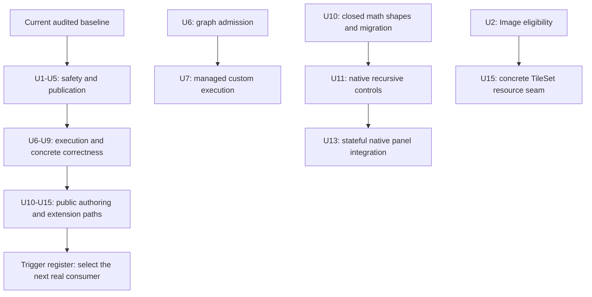
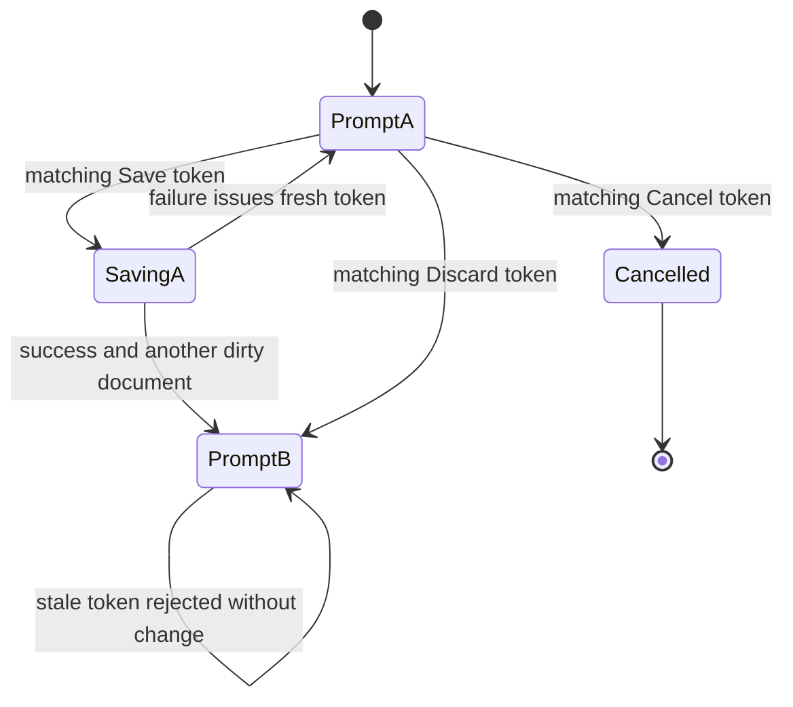

# Foundation Correction - Plan

## Goal Capsule

- **Objective:** Game authors can safely edit, reload and run projects through ordinary public interfaces, and extend components and Editor panels without copying engine ownership machinery.
- **Means:** Correct concrete owner boundaries first, complete existing authoring interfaces second, and use consumer evidence to enter larger refactors, as defined by KTD1-KTD8.
- **Authority:** User scope and `STRATEGY.md` govern product direction; Accepted ADRs govern existing contracts. This plan organizes changes and does not itself amend those ADRs.
- **Baseline:** Nara `9257bfd`, with runtime code at `835c5e4`. The two source audits below supply A01-A09 and B01-B14; their proposed tests are not execution evidence.
- **Execution:** Deliver independently reviewable units in dependency order. The implementation owner integrates code, migrations, focused tests, documentation and precise commits; push, PR and release publication require separate authorization.
- **Stop conditions:** Pause the affected unit for a newly discovered product choice, an incompatible Accepted contract that has not been reconciled, or evidence invalidating its premise. Independent units may continue. A missing native platform records a qualification limit rather than a passing result.

---

## Product Contract

### Summary

Repair current safety, recovery and execution gaps before expanding authoring tools.
Then complete the component, composition and Editor interfaces already exposed to users.
Keep larger task, performance, asset-domain and world-lifecycle work behind explicit evidence or consumer triggers.

### Problem Frame

The audits found several owner boundaries where valid public usage can discard an unseen document, stall eligible content, escape typed admission, or fail after mutation.
Other findings concern interfaces that work for built-ins but require external users to know private composition details.
Building many game components and tools on those interfaces would multiply migration work.
The source review does not establish that every future capability is currently broken or that every algorithmic cost causes a frame-time regression.

### Key Decisions

- **Correct foundations before tile tools.** Tile authoring remains deferred while the engine interfaces are corrected. Governs R16.
- **Require a fresh press after context restoration.** This avoids movement restarting from an input held through a menu. Governs R14. (session-settled: user-directed — chosen over resuming held input immediately: avoid unintended actions when a context returns.)

### Requirements

**Safety and publication**

- R1. A close decision authorizes exactly the prompt the user observed; replay cannot accept another document or a later prompt.
- R2. Superseded Image generations cannot block eligible current publication or accumulate unbounded terminal bookkeeping; physical task ownership remains accounted until retirement.
- R3. CPU-valid images that exceed the active device's texture capabilities receive typed content rejection before invalid device allocation.
- R4. The advertised instance-buffer budget applies across all views and passes in one Runtime frame or Editor Host render transaction, including its targets.
- R5. Invalid Scene provenance rejects before Scene allocation or replacement commits, leaving the old instance and its identity intact.

**Execution and concrete correctness**

- R6. Installed schedule graph errors produce typed diagnostics before startup systems execute, independently of public anchor compatibility rules.
- R7. An ordinary public consumer can explicitly execute an installed custom schedule through managed runtime ownership without changing the built-in automatic schedule sequence.
- R8. Opening a selected non-regular Unix leaf cannot block before the filesystem capability owner can reject its type.
- R9. A node's own text uses one content box for measurement, final shaping and paint while its outer box retains background and interaction semantics.

**Authoring and extension interfaces**

- R10. Supported derived Vec2 fields and Vec2 containers remain generically data-editable, with explicit owner-controlled schema migration.
- R11. Generic native Inspector controls expose admitted Optional, closed-record and scalar-container edits, including explicit Null, through existing revisioned root-field transactions.
- R12. One ordinary ProductRecipe can configure supported profile-installed defaults consistently through Headless, Desktop, Check, Editor Play and Export.
- R13. A source-built Editor panel can own independent per-instance draft state and enter the ordinary native startup and reconstruction lifecycle.
- R14. Semantic held actions aggregate active bindings, terminate once on context exit, and remain inactive after restoration until the affected physical inputs have been released and pressed again.
- R15. Runtime and Editor TileSet consumers use one concrete resource-join interface while Host source authority and TileSet/Image publication ownership remain explicit.

**Boundaries and proof**

- R16. Every audit item has an execution unit or a recorded entry trigger; tile tools and untriggered engine domains do not enter this correction round.
- R17. Public API and persistence changes include real public-consumer or saved-data evidence, with platform and measurement limits recorded accurately.

### Scope Boundaries

The active implementation scope is U1-U15.
Units do not authorize a new ECS, job kernel, package registry, erased asset executor, render graph, scripting ABI or widget framework.
Retain the existing managed World boundary, frozen component/plugin definitions, exact Image snapshots, explicit schema lineage, last-good publication eligibility and bounded close ownership.

#### Deferred to Follow-Up Work

The trigger register below owns task-submission latency work, measured scaling, additional asset roles, live relocation, residency/save workflows and reusable domain-field adapters.
Tile painting, terrain, brushes, layout editing and logical tile-ID migration remain deferred.
Physics, audio, arbitrary materials and multi-window document redesign need their own product consumers and plans.

### Sources

- `STRATEGY.md` and `docs/architecture/README.md`.
- [A01-A09: Bevy/Godot architecture comparison](../audits/2026-10-19-nara-bevy-godot-architecture-review.md).
- [B01-B14: expanded foundation audit](../audits/2026-10-19-foundation-audit-expansion.md).
- [M01-M04: post-publication module review](../audits/2026-10-19-post-publication-architecture-review.md).
- [Completed TileSet publication plan](2026-10-19-tileset-publication-and-recovery-plan.md). Its implemented behavior is a baseline to preserve.

Reference research is pinned to Bevy `85503941e488152711a4695bbe248e9ed9f453fc` and Godot `81ab961f91066a63bcbf3ec340962bb1a1ada558` in read-only `repo-ref/`.
The audits identify exact precedent locations; the plan adopts owner boundaries rather than either engine's full architecture.

---

## Planning Contract

### Key Technical Decisions

- KTD1. **Repair the owning boundary and remove obsolete entry points.** R1-R15 are pre-1.0 contract corrections; replace ambiguous APIs and migrate their consumers instead of retaining a second unchecked route. Persistence lineage remains explicit under R10 and R17.
- KTD2. **Bind Scene input and close authorization to concrete candidates.** Use a validated expanded-Scene value and an owner-issued prompt token for R1 and R5. Frame freshness or skipping unknown provenance keys cannot establish either association.
- KTD3. **Separate Image publication eligibility from physical work lifetime.** Logically retire superseded generations in the Image owner for R2, retaining TaskPools' real worker/capture close ownership. Preserve eligible same-generation ordering and existing Poll cutoffs.
- KTD4. **Admit resources at the device and transaction owners.** Device capability checks belong beside texture creation for R3; cumulative instance reservations belong above per-view preparation for R4. Do not shrink CPU import limits to match one GPU or introduce a buffer arena without measurement.
- KTD5. **Reuse Bevy schedule initialization and Nara's managed execution wrapper.** Fallibly initialize installed graphs at composition sealing for R6. For R7, use an explicit runtime-owner entry between managed drives, admitting custom labels only while Running. Requests from within systems are a later consumer, not a reason to introduce a request bus now.
- KTD6. **Make schema shapes useful before adding more special-case widgets.** Closed math shapes implement R10; shape-driven controls implement R11 through whole root-field edits. Opaque and EntityRef mutation restrictions remain owner decisions. New child values use explicit data drafts, not invented defaults or project-code callbacks.
- KTD7. **Complete existing composition paths.** Configure known profile defaults through the existing resolver for R12. Carry panel descriptors and frontend-specific instance factories through native startup for R13. A private test-only constructor or manual frontend installation does not prove the ordinary path.
- KTD8. **Add semantic held-state ownership above binding events.** Preserve low-level per-binding outcomes while the gameplay-facing held projection implements R14. Track contributions and mapping/context lifetime explicitly rather than asking each game to infer aggregate state from Started/Released events.

### Delivery Order And Dependencies

| Batch | Units | Exit evidence |
| --- | --- | --- |
| 1: data safety and publication | U1, U2, U3, U4, U5 | Replay cannot discard another document; current content publishes despite obsolete work; Scene and GPU admission reject before invalid mutation/allocation |
| 2: execution and legal existing content | U6, U7, U8, U9 | Typed graph admission, a real custom-schedule caller, Linux leaf-open proof, consistent padded text |
| 3: public component and Editor interfaces | U10, U11, U12, U13, U14, U15 | Saved-data, public-product and native-panel workflows prove the corrected interfaces |

Batch order is a risk-based default, not a fabricated code dependency.
The Dependencies field on each unit defines actual prerequisites.
Review a completed batch before starting the next, update its evidence, and revise later units if the implementation changes their assumptions.
Do not restart the twelve-lane audit after every commit.

### Ownership And State Design

| Boundary | Prepare/admit | Commit/publish | Retirement |
| --- | --- | --- | --- |
| Close prompt | Host issues intent/document/prompt identity | Resolve consumes exactly that prompt | Advance, cancel, failed Save or new intent invalidates the previous token |
| Expanded Scene | Scene owner validates document/provenance coverage and association together | Prepared Scene commit installs admitted provenance | Failed replacement leaves the previous instance live |
| Image reload | Image owner identifies the latest desired generation | Eligible ordered results reach final source/generation guards | Superseded logical handles retire independently; TaskPools retains physical work |
| GPU resources | Live device capabilities and cumulative scope reservations admit candidates | Existing packet/submission owners retain exact resources | Failure, candidate drop and submission completion release the corresponding reservations |
| Inspector | Frontend builds a complete data-only root-field draft | Document owner validates revision, shape and domain atomically | Rejected or stale drafts do not change the document or unavailable records |

### Assumptions And Decision Boundaries

The first batches need no further product decision.
U14 uses the user's chosen fresh-press behavior in R14.
Custom schedules are explicit owner calls between drives; Paused, Stepping, Stopping, Faulted and reentrant execution reject without running systems.
Custom execution does not synthesize frame/tick time, advance the automatic schedule sequence or publish a presented frame by itself.

Exact helper names, native widget arrangements and private reservation representations are implementation details.
If a later consumer needs custom schedules from systems or while paused, revise that contract before extending the entry point.
Do not treat that possible future need as a blocker to U6 or U7.

### Contract And Documentation Ownership

| Affected units | Owning contract or guide to reconcile during implementation |
| --- | --- |
| U1, U13 | `docs/architecture/adr/0118-editor-workspaces-frontends-and-creation-templates.md`; native qualification procedure |
| U2 | `docs/architecture/adr/0080-domain-owned-task-update-integration-sets.md`; `docs/architecture/adr/0115-editor-image-import-metadata-and-authoring-publication.md` |
| U3, U4 | `docs/architecture/adr/0054-gpu-upload-budget-and-buffer-allocation-policy.md`; `docs/architecture/adr/0096-evidence-gated-render-scaling-and-upload-policy.md` |
| U5-U7, U10, U14, U15 | `docs/architecture/adr/0117-2d-foundation-ownership-and-authoring-contracts.md`; U6-U7 also `docs/architecture/adr/0003-own-app-plugin-and-schedule-lifecycle.md` and `docs/architecture/adr/0084-executable-runtime-ownership-and-isolation.md` |
| U10-U11 | `docs/guides/persistent-components.md`; owning schema/catalog contracts identified by those ADRs |
| U12 | `docs/guides/rust-product-recipes.md`; composition contracts in ADR 0117 |
| All | Update `docs/architecture/adr/implementation-status.md` only for changed implementation claims; record actual verification in engineering memory |

---

## Implementation Units

| Unit | Result | Primary files | Depends on |
| --- | --- | --- | --- |
| U1 | Prompt-bound close decisions | `crates/nara_tooling/src/frame.rs`, `src/project_host/runtime/editor.rs` | None |
| U2 | Superseded Image retirement | `crates/nara_image/src/reload.rs` | None |
| U3 | Device texture admission | `crates/nara_render_wgpu/src/texture.rs` | None |
| U4 | Aggregate instance budget | `crates/nara_render_wgpu/src/backend.rs`, `crates/nara_render_wgpu/src/quad.rs` | U3 integration baseline |
| U5 | Validated expanded Scene input | `crates/nara_scene/src/spawn.rs`, `crates/nara_scene/src/prefab.rs` | None |
| U6 | Fallible schedule graph admission | `crates/nara_app/src/lib.rs`, `crates/nara_app/src/runtime.rs` | None |
| U7 | Managed custom-schedule execution | `crates/nara_app/src/runtime.rs` | U6 |
| U8 | Nonblocking Unix leaf admission | `crates/nara_fs/src/capability.rs` | None |
| U9 | Text content-box consistency | `crates/nara_ui_kernel/src/compiler/root.rs`, `crates/nara_ui_render/src/planner/lowering.rs` | None |
| U10 | Closed Vec2 schema and migration | `crates/nara_reflect/src/authoring.rs` | None |
| U11 | Shape-driven Inspector controls | `editor/src/frontend/imgui/authoring.rs` | U10 |
| U12 | Ordinary profile-default configuration | `src/product.rs`, `src/project_host/composition.rs` | None |
| U13 | Stateful native panel composition | `editor/src/frontend/imgui/workspace.rs`, `editor/src/platform/imgui.rs` | U1, U11 |
| U14 | Held-action lifetime | `crates/nara_input/src/lib.rs`, gameplay input bridge | None |
| U15 | Concrete TileSet resource interface | `crates/nara_tilemap/src/content.rs`, Runtime/Editor consumers | U2 |

### U1. Bind Close Decisions To Owner-Issued Prompts

**Goal:** Close and project-replacement actions cannot approve an unseen dirty document.
**Requirements:** R1, R17; B01. **Dependencies:** none.
**Files:** `crates/nara_tooling/src/frame.rs`, `src/project_host/runtime/editor.rs`, `src/project_host/runtime/editor/actions.rs`, `editor/src/app.rs`, `editor/src/frontend/imgui/mod.rs`; tests in `editor/tests/authoring_loop.rs`, `editor/tests/application_contract.rs` and `editor/src/frontend/imgui/interaction_tests.rs`.
**Approach:** Apply KTD2 to the frame model, semantic action, Host close state and native action producer together. Display the prompted document's title and admitted source locator from the same frame association, using an explicit unsaved label where no locator exists. Remove decision-only Resolve construction. Preserve existing mutation blocking and save checkpoints.
**Patterns:** Existing pending workspace intents and target-carrying revisioned document actions.
**Execution note:** Establish the two-dirty-document replay regression before changing dispatch.
**Test scenarios:**

1. Submit two Discard actions for prompt A in one batch; only A advances and B remains pending.
2. Replay A's token after Cancel/new Exit, project replacement or a failed Save; no document, disk or prompt state changes.
3. Sequential Save/Discard/Cancel still completes correctly; Save success advances once and Save failure exposes a fresh decision.
4. Advancing A to B changes the displayed title/source to B; rejecting A's stale token leaves B's visible identity and controls unchanged.

**Verification:** Host semantic tests and the native close producer agree on prompt identity; no unchecked Resolve route remains.

### U2. Retire Superseded Image Generations Without Blocking Current Results

**Goal:** A blocked obsolete Image load cannot prevent a completed desired generation from publishing.
**Requirements:** R2, R17; B12. **Dependencies:** none.
**Files:** `crates/nara_image/src/reload.rs`, `crates/nara_image/src/tests.rs`; integration coverage in `tests/project_content_boot.rs` and the existing Editor Image tests.
**Approach:** Apply KTD3 within Image-owned attempt/result state. Remove stale generation records independently, preserving source authority, final slot checks and decoded-byte reservations. Reuse current task cancellation and retained close ownership instead of changing the generic executor.
**Patterns:** Existing same-generation ordered-prefix tests and TileSet desired/published dependency recovery.
**Execution note:** Use barriers and two workers to distinguish logical completion from physical retirement.
**Test scenarios:**

1. Hold running A; finish newer B and publish B on the next eligible Poll before releasing A.
2. Release A late; it cannot overwrite B or revive a revoked source.
3. Keep A blocked across many failed/coalesced successors; owner metadata and reservations stay bounded, and close still observes A's physical work.
4. Preserve same-generation reverse-completion ordering, coalescing, Poll cutoff, removal and shared TileSet/Image recovery.

**Verification:** Image regressions and public Runtime/Editor dependency consumers pass without a new task-lifetime exemption.

### U3. Admit Textures Against The Active Device

**Goal:** CPU-valid oversized content returns typed rejection and leaves rendering usable.
**Requirements:** R3, R17; B13. **Dependencies:** none.
**Files:** `crates/nara_render_wgpu/src/texture.rs`, `crates/nara_render_wgpu/src/backend.rs`, `crates/nara_render_wgpu/src/readback_tests.rs`.
**Approach:** Apply KTD4 at concrete texture creation sites, including primary and auxiliary Image paths. Use the existing resource error route and appropriate WGPU error scopes for expected allocation failures. Re-admit after device reconstruction; keep exact snapshots and CPU admission independent.
**Patterns:** Existing typed texture admission, upload reservations and editor viewport capability checks.
**Test scenarios:**

1. On an explicitly default-limit device, 8,192-by-1 succeeds; 8,193-by-1 and 16,384-by-1 reject without an uncaptured validation panic.
2. Exercise primary Sprite and auxiliary material Image use, then render a legal frame successfully.
3. Rejection and device reconstruction release candidate charges and cannot publish a resource admitted under stale capabilities.

**Verification:** Focused admission tests plus actual Windows/DX12 readback cover rejection and recovery; missing adapters are recorded as a limit.

### U4. Enforce One Cumulative Instance Budget Per Render Scope

**Goal:** Multiple views or targets cannot each consume the full advertised frame budget.
**Requirements:** R4, R17; B14. **Dependencies:** U3 for shared backend integration and review.
**Files:** `crates/nara_render_wgpu/src/backend.rs`, `crates/nara_render_wgpu/src/quad.rs`, `crates/nara_render_wgpu/src/lib.rs`, `crates/nara_render_wgpu/src/readback_tests.rs`; Editor backend tests in `crates/nara_render_wgpu/src/editor_execution/imgui/tests.rs`.
**Approach:** Apply KTD4 by carrying one finite reservation owner across Runtime views/passes and the Editor Host render transaction. Reject before the allocation that exceeds the aggregate limit. Preserve existing target presentation/failure boundaries; this does not add an atomic rollback protocol across already submitted targets.
**Patterns:** Existing prepared-draw ownership and physical submission retirement.
**Test scenarios:**

1. Two individually admissible 40 MiB view demands exceed a 64 MiB scope and reject before the excess allocation.
2. Mixed Sprite/UI passes and two Editor targets share the same accounting scope.
3. Failed preparation, dropped candidates, successful submission and the next frame neither leak nor double-release charges; telemetry reports the admitted aggregate.

**Verification:** Owner-level accounting tests and native render recovery agree; scope reset does not erase charges still retained by older physical holders.

### U5. Admit Document And Provenance As One Scene Candidate

**Goal:** Scene creation and replacement cannot fail provenance validation after committing mutations.
**Requirements:** R5, R17; A01. **Dependencies:** none.
**Files:** `crates/nara_scene/src/provenance.rs`, `crates/nara_scene/src/prefab.rs`, `crates/nara_scene/src/spawn.rs`, `crates/nara_scene/src/tests.rs`, `crates/nara_scene/src/product_transaction_tests.rs`; public boundary tests in `tests/scene_product_public_surface.rs`.
**Approach:** Apply KTD2 to Prefab expansion output and all provenance-bearing spawn/replace callers. Require complete coverage and source association for expanded candidates. A plain Scene constructor supplies local provenance explicitly. Retire independently mutable public document/map pairs from commit APIs.
**Patterns:** Existing prepared product transactions and instance/incarnation identity checks.
**Test scenarios:**

1. A stale, rekeyed, missing or extra provenance entry rejects before allocating entities or installing source fields.
2. Invalid replacement leaves the prior instance, identities and provenance unchanged.
3. Valid nested Prefab expansion, ordinary plain Scenes and replacement retain correct source paths.

**Verification:** Transaction and public-consumer tests demonstrate precommit rejection; no postcommit provenance application route remains.

### U6. Build Installed Schedule Graphs Through Fallible Admission

**Goal:** Predictable schedule graph errors never first surface inside runtime execution.
**Requirements:** R6, R17; A03. **Dependencies:** none.
**Files:** `crates/nara_app/src/lib.rs`, `crates/nara_app/src/runtime.rs`, `crates/nara_app/tests/schedule_compatibility.rs`, `crates/nara_app/tests/schedule_registry.rs`.
**Approach:** Apply KTD5 after plugin composition is finalized and before Startup can run. Validate all installed built-in and custom graphs through Bevy's fallible initializer. Keep graph validity separate from Nara's narrower public-anchor compatibility inventory; do not add generic panic catching.
**Patterns:** Existing fallible runtime construction and schedule compatibility diagnostics.
**Test scenarios:**

1. Cycles in Startup, Update and an installed custom schedule return typed diagnostics before any Startup side effect.
2. Valid custom sets and supported public anchors retain their ordering.
3. Invalid graph diagnostics do not require expanding the public anchor policy to every schedule.

**Verification:** Runtime construction and graph tests cover all installed schedule classes; existing compatibility tests retain their contract.

### U7. Expose Managed Explicit Custom-Schedule Execution

**Goal:** External callers can actually run registered custom schedules through a supported runtime owner.
**Requirements:** R7, R17; A02. **Dependencies:** U6.
**Files:** `crates/nara_app/src/runtime.rs`, `crates/nara_app/tests/schedule_registry.rs`, `crates/nara_app/tests/runtime_ownership.rs`, `tests/schedule_extension_contract.rs`; existing `tests/fixtures/schedule-extension/` consumers.
**Approach:** Apply KTD5 at the owner that holds the schedule registry, using the existing managed authority/fault wrapper. The World-only driver scope is not that owner. Reconcile ADR 0003's stale raw run_schedule clause with ADR 0117's managed owner; do not restore raw App execution. Prove ordinary and renamed-root consumers without exposing mutable World or internal driver ports.
**Patterns:** Managed schedule execution and sticky fault handling.
**Test scenarios:**

1. A public consumer requests a registered custom label; its systems run exactly once and an unrequested schedule remains inert.
2. Built-in labels, missing labels, reentrant execution and disallowed runtime states reject before systems run.
3. Custom execution preserves frame/tick clocks and automatic order; a system fault follows existing sticky-fault and close behavior.

**Verification:** External fixture execution, ownership boundaries and fallible graph tests all pass.

### U8. Reject Non-Regular Unix Leaves Without Blocking Open

**Goal:** Selecting a FIFO cannot hang project admission before type validation.
**Requirements:** R8, R17; B09. **Dependencies:** none.
**Files:** `crates/nara_fs/src/platform/unix.rs`, `crates/nara_fs/src/capability.rs`, `crates/nara_fs/tests/filesystem_contract.rs`; relevant Linux CI coverage in the existing workflow.
**Approach:** Use a nonblocking Unix leaf open followed by regular-file validation on that same handle. Cover both ordinary and strict/openat2 paths without introducing a stat/open race or consumer-specific timeouts.
**Patterns:** Capability-relative open and same-handle metadata/bytes admission.
**Test scenarios:**

1. A child process opens a FIFO without a writer through open_file and open_child_file in both trust modes; it returns a type rejection within the parent-controlled deadline.
2. Regular files remain readable, symlink policy stays enforced, and strict path traversal retains existing tests.

**Verification:** Native Linux tests are required for the Unix claim. Windows-only validation cannot close this unit's platform qualification.

### U9. Publish A Consistent Text Content Box

**Goal:** Legal padded text measures, wraps and paints in the same box.
**Requirements:** R9, R17; B10. **Dependencies:** none.
**Files:** `crates/nara_ui_kernel/src/compiler/root.rs`, `crates/nara_ui_kernel/src/frame.rs`, `crates/nara_ui_kernel/src/tests.rs`, `crates/nara_ui_kernel/examples/layout_gallery.rs`, `crates/nara_ui_render/src/planner/lowering.rs`, `crates/nara_ui_render/src/packet_tests.rs`.
**Approach:** Publish compiler-owned content geometry and consume it directly in lowering. Preserve outer node geometry for background, hit testing and control semantics. Do not recompute layout padding in the renderer.
**Patterns:** Existing text constraints and immutable compiled-frame projection.
**Test scenarios:**

1. A 100-wide text node with 20 padding on each horizontal side wraps at 60 and paints at the content origin.
2. Changing padding updates auto-height, shaping and clipping consistently.
3. Button/sidebar and child-layout cases preserve outer hit/background geometry.

**Verification:** Kernel geometry and render-packet assertions agree, followed by the existing layout gallery/native presentation path.

### U10. Give Vec2 A Closed Shape With Explicit Schema Lineage

**Goal:** An ordinary external derived component remains data-editable when it contains Vec2.
**Requirements:** R10, R17; B02. **Dependencies:** none.
**Files:** `crates/nara_reflect/src/authoring.rs`, `crates/nara_reflect/tests/math_reflection.rs`, `crates/nara_reflect/tests/derive_nested.rs`, `crates/nara_scene/tests/data_authoring.rs`, `tests/fixtures/module-consumer/` and affected checked-in schema fixtures.
**Approach:** Apply KTD6 with a closed x/y numeric shape under the stable root field. Inventory consuming schema owners and reconcile the Accepted opaque-math rule before changing the helper. Each affected owner supplies the appropriate version, predecessor and migration; document the external-owner upgrade path instead of silently rewriting all schemas.
**Patterns:** Existing recursive closed shapes, numeric domains and owner-controlled predecessor migrations.
**Test scenarios:**

1. A separate component with Vec2, a scalar and Vec<Vec2> opens data-only without project Rust; valid edits survive Undo, Save and Reopen.
2. Missing/extra members, invalid numeric domains and incompatible catalogs reject without partial edits.
3. A saved predecessor fixture migrates explicitly and passes strict Check; unchanged wire encoding alone is not accepted as schema migration proof.

**Verification:** Reflection, data-only authoring, persisted fixtures and the external consumer prove the same shape contract.

### U11. Edit Recursive Shapes Through The Native Inspector

**Goal:** Native controls expose the data transactions already admitted by the document owner.
**Requirements:** R11, R17; B03. **Dependencies:** U10.
**Files:** `editor/src/frontend/imgui/authoring.rs`, `crates/nara_tooling/src/inspector.rs`, `editor/tests/generic_component_composition.rs`, `editor/src/platform/imgui/authoring_workflow_tests.rs`, `crates/nara_scene/tests/data_authoring.rs`.
**Approach:** Apply KTD6 for Optional Null/Some, closed records and supported bounded scalar List/Map shapes. Draft complete root-field values locally. Some/Add/Insert requires an explicit valid child-value draft or admitted creation-only data; never infer zero or an empty record as a universal default. Keep validators and revision authority in the owner.
**Patterns:** Existing revisioned authoring actions and explicit creation-only template semantics.
**Test scenarios:**

1. Native None -> Some -> None, Vec2 member editing and List/Map insert/remove round-trip through Undo/Redo and Save/Reopen.
2. A child requiring a nonzero or otherwise constrained value cannot be created from an invented default; cancelling its draft performs no transaction.
3. Invalid leaves, stale revisions and EntityRef-bearing writes reject while unknown/unavailable records remain byte-preserved.

**Verification:** Headless owner tests and actual native control interaction use the same root-field action; no component-specific Rust callback is needed.

### U12. Configure Profile Defaults Through Ordinary Product Recipes

**Goal:** Games can select a consistent custom font through the supported product entry point.
**Requirements:** R12, R17; B04. **Dependencies:** none.
**Files:** `src/product.rs`, `src/product/profile.rs`, `src/project_host/composition.rs`, `crates/nara_app/src/plugin/resolve.rs`, `tests/project_runtime_boot.rs`, `tests/product_capabilities.rs`, `tests/fixtures/product-slices/presentation-ui/src/lib.rs`, `docs/guides/rust-product-recipes.md`.
**Approach:** Apply KTD7 using typed configuration of known default slots before the existing resolver freezes the composition. Keep identity/dependency/schema/fingerprint checks and explicit duplicate errors. Carry the same immutable font selection into compile and render configuration.
**Patterns:** Existing direct App group configuration and checked ProjectRuntimePlugins configuration.
**Test scenarios:**

1. One external recipe chooses a nondefault FontFace consistently in Headless, Desktop, Check, Editor Play and exported startup.
2. An incomplete compile/render pairing or unsupported slot configuration returns a clear admission error.
3. Genuine duplicate modules and identity/fingerprint mismatches still reject; no advanced Host construction is required.

**Verification:** An ordinary public product fixture proves the complete path, including saved-source Check/Export and an affected native presentation smoke.

### U13. Carry Stateful Panel Instances Through Native Composition

**Goal:** External panels have usable state and lifecycle in the real native Editor.
**Requirements:** R13, R17; A06. **Dependencies:** U1, U11 for the integrated close and Inspector baseline.
**Files:** `editor/src/workspace/panels.rs`, `editor/src/frontend/imgui/workspace.rs`, `editor/src/platform.rs`, `editor/src/platform/imgui.rs`, `editor/tests/panel_contributions.rs`, `editor/tests/registered_panel_interactions.rs`, `tests/fixtures/module-consumer/editor-panel-consumer/tests/imgui_contribution.rs`.
**Approach:** Apply KTD7 to one source-built composition carrying descriptors and per-instance frontend factories. Use the Inspector and a small external data-draft panel as concrete consumers. Preserve the existing reconstruction path that moves the frontend; do not reinstall factories and clear surviving drafts during GPU reconstruction. Panel drafts do not obtain document mutation authority.
**Patterns:** Existing per-instance workspace identity, contribution validation and retained frontend reconstruction.
**Test scenarios:**

1. Two instances have separate drafts; closing one retires only its state.
2. Retarget, document close, project replacement and native GPU reconstruction apply the documented preserve/reset policy without stale writes.
3. The ordinary native runner launches the external contribution; a public fixture cannot satisfy this by manually installing a frontend only in tests.

**Verification:** External packaging plus native startup, interaction and reconstruction evidence satisfy ADR 0118 and the qualification procedure.

### U14. Own Semantic Held-Action Lifetimes

**Goal:** Context changes and multiple bindings cannot leave gameplay actions stuck or falsely released.
**Requirements:** R14, R17; B08. **Dependencies:** none.
**Files:** `crates/nara_input/src/lib.rs`, `crates/nara_input/src/timeline.rs`, `crates/nara_input/tests/timeline_runtime.rs`, `crates/nara_gameplay/src/lib.rs`, and the reference-game movement consumer.
**Approach:** Apply KTD8 and the settled R14 choice to binding contributions, context/mapping revisions and the gameplay projection. Context exit terminates an already delivered semantic action once. Inputs held through restoration remain suppressed until their physical release. Preserve low-level binding outcome APIs as explicitly separate semantics.
**Patterns:** Existing physical endpoint ownership and fixed-tick capture acknowledgement.
**Test scenarios:**

1. W and Up both hold one action; releasing W leaves it active until Up releases.
2. Disable after Started produces one terminal outcome; a later physical release cannot produce another or leave state latched.
3. Re-enable while W remains held does not restart movement; release and a fresh press do.
4. Pause/resume, rebinding, zero/multiple fixed ticks and focus/capture loss preserve the chosen lifetime without duplicate delivery or resurrection.

**Verification:** Input timeline tests and a real gameplay held-state consumer prove the same contract.

### U15. Encapsulate The Concrete TileSet Resource Join

**Goal:** Both existing consumers stop duplicating TileSet execution-resource assembly.
**Requirements:** R15, R17; M01 and the concrete seam within A04. **Dependencies:** U2.
**Files:** `crates/nara_tilemap/src/content.rs`, `crates/nara_tilemap/src/lib.rs`, `src/project_host/runtime.rs`, `src/project_host/runtime/editor/authoring_runtime/tilesets.rs`, `tests/project_content_boot.rs`; retain domain coverage beside the existing Tilemap tests.
**Approach:** Place request/reconcile resource assembly behind one concrete TileSet SystemParam or equivalent owned command interface. Keep pure reconciliation independently testable and Host source authority outside the domain owner. Remove both duplicated with-assets joins; do not create a universal World service or importer executor.
**Patterns:** The existing TileSet publication state machine and Image exact-content ownership.
**Test scenarios:**

1. Runtime and managed Editor use the same request/reconcile interface for initial publication and retargeting.
2. Missing dependency recovery, source removal, stale results and incompatible successors preserve existing desired/published behavior.
3. Exact Image coexistence, bounded retention and final-holder retirement remain unchanged through close.

**Verification:** Both real consumers and existing TileSet/Image regressions pass; no third placement must know the resource tuple.

---

## Follow-Up Trigger Register

These are tracked follow-ups, not completed fixes or hidden prerequisites to U1-U15.
When a trigger is selected, deepen the relevant item into its own implementation units before adding production mechanisms.

| ID | Audit items | Enter when | Required direction and proof |
| --- | --- | --- | --- |
| G1 | B05, B06 | Before adding a latency-sensitive external task submitter; queue work also needs a measured admission workload | Characterize blocking capture Drop on reject/coalesce/cancel and preserve finite physical retirement. Resolve rejected-work ownership versus bounded existing disposal lanes before promising nonblocking submission. Measure P95/P99, allocations and lock time at 512, 4,096 and the product-selected ceiling before queue indexing or compaction changes. No unbounded disposal queue or second scheduler. |
| G2 | A07, B11, M04 | A saved/reopened large map or long-lived UI produces an authoring/frame/cache-pressure problem | Measure prepare, validate, projection, presentation and allocation separately. For authoring, consider private touched-record candidates only after a budget miss. For glyph churn, prove a capacity-two A/B/C case and fresh atlas incarnation with old packets alive. For Tilemap scaling, measure per-view extraction before chunk/culling work. |
| G3 | B07 | A real simulation, animation or extraction workload misses its CPU frame budget | Evaluate Bevy's existing multithreaded schedules/queries first with one aggregate worker budget. Prove conflict ordering, main-thread NonSend, faults and close. Do not call the current owned background pools a scoped frame-job system or build another job kernel without a surviving consumer requirement. |
| G4 | A04, M02 | A real soft reference or a third file-backed asset domain is being implemented | Define minimum dependency roles and source-kind constraints from that consumer. Share private capability-bound admission facts/receipts while retaining strict-closure and incremental Editor scheduling owners. Prove one soft reference and one additional domain through Check, startup, Editor and Export. |
| G5 | A05 | Before live-session asset move/rename UI | Add a Host-owned old/new source transaction, task invalidation and binding publication. Prove shared Sprite/TileSet consumers in one live session. Fresh reopen alone is insufficient; ordinary reserve collision rules remain strict. |
| G6 | A08 | Two regions need independent residency, or dynamic game entities need save/restore | Plan acquisition/release and save contracts separately. Prove shared Image budget charges retire by actual holders; distinguish persistent authored identity, runtime instance/incarnation and dynamic save identity. Do not serialize World, raw Entity or generated Prefab locators as a save format. |
| G7 | A09 | Two real persistent components reuse the same domain field/newtype or closed enum | Design a constrained reusable field adapter with stable IDs, wire shape, unknown-choice behavior and owner lineage. Existing manual custom-scalar support remains valid. U10's math shape does not close this separate extension API gap. |
| G8 | M03 | Before tile layout editing, durable per-tile metadata or tile widgets | Decide logical tile identity/remapping and coordinate-based authoring with bounded inverse history. Keep atlas-local TileIndex until the consumer requires migration. Keep gameplay occupancy and mutable encounters out of render cells. |

### Decisions Reserved For Those Consumers

The user will choose the first additional asset/domain workflow, the intended scene-travel/save behavior, and the tile identity/migration experience when those consumers enter scope.
Native wheel/modifier vocabulary, broader material APIs and a unified module declaration remain separate triggered work.
These choices do not block current corrections and must not be preselected by speculative infrastructure.

---

## Audit Disposition

| Finding | Handling |
| --- | --- |
| A01 | U5 |
| A02 | U7 after U6 |
| A03 | U6 |
| A04 | U15 closes the concrete TileSet seam; G4 retains dependency-role/new-domain work |
| A05 | G5 |
| A06 | U13 |
| A07 | G2 |
| A08 | G6 |
| A09 | G7; deliberately separate from U10 |
| B01 | U1 |
| B02 | U10 |
| B03 | U11 |
| B04 | U12 |
| B05 | G1, before latency-sensitive external task ownership |
| B06 | G1, measurement before algorithm changes |
| B07 | G3 |
| B08 | U14 |
| B09 | U8, with native Linux evidence |
| B10 | U9 |
| B11 | G2, glyph-specific trigger and proof |
| B12 | U2 |
| B13 | U3 |
| B14 | U4 |
| M01 | U15 |
| M02 | G4 |
| M03 | G8 |
| M04 | G2 and G6 |

---

## Verification Contract

Use focused behavioral regressions before changing hazardous ownership paths, then broaden only to affected shared consumers.
Prefer `cargo nextest run` with package/test filters, reuse `target`, set `CARGO_BUILD_JOBS=1` for substantial work, and never run Cargo concurrently in this checkout.
Use `cargo fmt --all` after inspecting the diff and preserve unrelated concurrent edits.

| Change class | Required evidence |
| --- | --- |
| Owner-local corrections | Named scenarios in the unit, focused owning-package tests and the relevant existing regression cohort |
| Public API/composition | Real out-of-workspace/fixture consumers, supported feature-minimal cohorts and affected renamed-root paths |
| Persisted schema | Saved predecessor fixtures, explicit migrations, strict Check and data-only reopen without project Rust |
| Native Editor | Relevant procedure in `docs/verification/native-editor-qualification.md`, including actual native controls/startup when claimed |
| GPU resources | Typed admission/accounting tests and relevant native Windows/DX12 readback/recovery; record the actual device limits |
| Unix file open | Linux child-process deadline tests for ordinary and strict capability paths; Windows does not qualify Unix behavior |
| Shared runtime integration | A serial `cargo check --workspace --all-features` and targeted public workflow tests after the batch's final source changes |

Do not rerun unrelated release or whole-product acceptance for a documentation-only change.
Record actual commands, results, platform, source revision and remaining limits in engineering memory.
When implementation lands, update the relevant audit/HTML disposition with links to that evidence rather than describing a plan as a completed fix.

---

## Definition of Done

An individual unit is complete when its owning contract, implementation, real consumers and listed acceptance scenarios agree.
Remove the replaced ambiguous API and abandoned experimental code; retain no compatibility route that bypasses the corrected invariant.
Commit only intended changes with a precise Conventional Commit.

The active correction scope is complete when U1-U15 meet their verification contracts and each A/B/M item still resolves to its implementation evidence or trigger entry.
Untriggered G1-G8 items remain explicit follow-ups and are not reported as repaired.
If a platform is unavailable, distinguish implementation completion from missing native qualification and carry the latter visibly to handoff.
The final review checks architecture/API ownership and correctness without expanding into deferred tile tools or a new general engine framework.
