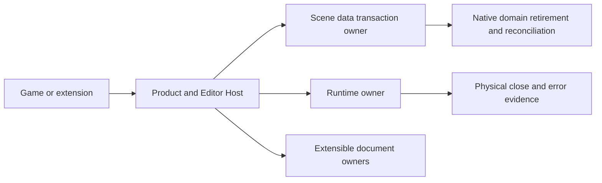
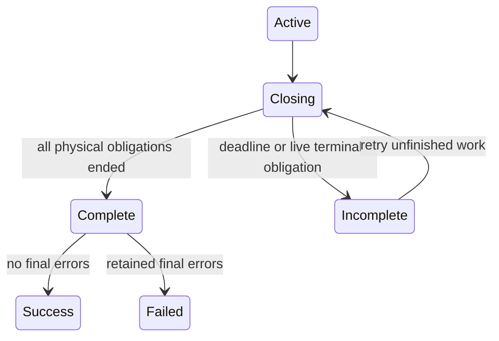

# Simplify Engine Workflow And Ownership Boundaries

## Goal Capsule

Make ordinary game production and independent extensions complete their supported workflows
without reproducing engine-owned lifecycle policy. Correct the reviewed defects and remove
unnecessary coordination and repeated validation at the owning boundaries.

The user authorizes pre-1.0 breaking refactors, removal of obsolete paths, and responsibility-based
decomposition of large files. Keep Bevy ECS. Accepted ADRs must be reconciled before changing their
contracts. The audit supplies evidence, not a requirement to build a universal framework.
Implementation, focused verification, independent review, and precise local commits are authorized;
remote publication is outside this work. No runtime correctness claim follows from documentation.

## Product Contract

### Summary

Repair input, rendering, and diagnostics; deepen runtime, Scene, Editor, and product Host owners;
then measure the two attributed cost mechanisms. Use real independent consumers to determine
extension interfaces.

### Problem Frame

The current code models resource custody carefully, but ordinary operations can be rejected by
over-broad classifications. Some individually correct modules require game or extension authors
to coordinate engine policy. Adding more protocol surfaces would compound this burden.

### Requirements

- R1. Nonmodal UI misses reach gameplay while valid capture, disabled targets, modal blocking,
  and stale-route rejection preserve their existing guarantees.
- R2. Instance tint does not split compatible adjacent Sprite batches; complete-frame impossible
  image demand is distinguished from transient residency pressure across views and UI.
- R3. Startup failure, shutdown outcome, physical retirement, and final close errors remain
  distinct through App, runtime, and product Host reporting.
- R4. Ordinary Scene/Prefab failures retain actionable structured format categories without
  exposing arbitrary document content.
- R5. Independently installed native domains can retire and reconcile owned runtime state during
  hosted Scene travel without game-owned sequencing of each domain.
- R6. A complete source-local Scene supports EntityRef assignment through ordinary field editing,
  history, persistence, and strict validation.
- R7. One independent non-Scene document consumer participates in Host-owned dirty state, history,
  Save/Reopen, and close decisions through a narrow public extension interface.
- R8. Ordinary product entrypoints delegate bootstrap, source opening, and cleanup policy to one
  product Host owner while advanced explicit driving remains available.
- R9. Ordinary task admission avoids rebuilding an unpressured pending queue. Repeated stable-ID
  catalogue work is measured before selecting shared caching.
- R10. Responsibility-based module boundaries replace monolithic code where the touched contract
  provides a real seam. Validation is performed at the owner that can establish the relevant fact.

### Scope Boundaries

No custom ECS, universal scripting kernel, dynamic ABI, generic transaction rollback, new executor,
unrestricted Any command bus, or generic graph editor. Do not weaken persistent atomicity or
pretend that live native resources are safely retired. Unknown/unavailable authoring records must
remain preservable. Do not introduce a Rust source-analysis release checker.

### Success Criteria

Real consumers demonstrate each changed workflow through public interfaces. Focused regressions
cover the original failures and the distinctions the fix introduces. Remaining platform, native
presentation, and timing limits are explicit. The final review can identify each remaining public
protocol's owner and why its validation is necessary.

## Planning Contract

### Key Technical Decisions

- KTD1. Keep Bevy ECS and the existing ownership foundation (session-settled: user-directed —
  chosen over replacing the ECS now: workflow and ownership defects do not require new storage).
- KTD2. Prefer correct breaking refactors to adapters around obsolete interfaces (session-settled:
  user-directed — chosen over minimizing changed lines: the engine is early in development).
- KTD3. Model physical close completion separately from final error evidence. A completed participant
  can retain a failure result; a genuinely live terminal obligation remains incomplete. One runtime
  query owns final-error interpretation, including product Host consumers.
  The ordinary process entrypoint reports retained participant/phase/code facts and explicitly
  terminates on an expired live cleanup obligation. Advanced embedded Hosts receive the retained
  owner and choose their own owner-thread lifetime policy. TLS abort remains a last-resort guard.
- KTD4. Split runtime implementation around close/ledger, custody, publication/admission, faults,
  and driving only where those responsibilities are cohesive. Keep the public facade stable when
  no semantic replacement is required; avoid proliferating public types for file organization.
- KTD5. Validate external or mutable facts at admission; use admitted values internally rather than
  repeating equivalent checks. Revision, authority, and resource-lifetime changes require their own
  checks because they establish different facts.
- KTD6. Native retirement is explicit and owned. Prove two independent domain participants through
  hosted travel; do not run arbitrary effects inside persistent-data rollback.
  The first protocol supports synchronous nonblocking domain operations, not multi-frame pending native
  work. The Scene request owner retains a finite travel attempt and per-participant progress after
  retirement begins. Gameplay cannot continue against a partially retired Scene. Failed retry
  advances only unfinished retirement or reconciliation; Stop retains the attempt's custody.
- KTD7. Start EntityRef support with source-local targets and complete validation. Leave cross-prefab
  instance/projection semantics unchanged until that specific workflow is designed.
- KTD8. Derive extensible document ownership from one small independent dialogue document consumer.
  Keep toolkit widgets outside the document owner and source authority in the product Host.
  Domain owners retain typed content, commands, history/inverses, and codecs. Workspace owns identity,
  dirty/history projections, and close decisions. Product Host owns capabilities, async I/O custody,
  and exact publication receipts; plugins do not create a parallel filesystem writer.

### Assumptions

The independent dialogue fixture is a suitable concrete consumer for R7. Native tests may use
deterministic handle-owning services to establish lifecycle ordering; hardware SDK integration
and frame-time claims require separate native measurements. Performance changes must report
operation counts or timings rather than infer P99 improvements from source changes.

### High-Level Technical Design

Scene travel prepares and validates the next persistent candidate before retiring the previous
instance's native domains. Publication and native reconciliation have distinct results. A failure
after irreversible retirement is reported honestly rather than described as transaction rollback.

## Implementation Units

### U1. Restore Ordinary UI Input Routing

**Goal / requirements:** R1, R10.
**Dependencies:** none.
**Files:** `crates/nara_ui/src/interaction/transaction.rs`, relevant interaction routing modules,
`crates/nara_ui/src/adapter_tests.rs`; kernel outcome types only if they own the distinction.
**Approach:** Classify ordinary unhandled input at the admitted presented session. Reuse existing
timeline pass-through finalization. Preserve release/capture changes that must commit.
**Test scenarios:**
1. Clicking inside a nonmodal Surface outside its button starts the gameplay action.
2. Unsupported pointer input and unfocused activation pass through only when unblocked.
3. Modal, disabled, stale-route, and captured release behavior remains correct.
**Verification:** Focused UI/input tests and relevant existing adapter coverage.

### U2. Correct Render Batching And Residency Progress

**Goal / requirements:** R2, R10.
**Dependencies:** none.
**Files:** `crates/nara_sprite_render/src/types.rs`, `queue.rs`, `tests.rs`,
`crates/nara_render_wgpu/src/texture.rs`, `backend.rs`, and renderer tests.
**Approach:** Remove per-instance tint from GPU compatibility; preflight complete deduplicated exact
Image demand across all target views and UI before mutating residency preparation.
**Test scenarios:**
1. Adjacent differently tinted compatible instances form one batch with their original colors/order.
2. Distinct sampler, alpha mode, texture, or extension state still separates incompatible batches.
3. An impossible aggregate working set reports finite content rejection.
4. Old inflight occupancy remains retryable and recovers when released.
**Verification:** Sprite tests and renderer residency/complete-target tests; distinguish CPU and GPU evidence.

### U3. Separate Close Completion From Failure And Decompose Runtime

**Goal / requirements:** R3, R10; KTD1-KTD4.
**Dependencies:** none.
**Files:** `crates/nara_app/src/lib.rs`, `runtime.rs`, new responsibility modules under
`crates/nara_app/src/runtime/`, runtime integration tests, `src/project_host/runtime.rs`,
ADR 0084 and `docs/architecture/adr/implementation-status.md`.
**Approach:** Correct shutdown classification first. Add completed-with-error participant outcome,
central final-failure interpretation, and actionable incomplete-obligation diagnostics. Extract the
close ledger/custody implementation without widening visibility beyond the facade's needs.
**Test scenarios:**
1. Failed build with successful shutdown physically retires without a shutdown-failure flag.
2. Completed-with-error reaches physical Stopped but finish/Host preserve failure.
3. A retryable error followed by completion does not become a final terminal failure.
4. A terminal live obligation remains incomplete and is never destroyed as retired.
5. Existing owner-thread, publication, quarantine, and restart tests preserve their contracts.
**Verification:** App/runtime suites and product Host close consumers, including API compilation.

### U4. Preserve Structured Content Failure Reasons

**Goal / requirements:** R4.
**Dependencies:** none.
**Files:** `src/project_content.rs`, `src/project_host/authoring/document.rs`, their tests,
and Scene format error accessors if necessary.
**Approach:** Preserve safe typed categories, locations, versions, and budget facts at the product
boundary. Keep stable outer diagnostic codes where appropriate; remove flattening helpers.
**Test scenarios:** malformed data, unsupported version, and exceeded format budget are distinguishable
through Check and ordinary document Open, without raw source content in diagnostics.
**Verification:** Focused project content and authoring tests.

### U5. Compose Native Domains Into Hosted Scene Travel

**Goal / requirements:** R5, R10; KTD6.
**Dependencies:** U3.
**Files:** `src/project_host/runtime/scene_requests/`, relevant `crates/nara_scene/src/` owners,
`tests/fixtures/module-consumer/tests/support/domain_reconciliation.rs`, hosted travel tests,
relevant Accepted ADRs and implementation ledger.
**Approach:** Give the managed Scene owner one bounded integration point for retiring domain-owned
runtime components and reconciling the published instance. Remove game-owned domain choreography
from the consumer. Derive the narrow interface from two independent participants.
Prepare World-dependent codecs, identities, hierarchy, resource budgets, overlays, and staged asset
publications before native retirement. Lifecycle admission distinguishes runtime components explicitly
claimed by registered domains from unclaimed hooks, which remain rejected. Retain the exact prepared
candidate and its baseline; revalidate after supported domain removals without re-running external
effects. Extend the request result to distinguish intact rejection from degraded travel. This unit
does not introduce Scene-only unload; its unload case is existing runtime Stop/retirement.

| Phase | Current data and availability | Retry and cancellation |
|---|---|---|
| Prepared, no native retirement | Old Scene remains usable | Reject/cancel without touching native owners |
| Some domains retired | Old data retained, gameplay suspended | Retry unfinished domains; Stop owns remaining responsibility |
| Persistent commit finished | New data published, native readiness incomplete | Reconcile unfinished domains only |
| All domains reconciled | New Scene usable | Complete and acknowledge request |

**Test scenarios:**
1. Two independently installed hook-owning domains survive replace/unload with exactly-once retirement.
2. Invalid next data leaves the current instance and native owners untouched.
3. Irreversible native failure retains truthful state and permits only the supported retry phase.
4. A retires and B fails: retry does not retire A twice. After commit, A reconciles and B fails:
   retry rebuilds only B. Unclaimed lifecycle effects still reject before native retirement.
**Verification:** Existing atomic Scene rejection tests plus public hosted two-domain travel consumer.

### U6. Complete Source-Local Entity Reference Editing

**Goal / requirements:** R6; KTD7.
**Dependencies:** U4.
**Files:** `crates/nara_scene/src/authoring_decode.rs`, authoring field tests, tooling field/history
tests, `editor/src/frontend/imgui/authoring/value_draft.rs`, Inspector controls and tests, ADR 0090.
**Approach:** Admit locally resolvable source references through the ordinary lane, retain one owner
for referential integrity, and reuse history/persistence. Preserve unavailable records.
**Test scenarios:** valid assignment and clear, absent target rejection, undo/redo, save/reopen,
and strict Check/Play; unsupported cross-source semantics stay explicit.
**Verification:** Scene/tooling/Editor tests and native qualification appropriate to changed controls.

### U7. Integrate One Independent Document Owner

**Goal / requirements:** R7, R10; KTD8.
**Dependencies:** U3 and the content-diagnostic/persistence boundary from U4. U6 may execute first
to avoid Editor file contention but is not an architectural prerequisite.
**Files:** `crates/nara_tooling/src/workspace.rs` and responsibility modules,
`src/project_host/runtime/editor/`, `editor/src/workspace/panels.rs`, panel context, external
consumer tests, ADR 0118 and document extension guide.
**Approach:** Separate document lifecycle from Scene-specific editing. Add only the type-erased
ownership boundary needed by an independent dialogue document; keep typed domain commands and
frontend-owned presentation. Migrate Scene/Prefab through the same lifecycle where appropriate.
**Test scenarios:** external registration/open, edit/history, dirty state, save/reopen, stale completion,
close cancel/discard/save, and panel retirement without losing the document.
**Verification:** Workspace/Host tests, external consumer, and affected native Editor qualification.

### U8. Deepen Ordinary Product Launch

**Goal / requirements:** R8, R10.
**Dependencies:** U3.
**Files:** `src/project_host/product_launch/`, runtime action entrypoint, starter desktop/library,
collect and two-level game entrypoints, product launch tests and guide.
**Approach:** Centralize bootstrap, explicit directory opening, product identity, source verification,
and incomplete close driving in the product Host. Retain the existing advanced managed driver.
**Test scenarios:** development launch, inherited supervised bootstrap, portable export launch,
startup failure, and bounded incomplete cleanup all retain correct outcomes.
**Verification:** Starter/sample compilation and existing launch/export tests; no new release claim.

### U9. Remove Attributed Queue Cost And Qualify Catalogue Work

**Goal / requirements:** R9, R10.
**Dependencies:** none for queue admission; U4 for the catalogue measurement context.
**Files:** `crates/nara_tasks/src/runtime.rs` and tests, project catalogue/delivery owners and tests
only if measurement warrants reuse, benchmark/evidence document.
**Approach:** Append ordinary unpressured queue admissions directly; reclaim cancelled nodes at
capacity pressure and retain explicit coalescing behavior. Measure stable-ID multi-root work before
selecting an operation-owned complete index; do not add an authoritative long-lived cache by default.
**Test scenarios:** ordinary burst, cancelled capacity recovery, coalescing/cancellation races and
physical custody; stable-ID multi-root scans, duplicate identity, and changed-source revalidation.
**Verification:** Task suite and measured operation counts/timings with declared workload limits.

## Verification Contract

Use sequential Cargo commands, existing target, and `CARGO_BUILD_JOBS=1`. Prefer focused nextest
while implementing, then run the affected integration and public API consumers. Run `cargo fmt --all`
after inspecting the working diff; preserve concurrent changes. Native Editor claims follow
`docs/verification/native-editor-qualification.md`; unexecuted platform/GPU cases remain explicit.

Start behavioral repairs from the reproduced failures or strengthen existing tests before changing
implementation. At phase boundaries review simplification and public API ergonomics independently.
Record evidence in a dedicated verification record rather than adding progress state to this plan.

## Definition of Done

All active units satisfy their stated workflows and verification, obsolete paths are removed,
durable ADRs and the implementation ledger match the code, and independent review finds no
unresolved correctness defect in the changed contracts. Remaining measurement/platform limits are
reported. This refactor prepares the user's next bottom-up architecture audit; it does not claim
that every engine subsystem has been requalified.
