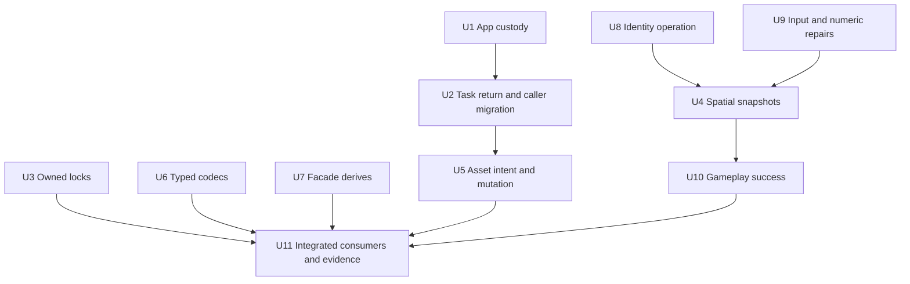

# Replace Incomplete Low-Level Contracts

## Goal Capsule

- Objective: ordinary games, modules and Editor workflows can use spatial data, persistent components, assets and owned services without recreating engine-owned validity or cleanup protocols.
- Means: replace the incomplete contracts in D1-D8 with complete owner operations, migrate actual consumers, remove obsolete paths, and qualify failures as well as successful workflows.
- Authority: the user authorizes planning, implementation, breaking source changes, ADR corrections, independent review and precise local commits. Accepted ADRs remain authoritative until their affected clauses are reconciled. The origin and audits supply evidence rather than implementation status.
- Execution: one canonical checkout on the existing branch, one Cargo process, root target reuse and `CARGO_BUILD_JOBS=1`; no remote publication is included.
- Completion: every in-scope finding has source and executed acceptance or an evidence-backed design disposition; independent review has no unresolved blocker. The coordinating agent owns implementation, verification and local commits.
- Escalation: ask only when a newly discovered consequential product choice cannot be resolved from existing authorization. Build failures, implementation difficulty and stale memory are work to resolve, not scope reductions.

---

## Product Contract

### Problem Frame

The original review found ten defects and six interface debts; the reassessment adds three source-confirmed gaps and one concrete snapshot consumer requirement.
The repeated mechanism is information loss or fragmentation at a public interface: custody, type relationships, desired state, publication association and temporal meaning are reconstructed by callers.
Pre-1.0 permits changing these contracts before more engine domains depend on them.

### Requirements

| ID | Required behavior | Origin |
| --- | --- | --- |
| R1 | Rejected App close-participant activation preserves a reachable cleanup owner through incomplete close and retry | L01, D1 |
| R2 | Per-task physical return and physical running observation cover executor-owned disposal, distinct from first terminal and transferred results | E02, A04, D1 |
| R3 | A native lock has one Rust release owner; acquisition/release failure preserves the corresponding capability | L07, D3 |
| R4 | Spatial readers consume explicitly identified immutable simulation/presentation cuts; no movable ECS Global component or caller token join grants completion | L03/L04/E04/A02, D2 |
| R5 | Valid non-spatial grouping terminates spatial inheritance without skipping ancestors; readers use the same cut's effective parent frame | A01, D2 |
| R6 | Image retains latest desired metadata/configuration through supersession, rejection and failure independently from last-good pixels | L05, D4 |
| R7 | Managed asset mutations admit their actual value/state pairing before baseline capture, then reject stale success, failure and removal atomically | E03, D4 |
| R8 | Watcher transport preserves invalidation scope or retains an owned rescan obligation; overflow cannot silently consume unprocessed coverage | L06, D4 |
| R9 | Public codec registration retains component T through preparation; batch/asset context and persistent admission guarantees remain intact | E01, D5 |
| R10 | Supported ECS derives work through root/direct/renamed Nara dependencies; ordinary Identity mutation owns its borrowing and effect admission | L02/L09/E05/A03, D6 |
| R11 | Shape budgets precede Nara-owned map-key copies; admitted finite interpolation endpoints do not overflow their angular intermediate | L08/L10, D7 |
| R12 | Gameplay success-dependent capture/acknowledgement observes the exact batch success state; Schedule ordering remains distinct from success and rollback | E06, D8 |
| R13 | Migrate all actual callers and delete superseded public/private paths; reconcile ADRs and retain truthful implementation/verification limits | User request, repository replacement policy |

### Scope Boundaries

Keep `bevy_ecs`, one execution owner, explicit domain effects, stable identities and persistent/native transaction separation.
No universal transaction, executor, importer, resource ledger, scripting layer, ABI or Rust source-analysis framework is introduced.
This plan selects no new persistent wire format; supported fixture/source changes need explicit migration if implementation establishes a format change.

Prior O1-O6 opportunities remain separately triggered: ordinary run conversion, submitter destructor cost, per-root copies, entity-picker scale, thread-affine pollable service and synchronous extension codec costs.
Do not promote them into mandatory generic infrastructure to finish this plan.
Do not discard user changes or inspect/modify the preexisting untracked `vendor/`; `repo-ref/` is read-only.

### Success Criteria

Every R-ID is exercised through its owning module and a real affected consumer.
No migrated consumer compares spatial completion generations, maintains a local `PhysicalReturn`, or supplies a hidden Bevy alias for a supported derive.
Failure tests assert unchanged data and retained custody, not only an error code.
Spatial performance is compared on the existing 4,096-member workload with unchanged/static, sparse/root-dirty and interpolation cases; investigate material regressions before closure and record separate runs rather than claiming an invented FPS target.
Platform evidence names the actual platform and does not equate compile-only checks with native qualification.

---

## Planning Contract

### Key Technical Decisions

- KTD1. Retain Bevy ECS and replace wrong contracts in place (session-settled: user-directed — chosen over compatibility layers and minimal patches: pre-1.0 correctness and caller simplicity take precedence). Governs R1-R13.
- KTD2. App accepts participant custody before fallible activation while standalone ledger rejection returns ownership. Preserve consuming App-to-runtime conversion; no completed-runtime reopen service. Governs R1.
- KTD3. Use a return observer independent from `TaskState<T>`; publication follows executor disposal including rejected late results, with cleanup failure classified. Transferred terminal outputs and external owners remain outside its guarantee. Governs R2.
- KTD4. Use an owned, non-cloneable locked capability; no second lock acquisition on it, no automatic OS guarantee upgrade. Governs R3.
- KTD5. Select private phase-stamped immutable spatial snapshots and remove Global's Component identity (session-settled: user-approved — chosen over repairing component caches behind a freshness facade: actual consumers read a cut then spawn/retire). Historical simulation reads seed mutation. Resolve runs after propagation and before Finalize; Finalize/Capture can read that same completed tick cut with its original stamp without joining the before-Finalize helper. Presentation uses one captured input cut. Governs R4/R5.
- KTD6. Separate Image desired state, in-flight attempt and usable publication; share only existing store/revision admission mechanics across asset domains. Retain unresolved source observations before a queue can reject them. Governs R6-R8.
- KTD7. Type codec candidates until private erasure; preserve owning deferred closures, one scratch AssetServer per batch and exact lifecycle admission. Governs R9.
- KTD8. Complete derives with a bounded path-parameterized extraction from the exact released Bevy 0.20.0 macro source; no token string rewriting or independently redesigned unsafe expansion. Current upstream exposes neither a Bundle/SystemParam path attribute nor macro-logic helper. Keep source/license provenance and lock runtime/helper versions together. Prefer private helper modules in the existing derive crate unless packaging has an actual reuse need; do not copy the entire upstream macro-logic crate. Governs R10.
- KTD9. Prefer shared Identity preparation and short index publication over resource extraction; genuinely needed extraction is admitted before its first effect. Governs R10.
- KTD10. Gameplay requires an exact batch success policy. A returning system error handler does not promise immediate schedule abort; no universal scheduler change is justified. Governs R12.

### ADR Correction Map

| Contract | Required treatment | Unit |
| --- | --- | --- |
| 0084/0117 custody | Repair lost owner paths; document the unconditional App transfer contract without new runtime lifetime | U1 |
| 0008/0052/0080 tasks | Add exact per-task return scope and align physical running accounting; keep domain integration ownership | U2 |
| 0070 filesystem | Refine release ownership for owned lock and preserve platform/proof axes | U3 |
| 0097/0100/0101/0117 spatial | Refine component-query and token completion clauses to snapshot roles, publication identity and domain boundaries; preserve hierarchy/lifetime separation | U4 |
| 0033/0037/0103/0115/0117 assets | Clarify retained desired observation and managed storage association without absorbing concrete recipe policy | U5 |
| 0081 reflection | Refine public typed candidate/encoder contract; keep stable schema and native binding proofs | U6 |
| 0002/0044 facade | State supported derive paths and their upstream coupling; do not claim full Bevy compatibility | U7 |
| 0058 identity | Repair first-target admission and preparation effect order; document normal World-oriented operations | U8 |
| 0049/0068 and spatial numerics | Repair existing bounded guarantees, not add new parser/numeric framework | U9 |
| 0023/0024/0057/0084 Gameplay | State success-sensitive finalization and exact retry/fault/deferred behavior; retain schedule-boundary fault detection | U10 |

Revise a focused existing ADR when it changes only that decision's clause.
Create the next unassigned ADR only when a durable choice does not fit its existing owner; retain reciprocal refinement links.
Never silently treat a historical test as evidence for a replacement.

### Dependency Shape

Units can be investigated concurrently; overlapping source edits and Cargo remain coordinated.
Land narrow independent correctness repairs before the larger spatial migration.
U4 may use the current numeric code while U9 is prepared, but final spatial acceptance includes U9.

### Assumptions And Deferred Details

Windows 11 is the current native environment; Linux FS mechanism tests require the existing WSL/native path and separate evidence.
Reuse the existing target; independently compiled manifests need their declared lockfiles and no parallel Cargo.
Exact snapshot names, buffer layout and macro helper packaging are implementation details with bounded proofs, not permission to retain parallel public APIs.
The released macro source has a bounded extraction path; U7 must still compile and execute its actual generated code before making support claims.

---

## Implementation Units

### U1. Retain Every Transferred Runtime Close Owner

**Requirements:** R1/R13. **Dependencies:** none.

**Files:** `crates/nara_app/src/lib.rs`, `crates/nara_app/src/runtime/close.rs`, `crates/nara_app/tests/runtime_close.rs`, `docs/architecture/adr/0084-executable-runtime-ownership-and-isolation.md`.

**Approach:** apply KTD2 at the public registration entry; distinguish retained rejection entries from admitted unique IDs. Reuse existing close driving and ordinary PluginError.

**Test scenarios:**

1. Outside Build rejection retains a participant until App cleanup, without treating it as installed.
2. Undeclared and duplicate obligation errors poison the right construction and retain both owners.
3. Duplicate participant ID retires both exact participants once.
4. Pending close, incomplete close and retry keep the rejected owner reachable; callbacks precede Drop.

**Verification:** focused fresh App tests fail on original code and pass after repair; ordinary construction/runtime close tests preserve exact error and shutdown behavior.

### U2. Publish Executor-Owned Return And Migrate Preparation

**Requirements:** R2/R13. **Dependencies:** U1.

**Files:** `crates/nara_tasks/src/runtime.rs`, `crates/nara_tasks/src/tests/execution.rs`, `crates/nara_tasks/src/tests/close.rs`, `src/project_host/runtime/scene_requests/preparation.rs`, `src/project_host/authoring/source_index/preparation.rs`, `src/project_host/runtime/editor/document_open/preparation.rs`, their existing owner tests, task ADRs.

**Approach:** implement KTD3 at every execution/disposal path, retaining state independently from output storage. Move physical running completion after worker-owned disposal. Replace all three local return guards with the task observation without merging domain request slots.
For a rejected spawn that returns no handle, the spawn rejection path must still expose or complete the exact disposal outcome; a document Open must not wait forever for an observer it never received.

**Test scenarios:**

1. Queued/running cancellation reports terminal while gated captures/late-result destruction still hold return pending.
2. Normal completion, rejection, coalescing, panic and shutdown disposal reach the correct return or cleanup-failed state.
3. Dropping the handle before a blocking output destructor leaves physical running age/count active until disposal.
4. Observer clones do not retain output storage; already delivered output lifetime remains caller-owned.
5. Scene/Browser/Open cancellation cannot release a request slot or capabilities before physical return.

**Verification:** Tasks tests plus affected root preparation tests and at least Scene/Browser public flows pass; no migrated `PhysicalReturn` remains.

### U3. Replace Borrowed File Lock Guards With Owned Lock Capabilities

**Requirements:** R3/R13. **Dependencies:** none.

**Files:** `crates/nara_fs/src/file.rs`, `crates/nara_fs/src/lock.rs`, `crates/nara_fs/src/lib.rs`, `crates/nara_fs/tests/filesystem_contract.rs`, `src/project_host/file_publication.rs`, `src/project_workflow/repair.rs`, `editor/src/supervised_play/generation/store/scavenge.rs`, `samples/two-level-game/src/save/io.rs`, affected public exports/tests and ADR 0070.

**Approach:** apply KTD4; acquisition returns the original file on failure, release returns the locked owner on failure. Audit reader/duplicate aliases. Migrate markers to store the owner directly and remove forgotten guard workarounds.

**Test scenarios:**

1. A second lock on the same locked owner has no supported API; independent opens remain contended.
2. Explicit release, Drop, failed release and retry preserve correct ownership and contention.
3. Reader aliases do not grant new lock authority or undermine explicit unlock.
4. Save conflict, repair and generation marker retirement retain actual file identity and publication checks.

**Verification:** Windows and Linux FS lock tests separately; focused root persistence and Editor marker tests; no claim of stronger OS locking than observed.

### U4. Replace Transferable Global Components With Phase Spatial Snapshots

**Requirements:** R4/R5/R13. **Dependencies:** U8/U9 for final acceptance; no need to wait for unrelated asset work.

**Files:** `crates/nara_transform/src/lib.rs`, `crates/nara_transform/src/propagation.rs`, `crates/nara_transform/src/presentation.rs`, `crates/nara_hierarchy/src/lib.rs`, `crates/nara_render/src/lib.rs`, `crates/nara_sprite_render/src/extract.rs`, `reference-game/src/lib.rs`, `reference-game/src/systems.rs`, `reference-game/src/snapshot.rs`, `tests/workspace_play_runtime.rs`, `crates/nara_transform/tests/scale_measurement.rs`, `crates/nara_transform/tests/scale_allocations.rs`, affected UI/Scene consumers found by symbol search and spatial ADRs.

**Approach:** apply KTD5 with bounded owner slots/history/candidate buffers. Keep authored Transform mutable. Publish one captured local/topology/global/order cut with World/full Entity identity and runtime/phase/tick stamp. Historical mutation readers and completed fixed/presentation readers have explicit roles. Resolve's helper closes before Finalize; `capture_wave_snapshot` and `capture_project_snapshot` remain inside Gameplay Capture and read the same completed cut without that helper. Use actual ApplyDeferred boundaries. Remove old Global Component, token joins and dual-source presentation fallback in the same slice.

**Test scenarios:**

1. Startup seeds historical pursuit; pursuit reads old globals and writes locals before this tick's completion.
2. Consume then spawn/retire preserves the selected cut; next cut adopts source/member changes, including same-tick direct edits.
3. Wrong World/entity generation/phase, missing slot and failed projection reject without old-as-current publication.
4. Non-spatial parent terminates inheritance; removal/re-addition and real pursuit use the snapshot's effective frame without skipping ancestors.
5. Zero/multiple fixed steps, pause, step and resume produce the documented cuts; Finalize/Capture reads the same tick cut without a scheduling cycle.
6. Camera/Sprite/Tilemap consume the same presentation; live renderables absent from that cut do not use local fallback.
7. Old Global Component insertion/query consumers fail compilation; public consumers need no private set/token.

**Verification:** Transform/Hierarchy/render tests, reference headless gameplay, root workspace play and affected native canary; existing scale fixture runs compare CPU/allocation cost with a recorded old baseline.

### U5. Retain Desired Asset State And Admit Managed Store Associations

**Requirements:** R6/R7/R8/R13. **Dependencies:** U2 for retirement observations where used.

**Files:** `crates/nara_asset/src/storage.rs`, `crates/nara_asset/src/state.rs`, `crates/nara_asset/src/reload/source_changes.rs`, `crates/nara_asset/src/reload/resolution.rs`, `crates/nara_image/src/reload.rs`, `crates/nara_image/src/import/publication.rs`, `crates/nara_image/src/tests.rs`, `crates/nara_tilemap/src/content/publication.rs`, `crates/nara_asset_watch/src/backend.rs`, `crates/nara_asset_watch/src/lib.rs`, asset/watch tests and affected root content tests.

**Approach:** apply KTD6. Capture store association before a baseline; validate the same baseline on success/failure/removal. Retain metadata observations before reload request admission can reject them. Start with conservative sticky rescan for unproven directory/rename scope; the Host owns actual reconciliation and clearing.

**Test scenarios:**

1. Held metadata attempt superseded by next-frame pixels still uses latest desired settings.
2. Invalid metadata, rejected queues and failed decode preserve unresolved intent independently of last-good values.
3. Removal/recreation respects identity; late predecessors cannot resurrect retired content.
4. Wrong value/state pair, state replacement, empty-slot ABA and late failure/removal reject before side effects.
5. Directory remove/rename/root/unknown events and overflow retain coverage until a completed rescan.
6. Image/TileSet retain coherent immutable pixels, dependency revocation and supported code-first Prepare behavior.

**Verification:** domain library regressions and external/runtime content refresh consumers pass; Image/TileSet share admission rather than stacked duplicate guards.

### U6. Keep Public Codec Candidates Typed

**Requirements:** R9/R13. **Dependencies:** none.

**Files:** `crates/nara_reflect/src/persistent_apply.rs`, `crates/nara_reflect/src/registry.rs`, `crates/nara_reflect/src/tests.rs`, `crates/nara_reflect_derive/src/lib.rs`, Sprite/Tilemap/UI codecs, `crates/nara_reflect/tests/durable_references.rs`, independent component fixtures and ADR 0081.

**Approach:** apply KTD7; generic public candidate represents exactly one T, typed encoder receives selected T with necessary read context, private adapter erases for heterogeneous batches.

**Test scenarios:**

1. T/U candidate mismatch is a compile failure, not a first-value runtime discovery.
2. Deferred asset-aware preparation owns inputs; mixed-component batch failure publishes no earlier components or scratch assets.
3. Missing component selection belongs to registry; Sprite/Tilemap do not repeat type lookup.
4. Stable schema, context-dependent references, lifecycle rejection and mutable baseline drift remain checked.

**Verification:** Reflect/derive/domain tests and independently compiled persistent component and reference consumers pass.

### U7. Complete Facade Derive Paths

**Requirements:** R10/R13. **Dependencies:** none; exact generated-code qualification is part of U7.

**Files:** `crates/nara_ecs_derive/src/lib.rs`, `crates/nara_ecs/src/lib.rs`, Cargo manifests/lockfiles only where needed, existing renamed-root/ECS fixtures and `tests/fixtures/module-consumer`, Reference Game aliases and ADRs 0002/0044.

**Approach:** apply KTD8 with exact upstream coupling and licenses. Do not use the local `0.20.0-dev`/Syn 3 reference as the patch baseline for the released 0.20.0 dependency. Re-export adapted derives through root/prelude and `bundle`/`system` paths, including required hidden `ptr`/`__macro_exports` support. Remove caller aliases only after real generated-path support compiles and executes.

**Test scenarios:**

1. Root-only, direct ECS and renamed dependencies derive Component/Resource/Bundle/SystemParam and ordinary schedule labels.
2. Generic/lifetime/where-clause, const generics, field attributes, deferred apply and generated support paths compile and run.
3. Negative derive diagnostics remain actionable; no direct Bevy dependency or `as bevy_ecs` fix is required.

**Verification:** independent compile/execution fixtures pass under their manifest/feature combinations, with no token-source approximation.

### U8. Remove Identity Borrowing And Admission Gaps

**Requirements:** R10/R13. **Dependencies:** none.

**Files:** `crates/nara_identity/src/domain.rs`, `crates/nara_identity/src/lib.rs`, `crates/nara_identity/src/tests.rs`, `crates/nara_scene/src/spawn.rs`, `crates/nara_scene/src/tests.rs`, `tests/fixtures/module-consumer/tests/durable_identity.rs`, Identity/Scene callers and ADR 0058.

**Approach:** apply KTD9, retaining detached advanced operations. Admit first marker target observers regardless of prior marker presence; prepare exact entity retirement with shared reads instead of resource extraction.

**Test scenarios:**

1. First Add/Insert target observer rejects before effects; legal idempotent adoption works.
2. Public single-entity retirement with resource Remove/Insert observers rejects with zero callbacks and unchanged entity/indexes.
3. Domain remains installed after failure; tombstones, stale runtime locators and independent save/restore remain correct.
4. Normal consumer uses World-oriented operations without manual remove/reinsert/resource_scope choreography.

**Verification:** Identity/Scene focused tests and independent durable identity workflow pass.

### U9. Correct Input Budget And Interpolation Arithmetic

**Requirements:** R11/R13. **Dependencies:** none.

**Files:** `crates/nara_core/src/serde_shape.rs`, `crates/nara_transform/src/presentation.rs`, corresponding owner tests.

**Approach:** check borrowed keys before Nara copies them; distinguish parser-owned allocation. Compute angular difference in a sufficiently wide domain before wrapping/lowering.

**Test scenarios:**

1. Oversized borrowed map key rejects before the copy controlled by Nara; ordinary/owned/duplicate keys retain correct budgets.
2. Opposite-sign finite f32 extremes, pi crossing, equal angles and alpha 0/0.5/1 preserve finite matrices and exact endpoints.

**Verification:** focused Core/Transform regressions pass without a new parser framework or changed wire semantics.

### U10. Specify And Enforce Successful Gameplay Finalization

**Requirements:** R12/R13. **Dependencies:** U4 for final reference consumer acceptance.

**Files:** `crates/nara_gameplay/src/lib.rs`, `crates/nara_app/src/runtime/fault_route.rs` documentation, `tests/fixtures/schedule-extension/renamed-root/src/lib.rs`, affected reference tests and ADR 0057/0084.

**Approach:** first execute the missing failure trajectory; apply KTD10 by consuming exact domain success state or one fallible batch operation. Keep faulted effects/commands visible and do not imply rollback. Retrying a faulted generation requires explicit existing restart policy, not automatic duplicate command replay.

**Test scenarios:**

1. Consume errors before Capture/Acknowledge; final fault and actual later/deferred effects match the adopted policy.
2. Successful zero/multiple ticks and replay keep one acknowledgement per accepted batch.
3. Old generation/batch success cannot authorize a successor; Stop remains reachable.

**Verification:** Gameplay, App managed schedule and external extension consumers prove outcome effects as well as error reporting.

### U11. Qualify Integrated Public Workflows And Close The Refactor

**Requirements:** R1-R13. **Dependencies:** U1-U10.

**Files:** relevant guides, facade exports, `docs/architecture/nara-foundation.md`, ADR catalogue/ledger, verification/memory records, generated starter sources and independent/native fixture migrations.

**Approach:** delete superseded surfaces, complete source migrations, review all changed contracts against actual consumers and record each unit's evidence. Do not demand unrelated deferred features to claim closure.

**Test scenarios:**

1. Independent module and Reference Game run through public setup, content preparation, fixed simulation, extraction and physical Stop.
2. Editor affected Open/Save/Reopen/Play/Retry/Stop canary preserves publication and pending cleanup under failure.
3. Source/domain Check/Export and renamed dependency consumers retain feature isolation.

**Verification:** fresh affected cohorts, scoped lint/fmt/build and independent review show no unresolved blocker; ledger completion points to new source/evidence rather than this plan.

---

## Verification Contract

Commands run sequentially with the existing target and one build job.
Select focused filters during regressions, then the owning cohorts once behavior stabilizes.
Do not rerun all native acceptance after a documentation-only correction.

| Scope | Existing command family | Required evidence |
| --- | --- | --- |
| App | `cargo nextest run --locked -p nara_app --test-threads=1` | Original failing custody regressions then passing close/ownership/compatibility cohort |
| Tasks | `cargo nextest run --locked -p nara_tasks --test-threads=1` | Return/disposal/accounting, cancellation and shutdown |
| FS | `cargo nextest run --locked -p nara_fs --test filesystem_contract --test-threads=1` | Native platform-qualified ownership and publication behavior |
| Core/identity/spatial/reflect | `cargo nextest run --locked -p nara_core -p nara_identity -p nara_hierarchy -p nara_transform -p nara_reflect --test-threads=1` with owning serde features | Actual changed unit and integration regressions |
| Asset/render | Focused `cargo nextest run` for changed Asset/Image/Watch/Tilemap/Render packages and feature sets from their manifests | Desired state, watcher reconciliation, immutable resource/extraction coherence |
| Root workflow | `cargo nextest run --locked -p nara --features presentation-2d,serde,tooling --test-threads=1` with affected target filters | Public preparation/Scene/Editor/runtime effects |
| Independent modules | `cargo nextest run --manifest-path tests/fixtures/module-consumer/Cargo.toml --locked --workspace --test-threads=1` | No hidden dependency aliases and complete domain workflows |
| Reference Game | `cargo nextest run --manifest-path reference-game/Cargo.toml --locked --test-threads=1` | Historical pursuit, fixed snapshot and gameplay parity |
| Native Editor | The affected explicit Windows canary under `docs/verification/native-editor-qualification.md` | Name actual toolkit/backend/visibility/feature limits |
| Format/build/lint | `cargo fmt --all -- --check`; changed independent manifest fmt; scoped `cargo check`/`cargo clippy` | No new warnings/errors caused by changes; retained unrelated baseline warnings identified |
| Spatial costs | Existing `scale_measurement`/`scale_allocations` ignored harness with exact release filters | Original baseline versus new phase reads, propagation, static and interpolation costs; no unsupported global speed claim |

If a lockfile must change for the derive helper, regenerate intentionally, inspect the exact dependency delta and resume `--locked` checks afterward.
If current source compilation exposes an unrelated preexisting failure, reproduce and isolate it; do not silently downgrade a required behavioral check to source inspection.

Focused product trajectories use the existing `scene_requests::`, `browser_preparation::`, `file_publication::` and `persistence::` root library tests with `--no-default-features --features tooling,runtime-2d,serde`.
Retain the public Scene cancellation/reuse, Browser cancellation/exact acknowledgement and held scan session-close tests.
Derive qualification extends `tests/derive_dependency_fixtures.rs` and its renamed-root/renamed-ecs fixtures to Bundle and SystemParam; their current Component-only pass does not close L09.
Native spatial qualification includes `native_resume_redraw_rebases_paused_idle_before_the_owner_drive`, `native_game_input_reopen_paused_refocus_resize_and_step_reach_presented_runtime` and `native_views_detach_minimize_reopen_recover_and_retire_with_exact_receipts` with Windows `WGPU_BACKEND=dx12`.
Lock/publication migration additionally exercises `native_ordinary_scene_and_prefab_widgets_save_and_reopen_preserved_source` and `native_imgui_supervised_play_preserves_last_good_and_successor_generations` when those owners change.
The existing spatial harness includes 64, 4,096 and 65,536 populations; filter or report actual populations rather than presenting all rows as the 4,096 requirement.

---

## Definition of Done

All L01-L10, E01-E06 and A01/A03/A04 map to committed code plus acceptance, or an explicit evidence-backed disposition that actually resolves the original requirement.
A02 is satisfied by the real consume-then-spawn/retire and historical pursuit consumers.
Every R-ID is covered, and no obsolete public compatibility path remains merely to avoid migration.
Affected ADR clauses, catalogue/ledger and guides agree on what is selected, implemented and still unqualified.
Focused and integrated fresh checks pass within their named scope; spatial cost and native platform limits are recorded.
Independent review reports no unresolved blocking finding.
Each coherent unit has a precise Conventional Commit and recoverable engineering memory; user changes remain preserved.
Only then mark the development Goal complete.
