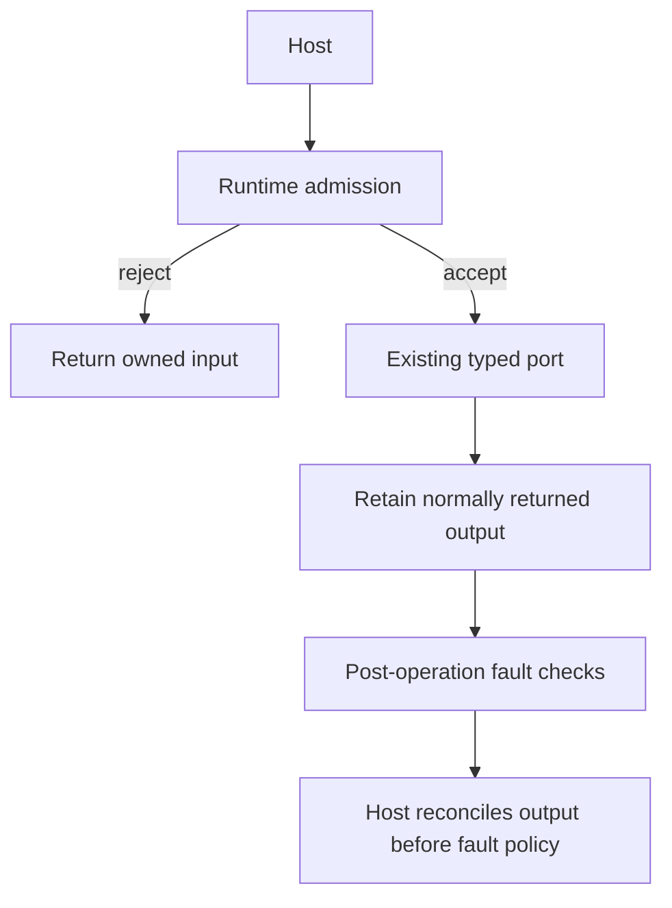
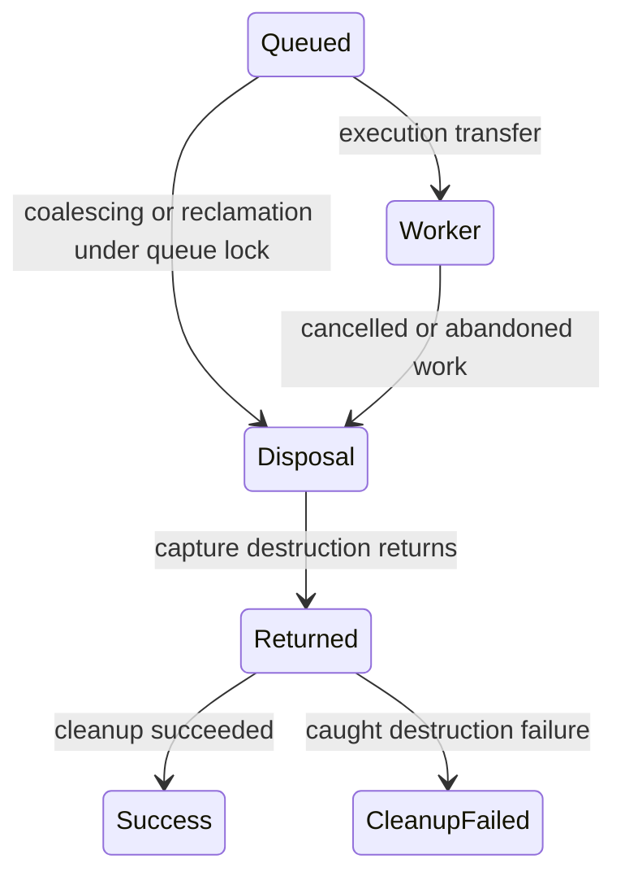
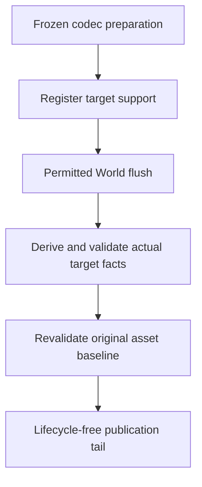

# Fearless Post-Boundary Contract Refactors

## Goal Capsule

Repair PB1-PB7 and complete E1/E2 through their existing owners, migrating real consumers rather
than retaining obsolete pre-1.0 interfaces. The user authorizes planning, implementation, independent
subagent review and precise local commits. This plan does not authorize PR publication.

Strategy and Accepted ADRs own product and durable contracts. The
[replacement design](../architecture/post-boundary-contract-redesign.md),
[audit](../audits/2026-10-23-post-boundary-architecture-and-interface-review.md) and
[pinned comparison](../research/2026-10-23-post-boundary-bevy-godot-comparison.md) explain the selected
repairs. The implementation baseline is `7c960f5`.

Finish only after every unit is implemented, its consumers migrated, applicable checks executed,
independent blocking findings resolved, and actual evidence recorded. A missing native prerequisite
is an explicit qualification gap, not a passing skipped test. Ask before changing an unresolved
product contract or overwriting concurrent work. Preserve the pre-existing untracked `vendor/`.

---

## Product Contract

### Requirements

| ID | Required outcome | Source |
| --- | --- | --- |
| R1 | A normally returned driver/candidate output survives subsequent fault checks; owned input survives pre-invocation rejection | PB1; design R1 |
| R2 | Physical close includes all admitted capture disposal and retains caught close-owned cleanup failure | PB2/PB4; design R2 |
| R3 | Borrowed reads cannot reposition a capability's ongoing write cursor | PB3; design R3 |
| R4 | Persistent target admission uses post-flush facts without legitimizing earlier asset interference | PB5; design R4 |
| R5 | Ordinary prepared Image consumers obtain identity and immutable pixels from one owner-issued capture | PB6; design R5 |
| R6 | Successful-removal recovery survives enumerated owner transitions but rejects external interference | PB7; refined design R6 |
| R7 | Ordinary exclusive Scene workflows use complete domain operations without repeated caller-side parameter assembly | E1 |
| R8 | Full ECS access explicitly names `bevy_ecs`, preserving original types and adapted derives | E2 |

Keep Bevy ECS, the selected Nara authoring surface, the managed Runtime owner, frozen component
codecs and concrete domain execution. Preserve cancellation, stale-result rejection, exact mutation
baselines, last-good publication, native callback affinity and retirement ownership.

No new migration guide, ECS replacement, global executor, generic transaction/rollback system,
writer-provenance log or speculative framework is in scope. Existing migration history remains.
`repo-ref/` is evidence only. Performance gains and unexecuted platform parity are not acceptance.

---

## Planning Contract

### Key Technical Decisions

- KTD1. Separate admission, returned output and post-operation fault. A scope error means not invoked;
  the returned envelope has no general lossy conversion. Typed owned-port admission owns staging.
- KTD2. Track task disposal under the existing queue synchronization before releasing custody;
  destroy outside the lock. Outstanding custody and sticky cleanup-failure evidence are distinct.
- KTD3. Keep exact-handle filesystem authority and use a capability-owned logical write offset with
  platform positional writes. No reopening, append API expansion or duplicated lock owner.
- KTD4. Determine persistent support insertion after the last allowed flush; retain the originally
  captured asset baseline and revalidate it before commit.
- KTD5. Image constructs coherent prepared values. Remove generic storage only if the production
  consumer inventory establishes that it has no independent purpose.
- KTD6. Keep the selected bounded recovery witness, with an explicit finite transition table.
  Diagnostic-only capacity rejection is not selected: it can strand superseded Loading attempts.
- KTD7. Domain Scene access and dependency naming are separate improvements. SystemState remains a
  legitimate advanced tool; no implicit flush or resource removal/reinsertion hides borrowing.

### High-Level Technical Design

These sketches describe responsibilities, not mandatory implementation syntax.

Recovery eligibility is separate from both an attempt baseline and desired import settings:

| Transition | Eligibility policy |
| --- | --- |
| Successful removal of usable Image | Issue pixel-free recovery authority for this exact owner association |
| Accepted recovery from still-eligible baseline | Carry authority into the admitted attempt |
| Known resolver item/byte rejection from eligible owner state | Carry authority while preserving Failed/generation/diagnostic semantics |
| Validated retryable owner failure | Carry authority only after exact post-resolution validation |
| External state/slot write, replaced stores or raw empty-slot ABA | Invalidate; a later legitimate rejection cannot restore it |
| Successful superseding publication, invalid metadata or real revocation | Invalidate/consume according to the owning operation |

U1 precedes integration of other correctness units. U2-U4 have disjoint owner code and can be
authored concurrently after plan review; their verification and canonical commits remain serial.
U5 precedes U6 Image integration. U7/U8 follow correctness repairs so naming churn cannot hide them.
No subagent runs Cargo, formatting across the workspace, or canonical commits.

---

## Implementation Units

### U1. Lossless Runtime and Host Driver Outcomes

- **Covers:** R1, KTD1. Own `crates/nara_app/src/runtime.rs`,
  `crates/nara_app/src/runtime/owner.rs` and all driver/admission consumers.
- **Work:** Introduce the returned-output/fault envelope and typed owned input-returning entry.
  Remove the lossy path and Game View external Option inference. Reconcile task admission, Image
  publication, candidate acquisition/completion and retirement before applying fault policy.
- **Tests:** `crates/nara_app/src/runtime.rs`, `tests/runtime_driver_boundary.rs`,
  `tests/runtime_instance.rs`, and existing Game View/Image Host tests under
  `src/project_host/runtime/editor/`. Prove returned move-only values survive post-check faults;
  rejected scopes never invoke; typed admission returns original input; sticky fault still permits
  the intended retirement/Stop path. Cover success and port-level rejection independently.
- **Execution note:** Add a current-source regression before changing owner behavior. API-shape
  migrations may require compile-driven updates, but must not convert owned outputs lossily.
- **Contract:** Reconcile ADRs 0076/0117; update hidden API documentation and affected examples.

### U2. Admitted Disposal and Truthful Task Close

- **Covers:** R2, KTD2. Own `crates/nara_tasks/src/runtime.rs`,
  `crates/nara_tasks/src/tests/close.rs`, `crates/nara_tasks/src/tests/execution.rs`.
- **Work:** Add private disposal custody and bounded failure summary; carry reaper outcomes into
  typed shutdown reporting and existing Runtime CompleteWithError/Stop diagnostics.
- **Tests:** Barrier-controlled coalescing/reclamation overlapping close; timed-out close retry;
  close-owned destructor panic; worker and reaper paths; observer Pending/Returned/CleanupFailed;
  healthy close and ordinary task business failure remain distinct.
- **Contract:** ADR 0052 and affected Runtime close clauses. No new worker pool.

### U3. Capability-Owned Write Position

- **Covers:** R3, KTD3. Own `crates/nara_fs/src/file.rs`, required
  `crates/nara_fs/src/platform/` helpers and `crates/nara_fs/tests/filesystem_contract.rs`.
- **Work:** Preserve write offset across writer reacquisition; update by actual partial writes;
  keep readers independent and capability/lock custody unchanged.
- **Tests:** Write prefix, partial read/seek, reacquire writer, append suffix at logical offset;
  multiple readers and ordinary staging/replacement/owned-lock controls. Execute Windows locally;
  record Linux runtime qualification separately if unavailable.
- **Contract:** ADR 0070 and current filesystem API documentation.

### U4. Post-Flush Persistent Admission

- **Covers:** R4, KTD4. Own `crates/nara_reflect/src/persistent_apply.rs` and its tests.
- **Work:** Fix direct and batch support insertion facts after flush, preserve frozen codecs and
  original asset interference guards, and remove obsolete pre-flush assumptions.
- **Tests:** Queue first persistent apply then ordinary direct/batch apply; conflicting stable/runtime
  binding; support observers/hooks; asset mutation during flush; Scene/Prefab consumers.
- **Contract:** ADR 0081. No callback execution in the prevalidated commit tail.

### U5. Image-Owned Prepared Capture

- **Covers:** R5, KTD5. Inventory `crates/nara_image`, `crates/nara_render`,
  `crates/nara_render_wgpu`, `crates/nara_sprite_render` and `crates/nara_ui` consumers first.
- **Work:** Construct identity/content together in Image, migrate packet/UI/GPU consumers, and
  remove arbitrary writable pairing. Retain immutable old/new packet behavior and code-first Images.
- **Tests:** Existing Image/render/UI owner tests plus code-first consumer and real-GPU warm-cache
  readback. An old packet must retain its original content after successor publication.
- **Contract:** ADRs 0033/0037 and affected render publication clauses.

### U6. Bounded Removal-Recovery Continuity

- **Covers:** R6, KTD6. Own `crates/nara_asset/src/reload/`, state-owner continuity and
  `crates/nara_image/src/reload.rs` with existing reload tests.
- **Work:** Implement the finite eligibility transitions above without relaxing exact per-attempt
  admission. Keep facts bounded and private; delete long-lived attempt-snapshot authority.
- **Tests:** Remove then repeated item/byte rejection and source-only retry; Loading A superseded
  by rejected B; with/without retained recipe; pair each allowed transition with external write
  before that transition. Include same-version writes, raw empty-slot ABA, replaced stores,
  metadata/removal ordering, stale tasks and successful import supersession.
- **Contract:** ADR 0037 and relevant Image publication clauses. No ownerless Loading or old pixels.

### U7. Complete Exclusive Scene Access

- **Covers:** R7, KTD7. Own `src/startup_scene.rs`,
  `src/project_host/runtime/scene_requests/api.rs`, their public exports/tests and
  `samples/two-level-game/src/gameplay/` consumers. These root-owned services must not move into
  `nara_scene` or create a reverse dependency for access convenience.
- **Work:** Share borrowed current-Scene reads and scoped ProjectScenes operations with scheduled
  access. No implicit advance/flush/acknowledgement and no resource remove/reinsert.
- **Tests:** Existing request cancellation/slot ownership, receipt association, two-level travel,
  Restart and fresh-process Save/restore through public APIs; prepared borrows cannot escape.

### U8. Explicit Full ECS Dependency Name

- **Covers:** R8, KTD7. Own `crates/nara_ecs/src/lib.rs`, import consumers and active guides.
- **Work:** Replace public `upstream` with `bevy_ecs` without a compatibility alias; preserve the
  derive provenance directory and historical evidence. Do not broaden the ordinary prelude.
- **Tests:** `crates/nara_ecs/tests/authoring_surface.rs`,
  `tests/fixtures/derive-dependencies/facade_contract.rs`, renamed-root fixture, six adapted derives
  and original World/component type identity. Search production imports for the deleted path.
- **Contract:** ADRs 0002/0044; no claim of an interchangeable ECS backend.

---

## Verification Contract

Run Cargo serially with `CARGO_BUILD_JOBS=1`, reuse `target`, and prefer focused nextest. Inspect
process/memory/disk pressure before substantial builds. The repository's qualified toolkit is
Rust 1.95.0; use its lockfile and existing profiles rather than incompatible cached artifacts.

| Scope | Verification | Required evidence |
| --- | --- | --- |
| U1 | `cargo +1.95.0 nextest run -p nara_app --lib --locked`; affected root/runtime tests | New regressions and migrated callers pass on current source |
| U2 | `cargo +1.95.0 nextest run -p nara_tasks --locked`; affected Runtime Stop/Host tests | Custody and failure reporting independently pass |
| U3 | `cargo +1.95.0 nextest run -p nara_fs --locked` | Windows mixed-cursor regression and lock/publication controls |
| U4 | `cargo +1.95.0 nextest run -p nara_reflect -p nara_scene --locked` | Queued apply and real persistent consumers, including Prefab in nara_scene |
| U5/U6 | Focused Image/Asset/render/UI nextest and affected GPU readback tests | Association, continuity, external-write negatives and immutable packets |
| U7/U8 | Public/direct/renamed fixtures and two-level consumer cohorts | No erased type identity, cancelled-slot leak or stale receipt admission |
| Native | Selected trajectories in `docs/verification/native-editor-qualification.md` | Actual Windows/DX12 Game View completion and affected Image paths execute |
| Integration | `cargo fmt --all -- --check`, scoped Clippy, link checks and `git diff --check` | No unrelated formatting, broken active references or unresolved review blockers |

Use existing feature combinations from the manifests/tests; a default-feature build does not
qualify a feature-gated Host. Record the exact commands, selected test counts and platform limits.
Before claiming a unit complete, review its final diff and run independent adversarial review of
the changed ownership/interface boundary. Canonical commits stage only attributed unit paths.

---

## Definition of Done

All eight units satisfy their requirement and test scenarios; obsolete paths are removed and
ordinary consumers use the new contracts. Related Accepted ADRs and implementation ledger cite
actual implementation/evidence, not proposed design. No blocking independent finding remains.
Native acceptance is limited to executed trajectories; unavailable Linux/macOS or performance
evidence is explicitly left unclaimed. Precise Conventional Commits and engineering continuity
identify delivered units and any remaining work without rewriting this plan as a status tracker.
