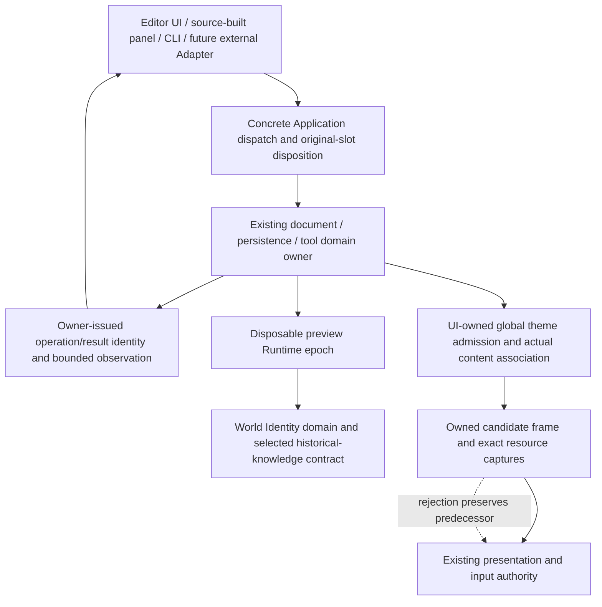

# Chat-Informed Foundation Redesign Plan

Date: 2026-10-23. Baseline: `f91466b0626543688bd98923dbd04fb842028120`.
Status: Proposed. No production unit in this plan is implemented by the review that created it.

## Outcome

Correct the concrete lifetime, content-association and observation seams identified in the
[chat-informed audit](../audits/2026-10-23-chat-informed-engine-architecture-review.md), while
preserving the original Bevy ECS substrate and Nara's real source/Runtime/Host ownership split.
Treat the supplied architecture conversation as a source of questions, not a replacement for
Accepted ADRs or the complete Rust production strategy.

The review reproduced Stop ticket/result loss, small-budget projection claim exhaustion and
same-revision mixed theme visuals. Other findings are source-confirmed, and the asset-copy/glyph
budget items need measurement or a separately selected execution guarantee. The verification
record retains the exact distinction; a green witness of undesirable current behavior is not a fix.

## Design Alternatives

| Approach | Benefit | Cost/risk | Disposition |
| --- | --- | --- | --- |
| Patch callers, increase history/claim caps, manually increment theme revisions | Small local diff | Retains missing identity/lifetime facts, repeated caller knowledge and finite-repeat failure | Reject as the final architecture; temporary diagnostics may remain useful. |
| Replace ECS, merge document truth into EditorWorld, add universal job/service/automation kernels | Apparently uniform vocabulary | Weakens supported lossless/data-only workflows and freezes speculative interfaces; no counterexample establishes a need | Reject. |
| Refactor the owning contracts and retain thin concrete adapters | Locality, stronger interfaces, deletable obsolete paths | Requires coordinated breaking caller changes and focused behavior tests | Recommended. |
| Defer every finding until a larger product | Avoids immediate change | Known repeated editing and observable-operation paths remain structurally incomplete | Accept only for explicitly gated F6/F9 investigations and separate extension research. |

Unreleased replacements take canonical unsuffixed names. Delete superseded interfaces instead of
adding deprecated aliases, V2 APIs, compatibility adapters or a new migration guide. Existing
historical migration material is not removed or expanded merely to log each internal API change.

## Ownership Shape



These are roles at existing owners, not a new shared service graph, trait hierarchy or set of
crates. Runtime control, persistence results, document commands and tool failures retain their
domain-specific types and state machines.

## Ordered Units

### R1: Select A Sustainable Preview Identity Lifetime (F5)

**Owners:** root Editor preview, Scene materialization and Identity. This is the highest-priority
design decision, not permission to silently weaken Identity lookup semantics.

1. Reproduce the tiny-budget failure through the actual Editor revision-to-preview path, including
   a normal known field edit rather than only the already exercised materializer witness.
2. Write the required knowledge table: live lookup, never-issued identity, recent retired identity,
   old retired identity, wrong World/runtime, explicit restore and partial retirement. State which
   distinctions callers genuinely require after an epoch/history boundary.
3. Compare these bounded alternatives before implementation:
   - roll the disposable preview Runtime at an explicit claim/epoch boundary, retaining current
     Identity guarantees inside each domain;
   - admit explicit expired/unverifiable historical knowledge while preserving stale-authority
     rejection and exact active/retained knowledge;
   - compress only a proven closed issuance/restore model that can answer the required distinctions.
4. Prefer the preview-specific epoch alternative for the first consumer if actual reconstruction,
   physical retirement and presentation continuity are acceptable. Do not select it without that
   evidence, and do not assume it solves indefinite churn in every gameplay Runtime.
5. Revise ADR 0058 and affected ADRs 0026/0047 before changing the selected contract. Then update
   preview callers and remove obsolete claims/observations only at the new proven lifetime seam.

**Do not:** clear claims in a live domain, reuse old identities, relabel unknown as Missing without
a selected contract, increase the cap as the remedy, or invent a universal incremental projector.

**Acceptance:** continue ordinary editing across the configured boundary while preserving current
document content/history, correct last-presented behavior and physical retirement. Stale locators
cannot acquire new authority; lookup classifications follow the selected knowledge table. Include
empty scenes, foreign Worlds, partial retirement, restore ordering and candidate-start/close failure.
Measure rollover owner occupancy and resource peak before making any latency or memory claim.

### R2: Unify Global Theme Admission And Content Identity (F7/F8)

**Owners:** `nara_ui` configuration projection and `nara_ui_kernel` compiler/cache.

1. Make actual immutable theme content part of fallback compatibility, or issue private runtime
   content identity through an owner that proves its association. Palette edits must not rely on
   a caller remembering to update a second hand-authored number.
2. Use one pure typed global-theme admission function for Runtime and Canvas. Equal declarations
   may coexist; different global declarations reject the candidate independently of hierarchy order.
3. If authored revision is removed or changes role, revise the UI schema owner and every affected
   current fixture. Keep semantic schema version and runtime publication identity distinct.
4. Preserve the existing last-presented session and input authority on rejection. Retained visuals
   remain noninteractive; a content correction must not weaken that rule.
5. Revoke incompatible unpresented candidates, but do not retire the last-presented session or
   classify a content conflict as a device fault. Keep the no-authored-theme default, no surface
   creation when none is active, and empty-candidate publication when the last active roots are
   deleted. Configuration admission is shared; presentation lifecycle owners stay separate.

**Alternatives:** comparing the small immutable theme value is sufficient for the current slice;
owner-issued publication may improve later ergonomics. A global registry, per-root scoping,
palette merging and Inspector-only revision bumps are not selected.

**ADR:** clarify 0108/0109; update the implementation ledger only after fresh execution.

**Acceptance:** same-revision changed palette cannot reuse incompatible fallback; multiple roots
cannot mix those themes. A shared authored fixture receives identical Canvas/Runtime admission,
including equal duplicates and structural reorder. Cover modal fallback, ordinary field edit,
failed candidate and unchanged presented/input authority. Run the relevant native Canvas trajectory
only if its actual presentation path changes; do not infer native acceptance from kernel tests.
The cache counterexample is reproduced; the full ordinary Inspector-to-Preview/Play manifestation
is not. Treat the revision/content mismatch as an incomplete identity/authoring contract, not a
violation of a documented requirement that every external caller manually advance the number.

### R3: Align Reissuable Operation And Result Lifetimes (F4/F2)

**R3a / Runtime control owner:** retain the original Stop record and active close-attempt record as
long as requests may return their tickets; ordinary historical control outcomes remain bounded.
Do not add a public operation/attempt framework when private pinned records suffice. Clarify ADRs
0084/0076. Test more retries than history capacity, repeat Stop during Stopping, failed and successful
attempts, eventual complete close, and bounded ordinary history without sleeps.

**R3b / Persistence owner:** replace payload-free acknowledgment with a session-bound result identity.
Projection identifies the exact terminal result; acknowledgment names it. Specify admitted requests,
immediate rejection results, retries and result replacement. Reuse the existing document-open
identity principle, not its complete implementation. Inventory adjacent payload-free acknowledgments
and either include a demonstrated equivalent hazard or explicitly retain their clear-current
semantics; do not claim automatic cross-domain equivalence.

**ADR:** select the new acknowledgment contract in 0047/0118. The old interface's clear-current
behavior is a design hazard, not evidence of persisted-byte loss or an already broken promise of
identity-specific acknowledgment.

**Acceptance:** delayed A acknowledgment cannot clear B; duplicate/foreign acknowledgment changes
nothing; an old displayed frame may acknowledge its still-current exact result. Cover two failures
at the same document revision, failure followed by retry, no pending work and pending work.

R3a and R3b are separate owner changes/commits. They share a principle, not a result registry or
global generic token. Neither requires ECS, task scheduler or physical-close replacement.

### R4: Return Complete Application Submission Disposition (F1)

**Owner:** `EditorApplication`. Deepen its existing public entry; do not add an Automation facade.

Return owned exact dispatch disposition together with frame/exit observation. Preserve original
action slots when closing filters compact the batch; represent not-dispatched and batch rejection
without fabricating domain outcomes. Reuse existing private feedback, not a second dispatch path.
Remove the lossy public return contract and migrate the actual independent dialogue panel and
first-party callers together. Private native execution flags stay private.

**ADR:** refine 0118; document transaction authority remains under 0026.

**Acceptance:** public independent consumers distinguish accepted, stale, close-filtered, no-project,
mixed-action and consecutive-batch cases by original slot. They do not poll revisions to guess
success. Save/Play admission remains distinct from eventual completion, with R3b's result identity
when the consumer follows that operation.

### R5: Preserve Bounded Domain Failure Facts Through Tools (F3)

**Owner:** compiled-project tool protocol/bootstrap; existing domains still own diagnostic meaning.

Replace the single opaque project-error string with a finite typed failure projection. Carry the
existing checked code, severity, approved safe summary, operation/stage and truncation information.
Keep raw contexts, arbitrary Debug/Error chains, capabilities and authoritative receipts out of
the wire DTO. Bootstrap preserves the structure; CLI or panel formats it last.
The wire collection must have its own smaller count/byte budget, with explicit omissions; a full
DiagnosticReport does not automatically fit the response budget. Checked static summaries are
defense in depth, not a complete arbitrary-text sanitizer. Preserve only explicitly permitted
field classifications. If no admitted typed diagnostic exists, use a static operation/stage
fallback rather than serializing `error.to_string()`.

Compare explicit error variants plus a finite diagnostic collection with a minimal common safe
failure record; choose the smaller shape that preserves the actual Text-domain cases. Do not
create per-domain CLI dispatch or a general RPC/diagnostics framework. Update both sides of the
unreleased protocol together; its existing version check continues to reject mismatches.

**ADR:** 0110 and privacy constraints in 0068.

**Acceptance:** the actual independently compiled Text domain's settings/source failures remain
distinct after child-process Check; safe repair summaries survive. Test field/response bounds,
UTF-8 truncation, missing/unknown fields according to the selected wire policy, version mismatch,
non-success exit agreement and secret-canary absence.

### R6: Attribute Preparation Cost Before Adding Mechanisms (F6/F9)

Two separate investigations, not an obligation to implement two frameworks:

| Item | Baseline probe | Bounded alternatives | Gate |
| --- | --- | --- | --- |
| F6 asset isolation | Fixed one-component apply while unrelated asset-directory size grows; separate asset-free/asset-touching cases and copy/allocation/owner-time counts | Lazy scratch; immutable snapshot with private delta; copy-on-write branch | Select the cheapest design with measured benefit and exact original-baseline/failure publication proof. Retain current implementation if the measured cost does not justify complexity. |
| F9 glyph raster | Allocation and work observation for an over-limit glyph, including tighter atlas allowance | Explicitly output-only bounds; preallocation extent/byte admission using the existing rasterizer's stages | Decide whether the product requires a hard execution limit. Only claim one after checked hinted/subpixel bounds and allocation tests prove it. |

For F6, preserve process-unique IDs, no failed scratch publication and original pre-flush asset
interference checks, including Image/TileSet/travel. Do not replace full equality with an unproven
counter or share mutable scratch. For F9, preserve the old atlas/packet on failure and reuse mature
font parsing/rasterization rather than maintaining a second implementation.

**ADR:** F6 touches 0037/0081 if its mechanism/contract changes; F9 may refine 0031/0068/0109.
Source complexity and output rejection alone do not establish a frame-tail regression or an OOM.

### R7: Integrate And Qualify Only The Changed Contracts

Run Rust formatting, scoped builds, nextest owner tests and independent public consumers serially,
using Rust 1.95.0, `CARGO_BUILD_JOBS=1`, `--locked` and the existing target. Never run parallel Cargo
in this checkout. Expand to affected native presentation/Editor lifecycles when those paths change.
Broader workspace qualification follows the final actual dependency impact, not every historical
plan's acceptance list by default.

Review each final source diff independently. Recheck first/middle/terminal operation paths and
negative cases, not merely an error-free compilation. Update Accepted ADR implementation evidence,
direct guides/navigation and engineering memory with actual results and explicit limits. Make
precise Conventional Commits, no push or PR unless separately requested.

## Dependencies And Parallel Lanes

```text
R1 knowledge/epoch decision -> R1 implementation and real Editor qualification
R2 theme identity/admission -----------------------------+
R3a Runtime control record ------------------------------+
R3b exact persistence result -> R4 Application callers ---+-> R7 integration
R5 compiled tool failure projection ---------------------+
R6 measurements -> selected bounded corrections, if any --+
```

Read-only reference/design reviews may run in parallel. Implementation lanes need disjoint write
sets; root Host/UI schema/ADR edits require one integration owner. R3b and R4 share Editor-facing
types and callers and should not edit concurrently without an explicit split. Cargo verification
is always serialized by the root owner. Registration is continuity, not a file lock.

## Success Criteria

| Contract | Current evidence | Required result |
| --- | --- | --- |
| Preview identity lifetime | Six claims exhaust after three one-entity publications | Continued admitted editing across the selected epoch/history boundary with explicit lookup semantics and no stale authority. |
| Runtime Stop observation | Reissued Accepted ticket has None status after enough retries | Every reissued Accepted ticket has an observable record; ordinary retained history stays bounded. |
| Theme content | One candidate can contain old-red fallback and new-green content under revision 1 | Fallback compatibility binds actual content; no mixed-theme candidate in this counterexample. |
| Theme conflict | Canvas rejects; Runtime selects the first declaration | Both use the same typed admission; rejection preserves previous presented/input authority. |
| Result acknowledgment | Delayed acknowledgment clears whichever result is current | Different/duplicate/foreign identity cannot consume the current result. |
| Public action submission | Existing exact feedback is dropped | Every original action slot has a truthful externally accessible disposition. |
| Tool failure observation | Domain code and safe repair summary disappear | Real subprocess round trip preserves admitted bounded diagnostic facts and privacy. |
| Preparation cost | Whole-directory copies and post-raster rejection are source-confirmed | Explicit measurement/requirement decision; no unsupported latency, hard-memory or OOM claim. |

## Risks And Mitigations

| Risk | Impact | Mitigation |
| --- | --- | --- |
| Claim compaction silently changes Missing/retired or restore semantics | Stale or ambiguous entity authority | Select the knowledge contract before algorithms; prefer an explicit disposable preview epoch when sufficient. |
| Preview rollover introduces expensive startup or loses shown content | Editor stalls or authority gaps | Measure owner occupancy/resource peak; construct a candidate and preserve predecessor until admitted retirement/publication rules allow replacement. |
| Acknowledgment and Application return changes break independent tools | Lost feedback or mismatched slots | Migrate actual fixtures and native callers in the owner slice; no compatibility wrapper or guessed revision polling. |
| Typed tool errors leak private context | Information disclosure | Allowlist checked safe fields, bound every collection/string, and test canaries. |
| Theme rejection tears down last-presented state | Input/visual mismatch | Keep rejection distinct from session retirement; test presented and interaction authority together. |
| A performance repair weakens failure atomicity | Wrong asset/catalog publication | Keep exact baselines and negative publication tests; require measured benefit before complex deltas. |
| Generic chat recommendations expand the project indefinitely | Framework work displaces complete game workflows | Keep optional extension/language/render work outside required R1-R7 acceptance. |

## Separate Product Questions, Not Refactor Prerequisites

The conversation's Unity-like dynamic extension preference deserves a named product experiment,
not a hidden architecture rewrite. OQ-031 already owns Package/Contribution/trust/restart semantics;
OQ-007 owns the optional gameplay-language trial. Before accepting a new experiment, identify a
specific author, install/enable/update/remove workflow, one mechanism and platform profile, retained
data, execution/retirement owner, iteration measurement and export/debugging proof.

An isolated installable Editor tool, a source-built Rust gameplay package, an optional managed
behavior and an in-process GPU extension do not need equivalent authority or unload behavior.
This plan does not select Lua before C#, a universal ScriptHost, Wasm/WIT, a native ABI, an Agent
framework, package registry, replacement UI toolkit, physics, networking, 3D or a RenderGraph.
These questions neither block the owner corrections above nor become implemented because this
plan exists. No new Goal or token budget is created for this review-only delivery.
