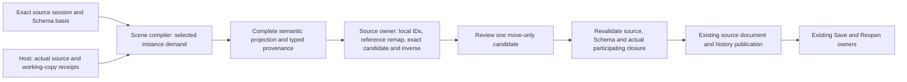

# Source-Owned Complete Prefab Conversion

## Outcome And Scope

Extend the [foundation plan](2026-10-23-foundation-architecture-rebaseline-plan.md) with one complete
workflow: select a directly owned instance anchor in a Scene or Prefab, review conversion to local
source records, commit once, Undo/Redo, Save and Reopen. The source owner allocates local IDs and
rewrites declared references. The selected anchor keeps its ID, local components and placement.
Its ordinary local children retain their IDs and relative order. Other instances remain linked.

This is a design comparison and implementation plan, not an implemented conversion interface or
an Accepted ADR amendment. The preceding declaration/Revert workflow is qualified at `f2fc60a`;
its [evidence](../knowledge/engineering/verification/2026-10/2026-10-27T012127Z-source-owned-prefab-intent-review-and-revert-qualification-4b14705bceb545e79f34b7afbc5144bf.md)
does not qualify conversion.

The first workflow is **complete conversion of the selected instance**, including nested instances
and overlay additions owned by its projection. It does not mean converting every instance in the
document or flattening instances attached to ordinary local children. Use wording that exposes
that scope. An outer-only unpack operation that preserves selected nested links is a separate
capability, not an undocumented mode flag. A nested declaration embedded inside an overlay first
needs a separately designed source-targeting workflow; it is not a direct source anchor.

## Concrete Design Pressure

The current implementation establishes several constraints:

- `AuthoringPrefabExpansionReport` retains a semantic candidate and typed omissions.
  `into_native_preview` removes components without native bindings. Source conversion cannot use
  the filtered result: a schema-editable component may be fully meaningful without a native codec.
- `RecordUnavailable` means composition has no complete interpretation of that retained record.
  Absence from a derived candidate does not authorize deleting it from source. An unavailable
  surviving projected record that must become local refuses conversion. Raw components on the
  retained anchor and its ordinary local children, as well as unrelated unavailable records, must
  remain exactly equal as semantic source values without requiring their interpretation.
- The current compiler expands a complete containing document. A missing dependency at an unrelated
  second anchor can reject that expansion. Requiring this successful whole-document preview for
  conversion would couple one source edit to an unrelated instance's availability.
- Generic source editing deliberately permits only empty `AddEntity` and exact admitted creation
  templates for `AddComponent`; arbitrary `ReplaceComponent` is unavailable. Conversion of an
  already interpreted record has a different admission from creation from a template.
- Generic history replay also has structural gates. A conversion inverse cannot acquire broader
  deletion/restore authority merely by setting the existing private `history` boolean. Unrelated
  linked instances and unavailable siblings must remain protected during Undo and Redo.
- An expanded locator is compiler output, not a persistent source ID. Lookup spelling, a terminal
  local ID, string prefixes and an `Arc` allocation address do not prove source ownership or fresh
  dependency content.
- The reusable Host request currently captures a Scene session for preview. A Prefab conversion
  needs its actual nominal source kind, session and receipts, including when it is not the active
  Inspector document. A Scene-shaped structural projection does not grant Scene source identity.

The relevant implementation is in
[`prefab.rs`](../../crates/nara_scene/src/prefab.rs),
[`staged.rs`](../../crates/nara_scene/src/prefab/overlay/compile/staged.rs),
[`candidate.rs`](../../crates/nara_scene/src/candidate.rs),
[`source structure admission`](../../crates/nara_scene/src/authoring_decode/structure.rs),
[`source history`](../../crates/nara_scene/src/authoring.rs) and
[`actual-demand capture`](../../src/project_host/authoring/project/capture.rs).

## Alternatives

| Approach | Leverage and locality | Cost and disposition |
| --- | --- | --- |
| Bake the native preview or export its World | Reuses visible output | Can lose schema-only or unavailable records, binds editing to runtime residency and requires native codecs. Rejected as the source authority. |
| Compile the whole containing source, then copy the selected projection | Reuses the current compiler entry and complete reference context | Unrelated missing instances can block the operation; filtered preview must still be avoided. Keep as an executable correctness baseline, not an assumed ergonomic contract. |
| Select conversion demand inside the existing Scene compiler, then prepare an exact source edit | Keeps layout, property, reference and ownership semantics in their existing owner; permits a narrow source workflow | Requires a proven selected-demand entry and owner-created replay footprint. Preferred comparison direction; qualify it before exposing public types. |
| Persist a complete before/after document checkpoint for conversion history | Simple exact restoration through one source history owner | Retains unrelated content twice and changes history cost/locality. Compare if the existing patch owner cannot express a narrow admitted inverse without excessive machinery. It must not create another document or Undo store. |

Do not implement a separate conversion interpreter, synthetic placeholder Scene, fake registry,
generic authorization DSL or public raw-record escape to force the preferred option through.
If selected demand cannot preserve reference/layout semantics inside the current compiler, deepen
that owner first or select the bounded whole-document policy explicitly with its limitation.

## Ownership And Interface Direction

The source module hides ID generation, complete record admission, remapping, exact inverse
construction and history costs behind one preparation/commit workflow. The Host hides actual
dependency acquisition and revalidation. The Editor renders an observation and submits the same
reviewed move-only candidate. A panel, Workspace ordinal or preview generation supplies neither
source identity nor independent mutation authority.

Extend shared acquisition with concrete Scene and Prefab source inputs where required by this
workflow. Preserve their nominal ownership and file admission. This is not a reason to add an
erased document store, a universal source-provider interface or a Runtime for every open document.

Do not freeze public method/type names until the owner experiment and independent consumer
establish the whole workflow. Reuse existing prepared editing where its contract is sufficient.
A contextual conversion token may be necessary because ordinary prepared edits currently have
only source revision/Schema evidence; it must not silently discard required dependency evidence
when adapted into an ordinary submission.

### Selected Demand

Selection starts at one direct source anchor under its exact query basis. Use typed projection
ancestry to identify records owned by that instance, including mixed source/addition origins and
all nested instances in its projection. A source's ordinary local children are outside that
projection even when they are visually below the anchor.

The same staged compiler must retain structural existence, layer order, complete selected values,
defaults and reference binding. Unrelated source records provide actual reference context but
must not trigger interpretation or recursive instance loading simply because they share the
document. In particular, a damaged independent instance on an ordinary local child is outside the
selected anchor's projection; it must not be loaded merely because it is below that anchor in the
tree. A selected binding may introduce a real structural source demand; retain that source even
when none of its entities survives.

Compare selected compilation with full expansion where both succeed. The selected operation must
have zero reads of an unrelated missing Prefab, while preserving identical selected hierarchy,
values and declared reference meaning. Do not add a second liveness map outside the compiler.

### Persistent Local Records

Allocate a fresh persistent source ID for each converted projected entity through the source
owner's existing allocation policy. Check against all actual local IDs and all IDs allocated by
this preparation. Allocation failure or later validation failure publishes no reservation or source
mutation. Do not reuse generated expanded locators as the new stored IDs.

Retain a complete typed old-projection-to-new-local remap for review and verification. Repeated
instances with equal local names must remain distinct. Preserve the selected anchor and untouched
direct records exactly. New projected roots become the anchor's ordinary children before its
existing containing-layer children, preserving the compiler's selected final order.

Use Reflect's declared reference traversal and rewrite plan. References within the converted set
use the new local IDs; references to untouched direct records retain their IDs. Validate every
surviving declared local reference after remapping. A reference to an unconverted occurrence's
private projected locator refuses rather than implicitly converting another instance. Runtime
`Persistent` references keep their existing namespace/UUID meaning; conversion does not guess a
source relation or a remap for them.
Assets retain their typed references and actual captured evidence. No arbitrary string replacement
or traversal of unknown payloads can supply this proof.

The converted projection contains complete selected semantic records, including defaults needed
to preserve the reviewed effective state. Native binding availability is irrelevant to semantic
conversion. Unavailable Schema for a surviving projected record that must be interpreted or
remapped, unresolved selected source identity, selected conflict, malformed selected value,
unknown required reference semantics or unsupported required remap refuses the entire operation.
Unavailable raw records retained without interpretation do not acquire that refusal requirement.

### Source Preparation And History

The source owner prepares one exact replacement that removes the selected declaration and inserts
the converted local records. It owns both the complete original declaration and admitted local
records, not just the source link. Preserve unavailable siblings and all unrelated declaration
intent under the existing manifest contract.

Compare a narrow closed conversion footprint on the existing source transaction/history with a
source-owner checkpoint. If a footprint is selected, only the source preparation path can create
it, and its accepted authority must survive into the same history entry for Undo/Redo. Verify
exact changed records, placement and references on replay. A caller-supplied patch or a private
boolean cannot impersonate that origin. Avoid extending the ordinary creation-template contract
to admit arbitrary records for every caller.

Forward conversion commit requires its exact root incarnation/revision, exact Schema, selected
working-copy lineages and actual file/metadata receipts. Changed selected dependencies reject the
reviewed candidate and require new preparation. Changes to unrelated open documents must not
revoke it. File-backed Play/Check/Export retain their existing source policy.

Undo/Redo replays the accepted exact source transformation through that history owner; it must not
recompile a newer base or generate new IDs. Undo may restore a declaration whose current projection
is now conflicted. That does not authorize rewriting the restored source or turning history replay
into a new conversion. Reopen starts a new source incarnation and rejects old prepared tokens.

### Work And Retention

Admit selected shells, source receipts, typed provenance, complete records, remap indices,
rewritten values, forward/inverse data and pending candidate retention before owning copies.
Reuse existing positive compiler, value, patch, file and history caps; record which owner refuses
an actual excess. Do not fix a failed budget by increasing default ceilings, ignoring retained
inputs or calling compiler work provenance.

A complete request can fail atomically because the selected result or both history directions
exceed the owning limits. There is no partial conversion or truncation of this entry's forward
or inverse data. Eviction of older entries continues under the existing history capacity policy;
this workflow does not change that policy to reject every request when the history is full.
Measure the owner experiment before choosing any further numerical cap or claiming a latency
improvement.

## Ordered Work

1. **Establish counterexamples.** Execute semantic-versus-native-preview and unavailable-record
   probes, plus an unrelated missing-anchor control. Inspect existing reference and replay
   primitives. Capture exact outcomes, not a passing synthetic conversion.
2. **Compare inside the source owner.** Build a private complete conversion against a bounded
   nested/mixed-origin fixture. Compare full expansion with selected demand and compare narrow
   inverse replay with an owner checkpoint where needed. Exercise absence of native codecs and
   unrelated unavailable/linked sources. Do not expose an incomplete public interface.
3. **Reconcile owning ADRs.** Amend 0026 for conversion preparation/replay admission, 0038 for
   complete conversion/identity/remap semantics, 0090 for selected unavailable refusal and sibling
   preservation, and 0047 for contextual preparation/closure fencing. Amend 0101 only if hierarchy
   sequence semantics actually change. Do not create a generic framework ADR for a local helper.
4. **Integrate a complete public consumer.** Scene and Prefab consumers prepare/review/commit,
   verify one Undo/Redo, Save/Reopen, last-failure atomicity and stale source/Schema/dependency
   refusal. An independently compiled consumer must use the same owner interface.
5. **Integrate the Editor.** Explicit selected-anchor scope, complete-conversion wording, bounded
   remap/diff review, cancel and exact result. Retain the original candidate across paints; reject
   stale context instead of silently repreparing. Qualify selected native hierarchy/pixel/input
   and history/persistence behavior through actual owned windows.
6. **Close the slice.** Independently review; run focused serial nextest, affected consumer and
   native checks; reconcile guides/implementation ledger; remove losing experiments or superseded
   code; commit precisely and fast-forward local main when qualified. Keep the foundation Goal active.

## Acceptance Matrix

| Scenario | Required observation |
| --- | --- |
| Two anchors sharing the same Prefab | Exactly the selected projection becomes local; the other declaration and its IDs remain unchanged |
| Repeated nested sources and overlay-local additions | One distinct fresh local ID per converted entity and a complete typed remap, with no projected locator saved as source |
| Anchor components and ordinary local children | IDs, components, placement and local-child relative order remain unchanged; new roots precede ordinary local children |
| Schema-only component, no native codec | Complete semantic data survives conversion; preview omission never becomes source deletion |
| Unavailable surviving projected record requiring localization | Entire operation refuses; source, history, dirty state and selection remain unchanged |
| Unavailable raw record on the retained anchor or an ordinary local child | Record remains exactly equal without interpretation and does not alone block conversion |
| Unrelated missing instance or unavailable record | No unrelated Prefab read; source data and declaration remain preserved |
| Damaged independent Prefab on an ordinary local child | Child instance is not requested or detached; its complete source record remains unchanged |
| Declared references and defaults | Internal references remap once; untouched local and Persistent references retain meaning; final survivor checks pass |
| Final invalid reference/layout, ID collision or budget excess | Zero published source/history changes and no observable ID reservation |
| Dependency changes after review | Original candidate rejects; no silent reprepare or conversion from last-good pixels |
| Unrelated document edit after review | Candidate remains valid when its actual root/participants/receipts are unchanged |
| Undo/Redo after base changes | Exact original declaration/restored local records and same IDs, without compiling the changed base |
| Save/Reopen | Actual decoder round trip; prior token rejects after new incarnation; original unavailable siblings survive |
| Independent consumer | No engine-private hook, fake native registry or tool-owned inverse |
| Editor review/cancel/commit | Same reviewed move-only candidate, exact routed result, one history entry and bounded display |

All selected cases must execute; ignored tests are not acceptance. Compare compiled entity/component
counts, hierarchy sequences, declared reference targets and preserved source values, not only a
successful return or a screenshot. Passing this matrix qualifies this workflow and its tested
platforms, not outer-only unpack, arbitrary nested-source conversion or cross-source Apply.

## Risks And Mitigations

| Risk | Impact | Mitigation |
| --- | --- | --- |
| Native filtering silently drops source data | Data loss | Keep complete semantic result and refuse selected unavailable interpretation |
| Broad replay privilege permits unrelated destructive edits | Source corruption | Owner-created exact footprint or bounded owner checkpoint, verified on both directions |
| Whole-document coupling makes ordinary conversion unavailable | Poor ergonomics and hidden dependency work | Execute unrelated-anchor control and select demand in the same compiler |
| Partial reference remap appears visually correct | Later runtime failure | Complete declared traversal, mixed-origin/repeated-instance fixtures and final survivor checks |
| Prepared edit loses dependency evidence in adapters | Stale data committed after review | One contextual token through Host/submission and fresh selected-closure fence |
| Accumulated capture/history work exceeds modeled retention | Unbounded work | Pre-copy aggregate admission and explicit failed-budget evidence |
| Conversion scope differs from familiar unpack commands | Unexpected nested-link removal | Explicit complete-conversion wording and review of scope/remap before commit |

## Unity And Godot Evidence

Unity 6.3 distinguishes ordinary unpack, which retains nested Prefab instances, from complete
unpack, which removes nested Prefab links too. It converts affected GameObjects to ordinary
objects and retains their overridden values. This supports explicit user-facing scope and value
preservation; it does not supply Nara's source identity, Schema-only conversion, reference remap
or dependency-fence implementation.

At pinned Godot `81ab961f91066a63bcbf3ec340962bb1a1ada558`,
`TOOL_SCENE_MAKE_LOCAL` records clearing the selected instance's scene file path and replacing
owners through `EditorUndoRedoManager`. `_node_replace_owner` changes nodes owned by the selected
base and records the inverse. This is source/history ownership evidence, not an implementation
of Nara's complete nested conversion. Godot's live Node identity is not Nara's persistent source
ID allocation policy. Neither Editor binary was executed for this study.

- [Unity 6.3: Unpacking Prefab instances](https://docs.unity3d.com/6000.3/Documentation/Manual/UnpackingPrefabInstances.html)
- Godot `repo-ref/godot/editor/docks/scene_tree_dock.cpp:1421` and `:1899` (read-only pinned source).
- [Existing Unity/Godot ownership study](../research/2026-10-26-unity-godot-prefab-editor-ownership.md)
- [ADR 0026](../architecture/adr/0026-editor-command-patch-and-undo-model.md)
- [ADR 0038](../architecture/adr/0038-scene-prefab-authoring-identity-and-provenance.md)
- [ADR 0047](../architecture/adr/0047-editor-workspace-and-scene-document-state.md)
- [ADR 0090](../architecture/adr/0090-unavailable-schema-and-lossless-authoring.md)
