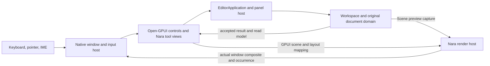

# Refactor the native Nara editor

## Goal Capsule

A game author launches `nara-editor`, opens their own 2D project, changes the Scene and a Dialogue choice, tries the result, and can Undo, save and reopen the same work. The desktop UI follows Nara's Design Kit. Nara's maintained Open-GPUI fork is the first choice for the native controls. The engine already has a usable GPU composition path. The largest change is bringing that path and the real authoring sessions together behind the ordinary executable. [Strategy](../../STRATEGY.md#our-approach) · [Editor Design Kit](../design/editor-reference/README.md) · [Frontend decision](../architecture/adr/0118-editor-workspaces-frontends-and-creation-templates.md#frontend-switch-conditions)

This is a proposed development sequence based on Nara `0b842b1`. The concurrent `dac49b3` commit updates the GPUI fixture's material dependency lock. The source findings below use the original baseline and identify the working-tree Dialogue adapter separately. The Dialogue plan owns its graph-specific deliverable and the foundation plan owns the broader engine program. The November 13 priority change deferred UI implementation. Breaking Rust API changes and removal of displaced first-party code are appropriate within this migration. Existing user-authored projects and saved document semantics are inputs to the replacement. [Editor research](../research/2026-11-23-editor-direction-and-native-authoring.md) · [Integration handoff](2026-11-12-nara-ui-integration-handoff.md#scope-and-next-deliverable) · [Dialogue plan](2026-11-12-dialogue-graph-integration-plan.md#complete-consumer)

## Product Contract

- R1. Open through the project manager with no arguments or with an explicit project and profile. Recovery, project replacement and dirty Close use the ordinary application lifecycle. Opening an ordinary source project preserves the distinction between inspecting data and explicitly running trusted compiled code. [Launch options](../../editor/src/main.rs) · [Workspace and trust](../architecture/adr/0118-editor-workspaces-frontends-and-creation-templates.md#panels-layouts-and-render-views-are-distinct)
- R2. Hierarchy, Inspector and Scene View operate on the same document. A completed gesture contributes one document edit, cancellation discards its preview, and a stale gesture cannot overwrite a newer edit. A second view may share content and history while keeping its own camera, focus and navigation. [Edit transactions](../architecture/adr/0026-editor-command-patch-and-undo-model.md#continuous-interaction-transactions) · [Vector editing](../design/editor-reference/nara-editor-design-spec-v0.4.md#L1242-L1250)
- R3. Scene and Game display the intended pixels, route input to the displayed occurrence, and survive resizing, detachment, recovery and closure within the supported native scope. Supervised Play retains its own process lifecycle. [Scene View](../architecture/adr/0111-editor-scene-view-execution-and-picking-authority.md) · [Game View](../architecture/adr/0112-editor-game-view-runtime-presentation-and-input-authority.md)
- R4. An author can edit a Dialogue choice in a graph and its property view, preview the chosen branch and save the document. Source-built panels can still use the documented semantic host and observe their own action results. [Dialogue domain](../../tests/fixtures/gpui-engine-consumer/README.md#dialogue-graph-domain) · [Panel contract](../guides/editor-panels.md)
- R5. The selected desktop product builds from its committed dependencies, can be launched outside the source tree, and meets the incumbent workflow, native lifecycle and measured-work criteria for its supported targets. Game and headless consumers retain their independent dependency closures. [Replacement criteria](../architecture/adr/0118-editor-workspaces-frontends-and-creation-templates.md#frontend-switch-conditions) · [Incumbent workflow matrix](2026-10-16-1229-refactor-editor-foundation-and-frontends-plan.md#frontend-parity-matrix)

## Planning Contract

### Architecture review at the baseline

| Finding | Consequence for the refactor |
| --- | --- |
| Three implementations start from different assumptions. `nara-editor` requires `imgui-reference`. `nara-editor-drawn` uses `EditorApplication` and requires a project path. The GPUI example creates a temporary project and calls `EditorProjectSession::open_trusted_compiled`. | A renamed example would lose project-manager, ordinary Open and recovery semantics. Promote its native adapter behind the real application. Leave synthetic projects, counters and failure injection in the fixture. [Package](../../editor/Cargo.toml#L9-L52) · [Drawn entry](../../editor/src/drawn_main.rs) · [Fixture engine](../../tests/fixtures/gpui-engine-consumer/examples/gpui_view/engine.rs) |
| The reusable GPU work is already in place. The Windows fixture imports an immutable Scene output on its original `WgpuRenderHost` and records the GPUI scene into the acquired window target. The diagnostic pixel probe renders separately. | Preserve the producer, Host and submitted-image lifetimes. Move the import, recording and feedback integration into the native editor. Keep readback selectable for diagnostics. [Renderer](../../tests/fixtures/gpui-engine-consumer/examples/gpui_view/renderer.rs) · [Recorded scope](../../tests/fixtures/gpui-engine-consumer/README.md#independent-graph-preview-views) · [Host decision](../architecture/adr/0078-render-host-affinity-webgpu-initialization-and-device-recovery.md) |
| `EditorPanelHost` already retains panel state and delivers exact action results. `EditorNativeComposition` also installs source asset importers, but its native panel factories construct an `ImguiEditorFrontend`. Five editor integration targets require the ImGui feature. | Reuse the semantic host and the application builder's behavior. Move trusted importer/descriptor installation outside the toolkit-specific factory before retiring the old module. Keep independent tests of generic Open and semantic extensions runnable with the reference feature off. [Panel host](../../editor/src/panels/host.rs#L67-L83) · [Composition](../../editor/src/platform/composition.rs) · [Independent consumer](../../tests/fixtures/module-consumer/editor-panel-consumer/Cargo.toml) |
| The drawn Winit handler requests redraw after each converted panel event. Separate measurements on a 10,001-record GPUI fixture put DX12 local-edit preview materialization at 92.790 ms P95 and the entire owner sample at 204.083 ms P95. | These are two distinct costs. Coalesce unchanged pointer motion at the UI boundary. Profile document preparation before optimizing GPU drawing for a slow edit. Treat these historical samples as attribution evidence. [Drawn event loop](../../editor/src/platform/drawn.rs#L724-L741) · [Matched measurements and scope](../benchmarks/2026-11-04-ui-work-baseline.md#compiled-topology-receiving-reuse) |
| The GPUI fixture has its own workspace and lock, a Windows-specific entry, an exact GPUI Git pin, and optional Jellyflow dependencies through sibling paths. The engine and fixture currently select the same wgpu Git revision. | Introduce the desktop dependencies at the editor leaf. Give the product reproducible library sources. Test one installation outside the developer's checkout before selecting the default. [Fixture manifest](../../tests/fixtures/gpui-engine-consumer/Cargo.toml) · [Platform entry](../../tests/fixtures/gpui-engine-consumer/examples/gpui_view.rs) · [Engine manifest](../../Cargo.toml) |
| The ordinary field editor already clears a draft on its own applied or unchanged result. The workspace selection helper clears the set on each selection, and the Scene/Prefab Inspector projects `top_entity()`. The baseline GPUI sample can also substitute a newer revision when its displayed projection compares equal. | Resolve selected membership, primary entity and common editable fields in the workspace. Capture the original revision when editing begins. The in-progress GPUI draft-basis and pending-result changes are relevant work to integrate and recheck. Painting a mixed-value indicator alone would leave editing semantics incomplete. [Selection and projection](../../crates/nara_tooling/src/workspace.rs) · [Field completion](../../editor/src/frontend/controls/field_drafts.rs) · [GPUI field adapter](../../tests/fixtures/gpui-engine-consumer/examples/gpui_view/panels.rs) |

### Ownership in the proposed editor

**Document and UI.** `EditorApplication` drives the session, opening/replacing projects and polling persistence and Play. The Scene/Prefab or extension document accepts typed changes and owns the inverse. A panel retains field text, selection within text, transient gestures and pending request identity. The workspace owns panel occurrence, document targeting and persisted layout preferences. Open-GPUI supplies native widget mechanics. A menu, keyboard shortcut and gizmo may share an admitted document operation while keeping different input handling. Use the existing registry, panel submission and completion interfaces. The browser-focused UI SDK and coss UI supply examples of field behavior and composition. The Nara Design Kit determines errors, mixed values, units and appearance. [Application drive](../../editor/src/app.rs) · [Panel submission](../../editor/src/panels/context.rs) · [UI SDK comparison](../research/2026-11-23-vercel-ui-sdk-and-native-editor-behaviors.md)

**First screen and component scope.** Start with the supplied Scene/Inspector and property sheets. Use 28 and 24 logical units as regular and compact single-line control minima. Measured text, scaling and wrapped errors can grow the row. Keep a stable label/value/unit layout, visible keyboard focus, a mixed-value marker, inline validation and a separate Prefab override marker. Saving clears the document's unsaved indicator while the override stays visible. In a narrow Inspector, stack the field under its label and give its error enough room. Reuse these controls in Dialogue Properties. Add pickers and specialized canvases when their tool reaches them. [Scene/Inspector sheet](../design/editor-reference/images/nara-scene-inspector-v0.4.png) · [Property sheet](../design/editor-reference/images/nara-components-properties-v0.4.png) · [Design guidance](../design/editor-reference/README.md#decisions-to-carry-forward)

### State ownership and reuse

| State and lifetime | Owner | What another consumer reuses |
| --- | --- | --- |
| Authored property values, Prefab overrides, keys, accepted revision, Undo and saved checkpoint | Original Scene, Prefab or Dialogue document and its workspace lifecycle | Inspector, gizmo, graph and automation read the same model and submit to the same edit path. A field may display a newer accepted value while a dirty draft still refers to its older basis. |
| Selected entities, primary entity, active or pinned document, panel occurrence | Nara workspace and the tool's declared editing context | A Hierarchy exposes stable entity IDs. The Inspector derives a common or mixed value and counts hidden/excluded targets. Filtering rows and repainting cannot renumber that selection. A pinned Inspector resolves its own document. |
| Filter, scroll anchor, expansion, camera, pan/zoom, active tool and field edit session | Specific Nara view occurrence, with GPUI entities retained where useful | Address a retained field by panel incarnation, target and field key. A reordered or virtualized row recovers the same live edit. Moving the same pane preserves compatible state. Duplicating a view creates independent navigation and drafts. Closing or retargeting retires input and pending callbacks for that occurrence. |
| Caret and text selection, IME preedit, pressed/hovered part, popup focus and pointer capture | The GPUI control and native input host for that seat and window | Use the actual native text or focus entity. Nara holds the field's initial typed value, edit revision, validation and pending request. Read the live draft from the control at the edit boundary. Keep one live composition buffer, and initialize or reconcile it on bind, Cancel or an acknowledged edit. |
| Frame-local drawing, mapping, native focus route, GPU image versions and pending submissions | Native host and renderer adapter | Reuse an unchanged source image across placements. Publishing a new placement produces fresh input authority. Recovery retires device-bound handles and capture while preserving document contents, view preferences and compatible text drafts. |

This layout gives each control a choice of controlled and local state. A popup's open state can belong to its view. A selected entity or an accepted X value comes from the application. Selection, draft error and document dirty can all be visible at once. Express them separately as inputs to the same theme, with keyboard and assistive actions consuming the same resolved state. Nara already has scoped keyed widget state for its own tree. Open-GPUI has `ControllableState<T>` and a component contract for resolved state and native adapters. Use the state mechanism of the tree that renders the control. The data shared between frontends is the typed read model, edit intent and result. [Nara retained state](../architecture/adr/0107-shared-ui-foundation-and-independent-product-layers.md#L218-L239) · [Nara state implementation](../../crates/nara_ui_widgets/src/state.rs) · [Open-GPUI controllable state](https://github.com/Latias94/open-gpui/blob/428b460e6d33e246aeb2d740a0e9c6215381c658/crates/ui_core/src/controllable_state.rs#L1-L46) · [Open-GPUI component contract](https://github.com/Latias94/open-gpui/blob/428b460e6d33e246aeb2d740a0e9c6215381c658/docs/ui/component-contract.md#L81-L116)

**A delayed reply shows why this matters.** Panel A edits X and submits an edit. Before the reply arrives, the author opens another field or another view. Nara associates the result with the original panel, document basis and `PanelSubmissionId`. A retired panel cannot settle the new field's draft. Vercel UI's `settleDraft` keeps the dropped value visible until the controlled view reconciles, and clears only the same draft. Its timer and reference comparison settle a web interaction. In Nara the document acknowledges the request, and `Saved` for the requested revision settles persistence. Similarly, the SDK Tree's focus/selection and clip editor's playhead/clip draft are reusable distinctions across Nara tools. [Vercel draft reconciliation](https://github.com/vercel-labs/ui/blob/a349d52a7c019260202dcb2139b28d073e218b28/packages/core/src/foundation/kernel/draft.ts#L1-L30) · [Nara panel submissions](../../editor/src/panels/submission.rs) · [Tree and timeline comparisons](../research/2026-11-23-vercel-ui-sdk-and-native-editor-behaviors.md#selection-in-the-hierarchy)

### When to change Open-GPUI

Treat the fork as a maintained part of development. Use framework APIs directly in first-party panels. Put a general native interaction fix in the owning Open-GPUI module as soon as a real Nara tool needs it. A second application adopting the feature can supply evidence later. Use these concrete destinations when implementing U1–U4. [Maintained framework boundary](../architecture/adr/0107-shared-ui-foundation-and-independent-product-layers.md#L44-L76)

| Demand | Where the change belongs | Consumer that demonstrates it |
| --- | --- | --- |
| A numeric field must preserve an incomplete or rejected draft, or expose raw text through a scrub/submit callback | First try `ui_components`' existing native text/number controls. If their public behavior prevents the interaction, change the fork's controller or callback at that boundary. An explicit rejection policy can preserve current defaults or replace them deliberately with caller migration. Exact integer parsing, relative multi-selection, units and Prefab semantics stay in Nara. | Transform X illustrates the policy. The existing fork's scalar commit carries `f32`, and its invalid submit can cancel. Preserve `16,777,217` in a reflected integer and let the author correct a `-` draft. [Commit contract](https://github.com/Latias94/open-gpui/blob/428b460e6d33e246aeb2d740a0e9c6215381c658/crates/ui_components/src/number_input/editing.rs#L132-L160) · [Controller](https://github.com/Latias94/open-gpui/blob/428b460e6d33e246aeb2d740a0e9c6215381c658/crates/ui_components/src/number_input/controller.rs#L157-L205) |
| A moved pane loses native focus, a popup dismisses the wrong window, or a hosted redraw cannot wake the external loop | Fix the behavior in `gpui_docking`, GPUI input/focus, or the platform adapter that observes the event. Leave generic pane keys and focus handles there. Nara binds pane keys to its panel instances and decides whether a document edit can proceed. | Relocate a live Dialogue view and return focus to its editable field. A plain framework consumer can exercise the focus or capture fix with ordinary controls. [Docking contract](https://github.com/Latias94/open-gpui/blob/428b460e6d33e246aeb2d740a0e9c6215381c658/crates/gpui_docking/README.md) |
| The recorder lacks a primitive or a way to report completion for an imported texture | Extend the framework Scene, external-WGPU recorder or platform contract at the narrowest point that expresses the missing operation. Nara owns the adapter, application render program, display mapping and final queue submission. | A real curve overlay or Scene image can motivate the change. Keep one ordinary framework rendering path working and check the changed engine consumer on its own device. [Framework external WGPU](https://github.com/Latias94/open-gpui/blob/428b460e6d33e246aeb2d740a0e9c6215381c658/docs/external-wgpu.md) · [Nara render ownership](../architecture/adr/0107-shared-ui-foundation-and-independent-product-layers.md#L67-L83) |

Make framework changes in the maintained Open-GPUI checkout. Pin the chosen revision in Nara and migrate the affected Jellyflow adapter alongside it when their types cross the same native entity tree. A deliberate breaking change should remove the displaced glue in that consumer. At review time the Nara fixture uses `f75c10b2`, the maintained checkout was at `e210c52a`, and the separate read-only reference was at `428b460e`, 23 commits ahead of the maintained checkout. The latter two illustrate newer capabilities. Start U1 with the known working integration and select a newer revision for a named requirement. Framework fixtures cover general behavior. One real Nara tool covers the integration. [Fixture pin](../../tests/fixtures/gpui-engine-consumer/Cargo.toml) · [Framework recovery example at the maintained revision](https://github.com/Latias94/open-gpui/blob/e210c52a70dd069baccfe2b29984f77d8cb83bf8/examples/dockspace-editor/src/recovery.rs)

### Render execution and frame lifetime

**Render and present.** Keep the current split between `nara_render`'s scene/capture description, the feature that produces the image, and `nara_render_wgpu`'s concrete execution. In the editor, Nara owns the window's device, queue, acquired target, final submission and retirement. GPUI shapes text, lays out and paints controls, and records commands on that device. The adapter imports the exact image and carries its size, sampling, color transfer and alpha convention through composition. UI chrome and overlays can paint directly into the destination. Independently produced Scene/Game images retain the lifetime their consumers require. The Scene remains displayable when another document is active. A Scene edit or pick requires the bound Scene to be active and the original view mapping to match. Game input follows its own focused route. [Accepted render ownership](../architecture/adr/0078-render-host-affinity-webgpu-initialization-and-device-recovery.md#gpu-execution-authority) · [Displayed image and picking](../architecture/adr/0111-editor-scene-view-execution-and-picking-authority.md#immutable-outputs-and-exact-display-receipts) · [SDR color](../architecture/adr/0092-sdr-color-space-alpha-and-output-encoding.md) · [Game input](../../editor/src/platform/game_input.rs)

| Transition | Owner and effect |
| --- | --- |
| Prepare a view, record UI and submit | Retain the original output and mapping with the pending frame. Publish the presented occurrence only after the destination window accepts that specific composite and the UI adopts it. A rejected or unmapped successor follows the existing publication/withdrawal rules. |
| Pointer down, edit preview, release or cancel | Route from the displayed occurrence. Retain target IDs, original edit basis and each target's value. Release submits the final candidate once. On conflict, drop the stale preview and report the conflict. A completion is delivered to its originating request. |
| Resize, move, close or lose the device | Invalidate input tied to displaced geometry or device epoch. Preserve the document and valid panel state. Retire in-flight recordings and textures with the original submission. Initialize a replacement and present again before admitting input against its image. |

For the scheduling boundary, Bevy separates extraction, preparation and queueing. Blender's region draw loop skips hidden or untagged regions. Godot's `CanvasItem::queue_redraw` coalesces a pending redraw. Apply those ideas narrowly. Recompute a panel when its visible model or local interaction changes, retain valid layout or paint work, and keep window exposure, animation, pending GPU work, IME and application deadlines able to wake the Host. A playing viewport can require a new composite while the adjacent Inspector reuses its layout. ADR 0121 is Proposed. The implemented Host path and Accepted ADRs 0078, 0107, 0111 and 0118 support this plan without adopting an engine-wide render graph. [Bevy render stages](https://github.com/bevyengine/bevy/blob/779770720e6ad916c1de38cf66a67d0e079ed1e3/crates/bevy_render/src/lib.rs#L183-L210) · [Blender region drawing](https://github.com/blender/blender/blob/20a0565aa86c7ba6ab1e9537675a0cd8529337ef/source/blender/windowmanager/intern/wm_draw.cc#L1055-L1059) · [Godot redraw](https://github.com/godotengine/godot/blob/b070e63b161aa816afac71dcfc9d60859d38f220/scene/main/canvas_item.cpp#L541-L553) · [Render program proposal](../architecture/adr/0121-composable-render-programs-and-host-execution.md)

### What can be deleted

| Code or data | Disposition and last consumer |
| --- | --- |
| `editor/src/frontend/imgui/`, `editor/src/platform/imgui/`, Dear panel exports and `imgui-reference` | Keep a runnable reference at the pinned revision and a working incumbent during migration. At cutover, migrate the source-built panel example and its useful behavioral assertions, then delete the displaced first-party painters, frontend lifecycle and exports. Some former Dear painters are already gone. [Reference policy](../architecture/adr/0118-editor-workspaces-frontends-and-creation-templates.md#frontend-switch-conditions) · [Affected exports](../../editor/src/lib.rs) |
| `crates/nara_render_wgpu/src/host/imgui.rs`, `editor-imgui`, Dear dependencies and CI commands | Remove together when the last actual Dear renderer caller or reference test is retired. Keep the WGPU Host, general image/overlay submission, Game route and retirement machinery. The backend manifest also has a Dear dev dependency. [Backend manifest](../../crates/nara_render_wgpu/Cargo.toml) · [Dear adapter](../../crates/nara_render_wgpu/src/host/imgui.rs) · [CI](../../.github/workflows/ci.yml) |
| `editor/src/frontend/drawn/`, `editor/src/platform/drawn/`, fixture-only `DraftInput` and temporary launch selection | Retire `Graphics::present`'s private per-panel `ImageBlitter` and its WGSL when the first-party drawn shell no longer uses those textures. Direct GPUI recording takes over its chrome. Keep exact-image support used by external panels. Preserve each distinct source/UI-Prefab behavior and its tests before deleting the remaining executable. Prefer the framework text control where it preserves IME, edit range and cancellation. [Drawn blitter](../../editor/src/platform/drawn/graphics.rs) · [Independent render consumer](../../tests/fixtures/render-output-consumer/examples/ui_surface.rs) · [Fixture text input](../../tests/fixtures/gpui-engine-consumer/examples/gpui_view/text_input.rs) · [Drawn qualification](../verification/native-editor-qualification.md#independent-drawn-source-workspace) |
| `editor/src/frontend/controls/`, `editor/src/native/images/` and `crates/nara_ui*` | Select by caller. Keep shared draft parsing, the public panel-image host and any independently used controls or image adapters. Runtime UI depends on `nara_ui_kernel`, `nara_ui_widgets` and `nara_ui_render`. An ordinary GPUI Inspector can lay out its own rows. Deleting the old shell does not justify deleting the game's UI or the external panel contract. [Field parser](../../editor/src/frontend/controls/value_draft.rs) · [External host consumer](../../tests/fixtures/editor-ui-host-consumer/Cargo.toml) · [Runtime dependencies](../../crates/nara_ui/Cargo.toml) |
| Layout preferences and saved assets | Preserve valid panel identities and targets when reconstructing a workspace. Retire the toolkit-specific layout payload when incompatible, restore a usable default and show the reason. Project, Scene, Prefab and Dialogue sources go through their original codecs and save operations. [Layout restore](../../editor/src/workspace/layout.rs) · [Workspace decision](../architecture/adr/0118-editor-workspaces-frontends-and-creation-templates.md#panels-layouts-and-render-views-are-distinct) |

Keep changes to an Accepted ADR with the implementation that actually changes its ownership or support contract. The temporary feature name, choice of a native text control and migration of private modules are plan-level decisions. The implementation ledger should record a workflow after the successor runs it. [Document responsibilities](../architecture/README.md#document-responsibilities)

## Implementation Units

### U1. Open a real project in the selected GPUI shell

Start in `editor/`. Add a private GPUI composition to the existing successor executable with an explicit opt-in Cargo feature. Keep the incumbent available through `nara-editor` during development. Factor the common argument handling and install the same trusted source facets into `EditorApplication`. The reference frontend can continue pairing its own paint factories with descriptors. The successor accepts the real project root and `--profile` and uses the manager on a no-argument launch. Keep only native GUI dependencies for the selected target and align the locked GPUI/wgpu/Winit versions in the product. Keep graph dependencies out of this first shell. [Current launchers](../../editor/src/main.rs) · [Drawn launcher](../../editor/src/drawn_main.rs) · [Existing composition](../../editor/src/platform/composition.rs) · [Application contract tests](../../editor/tests/application_contract.rs)

Deliver Project Manager → Open → active document through the selected window from an unrelated working directory. A bad project enters ordinary Recovery, from which a good project can open. A pending dirty replacement uses Save/Discard/Cancel. Compare the real source on disk. For a project-defined record without native preview, preserve its source, allow edits supported by its declared capabilities, and show the preview omission. The host may install its own source-built panels and asset importers during composition. Running project code in-process requires the explicit trusted entry. Ordinary Play/Check use the supervised or compiled-project routes already defined for those operations. These flows must work using committed dependencies and the user's existing project. This unit establishes R1 and the build part of R5. [Generic editor execution](../architecture/adr/0114-standalone-generic-editor-authoring-and-execution-boundary.md) · [Generic Open and recovery test](../../editor/tests/generic_open_recovery.rs)

### U2. Present and pick a real Scene through the product Host

Build on U1. Move the engine-image import, GPUI recording and completion adapter into `editor/src/platform/` or a private module immediately below it. Take `EditorApplication`'s existing preview and retain the original WGPU host. Isolate temporary assets, test control counters, readback and injected failures in the independent fixture. Reuse the Host's device replacement and close lifecycle. Record only with the current device/target, and retain pending recordings through the corresponding submission's retirement. [Fixture renderer](../../tests/fixtures/gpui-engine-consumer/examples/gpui_view/renderer.rs) · [Existing application presentation](../../src/project_host/runtime/editor/presentation.rs) · [Native fixture tests](../../tests/fixtures/gpui-engine-consumer/tests/gpui_view.rs)

Launch U1's actual GPUI editor binary on an external project with an ordinary supported Scene. Click an entity in that window. Keep Scene A visible while another document is active, reactivate Scene A and pick with its latest displayed mapping. Resize with an output pending, cover part of the image with an overlay and close with a frame in flight. Check the correct pick, overlay exclusion, rejection of stale input and release by the original owner. A deliberate device replacement must preserve source edits and stop old image handles from being used. This delivers the Scene half of R3. The fixture smoke remains a narrow adapter control and may keep its separately locked dependencies.

Separate the produced image from where it was displayed. Hold the camera, document, device and render extent fixed at `640×360`. Move the pane sideways. Reuse the same `WgpuImageOutput`, allocate a fresh display occurrence for its new placement and publish a new picking token from the accepted composite. The old token must refuse. This case needs zero new Scene producer submissions and a new window composite. The reference Scene panel already demonstrates this distinction with `display_image` and `redisplay`. [Reference Scene placement](../../editor/src/platform/imgui/owned/scene.rs#L110-L161) · [Mapping counterexample](../../tests/support/fake_preview_toolkit.rs#L736-L756)

### U3. Finish one property edit from both Inspector and gizmo

Build on U1 for the field and U2 for the gizmo. Use ordinary Scene entity and reflected field identities in `EditorPanelContext`, the current source-edit preparation path and the document's Undo. Share the captured target, revision and result. Keep the Inspector's text interaction and the gizmo's coordinate conversion local. Provide a Scene-owned candidate for a Scene Transform tool. The existing `dispatch_gesture` path serves the selected UI Prefab and commits an `ApplyPrefabPatch`. Attach a multi-object edit to one atomic same-document patch with each affected original value. Give unsupported targets the Design Kit's explicit exclusion treatment. [Panel services](../../editor/src/panels/context.rs) · [Current gesture dispatch](../../src/project_host/runtime/editor/actions.rs) · [Draft tests](../../editor/src/frontend/drawn/inspector/tests.rs) · [Design rules](../design/editor-reference/nara-editor-design-spec-v0.4.md#L1242-L1266)

Land this in three independently demonstrable changes. First migrate one single-entity `SetField`/`RemoveField`, retaining the distinction between text Undo, document Undo, acknowledged no-op and rejection. Then extend `EditorSelectionSet` and the common-field read model and prepare one batch of same-document edits. Finally attach the Scene gizmo to the original displayed view. The external Snap panel is a migration example with a real caller. Its Dear `show` function may be replaced while its prepare/apply path keeps the exact candidate. Prefab instance overrides keep their separate effective-property inspection and Review. [Workspace Inspector command](../../crates/nara_tooling/src/workspace.rs#L1455-L1485) · [Selection](../../crates/nara_tooling/src/workspace.rs#L2885-L2920) · [External Snap tool](../../tests/fixtures/module-consumer/editor-panel-consumer/src/snap_local_position.rs#L282-L348)

Use the designed Transform row. Select two objects with X values `2` and `10`, drag by `+3`, observe `5` and `13`, and Undo once to restore both. Typing `3` sets both X values to `3` and preserves the other axes. Narrow the Inspector and enlarge text while correcting an invalid draft. Keep the focus, entered text and full diagnostic visible. Cancel a second drag and try an intervening document revision, dropping the old preview without rolling the document back. Save, reopen and confirm the accepted values. Keep typed precision for reflected integers and floats. Earlier research shows the newer fork's scalar `NumberInput` commits `f32`. This supplies R2 through the existing authoring commands. [Native number field comparison](../research/2026-11-23-vercel-ui-sdk-and-native-editor-behaviors.md#the-inspector-number-field)

### U4. Dock two views and complete the Dialogue workflow

U1 provides the application host and U2 provides displayed occurrences. The existing Dialogue work can progress alongside U3. Inspect and integrate the in-progress native Dialogue changes with their owner. Use the existing domain, external graph requests and exact completion. Give each open view its own camera, gesture and focus. Keep document identity and Undo in the workspace/domain. Make docking a projection of the existing panel occurrences. Move preserves identity, duplicate allocates a new occurrence, and closing a view leaves sibling views usable. Qualify a coherent GPUI and Jellyflow revision before using newer dock APIs or making a graph dependency part of the installed editor. [Workspace panels](../../editor/src/workspace/panels.rs) · [Layout](../../editor/src/workspace/layout.rs) · [Graph document tests](../../tests/fixtures/gpui-engine-consumer/tests/dialogue_document.rs) · [Dialogue delivery](2026-11-12-dialogue-graph-integration-plan.md#complete-consumer)

Open two views of one Dialogue source. Edit a line with Chinese text composition, reconnect one choice, preview its new branch, Undo through the property view and Redo. Save, reopen and play the changed branch again. Then move one view to another window, close it and keep editing from the surviving view. Test a late result for the closed occurrence. Restore the workspace once with incompatible toolkit preferences. This delivers R4 in one window first, then the detachment behavior under R2/R3 on supported configurations.

The recorded domain and Session/file workflow already exists. The mixed working tree contains a native `--dialogue` draft with a fixed layout and fixture data. Start with the native authoring operation alongside a visible Scene. Store Dockspace topology in `EditorWorkspaceLayout`'s versioned toolkit preference and map each pane to its `EditorPanelInstanceId`. The existing restore path has explicit fallback reasons and may return secondary panes to the main window. Introduce restoration of supported detached windows deliberately. The same entity can move with the pane, while Duplicate creates fresh view-local state bound to the same document. Blender's node editor illustrates the distinction by duplicating the view path and creating a new runtime for the same tree. [Existing layout restoration](../../editor/src/workspace/layout.rs#L304-L368) · [Dialogue qualification](2026-11-12-dialogue-graph-integration-plan.md#exact-external-canvas-requests-and-publication-receipts) · [Blender node view duplication](https://github.com/blender/blender/blob/20a0565aa86c7ba6ab1e9537675a0cd8529337ef/source/blender/editors/space_node/space_node.cc#L928-L943)

### U5. Close the remaining product and cost gaps by workflow

Start each incumbent workflow when its own dependencies are ready. U1 unlocks Browser Import/Reimport with last-good output, project replacement, supervised Play and the external project's Check/Run/development Export. U2 provides native presentation and routes for the embedded Game and detached views. U3 supplies the editing path for ordinary and specialized Scene/Prefab authoring, custom components and UI Canvas. These can progress alongside Dialogue. Compare each row of the existing matrix to the running reference and successor. Include focused Play/Pause/Step, supervised Play failure/repair, first-present and child cleanup, source-built contributions, keyboard, clipboard, popup dismissal, IME ownership and the accessibility capabilities claimed. [Parity matrix](2026-10-16-1229-refactor-editor-foundation-and-frontends-plan.md#frontend-parity-matrix) · [First-game workflows](../../editor/tests/first_game_workflow.rs) · [Native qualification](../verification/native-editor-qualification.md) · [Public panel consumer](../../tests/fixtures/module-consumer/editor-panel-consumer/Cargo.toml)

Exercise Play in the lane that owns it. Ordinary Open launches the supervised external process. Verify build failure, repair, first-present, stop and child retirement there, including the existing explicit refusal of Pause/Resume/Step. For the embedded Game, port the stock consumer's explicit compiled recipe launch. That trusted session supplies the Game image and supports focus, Pause and Step. Both lanes need their own results when switching the frontend. [External Play controls](../../src/project_host/runtime/editor/external_play.rs#L552-L566) · [Trusted Game candidate](../../src/project_host/runtime/editor.rs#L2339-L2348) · [Stock editor caller](../../tests/fixtures/stock-composition-consumer/examples/editor_scene.rs)

Improve redraw demand on the selected shell while it gains these panels. Use existing view-local invalidation and Host deadlines. Compare quiet idle, pointer movement within one unchanged control, a running Game beside a static Inspector and a real property edit against the same workload. An exposed window still redraws, a hover boundary still paints, and Save, Play or GPU completion must still wake the loop. Record input-to-visible response and attribute time to source work, layout/text, recording and submission. Carry forward the matched budgets already owned by the relevant baseline. This supplies the remaining R1–R5 product evidence. [Existing benchmark](../benchmarks/2026-11-04-ui-work-baseline.md) · [Existing maintenance deadlines](../../editor/src/platform.rs)

### U6. Switch the default and remove its displaced implementations

Build on the agreed workflow matrix and measured baseline. Keep the public `nara-editor` command and its ordinary options. Select the successor by default on the supported target set only after its qualified workflows run there. Port or explicitly migrate toolkit-specific source-built callers. Remove the old default feature, obsolete aliases, first-party ImGui frontend/renderer and the temporary GPUI selection. Retire the previous drawn shell when its last distinct behavior has moved. Move useful assertions to the surviving semantic or native test target as part of that deletion. Update the guide, CI and dependency checks in the same change. Preserve standalone public conformance consumers. [Product dependency checks](../../tests/product_capabilities.rs) · [CI contracts](../../tests/ci_policy.rs) · [Panel frontend exports](../../editor/src/lib.rs)

Explicitly build the default `--bin nara-editor` in Windows and Linux CI. `--all-targets` can skip a binary or integration test whose required feature is absent. Keep the same command launching the incumbent on a still-supported target until it has a qualified replacement. Before retiring its public host exports, migrate `embedded_host_canary`, which hands its own Winit window to the editor, and check drawing and closure of that original window. Verify the default binary with a clean external project, the no-default semantic consumer and the headless/runtime dependency closures. The current Windows fixture supplies a starting point. The per-target default switch and global source deletion each require their corresponding evidence. [Embedded caller](../../tests/fixtures/module-consumer/editor-panel-consumer/src/bin/embedded_host_canary.rs) · [Target feature gates](../../editor/Cargo.toml#L20-L52)

## Verification Contract

During development, run the smallest affected owner test and one product trajectory for the boundary that changed. Use the checked-in native guide for release qualification and its exact platform requirements. Record the revision, entry point, backend and input method alongside the result. A Windows DX12/Vulkan fixture run, a programmatic DPI crossing and a physical IME session answer different questions. Reuse existing proof for unchanged components. For example, the existing 512-call warm hierarchy protocol has a 25 μs P99 budget and zero new descriptions/row visits. Apply that number only to the specified workload. For the running Game beside a warmed static Inspector, count the Inspector description/layout/shaping/uploads independently of the necessary window composites. Establish product latency in the selected window before setting or claiming a new product target. [Native guide](../verification/native-editor-qualification.md) · [Existing warm budget](../benchmarks/2026-11-04-ui-work-baseline.md#L203-L211) · [Panel reuse policy](2026-10-23-foundation-architecture-rebaseline-plan.md#r11e-measured-reuse-remaining-replacement-and-extension-qualification)

At the default switch, use the incumbent matrix once at the selected scope. Exercise one complete external-project authoring round trip, a changed native failure/retirement path, and the affected independent dependency closures. For interactive speed, measure the incumbent first on that project and backend, from accepted pointer/keyboard input to the first matching presented edit. Record the incumbent P95, repeat variation and corresponding allowed range before evaluating the successor. A reproducible regression beyond that range keeps the incumbent default until the cause is fixed or an explicit product tradeoff changes the target. A missing successor for a supported workflow also keeps its existing route available. Product-level results belong in the implementation ledger when obtained.

## Definition of Done

The installed editor completes the ordinary project, Scene, Dialogue and Play workflows through one launch, application and native host. The render host retains the only final submission and resource retirement authority for its windows. Workspace identities, original document history and saved files survive view and device changes. The selected build is independent of Dear and of development-only sibling checkouts. The source contains only implementations with a named product or independent consumer. The qualified targets, results, intentional API breaks and removed paths are recorded with the cutover. [Accepted replacement conditions](../architecture/adr/0118-editor-workspaces-frontends-and-creation-templates.md#frontend-switch-conditions)
