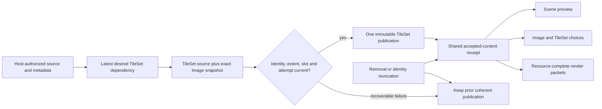

# TileSet Dependency Publication and Editor Loading

Research date: 2026-10-18 (local session). Status: research and proposed sequencing; no production
changes, Cargo commands, behavioral reproductions or new acceptance results in this study.

The subsequent authorized R0 implementation is recorded separately in the
[Image lifecycle repair plan](../plans/2026-10-18-image-lifecycle-contract-repairs-plan.md) and
[verification evidence](../knowledge/engineering/verification/2026-10/2026-10-19T021717Z-image-lifecycle-contract-repairs-95901fe367a149bc90ec922ad0384a73.md).
Those records supersede the implementation status of A01-A04 below. The original source traces
and remaining TileSet proposals retain their research scope.

Nara baseline: `0ebc6603ccafc41e89acd0d478658610f7cf19ee` plus the uncommitted, verified U1-U5
component/plugin/asset refactor and preceding file-backed TileSet slice. Concurrent changes were
preserved. Reference snapshots: Bevy `85503941e488152711a4695bbe248e9ed9f453fc` and Godot
`81ab961f91066a63bcbf3ec340962bb1a1ada558`. Reference behavior is specific to these local commits;
online documentation was checked separately on 2026-10-19 UTC.

Three read-only Codex lanes examined runtime reload, generic Editor loading and mature-engine
source. Integration additionally examined source-kind discovery, tile identity, strict admission,
document editing and GPU snapshot reuse. An independent cross-check confirmed the four Image
source paths and narrowed their scope. An adversarial design review accepted the main sequence
and identified two decision gaps, now addressed below: retained-allocation accounting and retry
of a desired dependency that has no admitted identity yet.
Source traces establish reachable decisions and missing guards; the proposed hostile trajectories
still require behavioral regressions before implementation claims.

## 1. Decision Summary

Keep the ECS/component/resource/plugin model and the completed identity/type/schema repairs.
The next foundation pressure is the publication and revocation of shared dependent content.

1. Repair existing Image event, recovery and Editor publication gaps before cloning their policies
   into a second asset domain.
2. Reuse one concrete TileSet dependency/admission recipe across strict startup and generic Editor
   loading. Replace built-in component-name asset routing with bounded source-kind discovery.
3. If visible last-good is required, publish a TileSet definition together with the exact immutable
   Image content it validated. Retaining only the TileSet descriptor or Image handle is insufficient.
4. Keep one managed authoring runtime. Add a concrete TileSet asset execution plugin separately from
   the existing Tilemap data/schema plugin. Share finite routing primitives, not an erased executor.
5. Admit layout-changing TileSet edits only after choosing tile identity/remapping semantics.
   Admit brushes only after bounded semantic transactions and inverse history exist.

These are proposed implementation decisions. This research does not amend an Accepted ADR, reopen
the completed U1-U5 goal, or claim TileSet hot reload, generic TileSet hydration or residency.

## 2. Existing Workflows and Their Limits

| Workflow | Current evidence | Limit |
|---|---|---|
| Strict Check, cold startup and trusted compiled Editor startup | TileSet source discovers its Image; Images decode before exact extent admission; immutable closure publishes Images before TileSets | Snapshot replacement is not concurrent in-place dependency reload |
| Generic Editor Open | Data-only authoring with trusted built-in preview bindings and read-only Image hydration | TileSet source is not decoded for recursive dependency discovery or published into `Assets<TileSet>` |
| Ordinary Image runtime reload | Checked type claim before Loading; attempt, state, slot and current-catalog validation; last-good on recoverable failure | Source/meta coalescing and recreation recovery have gaps below |
| Asset dependency graph | Reverse source influence and artifact membership | No captured dependency versions, readiness, atomic product group or residency authority |
| Tilemap rendering | Shared Sprite/Tilemap order and Image snapshots in packets | TileSet material refers to the live Image slot; no retained TileSet/Image version pair |
| Editor collection editing | Stable field identity, bounded document transactions and history | Collections are displayed read-only; no existing tile brush or coordinate delta contract |

Strict content admission is at [project_content.rs](../../src/project_content.rs#L1043);
typed publication is at [runtime.rs](../../src/project_host/runtime.rs#L1041).
Generic source collection is at [authoring/project.rs](../../src/project_host/authoring/project.rs#L928),
Image-only filtering at [authoring/project.rs](../../src/project_host/authoring/project.rs#L572),
and generic identity publication at
[authoring_runtime.rs](../../src/project_host/runtime/editor/authoring_runtime.rs#L713).
The [TileSet guide](../guides/file-backed-tilesets.md) explicitly documents the unsupported paths.

Generic authoring and strict startup must remain different admission products. Generic Open can
preserve custom/unavailable records without running project Rust. Strict Check/Play/Export requires
the compiled project's schema agreement and startup closure. Share concrete domain rules and
capability-bound reads; do not make strict Runtime readiness a prerequisite for ordinary Open.

## 3. Existing Image Gaps to Resolve First

These are new source-based findings outside the preceding repair's regression cases. None was
reproduced with an executed test in this research. Prior passing tests retain their actual scope.
P1 means resolve before extending the affected publication policy; P2 means a bounded correctness
or interaction repair. They are not estimates of security exposure or production incident frequency.

### A01 — P2: Metadata Changes Can Be Lost During Event Coalescing

**Trace.** [source_changes.rs](../../crates/nara_asset/src/reload/source_changes.rs#L225) replaces
the prior same-path change with the last enum; its batch entry does likewise at line 287.
[Image reload](../../crates/nara_image/src/reload.rs#L615) treats the outcomes differently:
`Modified` reuses accepted Image settings, while `MetaModified` reads the current sidecar.

**Trajectory.** Change `color_space` in a sidecar, then modify its PNG before the same drain.
`MetaModified -> Modified` drops the settings-change fact and imports new bytes with the old
recipe; the opposite order adopts the new recipe. Existing coalescing tests cover final removal
and remove/create replacement, not preservation of both dirty facts.

**Direction.** Model latest source existence and metadata dirtiness independently. Preserve
remove-then-create atomic-save semantics. Making `Removed` universally dominant would break that
behavior. Alternatively, explicitly choose fresh authorized metadata admission on every source
refresh; do not silently change `Modified` semantics as an incidental implementation shortcut.

**Required regression.** Both source/meta orders yield the same admitted settings and pixels;
remove/create and queue overflow retain their bounded behavior.

### A02 — P2: Cross-Update Image Recreation Loses the Accepted Recipe

**Trace.** The watcher maps filesystem Create to Modified
([backend.rs](../../crates/nara_asset_watch/src/backend.rs#L85)); ordinary source paths retain
that kind ([watch translation](../../crates/nara_asset_watch/src/lib.rs#L196)). Removal deletes
the Image value ([reload.rs](../../crates/nara_image/src/reload.rs#L699)). Accepted settings are
captured from usable pixels ([publication.rs](../../crates/nara_image/src/import/publication.rs#L150)),
so subsequent `Modified` has no recipe and rejects with `image.reload-settings-missing`.

**Trajectory.** Load a valid Image, process removal in one update, then recreate the source with
the same valid sidecar in a later update. A metadata event or explicit import can recover it;
the ordinary Create event cannot. Remove/create within one drain is different: coalescing can keep
the still-present accepted value and succeeds.

**Direction.** Separate the admitted/desired recipe from pixel residency, or re-admit it from the
current authorized sidecar during recovery. Retained recipe facts do not authorize deleted pixels.
Do not relax the intentional rejection of a first load without accepted settings
([existing test](../../crates/nara_image/src/tests.rs#L2509)).

**Required regression.** Previously admitted same-identity recreation recovers after completed
removal; conflicting UUID/path, invalid metadata and a genuinely recipe-less first load still reject.

### A03 — P2: Background Hydration Blocks the Explicit User Lane

**Contract.** [ADR 0115](../architecture/adr/0115-editor-image-import-metadata-and-authoring-publication.md#L162)
separates the two lanes and states that hydration never occupies the user-action lane.

**Trace.** [hydration.rs](../../src/project_host/runtime/editor/image_import/hydration.rs#L156)
reports active work or any queued item. The
[request blocker](../../src/project_host/runtime/editor/image_import/transaction.rs#L349)
rejects explicit Import/Reimport in either case; both public entry points check it.
Hydration advances only while explicit pending is empty, but there is no admission path that lets
the user acquire that lane while the hydration queue remains nonempty. Detail projection can still
be actionable: the observable failure is a Host `Busy` rejection, not necessarily a disabled button.

**Trajectory.** Open a valid project with referenced Images still queued for read-only hydration,
then explicitly Import another Image. Even a queued, not yet active background item blocks it.
Existing Image authoring tests drain hydration before issuing the explicit operation.

**Direction.** Give the bounded explicit lane priority at background admission boundaries. For the
same source, supersede or merge under existing attempt/baseline guards. Removing `Busy` alone is
insufficient: two completions must not race to publish one slot. Cancellation must retain task,
filesystem and budget cleanup ownership until physical retirement.

**Required regression.** With pending background work, explicit work is admitted without waiting
for the whole queue; same-source late completion cannot overwrite it, and project close drains both.

### A04 — P1: Metadata Revocation Does Not Reach Scene Preview's Typed Content

**Contract.** [ADR 0115](../architecture/adr/0115-editor-image-import-metadata-and-authoring-publication.md#L134)
distinguishes recoverable decode failure from invalid/conflicting/drifted identity. The latter
retires authoring choices and prepared-resource authority.

**Trace.** Catalog refresh calls
[retain_catalog_eligible](../../src/project_host/runtime/editor/image_import/transaction.rs#L757).
The [last-good store](../../src/project_host/runtime/editor/image_import/store.rs#L135) removes
Host map entries. [Editor projection](../../src/project_host/runtime/editor.rs#L1085) updates UI
choices and retires UI preview, but does not revoke the shared runtime's typed Image publication.
The Scene preview's [asset database](../../src/project_host/runtime/editor/preview.rs#L188)
also retains its old identity. The
[Image publication revision](../../src/project_host/runtime/editor/authoring_runtime.rs#L341)
advances on successful import, not this revocation. Preparation only removes an Image when its
typed slot or usable state disappears
([prepare.rs](../../crates/nara_image/src/prepare.rs#L178)).

**Trajectory.** Import an Image used by both a Sprite Scene and UI Canvas, then invalidate its
sidecar and complete source refresh. UI choices retire while the Scene path can retain prepared
pixels and produce a candidate with unchanged content identity. The existing retirement test
checks UI choices/last-good; another supported consumer proves imported Images can enter generic
Sprite Scene preview. Their intersection needs a regression.

**Direction.** Add a single authoring-content revoke operation at the managed runtime owner.
Revoke typed publication/derivation and publish a changed content receipt before consumers derive
new choices or packets. In-flight immutable allocations may remain physically retained by their
owners, but cannot create new authority after revocation. Do not add separate frontend deny lists.

**Required regression.** One Image used by UI and Scene is revoked consistently; late hydration
cannot resurrect it. Same-identity decode failure still preserves visible last-good. Selecting
and presenting an earlier frame remains governed by its existing retirement/input protocol.

## 4. The Next Architectural Seam

### Source Discovery Must Not Identify Domains by Component Name

[collect_image_candidates](../../src/project_content.rs#L1534) treats declared AssetRefs as
Images except the exact `nara.tilemap.Tilemap` / `tileset` field.
[collect_tileset_candidates](../../src/project_content.rs#L1570) recognizes only that pair.
A custom component declaring an AssetRef to an otherwise supported TileSet is routed as an Image
and rejected. [DeclaredAssetReference](../../crates/nara_reflect/src/asset_reference.rs#L20)
provides a schema field/path and semantic AssetRef; it does not itself determine an asset domain.

This is a current extension limitation, not a reason to add arbitrary native reflection or make
the schema visitor execute importers. Resolve the declared reference through admitted metadata,
then dispatch only the source kinds selected by the frozen product. Concrete codecs still verify
their expected source kind/type. An unknown kind yields an explicit unsupported-domain diagnostic.
Test the same TileSet through a custom component, a nested/default AssetRef and the built-in map.

| Owner | Responsibility | Avoid |
|---|---|---|
| `nara_asset` | Source identity, typed claim, attempt/generation, bounded source-kind routing and consumer authority | Domain decoding, GPU residency or an erased importer executor |
| `nara_image` | Image recipe, decode, exact immutable Image publication capture | Keeping the only accepted recipe inside resident pixels |
| `nara_tilemap` | TileSet source and layout validation, dependency requirements, published/desired closures | Repeating the extent formula in each Host |
| Product/Editor Host | Authorized reads, metadata receipts, current catalogue/document basis, demand, budgets and cleanup | A second TileSet App/task pool or implicit project-code loading |
| Managed authoring runtime | Shared typed publication and revocation, accepted-content revision | Scene preview acting as the authoritative asset catalogue |
| Render domains/backend | Captured Image versions, packet construction and GPU lifetime | Looking up mutable source bytes or deciding import policy |

The exact extent proof currently resides at
[project_content.rs](../../src/project_content.rs#L1684). It was appropriately private for one
caller. Move it to a concrete TileSet admission Interface when generic Editor/reload creates
another caller; do not duplicate its error-free arithmetic or prebuild a validation framework.

Keep `TilemapPlugin` usable for code-first data/schema composition. A separate concrete asset
execution plugin may require tasks/source routing; installing Tilemap data should not force I/O.
The bounded routing seam joins two actual products. The shared-executor trigger in
[ADR 0103](../architecture/adr/0103-concrete-domain-owned-asset-import-execution.md) still requires
two complete execution paths and demonstrable duplicated policy.

## 5. Publication Policy: Three Alternatives

Current [TileSet material](../../crates/nara_tilemap/src/lib.rs#L251) stores a live Image handle.
[Extraction](../../crates/nara_sprite_render/src/extract.rs#L223) obtains UVs from the TileSet;
[queueing](../../crates/nara_sprite_render/src/queue.rs#L250) resolves the current prepared Image.
If an Image changes dimensions first and TileSet validation then fails, preserving only the old
TileSet value pairs an old layout with new pixels. Commit-time dependency validation alone does
not fix later lookups.

| Alternative | Result | Cost and decision |
|---|---|---|
| Global Image plus all dependent assets commit together | One invalid TileSet blocks the Image and unrelated Sprites sharing it | Cross-domain transaction/failure coupling; reject for this slice |
| TileSet publishes an immutable definition plus exact Image content | Sprite can use the new Image while the TileSet retains a coherent old presentation until a valid successor exists | Recommended for visible last-good; needs bounded retained generations and exact GPU snapshot reuse |
| Live handle plus dependency revision/extent guard | Incompatible TileSet becomes unavailable until revalidated | Smaller alternative, but must explicitly accept disappearing content; it is not visible last-good |

Recommended consistency unit: **one resolved TileSet publication and its required Image content**.
A filesystem event batch is not a source transaction; all project assets do not need one commit.
Capture source identity/basis, Image usable version and slot revision, exact pixels/extent and
retention owner, plus TileSet attempt/source/own-slot baselines. Copy handles remain lookup
identities. A retained closure, not the handle, owns the old allocation.

Removal/identity revocation overrides last-good eligibility. Valid same-identity replacement may
leave an older coherent closure visible; deleted or invalidated identity must revoke dependent
authority even if its pixels are still allocated. This bounded retained-content policy needs an
ADR refinement before implementation; it is not a whole-engine streaming or GC design.

### Desired and Published Dependencies Have Different Jobs

When a TileSet retargets Image A to B and B is missing, the old published closure still depends
on A for revocation, while the desired candidate must observe B for retry. Recording edges only
after success misses B's recovery; replacing A's edge early misses A's revocation.

Keep one bounded latest-desired dependency and the published dependency separately. Project their
union into the reverse invalidation index, retain role-specific checks, and converge on success or
explicit cancellation/removal. Do not accumulate every abandoned dependency, and do not promote
`AssetDependencyGraph` into readiness or publication authority.

The desired record must retain its original `AssetRef` and unresolved status as well as any
resolved identity. A missing path B with no sidecar cannot enter the existing StableAssetId-keyed
graph. Keep that bounded unresolved demand at the Host; authorized catalogue refresh/source
observation or explicit Retry re-resolves it when B and its metadata appear. Only admitted
identities enter the existing reverse graph. Repeated retargeting replaces the old desired demand;
do not create generic graph placeholders or retry every frame without a relevant change.

### CPU Coherence Also Creates a GPU Reuse Requirement

[RenderResourceSnapshot](../../crates/nara_render/src/prepare.rs#L66) already identifies exact
slot/version/content. The [WGPU cache](../../crates/nara_render_wgpu/src/texture.rs#L23) retains
one version per logical `RenderResourceKey` and reuploads when the snapshot changes.
Per-batch [bind groups](../../crates/nara_render_wgpu/src/quad.rs#L280) are retained, so this
research does not claim existing captured packets sample the wrong texture.

However, regularly mixing a latest Sprite Image with an older TileSet closure would churn that
single-entry cache. Add a private exact-snapshot cache key or equivalent bounded policy when that
consumer is introduced. Test alternating versions in one packet, no reupload on unchanged repeat,
upload pressure, retained bytes, device recovery and resource retirement. Never merge batches
based only on the logical Image handle when their captured snapshots differ.

### Retention Capacity and Physical Retirement Must Be Explicit

One old closure per TileSet bounds references per consumer, not total retained allocations.
Different TileSets may pin different generations; an in-flight packet or bind group can outlive
the current cache entry. The implementation plan must assign these separate responsibilities:

| Retained object | Required owner and capacity rule |
|---|---|
| Shared CPU Image pixels | Retained-content ownership follows the actual shared allocation, including old generations; sharing the same payload must not double-charge it |
| Candidate plus previous publication | Reserve the complete overlap before admission. Editor reuses its existing retention policy: capacity failure rejects the successor and preserves last-good |
| Runtime TileSet retention | Bound the additional resolved-content retention introduced by this domain and expose capacity failure; ordinary Image work budgets do not already bound all resident pixels |
| GPU exact-version entries | Specify logical-byte/version capacity, eligible eviction and the existing deferred/rejected presentation outcome when no safe capacity exists; upload-per-frame limits alone are not residency limits |
| Submitted packet/bind group | Its existing presentation/GPU owner retains resources until actual retirement. Cache removal cannot be counted as physical release while another holder remains |

The last actual holder determines allocation retirement. Do not evict visible last-good content
to make a candidate appear admitted, or label current-cache bytes as total GPU memory. This is a
bounded policy for the newly retained concrete TileSet/Image path, not a claim of global process
RAM/VRAM accounting or a general streaming manager. Verification must include several TileSets
stuck on different old generations while an older submitted frame remains in flight.

## 6. What Mature Engines Actually Establish

| Topic | Bevy snapshot | Godot snapshot | Transfer to Nara |
|---|---|---|---|
| Dependency meaning | Ordinary handle dependencies and value/byte-reading loader dependencies are separate | Resource references and changed notifications drive derived work | A TileSet reading Image dimensions needs derivation invalidation, not merely a handle |
| Update completion | Store insertion precedes dependency-state completion; events are processed individually | Reload copies a successful replacement into the old Resource and coalesces that object's changes | Neither establishes an atomic versioned dependency bundle |
| Failed replacement | Failure state can coexist with the old store value | Failed new Resource load leaves the old object | Separate usable content from latest attempt/error |
| Source deletion | RemovedAsset handling in this snapshot refreshes parent folders rather than deleting current store content | Editor reload skips files no longer present | Do not import their deletion policy into Nara's explicit revocation contract |
| Atlas changes | Layout and Image are separate assets; no exact extent admission | Changed signals dirty derived tile work; out-of-texture tiles get editor warnings and explicit Undoable cleanup | Preserve Nara's stronger exact policy; never silently remap or delete authored cells |
| Lifetime | Strong handles own shared residency | Reference-counted Resource objects own shared lifetime | Keep Copy identity; give retained resolved content a separate lifetime owner |

Primary local evidence:

- Bevy [dependency classes](../../repo-ref/bevy/crates/bevy_asset/src/loader.rs#L141),
  [value-read dependencies](../../repo-ref/bevy/crates/bevy_asset/src/loader.rs#L608),
  [reverse loader edges](../../repo-ref/bevy/crates/bevy_asset/src/server/info.rs#L550),
  [store insertion/readiness](../../repo-ref/bevy/crates/bevy_asset/src/server/info.rs#L445),
  [failure](../../repo-ref/bevy/crates/bevy_asset/src/server/info.rs#L685),
  [event processing/deletion](../../repo-ref/bevy/crates/bevy_asset/src/server/mod.rs#L1891).
- Godot [single-object replacement](../../repo-ref/godot/core/io/resource.cpp#L234),
  [texture-change subscription](../../repo-ref/godot/modules/tilemap/tile_set.cpp#L4662),
  [deferred atlas rebuild](../../repo-ref/godot/modules/tilemap/tile_set.cpp#L5627),
  [TileSet propagation](../../repo-ref/godot/modules/tilemap/tile_set.cpp#L2552),
  [layer invalidation](../../repo-ref/godot/modules/tilemap/tile_map_layer.cpp#L2008),
  [explicit outside-tile cleanup](../../repo-ref/godot/modules/tilemap/editor/tile_set_atlas_source_editor.cpp#L2306).

Official documentation separately describes
[Bevy's LoadedWithDependencies event](https://docs.rs/bevy/0.20.0/bevy/asset/enum.AssetEvent.html)
and [Godot Resource changed](https://docs.godotengine.org/en/stable/classes/class_resource.html).
Readiness and notification describe different facts from Nara's proposed coherent publication.
The shared mutable Godot object model and Bevy's general asset executor are architectural
alternatives, not implementations to copy into this engine.

## 7. Tile Identity and Editing Before Tools Multiply

### A Physical Index Is Not a Stable Tile Definition

Current [TileIndex](../../crates/nara_tilemap/src/lib.rs#L83) is a row-major atlas index;
[normalized_region](../../crates/nara_tilemap/src/lib.rs#L196) derives `x/y` from columns.
For index 5, changing columns from 4 to 8 changes the selected region from `(1, 1)` to `(5, 0)`.
Dimensions can still match the new Image, so extent validation cannot detect semantic reassignment.

Before layout-changing authoring/import remaps, introduce a tileset-local opaque definition ID
mapped to physical regions, or explicitly choose coordinate-based identity with its more restrictive
editing semantics. Prefer the opaque mapping for repacking. Do not allocate a global UUID per cell.
Existing v1 indices can initially map to equal local IDs; subsequent repacks update the definition
mapping and require explicit missing/deleted-tile decisions. A migration must be deterministic,
previewable and preserve source on failure.

Until that workflow exists, a reload slice may support same-layout pixel/recipe/tint changes and
explicitly reject layout reinterpretation. Do not advertise unrestricted layout reload while silently
changing saved cell meaning. Read-only dependency loading does not itself require changing cell IDs.

[Tiled Global Tile IDs](https://doc.mapeditor.org/en/stable/reference/global-tile-ids/) are scoped
to one map and include transform flags. An importer must resolve the tileset association and local
ID; a GID cannot be an engine-wide persistent ID. Tiled's
[format reference](https://doc.mapeditor.org/en/stable/reference/tmx-map-format/) also permits gaps
in image-collection tile IDs. Its
[external tileset workflow](https://doc.mapeditor.org/en/stable/manual/editing-tilesets/) supports
sharing definitions rather than duplicating them into each map. These facts inform adapter rules;
Tiled import is not implemented by this study.

### A05 — P2: Strict Admission Does Not Prove Cell-to-Definition Membership

[The codec](../../crates/nara_tilemap/src/lib.rs#L903) validates unique coordinates and a `u32`
tile number. Strict loading validates source/Image extent but does not join every cell to the
loaded TileSet. Rendering deliberately skips invalid regions
([test](../../crates/nara_sprite_render/src/tests.rs#L1241)). Thus a successful source closure
does not currently prove every authored textured cell will be drawable.

Keep defensive code-first rendering behavior, and add domain-aware strict diagnostics once the
concrete TileSet closure is available: entity/component, cell coordinate, TileSet identity and
missing tile ID. Generic recovery may preserve unavailable records and diagnostics; strict
Check/Export should reject the invalid reachable map. This is a current admission limitation
requiring a regression, not a renderer crash or evidence that the intentional fallback is wrong.

### Small Brush Deltas Do Not Automatically Make Transactions Cheap

[Inspector SetField](../../crates/nara_tooling/src/inspector.rs#L357) replaces root values;
[field projection](../../crates/nara_tooling/src/inspector.rs#L1062) clones effective data.
The frontend displays collections read-only
([authoring.rs](../../editor/src/frontend/imgui/authoring.rs#L601)). There is no current brush
that performs whole-map replacement per cell.

Before adding one, define a bounded coordinate-addressed stroke: one document/base revision,
one target map component, deduplicated cell writes/removals with old-value preconditions, and one
atomic Undo record whose inverse data follows changed cells. Route UI, Rust tooling and agent
operations through the same semantic transaction. Keep crop wetness, encounters and occupant
state in gameplay owners rather than expanding every render cell into a global world database.

The current [patch staging](../../crates/nara_scene/src/patch.rs#L424) clones the whole document.
An O(changed-cells) command/inverse therefore does not prove O(changed-cells) total validation or
allocation. Measure end-to-end commit, projection and Undo on a saved/reopened map before choosing
copy-on-write, a private coordinate index or another document representation. Do not promise a
performance result based on payload size alone.

## 8. Proposed Implementation Order

| Stage | Owning work and deletion | Completion evidence |
|---|---|---|
| R0: Image contract closure | Regress A01-A04; correct coalescing, admitted-recipe recovery, background priority and shared runtime revoke; remove scattered retirement-only projections | Both event orders; split-update recreation; explicit request during hydration; UI and Scene revoke together; stale completion/close cleanup |
| R1: Concrete source/dependency admission | Resolve declared references by admitted source kind; share TileSet source/dependency/extent validation; remove component-name loading exceptions | Built-in/custom/nested/default TileSet references; strict/runtime/trusted behavior preserved; unknown kinds reject |
| R2: Coherent dependent publication | Implement concrete TileSet candidate/published owner, resolved/unresolved desired demands, published dependency roles and explicitly budgeted retained Image generations; add private exact GPU reuse/capacity policy | Either completion order; invalid extent preserves a complete old closure; same-frame Sprite/new and TileSet/old pixels; pressure, actual retirement and removal revocation |
| R3: Complete generic Editor and runtime consumers | Add demand from Open/new document to the same authoring runtime; finite TileSet source routing/execution; shared content receipt for publish/revoke | Open saved map, hydrate, explicitly update, fail/recover, save/reopen, Check/Export; no project-code execution during generic Open |
| R4: Tile identity and semantic editing | Admit logical IDs before layout-changing edits; coordinate stroke transactions before brushes; remove whole-field workaround designs | Deterministic v1 migration/remap, one stroke/Undo, stale/invalid atomic rejection, measured whole-transaction cost |
| R5: Scaling and streaming when measured | Profile a representative saved map; private culling/cache and acquisition ownership only where required | Attribution to the failing budget, exact invalidation/release proof; no universal GC or chunk cache by default |

R1 and tile-identity design can be researched in parallel. R2 must precede enabling live generic
TileSet consumers that can observe explicit Image replacement. R3's data-only discovery can be
built before runtime reload, but both must consume R1/R2's admission/publication contract.
R4 is a gate for layout-changing authoring, not a hidden prerequisite for reading an unchanged map.
No implementation should be scheduled as one large generic asset-platform rewrite.

## 9. Acceptance Matrix and Decision Gates

Use a fixture with a Sprite, two TileSets sharing an Image, UI Image content, a nested/default
TileSet reference and one unavailable custom record. Keep headless/domain checks first, Cargo
serial with one build job, and native GPU/readback checks limited to changed render behavior.

| Hostile trajectory | Required observable result |
|---|---|
| Metadata/source dirty in either order | Identical desired recipe and final accepted pixels |
| Remove, complete update, recreate | Immediate derivation revocation, then same-identity recipe recovery |
| Open with hydration pending, explicit Import | Bounded foreground admission; no stale same-slot commit |
| Metadata invalid/identity conflict after UI and Scene present | One accepted-content invalidation; no new authority for revoked pixels |
| Same-size Image pixel change | Stable semantic handles; compatible TileSet successor |
| Image resized before/after TileSet completion | No incompatible Image/layout pair is ever newly presented |
| TileSet A-to-B dependency switch; B fails then recovers | A still revokes old content; B triggers latest desired retry; edges remain bounded |
| B and its metadata do not exist until after the switch | Bounded unresolved demand re-resolves on authorized observation/Retry; no invented StableAssetId or leaked historical demand |
| Image candidate changes between validation and commit | Stale candidate rejects under explicit baseline policy |
| Two TileSets share an Image, one successor invalid | Independent supported consumers can advance; failed consumer follows selected last-good policy |
| Sprite uses new Image while TileSet retains old | Correct two-version readback; unchanged repeat does not reupload both generations |
| Several TileSets pin different Image generations and a prior frame remains in flight | Shared allocations are accounted once, overlap capacity rejects honestly, and resources release only after actual holder retirement |
| New document opens after initial project hydration | Demand is discovered from the new admitted document, not only startup references |
| One cell names a missing TileId | Precise strict diagnostic; no silently successful Check followed by invisible cell |
| One stroke, Undo/Redo, concurrent stale edit | One atomic history entry; exact inverse; no partial document or dirty/history change on reject |
| Runtime/project replacement or shutdown with work pending | Old completions cannot publish; allocations and cleanup ownership retire exactly once |

The live rename policy remains a separate decision. Fresh snapshots resolve stable UUIDs after
rename, but current watcher translation plus immutable same-runtime bindings do not form a live
rebinding transaction. Either scope it explicitly out or design Host-owned source/sidecar/catalogue
and task migration before claiming it.

No guessed latency or memory target is asserted. Measure foreground admission latency, retained
generation bytes/count, repeated-frame uploads, full stroke transaction cost and cleanup completion
on the selected fixture. Semantic success means zero mixed-version presentations, zero partial
rejected edits, and no unbounded pending/history/dependency growth in the specified trajectories.

## References

- [Strategy](../../STRATEGY.md)
- [Completed contract refactor evidence](../knowledge/engineering/verification/2026-10/2026-10-18T164837Z-component-plugin-and-asset-contract-refactor-b4c2497eff5d4bdb90cebe1de995ceb3.md)
- [Previous follow-up assessment](../audits/2026-10-18-next-foundation-refactor-assessment.md)
- [Concrete domain execution](../architecture/adr/0103-concrete-domain-owned-asset-import-execution.md)
- [Editor Image publication](../architecture/adr/0115-editor-image-import-metadata-and-authoring-publication.md)
- [Foundation ownership](../architecture/adr/0117-2d-foundation-ownership-and-authoring-contracts.md)
- [Document transactions](../architecture/adr/0026-editor-command-patch-and-undo-model.md)

The supplied pixel-engine planning conversation motivates data-driven maps, fast content iteration,
shared definitions and a usable Editor. Its older toolkit, genre-specific and integer-simulation
suggestions are background hypotheses; the Strategy and current Accepted ADRs govern this design.
