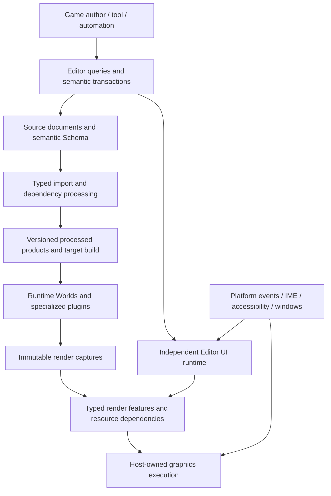

# Nara Engine Direction And Architecture Review

Date: 2026-10-30. Status: research synthesis; not an adopted architecture contract.

For the follow-up route advice, read [Development Direction](development-roadmap.md). The
[supplemental review](supplemental-review.md) records additional design/acceptance considerations.
A receiving development agent should begin with [the handoff](development-agent-handoff.md), which
defines reading order, current-HEAD reconciliation, complete consumer units and archive limits.

## Assessment

Nara has a credible foundation for a Rust-first integrated engine. The highest future migration
costs are concentrated in **content reference/demand semantics, persistent content evolution,
composable rendering, custom Editor interaction, and cross-domain simulation execution**.
These deserve concrete pre-1.0 replacement experiments. The evidence does not justify replacing
Bevy ECS, merging document truth into live Worlds, or building universal task/extension frameworks.

Five parallel research lanes produced 21 implementation-focused observations plus eight industry
themes; the coordinating lane added feedback/platform/navigation observations. An independent
review challenged three central execution and Editor claims. The implementation lanes established
structural limits and foreseeable risks, but did **not** establish a new violation of a currently
supported runtime contract. This is not a defect-free certification or an exhaustive security audit.

| Resolve early | Concrete consequence of postponement | Relevant evidence |
| --- | --- | --- |
| Reference validation versus current load demand | A connected Door graph becomes a large resource-preparation closure; backing lifetime separately retains all encoded members. | Content CP3/CP4; themes P8 below |
| Schema/Prefab evolution and source refactoring | A component upgrade or Prefab extraction requires coordinated rewriting of claims, addresses and history policy. | Content CP1/CP2; P9 |
| Render Features, resource versions and UI presentation | New effects, materials and Editor consumers multiply central backend edits; multiple displays need an explicit interaction/completion policy. | Render F1-F3; P1/P2 |
| Editable custom UI and semantic contributions | Frontend-specific drafts, text assumptions and panel-bound activation spread through the tool ecosystem. | Render F4/F5, Editor E1/E2/E4; P3/P5 |
| Motion phases and deliberate execution policy | Physics, animation, interpolation and success acknowledgement acquire incompatible ordering assumptions. | Runtime RE1-RE5; P4 |
| Complete Rust iteration and feedback | Fast restart hides rebuild and gameplay-setup cost; expensive validation discourages structural changes. | Editor E3/E5, feedback F1/F2; P6/P7 |

## Scope And Method

This review examines the changes that would become expensive after publishing Nara, growing game
content, or building the planned Nara-drawn Editor. It combines current implementation, Accepted
ADRs, existing qualification records, pinned reference source, and official external documentation.
Research recommendations do not change ADR status or claim implementation qualification.

Baseline: `75e1284ed28bc5a96686609f7dae8805d1924788` on `main`. The pre-existing untracked
`docs/knowledge/engineering/registry/render-ui-apply-foundation-implementation-codex-root.md`
is unrelated and remains untouched. Reference repositories are read-only:

| Reference | Inspected revision |
| --- | --- |
| Bevy | `ae6152152d6fb8308ad6038314b48ef295e80fbc` |
| Godot | `7be59b463a4798834d72d6d0a2942ddd01d920ee` |
| Fyrox | `5495d012b32145674501af2e67d2fd06a06f04dd` |

The short investigation plan is:

1. Establish current product scope and distinguish implemented repairs from historical proposals.
2. Inspect independent runtime, content, rendering/UI, and Editor/extension paths in parallel.
3. Compare transferable mechanisms and future directions against primary sources.
4. Challenge the findings with counterevidence; prioritize by migration cost and a concrete consumer.
5. Publish a consolidated recommendation and bounded experiments, with verification limits.

## Research Lanes

- [Runtime and execution](runtime-and-execution.md)
- [Content and persistence](content-and-persistence.md)
- [Rendering and custom UI](rendering-and-custom-ui.md)
- [Editor and extensibility](editor-and-extensibility.md)
- [Industry directions](industry-directions.md)
- [Feedback, product evidence, and platform boundaries](feedback-and-platform.md)

## Evidence Rules

- **Confirmed mechanism/limitation:** current code or an existing qualified workflow establishes the
  behavior. A source-confirmed limitation does not imply that it is an unintended defect.
- **Architectural risk:** a named foreseeable consumer would cross an unsuitable boundary. The
  scenario and migration consequence are explicit; performance and failure outcomes are not invented.
- **Capability gap:** a missing supported workflow, with the decision to build it kept separate from
  a correctness claim. Absence of high-end 3D, networking, mobile, or a marketplace is not a bug.
- **Historical evidence:** a measurement or test is attributed to its actual revision and endpoint.
  This review does not turn earlier qualification into a new all-platform or current-baseline claim.

Priority means the cost of postponing a boundary decision, not a fabricated severity or deadline.
A publicly frozen format, material ABI, widget identity, or plugin lifecycle merits earlier pressure
than a private allocator optimization. A unit should replace the owning boundary and migrate its
real consumers; a generalized framework needs more evidence than a concrete implementation.

## Direction To Preserve

The existing substrate is worth retaining: Rust and Bevy ECS for typed execution; Schema-first
persistent metadata; stable semantic identities separate from runtime entities; document-owned
edits and Undo; source-independent Runtime content; explicit platform/backend ownership; and
specialized plugins that need not pretend to be interchangeable implementations of a universal API.
The October 27-30 source/data, compound-product, source-location, Scene-dependency and Input repairs
must be assessed as current implementation, not repeatedly reported as missing historical work.

The intended ownership shape can remain compact even when individual owners become more capable:

This is a recommended responsibility map, not a new service-trait hierarchy or a claim that every
arrow is fully implemented. In particular, authoring documents and processed artifacts do not have
to become live ECS entities, and the Editor UI does not need to share one mutable World or one
simulation clock with its Game view.

## Transferable Industry Directions

These are architectural observations and recommendations, not predictions that every engine will
converge on one design. The [industry lane](industry-directions.md) contains the wider source trail.
External pages were inspected on 2026-10-30; a roadmap item is not treated as shipped functionality.

| Direction | Primary evidence | Consequence for Nara |
| --- | --- | --- |
| Resource dependencies are explicit | [Unity's render graph](https://docs.unity.com/en-us/engine/6000.5/manual/render-pipelines/universal-render-pipeline/customizing-urp/render-graph/introduction) declares resource use separately from execution and distinguishes graph-owned from imported resources. | Make resource identity, access and lifetime expressible before adding effects; parallel scheduling and transient aliasing can follow measurements. |
| Asset production and delivery are distinct | [Unreal's cooked-output store](https://dev.epicgames.com/documentation/unreal-engine/using-zen-storage-server-as-cooked-output-store-for-unreal-engine?lang=en-US) separates cooked content storage from staging and delivery. | Retain Nara's processed-content boundary and grow reproducible dependency-aware building; a remote cache server is a later product choice. |
| Editor ergonomics need composable data and reusable UI behavior | [Bevy's August 2026 report](https://bevy.org/news/bevys-sixth-birthday/) connects scene composition, behavior-only widgets, styled tool widgets and Editor development. Its Editor intentions are dated plans, not an assertion of October completion. | Separate stable model identity, widget lifetime, focus/text behavior, themes and Host integration. Reuse concepts without adopting another complete toolkit. |
| Fast native iteration has lifetime constraints | [Fyrox's hot-reload guide](https://fyrox-book.github.io/beginning/hot_reloading.html) describes serialized state restoration, DLL boundaries and trait-object limitations. | Maintain the reliable rebuild/restart path, measure it, and qualify bounded compatible patching separately from persistent-schema or state-layout replacement. |
| Spatial streaming and team authoring are linked | [Unreal World Partition](https://dev.epicgames.com/documentation/en-us/unreal-engine/world-partition-in-unreal-engine) relates streaming cells to authoring and data-layer mechanisms. | Preserve source/product/instance identity and allow multiple resident units; do not prematurely implement a large-world partitioner for the current PC 2D proof. |
| Automated tools need semantic operations | Nara already has document-owned transactions, exact outcomes and external source-tool work; the future-tool recommendation is an inference from those contracts. | Let scripts and AI submit the same validated queries/edits as the UI. Preview, conflicts, Undo and auditability belong to those operations; model-provider coupling does not belong in ECS or the renderer. |

GPU-driven rendering, richer authoring and AI-assisted workflows increase the value of these
boundaries. They do not require Nara to build virtual geometry, a universal scripting VM, a package
marketplace, distributed editing, or a new ECS before proving its own production workflow.
The [October 8 Bevy 0.20 release](https://bevy.org/news/bevy-0-20/) adds current evidence for shared
2D/3D rendering infrastructure, extensible sprite materials and editor-oriented widgets; it does
not establish a finished general-purpose Editor. Nara should borrow the ownership lessons while
retaining its distinct persistent-document and Host guarantees.

## Highest-Cost Boundaries To Resolve

The following numbered themes are review judgments, not severity grades. They combine existing planned work with additional
cross-contract observations; they are not a list of newly discovered correctness bugs.

### P1. Finish The Render Extension Boundary Before Adding More Closed Families

The current backend centrally names Sprite/UI payloads, and the material interface fixes a sprite
fragment ABI with one extra texture and one parameter vector. These are useful bounded prototypes,
but an independent renderer feature or richer durable material needs engine changes. See
`crates/nara_render_wgpu/src/frame.rs:36`, `backend.rs:1603`, and
`crates/nara_material/src/lib.rs:75`; [render F1/F3](rendering-and-custom-ui.md) follows the full path.

**Recommendation:** implement the already-selected finite resource graph with typed contributions,
one Host-owned native execution boundary, explicit texture/buffer access, exact output versions,
and a real alternate renderer policy. Include window-free GPU initialization and retiring one
producer while another keeps submitting. Select material semantic fields, GPU binding layout and
shader-interface identity as distinct contracts. Ordinary shader changes must not require growing
a central enum or silently rebinding persistent meaning.

**Status and migration cost:** this is primarily unimplemented R8/R9 and Proposed ADR 0121, not a new
direction. Every additional stock-only domain increases the future migration surface. A deterministic
serial topological executor is sufficient initially; allocator aliasing and multi-queue scheduling
are implementation optimizations. Replacing wgpu or building a second RHI is not justified.

### P2. Resolve Display Reuse, Interaction, And UI Completion Together

An exact image version and a completed UI interaction session have different lifetimes. Current
Editor targets are reusable; UI submission permissions are consumed once and can block the next
handoff while outstanding. A clone of a texture view does not retain the earlier pixels. See
`crates/nara_render_wgpu/src/editor_execution.rs:210`, `:382`, `:567`, and
`crates/nara_ui_render/src/integration.rs:465`; [render F2](rendering-and-custom-ui.md) gives the
source-derived counterexample.

**Required scenario:** a 30 Hz Game view and a 60 Hz preview are displayed by a 144 Hz Editor;
the Game output appears twice, one destination hides/fails, and the preview continues. Decide which
display attempt completes the original UI submission, which occurrence receives input, and what
remains valid when a newer producer frame fails. These rates define a test, not performance claims.

**Recommendation:** begin with one explicit interactive placement per logical UI surface and passive
mirrors. Retain exact output resources independently of one-shot completion and per-placement geometry.
Repeated display must not advance simulation/history or complete the same UI attempt twice. Join the
proposed graph contract to Accepted ADRs 0108/0112 before freezing the bridge. This is a substantive
additional refinement to the existing render plan; deferral would affect rendering, input, UI and
Runtime retirement simultaneously.

### P3. Establish The Custom Editor Interaction Runtime Before Growing Its Widget Catalogue

Document operations and Undo are already separate from Dear ImGui. The remaining migration includes
real interaction behavior and compilation boundaries: native panel factories take ImGui types,
`editor` imports the native stack unconditionally, drafts live in the frontend, and the current text
projection primarily exposes display glyphs. See `editor/src/frontend/imgui/workspace.rs:25`,
`editor/Cargo.toml:7`, and `crates/nara_text/src/engine.rs:27`;
[Editor E1](editor-and-extensibility.md) and [render F4/F5](rendering-and-custom-ui.md).

**Recommendation:** give the Editor its own retained widget identities, draft/edit state, focus,
layout/paint/semantic invalidation and drawing stream. Keep document/property identity and saved
panel identity separate from widget incarnation. Reuse Parley/Swash/Taffy and appropriate platform
bridges, while deliberately selecting editable cluster/caret/hit-testing, font fallback, IME,
clipboard and accessibility contracts. Game font determinism and Editor font policy need not be
identical. UI composition can share GPU infrastructure without sharing the gameplay clock or World.

**First complete consumer:** an Inspector with editable multilingual text and numeric properties,
filtered/reordered rows, exact Undo/save/reopen, and a Scene image under clipped UI/popups. Then
qualify native detach with DPI, focus, IME and retirement. A panel full of labels or triangles is too
weak to establish this boundary. Retire corresponding Dear workflows after parity is demonstrated;
do not require all game widgets or every Editor panel before trying the first real port.

### P4. Test The Schedule And Motion Protocol Before Physics And Animation APIs Harden

The managed runtime, fixed clock and spatial read cuts are sound foundations. The automatic stage
topology and public fixed joins have not proved intermediate motion publication and independent
domain ordering. Default ECS execution is also feature-dependent rather than explicitly fixed by
Nara. Local Transform writes do not establish physics/animation precedence, and future teleport
operations need an interpolation discontinuity policy. See `crates/nara_app/src/lib.rs:120`,
`:148`, `crates/nara_app/src/runtime/owner.rs:239`, and
`crates/nara_transform/src/presentation.rs:98`; [runtime RE1/RE2/RE5](runtime-and-execution.md).

The executor observation is conditional: enabling `multi_threaded` for the same Bevy package in
the target dependency graph changes its default on supported non-Wasm platforms. This review did
not execute a feature-unification regression or establish a current concurrency failure. Custom
schedules retain their explicit mutable executor configuration; the concern is the unfixed built-ins.

**Recommendation:** advance a small Physics-like plus Animation-like consumer into existing R4c,
together with the relevant R10 slice. Compare public ordered sets, a sealed finite phase plan, and
`bevy_app::App::empty()` under Nara lifecycle ownership using that same workflow. Keep the simplest
candidate that satisfies the actual ownership, stepping and failure protocol. A thin real solver
must check the chosen worker/body assumptions before declaring physics suitability.

Verify zero/multiple fixed ticks, pause/exact-step, root-motion intent, solver pose commit, deferred
spawns, parent frames, teleport and held-worker retirement. Make serial/parallel execution an
explicit supported policy; compare both for ordering correctness. Keep same-tick borrowed jobs
distinct from owned cross-frame Tasks. Also reconcile the current command Ack contract with any
stronger whole-tick completion promise. These are existing plan refinements and foreseeable design
risks, not proof that current fixed-step gameplay is incorrect.

### P5. Make Semantic Tool Contributions Independent Of Panels And A Single Active Slot

The public editing operations already exist. However, the ordinary shell exposes source-built
panels rather than a standalone command/menu/shortcut contribution, and installed finite tools
share one active route despite a multi-member installation graph. See
`editor/src/platform/composition.rs:46`, `editor/src/frontend/imgui/mod.rs:575`,
`src/project_host/runtime/editor/source_tools.rs:245`, and
`source_tools/selection.rs:925`; [Editor E2/E4](editor-and-extensibility.md).

**Recommendation:** qualify a contributed Snap command that remains callable with its panel closed,
using existing query/prepare/commit/Undo operations. Use the same semantic command from a menu,
shortcut and custom UI. Separately qualify two independent installed tools that remain discoverable
while either is updated or disabled. Execution can stay serialized; contribution availability is
a separate requirement. Generalize the active state only for that concrete coexistence workflow.

The current single-slot contract is deliberate and correct within its stated scope. Its installation
graph is useful even now. The risk is exporting those restrictions as the long-term general SDK,
which would encourage engine forks or unrelated tools bundled into one child executable. A universal
plugin kernel, package resolver or string-command bus would add unnecessary work.

### P6. Turn Rebuild-And-Resume Into An Ordinary Rust Workflow

`Restart` currently activates the admitted executable; it does not compile saved Rust changes.
The two-level sample has real game-owned checkpoint persistence, but ordinary supervised Play does
not join capture, rebuild and compatible state restoration. See
`editor/src/supervised_play/owner.rs:526`, `src/project_host/product_launch/wire/launch.rs:129`,
and [Editor E3](editor-and-extensibility.md).

**Recommendation:** make returning to a meaningful gameplay situation part of edit-to-result latency.
Join a game-owned development checkpoint to the existing supervised launch owner, with explicit
capture, compile and restoration failure behavior. Compare one function-body edit and one structural
edit at the same situation. Compatible hot patching can be an additional measured path; dynamic
linking alone does not solve it. Keep native code retirement separate from tool disable: retained
trait objects, views, history and destructors can still require old executable code
([Editor E5](editor-and-extensibility.md)).

The final historical five-sample cohort records body-edit Play at a 13.961-second median and admitted
Restart at 1.499 seconds. These are different endpoints at an older revision, not current performance
or a hot-reload comparison. Native unload and a mandatory second language should not precede this
complete reliable workflow.

### P7. Keep Performance And Platform Evidence Alongside The Structural Work

Current spatial publication scans source participants and rebuilds a complete candidate after local
change. This is a measured historical tradeoff, not an established current frame-budget failure.
Optional profiling should distinguish that cost from GPU work, authoring preparation and compilation.
CI likewise needs a prompt owner-test signal alongside complete costly qualification. Portability
must exercise filesystem/save/export/input/retirement paths; a Metal renderer alone would not qualify
macOS. See [runtime RE4](runtime-and-execution.md) and
[feedback F1-F3](feedback-and-platform.md).

**Recommendation:** retain current immutable-read guarantees while measuring sparse versus dense
change, same-tick edits and whole-workflow tails. Prefer private incremental maintenance behind
existing readers before changing their semantics. Reuse the existing benchmark harnesses, add
optional owner-phase spans and a comparable scheduled product run, and agree budgets after collecting
the baseline. Fix validation ordering/cache/profile costs from current measurements rather than
removing safety tests or writing a compiler-like proof script.

The source confirms explicit unsupported filesystem tiers on non-Linux Unix, and current CI covers
Windows/Linux. Run a small macOS authoring/launch spike before relying on those contracts for a broad
desktop promise. This is a capability gap, not a false existing macOS release claim.

### P8. Separate Valid References, Preparation Demand, And Encoded Backing Residency

The source-free path is implemented. Its remaining scope is eager: effective Scene references must
have catalog `Required` edges, and preparation recursively acquires that graph's Scene/domain
resources. A Door from A to B and B to C can therefore bring later levels' textures into A's
prepared resource closure even though only A is instantiated. See `src/runtime_content.rs:701`,
`:719`, and `src/runtime_content/prepared.rs:50`, `:135`; [content CP3](content-and-persistence.md).

Independently, `RuntimeContentBase` retains every member's encoded bytes, and individual decoded
assets retain their originating base (`src/runtime_content.rs:293`, `:470`, `:761`). A small escaped
asset can extend the whole encoded base's lifetime. This is intentional bounded sharing, not a copy
per asset or a memory leak; it is unsuitable to assume it already provides general streaming.

**Recommendation:** distinguish references required for materialization from validated deliverable
targets acquired later. Preserve strict target checks and complete build/export closure for both.
Today's `Soft` edge also permits absent membership, so simply relabeling Door edges would weaken
the contract. Change the Schema/reference/catalog interpretation deliberately, using a three-Scene
Door/menu consumer with a shared atlas and heavy later-level resources.

Separately retain immutable catalog/code-plan authority while allowing a concrete retained pack
backing to read verified members on demand. Keep the current eager backend's captured-file-removal
guarantee honest; define the lazy backend's availability guarantee explicitly. Validate cancellation,
overlapping generations and an escaped Image. Lazy bytes alone do not shrink a Required decode
closure, and lazy references alone do not evict eager bytes. No remote storage or open-world system
is needed to expose this distinction. CP3 should precede a stable travel-reference format; CP4 can
remain private until a representative content set proves the next backing policy.

### P9. Evolve Authored Intent And Addresses Together With Component Values

Native component migrations can update stored values, while Prefab property claims require an exact
current Schema version (`crates/nara_scene/src/schema_authority.rs:132`,
`crates/nara_scene/src/prefab/overlay/properties.rs:26`). Keeping a stable field ID does not decide
whether an old override still means the same thing. Additive owner adoption and retained Undo are
already qualified; arbitrary existing-owner evolution is a separate contract.

Prefab addresses also include source occurrence and nesting hops. Extracting a wheel from a Car
Prefab into a separate Wheel Prefab changes that ownership path despite an unchanged terminal
entity ID (`crates/nara_scene/src/prefab/overlay.rs:51`,
`crates/nara_scene/src/runtime_scene/identity.rs:182`). This prevents ambiguous retargeting, but
requires an explicit cross-source address migration for the new workflow. Ordinary hierarchy
reordering is not the same operation. See [content CP1/CP2](content-and-persistence.md).

**Recommendation:** before promising durable project upgrades, implement one reviewed project
upgrade over component values, property claims/selectors, dormant overrides and dirty dependants.
Choose an explicit history checkpoint or a proven retained-history basis. Separately qualify a
Prefab extraction with an old/new occurrence map and dependent rewrites. Unknown semantic records
must remain preserved or make an affected remap refuse; generic Open must not execute arbitrary
project migration code. Compare physical file shards with new logical sources before choosing a
team-editing format. CRDTs and a universal migration language are unnecessary.

When R6b persistent artifact reuse or target cooking starts, also close the actual build recipe:
versioned importer/cooker, normalized settings, observed dependencies and relevant target inputs.
Keep logical Product identity, recipe identity, output-byte digest and group publication distinct
([content CP5](content-and-persistence.md)). No wrong cache hit was demonstrated. This is a freeze
gate for the coming build workflow, not grounds to replace the working source-free base now.

## A Concrete Next Research-To-Implementation Sequence

Use existing R4c/R5/R6/R7/R8/R9/R10/R11 owners rather than starting another omnibus foundation plan.
These units can have independent implementation branches; their integration requires the named
shared contracts. The order within each row follows the consumer's actual dependency chain.

| Unit | Working consumer | Decision or replacement it must settle | Evidence of completion |
| --- | --- | --- | --- |
| Content semantics | Three Scenes linked by Doors/menu; nested Prefab with a versioned gameplay field | Deliverable reference versus load demand; one explicit Schema/claim upgrade and source extraction | Strict Check/export closure, selected preparation, unchanged unrelated payloads, precise conflicts and recoverable publication |
| Rendering to self-drawn UI | External texture/buffer Feature, two independently paced views, one interactive Game placement and passive mirror | Typed resource graph/Host boundary, exact output retention and one-shot UI completion | No central domain switch edit, window-free GPU boot, local producer retirement, failed/hidden mirror trajectory |
| Editable Editor slice | Multilingual Inspector plus Scene image, closed-panel Snap command and two installed tools | Retained edit/text/focus identities, semantic command contribution and coexistence | Preview/exact result/Undo/save/reopen, stale result rejection, keyboard/IME/accessibility and measured idle/active behavior |
| Simulation and iteration | Small physics/animation motion slice and game-owned development checkpoint | Phase plan, pose write/reset semantics, explicit execution mode, reliable rebuild/resume | Zero/multiple ticks, pause/step, teleport, held worker close, body/structural edit restored to a meaningful gameplay situation |

Bring the small motion consumer forward while comparing the scheduler; do not leave it until after
the schedule API is frozen. Likewise, editable text and display completion should constrain the
first custom UI design rather than being appended after a full widget catalogue. Use a deterministic
stand-in only to compare sequencing, then a real solver/native UI/GPU path for the corresponding
claim. Existing qualified source-free, Input, ordinary authoring and physical-close workflows are
regression obligations within their affected scope, not requirements to rerun every product gate for
this documentation-only review.

Measure current costs at the start and after meaningful changes. Keep unrelated capability expansion
out of those units. Future 3D can remain a separate spatial domain, but qualify affine import or
KeepWorld representation before persistent animation/property APIs depend on TRS-only assumptions
([runtime RE6](runtime-and-execution.md)). Large-world streaming, networking/rollback, high-end 3D,
remote caches, universal binary ABI and model-provider infrastructure can remain deferred.

## What This Adds To Existing Research

- It rechecks the October 27-30 implementation and excludes obsolete findings about missing
  source-free startup, compound products, finite Scene closures, schema adoption, task scopes and
  local close ownership.
- It distinguishes graph/pixel ownership from UI submission completion and interactive placement,
  requiring an explicit join with ADRs 0108/0112.
- It separates Required-reference preparation from eager encoded-base retention; each needs its own
  consumer and neither is solved by the other's optimization.
- It advances the joint motion consumer into schedule selection, and treats successful command Ack
  separately from any future whole-tick success promise.
- It identifies concrete extension friction: a closed-panel command, two installed tools, and a
  meaningful gameplay resume operation. General API size or source line count is not the evidence.
- It connects persistence evolution and Prefab source refactoring to their actual address/history
  migration burden, with a conditional build-recipe gate before persistent reuse.
- It flags current OQ-010's stale egui/convergence wording as navigation drift, while preserving the
  already selected custom-drawn destination. This does not create an approval prerequisite.

## Verification And Limits

The review used current source, Accepted/Proposed decision status, inspected test cases, historical
measurements, fixed reference commits and official pages. Five research agents had disjoint report
write scopes. A sixth independent reviewer confirmed the conditional default-executor mechanism,
the ordinary-shell command contribution gap and the deliberate single-active-tool scope. The
wording was tightened to say **successful activation** replaces the predecessor and to preserve the
custom-Host/custom-schedule counterexamples. The coordinating review also traced Required graph
preparation, encoded-base retention, versioned Prefab claim refusal, and UI completion in source.
The subsequent documentation handoff added a bounded supplemental reviewer for derived-output
provenance, interrupted migration, color/mapping oracles and independent-author/platform acceptance.
Those additions refine proposed verification; they do not report new product test execution.

No Cargo command, formatter, native/GPU run, benchmark, source-code edit, reference checkout update,
dependency change or commit was performed. This is not new product qualification or a demonstrated
performance improvement. Document validation covers local link targets, referenced line bounds,
unfinished markers, whitespace and final change scope. All measurements quoted above retain their
original source and endpoint. The detailed lanes contain the primary links and limitations needed
to challenge each recommendation.
