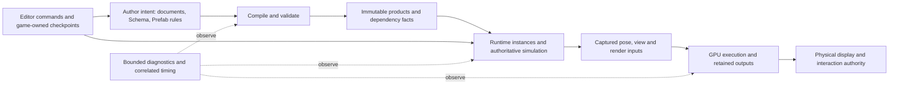

# Nara Infrastructure Compared With Bevy, Fyrox And Godot

Date: 2026-11-02. Status: CTO-oriented comparative audit and recommendations. This document
does not accept an ADR, change an implementation contract or replace the current foundation plan.

## Executive Assessment

Nara's current problem is not a lack of module boundaries or a need to replace its ECS.
It has substantial mechanisms for authoring truth, runtime identity, immutable observations,
bounded work, exact publication and physical retirement. The open question is whether those
mechanisms compose into an engine that is economical to extend, diagnose and use every day.

The reference engines supply different evidence:

- **Bevy** is the closest comparison for Rust/ECS application composition, scheduling, asset
  integration and render-world extraction. Its current development source must be inspected
  directly; an old generalization that it has no Editor work or hotpatch support is inadequate.
- **Fyrox** is the closest Rust comparison for an integrated Editor/runtime product, scene and
  property inheritance, custom UI, and concrete game/plugin reload workflows. Its narrower
  object model simplifies some workflows while carrying its own lifetime constraints.
- **Godot** is the strongest reference here for the breadth of an integrated authoring,
  platform, debugging and export product. That does not make Node inheritance, Variant storage
  or its service singletons the right runtime architecture for Nara.
- **Nara** deliberately makes several ownership/publication distinctions more explicit. This
  can protect independent Hosts, recoverable editing and retained outputs. It is not evidence
  that Nara is globally safer, faster or more mature than the references.

The recommended direction is to retain Bevy ECS and Nara's useful semantic owners, finish the
few cross-domain contracts that are expensive to change after content and tools accumulate,
and judge the remaining mechanisms through complete public consumers. Avoid both copying a
whole reference engine and designing a universal replacement for every service.

| Infrastructure | Nara's relative position in this audit | Most useful reference lesson |
| --- | --- | --- |
| ECS and execution | Strong typed substrate and explicit independent-runtime semantics; joint solver/animation joins and executor selection remain open. | Bevy's composition and borrowed execution; Fyrox/Godot's concrete frame orchestration. |
| Durable Scene/Schema | Explicit author intent, unavailable data and version/owner separation; the source/compiled split and extraction still need completion. | Fyrox's inheritance flags, Godot's pinned properties, Bevy's distinct resolved templates/world serialization. |
| Asset production | Credible bounded identity, dependency demand, captured backing and complete-group builds; automatic auxiliary-input propagation needs a complete consumer. | Bevy's maintained reverse dependencies, Godot's importer/loader/target separation, Fyrox's ordinary resource usability. |
| Rendering | Explicit version retention, independent streams and physical completion; durable materials and captured clock meaning lag behind the execution seam. | Bevy's specialization/cache states, Fyrox's effect integration, Godot's logical/physical resource separation. |
| Editor and UI | Semantic edits, source history and terminal interaction ownership exist; the custom editable frontend and general command placement remain incomplete. | Fyrox/Godot's integrated input/text/command services; current Bevy editing primitives and their documented limits. |
| Iteration and delivery | Exact artifacts and scoped source-free delivery exist; preserving a playable situation through rebuild is still a separate product task. | Fyrox's concrete reload workflow, Bevy's development profiles, Godot's template/export/debugger integration. |
| Diagnosis and qualification | Substantial bounded observations and scoped evidence, with gaps in joined diagnosis and automatic consumer enrollment. | Reusable trace/profiler consumers and visible CI lanes, not a larger collection of manual receipts. |

This is a capability/contract assessment, not a numeric maturity score. The focused chapters
provide the source evidence and limits for each row. No mechanism comparison establishes
superior runtime speed or overall reliability.

## Evidence And Reading Order

| Repository | Inspected commit | Commit date | Qualification |
| --- | --- | --- | --- |
| Nara | `a2640a10973b6d1724176a506237bc458aa5f3bc` | Pinned local HEAD | Current implementation and explicitly unfinished refactor. |
| Bevy | `ae6152152d6fb8308ad6038314b48ef295e80fbc` | 2026-10-29 | Local development checkout; not an assertion about the latest stable release. |
| Fyrox | `b5b151b603bba0549ac03db676568726f17e6807` | 2026-11-01 | Local development checkout. |
| Godot | `95c0fa5fe8a019adc29d074c16b64469b04571f7` | 2026-10-30 | Local development checkout. |

Reference repositories were read without modification or remote update. Nara pins
`bevy_ecs = 0.20.0`; the Bevy repository is comparative source, not proof that every observed
Bevy API is the exact implementation of that dependency. No benchmark or runtime acceptance
was executed in any engine for this comparative audit. Official web documentation was checked
for selected iteration/profiling claims; pinned source remains the basis of mechanism claims.

Read the focused studies for implementation paths, alternatives and counterevidence:

1. [Runtime, execution, tasks and spatial identity](runtime-and-execution.md).
2. [Assets, builds, dependencies and residency](assets-and-builds.md).
3. [Scene, Schema, Prefab and persistent evolution](scene-and-schema.md).
4. [Rendering and GPU ownership](rendering.md).
5. [Editor, custom UI and platform interaction](editor-and-platform.md).
6. [Delivery, iteration, observability and engineering economics](delivery-and-observability.md).

The [preceding refactor review](../../audits/2026-11-02-refactor-follow-up-review.md) at the same Nara HEAD
already reproduced two regressions and statically confirmed two more. This audit incorporates
their consequences without claiming to have rerun them. Current decisions and implementation
status remain in [STRATEGY](../../../STRATEGY.md), the
[ADR ledger](../../architecture/adr/implementation-status.md) and the
[foundation plan](../../plans/2026-10-23-foundation-architecture-rebaseline-plan.md).

## First Principles: What Infrastructure Must Deliver

The unit of success is a correct game-author workflow, including its failure and recovery path.
Infrastructure is valuable when it reduces the total repeated cost of those workflows.

| Obligation | The question the architecture must answer | Failure that forces later restructuring |
| --- | --- | --- |
| Truth and identity | Who owns each value, and what still denotes the same thing after edit, move, reload or restart? | Live entity IDs become persistent identity; path spelling becomes content identity; generated output becomes author intent. |
| Time and causality | Which input, pose, view and resource generation does this result represent? | Physics, animation and rendering disagree about the current frame; a stale completion publishes into a successor. |
| Transformation | What information must survive source -> compiled product -> runtime -> editing operations? | Source reconstruction loses defaults, overrides, unknown data or occurrence correspondence. |
| Resource lifetime | When can a logical owner close, and when has physical use actually finished? | Cancelling a task frees its input early; GPU submission is mistaken for completion; code unload leaves callable objects. |
| Change propagation | Which dependants are invalidated, rebuilt, migrated or merely observed? | Every edit reloads the world, or some consumers silently continue with incompatible generations. |
| Bounded cost | What work is paid at admission, per change and every frame? | Correctness checks and complete snapshots become unmeasured frame/editor stalls. |
| Diagnosis and delivery | Can an author explain failures and run the intended game outside the checkout? | Strong internal checks produce opaque errors; packaging and CI qualify different paths from ordinary use. |

The relevant optimization is not minimum code or maximum abstraction. It is the combined cost
of author iteration, extension integration, failure diagnosis/recovery and future semantic
migration, subject to correctness and supported-platform constraints. No numeric weighting or
competitor performance ranking is inferred without matched measurements.

## Do Not Confuse These Graphs

Nara needs several different relationships. They may share identifiers, but they have different
edges, update rates and owners:

- Authoring/Prefab composition: inheritance, placements, defaults and overrides.
- Asset references: whether a target must exist and remain valid.
- Current load demand: which decoded products are needed now.
- Simulation execution: which writes/reads must precede a committed tick.
- Render execution: logical resource versions and GPU-use order.
- Physical lifetime: outstanding children, queued results, native work and retained consumers.
- Contribution compatibility: what schema, code or tooling generation can interpret a value.

The completed CP3/CP4 work already demonstrates why these distinctions matter: a valid
reference need not force immediate decoded residency, and encoded backing need not be kept
in the same form as decoded products. The next high-cost mistake would be folding authored
composition into flat runtime storage, or treating every graph as an instance of one generic
transaction/scheduler kernel. See [assets](assets-and-builds.md) and
[scene semantics](scene-and-schema.md) for the actual owners.

This is an ownership map, not a demand for new crates. In particular, flat render/compiled
data does not automatically contain enough information to reconstruct authored intent.

## CTO Decisions To Make Before The Remaining Refactor Spreads

### C1 — Finish The Source/Compiled Boundary Before More Durable Editing Features

**Priority:** Architectural dependency, not a claim that unfinished CP2 is a bug.

Nara has selected separate flat compiled output, root/placement changes and explicit occurrence
correspondence in the [CP2 plan](../../plans/2026-11-02-prefab-extraction-plan.md#L3). Those
items remain unfinished. The previous review's successful-conversion/failed-reopen counterexample
shows the cost of sharing a flat result with a source-producing operation: clearing contextual
defaults is valid for one consumer and invalid for the other.

Define which authored facts survive extraction, convert-to-local, copy and unknown-module
round trips; reuse the completed CP1 schema-upgrade contract rather than redesigning it.
Define identity remapping for nested/repeated instances, not just
generated entity naming. A runtime representation may erase source information only after
source-producing consumers have their own sufficient inputs.

**Do now:** Complete one nested extraction with dependent references, contextual defaults,
overrides and dirty/closed sources. Preserve CP2's selected saved/history checkpoint after
successful publication, then test ordinary edits, their Undo and Save/Reopen. This does not
promise Undo of the cross-file extraction itself. **Do later:** General optimizations
of compiled storage after the boundary is qualified. More runtime caches cannot repair lost
source semantics. The alternatives and reference mechanisms are in [Scene and Schema](scene-and-schema.md).

### C2 — Select Pose And Execution Semantics With A Real Solver/Animation Consumer

**Priority:** Before physics/animation integrations multiply.

Nara has fixed/update stages, phase snapshots and task custody; that does not yet settle
authoritative pose arbitration, same-tick borrowed work, discontinuities or executor profiles.
The current plan explicitly leaves these open. Define input tick assignment, motion intent,
solver result, animation/root motion, authoritative pose commit and presentation interpolation
as one observable sequence. Define what teleport, parent change, pause and exact-step do to
history. Specify repeatability separately from cross-platform determinism.
Preserve the current distinction between command consumption acknowledgement and whole-tick
success: ADR0057 permits an unrelated later failure and promises no rollback. If the new joint
consumer needs a stronger finalization boundary, select and qualify it explicitly rather than
silently widening Ack into transaction durability.

**Do now:** Use one actual small solver plus animation path, test serial and selected parallel
execution with feature unification, and prove close waits for actual work return. **Do later:**
More elaborate parallel jobs or automatic phase planning when the same consumer demonstrates
their benefit. Replacing Bevy ECS or widening Tasks to every conceivable job is not supported
by current evidence. See [runtime comparison](runtime-and-execution.md).

### C3 — Make View/Material Semantics Stable Before Multiplying Render Effects

**Priority:** Before durable material/shader authoring and custom Editor consumers depend on it.

The typed-program, policy, shared stock-stage and immutable-output refactor is real progress;
the old “every effect requires a new closed backend family” diagnosis is obsolete. Non-reused
View identity, explicit history reset, typed color ports and 2D display mapping already exist.
Preserve those owners. Complete broader captured clock, exposure/color and material/shader
generation semantics, connecting new reset triggers and coordinate spaces to the existing
mechanisms rather than rebuilding them.

**Do now:** Drive one material and two-pass effect through Runtime, Scene View and offscreen,
including reload and history invalidation. The physical window's successful replacement must
also replace interaction authority, regardless of presentation entry. **Do later:** Render-graph
allocation/aliasing optimizations and additional backends based on measurements. A graph can
be structurally valid while composing semantically incompatible images. See [rendering](rendering.md).

### C4 — Treat The Custom Editor As An Interaction Product

**Priority:** Before tool authors bind their state to a new widget/frontend API.

Rendering Editor pixels is a necessary but small part of replacement. Document truth,
uncommitted edit drafts, focus, pointer capture, text composition, accessibility and Undo have
different lifetimes. Nara's semantic document/session owners are useful precisely because they
need not be reimplemented by the custom frontend.

**Do now:** One editable multilingual/numeric Inspector and one command that remains usable
with its panel closed. Exercise IME, selection/caret, failed commit, focus/window transfer,
Undo/Redo, DPI and document close while a draft exists. Keep draft/selection ownership explicit.
**Do later:** Broad widget catalogues, docking richness and theme work after that loop proves the
boundary. Fyrox/Godot's useful lesson is how many connected interaction services a real Editor
needs, not that Nara should adopt their entire node model. See [Editor and platform](editor-and-platform.md).

### C5 — Complete Rebuild/Resume Before Promising Arbitrary Native Reload

**Priority:** Product differentiation and recurring developer cost.

Restarting an admitted executable and recompiling changed code are different paths. Restoring
the situation being debugged is a third operation. The current Supervisor and game-owned
checkpoint mechanisms give Nara a practical route that does not require capturing arbitrary
ECS/native state. Define compatibility/refusal and content-generation binding now.

**Do now:** Capture a late-game situation, rebuild a body edit and restore it through the public
Host; inject compiler and restore incompatibility failures. **Do later:** Narrow safe hotpatch
or dynamic-code replacement where a real consumer and lifetime proof justify it. Fyrox's
working reload path carries constraints; Bevy's hotpatch example is not a general layout
migration promise. See [iteration evidence](delivery-and-observability.md#d1--keep-exact-build-authority-complete-situation-restoration).

### C6 — Close The Asset Change-Propagation Loop

**Priority:** Before dependent importers and native asset consumers proliferate.

Current source reload, tracked build inputs and Runtime demand are intentionally separate.
However, the inspected source graph's `record_recipe` and `add_source_dependency` callers in
the engine/consumer tree occur only in tests; its public mutation API does not automatically
connect a successful custom build to dependent refresh. Explicit rebuild detects changed inputs,
which is a different promise from changing an auxiliary file and seeing the dependent update.
Direct Image reload and Host revalidation already work in their qualified scopes; this is not
a claim that all reload is broken. The [asset study](assets-and-builds.md#1-freeze-edge-meaning-and-give-change-propagation-a-production-owner)
traces the exact distinction and the Bevy comparison.

**Do now:** Use one real custom asset with an auxiliary/optional input. Publish its dependency
observations through one owner, update/replace reverse relationships on successful change,
retain last-good on failure, and show unrelated consumers do no decode work. **Do later:**
General DAG scheduling, remote CAS or a residency policy. Those systems cannot substitute for
the missing ownership of edge publication.

### C7 — Put Complexity, Timing And Coverage Under An Observable Budget

**Priority:** Ongoing work alongside C1-C6, not a new platform rewrite.

Explicit limits and immutable owners can be sound while ordinary actions still incur excessive
work or choreography. Conversely, the size of the root Host is not sufficient evidence that
those guarantees should be removed. Measure at the consumer boundary and attribute by owner.

**Do now:** Track current edit-to-result, owner-call occupancy, frame tails, retained memory,
and the author-facing steps needed for one component/importer/command/effect. Join existing
diagnostics and GPU observations through bounded trace correlation. Enroll independent
consumers in visible CI lanes and repair feature-specific test configuration.
**Do later:** A custom profiler UI, broad caching frameworks or a general verification language.
The [delivery study](delivery-and-observability.md) explains both existing strengths and the
remaining diagnostic/feedback gap. Historical benchmark numbers are not current-HEAD evidence.

## Where The Present Mechanisms Can Accumulate Cost

These are source-established work shapes and measurement priorities, not measured frame-budget
violations. A finite allocation/work ceiling prevents unbounded growth within its policy; it
does not establish acceptable latency at the ceiling.

| Current work shape | Why it exists | Measurement that should decide the next implementation |
| --- | --- | --- |
| Spatial completion scans local values; changed input rebuilds a complete immutable candidate. | Coherent phase-specific reads and atomic candidate publication. | Static, sparse-change and full-motion scenes: scanned rows, rebuilt matrices, bytes copied and owner time. Preserve the snapshot API if a private incremental representation wins. See [runtime](runtime-and-execution.md). |
| Runtime preparation allocates some bookkeeping against total catalog size; independent acquisitions can decode independently. | Finite closure validation and independent ownership. | Fixed demanded content with increasing catalog size, then A-B-A travel with a shared atlas: scratch bytes, decode count, cancellation tail and actual release. See [assets](assets-and-builds.md). |
| Image cook/reuse performs decode and validation work even around cache hits. | Actual target/codec agreement, mutable-input revalidation and corrupt-cache rejection. | Cold/unchanged/auxiliary-change cases: bytes hashed/read, repeated decode, allocations and time. Reuse exact admitted immutable facts only when ownership proves them current for that use. |
| Unbound render versions get distinct physical storage; the admitted graph does not imply dead-work elimination. | Immutable outputs, preservation and simple completion-safe execution. | Private intermediates versus retained exports, allocation peaks and last-reader/completion intervals. Add pooling/aliasing behind the current meaning only if it materially helps. See [rendering](rendering.md). |
| Extensions declare providers, bindings, access and result ownership. | Stable meaning and independent contribution admission. | Measure ordinary component/importer/command/effect steps by author role. Hide repeated assembly through existing owners rather than weaken the boundary or add a second framework. |

The CTO question is whether the invariant needs the current mechanism's cost, not whether the
invariant should disappear. Bevy dirty propagation, Godot caches and Fyrox shared resources are
useful alternative algorithms with different freshness/lifetime assumptions; adopt a mechanism
only after the same Nara consumer retains its required meaning.

## What To Keep, What To Challenge

| Preserve unless a matched consumer disproves it | Challenge with a bounded comparison | Avoid adopting by analogy alone |
| --- | --- | --- |
| Bevy ECS substrate and ordinary typed gameplay systems. | Repeated declarations and Host choreography reaching game/contribution authors. | A custom ECS just to remove the Bevy dependency. |
| Schema as durable semantic authority, separate from native execution binding. | Where the source compiler materializes, copies or erases information across consumers. | Rust type names/layout or reflection metadata as the only persistent contract. |
| Document/session truth and prepared editing with a selected history policy. | Complete-document work on local edits, using measured cost and round-trip correctness. | Live World as the universal authoring document. |
| Separate validity, demand, backing, residency and actual native lifetime. | Retention/cancellation policies that force unrelated consumers to wait or keep resources. | One lifetime/transaction abstraction imposed on every domain. |
| Existing render Host, typed programs and retained outputs. | Durable materials, semantic image compatibility and per-view time/history cost. | A new RHI/backend rewrite before the existing seam is tested by a real effect. |
| Cargo resolution and captured executable authority. | Public iteration latency and checkpoint restoration. | A package resolver or universal stable ABI owned by the engine. |

Three strategic alternatives are worth naming. Continuing Nara's semantic layers over Bevy ECS
retains the work that differentiates its integrated authoring/Host model, but requires funding
integration and diagnostic quality. Adopting more whole Bevy subsystems could reduce maintenance
where their contracts match, but would need a proof that Nara's independent Host, document and
publication semantics survive; superficial API similarity is insufficient. Adopting a Godot/Fyrox
style scene object as the engine's universal truth would simplify some built-in workflows but
replace the selected ECS/source/runtime boundaries and create a substantial migration. Current
evidence is insufficient to overturn the selected substrate direction; this is not a measured
proof that every current upper layer minimizes cost. Assess selective reuse with the same public
consumers and the existing ADR0002 reevaluation triggers.
Even within that route, `bevy_app::App::empty()` is a legitimate bounded R4c comparison for
composition plumbing. Retaining Nara's semantic guarantees does not by itself justify retaining
every wrapper or registry implementation; the alternative must carry the same fallible seal,
phase/step behavior and close obligations before it can count as a simplification.

## Execution Order And Exit Evidence

This is advice for the existing plan, not another parallel roadmap. The list expresses
dependencies and risk, not a mandatory serial queue:

1. Repair the four concrete findings in the preceding review. Two protect authored work,
   one protects current interaction and one protects actionable diagnostics.
2. Complete C1's CP2 source/compiled and extraction consumer. Keep primitive/runtime-only
   work independent where it does not freeze incompatible source semantics.
3. Run C2's joint motion consumer, C3's material/View consumer and C6's dependent-asset consumer
   as separate work units where ownership permits; do not serialize unrelated work behind all
   of CP2. Their exact implementation order depends on the reference game's pressure.
4. Build C4's editable custom Inspector together with a clipped live Scene image on the existing
   semantic owners and qualified render Host; it need not wait for all durable material work.
   Require an independent tool consumer before freezing the broader tool-facing UI API.
5. C5's checkpoint/rebuild/restore is an independent product loop, not a successor blocked on
   completing the custom Editor. Connect it in the reference game and extend the currently
   bounded delivery path to a named native desktop target. Keep C7 measurements and required
   consumer CI active throughout.

An exit is a public workflow with real failure handling: no engine-private fixup, one selected
owner for each state, retained old work released after actual completion, reproducible diagnosis,
and persistence/reopen where applicable. Passing one native trajectory qualifies that trajectory,
not every platform or every concurrent composition.

Audio, full physics breadth, 3D, networking, rollback, browser/mobile/console and distributed
asset builds are not ranked as defects merely because the references include more of them.
The first-production strategy is a complete PC 2D game. Before promising those later domains,
require their own consumers; the contracts above should leave a place for them without pretending
to have implemented their algorithms or guarantees.

## Evidence Limits

This audit compares selected source mechanisms across four snapshots, with five parallel domain
studies, coordinating delivery/diagnostic analysis and an independent challenge of the synthesis.
That challenge clarified extraction checkpoint/Undo scope, existing View/history mechanisms and
which product loops may proceed independently. It is not an exhaustive code/security
audit, a cross-engine benchmark, a release certification or a claim that all inspected references
are bug-free. Existing Nara qualification is inherited only within the scope of its records.
The previous four regressions remain separately identified. Recommendations distinguish
present defects, intentional unfinished capabilities, structural migration risks and hypotheses
that require cost measurements.
